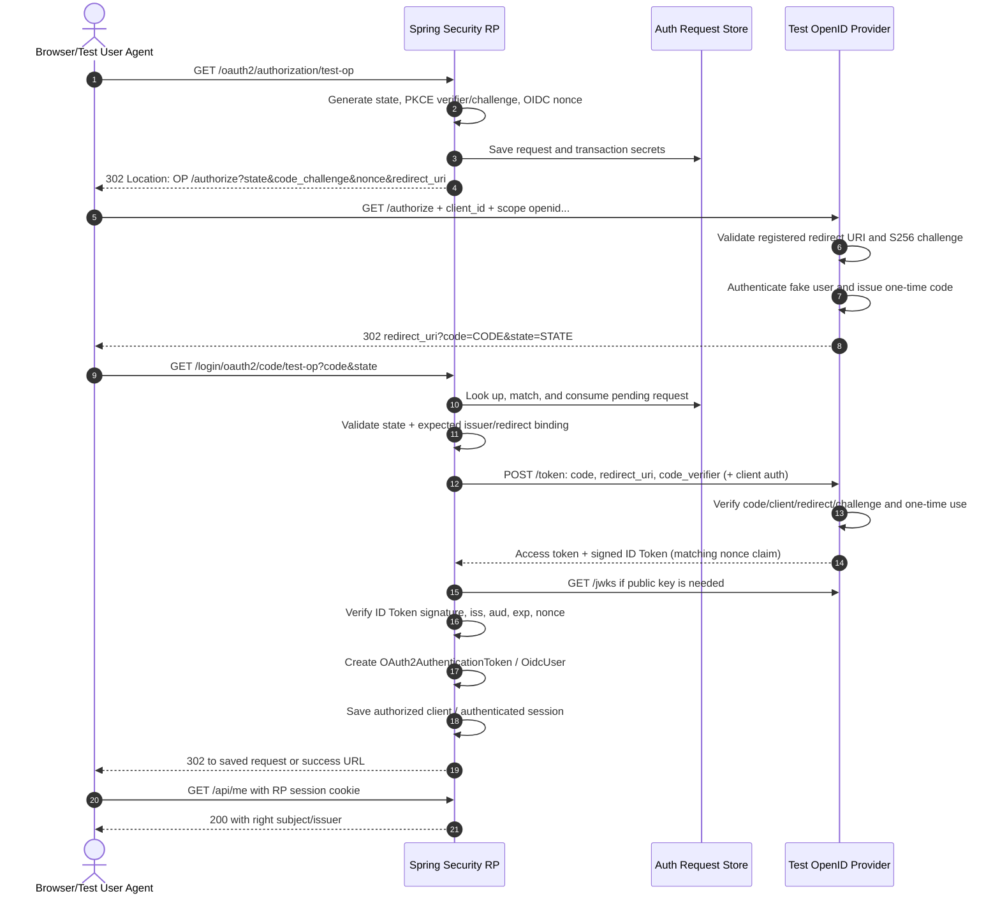
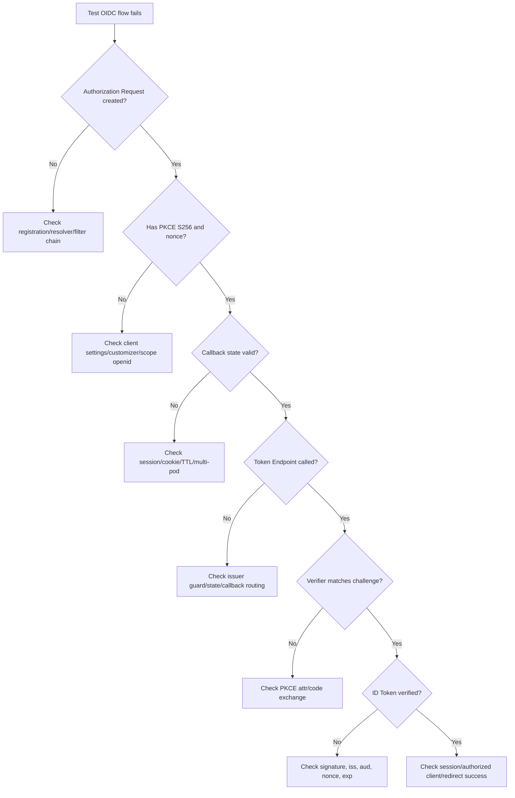

# 31.3. Testing Authorization Code Flow with PKCE and Nonce

## 1. Goal: Testing the **Full Protocol**, Not Just Creating a Mock User

A Spring Security OAuth 2.0/OIDC Client application can test controllers using:

```java
mockMvc.perform(get("/api/me").with(oidcLogin()));
```

or in Spring WebFlux:

```java
webTestClient.mutateWith(mockOidcLogin())
    .get().uri("/api/me")
    .exchange();
```

These helpers are useful when testing controllers, `SecurityContext`, and authorization rules. However, they **pre-populate an authentication** on the request. Therefore, that test **does not prove** Spring Security actually:

- Built a real authorization request.
- Generated a random `state` and saved the authorization request.
- Generated a `code_verifier` and computed the PKCE S256 `code_challenge`.
- Redirected the browser to the right OpenID Provider (OP) Authorization Endpoint.
- Sent an OIDC `nonce` and stored the information needed to verify it.
- Validated the callback `code` and `state`.
- Sent the authorization code to the right Token Endpoint with the matching `redirect_uri` and `code_verifier`.
- Verified the ID Token signature, issuer, audience, expiry, and `nonce`.
- Rejected swapped/replayed callbacks, invalid PKCE, or invalid ID Tokens.
- Saved `OAuth2AuthorizedClient` and established an authenticated session **only after all steps succeeded**.

**This lesson focuses on integration testing**: running the application's real OAuth2/OIDC security filter chain against a test Authorization Server/OP whose behavior closely matches the protocol. We can still use `MockMvc` or `WebTestClient` to send HTTP exchanges to the application, but **never use `oidcLogin()`/`mockOidcLogin()` to bypass the step under test**.

A solid test must prove both directions:

1. **Happy path:** valid `state`, valid PKCE verifier, valid `nonce`, valid issuer/audience/signature → login succeeds.
2. **Negative paths:** any single invalid element → **no authentication is created**; no token is accepted or code sent to the wrong endpoint.

### 1.1. Learning Outcomes

After this lesson, you will be able to:

1. Distinguish between controller mock tests, integration tests, and browser E2E tests.
2. Describe Authorization Code + PKCE + OIDC nonce and the data that must be retained across redirects.
3. Identify where PKCE is enabled in Spring Security Servlet and Reactive stacks.
4. Verify `code_challenge_method=S256` in the authorization request.
5. Capture and verify the real `code_verifier` in the Token Request without logging raw values.
6. Recompute the S256 challenge in tests to assert exact matching.
7. Test `state` bound to the session/browser, single-use, and replay-resistant.
8. Test OIDC nonce in the Authorization Request and ID Token response.
9. Stand up a fake OP with `/authorize`, `/token`, `/jwks`, and approved metadata.
10. Sign a test ID Token with an RSA key and serve the public JWK.
11. Test ID Tokens with invalid nonce, issuer, audience, signature, and expiration.
12. Verify `redirect_uri` and `client_id` at both endpoints.
13. Verify how callbacks are handled in Servlet `MockMvc` and Reactive `WebTestClient`.
14. Distinguish errors caused by the app, fake OP, session/cookie, proxy, or JWT validation.
15. Structure a test suite that runs reliably in CI without production credentials.

## 2. Context and Components

| Component | Responsibility |
| --- | --- |
| **Browser/User Agent** | Follows redirects, holds RP and OP cookies |
| **Relying Party (RP)** | Spring Security OAuth2/OIDC Client application |
| **Authorization Server/OpenID Provider** | Issues authorization codes, access tokens, and ID Tokens |
| **Authorization Endpoint** | Receives `client_id`, `redirect_uri`, `scope`, `state`, PKCE challenge, `nonce` |
| **Token Endpoint** | Receives code, `redirect_uri`, `code_verifier`, and proper client authentication |
| **JWKS Endpoint** | Publishes public keys for the RP to verify ID Tokens |
| **Authorization Request Repository** | Retains `state`, original nonce, PKCE verifier/attributes across browser redirects |
| **Authorized Client Repository/Service** | Saves tokens once authorization completes |
| **SecurityContext** | Holds `Authentication` after successful login |

At the moment the browser starts login, the RP **does not have an ID Token yet**. All ID Token checks happen only after the RP sends the code to the Token Endpoint and receives the Token Response.

### 2.1. Flow Under Test



In tests, the OP can be a mock server with a code store and fixed signing key, or a dedicated real OP running in CI. The degree of realism determines what the test actually proves.

## 3. Three Distinct Values: `state`, PKCE, and `nonce`

| Value | Created By? | Sent Where? | Purpose |
| --- | --- | --- | --- |
| OAuth2 `state` | RP | Authorization Request, echoed by AS on callback | Binds authorization response to transaction/browser |
| PKCE `code_verifier` | RP | Sent only to **Token Endpoint**, never to browser/AS Authorization Endpoint beforehand | Proves the party exchanging the code knows the original verifier |
| PKCE `code_challenge` | RP computed from verifier | Authorization Request | Binds the authorization code to the verifier |
| PKCE `code_challenge_method` | RP | Authorization Request | Indicates how verifier maps to challenge, preferring `S256` |
| OIDC `nonce` | RP | Authorization Request, and claim in ID Token returned by OP | Binds an ID Token to an authentication request |
| Original OIDC nonce in request store | RP | Kept in server-side pending transaction | Enables Spring Security to verify `nonce` in the ID Token |

**Never share one value across the three mechanisms.** They solve different problems:

- `state` does not replace PKCE.
- PKCE does not replace `state`.
- `nonce` is not an HTTP POST CSRF token.
- An ID Token signature does not replace `nonce`.
- An ID Token nonce does not replace issuer/audience checks.
- Mix-up protection before code exchange is an additional responsibility when a client talks to multiple ASes.

### 3.1. An Important Note on OIDC Nonce

Per OIDC Core, `nonce` is **not strictly required in pure Authorization Code Flow** in the same way as some other response types; however, it is a valuable safeguard and Spring Security typically generates `nonce` for OIDC authorization requests.

In familiar Spring Security implementations, the logic may:

1. Generate a random raw nonce.
2. Store the **raw nonce** in `OAuth2AuthorizationRequest.attributes`.
3. Compute the SHA-256/Base64URL hash of the raw nonce.
4. Send the **hashed nonce** as the `nonce` parameter to the OP.
5. After token exchange, recompute the hash from the raw nonce and compare it to the **ID Token `nonce` claim**.

**Consequence for the test OP:** if the browser-visible Authorization Request contains:

```text
nonce=NONCE_VALUE_SEEN_BY_OP
```

the OP must put **that exact value** into the ID Token's `nonce` claim per the OIDC protocol. The fake OP **must not hash the nonce a second time**, nor demand that the ID Token contain an unhashed raw nonce the OP never saw.

This is an implementation detail to verify against your actual Spring Security version; do not hardcode internal nonce storage details when you can test via the OP-facing HTTP contract.

## 4. PKCE S256 per RFC 7636

A valid `code_verifier`:

- Is randomly generated using a proper entropy source.
- Has a length of **43 to 128 characters**.
- Uses only unreserved characters: letters, digits, and the specific punctuation allowed by RFC 7636.
- Is never sent in the Authorization Request URL.
- Should not be logged or exposed to client-side JavaScript in a server-side RP.

With `S256`:

\[
\text{code\_challenge} =
\operatorname{BASE64URL\_NO\_PADDING}
\left(
\operatorname{SHA256}
\left(
\operatorname{ASCII}(\text{code\_verifier})
\right)
\right)
\]

In the Authorization Request:

```text
code_challenge=...
code_challenge_method=S256
```

In the Token Request:

```text
grant_type=authorization_code
code=...
redirect_uri=...
code_verifier=...
```

**Never send `code_verifier` directly in the Authorization Request.** Doing so defeats PKCE's protection against authorization code interception.

### 4.1. Test Helper for Computing S256

```java
import java.nio.charset.StandardCharsets;
import java.security.MessageDigest;
import java.util.Base64;

final class PkceAssertions {

    static String s256(String verifier) {
        try {
            byte[] input =
                verifier.getBytes(StandardCharsets.US_ASCII);

            byte[] digest =
                MessageDigest.getInstance("SHA-256")
                    .digest(input);

            return Base64.getUrlEncoder()
                .withoutPadding()
                .encodeToString(digest);
        }
        catch (Exception ex) {
            throw new IllegalStateException(
                "Could not calculate S256 challenge", ex);
        }
    }

    static boolean validVerifierSyntax(String value) {
        return value != null
            && value.matches("[A-Za-z0-9._~-]{43,128}");
    }
}
```

Test libraries can use JUnit/AssertJ:

```java
assertThat(PkceAssertions.validVerifierSyntax(verifier))
    .isTrue();

assertThat(PkceAssertions.s256(verifier))
    .isEqualTo(challengeFromAuthorizationRequest);
```

**Do not** include `verifier` in assertion messages when running in CI if logs are widely accessible. Have the assertion message say "PKCE challenge mismatch" instead of printing raw secrets.

### 4.2. Official RFC 7636 Vector

RFC 7636 defines a well-known test vector:

```text
code_verifier:
dBjftJeZ4CVP-mB92K27uhbUJU1p1r_wW1gFWFOEjXk

code_challenge:
E9Melhoa2OwvFrEMTJguCHaoeK1t8URWbuGJSstw-cM
```

This is public data for a test vector, **not a verifier to use in production**.

```java
@Test
void computesRfc7636S256Vector() {
    String verifier =
        "dBjftJeZ4CVP-mB92K27uhbUJU1p1r_wW1gFWFOEjXk";

    assertThat(PkceAssertions.s256(verifier))
        .isEqualTo(
            "E9Melhoa2OwvFrEMTJguCHaoeK1t8URWbuGJSstw-cM");
}
```

This unit test checks the hash computation; it **does not prove the Authorization Server enforces PKCE at the Token Endpoint**.

## 5. `state` Binds the Browser and Authorization Transaction

A typical RP stores the pending authorization request in a session or another repository. Tests must verify:

```text
Request 1:
  state=S1
  callback code=C1,state=S1 -> allowed to proceed

Request 2:
  state=S2
  callback code=C1,state=S2 -> must not be treated as the same flow

Wrong browser:
  callback code=C1,state=S1 without pending transaction -> reject
```

`state` should have entropy and be bound to the transaction/browser that initiated the request. In Servlet, `HttpSessionOAuth2AuthorizationRequestRepository` typically stores the request; in Reactive, `WebSessionOAuth2ServerAuthorizationRequestRepository` serves the corresponding role.

### 5.1. Do Not Confuse the Session Cookie with state

- The RP session cookie binds the browser to the RP session.
- `state` binds the authorization response to the saved request.
- Both may need to match for the callback to succeed.
- `state` can appear in OP/callback URLs, so redact it from HTTP logs and traces.
- The OP cookie belongs to the OP domain; it does not replace RP session/correlation.

If a callback lands on a different pod where the pending request does not exist, the RP **must reject it** rather than reconstructing an expected state from the callback parameter.

## 6. Levels of Integration Testing

Not every test needs Selenium/Playwright or a real OP.

| Level | RP | OP/AS | What It Verifies | Limitations |
| --- | --- | --- | --- | --- |
| **A — Controller slice** | MockMvc/WebTestClient + mock login principal | None | Controllers/claims/authorization | Skips code, PKCE, nonce, JWT |
| **B — RP + fake OP Token/JWKS** | Real Spring Security filters | WireMock/MockWebServer | Authorization redirect, token request, PKCE/nonce/ID Token validation | Browser callback may be simulated |
| **C — RP + programmable OP** | Real app/test context | Test OP with `/authorize`, `/token`, `/jwks` | Most front-/back-channel protocol contracts | Not production OP |
| **D — Browser + OP sandbox** | Real server | OP test instance | Cookies, redirect chains, login UX, proxy, provider-specific policy | Slower, setup-dependent |
| **E — Multi-pod/security E2E** | Multiple app instances | OP sandbox + shared store | Stateful correlation across nodes, ingress, rotation | Complex |

**This lesson primarily illustrates levels B/C**, then highlights cases that require stepping up to levels D/E.

### 6.1. What Not to Mock If You Want to Test PKCE/Nonce

Do not write:

```java
.with(oidcLogin())
```

and conclude PKCE works. Do not replace the entire OAuth2 authentication provider with a stub that always returns "success." Do not skip `JwtDecoder` or accept an unsigned ID Token in a suite claiming to verify signature/nonce validation.

You may mock dependencies **outside scope**, such as business databases, email notifiers, or downstream reporting APIs.

## 7. Dependencies for Servlet Integration Tests

Gradle example:

```gradle
dependencies {
    implementation 'org.springframework.boot:spring-boot-starter-web'
    implementation 'org.springframework.boot:spring-boot-starter-security'
    implementation 'org.springframework.boot:spring-boot-starter-oauth2-client'

    testImplementation 'org.springframework.boot:spring-boot-starter-test'
    testImplementation 'org.springframework.security:spring-security-test'

    // Choose an HTTP stub server:
    testImplementation 'com.github.tomakehurst:wiremock-jre8:<compatible-version>'
    // Or MockWebServer per the project's dependency BOM.

    // If using Nimbus APIs to create signed test ID Tokens:
    testImplementation 'com.nimbusds:nimbus-jose-jwt'
}
```

`<compatible-version>` is a placeholder; do not paste it verbatim into your build. WireMock artifact coordinates/versions differ across major versions—for example, WireMock 3 uses different distributions; choose **a dependency compatible with the Spring Boot BOM**, without pulling conflicting versions simultaneously.

With Maven, the corresponding dependencies typically include:

```xml
<dependency>
  <groupId>org.springframework.security</groupId>
  <artifactId>spring-security-test</artifactId>
  <scope>test</scope>
</dependency>
```

plus an HTTP stub server/JWT signer for tests.

### 7.1. Reactor/WebFlux

Reactive applications replace `spring-boot-starter-web` with:

```gradle
implementation 'org.springframework.boot:spring-boot-starter-webflux'
testImplementation 'io.projectreactor:reactor-test'
```

Correspondingly, use `SecurityWebFilterChain`, `WebTestClient`, `ReactiveClientRegistrationRepository`, and reactive token exchange APIs. Avoid mixing Servlet and Reactive security configurations in the same test context.

### 7.2. Never Take Real Client Secrets or Signing Keys

Use:

- A dedicated test `client_id`.
- A fake `client_secret` if testing a confidential client.
- An RSA key pair that exists only within the test process.
- A fake access token strictly for OAuth2Client integration tests.
- A test identity `sub=user-123` with a `.test` domain or localhost.
- Never connect to a production OP during CI runs.

Never commit a real `refresh_token`, OP private keys, or secret manager credentials to the repository.

## 8. A `ClientRegistration` Used in Tests

With Spring Security 6.5+ or newer releases supporting `ClientRegistration.ClientSettings`, you can define a **public OAuth2 Client** requiring PKCE:

```java
static ClientRegistration testRegistration(
        URI fakeOpBaseUrl) {

    return ClientRegistration
        .withRegistrationId("test-op")
        .clientId("portal-integration-test")
        .clientAuthenticationMethod(
            ClientAuthenticationMethod.NONE)
        .authorizationGrantType(
            AuthorizationGrantType.AUTHORIZATION_CODE)
        .redirectUri(
            "{baseUrl}/login/oauth2/code/{registrationId}")
        .scope("openid", "profile")
        .issuerUri("https://issuer.example.test")
        .authorizationUri(
            fakeOpBaseUrl.resolve("/authorize").toString())
        .tokenUri(
            fakeOpBaseUrl.resolve("/token").toString())
        .jwkSetUri(
            fakeOpBaseUrl.resolve("/jwks").toString())
        .clientSettings(
            ClientRegistration.ClientSettings.builder()
                .requireProofKey(true)
                .build())
        .clientName("Test OIDC Provider")
        .build();
}
```

**Explanation:**

- `client-authentication-method=none`: public client using no `client_secret` at the Token Endpoint.
- `requireProofKey(true)`: instructs Spring Security to generate a PKCE proof key. This API appeared in Spring Security **6.5 onward**; projects on older versions may need `OAuth2AuthorizationRequestCustomizers.withPkce()` on the resolver.
- `scope=openid`: the flow is handled as OIDC Login rather than plain OAuth2 Login.
- `issuerUri`: the **logical** issuer of the test OP used to validate the ID Token.
- `authorizationUri`/`tokenUri`/`jwkSetUri`: test endpoints provided by the fake server.
- `redirectUri`: the RP's callback URI; in tests it must match the actual request.

Here, the HTTPS `issuerUri` can differ from the HTTP loopback URLs of the fake endpoints. This separation is **only suitable for test fixtures with explicitly approved trust**; production requires valid issuer/metadata/endpoints per OP and TLS/egress policies. Never use arbitrary HTTP token/JWKS endpoints in production.

### 8.1. Automatic PKCE Enablement and Version Compatibility

Per Spring Security documentation, public clients typically enable PKCE automatically when:

```text
clientSecret = omitted/empty
clientAuthenticationMethod = none
```

For confidential clients, PKCE can be enabled via `requireProofKey(true)` when supported by the version, or via a custom authorization request resolver.

Do not write tests asserting **"public client → definitely S256"** without inspecting the actual `Location`. Dependency upgrades or custom resolvers can change behavior; the contract must be tested.

### 8.2. Confidential Clients Should Still Be Tested with PKCE

PKCE does not replace `client_secret`/mTLS/private key JWT in a confidential-client flow, and client authentication **does not replace PKCE**.

A confidential registration:

```java
ClientRegistration
    .withRegistrationId("test-confidential")
    .clientId("portal-backend-test")
    .clientSecret("FAKE_TEST_SECRET")
    .clientAuthenticationMethod(
        ClientAuthenticationMethod.CLIENT_SECRET_BASIC)
    .authorizationGrantType(
        AuthorizationGrantType.AUTHORIZATION_CODE)
    .redirectUri(
        "{baseUrl}/login/oauth2/code/{registrationId}")
    .scope("openid", "profile")
    .issuerUri("https://issuer.example.test")
    .authorizationUri(fakeAuthUri)
    .tokenUri(fakeTokenUri)
    .jwkSetUri(fakeJwksUri)
    .clientSettings(
        ClientRegistration.ClientSettings.builder()
            .requireProofKey(true).build())
    .build();
```

For Spring Security versions without `ClientSettings`, configure the resolver:

```java
DefaultOAuth2AuthorizationRequestResolver resolver =
    new DefaultOAuth2AuthorizationRequestResolver(
        registrations, "/oauth2/authorization");

resolver.setAuthorizationRequestCustomizer(
    OAuth2AuthorizationRequestCustomizers.withPkce());
```

Then pass `resolver` into `oauth2Login().authorizationEndpoint(...)` per your version's Servlet DSL. Using `withPkce()` alone can overwrite another existing customizer; if the app also adds `prompt`, `audience`, or resource indicators, **compose** the customizers explicitly and test them.

## 9. Spring Security Servlet: Testing the Real SecurityFilterChain

A simple test OIDC Login configuration:

```java
@Configuration
class TestServletSecurity {

    @Bean
    ClientRegistrationRepository clientRegistrationRepository(
            TestOpFixture op) {
        return new InMemoryClientRegistrationRepository(
            testRegistration(op.baseUri()));
    }

    @Bean
    SecurityFilterChain securityFilterChain(
            HttpSecurity http) throws Exception {

        return http
            .authorizeHttpRequests(auth -> auth
                .requestMatchers("/api/public").permitAll()
                .anyRequest().authenticated())
            .oauth2Login(Customizer.withDefaults())
            .build();
    }
}
```

`TestOpFixture` is an **application-authored test class** managing the fake OP. It is not a built-in Spring Security bean.

The test must load the actual OAuth2 Login filter chain, for example:

```java
@SpringBootTest
@AutoConfigureMockMvc
class AuthorizationCodePkceNonceIT {

    @Autowired
    MockMvc mvc;

    // Fake OP fixture, signing key, token request recorder...
}
```

If a test uses `@WebMvcTest` and replaces the security chain with `httpBasic()`, it can test controllers, **but no longer tests the Authorization Code Flow**.

### 9.1. Two Important Routes

By default when using Servlet OAuth2 Login:

```text
Start authorization:
  GET /oauth2/authorization/{registrationId}

Receive callback:
  GET /login/oauth2/code/{registrationId}
```

If you customize the base URI, update `redirectUri` and the registration at the OP in sync. Never hardcode a callback path in tests that differs from the actual configuration.

### 9.2. Why Must the Fake OP Run Before Creating the Repository Bean?

`ClientRegistration` needs the real URLs of the fake server:

```text
http://127.0.0.1:<ephemeral-port>/authorize
http://127.0.0.1:<ephemeral-port>/token
http://127.0.0.1:<ephemeral-port>/jwks
```

If the test context creates the bean before the stub server binds a port, you will end up with `:0` or the wrong port.

You can use:

- A JUnit fixture started via `@DynamicPropertySource`/an appropriate test context initializer.
- A test configuration factory starting the fake server tied to the Spring context lifecycle.
- `@Testcontainers`/an OP sandbox service whose address is known before bean initialization.
- A full test application context with injected fake OP properties.

If the test uses `@DynamicPropertySource`, those properties must actually be referenced during bean creation, not merely logged in test output.

## 10. Reactive WebFlux: Testing the Real SecurityWebFilterChain

WebFlux uses:

```java
@Configuration
@EnableWebFluxSecurity
class TestReactiveSecurity {

    @Bean
    ReactiveClientRegistrationRepository registrations(
            TestOpFixture op) {

        return new InMemoryReactiveClientRegistrationRepository(
            testRegistration(op.baseUri()));
    }

    @Bean
    SecurityWebFilterChain chain(ServerHttpSecurity http) {
        return http
            .authorizeExchange(exchanges -> exchanges
                .pathMatchers("/api/public").permitAll()
                .anyExchange().authenticated())
            .oauth2Login(Customizer.withDefaults())
            .build();
    }
}
```

Reactive tests can use:

```java
@SpringBootTest(
    webEnvironment = SpringBootTest.WebEnvironment.MOCK)
@AutoConfigureWebTestClient
class ReactiveAuthorizationCodeIT {

    @Autowired
    ApplicationContext context;

    WebTestClient client;

    @BeforeEach
    void setUp() {
        client = WebTestClient.bindToApplicationContext(context)
            .apply(springSecurity())
            .configureClient()
            .build();
    }
}
```

When testing the **real Authorization Code Flow**, **do not** use:

```java
client.mutateWith(mockOidcLogin())
```

in the authorization initiation/callback test; this helper pre-populates OIDC Authentication and skips the flow under test.

### 10.1. Reactive PKCE Setup

With a public client or `requireProofKey(true)` on supported versions, PKCE can be enabled on the registration. On older versions or custom scenarios:

```java
DefaultServerOAuth2AuthorizationRequestResolver resolver =
    new DefaultServerOAuth2AuthorizationRequestResolver(
        reactiveClientRegistrationRepository);

resolver.setAuthorizationRequestCustomizer(
    OAuth2AuthorizationRequestCustomizers.withPkce());
```

Pass the resolver into `ServerHttpSecurity`'s `oauth2Login()` via the matching configuration method for your Spring Security version. The resolver classes are **Reactive**; never use Servlet's `DefaultOAuth2AuthorizationRequestResolver` inside `SecurityWebFilterChain`.

### 10.2. Reactor Context and Session Correlation

WebFlux stores authentication in the Reactor Context; the temporary authorization request is typically held via WebSession and the `SESSION` cookie.

A test that runs one exchange and drops the cookie/session cannot reproduce the callback. **Propagate the session cookie** or use a test browser client with a proper cookie jar. `WebTestClient` does not automatically act as a full browser preserving all cookies/redirects.

## 11. What Does a Fake OP Need to Simulate?

A fake OP capable of testing Authorization Code + PKCE + nonce does not just return:

```json
{"access_token":"anything"}
```

At minimum, it should simulate:

| Endpoint | Input | Behavior |
| --- | --- | --- |
| `/.well-known/openid-configuration` if discovery is used | GET | Return configured test issuer and endpoints |
| `/authorize` | GET with client_id, redirect_uri, state, code_challenge, nonce, scope | Validate and issue a one-time authorization code |
| `/token` | POST authorization_code grant | Validate code, client, redirect_uri, code_verifier, grant |
| `/jwks` | GET | Return public RSA key used to sign ID Tokens |
| `/userinfo` if used by the app | GET access token | Return claims; `sub` must match ID Token |
| `/error`/invalid response scenarios | Per test | Return controlled OAuth2/OIDC errors |

For tests focused on the RP filter chain, you can **simulate the browser callback** without actually calling `/authorize` through a browser. Still, the fake OP must store a record representing code issuance to validate PKCE at `/token`.

### 11.1. Whose Responsibility Are State and Nonce?

- The AS **echoes** `state` in the authorization response if the RP sent it.
- The AS puts `nonce` from the Authorization Request as a claim in the ID Token.
- The AS binds the code to `client_id`, `redirect_uri`, PKCE challenge, scope, subject, and expiry.
- The RP compares `state` and verifies the ID Token `nonce`.
- The fake OP must never "help" the RP by treating an unrequested `state` as valid.

### 11.2. Need a One-Time Code Store

Example internal test record:

```java
record IssuedAuthorizationCode(
    String code,
    String clientId,
    String redirectUri,
    String codeChallenge,
    String codeChallengeMethod,
    String requestedNonce,
    String subject,
    Instant expiresAt) {}
```

When the Token Endpoint receives a code, the fake OP should consume it atomically:

```text
issuedCodes.remove(code)
```

before evaluating further. Missing/expired/already-used code → `invalid_grant`.

A fake OP that always returns a token for every code **will not properly test PKCE or one-time use**.

## 12. Designing a Test Fixture with an HTTP Stub Server

You can use WireMock, OkHttp MockWebServer, or a test Spring Authorization Server. An illustrative architecture:

```text
JUnit 5 Test Class
    |
    +-- RP Spring ApplicationContext
    |     +-- Real OAuth2 Login filter chain
    |     +-- ClientRegistration(test-op)
    |     +-- Session / Auth Request Repository
    |     +-- Real JWT decoder / OIDC validators
    |
    +-- Fake OP HTTP Server
          +-- /authorize
          +-- /token
          +-- /jwks
          +-- issued-code store
          +-- token request recorder
          +-- RSA private signing key
          +-- scenario flags: wrong nonce/issuer/audience...
```

These dependencies are **test-only**. Do not spin up a real browser just to read a 302's query parameters when the integration scope allows simulating the redirect.

### 12.1. WireMock or MockWebServer?

| Tool | Advantages | Notes |
| --- | --- | --- |
| WireMock | Stub request matching, scenarios, verification, templating | Dynamic token responses/challenge validation may need a transformer/custom extension |
| MockWebServer | Records HTTP requests, write dynamic Dispatcher | Must write OAuth2 token validation/code store yourself |
| Spring Authorization Server test | Closer to real protocol behavior | Complex setup, needs client/keys/user store |
| Keycloak/IdP test container | Provider-specific behavior closer to production | Runs slower, requires configuring realms, clients, credentials |
| Dedicated OP sandbox | Tests compatibility with real IdP | Network/reliability, lifecycle, and access controls |

You do not need all of them; pick one tool per test tier. **Never use a real production OP** in default unit/integration CI tests.

## 13. Creating a Signed ID Token for Testing

To prove the RP actually verifies the ID Token, the fake OP should generate a **signed JWT**, with its public key served at the JWKS endpoint.

Example using Nimbus JOSE + JWT (illustrative code; add the matching Nimbus imports):

```java
RSAKey key = new RSAKeyGenerator(2048)
    .keyID("test-signing-key-1")
    .generate();

JWKSet publicKeys = new JWKSet(key.toPublicJWK());

String jwksJson = publicKeys.toString();
```

Use the private key in the test fixture to sign:

```java
static String signedIdToken(
        RSAKey signingKey,
        String issuer,
        String clientId,
        String subject,
        String nonceClaim,
        Instant now) throws Exception {

    JWTClaimsSet claims = new JWTClaimsSet.Builder()
        .issuer(issuer)
        .subject(subject)
        .audience(clientId)
        .issueTime(Date.from(now))
        .expirationTime(Date.from(now.plusSeconds(300)))
        .claim("nonce", nonceClaim)
        .build();

    JWSHeader header = new JWSHeader.Builder(
        JWSAlgorithm.RS256)
        .keyID(signingKey.getKeyID())
        .type(JOSEObjectType.JWT)
        .build();

    SignedJWT jwt = new SignedJWT(header, claims);
    jwt.sign(new RSASSASigner(signingKey.toPrivateKey()));

    return jwt.serialize();
}
```

Here:

- The key has a `kid` so the JWKS resolver picks the right key.
- The header declares RS256.
- ID Token `iss` must match the expected issuer.
- ID Token `aud` must contain the RP's `client_id`.
- `iat`/`exp` are valid.
- `sub` has a non-empty value.
- `nonce` must equal **the nonce the OP received in the Authorization Request**.
- Test tokens are signed with the private key whose public key is served at the JWKS endpoint.

When using OIDC UserInfo, the fake `/userinfo` endpoint must return a `sub` matching the ID Token to avoid introducing unrelated failures.

### 13.1. Testing Signature Failure

Create an ID Token signed with a different RSA private key, while the JWKS endpoint still returns the public key of the original key.

Expected:

```text
Callback does not lead to an authenticated session.
OIDC validation fails.
Access/refresh tokens are not accepted.
SecurityContext remains anonymous/unauthenticated.
```

Do not "mock JwtDecoder to always return a JWT" in this test, because doing so prevents testing signature failures.

### 13.2. Testing Issuer and Audience

Generate a signed ID Token with:

```json
{
  "iss": "https://other-issuer.example.test",
  "sub": "user-42",
  "aud": "portal-integration-test"
}
```

or:

```json
{
  "iss": "https://issuer.example.test",
  "sub": "user-42",
  "aud": "other-client"
}
```

Expected: **login is rejected**, even though the signature is valid.

The OIDC Client's ID Token `aud` is the **RP's client ID**. Do not confuse it with the `aud` of a downstream access token intended for a Resource Server.

## 14. Token Response from the Fake OP

When code/verifier/client/redirect_uri are valid, the Token Endpoint can return:

```http
HTTP/1.1 200 OK
Content-Type: application/json
Cache-Control: no-store
Pragma: no-cache

{
  "access_token": "FAKE_OPAQUE_ACCESS_TOKEN",
  "token_type": "Bearer",
  "expires_in": 300,
  "scope": "openid profile",
  "id_token": "SIGNED_TEST_ID_TOKEN_JWT"
}
```

`SIGNED_TEST_ID_TOKEN_JWT` is an example placeholder; an actual test run must replace it with a **signed** JWT string as shown in Section 13.

In the OIDC Authorization Code flow, having an ID Token in the Token Response is a key requirement. If `id_token` is missing during OIDC login, the client must treat the flow as invalid per the contract.

**Never use**:

```json
{
  "id_token": "hello-world"
}
```

and disable JWT validation just to make tests pass. Doing so fails to test nonce/issuer/audience/signature checks.

### 14.1. What the Fake Token Endpoint Needs to Check

Suppose it receives:

```text
grant_type=authorization_code
code=CODE123
redirect_uri=https://portal.example.test/login/oauth2/code/test-op
code_verifier=VERIFIER_SECRET
client_id=portal-integration-test
```

The fake OP:

1. Parses the request as `application/x-www-form-urlencoded`.
2. Verifies the grant type.
3. Looks up and **consumes the one-time code**.
4. Checks client ID/client authentication per registration.
5. Compares **exact** `redirect_uri` against the value saved when issuing the code.
6. Verifies the recorded challenge method is `S256`.
7. Computes `S256(code_verifier)` and compares it with the saved challenge.
8. If mismatched → returns `invalid_grant`/appropriate error, **never issuing tokens**.
9. If valid → issues access token and signed ID Token containing the authorization request's `nonce`.

Never turn the fake OP into a "server that always returns 200," as that hides RP PKCE bugs.

## 15. Servlet: Capturing the Authorization Request from MockMvc

A test begins the flow:

```java
MvcResult start = mvc.perform(
        get("/oauth2/authorization/test-op")
            .secure(true)
            .scheme("https")
            .serverName("portal.example.test")
            .serverPort(443))
    .andExpect(status().is3xxRedirection())
    .andExpect(header().exists(HttpHeaders.LOCATION))
    .andReturn();

String location = start.getResponse()
    .getHeader(HttpHeaders.LOCATION);
```

`location` must point to the fake OP's **Authorization Endpoint**. It contains the query parameters under test, though never log the raw Location when it includes `state`, `nonce`, `code_challenge`, or sensitive data.

### 15.1. Parsing Query Parameters Exactly Once

An illustrative test helper:

```java
static Map<String, List<String>> parseFormQuery(String location) {
    String rawQuery = URI.create(location).getRawQuery();

    if (rawQuery == null) {
        return Map.of();
    }

    Map<String, List<String>> values =
        new LinkedHashMap<>();

    for (String part : rawQuery.split("&")) {
        String[] pair = part.split("=", 2);

        String key = URLDecoder.decode(
            pair[0], StandardCharsets.UTF_8);

        String value = URLDecoder.decode(
            pair.length == 2 ? pair[1] : "",
            StandardCharsets.UTF_8);

        values.computeIfAbsent(
            key, ignored -> new ArrayList<>()).add(value);
    }

    return values;
}

static String one(
        Map<String, List<String>> params,
        String key) {

    List<String> values = params.get(key);

    if (values == null || values.size() != 1) {
        throw new AssertionError(
            "Expected exactly one value for " + key);
    }

    return values.get(0);
}
```

`URLDecoder` fits form query encoding in this example. A production/test parsing library can replace it; the goal is to **avoid double-decoding** and detect **duplicate parameters**.

Usage:

```java
var query = parseFormQuery(location);

String clientId = one(query, "client_id");
String redirectUri = one(query, "redirect_uri");
String state = one(query, "state");
String challenge = one(query, "code_challenge");
String method = one(query, "code_challenge_method");
String nonce = one(query, "nonce");
```

### 15.2. Mandatory Assertions at This Step

```java
assertThat(clientId)
    .isEqualTo("portal-integration-test");

assertThat(redirectUri)
    .isEqualTo(
        "https://portal.example.test/login/oauth2/code/test-op");

assertThat(one(query, "response_type"))
    .isEqualTo("code");

assertThat(one(query, "scope"))
    .contains("openid");

assertThat(state)
    .isNotBlank();

assertThat(nonce)
    .isNotBlank();

assertThat(method)
    .isEqualTo("S256");

assertThat(challenge)
    .matches("[A-Za-z0-9_-]+");
```

**Do not** print `state`/`nonce`/challenge on assertion failure. If your assertion framework prints actual values by default, account for your test CI security logging policy.

### 15.3. Asserting "No Verifier Sent on the Front Channel"

```java
assertThat(query)
    .doesNotContainKey("code_verifier");
```

This is a valuable security assertion. The PKCE verifier is a secret **sent only at the Token Endpoint**, never on the authorization redirect URL.

## 16. Preserving Session from Initiation to Callback in Servlet

In MockMvc, two separate test requests do not automatically carry cookies/sessions like a real browser unless test setup passes them along.

After the login initiation request:

```java
MockHttpSession session =
    (MockHttpSession) start.getRequest().getSession(false);

assertThat(session).isNotNull();
```

Simulating the browser returning to the callback while **keeping the exact session**:

```java
MvcResult callback = mvc.perform(
        get("/login/oauth2/code/test-op")
            .session(session)
            .secure(true)
            .scheme("https")
            .serverName("portal.example.test")
            .serverPort(443)
            .param("code", "FAKE_ONE_TIME_CODE")
            .param("state", state))
    .andReturn();
```

In a real flow, `FAKE_ONE_TIME_CODE` must be the code issued by the fake OP and stored alongside the challenge/nonce observed in the authorization request.

If a test uses a `MockMvc` session object that gets invalidated/rotated after successful login, retrieve the **new** session/cookie from the response before testing protected routes. Spring Security typically performs session fixation protection; do not assume the session ID before and after login stays identical.

### 16.1. Why Not Fill In a Fixed `state` Manually?

In a happy-path integration test, extract `state` **from the real `Location`** generated by Spring Security. Hardcoding:

```text
state=123
```

without initiating a matching authorization request must cause the callback to fail.

A test that directly mutates the request repository to plant an arbitrary state may suit an **internal unit test**, but it does not verify front-channel generation.

## 17. Issuing a Code from the Observed Authorization Request in the Fake OP

A fixture can accept the parameters after the test parses the URL:

```java
record AuthorizationRequestObserved(
    String clientId,
    String redirectUri,
    String state,
    String codeChallenge,
    String challengeMethod,
    String nonce) {}
```

Fake OP issues a code:

```java
String code = fakeOp.issueCode(
    new AuthorizationRequestObserved(
        clientId,
        redirectUri,
        state,
        challenge,
        method,
        nonce),
    "test-subject-42");
```

`fakeOp.issueCode(...)` is a **custom test API**, not a built-in Spring Security API. Its implementation must store the one-time code along with challenge/client/redirect/nonce.

Then the callback sends that exact `code` and `state`.

### 17.1. The Fake OP Must Echo State Intact

Authorization response:

```http
HTTP/1.1 302 Found
Location: https://portal.example.test/login/oauth2/code/test-op?code=CODE123&state=STATE123
```

If the OP supports RFC 9207, it can include `iss` in the authorization response:

```text
iss=https%3A%2F%2Fissuer.example.test
```

The client should validate `iss` against the selected issuer **before the Token Endpoint** or apply another mix-up defense when dealing with multiple ASes.

Do not generate a new `state` inside the fake OP.

### 17.2. Authorization Error

Also test:

```text
error=access_denied
state=SAME_PENDING_STATE
```

Expected: login fails cleanly in a controlled manner, with **no** Token Endpoint request. If the provider supports RFC 9207, validate/apply `iss` on authorization errors per the contract.

## 18. Verifying the Token Request Actually Contains the PKCE Verifier

After the callback, the fake OP recorder must contain a request:

```http
POST /token HTTP/1.1
Content-Type: application/x-www-form-urlencoded

grant_type=authorization_code&
code=CODE123&
redirect_uri=https%3A%2F%2Fportal.example.test%2Flogin%2Foauth2%2Fcode%2Ftest-op&
code_verifier=...
```

Parse the form body the same way query parameters are parsed (with a utility tailored for form bodies).

Assertions:

```java
assertThat(one(tokenForm, "grant_type"))
    .isEqualTo("authorization_code");

assertThat(one(tokenForm, "code"))
    .isEqualTo(code);

assertThat(one(tokenForm, "redirect_uri"))
    .isEqualTo(redirectUri);

String verifier = one(tokenForm, "code_verifier");

assertThat(PkceAssertions.validVerifierSyntax(verifier))
    .isTrue();

assertThat(PkceAssertions.s256(verifier))
    .isEqualTo(challenge);
```

**The most important check:** compare **the challenge in the front-channel request** against **the verifier in the back-channel token request**. Merely asserting "a verifier parameter exists" is insufficient: the client might send the verifier from the wrong transaction.

### 18.1. The Token Request Must Reach the Right OP

In addition to PKCE, assert:

```text
Token Endpoint host/port = approved test OP.
HTTP method = POST.
Content-Type = application/x-www-form-urlencoded.
client_id/client authentication = per registration.
redirect_uri = URI used when initiating the flow.
```

In confidential client tests, verify `client_secret_basic` or the corresponding authentication method **without logging the secret**. In public client tests, do not expect `client_secret` to be present.

### 18.2. A Different Verifier Must Be Rejected by the Fake OP

After issuing a code with a saved challenge:

```text
code_verifier = wrong-value-with-valid-syntax...
```

The fake OP must return an appropriate error and issue no tokens.

This is a **test of the fake OP / integrated server behavior**. To verify the RP does not swap verifiers, normal flow tests verify S256 matches. Negative tests can alter the pending authorization request in a *test-only setup* or adjust the fake OP response policy to simulate a verifier mismatch.

## 19. ID Token Nonce: Must Echo **the Value Sent to the OP**

Suppose Spring Security produces:

```text
Authorization Request:
    nonce=VISIBLE_NONCE_N1
```

The fake OP issues an ID Token containing:

```json
{
  "iss": "https://issuer.example.test",
  "sub": "test-subject-42",
  "aud": "portal-integration-test",
  "nonce": "VISIBLE_NONCE_N1"
}
```

**Do not** put:

```json
"nonce": "UNHASHED_SERVER_SIDE_NONCE"
```

if the OP never received that value, and **do not** hash `VISIBLE_NONCE_N1` a second time.

### 19.1. Relationship Inside Spring Security

Conceptual model:

```text
RP internal:
    rawNonce = random()
    publicNonce = BASE64URL(SHA256(rawNonce))

RP Authorization Request:
    nonce=publicNonce

RP saved authorization request:
    attribute nonce=rawNonce

OP ID Token:
    nonce=publicNonce

RP validation:
    BASE64URL(SHA256(saved rawNonce))
        == ID Token nonce
```

This is behavior implemented by several Spring Security versions. **Tests should bind via the protocol-observed nonce**, rather than relying on fixtures reading private implementation fields.

### 19.2. Why Is Nonce Different from State?

| Value | Where Does the Test Get It? | What Is It Compared Against? |
| --- | --- | --- |
| State | Authorization redirect URL | Authorization response `state` |
| PKCE challenge | Authorization redirect URL | S256 of Token Request verifier |
| OIDC nonce | Authorization redirect URL | Signed ID Token `nonce` |

All three must be **tied to the same authorization transaction**, never mixing values from two different flows.

## 20. Happy-Path Integration Test: Structuring with Given–When–Then

### Given

- An approved OIDC `ClientRegistration` `test-op`.
- A public client or confidential client configured to **require PKCE S256**.
- A fake OP with `/authorize`, `/token`, and `/jwks`.
- A test RSA key pair; the fake OP holds the private key while the RP only sees the public JWKS.
- The OP has a fixed issuer `https://issuer.example.test`.
- The RP has its real `SecurityFilterChain` and authorization request repository.
- Controller `/api/me` permits only authenticated users.

### When — Initiation

1. Request `GET /oauth2/authorization/test-op`.
2. Assert redirect to the fake OP's `/authorize`.
3. Parse `client_id`, `redirect_uri`, `state`, `code_challenge`, `code_challenge_method`, and `nonce`.
4. Assert `scope` includes `openid`.
5. Assert S256, non-blank nonce/state, and no `code_verifier` on the front channel.

### When — OP and Callback

1. Fake OP stores the code record with clientId/redirectUri/challenge/nonce.
2. Fake OP configures the Token Endpoint to return a signed ID Token with the observed nonce.
3. Browser/test callback hits the RP with `code`, the same `state`, and the RP session.
4. RP calls the right Token Endpoint.
5. Fake OP verifies the verifier and redirect/client binding.
6. RP verifies the ID Token via JWKS.

### Then

- The Token Endpoint receives **exactly one** valid token request.
- `S256(code_verifier)` equals the observed challenge.
- The ID Token nonce is accepted.
- The RP creates `OAuth2AuthenticationToken`/`OidcUser`.
- The protected route returns the expected subject/issuer.
- `OAuth2AuthorizedClient` is saved if the app configures persistence.
- No code/verifier/access token/ID Token/secret appears in logs.
- Replaying the callback does not produce another successful login.

### 20.1. Do Not Assert Only a 302

After login, Spring Security typically returns `302` to the saved request or `/`. A successful redirect **does not guarantee** an authenticated session if success/failure handlers are customized.

Test a subsequent request:

```text
GET /api/me with post-login session
    → HTTP 200
    → subject = test-subject-42
    → issuer = expected issuer
```

Also verify the fake Token Endpoint was called and the verifier matched. This is far stronger evidence than a standalone 302 response.

## 21. A Test Skeleton for the Full Servlet Flow

The example below outlines a JUnit structure; `FakeOp`, `FakeCode`, and `CapturedTokenRequest` are **test fixtures you must implement**, not Spring Security classes. When applying this to a project, supply the imports, test configuration, and fixture implementation.

```java
@SpringBootTest
@AutoConfigureMockMvc
class AuthorizationCodePkceNonceIT {

    @Autowired
    MockMvc mvc;

    @Autowired
    FakeOp op;

    @Test
    void exchangesCodeWithMatchingPkceAndNonce()
            throws Exception {

        // 1. RP issues a real Authorization Request.
        MvcResult start = mvc.perform(
                get("/oauth2/authorization/test-op")
                    .secure(true)
                    .scheme("https")
                    .serverName("portal.example.test")
                    .serverPort(443))
            .andExpect(status().is3xxRedirection())
            .andReturn();

        String location = start.getResponse()
            .getHeader(HttpHeaders.LOCATION);

        var params = parseFormQuery(location);

        String state = one(params, "state");
        String nonce = one(params, "nonce");
        String redirectUri = one(params, "redirect_uri");
        String challenge = one(params, "code_challenge");

        assertThat(one(params, "code_challenge_method"))
            .isEqualTo("S256");

        assertThat(params).doesNotContainKey("code_verifier");

        // 2. Keep the same browser/RP session.
        MockHttpSession session =
            (MockHttpSession) start.getRequest()
                .getSession(false);

        assertThat(session).isNotNull();

        // 3. Fake OP issues a code bound to challenge/nonce.
        FakeCode code = op.issueAuthorizationCode(
            one(params, "client_id"),
            redirectUri,
            challenge,
            nonce,
            "test-subject-42");

        // 4. RP executes callback, token exchange,
        //    JWKS validation, and nonce validation.
        MvcResult callback = mvc.perform(
                get("/login/oauth2/code/test-op")
                    .session(session)
                    .secure(true)
                    .scheme("https")
                    .serverName("portal.example.test")
                    .serverPort(443)
                    .param("code", code.value())
                    .param("state", state))
            .andReturn();

        // 5. Verify the fake OP received the token request.
        CapturedTokenRequest token = op.lastTokenRequest();

        assertThat(token)
            .isNotNull();

        assertThat(token.grantType())
            .isEqualTo("authorization_code");

        assertThat(token.redirectUri())
            .isEqualTo(redirectUri);

        assertThat(
            PkceAssertions.s256(token.codeVerifier()))
            .isEqualTo(challenge);

        // 6. After successful login, verify the real user
        //    in SecurityContext/session per app setup.
        assertThat(op.successfulTokenExchanges())
            .isEqualTo(1);

        // 7. callback.getResponse() must go through the
        //    success handler, not failure flow;
        //    also verify session/cookie against /api/me.
    }
}
```

### 21.1. Why Is This Skeleton Not Yet a Complete Copy-Paste Test?

It illustrates the **flow and key assertions**, while the project still needs implementations for:

- The `FakeOp` HTTP server, endpoints, and code store.
- The RSA signing key/JWKS response.
- The Token endpoint handler validating PKCE and returning an ID Token.
- The `ClientRegistration` bean with fake OP URLs.
- SecurityFilterChain and `/api/me`.
- Session fixation/success handler behavior.
- Form request parsing helpers.
- Session/cookie correlation handling appropriate to the app.
- Optional UserInfo stub if the app calls UserInfo.

Calling this skeleton "ready to run as-is" without fixtures would mislead readers. It is an **integration blueprint** for building real tests, not a pure mock.

### 21.2. Test the Token Endpoint Before Wiring to Spring

For a team-authored fake OP, write unit tests:

```text
Correct code + S256 verifier -> 200 signed token response.
Wrong code verifier -> invalid_grant.
Missing code_verifier when required -> reject.
Code already consumed -> invalid_grant.
Wrong client_id -> reject.
Wrong redirect_uri -> reject.
Expired code -> reject.
```

If the fake OP does not enforce these rules, RP integration tests can pass even when Spring configuration is broken.

## 22. Negative Test: Wrong `state`

The happy path has `state=S1`. An attacker callback sends:

```text
GET /login/oauth2/code/test-op
    ?code=CODE1
    &state=SOME_OTHER_STATE
```

Expected:

- The RP finds no matching pending authorization request.
- The RP rejects the callback.
- **Does not call the Token Endpoint**.
- Creates no authenticated session.
- Saves no authorized client.
- Returns no protected data.

If the fake OP/token server received a code exchange in this case, investigate filter chain order or the state repository implementation.

### 22.1. Missing State

Similarly:

```text
GET /login/oauth2/code/test-op?code=CODE1
```

Expected: reject per OAuth2 callback rules, creating no Authentication.

### 22.2. State Replay

After a successful callback:

```text
GET /login/oauth2/code/test-op?code=CODE1&state=S1
```

is sent again.

Expected:

- The state/pending request was already consumed, or the single-use code cannot be exchanged again.
- No new authenticated session is established from the replay.
- The OP does not issue new tokens for the old code.
- The API/response does not leak raw errors/credentials.

Distinguish between the RP **still holding an authenticated session from the first success** and the replay **creating a new session**. To test replay cleanly, use a fresh browser/session or clear auth appropriately for accurate measurement.

### 22.3. Different Browser

Browser B attempts to use browser A's `code` and `state` **without** A's session/correlation cookie.

Expected: reject before token exchange. Never fabricate a pending request from the callback.

## 23. Negative Test: Mismatched PKCE Verifier

During login initiation:

```text
code_challenge = S256(V1)
```

Yet the Token Request contains:

```text
code_verifier = V2
```

with `V2 != V1`.

The fake OP must reject:

```http
HTTP/1.1 400 Bad Request
Content-Type: application/json

{
  "error": "invalid_grant"
}
```

The AS may use specific error codes/descriptions per its implementation, but **must not issue tokens**.

### 23.1. How to Create This Case Without Breaking Production Code

Test options:

- A fake OP can **intentionally alter the saved challenge** to trigger a negative response, where the RP sends the right verifier yet the OP rejects it. This proves the RP handles token errors safely, **not that the RP generates a wrong verifier**.
- In a test-only repository, you can modify the verifier before callback to induce a mismatch; be mindful of the `OAuth2AuthorizationRequest.attributes` lifecycle.
- Test the fake Token Endpoint directly with a wrong verifier to confirm it enforces PKCE.
- Test a custom authorization request resolver/verifier repository separately if the project customizes them.

**Never** alter Spring Security production filters to intentionally emit a wrong verifier just for one test case.

### 23.2. Missing `code_verifier`

When the authorization request had a challenge, the Token Endpoint must reject requests missing the verifier. This test case is especially valuable when an app has a misconfigured custom token client or is migrating from an older OAuth2 Client version.

### 23.3. Do Not Allow Accidental Downgrade to `plain`

`code_challenge_method=S256` must be verified in tests. Do not assume all OPs support `plain` with equivalent safety; OAuth2 Security BCP recommends/requires S256 in modern contexts.

If a project requires PKCE S256, tests must fail when the Authorization Request contains:

```text
code_challenge_method=plain
```

or omits the challenge.

## 24. Negative Test: Missing ID Token Nonce

The happy flow sent a nonce in the authorization request. The fake OP returns a validly signed ID Token with matching issuer/audience, but **omits the `nonce` claim**.

```json
{
  "iss": "https://issuer.example.test",
  "sub": "test-subject-42",
  "aud": "portal-integration-test",
  "exp": 1790000000
}
```

Expected:

- The Token Request may succeed at the HTTP level.
- The RP receives the signed ID Token, yet **OIDC nonce validation fails** because the pending request sent a nonce.
- No authenticated `OidcUser` is created.
- No authorized-client state is saved as a successful login.
- The user is not sent to a protected page with a new authenticated session.

This test is crucial because it proves Spring Security does not merely trust signature/issuer/audience, but also enforces **transaction binding**.

### 24.1. Testing Wrong Nonce

Fake OP issues an ID Token:

```json
{
  "nonce": "A_DIFFERENT_NONCE"
}
```

even though the browser-visible request had:

```text
nonce=EXPECTED_NONCE
```

Expected: fail OIDC authentication. **Never** disable nonce validation or swap the ID Token decoder for a permissive mock just to make the test pass.

### 24.2. Testing Nonce from Another Flow

Two authorization requests:

```text
Flow A:
    state=S_A
    nonce=N_A

Flow B:
    state=S_B
    nonce=N_B
```

Callback for Flow A receives an ID Token containing `nonce=N_B`.

Expected: reject. This test proves nonce is bound to the exact **transaction**, not just "any nonce in the session" or "non-empty nonce."

### 24.3. Testing Callback Without a Nonce Query Parameter

Nonce normally **does not appear in the authorization response query** of the Authorization Code Flow. It appears in the **Authorization Request** and is later embedded by the OP into the **ID Token**.

Do not write a misguided test expecting:

```text
/login/oauth2/code/test-op?code=C&state=S&nonce=N
```

and using a callback `nonce` query parameter to validate the ID Token. The nonce in the ID Token must be compared against **the saved request's nonce**.

## 25. Negative Tests: ID Token Issuer, Audience, Signature, and Time

To avoid misdiagnosing every failure as a "nonce mismatch," isolate test fixtures for each validator.

| Case | ID Token Signed? | `iss` | `aud` | `nonce` | Expected |
| --- | --- | --- | --- | --- | --- |
| Happy | Right key | Valid | RP client ID | Valid | Can succeed |
| Wrong nonce | Valid | Valid | Valid | Wrong | Reject |
| Missing nonce | Valid | Valid | Valid | Missing | Reject if request sent nonce |
| Wrong issuer | Valid | Different | Valid | Valid | Reject |
| Wrong audience | Valid | Valid | Other client | Valid | Reject |
| Wrong signature | Wrong key | Valid | Valid | Valid | Reject |
| Expired | Valid | Valid | Valid | Valid | Reject |
| Future-issued/invalid times | Valid | Valid | Valid | Valid | Reject per clock skew policy |
| Missing ID Token | Absent | — | — | — | Reject OIDC Login |
| UserInfo sub mismatch | Valid | Valid | Valid | Valid | Reject UserInfo/OIDC consistency |

Other cases such as `azp` with multiple audiences, algorithm allowlists, and `auth_time`/`max_age` when used should also be tested per OIDC Core and provider policy.

### 25.1. Using a Test Clock to Avoid Flakiness

If the fake OP creates an ID Token with:

```text
iat = now
exp = now + 5 minutes
```

integration tests are usually stable enough under normal clocks. When testing near-boundary expiry/time skew, use a controllable clock or configure validators appropriately so tests don't flake when CI slows down.

Never hardcode an `exp` in the past and use it as a happy-path token.

### 25.2. OIDC Audience Differs from API Access Token Audience

An ID Token with:

```json
"aud": "portal-integration-test"
```

is right for the RP test.

An access token issued for a downstream API might have:

```json
"aud": "inventory-api"
```

Therefore, never put `aud=inventory-api` in an ID Token during an OIDC Client test and treat it as valid just because the API name looks right. An ID Token must **contain the RP's OAuth2 client ID**.

## 26. Negative Tests: Redirect URI, Code Reuse, and Client Binding

These factors are neither PKCE nor nonce, yet they are bindings of the same Authorization Code Flow.

### 26.1. Redirect URI Mismatch

Initial Authorization Request:

```text
redirect_uri=https://portal.example.test/login/oauth2/code/test-op
```

Token Request:

```text
redirect_uri=http://portal-internal:8080/login/oauth2/code/test-op
```

Expected: fake OP rejects code exchange. This can indicate a proxy base URL issue or a custom registration/token client config mismatch.

Tests must compare the URI used **at both steps**, not just the URI registered at the OP.

### 26.2. Code Reuse

Once a code is exchanged for tokens, a second exchange attempt with the same code must fail.

Test fake OP:

```text
First POST /token(code=C)  -> 200
Second POST /token(code=C) -> invalid_grant
```

The RP must also never create a new authenticated session from a replayed callback.

### 26.3. Wrong Client ID

The code was issued to:

```text
client_id=portal-integration-test
```

but the Token Request uses:

```text
client_id=another-client
```

Expected: reject. For confidential clients, also test the client authentication method, secret, or signed client assertion as applicable.

### 26.4. Expired Code

The fake OP record has `expiresAt`. Callbacks after expiry must be rejected; never automatically "extend" the code or retry with an expired code. This differs from refresh-token renewal.

## 27. Multi-AS Mix-Up and Authorization Response `iss`

If an RP integrates with multiple Authorization Servers, checking `state` + PKCE alone does not prove the response originated from the intended AS.

[RFC 9207](https://www.rfc-editor.org/rfc/rfc9207) specifies `iss` in the authorization response, allowing clients to check the issuer **before the Token Endpoint**.

A callback may look like:

```text
/login/oauth2/code/test-op
  ?code=FAKE_CODE
  &state=EXPECTED_STATE
  &iss=https%3A%2F%2Fissuer.example.test
```

Tests should verify:

1. Expected issuer comes from the **approved ClientRegistration** selected when starting the flow.
2. If the AS advertises response `iss` support, the parameter must be present and must match.
3. Different issuer → reject before token exchange.
4. Missing `iss` when required → reject.
5. Token Endpoint request count on mismatch **equals 0**.
6. Never use callback `iss` to dynamically pick a new Token Endpoint.

If a version/framework/customization does not support RFC 9207, multi-AS clients need another mix-up defense per [RFC 9700](https://www.rfc-editor.org/rfc/rfc9700), such as distinct redirect URIs with proper validation.

**Do not treat a PKCE test as proof of AS mix-up protection** without testing issuer binding.

## 28. Reactive WebTestClient: Preserving WebSession/Cookies Across Redirects

With `WebTestClient` bound to `ApplicationContext`, a test can start with:

```java
EntityExchangeResult<Void> started =
    client.get()
        .uri("/oauth2/authorization/test-op")
        .exchange()
        .expectStatus().is3xxRedirection()
        .expectBody()
        .isEmpty();

String location = started.getResponseHeaders()
    .getFirst(HttpHeaders.LOCATION);
```

To retain the session cookie:

```java
List<ResponseCookie> cookies =
    started.getResponseCookies().get("SESSION");
```

In practice, `WebTestClient` receives cookies from `Set-Cookie` such as `WebSession`'s `SESSION`; the cookie name can vary by config/session store. Do not hardcode the name if your project customizes cookies.

The callback must pass the cookie issued by the server:

```java
client.get()
    .uri(uriBuilder -> uriBuilder
        .path("/login/oauth2/code/test-op")
        .queryParam("code", code)
        .queryParam("state", state)
        .build())
    .cookie("SESSION", sessionCookieValue)
    .exchange();
```

`sessionCookieValue` is taken from the initiation response's `ResponseCookie`, not fabricated. With a server-bound `RANDOM_PORT` WebTestClient, you get real HTTP/cookie behavior. With mock exchanges, you still need the real application context and filters.

### 28.1. URL Templates and Mock Request Host

If `ClientRegistration.redirectUri` uses `{baseUrl}`, the test request needs the appropriate public scheme/host. In a context-bound WebTestClient, you can set the base URL:

```java
client = WebTestClient
    .bindToApplicationContext(context)
    .apply(springSecurity())
    .configureClient()
    .baseUrl("https://portal.example.test")
    .build();
```

If the app sits behind a reverse proxy, test trusted forwarded headers. Never accept an attacker-supplied Host header as the production `redirect_uri`.

### 28.2. Reactive Authorized Client Persistence

Reactive WebFlux uses `ServerOAuth2AuthorizedClientRepository` or `ReactiveOAuth2AuthorizedClientService` depending on configuration. Once login succeeds, tests can assert the repository/service holds an authorized client for the right registration/user.

**Do not** use `mockOAuth2Client()` in a test proving real token exchange: this helper pre-populates an authorized client and can mask the fact that the Token Endpoint was never called.

### 28.3. Never `.block()` in Production Handlers

Test code uses `WebTestClient` to await assertions, while reactive production code must use `Mono`/`Flux` and non-blocking token/client I/O. Never patch a login handler with `.block()` just to make an integration test "run easily."

## 29. A Test OP Sandbox with a Real Browser

HTTP-stub integration can simulate callbacks. However, when a system uses:

- MFA/step-up authentication.
- Consent screens.
- Browser cookies with SameSite/Secure.
- PKCE across cross-site redirects.
- Login initiation/callback on different domains.
- Authorization Response Form Post mode.
- Reverse proxy/ingress.
- Multi-pod session stores.
- Provider-specific metadata and signing policies.

you should add **browser E2E** tests with an OP sandbox or test container.

### 29.1. Browser E2E Assertions

1. Browser starts at the public HTTPS RP URL.
2. RP redirects to the right OP Authorization Endpoint.
3. Authorization Request contains `state`, `code_challenge_method=S256`, `code_challenge`, and OIDC `nonce`.
4. Browser authenticates the synthetic test user at the OP.
5. OP redirects callback to the right URI; RP cookie/session travels along.
6. RP calls Token Endpoint with the matching `code_verifier`.
7. OP issues a signed ID Token with the right nonce.
8. RP completes login and creates a session.
9. User lands on the previously requested page.
10. Authenticated API returns the expected identity, with no tokens in URLs/logs.

### 29.2. Never Test Production Accounts in CI

- Use a dedicated test realm/provider/tenant.
- Create narrow, purpose-built test users.
- Never print usernames/passwords/tokens in CI logs.
- Reset/revoke test sessions.
- Pin or verify test signing keys/issuer.
- Never rely on real personal data.

## 30. Integration Test Matrix: Flow and Security Failures

| ID | Scenario | Key Assertion |
| --- | --- | --- |
| P01 | Authorization Request contains `state` | Non-empty value present |
| P02 | Authorization Request contains `scope=openid` | OIDC flow |
| P03 | PKCE S256 enabled | `code_challenge_method=S256` |
| P04 | Challenge in Base64URL format | No padding, valid characters |
| P05 | Front channel contains no verifier | No `code_verifier` present |
| P06 | Token Request contains verifier | Non-null, valid syntax |
| P07 | S256(verifier) equals challenge | Binding matches |
| P08 | Public client | No client secret sent |
| P09 | Confidential client with PKCE | Both valid client auth and valid PKCE |
| P10 | Token Request redirectUri valid | Matches Authorization Request URI |
| P11 | Code meant for another client | Fake OP rejects |
| P12 | Wrong PKCE verifier | Fake OP rejects |
| P13 | Missing verifier when PKCE required | Fake OP rejects |
| P14 | PKCE method downgraded | Reject per S256 policy |
| P15 | Code reuse | Reject second token request |
| P16 | Code expired | `invalid_grant`/reject |
| S01 | State echoed accurately | Callback proceeds |
| S02 | Wrong state | Reject before token request |
| S03 | Missing state | Reject before token request |
| S04 | Callback from different session | Reject |
| S05 | State replay | Creates no new login |
| N01 | Authorization Request has nonce | Value present |
| N02 | ID Token nonce claim equals nonce sent to OP | Login can succeed |
| N03 | ID Token missing nonce | Reject if request sent nonce |
| N04 | ID Token wrong nonce | Reject |
| N05 | ID Token nonce from another flow | Reject |
| J01 | ID Token signed by trusted key | Verification succeeds |
| J02 | Wrong signing key | Reject |
| J03 | Wrong ID Token issuer | Reject |
| J04 | Wrong ID Token audience | Reject |
| J05 | Expired ID Token | Reject |
| J06 | Missing ID Token in OIDC Token Response | Reject |
| J07 | UserInfo sub differs from ID Token sub | Reject |
| M01 | Authorization response issuer mismatch | **0 token requests** |
| M02 | Response issuer missing when required | **0 token requests** |
| M03 | Callback wrong registrationId | Does not exchange code with wrong client |
| M04 | Multi-pod missing shared state | Fail closed |
| M05 | Wrong reverse proxy public redirect URI | OP rejects, never open a wildcard |
| A01 | Successful login | RP authenticated, right subject |
| A02 | Successful login | Authorized client saved for right user/registration |
| A03 | Failed login | No new authenticated session |
| A04 | Failed login | No token/secret in response/logs |
| A05 | Test fake OP | Enforces one-time code/PKCE/client/URI |
| A06 | Browser E2E | Valid cookies/scheme/host/path |

Do not just count the total number of tests. What matters is that **each control is proven at the exact point in the protocol flow**.

## 31. Where Should Assertions Be Placed?

### 31.1. At the RP Authorization Request

Observed from `Location` or the fake OP `/authorize` recorder:

```text
response_type=code
client_id=...
redirect_uri=...
state=...
scope includes openid
code_challenge=...
code_challenge_method=S256
nonce=...
```

This proves the RP emitted a proper request.

### 31.2. At the OP Token Endpoint

Observed from the actual request:

```text
grant_type=authorization_code
code=...
redirect_uri=...
code_verifier=...
proper client authentication
```

This proves the RP sent the right data and gave the OP the means to validate PKCE.

### 31.3. At the RP After Token Response

Observed:

```text
Authentication contains expected OidcUser.
Correct authorized-client registration selected.
Correct issuer and subject.
Session/login success according to app policy.
```

This proves the client accepted the token **only after validation succeeded**.

### 31.4. In Negative Scenarios

Observed:

```text
No authenticated session created.
No authorized client stored as success.
Correct token request count.
Correct error class/status/failure handler.
No data leakage.
```

This proves the RP **does not fail open** when the protocol is violated.

## 32. Keeping `state`, Nonce, and Verifier Across Multi-Pod Deployments

This is a common production failure mode:

```text
Pod A:
  GET /oauth2/authorization/test-op
  Save pending state/nonce/verifier

Browser:
  Redirect to OP; user MFA 2 minutes

Pod B:
  GET /login/oauth2/code/test-op?code=...&state=...
  Cannot load pending request
```

If the app uses local `HttpSessionOAuth2AuthorizationRequestRepository`/WebSession on Pod A without shared session state, callbacks landing on Pod B will fail.

Solutions:

- Shared session store such as Spring Session/Redis when appropriate.
- Sticky sessions per policy if not using a shared store (has limitations on pod restart).
- TTL sized appropriately for OAuth2 login/MFA, never infinite.
- Session cookie domain/path/SameSite/Secure compatible with callback mode.
- Synchronize registration/issuer/clientId/tokenURI versions across pods.
- Never use `state` from the callback to **reconstruct** a missing verifier/nonce.

### 32.1. Cross-Pod Integration Test

You can start the flow on App Instance A and send the callback to B:

1. Start A/B with a shared session store.
2. Initiate through A; capture cookie/state/challenge/nonce.
3. Fake OP issues code.
4. Callback through B with the matching cookie.
5. Assert B finds the saved request and sends the right verifier.
6. Assert login succeeds.
7. Run the same test with the shared store disconnected → callback fails closed.

This is a higher-level test; you do not need to run it in every unit test method.

## 33. When Upgrading Spring Security Versions

PKCE/nonce code paths, default request resolver behavior, and client settings APIs can change across versions.

### 33.1. Contracts to Lock Down with Tests

- `code_challenge_method=S256` is present.
- `code_verifier` is never sent in the Authorization Request.
- Token Request carries the verifier matching the challenge.
- Authorization Request has a nonce when OIDC login policy expects it.
- ID Token nonce holds the value **observed by the OP**.
- Wrong/missing nonce → reject.
- Issuer/audience/signature/expiry → validated properly.
- Session/correlation state works across callbacks.
- Callback mismatch sends zero token requests.
- OAuth2 Client calls only the trusted Token Endpoint.

When upgrading Spring Security, run the integration suite; do not just check that the build compiles or controller mock tests pass.

### 33.2. Be Careful with Custom Authorization Request Resolvers

A resolver might do:

```java
builder.additionalParameters(params ->
    params.put("prompt", "consent"));
```

If custom code **replaces** the default consumer without properly composing PKCE/nonce behavior, it can inadvertently omit the challenge or break request attributes.

Test against the **observable request**, not merely asserting that `withPkce()` was invoked.

### 33.3. Managing Custom Registration Repositories

If an app uses a multi-tenant `ClientRegistrationRepository` or its Reactive variant:

- Registration ID must remain stable within a flow.
- Select the exact issuer and Token Endpoint on callback.
- Never take the Token Endpoint from a callback `iss`/provider parameter.
- Never auto-discover from a user-supplied URL.
- Never change issuer/clientId between initiation and callback without versioning/migration.
- PKCE/nonce store and `state` must be bound to the right registration.

## 34. Common Errors and How to Diagnose Them

| Symptom | Possible Cause | Verification Step |
| --- | --- | --- |
| Missing `code_challenge` | PKCE not enabled, wrong registration/resolver | Capture Authorization Request |
| `code_challenge_method=plain` | Config/migration does not enforce S256 | Assert challenge method |
| Challenge present, Token Request missing verifier | Lost saved attributes/broken custom token client | Inspect sanitized Token Request |
| S256(verifier) mismatches challenge | Swapped transaction/state or custom resolver | Assert math binding |
| Token Endpoint `invalid_grant` | Code expired/reused, PKCE/redirect/client mismatch | Fake OP code record validation |
| Callback 302 `/login?error` | Check stage: state, token, JWT, nonce | Security failure event/OP recorder |
| Callback cannot find state | Cookie/session/pod/TTL | Session store + callback cookie |
| Token Request succeeded yet login fails | ID Token issuer/aud/signature/nonce | Decoder and nonce validation |
| Nonce claim always mismatches | Fake OP hashed nonce a second time | Echo Authorization Request nonce |
| ID Token has `nonce` yet Spring rejects | Lost saved nonce attr, wrong flow, OIDC validation | Check pending auth transaction |
| Signed JWT fails decode | JWKS `kid`/RSA mismatch, bad signature | Test signing key/JWKS response |
| Issuer mismatch | Test token `iss` mismatches registration/metadata | Expected issuer vs ID Token |
| Audience mismatch | Test ID Token `aud` omits client ID | Client registration and claims |
| `/userinfo` called and fails | App user service requires UserInfo endpoint | Stub userinfo and `sub` |
| Passes with `oidcLogin()` yet real callback fails | Helper bypasses protocol | Switch to fake OP integration |
| Token server receives two unexpected requests | Retry/custom filter/replay | Recorder request count |
| WebFlux mock callback loses cookie | WebTestClient doesn't keep WebSession | Propagate `SESSION` cookie |
| Old MockMvc session invalidated | Session fixation protection after login | Inspect rotated/new session |
| Redirect URI becomes internal HTTP | Reverse proxy forwarded headers wrong | Capture decoded redirect_uri |
| Passes locally, fails in CI | OP container start order/clock/network | Dynamic port, readiness, fixed clock |
| OP metadata fetch fails before test | Fake issuer/discovery not ready | Start fixture before context |
| JWT signature validation bypassed | Mock decoder in integration test | Use trusted public JWKS and real decoder |
| PKCE fixture returns 200 despite wrong verifier | Fake OP fails to enforce challenge | Unit test fake Token Endpoint |
| Unexpected callback issuer `iss` | Multi-AS mix-up or metadata issue | RFC9207 guard before code exchange |
| Logs contain raw JWT/token/verifier | Overly broad HTTP wire logging | Redaction/test observability |

### 34.1. A Decision Flow



Use this flow to **pinpoint failures**, rather than automatically assuming every `invalid_grant` is a PKCE failure or every `OAuth2AuthenticationException` is a nonce mismatch.

## 35. Logging and Protecting Sensitive Data in Tests

The more realistic an integration test is, the greater the risk of printing credentials:

```text
Authorization Code
PKCE code_verifier
OAuth2 state
OIDC nonce
ID Token
Access Token
Refresh Token
Client Secret
Session Cookie
```

Never log in full:

```text
Location: https://rp/callback?code=...&state=...
POST /token body=code=...&code_verifier=...
Authorization: Basic ...
Authorization: Bearer ...
Set-Cookie: SESSION=...
```

Replace with sanitized telemetry:

```text
event=oidc_authorize_request
registrationId=test-op
statePresent=true
pkcePresent=true
pkceMethod=S256
noncePresent=true
```

```text
event=oidc_token_exchange
registrationId=test-op
tokenRequestCount=1
redirectUriMatches=true
pkceVerifierMatches=true
```

```text
event=oidc_id_token_validation
issuerMatches=true
audienceMatches=true
nonceMatches=false
signatureValid=true
outcome=rejected
```

If you need to correlate two transactions, use a **test-local correlation ID free of tokens**. Never use raw `state`/`nonce` as metric labels or log correlation IDs in production.

### 35.1. Assertions Can Also Leak Secrets

Some assertion frameworks print expected/actual values on failure:

```java
assertThat(actualVerifier).isEqualTo(expectedVerifier);
```

If the verifier differs, CI logs may print both. With real data, that is unacceptable. In integration tests, use only **test-generated secrets**, and for sensitive secrets use boolean assertions + generic messages:

```java
assertThat(
    MessageDigest.isEqual(
        actualBytes, expectedBytes))
    .as("PKCE proof comparison failed")
    .isTrue();
```

Test code can keep values in memory to compute challenges without writing them into responses or logs.

## 36. Practice Exercises

### Exercise A — Request with PKCE S256

Build a public `ClientRegistration`, capture `Location` from:

```text
GET /oauth2/authorization/test-op
```

Assert `state`, `nonce`, `code_challenge`, `code_challenge_method=S256`, `scope=openid`, and no `code_verifier` in the redirect.

### Exercise B — Token Exchange Matching Challenge

Fake OP issues a code for the challenge from the Authorization Request. Callback with the right session/state; recorder reads `code_verifier` from the Token Request. Use the S256 helper to compute the challenge and assert a match. Assert `redirect_uri` and `client_id` are right.

### Exercise C — Signed ID Token with Nonce

Create a test RSA key pair, serve public JWKS, issue an ID Token with `nonce` equal to the Authorization Request nonce and valid `iss`/`aud`. Assert login succeeds and user subject is right.

### Exercise D — ID Token with Different Nonce

Change **only** the `nonce` claim while keeping the signature valid. Assert login fails and no authenticated authorized client is stored. Explain why this is not a JWT signature error.

### Exercise E — Callback with Wrong `state`

Capture the real state from initiation; call the callback with a different random state. Assert the Token Endpoint receives **0** requests and the RP refuses to create a session.

### Exercise F — Wrong PKCE Verifier

In the fake OP, alter the saved challenge or send a Token Request directly with a wrong verifier. Assert `invalid_grant` and no token response. Distinguish testing that the OP enforces PKCE from testing that the RP produces the right verifier.

### Exercise G — Upgrading to a Confidential Client

Add a test client secret and enable `requireProofKey(true)`. Assert the Token Request both uses valid client authentication and carries a matching verifier. Do not leak the secret in logs.

### Exercise H — WebFlux

Run the same flow through Reactive `SecurityWebFilterChain`/`WebTestClient`. Preserve the WebSession cookie between initiation and callback, using a fake Token/JWKS server. Do not use `mockOidcLogin()` for the flow integration test.

### Exercise I — Multi-AS Issuer

Create two client registrations with different issuers. Callback has the right `state` yet returns the `iss` of the other provider. With the RFC9207 guard, assert callback fails and **0 Token Endpoint requests**.

### Exercise J — Real Browser Test

Run the RP server, test OP sandbox, and browser automation. Check cookies/proxy/redirect URI, log in, and call authenticated `/api/me`. Compare results with the MockMvc/WebTestClient integration scope.

## 37. Review Questions

**1. Why is `oidcLogin()` insufficient for testing PKCE?**  
It pre-populates OIDC Authentication on the request without executing the authorization redirect/code exchange.

**2. Which test proves real PKCE?**  
Capture the challenge in the Authorization Request, the verifier in the Token Request, verify `S256(verifier) == challenge`, and confirm the fake OP rejects a wrong verifier.

**3. When is `code_verifier` sent?**  
In the Token Request, never in the front-channel Authorization Request.

**4. What should `code_challenge_method` be?**  
`S256` when test policy requires modern PKCE.

**5. Does PKCE replace the client secret?**  
No. A confidential client may require both client authentication and PKCE.

**6. What is `state` used for?**  
Correlating the authorization response with the pending request/browser and preventing CSRF/login injection.

**7. What is `nonce` used for?**  
Binding the ID Token to an OIDC authentication request.

**8. Is `nonce` mandatory in pure OIDC Authorization Code Flow?**  
Not always mandatory under OIDC Core, yet if the RP sent a nonce it must verify the nonce in the ID Token.

**9. Why should the fake OP echo the nonce from the Authorization Request?**  
The OP only knows the value sent by the RP on the front channel; that is the value that must appear in the ID Token claim.

**10. Can Spring Security store a different nonce value than what it sends to the OP?**  
Yes. Some implementations store the raw nonce and send its hash to limit exposure of the raw nonce.

**11. What happens if the fake OP hashes the nonce a second time?**  
Nonce validation can fail even if token issuer/audience/signature are valid.

**12. How do you test callback state mismatch?**  
Send a callback with a state differing from the pending request and assert 0 Token Endpoint requests.

**13. Can replaying an authorization code issue tokens a second time?**  
No. Authorization codes must be one-time; the fake OP must enforce this.

**14. Why is a fake OP that always returns 200 a poor test?**  
It may fail to validate client/URI/PKCE and mask real bugs.

**15. Is an unsigned fake ID Token sufficient for testing nonce?**  
Not for security integration tests; use a signed test ID Token with real JWKS/validators.

**16. What must ID Token `aud` contain?**  
The RP's Client ID.

**17. What must `iss` in the ID Token look like?**  
It must match the expected issuer of the trusted registration/OP.

**18. Is a JWT with a valid signature but wrong nonce accepted?**  
No, when the request sent a nonce and the RP validates it.

**19. How do you preserve state in MockMvc?**  
Pass the exact `MockHttpSession` from initiation to callback.

**20. How do you preserve state in WebTestClient?**  
Retain/copy the WebSession cookie or use a proper browser cookie jar.

**21. Why avoid `.mutateWith(mockOidcLogin())` in a Reactive integration flow test?**  
It bypasses the token/nonce/callback stages the test is meant to verify.

**22. When do you need `MockWebServer`/WireMock?**  
When you want to stub OP HTTP token/JWKS interactions and record outbound Token Requests.

**23. When do you need browser E2E?**  
When you need to test real redirects, cookies, SameSite, proxies, consent/MFA, and OP compatibility.

**24. Does `invalid_grant` always mean wrong PKCE?**  
No. It can be an expired/reused code, redirect_uri mismatch, wrong client, or another grant binding failure.

**25. Why check redirect URI in the Token Request?**  
The code must be exchanged using the exact URI used during authorization and accepted by the AS.

**26. Why test authorization response `iss` with multiple ASes?**  
To prevent authorization server mix-up before code exchange per RFC9207/RFC9700.

**27. Is a 302 login response enough proof of successful OIDC login?**  
No. Check the authenticated session/subject and token exchange/validation outcomes.

**28. What do multi-pod tests need?**  
Shared authorization request/session state, consistent registration config, and callback routed to a different pod.

**29. Should code verifiers and real JWTs be logged in CI?**  
No. Use fake credentials, redact logs, and avoid printing raw secrets in assertion messages.

**30. What matters most when upgrading Spring Security versions?**  
Locking down the **observable protocol contract** with integration tests: PKCE S256, nonce, state, token endpoint, ID Token validation, and fail-closed behavior.

## 38. References

- [RFC 6749 — The OAuth 2.0 Authorization Framework](https://www.rfc-editor.org/rfc/rfc6749)
- [RFC 7636 — Proof Key for Code Exchange by OAuth Public Clients](https://www.rfc-editor.org/rfc/rfc7636)
- [RFC 9700 — Best Current Practice for OAuth 2.0 Security](https://www.rfc-editor.org/rfc/rfc9700)
- [RFC 9207 — OAuth 2.0 Authorization Server Issuer Identification](https://www.rfc-editor.org/rfc/rfc9207)
- [RFC 8414 — OAuth 2.0 Authorization Server Metadata](https://www.rfc-editor.org/rfc/rfc8414)
- [OpenID Connect Core 1.0 — Authorization Code Flow](https://openid.net/specs/openid-connect-core-1_0.html#CodeFlowAuth)
- [OpenID Connect Discovery 1.0](https://openid.net/specs/openid-connect-discovery-1_0.html)
- [Spring Security Reference — Servlet OAuth2 Authorization Grants](https://docs.spring.io/spring-security/reference/servlet/oauth2/client/authorization-grants.html)
- [Spring Security Reference — Reactive OAuth2 Authorization Grants](https://docs.spring.io/spring-security/reference/reactive/oauth2/client/authorization-grants.html)
- [Spring Security Reference — Servlet OAuth2 Login](https://docs.spring.io/spring-security/reference/servlet/oauth2/login/index.html)
- [Spring Security Reference — Reactive OAuth2 Login](https://docs.spring.io/spring-security/reference/reactive/oauth2/login/index.html)
- [Spring Security Reference — Servlet MockMvc OAuth2 Tests](https://docs.spring.io/spring-security/reference/servlet/test/mockmvc/oauth2.html)
- [Spring Security Reference — Reactive WebTestClient OAuth2 Tests](https://docs.spring.io/spring-security/reference/reactive/test/web/oauth2.html)
- [Spring Security API — OAuth2AuthorizationRequestCustomizers](https://docs.spring.io/spring-security/reference/api/java/org/springframework/security/oauth2/client/web/OAuth2AuthorizationRequestCustomizers.html)
- [Spring Security API — ClientRegistration.ClientSettings.Builder](https://docs.spring.io/spring-security/reference/api/java/org/springframework/security/oauth2/client/registration/ClientRegistration.ClientSettings.Builder.html)
- [Spring Security API — DefaultOAuth2AuthorizationRequestResolver](https://docs.spring.io/spring-security/reference/api/java/org/springframework/security/oauth2/client/web/DefaultOAuth2AuthorizationRequestResolver.html)
- [Spring Security API — DefaultServerOAuth2AuthorizationRequestResolver](https://docs.spring.io/spring-security/reference/api/java/org/springframework/security/oauth2/client/web/server/DefaultServerOAuth2AuthorizationRequestResolver.html)
- [Spring Security Reference — WebFlux and WebTestClient](https://docs.spring.io/spring-security/reference/reactive/test/web/setup.html)
- [Spring Framework Reference — MockMvc](https://docs.spring.io/spring-framework/reference/testing/spring-mvc-test-framework.html)
- [Spring Framework Reference — WebTestClient](https://docs.spring.io/spring-framework/reference/testing/webtestclient.html)
- [Nimbus JOSE + JWT Project](https://connect2id.com/products/nimbus-jose-jwt)
- [Project Reactor — StepVerifier](https://projectreactor.io/docs/core/release/reference/testing.html)

**Remember:** A proper integration test for **Authorization Code Flow + PKCE + nonce** must observe both the **front channel** (authorization redirect with `state`, `code_challenge_method=S256`, `code_challenge`, `nonce`) and the **back channel** (Token Request containing `code_verifier`, matching code/client/redirect URI). Tests must verify **S256(verifier) matches the challenge**, that the fake OP rejects wrong verifiers/code replay, and that the RP verifies **a signed ID Token with valid issuer, audience, and nonce**. With Spring Security, the nonce returned by the OP in the ID Token must match **the nonce value the OP observed in the Authorization Request**, even when the framework stores the raw nonce and sends its hash. Never use `oidcLogin()` or `mockOidcLogin()` to claim protocol coverage: they serve controller/security context tests, whereas flow integration requires **the real SecurityFilterChain + fake OP/test OP + negative cases + session/cookie correlation**.
