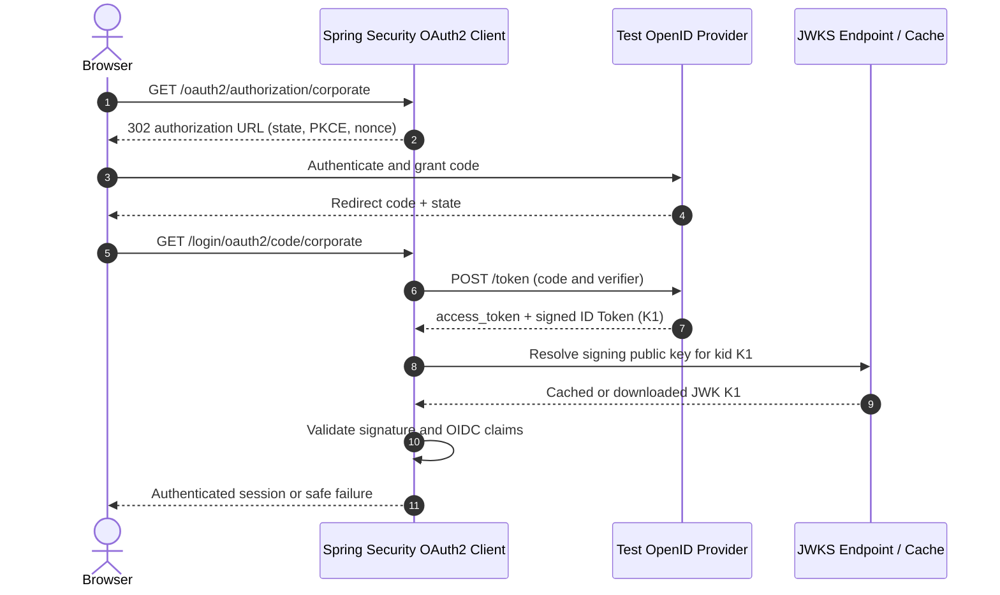

# 31.6. Testing Key Rotation and JWKS Caching

## 1. The Problem: OIDC Login Works Today, Yet May Break When the IdP Rotates Keys

In a **Spring Security OAuth 2.0/OIDC Client** application, the OpenID Provider (OP) may sign ID Tokens with an asymmetric key, such as RSA with `RS256`. The application retrieves **public keys** via a configured or OIDC Discovery-resolved `jwks_uri` to verify signatures.

One day, the OP rotates from signing key **K1** to **K2**:

```text
Day 1:
    OP signs ID Tokens with private key K1
    JWKS publishes public key K1
    Spring Security verifies signatures with K1

Day 2: rotation begins
    OP publishes public keys K1 + K2
    OP gradually shifts to signing with private key K2
    Spring Security may still cache the old JWKS: K1 only

Day 3: rotation completes
    OP stops signing with K1
    OP publishes only public key K2
    Caches/authenticated sessions vary by timing
```

If the client caches the old JWKS too long, tokens signed with **K2** may be rejected. If the client acts too permissively when a key is not found, attackers can exploit weak signature checks or wrong-issuer trust. If operators remove K1 before valid older ID Tokens expire or before consumers refresh, cutover can cause outages.

**Central testing question:** Does the application verify ID Tokens with the right key, refresh its JWKS cache as expected, tolerate the two-key overlap phase, and **fail closed** when a signature cannot be verified?

> This lesson belongs to Chapter **31. Integration Testing** in the **Spring Security OAuth 2.0 OIDC Client** module. The focus is testing real OIDC Client behavior when the OP rotates signing keys; do not equate this with rotating OAuth client secrets, refreshing access tokens, rotating TLS certificates, or rotating session cookies.

### Learning Objectives

After this lesson, you will be able to:

1. Explain JWKS, JWK, `jwks_uri`, `kid`, `alg`, issuer, and the public key cache.
2. Distinguish **signing-key rotation**, **client-secret rotation**, **TLS rotation**, and **refresh-token rotation**.
3. Build a fake OpenID Provider serving a **dynamic JWKS** and signing ID Tokens with multiple test keys.
4. Run integration tests through OAuth2 authorization redirect, callback, Token Endpoint, and OIDC ID Token validation.
5. Test cache hits, cache misses, unknown new keys, K1/K2 overlap, and K1 retirement.
6. Test negative cases: bad signature, nonexistent key ID, wrong issuer/audience, disallowed algorithm, and JWKS errors or timeouts.
7. Design TTL/cache refresh tests without abusing `Thread.sleep`.
8. Distinguish the **OIDC ID Token decoder** cache from the **Resource Server JWT decoder** cache.
9. Control multi-instance, multi-tenant, JWKS endpoint trust, and dynamic key URL risks.
10. Build an operational runbook for observing JWKS rotation incidents in deployed environments.

Examples use Spring Boot/Spring Security Servlet with OIDC Authorization Code Flow, a loopback fake OP, and test keys **never used outside tests**. Nimbus/Spring Security caching details can vary across versions, HTTP clients, cache providers, and configuration. Never infer concrete cache behavior solely from APIs or conceptual examples.

---

## 2. Foundational Concepts

### 2.1. JSON Web Key (JWK)

A **JWK** is a JSON representation of a cryptographic key. For RSA signatures, public key metadata may include:

```json
{
  "kty": "RSA",
  "use": "sig",
  "alg": "RS256",
  "kid": "signing-2026-11-k2",
  "n": "PUBLIC_MODULUS_BASE64URL",
  "e": "AQAB"
}
```

`n` and `e` here are illustrative values; they are not a real RSA key usable for verification. On a real OP, the JWK holds the exact public key modulus/exponent.

**Private keys must never be published in JWKS.**

### 2.2. JSON Web Key Set (JWKS)

JWKS is a JSON object containing a `keys` array:

```json
{
  "keys": [
    {
      "kty": "RSA",
      "use": "sig",
      "alg": "RS256",
      "kid": "signing-2026-10-k1",
      "n": "PUBLIC_MODULUS_K1",
      "e": "AQAB"
    },
    {
      "kty": "RSA",
      "use": "sig",
      "alg": "RS256",
      "kid": "signing-2026-11-k2",
      "n": "PUBLIC_MODULUS_K2",
      "e": "AQAB"
    }
  ]
}
```

During overlap, the OP may publish **both K1 and K2** even while signing new tokens only with K2.

### 2.3. JWS Header and `kid`

A signed JWT typically carries a header:

```json
{
  "alg": "RS256",
  "kid": "signing-2026-11-k2",
  "typ": "JWT"
}
```

`kid` helps the decoder **select candidate keys** in the JWKS. It is not standalone proof of trust.

To accept an ID Token, the client must still verify:

- The signature matches a public key fetched from the **trusted issuer/JWKS source**.
- The signing algorithm is allowed.
- OIDC claims are valid.
- The token belongs to the right client, issuer, and authorization transaction.

### 2.4. `jwks_uri`

The OP may advertise via discovery:

```json
{
  "issuer": "https://login.example.test",
  "jwks_uri": "https://login.example.test/keys"
}
```

Spring Security uses metadata/provider configuration to locate the matching JWKS. `jwks_uri` must come from **trusted provider configuration**, never taken arbitrarily from a caller-supplied JWT header.

### 2.5. JWKS Cache

Decoders usually do not download the entire JWKS over the network on every token. They may cache keys in memory or via a dedicated cache implementation.

Caching solves performance and availability, yet introduces situations like:

```text
Remote JWKS already has K2
    while
Pod A's cache still has only K1.
```

Whether an unknown `kid` triggers automatic refresh, as well as TTL, cooldown, cache-control handling, concurrent fetches, and failure behavior, must be **verified against your deployed version**, not assumed universally.

---

## 3. Distinguishing Four Frequently Confused Types of "Rotation"

| Change Type | What Changes | Involves JWKS? |
|---|---|---|
| **OP signing-key rotation** | Private key signing ID Tokens and public key in JWKS | **Yes, focus of this lesson** |
| OAuth2 client-secret rotation | `client_secret` authenticating the client at Token Endpoint | Not directly; failure is usually `invalid_client` |
| TLS certificate rotation | Certificate securing HTTPS connections to OP | Not token-signing JWK; may affect HTTP/TLS |
| Refresh-token rotation | OP issues a new refresh token and invalidates the old one | Not JWKS; failure is usually `invalid_grant` |

### 3.1. A New Token After Refresh Still Needs Contextual Verification

If the OP issues a new ID Token in an OIDC-related response, the client may need to verify it with the current signing key. However, **Refresh Token Grant does not guarantee a new ID Token is always returned**; details depend on the spec and provider.

### 3.2. Provider Access Tokens Need Not Be JWTs

An OIDC Client may receive an **opaque access token**. Spring Security OAuth2 Client does not automatically decode every access token as a JWT using OP JWKS.

Never write:

```text
JWKS integration test green
    => all access tokens are valid
```

JWKS tests for **OIDC ID Token login** differ from Resource Server tests verifying **JWT access tokens**.

---

## 4. Where ID Tokens Are Verified in Spring Security Servlet

Overall flow:



A proper integration test must let **OIDC validation actually run**. If a test calls `.with(oidcLogin())`, it skips everything from `/authorize` through JWT/JWKS validation.

### 4.1. Spring Security Components Typically Involved

In the Servlet stack:

- `ClientRegistration` and `ClientRegistrationRepository`: issuer, JWK Set URI, client ID/secret, redirect URI.
- `OAuth2AuthorizationRequestRedirectFilter`: initiates the Authorization Code Flow.
- `OAuth2AuthorizationRequestRepository`: stores state, PKCE verifier, and transaction attributes.
- `OAuth2LoginAuthenticationFilter`: handles the authorization code callback.
- `OidcAuthorizationCodeAuthenticationProvider`: handles the OIDC login branch.
- `OidcIdTokenDecoderFactory`: builds the ID Token decoder per registration/provider.
- Nimbus JOSE/JWT/JWK support: verifies JWS and fetches JWKs via configured components.
- `SecurityContextRepository` and `OAuth2AuthorizedClientRepository/Service`: persists login results/authorized clients.

These classes can be customized or replaced depending on the Spring Security version. Tests must target the **project's actual pipeline**, rather than assuming every app uses one default singleton decoder.

### 4.2. Do Not Target the Wrong Decoder Bean

An application might configure both:

```text
oauth2Login()     -> validate OIDC ID Token
oauth2ResourceServer().jwt() -> validate JWT access token
```

The two branches can use **separate decoder factories, JWKS caches, and TTLs**.

Constructing a `NimbusJwtDecoder` to test Resource Server JWTs and concluding OIDC Login's cache works properly is insufficient.

---

## 5. Ideal Rotation Scenario: Pre-Publish, Switch, Retire

A **zero-downtime** plan usually breaks into three phases.

### Phase A — K1 Only

```text
OP signs tokens with K1
JWKS = [K1]
```

Client verifies K1 ID Tokens successfully.

### Phase B — Overlap

```text
OP starts publishing [K1, K2]
OP may continue signing with K1 for a period
Then OP signs new ID Tokens with K2
```

Clients must be able to find K2 without accepting keys outside the trust boundary. K1 stays published during overlap so consumers can verify tokens signed prior to cutover.

### Phase C — Retire

```text
OP stops signing with K1
OP publishes [K2]
```

Once the client's JWKS cache refreshes, the decoder no longer uses K1 once K1 leaves the current valid key set.

**However:** removing K1 from JWKS **does not instantaneously revoke** all previously issued K1 tokens. A client holding a stale cache may continue accepting unexpired K1 tokens until its cache refreshes or another security policy blocks them. During a key-compromise incident, separate revocation/session invalidation/deny-policy mechanisms are needed beyond editing JWKS.

### 5.1. Intervals That Govern Overlap

Consider:

- Lifetime of ID Tokens/access tokens signed with K1.
- Acceptable clock skew.
- Consumer cache TTL/behavior.
- JWKS endpoint check cost and latency.
- Rollout speed of the new key across OP nodes.
- Concurrency and number of clients.
- Sessions/tokens issued prior to rotation.

There is no universal overlap duration. The provider sets it based on token lifetimes and the consumer ecosystem.

---

## 6. How Integration Tests Differ from Unit Tests

### 6.1. Unit Tests Check Key Selection with JWT Test Fixtures

You can build:

```text
JWT signed K1, header kid=K1
decoder with public K1 -> success

JWT signed K2, header kid=K2
decoder with public K1 only -> cannot validate
```

This tests JWS/key-selection verification logic. If you merely mock `JwtDecoder.decode()` to return a prebuilt `Jwt`, **you are not testing cryptography**.

### 6.2. Integration Tests Check Caching and HTTP

A fake JWKS server returns changing state:

```text
GET /jwks -> [K1]
GET /jwks -> [K1,K2]
GET /jwks -> [K2]
```

The real app must process ID Tokens signed by K1/K2 over HTTP/TLS test setups, exercising cache TTLs and errors.

### 6.3. Full OIDC Login Integration Tests Check the Callback Too

Calling a decoder directly does not prove:

```text
Authorization Code Flow
state/PKCE
nonce
token exchange
OIDC user mapping
session persistence
```

When asked to test **Spring Security OIDC Client**, maintain at least one group of full callback pipeline tests alongside decoder-focused tests.

### 6.4. Browser E2E Still Has Its Own Role

MockMvc does not fully reproduce `SameSite` cookies, TLS termination, browser redirects, or OP account choosers. Rotation/JWKS tests can run mostly on the backend, yet production-like smoke tests remain important.

---

## 7. Architecture of a Fake OpenID Provider with Mutable JWKS

A useful fake OP must expose:

```text
/.well-known/openid-configuration
/authorize
/token
/jwks
/userinfo (if the flow uses it)
```

In addition, it needs a **test control plane** never exposed to users:

```text
publishKeys([K1])
publishKeys([K1,K2])
publishKeys([K2])

signNextIdTokenWith(K1)
signNextIdTokenWith(K2)

setJwksResponse(200/304/500/timeout)
setJwksCacheHeaders(...)
getJwksRequestCount()
```

These methods are pseudocode for a test-defined fake server, not Spring Security/WireMock APIs.

### 7.1. Separating Private and Public Keys

```text
Fake OP private keystore:
    K1.private
    K2.private

GET /jwks:
    K1.public
    K2.public
```

Never return private keys in JWKS JSON.

### 7.2. Tools You Can Use

- **WireMock** or **MockWebServer** to stub JWKS/Token/UserInfo.
- **Spring Authorization Server** as a test Authorization Server with real protocol handling.
- A test IdP container with rotation hooks.
- A custom fake OP for negative cases needing tokens signed by specific keys.
- JUnit 5, MockMvc, Testcontainers, Awaitility, or a controllable clock/cache adapter.

A fake that only returns static JSON tokens without validating authorization codes/PKCE can be useful for decoder tests, yet does not prove full OIDC Login.

### 7.3. Never Depend on a Production IdP in CI Tests

Use test RSA/EC keys generated for fixtures, never real provider private keys. A provider sandbox may be used in a separate suite, but never with production credentials/tokens.

---

## 8. Preparing Two Independent RSA Signing Keys

For the `RS256` OIDC signing algorithm, tests can generate two RSA key pairs:

```java
import java.security.KeyPair;
import java.security.KeyPairGenerator;
import java.security.interfaces.RSAPrivateKey;
import java.security.interfaces.RSAPublicKey;

import com.nimbusds.jose.JWSAlgorithm;
import com.nimbusds.jose.jwk.KeyUse;
import com.nimbusds.jose.jwk.RSAKey;

public final class TestSigningKeys {

    public static RSAKey newRsaSigningKey(String kid)
            throws Exception {

        KeyPairGenerator generator =
            KeyPairGenerator.getInstance("RSA");
        generator.initialize(2048);

        KeyPair pair = generator.generateKeyPair();

        return new RSAKey.Builder(
                (RSAPublicKey) pair.getPublic()
            )
            .privateKey((RSAPrivateKey) pair.getPrivate())
            .keyID(kid)
            .keyUse(KeyUse.SIGNATURE)
            .algorithm(JWSAlgorithm.RS256)
            .build();
    }
}
```

Two fixtures:

```java
RSAKey k1 = TestSigningKeys.newRsaSigningKey("test-k1");
RSAKey k2 = TestSigningKeys.newRsaSigningKey("test-k2");
```

**Important:**

- K1 and K2 must have **different key material**.
- K1/K2 must have different `kid` values in normal rotation.
- `kid` is only a selector; every token still needs a valid signature.
- Private keys exist only in the test process; never export them into HTTP JSON.
- Never use these test keys to sign tokens in production.

### 8.1. Why Not Just Change `kid` on the Same Public Key?

If you keep the same RSA key material and only rename `kid`, tests may miss key-selection bugs because both tokens would still verify under the same public key if the decoder happened to pick it.

To test cryptographic rotation, **actually swap the keypair**.

---

## 9. Serving JWKS Containing Only Public Keys

Using Nimbus `JWKSet`:

```java
import java.util.List;

import com.nimbusds.jose.jwk.JWK;
import com.nimbusds.jose.jwk.JWKSet;
import com.nimbusds.jose.jwk.RSAKey;

public String jwksBody(RSAKey... keys) {

    List<JWK> publicKeys = java.util.Arrays.stream(keys)
        .map(RSAKey::toPublicJWK)
        .map(key -> (JWK) key)
        .toList();

    JWKSet set = new JWKSet(publicKeys);
    return com.nimbusds.jose.util.JSONObjectUtils
        .toJSONString(set.toJSONObject());
}
```

Code note: this is an illustrative helper using Nimbus JOSE/JWT; depending on your version, you may use `JWKSet#toString()`/the matching JSON serializer instead of `JSONObjectUtils`. The goal is returning valid public-only JWKS JSON.

Example:

```java
String jwksK1 = jwksBody(k1);
String jwksBoth = jwksBody(k1, k2);
String jwksK2 = jwksBody(k2);
```

### 9.1. Never Accidentally Include Private JWKs in Responses

Dangerous:

```java
new JWKSet(List.of(k1, k2))
```

and serializing private properties without filtering.

Always call `toPublicJWK()` before publishing.

### 9.2. HTTP Response for JWKS

```http
HTTP/1.1 200 OK
Content-Type: application/json
Cache-Control: public, max-age=60
```

```json
{"keys":[{"kty":"RSA","kid":"test-k1","n":"...","e":"AQAB"}]}
```

`max-age=60` here is just a fixture. Do not assume Spring/Nimbus in every version uses **HTTP Cache-Control TTL directly** as its cache duration. Measure and verify the effective cache implementation.

---

## 10. Signing ID Tokens with Each Key

Example building a signed JWT with Nimbus:

```java
import java.time.Instant;
import java.util.Date;

import com.nimbusds.jose.JOSEObjectType;
import com.nimbusds.jose.JWSAlgorithm;
import com.nimbusds.jose.JWSHeader;
import com.nimbusds.jose.crypto.RSASSASigner;
import com.nimbusds.jwt.JWTClaimsSet;
import com.nimbusds.jwt.SignedJWT;
import com.nimbusds.jose.jwk.RSAKey;

public String signIdToken(
        RSAKey signingKey,
        String issuer,
        String clientId,
        String subject,
        String nonce,
        Instant now) throws Exception {

    JWTClaimsSet claims = new JWTClaimsSet.Builder()
        .issuer(issuer)
        .subject(subject)
        .audience(clientId)
        .issueTime(Date.from(now))
        .expirationTime(Date.from(now.plusSeconds(300)))
        .claim("nonce", nonce)
        .build();

    JWSHeader header = new JWSHeader.Builder(
            JWSAlgorithm.RS256
        )
        .type(JOSEObjectType.JWT)
        .keyID(signingKey.getKeyID())
        .build();

    SignedJWT jwt = new SignedJWT(header, claims);

    jwt.sign(new RSASSASigner(
        signingKey.toRSAPrivateKey()
    ));

    return jwt.serialize();
}
```

This is a **test fixture** helper; real ID Tokens are also subject to other OIDC requirements per authorization flow, such as time validation, nonce, authorized party with multiple audiences, and registered algorithms.

### 10.1. Why Must Nonce Come from the Authorization Request?

If the OIDC Login flow sends:

```text
nonce = N7
```

the fake OP's ID Token needs:

```json
{"nonce":"N7"}
```

In a negative test, change it to `N8` to confirm the callback fails. Do not pick an arbitrary fixed nonce and skip OIDC nonce validation when the test fails.

### 10.2. Do Not Assert Only JWT Header `kid`

An attacker can craft a header:

```json
{"kid":"test-k2","alg":"RS256"}
```

while signing with a different private key. The decoder must reject it even though `kid` matches K2.

---

## 11. OIDC Discovery Must Point to the Right JWKS Endpoint

Example metadata:

```json
{
  "issuer": "http://127.0.0.1:9009",
  "authorization_endpoint": "http://127.0.0.1:9009/authorize",
  "token_endpoint": "http://127.0.0.1:9009/token",
  "jwks_uri": "http://127.0.0.1:9009/jwks",
  "userinfo_endpoint": "http://127.0.0.1:9009/userinfo",
  "response_types_supported": ["code"],
  "subject_types_supported": ["public"],
  "id_token_signing_alg_values_supported": ["RS256"],
  "token_endpoint_auth_methods_supported": ["client_secret_basic"]
}
```

**Loopback HTTP is strictly for controlled local testing.** Production providers require HTTPS/TLS per trust policy.

### 11.1. Issuer Mismatch Is a Different Error from Rotation

If metadata advertises:

```text
issuer=http://127.0.0.1:9009
```

while the ID Token says:

```text
iss=https://another.example
```

login must fail issuer validation even when the public key can verify the signature.

### 11.2. JWKS URI from Provider Metadata Is a Trust Input

Never accept an arbitrary JWT header `jku` or `x5u` and make network calls to that URL. The JWKS endpoint must be determined by **approved ClientRegistration/issuer configuration**.

### 11.3. Changing Issuer Is a Trust-Domain Change

If an OP changes its issuer, that is not just a K1→K2 rotation. The app must consider migration/tenant identity mapping `(iss,sub)`, never automatically merging users based on matching `sub` or email.

---

## 12. Minimal Key Rotation Matrix

| JWKS State | ID Token Signed With | Expectation |
|---|---|---|
| `[K1]` | K1 | Succeed |
| `[K1]` | K2 | Must not be accepted if K2 is not yet present and fetched from trusted source |
| `[K1,K2]`, cache refreshed | K1 | Succeed if token/claims valid |
| `[K1,K2]`, cache refreshed | K2 | Succeed |
| `[K2]`, cache refreshed | K2 | Succeed |
| `[K2]`, cache refreshed, token K1 | K1 | Reject once K1 is no longer a trusted cached key |
| `[K2]`, stale cache still holds K1 | K1 | **May still be accepted** until cache refreshes; measure per policy |
| `[K1,K2]` | Unpublished key K3 | Reject |
| `[K1,K2]` | Header `kid=K2`, signature by K3 | Reject |
| Endpoint error, no matching cached key | K2 | Reject, never bypass signature |
| Endpoint error, cache still holds K1 | K1 | Depends on cache policy; never accept if unverifiable |

### 12.1. Do Not Label a Valid Result Under a Different Cache Policy as FAIL

In the row "new JWKS `[K2]`, stale cache K1," a cached decoder may still verify an **unexpired K1 token** before cache refresh. If a test requires **K1 to be rejected immediately after rotation**, you need a specific emergency revocation/cache invalidation/deny rule. Never assume changing the JWKS JSON on the server simultaneously clears all local caches.

### 12.2. Test Policy, Not Just Timing

A good test states clearly:

```text
After a client-observable JWKS refresh that replaces
the cached set with [K2]:
    Valid K2 tokens accepted.
    K1-only signatures not trusted.
```

That is a verifiable condition. "The instant the server updates JWKS, every pod must reject K1" is a stronger requirement needing additional architecture.

---

## 13. Test 1 — Cold Cache, JWKS Contains K1

**Preconditions:**

```text
Fake OP signs ID Tokens using K1.
GET /jwks returns public K1.
Spring client decoder/cache is newly created or cleared.
```

**Execution:**

1. Initiate a real authorization request.
2. OP issues an authorization code for the right client, redirect URI, and PKCE challenge.
3. Fake Token Endpoint returns a signed K1 ID Token with the right nonce.
4. Client executes OIDC validation.
5. Using the logged-in session, call `/api/me` **without `oidcLogin()`**.

**Expectations:**

- HTTP callback succeeds per SecurityFilterChain.
- JWKS endpoint is queried when the decoder needs the public key.
- Session is authenticated with the right external identity.
- `OidcUser`/application principal has the right subject.
- No raw private key, ID Token, or access token appears in logs.

### 13.1. Do Not Mismeasure Request Count

An application context may initialize decoders or call discovery prior to the callback. If asserting:

```text
JWKS HTTP request count == 1
```

reset the counter at the right point and understand the decoder's caching behavior. You can split the test:

```text
Count after fresh decoder initialization
Count after first signed token validation
```

so you don't confuse metadata/JWKS prefetching with refreshes.

---

## 14. Test 2 — Cache Hit While the Same Key Remains Valid

**Preconditions:**

```text
JWKS=[K1]
Client already verified a K1 token successfully.
Cache version/issuer unchanged.
```

**Execution:**

Verify another valid K1-signed ID Token with proper `sub`, `nonce`, `iat`, and `exp`; use a fresh authorization transaction if testing full login.

**Expectations:**

- The token continues to be accepted.
- While the cache entry remains valid, the decoder **may** avoid re-fetching JWKS.
- Performance and request counts align with the effective cache policy.

### 14.1. Cache-Hit Assertions Require Understanding TTL

If a test does not control TTL/cache lifecycle, an extra `GET /jwks` is not necessarily a bug; the decoder might proactively refresh or belong to another instance/cache.

To assert **zero extra GETs**, establish a deterministic cache config and confirm it is the actual cache used by Spring OIDC Login.

### 14.2. Session Tests Do Not Substitute for JWT Tests

If a second request merely uses the session cookie after initial login, Spring Security typically **does not re-verify the ID Token on every HTTP request**. Thus, it does not generate a cache hit in the sense of decoding another JWT.

To test JWKS cache reuse, trigger **multiple new ID Token validations**, such as multiple valid OAuth2 Login transactions.

---

## 15. Test 3 — Pre-Publishing K2 During Overlap

**Preconditions:**

```text
OP initially:
    JWKS=[K1]
    signWith=K1

OP prepares:
    JWKS=[K1,K2]
    signWith=K1
```

**Execution:**

1. Client verifies a K1 token.
2. Fake OP updates the JWKS response to `[K1,K2]`.
3. Trigger a cache refresh per the designed or controlled mechanism.
4. Test valid tokens signed with K1 and K2 in two separate login transactions.

**Expectations:**

- Once the decoder fetches JWKS `[K1,K2]`, both K1 and K2 are valid key candidates, with allowed algorithms and valid claims.
- Never assume "JWKS has multiple keys ⇒ pick the first key and ignore `kid`."
- The client does not depend on the ordering of the `keys` array when keys carry accurate identifiers and metadata.

### 15.1. Testing Reordered Keys

Have the fake OP return:

```text
[K1,K2]
```

then:

```text
[K2,K1]
```

and confirm K1/K2 signatures both verify properly after refresh. JWK Set does not impose first-key-wins semantics.

### 15.2. Testing Appropriate `use`/`key_ops`/`alg`

If JWKS includes both signing keys and encryption keys, the decoder must apply selection/algorithm policies rather than verifying with any RSA key just because `kty` matches.

Know which metadata fields your JOSE library/OP contract handles, rather than writing tests expecting every implementation to treat optional fields identically.

---

## 16. Test 4 — OP Starts Signing K2 While Client Still Caches K1

This is the critical rotation case.

**Sequence:**

```text
T0:
    Client cache = [K1]

T1:
    Remote JWKS = [K1,K2]

T2:
    OP signs ID Token with K2

T3:
    Client receives token header kid=K2
```

The client must decide whether to fetch the updated JWKS upon seeing an unknown `kid`.

### 16.1. Two Observable Behaviors

**Behavior A — unknown `kid` triggers refresh:**

```text
Cache miss kid=K2
    -> GET /jwks
    -> [K1,K2]
    -> verify K2 token succeeds
```

**Behavior B — cache does not refresh immediately:**

```text
Cache miss kid=K2
    -> decoder rejects
    -> after TTL/separate refresh mechanism, K2 token can be verified
```

**Which behavior is expected** depends on your cache implementation and requirements. Spring/Nimbus may refetch JWKS on an unknown `kid` in certain setups, yet **never assert it always happens** without verifying your effective version, custom cache, negative caching, and refresh policy.

### 16.2. Tests Must State the Contract Clearly

Example acceptance criterion:

```text
Given OP has pre-published K2
When a valid K2 ID Token arrives after the application
has cached only K1
Then the application refreshes JWKS and accepts K2
within a bounded time under the configured strategy.
```

If the system chooses TTL-only, the criterion might be:

```text
No cryptographic bypass.
A K2 token might temporarily fail before refresh,
then succeeds after controlled cache expiry.
```

Remember that availability requirements never justify skipping signature validation just to "always succeed login."

---

## 17. Test 5 — Retiring K1 After Refresh

**Sequence:**

```text
Remote JWKS = [K2]
Client's effective JWKS cache has been refreshed to [K2].
```

**Positive:**

```text
ID Token signed K2, kid=K2
    -> accepted
```

**Negative:**

```text
ID Token signed K1, kid=K1
    -> rejected after old key removed from effective cache
```

### 17.1. Why Prove the Effective Cache Actually Refreshed?

If the client still holds `[K1,K2]` in cache, it can keep verifying K1 tokens. A test that "changes WireMock's response, immediately sends K1, expects failure" can fail because **the cache wasn't invalidated yet**, not because the decoder ignores JWKS.

### 17.2. Key Retirement Is a Process

Providers should consider keeping K1 published long enough for valid tokens signed before cutover to verify until expiration per policy. When emergency K1 termination is needed due to private key compromise, the security incident procedure differs from normal rotation.

---

## 18. Test 6 — Unknown `kid` and Invalid Signatures

A negative test:

```text
Remote JWKS=[K1,K2]
ID Token header:
    kid=never-published-k3

JWT signature:
    private key K3
```

Expectation: **authentication fails**.

Another test:

```text
Remote JWKS=[K1,K2]
ID Token header:
    kid=K2

JWT signature:
    private key K3
```

Expectation: **authentication fails even though `kid` matches K2**.

### 18.1. Never Fall Back to "Skip Signature"

Wrong:

```text
if kid not found:
    parse JWT payload only
    accept based on sub/email
```

That is an authentication bypass.

### 18.2. Never Trust Token-Supplied `jku` or `x5u`

A JWT header can contain a URL hinting at a key:

```json
{
  "alg": "RS256",
  "kid": "k3",
  "jku": "https://attacker.example/jwks"
}
```

The OIDC Client must obtain keys from the issuer's **configured trusted JWKS source**, never fetching URLs embedded by an attacker in a token header. A fake JWKS server/egress monitor can detect if a test decoder unexpectedly issues HTTP calls to an attacker host; egress allowlisting provides an extra safeguard.

### 18.3. Limiting Refresh Storms

When an attacker sends many distinct unknown `kid` values, the decoder should not trigger an unbounded HTTP storm against the JWKS endpoint if external exposure lets attackers trigger validation continuously.

Test rate limiting, negative-cache/cooldown, and concurrent request coalescing per your **implementation and threat model**.

---

## 19. Test 7 — Algorithm Mismatch and Algorithm Confusion

A JWT header says:

```json
{"alg":"RS256","kid":"K1"}
```

while the application may be configured to accept only a specific set of algorithms.

Cases to test:

- Token signed with an algorithm outside the configured policy.
- Token claiming `alg=none`.
- Token claiming `HS256` when the client only accepts asymmetric signing.
- Inconsistency between JWT header `alg` and JWK metadata.
- Token signed with a key incompatible with the algorithm.
- Mixed RSA/EC keys in JWKS when only one algorithm is permitted.

### 19.1. Never Let "alg from Token Decide the Decoder" Unconditionally

A secure decoder enforces **allowed algorithms** from trusted configuration and JWK selection, rather than blindly trusting caller-supplied headers.

### 19.2. OIDC Supports Multiple Signing Methods

An OP may use `RS256`, `ES256`, or another registered/supported algorithm. Some setups use MAC-based signing such as `HS256` with a client secret, which does not rely on JWKS in the same way.

**Lesson scope:** key rotation for **asymmetric JWKS**. To test `HS256`, design dedicated tests around client-secret/MAC validation semantics rather than RSA JWKS scenarios.

### 19.3. Do Not Hardcode `RS256` for Every Provider

If a real provider uses ES256, RSA tests may not reflect production trust. Choose the signing algorithm matching the provider contract and Spring Security configuration.

---

## 20. Test 8 — JWKS Endpoint Disconnected or Returning Errors

Simulate:

```text
GET /jwks -> HTTP 503
GET /jwks -> timeout
GET /jwks -> malformed JSON
GET /jwks -> empty keys
GET /jwks -> 404
GET /jwks -> 429
```

### 20.1. Cache Does Not Hold the Key Yet

If no matching public key is cached:

```text
JWKS unavailable
    -> cannot cryptographically verify ID Token
    -> authentication must fail closed
```

Never accept a token simply because issuer/audience/sub look right or the JWT parses cleanly.

### 20.2. Cache Still Holds a Valid Public Key

If the cache currently holds key K1 and a matching K1 token arrives:

```text
JWKS remote outage
    + valid cached K1
    -> may continue validation depending on cache policy
```

This can be a valid availability strategy **if the cached key remains within its validity/trust policy**. Do not assume the library always does stale-while-revalidate or always fails; test the actual behavior.

### 20.3. New Key Not in Cache

```text
Client cached only K1.
OP signs K2.
JWKS endpoint unavailable.
```

K2 cannot be verified with K1, so it **must be rejected**—never fall back to trusting `sub` or an arbitrary header certificate.

### 20.4. Bounded Timeouts and Retries

When the JWKS endpoint is slow, timeouts prevent holding threads/exhausting pools. Test:

- HTTP connect timeout.
- HTTP read timeout.
- Bounded retries/backoff.
- No HTTP request cascades on concurrent unknown kids.
- Failure handler shows a safe message, never raw endpoints/stack traces.

---

## 21. Test 9 — HTTP Caching Headers, ETag, and 304

A JWKS endpoint may return:

```http
HTTP/1.1 200 OK
Cache-Control: public, max-age=120
ETag: "jwks-v2"
Content-Type: application/json
```

If the client HTTP/cache implementation supports conditional requests, subsequent requests may send:

```http
If-None-Match: "jwks-v2"
```

and the server responds:

```http
HTTP/1.1 304 Not Modified
ETag: "jwks-v2"
```

**Not every Spring/Nimbus JWKS cache sends conditional GETs or takes its TTL directly from `Cache-Control`.** Only write ETag/304 tests when the application actually uses a layer supporting that capability.

### 21.1. Test Metadata Instead of Guessing

Never conclude:

```text
max-age=120 => decoder always refreshes at second 121.
```

Effective caching also depends on implementation, clock, default expiration, refresh policy, caching proxies, and the HTTP client.

### 21.2. Checking After 304

If the cache layer supports conditional GET:

- 304 carries no new JWKS body.
- Cached keys are safely retained per cache semantics.
- Do not parse an empty body as `{"keys":[]}` and wipe all keys.
- Cache metadata updates cleanly to prevent request storms.

### 21.3. Testing Cache-Control no-store Intentionally

If a JWKS response sets `no-store`, whether caching stops depends on whether the HTTP client/cache layer honors it. Do not inject that header and assume caching is disabled if the library doesn't follow HTTP cache semantics.

---

## 22. Cache TTL: Testing Time Without Slowing Down CI

A test like:

```java
Thread.sleep(300_000); // 5 minutes
```

is unsuitable: slow, highly flaky, and prone to timeouts in parallel runs.

### 22.1. Prefer a Test-Controllable Cache

If the application owns the cache adapter:

```text
JWKS cache TTL = 30s
TestClock:
    T0 -> K1 cached
    T0 + 31s -> expiry triggered
```

A mock `Clock` or cache implementation supporting a test clock enables deterministic tests. However, **Spring/Nimbus internal caches may not use an injected Spring Clock**. Do not assume `Clock.fixed()` automatically controls Nimbus's cache.

### 22.2. Other Options

- Use a short TTL **supported by the cache implementation itself** in a test profile.
- Expose a test-only cache invalidation hook if production has an appropriate abstraction.
- Construct a fresh decoder instance to test cold-cache loading (not a substitute for testing expiration).
- Use a fake OP with HTTP request counters.
- Use Awaitility with short deadlines and sensible polling instead of fixed long sleeps.
- Split long-running suites into nightly/compatibility tests when TTL cannot be controlled.

### 22.3. State Your Test Boundaries

A test that creates a new decoder after the OP updates JWKS only proves **a cold cache loads K2**, not that a decoder running for days knows how to refresh K1→K2.

To test stale-cache upgrades, reuse **the same decoder/cache instance** across the transition.

### 22.4. Do Not Clear the Cache Between Every Step

If a test always calls:

```text
cache.clear()
```

before submitting a K2 token, it skips the very rotation-cache problem under test. Maintain separate tests for:

- **Cold cache**.
- **Warm cache / unknown kid**.
- **Configured TTL expiration**.
- **Manual invalidation behavior** (if the product supports it).

---

## 23. Nimbus and Spring: Avoid Assumptions About Internal Refresh

Spring Security uses Nimbus across many JOSE/JWT validation paths, yet actual behavior can vary with Spring Security version, Nimbus JOSE/JWT version, dependency management, and how the app customizes `JwtDecoder`.

Points to verify:

1. Which decoder is used for the **OIDC ID Token**?
2. Is that decoder created **once**, per registration, or per request?
3. Where does the JWKS cache live?
4. What are the current cache TTL and fetch cooldown?
5. Does an unknown `kid` trigger an immediate HTTP fetch?
6. If JWKS fetch fails, are still-valid cached keys used?
7. If HTTP returns 304, does the cache layer understand it?
8. If concurrent requests hit a new K2, are fetches coalesced?
9. When a tenant registration changes issuer/JWKS URI, are the decoder/cache refreshed?
10. If a `kid` is reused for new key material, how does the client handle it?

### 23.1. OIDC Decoder Differs from Resource Server Decoder

An application might declare:

```java
NimbusJwtDecoder.withJwkSetUri("https://.../jwks")
```

for **Resource Server JWTs**. That does not prove OIDC Login uses that same instance/cache.

When testing **OIDC Client**, trigger the callback/token exchange and verify the actual OIDC Login decoder; if testing the decoder directly, verify it is the exact decoder produced by `OidcIdTokenDecoderFactory` in production.

### 23.2. Do Not Mock `JwtDecoder` for JWKS Cache Tests

Wrong target:

```java
when(jwtDecoder.decode(anyString())).thenReturn(fakeJwt);
```

This test completely bypasses:

```text
JWKS HTTP fetch
JWK selection
JWS signature check
Cache refresh
Algorithm validation
```

It is only useful for controller/service logic that already assumes a valid token.

### 23.3. Wire the Cache in the Right Place

If the app uses a custom caching library, prove that cache sits on the **call path of the actual decoder**. A fake cache object asserted in a test that Spring Security OIDC Login never uses proves nothing about real rotation.

---

## 24. Building ClientRegistration for the Fake OP

You can use the `ClientRegistration` builder with known test endpoints:

```java
import org.springframework.security.oauth2.client.registration.ClientRegistration;
import org.springframework.security.oauth2.core.AuthorizationGrantType;
import org.springframework.security.oauth2.core.ClientAuthenticationMethod;

public ClientRegistration testRegistration(String opBaseUrl) {

    return ClientRegistration
        .withRegistrationId("test-corporate")
        .clientId("portal-test-client")
        .clientSecret("test-only-client-secret")
        .clientAuthenticationMethod(
            ClientAuthenticationMethod.CLIENT_SECRET_BASIC
        )
        .authorizationGrantType(
            AuthorizationGrantType.AUTHORIZATION_CODE
        )
        .redirectUri(
            "{baseUrl}/login/oauth2/code/{registrationId}"
        )
        .scope("openid", "profile")
        .authorizationUri(opBaseUrl + "/authorize")
        .tokenUri(opBaseUrl + "/token")
        .jwkSetUri(opBaseUrl + "/jwks")
        .issuerUri(opBaseUrl)
        .userInfoUri(opBaseUrl + "/userinfo")
        .userNameAttributeName("sub")
        .clientName("Test Corporate OP")
        .build();
}
```

This is a test configuration example. If the real app relies on `issuer-uri` and discovery, maintain **separate tests for metadata discovery** rather than relying solely on hardcoded endpoints.

### 24.1. When Using issuer-uri?

In Spring Boot:

```yaml
spring:
  security:
    oauth2:
      client:
        registration:
          corporate:
            client-id: ${OIDC_CLIENT_ID}
            client-secret: ${OIDC_CLIENT_SECRET}
            scope:
              - openid
              - profile
        provider:
          corporate:
            issuer-uri: https://login.example.test
```

Spring Boot/Spring Security can use discovery to build the corresponding provider metadata/`ClientRegistration`. With a fake OP on a random port, tests must supply the **actual issuer URI** via dynamic properties or programmatic registration before the application context starts.

### 24.2. Never Let Users Supply Arbitrary JWKS URIs

The test server is hardcoded/approved in the test context. In production, issuer/JWKS URIs are trust configuration, never arbitrary values from browsers/JWT headers. If supporting dynamic tenant onboarding, enforce allowlists/TLS/SSRF controls.

---

## 25. A Stateful Fake JWKS Server

Java pseudocode:

```java
// Test-only component: illustrative interface, not a Spring API.
public interface MutableTestJwksServer {

    void publish(RSAKey... publicAndPrivateTestKeys);

    void signTokensWith(RSAKey signingKey);

    void respondWithHttpStatus(int status);

    void delayResponses(java.time.Duration duration);

    int requestCount();

    void resetRequestCounter();
}
```

A WireMock/MockWebServer implementation can maintain:

```java
AtomicReference<String> jwksResponse =
    new AtomicReference<>();

AtomicInteger jwksHits = new AtomicInteger();

AtomicReference<RSAKey> activeSigningKey =
    new AtomicReference<>();
```

The `/jwks` endpoint reads `jwksResponse.get()` and increments `jwksHits`. The Token Endpoint uses `activeSigningKey.get()` to sign the ID Token.

### 25.1. Starting Rotation in a Test

```java
server.publish(k1);
server.signTokensWith(k1);

loginAndVerify();

server.publish(k1, k2);
server.signTokensWith(k2);

loginAndVerify();
```

`loginAndVerify()` is a **test-implemented helper**: initiates the authorization request, extracts code/state, lets the fake OP handle PKCE and sign the ID Token, calls back into Spring Security, and verifies the session.

### 25.2. Separate Remote State from Local Cache State

Changing the fake server's JWKS response does not mean the decoder cache has changed.

In test fixtures, track two separate observations:

```text
remotePublishedKids = [K1,K2]
clientObservedKids = inferred from successful validation/fetch count
```

Never read a `server.keys` variable and use it as proof the client loaded the right keys.

---

## 26. Structure of a Full MockMvc Login Integration Test

An integration test can do:

```java
// Pseudocode; requires real fake OP and helpers in your project.

MvcResult begin = mockMvc.perform(
        get("/oauth2/authorization/test-corporate")
    )
    .andExpect(status().is3xxRedirection())
    .andReturn();

MockHttpSession session =
    (MockHttpSession) begin.getRequest().getSession(false);

String authorizationUrl =
    begin.getResponse().getHeader("Location");

FakeAuthorizationTransaction transaction =
    fakeOp.issueAuthorizationCodeFrom(authorizationUrl);

MvcResult callback = mockMvc.perform(
        get("/login/oauth2/code/test-corporate")
            .param("code", transaction.code())
            .param("state", transaction.state())
            .session(session)
    )
    .andExpect(status().is3xxRedirection())
    .andReturn();

MockHttpSession authenticatedSession =
    (MockHttpSession) callback.getRequest().getSession(false);

mockMvc.perform(
        get("/api/me").session(authenticatedSession)
    )
    .andExpect(status().isOk());
```

`fakeOp`, `FakeAuthorizationTransaction`, and helpers are **custom test fixtures**, not Spring Security APIs. Session management may rotate IDs or swap session objects depending on framework/test setup; real tests must extract the post-callback session/cookie from the response and matching repository.

### 26.1. Conditions for Actually Testing JWKS

The fake Token Endpoint must return:

```text
id_token = JWT signed with private K1 or K2
```

Spring Security must perform OIDC signature validation against the configured JWKS endpoint.

If a test substitutes:

```java
.with(oidcLogin())
```

or stubs the entire authentication provider to return success, the JWKS cache is bypassed completely.

### 26.2. The Fake OP Must Manage Authorization Codes

The fake OP should enforce:

- Short TTL on authorization codes.
- One-time-use codes.
- Code bound to the exact client/redirect URI.
- PKCE code verifier matching the challenge.
- OIDC nonce from the authorization request.
- Client authentication at the Token Endpoint.

If the fake OP skips these, the test is still useful for JWKS, yet **does not prove the entire Authorization Code Flow**.

### 26.3. Use a Fresh Signed ID Token for Each Login Attempt

When running multiple logins with K1/K2, each transaction needs a fresh `state` and `nonce`; never reuse an old K1 ID Token with a stale nonce from an earlier login and conclude the key was rejected.

---

## 27. A Common Pitfall: Replacing the Key While Reusing `kid`

A provider may accidentally swap key material while keeping:

```text
kid = signing-current
```

even though the old public key differs from the new public key.

### 27.1. Why Is This Dangerous for Caches?

```text
Client cache:
    kid=signing-current -> public K1

Remote JWKS:
    kid=signing-current -> public K2
```

When receiving a token header with the same `kid`, the decoder may keep picking K1 from cache and rejecting K2's signature; it **does not necessarily realize it needs to refresh** because the key ID is already known.

### 27.2. Useful Negative Test

1. Cache K1 with `kid=signing-current`.
2. Remote JWKS switches to public K2 **with the same kid**.
3. OP signs an ID Token with private K2, keeping the same kid in the header.
4. Observe behavior before and after cache refresh.
5. Verify there is no fallback that skips signature verification.

### 27.3. Provider Practice

Generally, **assign a new `kid` for new key material** with appropriate overlap. While not a substitute for JWT signature validation, it helps consumers manage key caches safely.

### 27.4. Never Fix Caches by Looking at `kid` Alone

An application-wide cache keyed solely by `kid` risks collisions across issuers/tenants. Key trust must be bound to the provider/issuer/JWKS source and algorithm policy.

---

## 28. Multi-Tenant: Two Issuers Sharing the Same `kid`

Suppose:

```text
Tenant Alpha:
    issuer = https://id.alpha.example
    kid = current
    public key = AlphaKey

Tenant Beta:
    issuer = https://id.beta.example
    kid = current
    public key = BetaKey
```

This is completely normal. `kid` is **not globally unique** across providers.

### 28.1. Mandatory Tests

- Alpha tokens verify against Alpha's JWKS.
- Beta tokens verify against Beta's JWKS.
- An Alpha token is never accepted by Beta's registration even though `kid` matches.
- `iss` must match the ClientRegistration's provider.
- Tenant authorization for login/callback matches the trusted tenant context.
- When Alpha rotates K1→K2, Beta's cache is not erroneously invalidated.
- When a tenant disables its registration, new callbacks are blocked per policy.

### 28.2. Never Share a Global Cache Keyed Only by kid

Wrong:

```text
cache["current"] = publicKey
```

Safer for trust boundaries:

```text
cache[trustedIssuerOrJwksSource][kid] = key
```

However, implementations should rely on the proven security library's cache/key-source design rather than hand-rolling custom decoders unnecessarily.

### 28.3. Issuer Validation Must Never Be Skipped

Even if Alpha and Beta accidentally publish the same public key due to misconfiguration, Alpha's token must never be accepted as a Beta token if `iss`/audience don't match.

---

## 29. Multi-Instance and Rolling Deployments

An application running three pods:

```text
Pod A:
    cached JWKS = [K1]

Pod B:
    cached JWKS = [K1,K2]

Pod C:
    just restarted, cache cold
```

When the OP switches signing to K2:

```text
Pod A:
    may need refresh and may temporarily fail

Pod B:
    validates K2

Pod C:
    fetches current JWKS and validates K2
```

### 29.1. Not a Session Bug If Failures Appear on Only One Pod

An intermittent `kid not found` error can stem from unaligned local caches rather than authorization request state.

Observe across:

```text
deploymentVersion
pod/instance identifier
registration/issuer alias
JWKS fetch success/error
kid classification (do not log token)
cache refresh timing
```

### 29.2. Testing Multiple Independent Decoder Instances

Instantiate two application/decoder instances:

```text
Decoder A warmed with [K1]
Decoder B initialized after [K1,K2]
```

Verify divergence in behavior and eventual recovery per policy, not just a single singleton in a JUnit class.

### 29.3. A Shared Cache Is Not Automatically Safer

A Redis/distributed JWKS cache can reduce HTTP fetches, yet requires:

- Namespacing by issuer/JWKS source.
- TTL and invalidation.
- Race handling between old and new key sets.
- Guaranteeing private keys are never written to the cache.
- Access controls and network isolation.
- Monitoring for cache poisoning/misconfiguration.

Do not move JWKS into a shared cache just to "keep pods identical" without understanding invalidation/consistency.

---

## 30. JWKS Fetch Storms and Concurrency

When an OP rotates keys, hundreds of login callbacks may arrive together carrying header:

```text
kid=K2
```

While every pod still caches `[K1]`, they may all call:

```http
GET /jwks
```

### 30.1. Controlled Load Testing

A test:

1. Warm the cache with K1.
2. Publish `[K1,K2]`.
3. Run N concurrent ID Token validations signed with K2.
4. Record JWKS request counts, latencies, and error rates.
5. Verify no unbounded retries, deadlocks, or OOMs occur.
6. Confirm all accepted tokens have valid signatures and claims.

### 30.2. Do Not Impose a Universal "Only One HTTP GET" Rule

One decoder may coalesce fetches while another does not; multiple pods hold separate caches. Acceptance criteria should be framed around SLO/traffic budgets:

```text
Concurrent K2 validations recover within configured bound,
without bypassing signature verification and without
overloading the JWKS endpoint.
```

### 30.3. Unknown-kid DoS

If an attacker can trigger thousands of validations with random `kid`s, cache-miss refreshes can be abused to drive network/CPU load. Apply rate limits, bounded refresh/retries, and monitoring per implementation.

### 30.4. HTTP Retries Must Never Leak Tokens

A failed JWKS fetch never needs to log a raw ID Token. If correlation is needed, use a random request ID and safe error category—never a token suffix or hash.

---

## 31. Testing Cache Staleness and Key Revocation

A distinction to maintain:

**Normal rotation:**

```text
K1 remains safe.
New K2 is put into use.
K1 may stay published for a period.
```

**Compromised K1:**

```text
Private key K1 was leaked.
An attacker can forge signed tokens.
```

If private K1 is compromised, merely removing K1 from the remote JWKS may not immediately eliminate risk for clients still caching K1.

### 31.1. Actions Beyond JWKS

Depending on the system and severity:

- Invalidate local authenticated sessions.
- Bump tenant/account/session epochs or apply a central deny policy.
- Revoke/restrict existing authorizations.
- Rotate keys and update trust allowlists.
- Force cache invalidation/restart decoders per architecture.
- Tighten token lifetimes/time validation.
- Monitor issuer/signature anomalies.
- Coordinate with the OP and downstream Resource Servers.

### 31.2. Do Not Assume the ID Token Is Re-Verified on Every Request

After OIDC Login, Spring Security may store the SecurityContext in the session. Subsequent business API requests **do not necessarily re-decode the ID Token**. Thus, JWKS removal does not automatically log out old sessions.

### 31.3. Security Incident Tests Differ from Normal Rotation Tests

Normal rotation tests prove **availability + signature validation**.

Compromise-response tests prove **revocation/session enforcement/cache invalidation** per your dedicated architecture. Do not mark a normal rotation test "insecure" simply because old sessions don't vanish automatically when remote JWKS changes.

---

## 32. Negative Test: JWKS Contains Invalid Keys

A fake JWKS might return:

```text
Malformed JSON
keys is not an array
key missing kty
invalid RSA n/e
duplicate kids with different keys
unsupported kty
key use=enc (not sig)
incompatible key_ops
mismatched key alg
empty keys
oversized JWKS
```

### 32.1. General Expectations

- Never accept an ID Token without a valid key to verify it.
- Never crash the entire application process.
- Never send raw JWT/JWKS bodies or stack traces back to the browser.
- Enforce HTTP timeout/response-size controls.
- Emit safe metrics per error category.

### 32.2. Duplicate `kid`

A JWKS containing two public keys with the same `kid` yet different key material is a severe provider misconfiguration. Never rely on array order or blindly accept any key while ignoring algorithm/issuer.

### 32.3. JWKS Containing Untrusted Public Keys

Even syntactically valid key JSON is untrusted if it comes from a server the application has not authorized. Require issuer/JWKS URI trust, HTTPS/TLS, and metadata validation.

---

## 33. HTTP/TLS and Controlling JWKS Sources

In production, calling a JWKS endpoint requires:

- HTTPS with TLS hostname/certificate validation.
- URIs derived from trusted provider configuration.
- Restricted redirect policies that never send traffic to dangerous hosts.
- Appropriate DNS/egress policies.
- Timeouts and response-size limits.
- SSRF defenses if tenant admins can configure issuers.
- Pinning/allowlisting or approval per provider onboarding policy.

### 33.1. Never Let Disabled TLS Verification Leak from Test Profiles into Production

A fake OP using loopback HTTP is fine in an isolated test environment. Never put a custom `TrustManager` that trusts all certificates into production code just to make testing a fake HTTPS server easier.

### 33.2. Testing Malicious `jku`

Construct an ID Token header:

```json
{
  "alg": "RS256",
  "kid": "test-k1",
  "jku": "http://169.254.169.254/latest/meta-data/"
}
```

Expect the client **not to fetch** this URL just because it appears in the token header. A security egress monitor/fake HTTP client can confirm zero network requests to the token-supplied header endpoint.

### 33.3. Rotation Does Not Justify Arbitrary Fallbacks

Wrong:

```text
JWKS fetch fails:
    try decoding JWT without signature
```

Equally wrong:

```text
kid unknown:
    follow any URL declared in token header
```

An authentication system must fail closed when no trusted verification key is available.

---

## 34. Observing Rotation in Production Systems

Metrics worth tracking:

```text
oidc_id_token_validation_total{
  provider="corporate",
  outcome="failure",
  reason="UNKNOWN_KID"
}

oidc_jwks_fetch_total{
  provider="corporate",
  outcome="success"
}

oidc_jwks_fetch_duration_seconds{
  provider="corporate"
}

oidc_login_failure_total{
  stage="ID_TOKEN_VALIDATION",
  reason="SIGNATURE_INVALID"
}

oidc_jwks_cache_events_total{
  event="refresh"
}
```

These names are **illustrative custom metrics**, not metrics Spring Security guarantees to emit with those exact labels.

### 34.1. Never Write Tokens to Logs

Never log:

```text
id_token
access_token
refresh_token
client_secret
authorization_code
nonce
OAuth2 state
session cookie
private JWK
```

### 34.2. `kid` Is Metadata, Not a Secret, Yet Still Needs Care

`kid` in public JWKS/headers is usually not a secret; however, raw `kid` values can be attacker-supplied and cause high-cardinality metrics or log injection. Log a **known/unknown class** or a sanitized/bounded key alias per policy.

### 34.3. Useful Dimensions for Troubleshooting

- Trusted provider/issuer alias.
- Authorized tenant reference with bounded cardinality.
- Pod/region.
- Spring Security/Nimbus dependency versions.
- JWKS cache version/age if available.
- Validation outcome.
- Token algorithm class permitted by policy.
- JWKS request status/latency.
- Correlation ID in logs/traces—**never** as a metric label.

### 34.4. Do Not Automatically Treat an Unknown kid as an Attack

An unknown kid can indicate normal rotation, a JWKS configuration error, or a forged token. Correlate patterns, timing, and provider metadata before concluding.

---

## 35. Runbook When K2 Tokens Are Rejected After Rotation

**Symptoms:**

```text
OAuth2 Login failure
reason=ID_TOKEN_SIGNATURE_VALIDATION_FAILED
kid_class=UNKNOWN
provider=corporate
```

Investigation order:

1. Check the active issuer/registration.
2. Check the trusted OP's current public JWKS through controlled operational channels.
3. Verify whether the OP actually published K2 before signing with K2.
4. Verify all OP nodes serve consistent JWKS.
5. Check client decoder/cache behavior for the deployed dependency versions.
6. Check JWKS HTTP status, timeouts, and DNS/TLS.
7. Check whether one pod or multiple pods are failing.
8. Check whether a new `kid` was reused or has wrong key material.
9. Verify the client isn't pointing to the wrong issuer/JWKS URI due to a tenant config change.
10. Verify JWKS cache refresh/expiration works as configured.
11. Apply recovery/mitigation per policy; never disable signature validation.
12. Record the rotation timeline, config versions, and post-recovery results.

### 35.1. Support Code for Users

The UI can display:

> Could not verify sign-in right now. Please try again later or contact support with code `c-7f12`.

Never display raw JWTs, stack traces, JWKS contents, or internal URLs.

### 35.2. If K2 Was Not Pre-Published

This may be an OP-side rotation process bug: signing switched before JWKS published the key. Coordinate with the OP to publish K2 and ensure clients can fetch it; never change client policy to accept unknown keys.

### 35.3. If the Client Still Caches K1

Depending on architecture:

- Check unknown-kid refresh behavior.
- Wait out the TTL within allowed bounds if policy expects it.
- Trigger approved cache invalidation/reload.
- Recycle instances/decoders per change management if needed.
- Keep session/flow errors safe with appropriate UX messaging.

---

## 36. Stable CI Tests: Avoiding Flakiness

### 36.1. Each Test Must Control Cache Lifecycle

Tests sharing a singleton decoder can interfere with one another:

```text
Test A warming K1
Test B expects cold K2
Test C expects K1 already retired
```

If run in parallel without isolation, results will depend on test execution order.

**How to handle:**

- Use an isolated Spring application context/registration per test group.
- Use an independent fake OP instance/issuer.
- Use unique `kid`/issuer per fixture.
- Reset mutable fake server state at the proper boundary.
- Never share a test cache without isolation.
- Only assert HTTP fetch counts with a controlled decoder/cache.

### 36.2. Do Not Generate Random RSA Keys and Assert a Hardcoded JWT Signature

If each test generates new keys, JWT signature outputs differ; assert verification outcomes rather than comparing the whole JWT string to a constant.

### 36.3. Clock Skew

ID Token fixtures include:

```text
iat / exp / auth_time
```

Pick stable timestamps so tokens don't expire mid-CI run, or inject a controllable clock when the decoder/test infrastructure supports it.

A "rotation failed" test might actually have an expired `exp` or wrong nonce. To isolate the cause, vary test keys while keeping other OIDC claims valid.

### 36.4. Network Random Ports

If the fake OP runs on an ephemeral port:

```text
issuer = http://127.0.0.1:<port>
```

metadata discovery, registration, and the signed ID Token `iss` must use **the exact same issuer**. Do not sign JWTs with `localhost` while discovery uses `127.0.0.1` and mistake it for a key rotation bug.

### 36.5. Reset HTTP Request Counters at the Right Boundary

If a test asserts JWKS fetch counts during rotation, reset after startup/discovery and before the target action, or measure the delta count:

```text
before = server.jwksHits()
perform login K2
after = server.jwksHits()

assert expected bounded delta, depending on configured policy
```

---

## 37. Recommended Test Matrix for Spring Security OIDC Client

| ID | State | Test Input | Expectation |
|---|---|---|---|
| R01 | Cold cache `[K1]` | Valid ID Token K1 | Login OK |
| R02 | Warm cache `[K1]` | Valid token K1 in new login | Login OK |
| R03 | Published overlap `[K1,K2]` | Valid K1 | Login OK after any needed refresh |
| R04 | Published overlap `[K1,K2]` | Valid K2 | Login OK after cache update |
| R05 | Stale cache `[K1]`, OP publishes K2 | Valid K2 | Refresh/recover per policy, never bypass verify |
| R06 | Effective cache `[K2]` | Valid K2 | Login OK |
| R07 | Effective cache `[K2]` | Valid K1 | Reject if K1 is no longer trusted |
| R08 | `[K1,K2]` | Unknown `kid=K3` | Reject |
| R09 | `[K1,K2]` | Header `kid=K2`, signed K3 | Reject |
| R10 | `[K1,K2]` | Wrong algorithm/`none` | Reject |
| R11 | `[K1,K2]` | Wrong issuer | Reject |
| R12 | `[K1,K2]` | Wrong audience | Reject |
| R13 | `[K1,K2]` | Wrong nonce | Reject |
| R14 | Cold cache, JWKS 503 | Token K2 | Reject, safe error |
| R15 | Warm cache K1, JWKS 503 | Token K1 | Per trusted cache policy |
| R16 | JWKS malformed/empty | Token K2 | Reject if no matching trusted key |
| R17 | JWKS slow | Token K2 | Timeout/bounded failure |
| R18 | Same `kid`, different key material | Token signed with new key | Reject invalid signature; recover per policy |
| R19 | Two tenants share `kid` | Alpha token at Beta | Reject |
| R20 | Two decoder instances | K1/K2 transition | Eventual recovery per cache policy |
| R21 | Concurrent unknown K2 | N valid K2 tokens | Bounded load and valid signatures |
| R22 | JWT header malicious `jku` | Signed untrusted K3 | Reject; no fetch of attacker URL |
| R23 | Authenticated session created pre-rotation | Business request post-rotation | Per session policy, don't assume JWT revalidation |
| R24 | Browser callback post-rotation | Valid K2 | Session/cookies/proxy OK |
| R25 | Log capture on JWKS failure | Fake token and secrets | No secrets/token payload leaked |
| R26 | Issuer metadata updated | JWKS URL changes | Per approved registration/cache invalidation policy |

### 37.1. Why Do Many Test Cases Look Similar?

They test **different layers**:

```text
R05: cache refresh on unknown key
R07: removal of retired key after effective refresh
R18: same kid but changed cryptographic material
R19: cross-issuer key isolation
R23: session lifecycle independent of JWT verification
```

Collapsing them into a single "rotate success" test can miss critical defects.

---

## 38. Comparing Resource Server JWT Tests

An app may require both:

```text
OIDC Client:
    Validate ID Token during login.

Resource Server:
    Validate JWT access token on each API request.
```

For Resource Server, Spring Security can configure:

```java
http.oauth2ResourceServer(oauth2 ->
    oauth2.jwt(Customizer.withDefaults())
);
```

and a `JwtDecoder` that verifies access tokens against the issuer/JWK Set URI.

### 38.1. Difference in Validation Frequency

**OIDC Login:** the ID Token is verified when completing the authentication/authorization transaction, not necessarily on every business request.

**Resource Server:** JWT access tokens are typically decoded/verified on every request carrying a Bearer token (per security architecture).

Hence, the Resource Server's JWKS cache may encounter K2 more frequently when the OP rotates and access tokens are continuously minted.

### 38.2. Separate Tests for Audience/Scope/Resource

An access token properly signed with K2 yet carrying:

```text
aud = wrong-api
```

must be rejected by the Resource Server per audience policy, assuming the application configured the proper validator.

A rotation test must never treat "signature verified OK" as meaning the token is authorized for every API.

### 38.3. Never Blindly Copy Cache Configuration

`NimbusJwtDecoder` for a Resource Server can be built with its own options, whereas the OIDC ID Token decoder per ClientRegistration has a different lifecycle. The two test suites must explicitly target **their own actual object under test**.

---

## 39. Difference Between Key Rotation and `kid` Cache Poisoning

### 39.1. `kid` Is Not Independently Trustworthy

JWT headers are attacker-controllable input. Only use `kid` as a selector **within a trusted key source**.

### 39.2. Never Fall Back to Keys from Another Issuer

Wrong:

```text
if key missing in issuer A:
    search all known JWK sets by kid
```

An Alpha token must never verify using Beta's key merely because `kid` matches.

### 39.3. Never Let Tenants Arbitrarily Swap JWKS URIs at Runtime

Dynamic tenant onboarding requires issuer allowlists/approval, metadata validation, HTTPS, and SSRF controls. If a user can submit:

```text
jwks_uri=https://attacker.example
```

and the decoder trusts that JWKS for a corporate issuer, an attacker can forge accepted tokens.

### 39.4. Metadata Tampering Tests

- Provider metadata issuer differs from expected issuer.
- JWKS URI changed to an untrusted host.
- JWK has a `kid` matching a trusted key yet different public material.
- JWT has `jku`/`x5u` pointing to an untrusted host.
- Discovery endpoint redirects into a private network.

Expected: validation/configuration policy never silently trusts an unapproved new key source.

---

## 40. Common Testing Mistakes

### Mistake 1 — Using Only `oidcLogin()` and Claiming JWKS Is Tested

The post-processor does not call the Token Endpoint and does not verify signed ID Tokens.

**Right approach:** fake OP + signed JWT/JWKS + actual decoder, with at least one full OIDC callback test.

### Mistake 2 — Fake JWKS Containing Private Keys

Using `JWKSet` without stripping private material.

**Right approach:** return `toPublicJWK()`.

### Mistake 3 — K1/K2 Sharing the Same RSA Material

Changing only `kid` without changing the keypair, causing tests to miss key-selection failures.

**Right approach:** two independent keypairs.

### Mistake 4 — Testing `kid` Instead of Signature

Asserting header `.kid=K2` and assuming the token was verified.

**Right approach:** run the JWS verifier/decoder and assert acceptance/rejection.

### Mistake 5 — Failing to Preserve Session/State/Nonce in Callback Tests

The callback fails due to nonce/state mismatch, yet is misdiagnosed as a JWKS error.

**Right approach:** use a real authorization transaction and valid claim fixtures.

### Mistake 6 — Creating a New Decoder in Every Test

Only tests cold-cache JWKS loading, never testing refresh on a warm-cached decoder.

**Right approach:** reuse the same decoder/cache across the transition in warm-cache tests.

### Mistake 7 — Removing K1 from the Fake Server and Expecting Cached Clients to Reject K1 Immediately

Remote JWKS changes do not automatically invalidate local caches.

**Right approach:** test according to **effective local cache** state and documented TTL/invalidation policy.

### Mistake 8 — Disabling Signature Validation on JWKS Timeout

This is an authentication bypass.

**Right approach:** fail closed, or use still-valid cached trusted keys per explicit cache policy.

### Mistake 9 — Using the Resource Server Decoder to Infer OIDC Login Cache Behavior

The two branches may use different decoders.

**Right approach:** test the actual target decoder/pipeline.

### Mistake 10 — Asserting a Fixed HTTP GET Count Across All Spring/Nimbus Versions

Cache refresh behavior can change.

**Right approach:** pin versions/config and measure request counts in a controlled setup; allow bounded observations where the contract fits.

### Mistake 11 — Logging Raw ID Tokens on Failure

JWTs can contain PII and authentication claims; never use them as correlation IDs.

**Right approach:** stage, error category, registration alias, request ID.

### Mistake 12 — Treating Identical `kid` Across Tenants as the Same Key

`kid` is not globally unique; issuer/JWKS source is the trust boundary.

### Mistake 13 — Using an HTTP Test Issuer and Copying Config to Production

Loopback HTTP is strictly for tests; production requires TLS/trust controls.

### Mistake 14 — Running One K2 Login and Assuming Caching Is Tested

A cold-cache decoder will always fetch K2; this does not prove behavior when K1 is already cached.

### Mistake 15 — Confusing Signing Key Rotation with Token Revocation

Removing K1 remotely does not guarantee old sessions log out or all cached K1 tokens are immediately rejected.

---

## 41. Symptom-Based Troubleshooting

| Symptom | Possibility | How to Isolate |
|---|---|---|
| Login fails only after K2 rotation | Stale JWKS cache or OP published K2 late | Check remote JWKS, `kid`, cache refresh |
| Pod A fails, Pod B succeeds | Different caches/versions | Compare instance age, decoder cache lifecycle |
| `kid` is in JWKS yet verification fails | Bad signature, key material/alg mismatch | Check public JWK, signer key, `alg` |
| K2 token fails while JWKS returns 503 | Cannot download new key | Network status/timeout, no insecure fallback |
| K1 token still accepted after OP removes K1 | Local K1 cache still valid | Verify effective cache/TTL; review incident policy |
| Valid K2 token yet login fails | Possibly wrong nonce/issuer/audience/state | Isolate error stage before blaming rotation |
| Unknown kid causes many JWKS GETs | Refresh storm/DoS | Load test + bounded retry/cache controls |
| Same kid reissued with new key | Cache picks stale material | Provider should use new kid; test recovery |
| Valid JWKS JSON yet wrong issuer | Trust config mismatch | Validate discovery issuer, registration |
| Tests pass yet production fails | Testing mocked decoder instead of full flow | Add fake OP/full callback integration |
| HTTP 304 causes JSON parse error | Cache layer mishandles conditional GET | Test actual ETag support |
| Invalid signature when key uses ES256 | Test/registration allows only RS256 | Provider algorithm policy and key type |
| Login keeps session after key retirement | Existing SecurityContext doesn't re-verify ID Token every request | Test session invalidation policy separately |
| Multiple tenants with same kid cross-fail | Shared cache keyed only by kid | Namespace by issuer/source |
| Tests flake depending on execution order | Shared fake server/cache across tests | Independent isolation/context/fixtures |
| JWKS fetch times out during peak traffic | Network/refresh herd | Timeouts, coalescing, capacity |
| Metrics have millions of `kid` labels | Attacker/unbounded cardinality | Bucket unknown kids; never use raw kid labels |
| JWT header `jku` triggers strange HTTP request | Untrusted header URL handling | Trust fixed JWKS source, block egress |
| JWKS contains private fields | Broken test/server serializer | Serialize only public JWKs |

### 41.1. Distinguishing Three Similar-Looking Errors

**Unknown kid:**

```text
No matching key selector found in the effective cache.
```

**Bad signature:**

```text
Candidate key exists, yet signature fails verification.
```

**Wrong issuer/audience/nonce:**

```text
JWS signature may be valid, yet OIDC identity/transaction validation fails.
```

Do not lump all three together as "failed to load JWKS."

---

## 42. Practice Scenarios

### Scenario A — K1 Running, OP Just Published K2

**Test goal:** after cache refresh, both K1 and K2 verify; zero disruption to K1 logins during overlap.

### Scenario B — OP Starts Signing K2 Immediately Upon Publish

**Test goal:** verify unknown-kid refresh/recovery behavior per configuration, without bypassing signature checks.

### Scenario C — OP Retires K1 While Pod A Still Caches K1

**Test goal:** measure the window during which Pod A may still accept K1; do not assume all caches update instantaneously.

### Scenario D — K2 Not Yet in JWKS

**Test goal:** K2-signed token is rejected, with no fallback to unsigned claims.

### Scenario E — Token Header Claims `kid=K2` Yet Signed with K3

**Test goal:** verification fails; `kid` does not replace cryptographic proof.

### Scenario F — OP Reuses Same `kid` for a New Key

**Test goal:** verify stale-cache mismatch and recovery via TTL/invalidation; recommend distinct kids.

### Scenario G — JWKS Endpoint Returns HTTP 503 on Cold Cache

**Test goal:** fail closed, safe error UX, bounded timeout.

### Scenario H — JWKS Endpoint Returns HTTP 503 While Client Caches K1

**Test goal:** behavior matches trusted cache policy, never using keys outside policy.

### Scenario I — JWKS Endpoint Returns Malformed Body

**Test goal:** login fails safely, process does not crash, raw body is not logged.

### Scenario J — JWKS Endpoint Returns 304

**Test goal:** apply only if the HTTP caching layer supports ETag; cached keys remain valid.

### Scenario K — Two Tenants Use the Same kid `current`

**Test goal:** Alpha token fails verification on Beta, despite identical key IDs.

### Scenario L — K2 Has Valid Signature Yet Wrong `iss`

**Test goal:** OIDC validation still rejects.

### Scenario M — K2 Has Valid Signature Yet Wrong `nonce`

**Test goal:** login callback rejects; never treat a signature alone as sufficient to authenticate.

### Scenario N — K2 Token from Another User in the Same Tenant

**Test goal:** business account linking/pending consent flow does not attach the wrong local principal; `(iss,sub)` identity is still verified.

### Scenario O — Browser Login Across Multiple Tabs After Rotation

**Test goal:** state/nonce/authorization transactions never mix, and JWKS cache remains safe.

### Scenario P — JWKS URI Updated Due to Tenant Config Change

**Test goal:** accept only approved URLs, refresh cache/decoder per version policy, never use an attacker's key set.

### Scenario Q — Rotation During Refresh Token Grants

**Test goal:** distinguish ID Token signature validation from refresh token lifecycle; do not assume every token response contains an ID Token.

### Scenario R — Provider Private K1 Compromised

**Test goal:** incident response/session revocation differs from normal key rotation; remote JWKS removal is not full revocation.

### Scenario S — One Hundred Concurrent K2 Login Callbacks

**Test goal:** bounded JWKS requests/latency, no deadlocks, no insecure fallback.

### Scenario T — Resource Server Also Uses This Issuer

**Test goal:** test the JWT access-token decoder separately; do not infer results from the OIDC Login decoder.

---

## 43. Self-Check Questions

**1. What is JWKS?**  
A JSON Web Key Set containing a collection of keys, typically publishing public signing keys so verifiers can select and verify JWT signatures.

**2. Is `kid` proof that a token is trustworthy?**  
No. It is only a key selector. You must verify the JWS signature and OIDC claims.

**3. Why do OPs pre-publish K2 before signing with K2?**  
To give clients time to fetch/update their key sets, reducing unknown-kid errors at cutover.

**4. Why keep K1 during overlap?**  
So clients can still verify valid K1 tokens before they expire and finish migrating smoothly.

**5. Does removing K1 from remote JWKS immediately revoke all K1 tokens?**  
No. Caches may still hold K1, and established sessions may not re-verify the JWT.

**6. Does `oidcLogin()` in MockMvc test JWKS?**  
No. It constructs a mock OIDC principal and bypasses token signature verification.

**7. How do you test real JWKS?**  
A fake OP with signed JWT keys K1/K2, a dynamic JWKS endpoint, and the actual Spring OIDC decoder/full callback.

**8. Why must two different keypairs be used?**  
To test real key rotation rather than just renaming `kid`.

**9. When a K2 token arrives while the cache only holds K1, what happens?**  
The decoder may refresh on unknown `kid` or fail until the cache updates, depending on implementation/policy; it must never skip signature validation.

**10. Why not always assert `JWKS GET count==1`?**  
Cache TTL, prefetching, decoder lifecycle, and refresh semantics vary.

**11. If JWKS returns 503 and the cache is cold, can a token be accepted?**  
No, if no matching trusted key is available to verify it.

**12. If JWKS returns 503 while the cache holds K1, can K1 still be verified?**  
Depends on trusted cache policy and key validity; never verify if the key is no longer trusted under policy.

**13. Is a K2 token with a valid signature yet wrong issuer valid?**  
No. OIDC validation must check the issuer and other claims.

**14. Should nonce be tested during rotation?**  
Yes, to ensure the fake OP/full callback is valid and to avoid confusing nonce errors with JWKS errors.

**15. Is the Resource Server JwtDecoder identical to the OIDC Login decoder?**  
Not necessarily. They can have different instances, caches, and lifecycles; test them separately.

**16. Can two issuers share the same `kid`?**  
Yes. `kid` is not globally unique and must be namespaced by JWKS source/issuer.

**17. When a new key reuses the same kid with different material, what happens to the cache?**  
The cache may retain the old material and reject the new signature; use distinct kids and test refresh strategies.

**18. When cache TTL is 5 minutes, should CI sleep for 5 minutes?**  
No. Use a controllable cache/clock/short test TTL or a dedicated long-running suite.

**19. Can a JWK be fetched from an arbitrary URL in a JWT `jku`?**  
No. Trust only the configured/approved JWKS source.

**20. Does JWKS contain public keys or private keys?**  
Typically only public keys for verification—never publish private keys.

**21. What are the symptoms when multiple pods hold different caches?**  
K2 logins may succeed on one pod yet fail on another; observe instance IDs and cache behavior.

**22. Should JWKS endpoint timeouts be tested?**  
Yes. Verify fail-closed behavior, bounded timeouts/retries, and safe error messaging.

**23. Do all decoders support HTTP ETag/304?**  
No. Only test conditional GET when the implementation actually supports it.

**24. Why avoid storing raw `id_token` in metrics?**  
Because JWTs may contain PII/credentials and cause exposure/high cardinality.

**25. What is the single most important criterion during rotation?**  
Accepting ID Tokens signed by active trusted keys per policy once caches update, rejecting invalid signatures/issuers, and handling key transitions without weakening verification.

---

## 44. Quick Reference Table

| Concept | Meaning |
|---|---|
| JWK | JSON representation of a cryptographic key |
| JWKS | A set of JWKs, usually public keys |
| `jwks_uri` | Endpoint configured/discovered from a trusted issuer |
| `kid` | Key ID used to select candidate keys; not trust by itself |
| `alg` | JWS algorithm, must be allowlisted |
| `RS256` | RSA SHA-256 signature algorithm |
| K1/K2 | Old/new signing keypairs |
| Pre-publish | OP publishes K2 before signing with K2 |
| Overlap | OP publishes both K1 and K2 simultaneously |
| Retirement | OP stops publishing K1 after the planned cutover |
| Cold cache | Decoder holds no trusted JWKs yet |
| Warm cache | Decoder holds previously fetched JWKs |
| Unknown kid | No matching key identifier in the effective cache |
| Cache TTL | Cache lifetime per implementation |
| Cache invalidation | Removing stale key sets per policy |
| Fake OP | Test OpenID Provider issuing codes/tokens/JWKS |
| JWS signature | Proves the token was signed with the matching key |
| `OidcIdTokenDecoderFactory` | Spring component creating decoders for OIDC ID Tokens |
| `NimbusJwtDecoder` | JWT decoder used in many configs; not automatically the default OIDC Client decoder |
| `OAuth2LoginAuthenticationFilter` | Processes OAuth2 callbacks |
| ID Token | OIDC token authenticating the user to the client |
| Access token | API-calling credential; may be opaque or JWT |
| Nonce | Correlates OIDC ID Token with the login request |
| Issuer | OP trust domain; must be validated |
| Audience | Target client/resource of the token |
| JWKS outage | Endpoint fails to return keys; needs cached-key/fail-closed policy |
| Rotation window | Period where old and new keys coexist |
| Same kid reuse | Cache risk when key material changes without changing the ID |
| Multi-tenant key isolation | Never use keys from another issuer |
| Fetch storm | Surge of HTTP requests from concurrent cache misses |
| Security incident | Key compromise requiring additional revocation/session policies |
| JWT validation test | Decodes/verifies signed tokens and claims |
| Full login integration test | Redirect→code→token→ID Token→session |
| Browser E2E | Redirect/cookie/HTTPS/real browser behavior |

### Conclusion

**Testing key rotation and JWKS caching** is not just changing `kid` in a mocked JWT and checking for a 200 from a controller. In Spring Security OAuth2/OIDC Client, meaningful tests must include:

1. **Two real signing keypairs K1/K2** in the test environment and a fake OP publishing only public JWKs.
2. **A dynamic JWKS endpoint** simulating `[K1] → [K1,K2] → [K2]`.
3. **Real signed ID Tokens** verified by the Spring Security OIDC decoder, never using `oidcLogin()` or a mocked `JwtDecoder` as a substitute.
4. **Separate cold-cache and warm-cache tests**, covering unknown `kid` and TTL/invalidation policies.
5. **Negative cases** for wrong signature, unknown `kid`, wrong issuer/audience/nonce, algorithm confusion, and JWKS outages.
6. **Multi-issuer/multi-pod isolation**, guarding against cache confusion and fetch storms.
7. **Clear evidence of session lifecycle:** key retirement does not automatically invalidate existing authenticated sessions.
8. **Runbooks/observability** to diagnose rotation failures without logging raw tokens or dropping cryptographic validation.

**Never trade signature correctness for rotation convenience.** If a new key hasn't been loaded yet, the client may safely refresh or temporarily reject logins; never accept an unverified token outside a trusted key source.

## References

- [Spring Security — OAuth2 Login (Servlet)](https://docs.spring.io/spring-security/reference/servlet/oauth2/login/index.html) — OIDC Login and callbacks.
- [Spring Security — OAuth2 Login Advanced Configuration](https://docs.spring.io/spring-security/reference/servlet/oauth2/login/advanced.html) — OIDC user services and customizations.
- [Spring Security — MockMvc OAuth2 Testing](https://docs.spring.io/spring-security/reference/servlet/test/mockmvc/oauth2.html) — difference between mock principals and full flows.
- [Spring Security — OAuth2 Client Core](https://docs.spring.io/spring-security/reference/servlet/oauth2/client/core.html) — ClientRegistration and provider details.
- [Spring Security API — OidcIdTokenDecoderFactory](https://docs.spring.io/spring-security/reference/api/java/org/springframework/security/oauth2/client/oidc/authentication/OidcIdTokenDecoderFactory.html) — OIDC ID Token decoder factory.
- [Spring Security — JWT Resource Server](https://docs.spring.io/spring-security/reference/servlet/oauth2/resource-server/jwt.html) — resource-server JWT decoder/JWKS behavior (separate pipeline from OIDC Client).
- [OpenID Connect Core 1.0](https://openid.net/specs/openid-connect-core-1_0.html) — OIDC ID Token validation, issuer, audience, nonce.
- [OpenID Connect Discovery 1.0](https://openid.net/specs/openid-connect-discovery-1_0.html) — `jwks_uri` and OP metadata.
- [RFC 7517 — JSON Web Key (JWK)](https://www.rfc-editor.org/rfc/rfc7517) — JWK and JWK Set.
- [RFC 7515 — JSON Web Signature (JWS)](https://www.rfc-editor.org/rfc/rfc7515) — `kid`, JWS headers, and signatures.
- [RFC 7518 — JSON Web Algorithms (JWA)](https://www.rfc-editor.org/rfc/rfc7518) — algorithms and key types.
- [RFC 7519 — JSON Web Token (JWT)](https://www.rfc-editor.org/rfc/rfc7519) — JWT claims.
- [RFC 8414 — OAuth 2.0 Authorization Server Metadata](https://www.rfc-editor.org/rfc/rfc8414) — metadata endpoints.
- [RFC 9700 — OAuth 2.0 Security Best Current Practice](https://www.rfc-editor.org/rfc/rfc9700) — OAuth security.
- [Nimbus JOSE + JWT Documentation](https://connect2id.com/products/nimbus-jose-jwt) — JWK/JWS/JWT operations and library-specific behavior.
