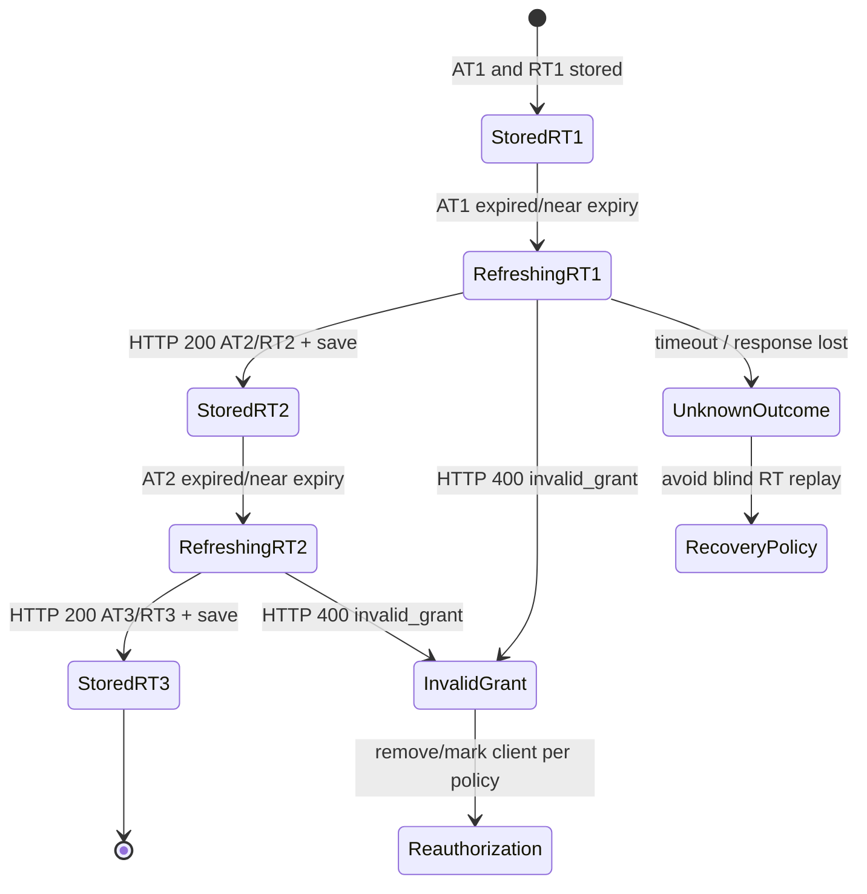
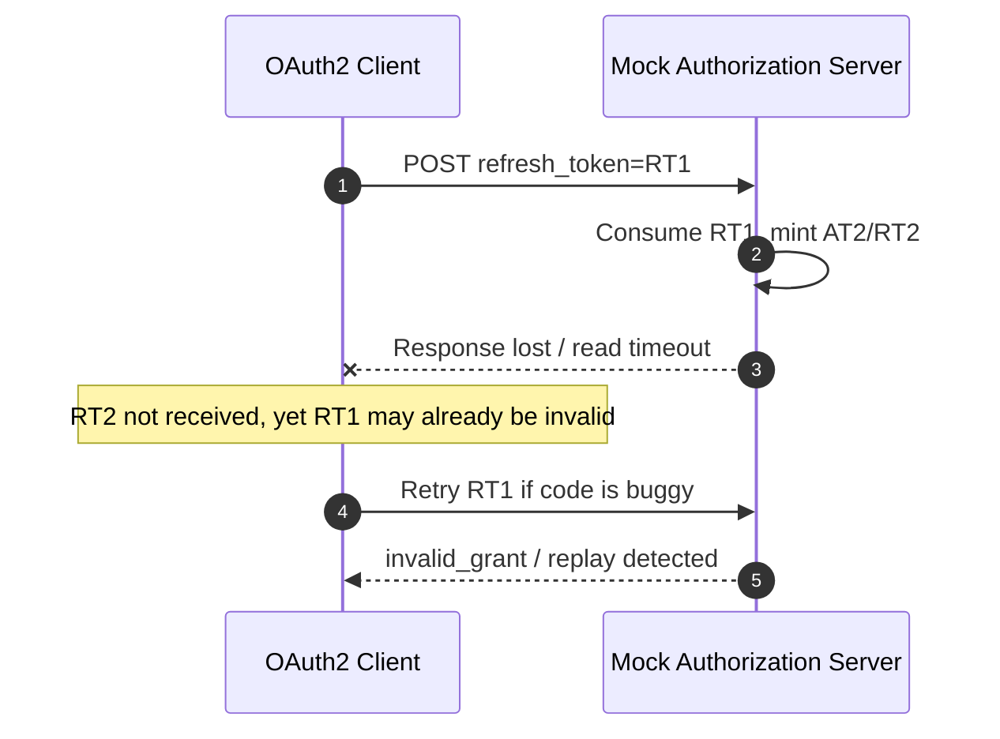
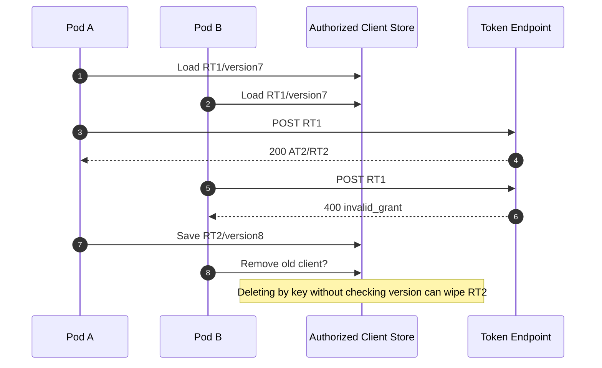
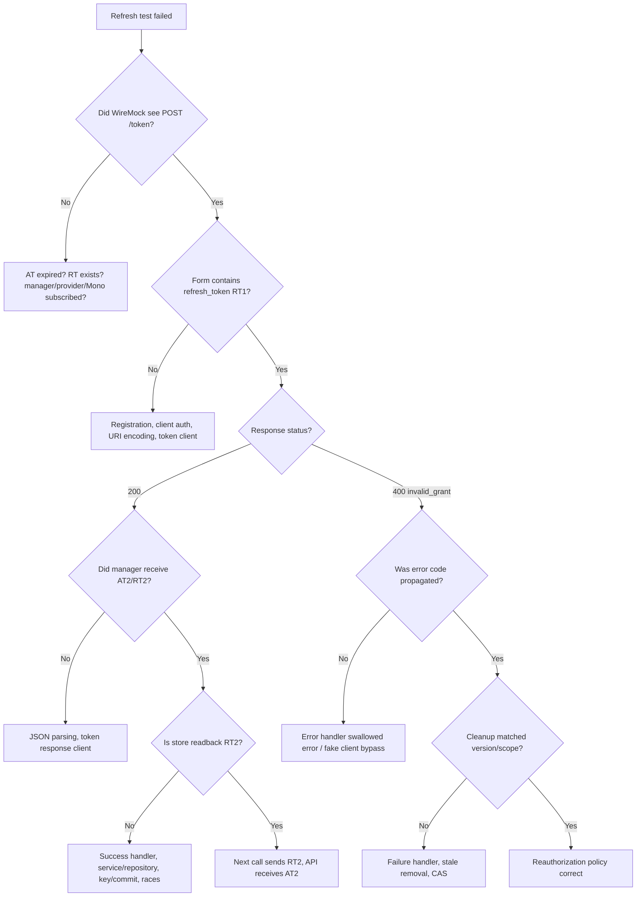

# 31.7. Testing Refresh Token Rotation and invalid_grant

In a **Spring Security OAuth 2.0 / OpenID Connect (OIDC) Client** application, initial login may work flawlessly, yet later downstream APIs start returning 401, users get prompted to re-authorize, or multiple concurrent requests fail together. One major cause is **refresh token rotation**: when the Authorization Server (AS) receives refresh token `RT1` and mints a new access token `AT2`, it may also issue a **new refresh token `RT2` to replace RT1**. The next refresh must use RT2, not the already-consumed RT1.

When a stale refresh token is reused, the AS may return the OAuth2 error **`invalid_grant`**. Depending on provider policy, this can signal an expired token, revoked grant, wrong client, already-rotated token, or potential replay; some ASes even invalidate the entire token family. The problem goes beyond the HTTP response. The application must **store RT2 in the right place, read it back for the right principal/registration, prevent race conditions across instances, and handle `invalid_grant` without accidentally deleting another request's fresh token**.

Lesson **"31.7. Testing Refresh Token Rotation and invalid_grant"** in Chapter **31. Integration Testing** builds controlled integration tests using **JUnit 5, WireMock, Spring Security OAuth2AuthorizedClientManager, authorized-client storage, and Reactor/WebFlux**. Examples need no production OP, real passwords, or real client secrets; strings like `AT1`, `RT1`, and `RT2` are strictly fixtures.

> **What must be proven:** Do not just verify HTTP 200 from the token endpoint—verify **request sends RT1 → response issues AT2/RT2 → authorized client persists RT2 → next refresh sends RT2**. On `invalid_grant`, verify the error propagates properly, cleanup/reauthorization follows policy, and tokens belonging to other requests are never lost.

## 1. Learning Objectives

After this lesson, you will be able to:

1. Explain the refresh token grant and the lifecycle AT1/RT1 → AT2/RT2 → AT3/RT3.
2. Distinguish refresh token rotation, token revocation, reuse detection, and `invalid_grant` errors.
3. Build a fake token endpoint returning valid HTTP 200 or OAuth2 error 400 responses.
4. Create a `ClientRegistration` and expired `OAuth2AuthorizedClient` to trigger refresh intentionally.
5. Use `AuthorizedClientServiceOAuth2AuthorizedClientManager` with a refresh provider in backend/Servlet tests.
6. Verify `grant_type=refresh_token`, the refresh token value, and client authentication in form requests via WireMock.
7. Read back `OAuth2AuthorizedClientService` to confirm RT2 was persisted within the test store's scope.
8. Test `invalid_grant` and verify failure handlers do not swallow errors, retry indefinitely, or delete unrelated authorized clients.
9. Simulate concurrent refreshes, stale writes, stale deletes, and optimistic locking.
10. Write Reactive integration tests using `AuthorizedClientServiceReactiveOAuth2AuthorizedClientManager`/`StepVerifier`.
11. Verify outbound `WebClient` sends the new access token and never sends the refresh token as a bearer token.
12. Distinguish unit/component/integration/contract tests and recognize each layer's boundaries.

## 2. Two Distinct Lifecycles: OIDC Login and Refresh Token

Authorization Code + OIDC Login:

```text
Browser -> /oauth2/authorization/company-login
        -> OpenID Provider /authorize
        -> callback ?code=...&state=...
Portal  -> POST /token, grant_type=authorization_code
AS      -> access_token, id_token, refresh_token (if issued)
Portal  -> validate ID Token, Authentication, OAuth2AuthorizedClient
```

After the user has logged in:

```text
Authorized Client Store:
  registrationId = reports-api
  principalName  = alice
  accessToken    = AT1 (expired)
  refreshToken   = RT1 (available)

Portal -> POST /token
          grant_type=refresh_token
          refresh_token=RT1
AS     -> access_token=AT2
          refresh_token=RT2 (if rotated)

Portal -> save AT2/RT2 into the exact authorized client
```

A refresh token grant typically does not require the browser to revisit the OP screen; it **does not automatically create a new OIDC Login, enforce MFA again, or refresh the entire `SecurityContext`**. The browser session may remain authenticated even while the token to call the Reports API can no longer be refreshed.

### 2.1. Role of Each Value

| Value | Kind | Where Used? |
|---|---|---|
| `AT1` | Old access token | Bearer when calling APIs; may already be expired |
| `RT1` | Old refresh token | Body of the token refresh request |
| `AT2` | New access token | Bearer for Reports API after refresh |
| `RT2` | New refresh token | Used in place of RT1 on the next refresh |
| `AT3`/`RT3` | Next-round tokens | Proves RT1 is not reused |
| `ID Token` | OIDC identity token | Verifies identity; not a refresh credential |
| `ClientRegistration` | OAuth2 client config | Registration ID, client ID, token URI, grant, scopes |
| `OAuth2AuthorizedClient` | Token state | Registration + principal + AT/RT |

Never send `RT1`/`RT2` in an HTTP `Authorization: Bearer` header to a Resource Server, and never use an ID Token as a refresh token.

### 2.2. HTTP Refresh Request

```http
POST /oauth2/token HTTP/1.1
Host: idp.example.org
Content-Type: application/x-www-form-urlencoded
Authorization: Basic <TEST_CLIENT_CREDENTIALS>

grant_type=refresh_token&refresh_token=RT1
```

This is illustrative content; the real HTTP client URL-encodes form parameters and applies client authentication per `ClientRegistration`. Never embed production credentials in code or test logs.

### 2.3. Token Response with Rotation

```http
HTTP/1.1 200 OK
Content-Type: application/json
Cache-Control: no-store

{
  "access_token": "AT2",
  "token_type": "Bearer",
  "expires_in": 3600,
  "refresh_token": "RT2",
  "scope": "reports.read"
}
```

An AS might **not** issue a new refresh token. When the response omits `refresh_token`, many OAuth2 clients retain the existing RT per provider contract. This differs from a response containing an empty or invalid refresh token.

### 2.4. `invalid_grant` Has More Than One Cause

```http
HTTP/1.1 400 Bad Request
Content-Type: application/json

{
  "error": "invalid_grant",
  "error_description": "Refresh token is not valid"
}
```

Possibilities:

- The refresh token expired.
- User/admin revoked the grant or token.
- RT1 was already consumed during rotation.
- Another pod already used RT1.
- Token was issued to a different client or used with wrong client authentication.
- Provider enforces replay/family revocation policies.

**Do not conclude for certain that a replay attack occurred solely from `invalid_grant`.** Finding the root cause requires telemetry and provider contract context.

## 3. Refresh Token Rotation State Machine



**Invariants to test**:

1. Request #1 sends `refresh_token=RT1`, not AT1.
2. Response #1 is parsed into AT2/RT2.
3. Both the returned `OAuth2AuthorizedClient` and **store readback** hold RT2.
4. Request #2 sends RT2, never reusing RT1.
5. `invalid_grant` from the AS is treated as a failure, never turned into a successful authorized client.
6. If a custom failure handler removes the client, it removes only the matching record without deleting a concurrent request's fresh token.
7. Reports API receives `Bearer AT2`, never RT1/RT2.
8. No token values or client secrets appear in logs, metrics, or HTTP responses to the browser.

## 4. Choosing the Right Test Layer

| Layer | Test Harness | What Is Proven |
|---|---|---|
| Unit token client | Fake `OAuth2AccessTokenResponseClient` | Response/error mapping in the class |
| Component manager | Fake token response client + in-memory service | Manager load, refresh, save/remove |
| **HTTP integration** | **WireMock/MockWebServer + real token response client** | Form POST, client auth, HTTP parsing, manager, storage |
| Persistence integration | Testcontainers JDBC/Redis | Commit, serialization, versioning, races |
| Servlet HTTP integration | MockMvc + session/repository | Real web request triggers reauthorization |
| Reactive integration | WebFlux/StepVerifier + reactive store + HTTP stub | Mono subscription, save/remove/error |
| Provider contract | Organization-managed staging tenant/realm | Real OP rotation, grace period, reuse detection |

Mocking `getTokenResponse()` alone does not prove HTTP form encoding or client authentication. Conversely, calling `POST /token` directly with RestClient without going through the manager **does not prove RT2 is saved properly in the authorized client service**.

### 4.1. Mock OAuth2 Login Is Not Enough to Test Refresh

`mockOidcLogin()`, `oidcLogin()`, or `mockOAuth2Client()` help test app code with a mock Authentication/authorized client; they **do not execute token endpoint grants in an integration sense**. To test rotation, you need an expired authorized client, a refresh provider, a token HTTP client, and matching storage.

### 4.2. Test Both the Returned Object and Side Effects

```text
Object result:
  manager.authorize(...) -> OAuth2AuthorizedClient(AT2, RT2)

Storage effect:
  loadAuthorizedClient("reports-api", "alice") -> AT2, RT2

External effect:
  WireMock journal -> refresh_token=RT1 exactly once
```

Missing any one of these three layers can let critical bugs slip through.

## 5. Test Infrastructure and Dependencies

Maven example:

```xml
<dependencies>
  <dependency>
    <groupId>org.springframework.boot</groupId>
    <artifactId>spring-boot-starter-oauth2-client</artifactId>
  </dependency>
  <dependency>
    <groupId>org.springframework.boot</groupId>
    <artifactId>spring-boot-starter-test</artifactId>
    <scope>test</scope>
  </dependency>
  <dependency>
    <groupId>org.springframework.security</groupId>
    <artifactId>spring-security-test</artifactId>
    <scope>test</scope>
  </dependency>
  <dependency>
    <groupId>org.wiremock</groupId>
    <artifactId>wiremock</artifactId>
    <version><!-- 3.x version chosen by project --></version>
    <scope>test</scope>
  </dependency>
</dependencies>
```

Corresponding Gradle:

```gradle
implementation 'org.springframework.boot:spring-boot-starter-oauth2-client'
testImplementation 'org.springframework.boot:spring-boot-starter-test'
testImplementation 'org.springframework.security:spring-security-test'
testImplementation 'org.wiremock:wiremock:3.9.2' // Example version
```

Example APIs target Spring Security 6.4+ where `RestClientRefreshTokenTokenResponseClient` exists; projects on older versions may need `DefaultRefreshTokenTokenResponseClient`/`RestOperations`. For Spring Security 7.x or other Boot releases, check the matching version's API docs. Never mix APIs from different major versions haphazardly.

### 5.1. Dynamic Port and Server Lifecycle

```java
import com.github.tomakehurst.wiremock.WireMockServer;
import static com.github.tomakehurst.wiremock.core
        .WireMockConfiguration.options;

WireMockServer tokenServer =
        new WireMockServer(options().dynamicPort());

tokenServer.start();
try {
    String tokenUri = tokenServer.baseUrl() + "/oauth2/token";
    // Use this URI in the test's ClientRegistration.
} finally {
    tokenServer.stop();
}
```

Dynamic ports prevent port collisions across CI agents. Loopback HTTP here is strictly for **test-local stubs**; production token endpoints must use HTTPS and proper truststores. To test TLS/mTLS, stand up an HTTPS mock server and configure dedicated trust material in the test.

### 5.2. A Test Does Not Need Full-System SpringBootTest

You can instantiate the manager, registrations, in-memory service, and WireMock directly inside a JUnit test class. This tests the OAuth2 token refresh code path and HTTP transport. Reach for `@SpringBootTest` only when verifying bean wiring, a real JDBC repository, the security filter chain, callbacks, or controllers.

## 6. Fixture: ClientRegistration

```java
import org.springframework.security.oauth2.client.registration.ClientRegistration;
import org.springframework.security.oauth2.core.AuthorizationGrantType;
import org.springframework.security.oauth2.core.ClientAuthenticationMethod;

static ClientRegistration testRegistration(String tokenUri) {
    return ClientRegistration.withRegistrationId("reports-api")
            .clientId("reports-client-test")
            .clientSecret("fake-secret-test-only")
            .clientAuthenticationMethod(
                    ClientAuthenticationMethod.CLIENT_SECRET_BASIC)
            .authorizationGrantType(
                    AuthorizationGrantType.AUTHORIZATION_CODE)
            .authorizationUri("http://localhost/unused-authorization")
            .redirectUri("{baseUrl}/login/oauth2/code/{registrationId}")
            .tokenUri(tokenUri)
            .scope("openid", "reports.read")
            .clientName("Reports API Test")
            .build();
}
```

Note: `ClientRegistration.authorizationGrantType` remains `authorization_code` because the authorized client originated from user consent. `refresh_token` is the grant **used after an OAuth2AuthorizedClient already exists**, not a value you swap into the registration just to test rotation.

### 6.1. Lookup Key

An authorized client is keyed by:

```text
registrationId = reports-api
principalName  = alice
```

The AS-issued `clientId=reports-client-test` is not Spring Security's `registrationId`. If you seed a token for Alice yet authorize as Bob, the manager cannot read Alice's RT1—that is a broken test fixture, not proof of a refresh bug.

## 7. Fixture: Expired OAuth2AuthorizedClient

```java
import java.time.Instant;
import java.util.Set;
import org.springframework.security.oauth2.client.OAuth2AuthorizedClient;
import org.springframework.security.oauth2.client.registration.ClientRegistration;
import org.springframework.security.oauth2.core.OAuth2AccessToken;
import org.springframework.security.oauth2.core.OAuth2RefreshToken;

static OAuth2AuthorizedClient expiredClient(
        ClientRegistration registration,
        String principalName,
        String atValue,
        String rtValue) {

    Instant now = Instant.now();
    var accessToken = new OAuth2AccessToken(
            OAuth2AccessToken.TokenType.BEARER,
            atValue,
            now.minusSeconds(7200),
            now.minusSeconds(3600),
            Set.of("reports.read"));

    var refreshToken = new OAuth2RefreshToken(
            rtValue, now.minusSeconds(7200));

    return new OAuth2AuthorizedClient(
            registration, principalName, accessToken, refreshToken);
}
```

The AT expired an hour ago so the refresh provider is guaranteed to take the refresh branch. **Never use `Thread.sleep()` to wait for token expiry**, as tests become slow and flaky. Dedicated clock-skew tests can use `Clock.fixed(...)` or refresh provider clock settings if supported by the API.

### 7.1. Do Not Assume Refresh Tokens Live Forever

Refresh tokens may be bounded by AS lifetime, usage count, inactivity timeout, or revocation; expiration metadata at the client may be incomplete. In tests with RT1, WireMock decides whether to accept or reject per scenario, rather than relying on a token string that "looks valid."

## 8. Synchronous Manager Suited for Backend Tests

In Servlet apps, `DefaultOAuth2AuthorizedClientManager` uses `OAuth2AuthorizedClientRepository` and the Servlet request context. To isolate token lifecycle outside HTTP requests, use `AuthorizedClientServiceOAuth2AuthorizedClientManager` backed by `OAuth2AuthorizedClientService`.

```java
import org.springframework.security.oauth2.client
        .AuthorizedClientServiceOAuth2AuthorizedClientManager;
import org.springframework.security.oauth2.client
        .OAuth2AuthorizedClientProviderBuilder;
import org.springframework.security.oauth2.client
        .OAuth2AuthorizedClientProvider;
import org.springframework.security.oauth2.client.OAuth2AuthorizedClientService;
import org.springframework.security.oauth2.client.registration
        .ClientRegistrationRepository;
import org.springframework.security.oauth2.client.endpoint
        .RestClientRefreshTokenTokenResponseClient;

static AuthorizedClientServiceOAuth2AuthorizedClientManager testManager(
        ClientRegistrationRepository registrations,
        OAuth2AuthorizedClientService service) {

    var refreshTokenHttpClient =
            new RestClientRefreshTokenTokenResponseClient();

    OAuth2AuthorizedClientProvider provider =
            OAuth2AuthorizedClientProviderBuilder.builder()
                .refreshToken(refresh ->
                        refresh.accessTokenResponseClient(
                                refreshTokenHttpClient))
                .build();

    var manager =
            new AuthorizedClientServiceOAuth2AuthorizedClientManager(
                    registrations, service);
    manager.setAuthorizedClientProvider(provider);
    return manager;
}
```

The test provider chain enables only `refreshToken()` so it does not accidentally trigger client credentials or another authorization code flow. In production, the chain may include `authorizationCode()`, `clientCredentials()`, custom token exchanges, and success/failure handlers.

### 8.1. Managers to Distinguish

| Manager | Used In | Authorized Client Storage |
|---|---|---|
| `DefaultOAuth2AuthorizedClientManager` | Servlet requests | `OAuth2AuthorizedClientRepository` |
| `AuthorizedClientServiceOAuth2AuthorizedClientManager` | Backend jobs outside Servlet requests | `OAuth2AuthorizedClientService` |
| `DefaultReactiveOAuth2AuthorizedClientManager` | WebFlux `ServerWebExchange` | `ServerOAuth2AuthorizedClientRepository` |
| `AuthorizedClientServiceReactiveOAuth2AuthorizedClientManager` | Reactive services/background | `ReactiveOAuth2AuthorizedClientService` |

An integration test of manager/service does not automatically prove the session-based repository of a Servlet/Reactive UI. Test that layer separately if your app uses it.

## 9. WireMock Token Endpoint: RT1 -> AT2/RT2

```java
import static com.github.tomakehurst.wiremock.client.WireMock.*;

tokenServer.stubFor(
    post(urlEqualTo("/oauth2/token"))
        .withRequestBody(containing("grant_type=refresh_token"))
        .withRequestBody(containing("refresh_token=RT1"))
        .willReturn(okJson("""
            {
              "access_token":"AT2",
              "token_type":"Bearer",
              "expires_in":3600,
              "refresh_token":"RT2",
              "scope":"reports.read"
            }
            """)));
```

This is the HTTP response from the **fake AS**. Because the real token response client sends requests to WireMock, tests can verify:

- HTTP POST method and right path/tokenUri.
- Body `grant_type=refresh_token`.
- Body contains the exact RT1.
- HTTP Basic/client-auth method per registration.
- JSON parsed by the token client.
- Returned object and store updated.

### 9.1. Verifying Client Authentication in Tests

```java
tokenServer.verify(
        1,
        postRequestedFor(urlEqualTo("/oauth2/token"))
                .withRequestBody(containing(
                        "refresh_token=RT1"))
                .withHeader(
                        "Authorization",
                        matching("Basic .+")));
```

In production, OAuth2 client authentication might be `client_secret_basic`, `client_secret_post`, mTLS, or `private_key_jwt` per provider contract; the example uses Basic for clarity. Never log headers containing real credentials.

### 9.2. Form Encoding Must Be Verified Properly

An RT is an opaque string that can contain `+`, `/`, `=`, or `%`. If hand-concatenated as:

```text
refresh_token=opaque+/=value
```

in `application/x-www-form-urlencoded`, `+` can decode into a space. Use the standard token response client and test URL encoding—for example, a token `opaque+/=value` must be sent properly form-encoded. Never append refresh tokens onto URL query strings.

## 10. Full Integration Test: Refreshing and Persisting the New Token

The example below uses the helpers `testRegistration`, `expiredClient`, and `testManager` defined in Sections 6–8. The project requires Java 17+ for text blocks.

```java
import com.github.tomakehurst.wiremock.WireMockServer;
import java.util.List;
import org.junit.jupiter.api.AfterEach;
import org.junit.jupiter.api.BeforeEach;
import org.junit.jupiter.api.Test;
import org.springframework.security.authentication
        .UsernamePasswordAuthenticationToken;
import org.springframework.security.core.Authentication;
import org.springframework.security.oauth2.client.OAuth2AuthorizeRequest;
import org.springframework.security.oauth2.client.OAuth2AuthorizedClient;
import org.springframework.security.oauth2.client
        .AuthorizedClientServiceOAuth2AuthorizedClientManager;
import org.springframework.security.oauth2.client
        .InMemoryOAuth2AuthorizedClientService;
import org.springframework.security.oauth2.client.registration.ClientRegistration;
import org.springframework.security.oauth2.client.registration
        .InMemoryClientRegistrationRepository;

import static com.github.tomakehurst.wiremock.client.WireMock.*;
import static com.github.tomakehurst.wiremock.core
        .WireMockConfiguration.options;
import static org.assertj.core.api.Assertions.assertThat;

class RefreshRotationIntegrationTest {

    private WireMockServer server;
    private ClientRegistration registration;
    private InMemoryOAuth2AuthorizedClientService service;
    private AuthorizedClientServiceOAuth2AuthorizedClientManager manager;
    private Authentication alice;

    @BeforeEach
    void setUp() {
        server = new WireMockServer(options().dynamicPort());
        server.start();

        registration = testRegistration(
                server.baseUrl() + "/oauth2/token");
        var registrations =
                new InMemoryClientRegistrationRepository(registration);
        service = new InMemoryOAuth2AuthorizedClientService(
                registrations);
        manager = testManager(registrations, service);
        alice = UsernamePasswordAuthenticationToken.authenticated(
                "alice", "N/A", List.of());

        service.saveAuthorizedClient(
                expiredClient(registration, "alice", "AT1", "RT1"),
                alice);
    }

    @AfterEach
    void tearDown() {
        if (server != null) server.stop();
    }

    @Test
    void refreshRotatesTokenAndPersistsRt2() {
        server.stubFor(
            post(urlEqualTo("/oauth2/token"))
                .withRequestBody(containing("grant_type=refresh_token"))
                .withRequestBody(containing("refresh_token=RT1"))
                .willReturn(okJson("""
                    {
                      "access_token":"AT2",
                      "token_type":"Bearer",
                      "expires_in":3600,
                      "refresh_token":"RT2",
                      "scope":"reports.read"
                    }
                    """)));

        OAuth2AuthorizeRequest request = OAuth2AuthorizeRequest
                .withClientRegistrationId("reports-api")
                .principal(alice)
                .build();

        OAuth2AuthorizedClient result = manager.authorize(request);
        assertThat(result).isNotNull();
        assertThat(result.getAccessToken().getTokenValue())
                .isEqualTo("AT2");
        assertThat(result.getRefreshToken().getTokenValue())
                .isEqualTo("RT2");

        OAuth2AuthorizedClient persisted = service.loadAuthorizedClient(
                "reports-api", alice.getName());
        assertThat(persisted).isNotNull();
        assertThat(persisted.getAccessToken().getTokenValue())
                .isEqualTo("AT2");
        assertThat(persisted.getRefreshToken().getTokenValue())
                .isEqualTo("RT2");

        server.verify(
                1,
                postRequestedFor(urlEqualTo("/oauth2/token"))
                    .withRequestBody(containing(
                            "grant_type=refresh_token"))
                    .withRequestBody(containing(
                            "refresh_token=RT1")));
    }
}
```

### 10.1. Why Read Back from Storage?

The object returned by `manager.authorize(...)` might show AT2/RT2, yet if the success handler fails to save to the DB or the app uses a different repository, the next call will still read RT1. Reading back from `OAuth2AuthorizedClientService` verifies the **storage side effect of the integration path**, not just the method's return value.

In this test, readback proves the test's in-memory service; if production uses JDBC/Redis, add real integration tests for that store.

### 10.2. Expected HTTP Request Count

One refresh in the happy path corresponds to one POST token request when there are no retries. If your code uses an HTTP client with internal retries, distinguish **logical authorize calls** from **physical HTTP attempts**; tests at the HTTP boundary should verify actual attempt counts.

### 10.3. No Need to Call OP /authorize in Refresh Tests

We seed the authorized client as if login already occurred. The goal here is the refresh grant, not PKCE/state/nonce/callback validation. Those belong in a separate OIDC Login integration test.

## 11. Proving RT2 Is Used on the Next Refresh

After refreshing, AT2 from the mock has `expires_in=3600`, so the manager will reuse it if called immediately. To force the next refresh **without waiting an hour**, replace the store entry with an expired authorized client **while keeping the exact RT2 that was asserted/read back**:

```java
OAuth2AuthorizedClient saved = service.loadAuthorizedClient(
        "reports-api", alice.getName());
assertThat(saved.getRefreshToken().getTokenValue())
        .isEqualTo("RT2");

service.saveAuthorizedClient(
        expiredClient(
                registration,
                alice.getName(),
                saved.getAccessToken().getTokenValue(),
                saved.getRefreshToken().getTokenValue()),
        alice);

server.stubFor(
    post(urlEqualTo("/oauth2/token"))
        .withRequestBody(containing("refresh_token=RT2"))
        .willReturn(okJson("""
            {
              "access_token":"AT3",
              "token_type":"Bearer",
              "expires_in":3600,
              "refresh_token":"RT3"
            }
            """)));

OAuth2AuthorizedClient result = manager.authorize(
        OAuth2AuthorizeRequest
            .withClientRegistrationId("reports-api")
            .principal(alice)
            .build());

assertThat(result.getAccessToken().getTokenValue())
        .isEqualTo("AT3");
assertThat(result.getRefreshToken().getTokenValue())
        .isEqualTo("RT3");

server.verify(
        1,
        postRequestedFor(urlEqualTo("/oauth2/token"))
            .withRequestBody(containing("refresh_token=RT2")));
```

**Important:** First prove RT2 came from the manager/store after refresh #1. If you manually hardcode `RT2` into the fixture without asserting storage, test #2 can pass even if the application never actually persisted the new token.

### 11.1. Normal Path Must Never Reuse RT1

Across two successful refreshes:

```text
Request #1: refresh_token=RT1 -> AT2, RT2
Request #2: refresh_token=RT2 -> AT3, RT3
Final store: AT3, RT3
```

Do not just assert total requests == 2; verify **the refresh token value on each attempt**.

## 12. WireMock Scenario Simulating One-Time Tokens

A simple WireMock stub may accept RT1 indefinitely, whereas many providers consume the RT upon rotation. Use a Scenario:

```text
State STARTED:
   RT1 -> 200 AT2/RT2, transitions to RT1_SPENT

State RT1_SPENT:
   RT1 -> 400 invalid_grant
   RT2 -> 200 AT3/RT3, transitions to RT2_SPENT

State RT2_SPENT:
   RT2 -> 400 invalid_grant
```

### 12.1. Stubbing Single-Use RT1

```java
import static com.github.tomakehurst.wiremock.stubbing.Scenario.STARTED;

server.stubFor(
    post(urlEqualTo("/oauth2/token"))
        .inScenario("refresh-rotation")
        .whenScenarioStateIs(STARTED)
        .withRequestBody(containing("refresh_token=RT1"))
        .willReturn(okJson("""
            {
              "access_token":"AT2",
              "token_type":"Bearer",
              "expires_in":3600,
              "refresh_token":"RT2"
            }
            """))
        .willSetStateTo("RT1_SPENT"));

server.stubFor(
    post(urlEqualTo("/oauth2/token"))
        .inScenario("refresh-rotation")
        .whenScenarioStateIs("RT1_SPENT")
        .withRequestBody(containing("refresh_token=RT1"))
        .willReturn(
            aResponse().withStatus(400)
                .withHeader("Content-Type", "application/json")
                .withBody("""
                    {
                      "error":"invalid_grant",
                      "error_description":"RT already used"
                    }
                    """)));
```

### 12.2. RT2 Remains Valid After the First Use

```java
server.stubFor(
    post(urlEqualTo("/oauth2/token"))
        .inScenario("refresh-rotation")
        .whenScenarioStateIs("RT1_SPENT")
        .withRequestBody(containing("refresh_token=RT2"))
        .willReturn(okJson("""
            {
              "access_token":"AT3",
              "token_type":"Bearer",
              "expires_in":3600,
              "refresh_token":"RT3"
            }
            """))
        .willSetStateTo("RT2_SPENT"));
```

A WireMock Scenario is a test double, not proof that the production AS applies the exact same grace/reuse policy. To verify provider-specific semantics, use a provider-supported test realm/staging environment with least-privilege credentials.

### 12.3. Resetting Scenario State

If running multiple tests on the same WireMock server:

- Reset stubs, scenarios, and the request journal between tests.
- Or create a dedicated server per test.
- Never share a mutable Scenario across parallel tests.

A test that passes in isolation yet fails in the full suite often means `RT1_SPENT` state leaked from an earlier test.

## 13. invalid_grant: Testing HTTP Errors and Manager Behavior

Simulating the AS rejecting a refresh token:

```java
server.stubFor(
    post(urlEqualTo("/oauth2/token"))
        .withRequestBody(containing("refresh_token=RT1"))
        .willReturn(
            aResponse().withStatus(400)
                .withHeader("Content-Type", "application/json")
                .withBody("""
                    {
                      "error":"invalid_grant",
                      "error_description":"Token invalid or revoked"
                    }
                    """)));
```

### 13.1. Exception Must Carry the OAuth2 Error Code

```java
import org.springframework.security.oauth2.core.OAuth2AuthorizationException;
import static org.assertj.core.api.Assertions.assertThatThrownBy;

var request = OAuth2AuthorizeRequest
        .withClientRegistrationId("reports-api")
        .principal(alice)
        .build();

assertThatThrownBy(() -> manager.authorize(request))
        .isInstanceOf(OAuth2AuthorizationException.class)
        .satisfies(error -> {
            var oauth = (OAuth2AuthorizationException) error;
            assertThat(oauth.getError().getErrorCode())
                    .isEqualTo("invalid_grant");
        });
```

Depending on wrappers/versions, the OAuth2 exception may sit in the cause chain. Tests at the controller/WebClient layer may need to unwrap `OAuth2AuthorizationException` from a higher-level exception. Never assert raw `error_description` as a Spring Security security contract.

### 13.2. Checking the Failure Handler

Spring Security OAuth2 managers expose the `OAuth2AuthorizationFailureHandler` extension point. In many built-in configurations, `invalid_grant` is handled by removing the stale authorized client so an AS-rejected refresh token isn't reused. If the application installs a custom handler, behavior may differ.

With a **remove-on-invalid_grant** policy, after the exception:

```java
OAuth2AuthorizedClient remaining =
        service.loadAuthorizedClient("reports-api", "alice");
assertThat(remaining).isNull();
```

This assertion is only valid when the manager/test actually wires the removal failure handler to the same service. If business logic keeps a `reauthorization_required` status in a custom store, assert that status instead of forcing null.

### 13.3. Never Delete All Tokens/Sessions

An `invalid_grant` for `(reports-api, alice)` typically concerns only that specific authorized client. Seed the test:

```text
(reports-api, alice)   -> invalid RT1
(reports-api, bob)     -> valid RT_BOB
(inventory-api, alice) -> valid RT_INVENTORY
```

After Alice/Reports fails:

- Alice/Reports is removed or marked per policy.
- Bob/Reports is untouched.
- Alice/Inventory is untouched.
- The browser authentication session is not wiped completely unless business rules require it.

### 13.4. invalid_grant Is Not Automatic Reauthentication

The manager can surface the error and remove the token, yet cannot automatically complete OIDC Authorization Code/MFA for the user again. Browser-facing layers must define reauthorization UX, while background jobs need dedicated events/errors. Never retry RT1 infinitely hoping to "get a token back."

## 14. AS Returns 200 Without a New refresh_token

A non-rotating AS might return:

```json
{
  "access_token":"AT2",
  "token_type":"Bearer",
  "expires_in":3600,
  "scope":"reports.read"
}
```

Clients typically retain the old refresh token per OAuth2 semantics when the AS does not issue a new one:

```text
Before: AT1 expired, RT1
After:  AT2 valid,   RT1
```

This is **not inherently an error**. Test this differently from rotation:

1. Stub a response without `refresh_token`.
2. Call the manager with expired AT1/RT1.
3. Assert AT2 is persisted.
4. Assert RT1 is preserved per client implementation/provider contract.
5. Never fabricate RT2 inside the application.

Conversely, a response with `refresh_token=""` may be an invalid response. Test parser/error behavior separately; never store an empty string as a valid credential.

## 15. Missing Initial Refresh Token

Some registrations lack an RT due to consent/scope/provider policy. Create:

```java
OAuth2AuthorizedClient withoutRefresh =
        new OAuth2AuthorizedClient(
                registration,
                "alice",
                expiredAccessToken,
                null);
```

When the provider chain only has `refreshToken()`, no refresh grant can run. Manager behavior may return an un-reauthorized client or handle it per config; **do not automatically assert HTTP 400 invalid_grant**, since the AS never even received a request.

Verify:

- The token endpoint receives no `POST /token`.
- The application has a clear error/reauthorization policy.
- The expired AT is never sent to APIs as if still valid.

## 16. Testing HTTP 503, TLS, and Network Errors Differently from invalid_grant

| Kind | Observation | Handling Direction |
|---|---|---|
| `invalid_grant` | OAuth2 error 400 | Refresh credential unusable; remove/re-authorize per policy |
| `invalid_client` | OAuth2 error 400/401 | Check client auth/secret/mTLS/config, don't blame user |
| `temporarily_unavailable` | AS reports temporary outage | Keep RT per policy, bounded retry/backoff |
| HTTP 500/502/503 | Provider/network infrastructure | Do not remove RT as invalid_grant without evidence |
| DNS/connect timeout | Unreachable | Check egress/DNS/pools; handle outage |
| Read timeout after POST | **Unknown outcome** | Never blindly replay RT |
| TLS handshake failure | Truststore/SAN/mTLS | Fix TLS transport, not OAuth2 grant |
| Invalid JSON | Token endpoint/parser failure | Never save invalid response |
| API 401/403 | Resource Server rejects access token | Does not equal token endpoint invalid_grant |

WireMock 503 example:

```java
server.stubFor(
    post(urlEqualTo("/oauth2/token"))
        .willReturn(
            aResponse().withStatus(503)
                .withHeader("Content-Type", "application/json")
                .withBody("""
                    {"error":"temporarily_unavailable"}
                    """)));
```

Tests must distinguish **failure handler cleanup**. Never delete tokens simply because all network errors map to a generic failure.

## 17. Unknown Outcome: Timeout After the AS Already Rotated



When a request times out, you cannot tell whether the AS processed the token or not. Tests can use a WireMock delay:

```java
server.stubFor(
    post(urlEqualTo("/oauth2/token"))
        .withRequestBody(containing("refresh_token=RT1"))
        .willReturn(
            aResponse()
                .withFixedDelay(10_000)
                .withStatus(200)
                .withHeader("Content-Type", "application/json")
                .withBody("""
                    {"access_token":"AT2",
                     "token_type":"Bearer",
                     "expires_in":3600,
                     "refresh_token":"RT2"}
                    """)));
```

Configure the token HTTP client's **read/response timeout** shorter than the mock delay (e.g., a few hundred ms) so tests run fast. Expectations:

- No "successful" AT2/RT2 if the app never received the response.
- HTTP call counts/retry behavior stay within budget.
- No infinite auto-retry of RT1.
- Error classified as `network/unknown_outcome`, never assumed to be `invalid_grant`.
- Never log RT1/RT2.
- Store follows the defined recovery policy.

Some ASes support a grace period/idempotency; rely only on a verified provider contract—never add an `Idempotency-Key` header and assume the AS understands it.

## 18. Concurrency: Two Pods Refreshing the Same Token Simultaneously

This is the easiest way to trigger a production incident.



### 18.1. Two Distinct Races

**Race A — stale remove:** Pod B receives `invalid_grant` on RT1 and its failure handler deletes the entire record by `registrationId+principal` **after** Pod A already saved RT2. Valid RT2 is deleted.

**Race B — stale write:** Pod B holds an older snapshot and overwrites the fresh AT2/RT2 record with AT1/RT1 or an invalid state.

Hence, single-threaded unit tests using only `InMemoryOAuth2AuthorizedClientService` are insufficient.

### 18.2. Architectural Solutions That Must Be Tested

Depending on provider and store, you may use:

- Single-flight refresh within a single JVM.
- Distributed lock keyed by `(tenant, registrationId, principal)`.
- Optimistic locking or compare-and-set (CAS) on the authorized client record.
- Delete the record only if the current version equals the version read by the failed request.
- Reload the client upon detecting stale state before deciding to reauthorize.
- Never retry an old refresh token that already returned `invalid_grant`.
- Emit conflict/replay metrics with bounded labels, leaking no tokens.

**No single mechanism is guaranteed automatically by every Spring Security store.** Test your specific implementation, especially when using custom JDBC/Redis stores.

### 18.3. Illustrative SQL Compare-and-Swap

Example **application schema**, not Spring Security's default schema:

```sql
CREATE TABLE authorized_client_state (
    tenant_id         varchar(100) NOT NULL,
    registration_id   varchar(150) NOT NULL,
    principal_id      varchar(300) NOT NULL,
    record_version    bigint NOT NULL,
    encrypted_access  bytea NOT NULL,
    encrypted_refresh bytea NOT NULL,
    PRIMARY KEY (tenant_id, registration_id, principal_id)
);
```

When Pod A receives RT2:

```sql
UPDATE authorized_client_state
   SET encrypted_access = :encryptedAT2,
       encrypted_refresh = :encryptedRT2,
       record_version = record_version + 1
 WHERE tenant_id = :tenantId
   AND registration_id = :registrationId
   AND principal_id = :principalId
   AND record_version = :observedVersion;
```

Affected rows = 0 indicates the record changed concurrently. Never blindly overwrite with a stale snapshot. A real schema also needs token type, scopes, issuedAt/expiresAt, serialization, and encryption-key metadata.

### 18.4. Conditional Remove on invalid_grant

Do not delete unconditionally:

```sql
DELETE FROM authorized_client_state
 WHERE registration_id = :registrationId
   AND principal_id = :principalId;
```

Use conditional removal if policy requires deletion:

```sql
DELETE FROM authorized_client_state
 WHERE tenant_id = :tenantId
   AND registration_id = :registrationId
   AND principal_id = :principalId
   AND record_version = :versionSeenByFailedRefresh;
```

If Pod A already saved RT2/version8, Pod B holding version7 deletes 0 rows; RT2 is preserved. This is a **custom storage/failure-handler design**, not a feature guaranteed by every built-in `OAuth2AuthorizedClientService`.

### 18.5. Testing Races Without Sleeping

```java
CountDownLatch bothReadRt1 = new CountDownLatch(2);
CountDownLatch allowRequests = new CountDownLatch(1);

// Fake store/test hooks:
// each worker loads RT1 -> bothReadRt1.countDown()
// each worker awaits allowRequests
//
// Test waits for both to load the snapshot, then:
// allowRequests.countDown()
// Mock AS returns success for one RT1 request and invalid_grant for the other.
```

Use `CountDownLatch`, `CyclicBarrier`, or a fake store with interleaving hooks; never use `Thread.sleep(...)` hoping a race reproduces reliably in CI.

### 18.6. Two Types of Concurrency Contracts

| Strategy | HTTP Requests to AS | Expected Storage |
|---|---|---|
| Distributed lock/single-flight | Possibly only one RT1 refresh | RT2 saved; other requests reuse result |
| CAS without locking HTTP calls | Possibly two POST RT1, one invalid_grant | RT2 immune to stale remove/write |
| No concurrency control | Two POSTs and cleanup race | RT2 may be lost; tests should expose it |

Do not assert "only one HTTP request" if the design only promises storage CAS; those are two separate properties.

## 19. Failure Handlers and Races

Spring Security provides extension points:

- `OAuth2AuthorizationSuccessHandler`.
- `OAuth2AuthorizationFailureHandler`.
- `RemoveAuthorizedClientOAuth2AuthorizationFailureHandler` for corresponding cases.
- Reactive success/failure handlers in Reactive OAuth2 Client.

In many manager configurations, when `invalid_grant` occurs, the default handler removes the old authorized client from the repository/service. This prevents reusing an invalid RT1 in single-threaded flows. In multi-pod setups, however, **key-based removal does not protect a newly saved RT2 during a race**, unless the store/handler uses versioned conditions.

Tests should cover two scenarios:

1. **No race:** RT1 is genuinely invalid; old client is removed/marked for reauthorization, with no retries.
2. **Race:** Pod A already saved RT2; Pod B fails on stale RT1; Pod B must not delete the new RT2.

Never disable all cleanup just to make tests pass if doing so leaves the app using RT1 forever. Policies must safely handle both real invalid tokens and stale failures.

## 20. Testing Real Persistence with Testcontainers

`InMemoryOAuth2AuthorizedClientService` only proves behavior inside a single JVM. Production deployments using Redis/JDBC need dedicated integration tests:

```text
Manager A + Service A:
  load RT1
  HTTP refresh -> RT2
  commit RT2

Manager B + Service B:
  load same (registration, principal) from shared DB
  assert RT2
```

Items to verify:

- DB commit/rollback.
- Encryption at rest and serialization of access/refresh tokens.
- Lookup keys by registration/principal/tenant.
- Optimistic locking/version increment on save.
- Conditional delete never deletes a newer version.
- Concurrent refresh across two instances.
- Refresh token rotation while the DB is unavailable.
- Contention between logout and refresh writes/deletes.

### 20.1. AS Succeeds Yet DB Save Fails

```text
POST RT1 -> AS already consumed RT1, issued RT2
DB save RT2 -> exception/rollback
DB still holds RT1
Next refresh RT1 -> invalid_grant
```

Tests must verify the app does not report persistence success when the DB fails, and enforces a recovery/re-authentication policy. You cannot roll back a completed token rotation on the AS using a local JDBC transaction.

### 20.2. Logout/Refresh Race

```text
T1: Refresh RT1 -> AT2/RT2 awaiting response
T2: User logs out, authorized client removed
T3: Refresh success handler writes AT2/RT2 back
```

If logout must revoke token usage, enforce a session generation/version guard or coordination so RT is not resurrected after logout. This concurrent test differs from a race between two refresh requests.

## 21. Reactive WebFlux: Manager and StepVerifier

For Reactive, use:

- `InMemoryReactiveClientRegistrationRepository`.
- `InMemoryReactiveOAuth2AuthorizedClientService`.
- `AuthorizedClientServiceReactiveOAuth2AuthorizedClientManager`.
- `ReactiveOAuth2AuthorizedClientProviderBuilder.refreshToken()`.
- `WebClientReactiveRefreshTokenTokenResponseClient`.
- `StepVerifier`.

### 21.1. Setting Up the Reactive Manager

```java
import org.springframework.security.oauth2.client
        .AuthorizedClientServiceReactiveOAuth2AuthorizedClientManager;
import org.springframework.security.oauth2.client
        .InMemoryReactiveOAuth2AuthorizedClientService;
import org.springframework.security.oauth2.client
        .ReactiveOAuth2AuthorizedClientProvider;
import org.springframework.security.oauth2.client
        .ReactiveOAuth2AuthorizedClientProviderBuilder;
import org.springframework.security.oauth2.client.endpoint
        .WebClientReactiveRefreshTokenTokenResponseClient;
import org.springframework.security.oauth2.client.registration
        .InMemoryReactiveClientRegistrationRepository;
import org.springframework.web.reactive.function.client.WebClient;

var registrations =
        new InMemoryReactiveClientRegistrationRepository(registration);
var service =
        new InMemoryReactiveOAuth2AuthorizedClientService(registrations);

var tokenHttpClient =
        new WebClientReactiveRefreshTokenTokenResponseClient();
tokenHttpClient.setWebClient(WebClient.builder().build());

ReactiveOAuth2AuthorizedClientProvider provider =
        ReactiveOAuth2AuthorizedClientProviderBuilder.builder()
            .refreshToken(refresh ->
                    refresh.accessTokenResponseClient(tokenHttpClient))
            .build();

var manager =
        new AuthorizedClientServiceReactiveOAuth2AuthorizedClientManager(
                registrations, service);
manager.setAuthorizedClientProvider(provider);
```

WebClient uses the token URI in `ClientRegistration`, pointing to WireMock loopback. If the application uses proxies/TLS/mTLS, configure the exact HTTP client used by the token response client.

### 21.2. Reactive Test RT1 → RT2

```java
import org.springframework.security.oauth2.client.OAuth2AuthorizeRequest;
import org.springframework.security.oauth2.client.OAuth2AuthorizedClient;
import org.springframework.security.authentication
        .UsernamePasswordAuthenticationToken;
import reactor.core.publisher.Mono;
import reactor.test.StepVerifier;

var principal =
        UsernamePasswordAuthenticationToken.authenticated(
                "alice", "N/A", java.util.List.of());

var initial = expiredClient(registration, "alice", "AT1", "RT1");
var authorizeRequest = OAuth2AuthorizeRequest
        .withClientRegistrationId("reports-api")
        .principal(principal)
        .build();

Mono<OAuth2AuthorizedClient> operation =
        service.saveAuthorizedClient(initial, principal)
            .then(manager.authorize(authorizeRequest))
            .flatMap(result ->
                service.loadAuthorizedClient("reports-api", "alice")
                    .map(stored -> {
                        org.assertj.core.api.Assertions.assertThat(
                                result.getRefreshToken()
                                        .getTokenValue())
                                .isEqualTo("RT2");
                        return stored;
                    }));

StepVerifier.create(operation)
        .assertNext(stored -> {
            org.assertj.core.api.Assertions.assertThat(
                    stored.getAccessToken().getTokenValue())
                    .isEqualTo("AT2");
            org.assertj.core.api.Assertions.assertThat(
                    stored.getRefreshToken().getTokenValue())
                    .isEqualTo("RT2");
        })
        .verifyComplete();
```

WireMock must have `RT1 → 200 AT2/RT2` stubbed before subscribing. After `verifyComplete()`, verify the request journal recorded RT1.

### 21.3. Reactive invalid_grant

With WireMock returning HTTP 400:

```java
StepVerifier.create(
        service.saveAuthorizedClient(initial, principal)
            .then(manager.authorize(authorizeRequest)))
        .expectErrorMatches(error ->
                "invalid_grant".equals(
                        findOAuth2ErrorCode(error)))
        .verify();
```

`findOAuth2ErrorCode(Throwable)` is a test helper you implement for the cause chain/`OAuth2AuthorizationException`. If using remove-on-invalid_grant:

```java
StepVerifier.create(
        service.loadAuthorizedClient("reports-api", "alice"))
        .verifyComplete(); // Mono.empty() after cleanup
```

Do not assert empty if a custom failure handler intentionally keeps a different state; expectations must derive from your application's contract.

### 21.4. Cold Monos and Subscriptions

`manager.authorize(...)` returns a `Mono`. **Merely creating the Mono does not call the token endpoint.** `StepVerifier.verify()` subscribes and runs the flow.

Subscribing twice to a cold publisher can trigger two token requests and accidentally reuse RT1. Tests must control subscriptions/retries rather than calling `block()` inside a Reactive controller to force execution.

### 21.5. Reactive Service Manager vs WebFlux Exchange Manager

`AuthorizedClientServiceReactiveOAuth2AuthorizedClientManager` suits service/background contexts. If the app uses `DefaultReactiveOAuth2AuthorizedClientManager` inside requests, it depends on `ServerWebExchange` and `ServerOAuth2AuthorizedClientRepository`. Add tests via `WebTestClient` with the matching real repository/fixture.

`mockOAuth2Client()` pre-populates the client in the test repository without performing HTTP refreshes; never use it as proof of rotation.

## 22. Testing Outbound WebClient Sends AT2, Never RT2

After refresh, the Reports API must receive:

```http
GET /summary HTTP/1.1
Host: reports-api.example.org
Authorization: Bearer AT2
```

It must never receive:

```text
Bearer AT1 (expired)
Bearer RT1
Bearer RT2
```

Example Reports API stub:

```java
reportsServer.stubFor(
    get(urlEqualTo("/summary"))
        .withHeader("Authorization", equalTo("Bearer AT2"))
        .willReturn(okJson("""
            {"status":"ok","reports":3}
            """)));
```

After the controller/WebClient executes the call:

```java
reportsServer.verify(
    1,
    getRequestedFor(urlEqualTo("/summary"))
        .withHeader("Authorization", equalTo("Bearer AT2")));
```

A fake API that always returns 200 without checking the Authorization header will miss wrong-token bugs. Also verify the outbound target belongs to an allowed host; never send bearer tokens to arbitrary browser-supplied URLs.

## 23. Servlet MockMvc and Browser Sessions

For a Servlet application, the real flow may be:

```text
HTTP session + SecurityContext
  -> Controller / Service
  -> OAuth2AuthorizedClientRepository
  -> DefaultOAuth2AuthorizedClientManager
  -> RefreshTokenOAuth2AuthorizedClientProvider
  -> HTTP token endpoint
  -> Save authorized client
  -> Outbound API
```

`MockMvc` with `oauth2Login()` or `oidcLogin()` creates an authenticated principal, **yet does not guarantee** the authorized client store contains expired AT1/RT1 in the application's actual repository. Seed it explicitly and check:

- Does the session/principal have the exact expected name?
- Does the registration point to the test token URI?
- Was the manager injected from the right context?
- Did the token request to WireMock carry RT1?
- Does the repository/service readback contain RT2?
- Did the downstream API receive AT2?

Testing `DefaultOAuth2AuthorizedClientManager` outside a Servlet request context can fail due to missing `HttpServletRequest`/`HttpServletResponse`; use the service manager to isolate or MockMvc to supply a real request in tests.

### 23.1. invalid_grant Does Not Imply Default Logout

A user can still hold an `Authentication` in `SecurityContext` even when `reports-api` refresh is rejected. Business logic may prompt "Reconnect Reports API" without logging out of all services. Test response/error mapping and session state per your chosen policy; do not assume every `invalid_grant` must clear the web session.

## 24. Multi-User and Multi-Tenant Isolation

Seed multiple authorized clients:

```text
(reports-api, alice)   -> AT1/RT1
(reports-api, bob)     -> BAT/BRT
(inventory-api, alice) -> IAT/IRT
```

When Alice/Reports refreshes:

- Only Alice/Reports updates to AT2/RT2.
- Bob/Reports neither has its token used nor deleted.
- Alice/Inventory is untouched.

When Alice/Reports receives `invalid_grant`:

- Do not wipe all user sessions.
- Do not delete Bob or Inventory.
- If the app shares a registration across tenants, storage keys must enforce tenant isolation per design.

An identical OIDC `sub` from two issuers **does not prove the same user**; local identity mapping must include `(iss, sub)` and business authorization. Never take `principalName` from an arbitrary browser query parameter to load another user.

## 25. Refresh Token Rotation and OIDC Claims

After a successful refresh:

```text
OAuth2AuthorizedClient:
  accessToken = AT2
  refreshToken = RT2

SecurityContext:
  Authentication may remain the original principal
```

Refreshing does not force MFA or automatically update all `OidcUser` claims or business memberships. If the provider returns a new ID Token in the refresh response per OIDC contract, handling depends on the library/application; never assume every token refresh returns an ID Token.

If a user's tenant membership is revoked while their session is alive, enforce appropriate policy re-checks at resource boundaries; a valid access/refresh token does not prove continued business authorization.

## 26. Securing Test Data, Logs, and Metrics

**Use only fake credentials:**

```text
client_id     = reports-client-test
client_secret = fake-secret-test-only
access_token  = AT1, AT2, AT3
refresh_token = RT1, RT2, RT3
```

Never put production secrets into unit tests, WireMock recordings, Postman exports, or CI logs. When enabling WireMock's request journal/wiretap, remember it can retain HTTP Authorization headers and bodies carrying refresh tokens—keep only fake values in tests.

### 26.1. Metric Names/Labels

Example:

```text
oauth2_refresh_requests_total{
  registration="reports-api",
  outcome="failure",
  reason="invalid_grant"
}
```

Never put `access_token`, `refresh_token`, user email, subject, session ID, raw `error_description`, or authorization code into labels. Those values are sensitive and high-cardinality.

### 26.2. Unknown Outcomes Must Be Logged Accurately

A network timeout should be categorized as `network`/`unknown_outcome` when the AS may already have rotated the token. Never log `invalid_grant` or "provider rejected" without actually receiving a confirming HTTP response.

### 26.3. Debugging Must Never Weaken Security

Never install a `trust-all SSLContext`, disable issuer/nonce checks, turn off CSRF, log raw RTs, or add infinite retries just to pass tests. Tests must remain independent of production providers and network-isolated.

## 27. Recommended Test Matrix

| Scenario | Mock Input | Assertion |
|---|---|---|
| Refresh succeeds | RT1 → 200 AT2/RT2 | Both manager and service hold AT2/RT2 |
| Next refresh | RT2 → 200 AT3/RT3 | Request uses RT2; store holds RT3 |
| RT1 reused | RT1 → 400 invalid_grant | Never replays RT1; proper failure |
| RT revoked | 400 invalid_grant | Removed/reauthorized per policy |
| No rotation | 200 AT2, no new RT | Keeps RT1 if contract permits |
| Valid unexpired token | AT1 expires +1h | Zero HTTP token endpoint calls |
| No RT | RT null | No invalid HTTP refresh call |
| Missing registration | Missing ClientRegistration | Clear failure, never calls real OP |
| Principal mismatch | Alice stored, Bob authorizes | Never retrieves Alice's token |
| HTTP 503 | Token AS unavailable | Does not delete RT as invalid_grant per policy |
| invalid_client | AS rejects client auth | Isolates client configuration error |
| Read timeout | Unknown server outcome | Never blindly retries RT1 |
| Invalid JSON | Malformed token response | Never persists garbage tokens |
| DB save fails | AT2/RT2 response yet save throws | Never reports persistence success |
| Concurrent refresh | Two RT1 requests | No stale-write/remove of RT2 |
| Logout during refresh | RT2 response arrives after logout | Never resurrects token |
| API call after refresh | Reports stub | Bearer AT2, never RT2 |
| Alice/Bob isolation | Multiple authorized clients | Never deletes/overwrites another token |
| Multi-tenant isolation | North/South keys | No cross-tenant tokens |
| Reactive cancellation | Cancel Mono | Never reports false success |
| Metrics/logging | Inject distinctive fake strings | Zero raw tokens leaked |

## 28. CI Stability: Avoiding Flaky Tests

1. **Dynamic ports:** use WireMock dynamic ports; never assume localhost:8080 is free.
2. **Test isolation:** create fresh managers/services and reset WireMock scenarios/request journals between tests.
3. **No sleeping:** construct expired AT fixtures or inject a clock; use CountDownLatch/Barrier for concurrency.
4. **No real providers:** avoid external MFA, consent, network, and secrets.
5. **Never compare expiresAt to the nanosecond:** token response `expires_in` is computed against a clock; allow tolerance.
6. **Do not call manager.authorize() twice just to assert:** the second call can alter state or emit extra HTTP requests. Inspect the returned object and read back from the store.
7. **Reactive must subscribe:** `StepVerifier.verify()` is what triggers cold Monos.
8. **Timeout tests need bounded client timeouts:** pair long mock delays with short client timeouts so the suite doesn't hang.
9. **Never share mutable static fake stores across parallel tests** without isolation.
10. **Always clean up resources:** WireMock servers, HTTP clients/pools, and Testcontainers DBs per lifecycle.

## 29. Diagnosing Test Failures



### 29.1. WireMock Sees No Request

Check expiration/skew, whether the refresh token exists, whether registration/principal keys match, whether `refreshToken()` is in the provider chain, whether the manager was invoked, and whether the Reactive Mono was subscribed.

### 29.2. Manager Has AT2 Yet Store Still Holds RT1

Check the success handler, whether the repository/service is the **exact same instance/store**, whether the transaction committed, and whether a concurrent writer overwrote it.

### 29.3. Newly Saved RT2 Disappears After invalid_grant

Check if the failure handler deletes unconditionally by registration/principal. Force two workers to load RT1 concurrently and let one save RT2 before the other deletes; verify CAS/conditional cleanup.

### 29.4. API Still Returns 401 After Refresh

Verify `Authorization: Bearer AT2`, matching audience/scope/issuer, and that the right client registration was selected for the downstream API. HTTP 200 from the token endpoint does not guarantee the API accepts AT2.

## 30. Synthesis Scenario: 3 Pods Sharing Storage

A Reports Portal running 3 pods:

- Users log in via OIDC `company-login`.
- Authorized client `reports-api` is stored in JDBC.
- Reports API requires an access token.
- AS uses one-time refresh token rotation.
- Multiple concurrent web requests may trigger refreshes.

### 30.1. Normal Flow

```text
DB: (reports-api,alice) -> AT1 expired, RT1, version5
Pod A: load version5
Pod A: POST /token RT1 -> 200 AT2/RT2
Pod A: CAS save version6
Pod A: GET Reports API with Bearer AT2
DB: AT2/RT2 version6
```

Tests verify HTTP RT1, DB RT2, outbound AT2, and that the next refresh uses RT2.

### 30.2. Race Flow

```text
A and B read RT1/version5
A refreshes RT1 -> 200 RT2
B refreshes RT1 -> 400 invalid_grant
A saves RT2/version6
B conditional delete(version5) -> 0 rows
DB keeps RT2/version6
```

Tests verify RT1 is never retried, RT2 is never deleted, and version6 is never overwritten. With single-flight/locking, tests can expect a single HTTP request; with CAS alone, two HTTP requests may still occur.

### 30.3. Revoked User

```text
DB: RT1/version5
AS: RT1 revoked
Refresh -> 400 invalid_grant
No concurrent successful rotation
Conditional delete(version5) -> 1 row
App marks reauthorization required
```

Tests verify the right authorized client is deleted and a safe error is returned without touching other users/sessions.

## 31. Pre-Merge Checklist

| Question | Confirm |
|---|---|
| Mock token endpoint independent of real OP? | WireMock dynamic port |
| Client registration has right grant/client auth? | authorization_code registration + refresh provider |
| Fixture AT1 genuinely expired? | No sleep, accounts for clock skew |
| RT1 under right principal/registration? | Exact store lookup key |
| HTTP POST has valid form? | grant_type=refresh_token, RT1 |
| AT2/RT2 response parsed? | Manager returned object |
| Storage persisted RT2? | Readback service/JDBC/Redis |
| Next refresh uses RT2? | Verify second token request |
| invalid_grant handled? | Error code, cleanup, reauth |
| Non-rotation response covered? | Don't treat missing RT as automatic error |
| 503/timeout distinct from invalid_grant? | Don't delete RT under wrong policy |
| Concurrency tests present? | Latch/CAS/conditional remove |
| Production store tested? | Testcontainers if using JDBC/Redis |
| Reactive code non-blocking? | StepVerifier, Mono composition |
| Reports API receives AT2? | Bearer header assertion |
| Multi-user/tenant isolation? | No cross-token leakage |
| Logout/refresh race covered? | Never resurrects authorized client |
| No tokens in logs/metrics? | Fake data and redaction |
| Independent of test order/parallelism? | State isolation |
| Provider rotation behavior known? | Contract/staging tests where needed |

## 32. Mistakes to Avoid

1. Testing only token endpoint HTTP 200 without asserting RT2 was saved.
2. Pre-seeding RT2 before verifying the manager saved RT2.
3. Changing registration grant type to `refresh_token` to "enable" refresh.
4. Using an unexpired access token and expecting the token endpoint to be called.
5. Forgetting RT1 in the expired `OAuth2AuthorizedClient`.
6. Using a fake token response client and calling it an HTTP integration test.
7. Assuming every provider always mints a new RT.
8. Treating every `invalid_grant` as a replay attack.
9. Retrying RT1 endlessly after `invalid_grant`/unknown timeouts.
10. Unconditionally deleting the authorized client during concurrent refreshes.
11. Overwriting RT2 with stale RT1.
12. Trusting an in-memory test as proof of multi-pod JDBC safety.
13. Checking only the returned object without checking storage side effects.
14. Skipping form encoding/client authentication checks on token requests.
15. Putting a refresh token into the Bearer header of a downstream API call.
16. Putting raw tokens in metrics/logs/test reports.
17. Using the same principal across all users/tenants and skipping isolation.
18. Using `Thread.sleep` to simulate races.
19. Failing to reset WireMock Scenarios across a test suite.
20. Failing to subscribe to the Mono in Reactive integration tests.
21. Putting a generic `retryWhen()` on token refresh HTTP POSTs.
22. Conflating 503/TLS/`invalid_client` errors with `invalid_grant`.
23. Failing to test DB save failures after AS success.
24. Failing to test logout concurrent with refresh.
25. Calling a production OP with real credentials in tests.
26. Assuming WireMock accurately mirrors provider grace/replay policies without contract tests.

## 33. Review Questions

1. How does a refresh token grant differ from Authorization Code OIDC Login?
2. Why might an AS return RT2 after consuming RT1?
3. Why must the next refresh use RT2?
4. What causes `invalid_grant` besides RT reuse?
5. Are providers required to rotate refresh tokens on every response?
6. Why read back the authorized-client store after `manager.authorize()`?
7. Should a user's `ClientRegistration` change its grant to `refresh_token`?
8. What does a WireMock HTTP test prove that a fake token client cannot?
9. In an RT1→RT2→RT3 test, how do you avoid waiting for real `expires_in`?
10. Why is a stateful Scenario more useful than a stub that always returns 200 for RT1?
11. On `invalid_grant`, which record should the failure handler remove?
12. How do you prevent Pod B from deleting Pod A's newly saved RT2?
13. What advantage does CAS by record version provide?
14. Does a read timeout after POST prove RT1 was not consumed?
15. Why does retrying a refresh POST differ from retrying an ordinary GET?
16. How does HTTP 503 differ from `invalid_grant` in cleanup policy?
17. Why does an unexpired access token not trigger a refresh?
18. Does a missing RT in the authorized client cause the token endpoint to return `invalid_grant`?
19. What must tests watch for when DB save fails after HTTP 200?
20. How does Reactive `StepVerifier` ensure the refresh Mono actually ran?
21. Does `mockOAuth2Client` prove rotation on its own?
22. How do you test that the Reports API receives AT2 rather than RT2?
23. Must browser Authentication always be deleted when refresh fails with `invalid_grant`?
24. What risks arise from wrong multi-user/tenant storage keys?
25. Why keep raw RTs out of WireMock recordings/CI logs?
26. When a test passes alone yet fails in the suite, which states should you inspect?

## References

- [Spring Security Reference — OAuth2 Client Core](https://docs.spring.io/spring-security/reference/servlet/oauth2/client/core.html)
- [Spring Security Reference — OAuth2 Client Authorization Grants](https://docs.spring.io/spring-security/reference/servlet/oauth2/client/authorization-grants.html)
- [Spring Security Reference — OAuth2 Client Authorized Clients](https://docs.spring.io/spring-security/reference/servlet/oauth2/client/authorized-clients.html)
- [Spring Security Reference — OAuth2 Login](https://docs.spring.io/spring-security/reference/servlet/oauth2/login/index.html)
- [Spring Security Reference — Reactive OAuth2 Client](https://docs.spring.io/spring-security/reference/reactive/oauth2/client/index.html)
- [Spring Security Reference — Reactive OAuth2 Login](https://docs.spring.io/spring-security/reference/reactive/oauth2/login/index.html)
- [Spring Security API — AuthorizedClientServiceOAuth2AuthorizedClientManager](https://docs.spring.io/spring-security/reference/api/java/org/springframework/security/oauth2/client/AuthorizedClientServiceOAuth2AuthorizedClientManager.html)
- [Spring Security API — DefaultOAuth2AuthorizedClientManager](https://docs.spring.io/spring-security/reference/api/java/org/springframework/security/oauth2/client/web/DefaultOAuth2AuthorizedClientManager.html)
- [Spring Security API — OAuth2AuthorizedClientProviderBuilder](https://docs.spring.io/spring-security/reference/api/java/org/springframework/security/oauth2/client/OAuth2AuthorizedClientProviderBuilder.html)
- [Spring Security API — OAuth2AuthorizedClientService](https://docs.spring.io/spring-security/reference/api/java/org/springframework/security/oauth2/client/OAuth2AuthorizedClientService.html)
- [Spring Security API — RestClientRefreshTokenTokenResponseClient](https://docs.spring.io/spring-security/reference/api/java/org/springframework/security/oauth2/client/endpoint/RestClientRefreshTokenTokenResponseClient.html)
- [Spring Security API — WebClientReactiveRefreshTokenTokenResponseClient](https://docs.spring.io/spring-security/reference/api/java/org/springframework/security/oauth2/client/endpoint/WebClientReactiveRefreshTokenTokenResponseClient.html)
- [Spring Security API — AuthorizedClientServiceReactiveOAuth2AuthorizedClientManager](https://docs.spring.io/spring-security/reference/api/java/org/springframework/security/oauth2/client/AuthorizedClientServiceReactiveOAuth2AuthorizedClientManager.html)
- [Spring Security Reference — Reactive OAuth2 Testing](https://docs.spring.io/spring-security/reference/reactive/test/web/oauth2.html)
- [WireMock — Request Matching](https://wiremock.org/docs/request-matching/)
- [WireMock — Stateful Behaviour / Scenarios](https://wiremock.org/docs/stateful-behaviour/)
- [Project Reactor — Testing](https://projectreactor.io/docs/core/release/reference/testing.html)
- [Testcontainers for Java](https://java.testcontainers.org/)
- [RFC 6749 — Refreshing an Access Token](https://datatracker.ietf.org/doc/html/rfc6749#section-6)
- [RFC 6749 — invalid_grant Error Response](https://datatracker.ietf.org/doc/html/rfc6749#section-5.2)
- [RFC 9700 — OAuth 2.0 Security Best Current Practice](https://www.rfc-editor.org/rfc/rfc9700.html)
- [OpenID Connect Core — Refresh Token Request](https://openid.net/specs/openid-connect-core-1_0.html#RefreshTokenRequest)
