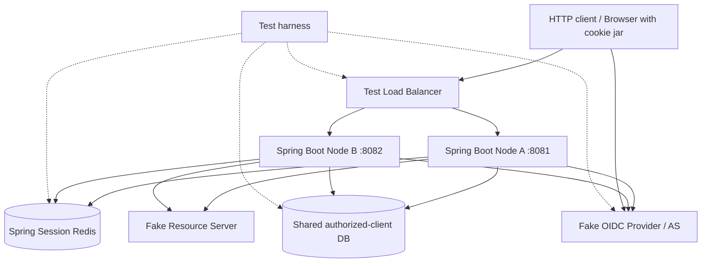
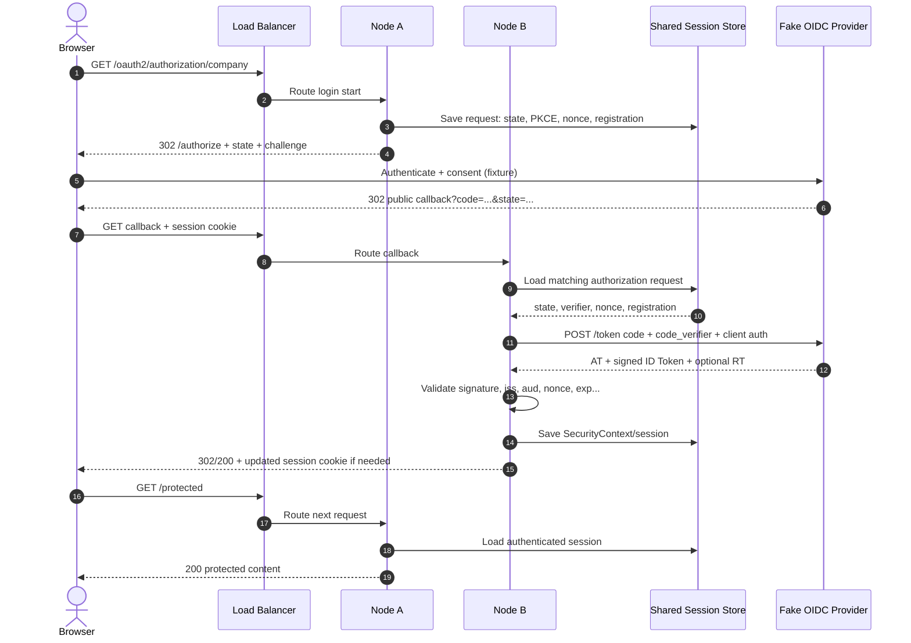
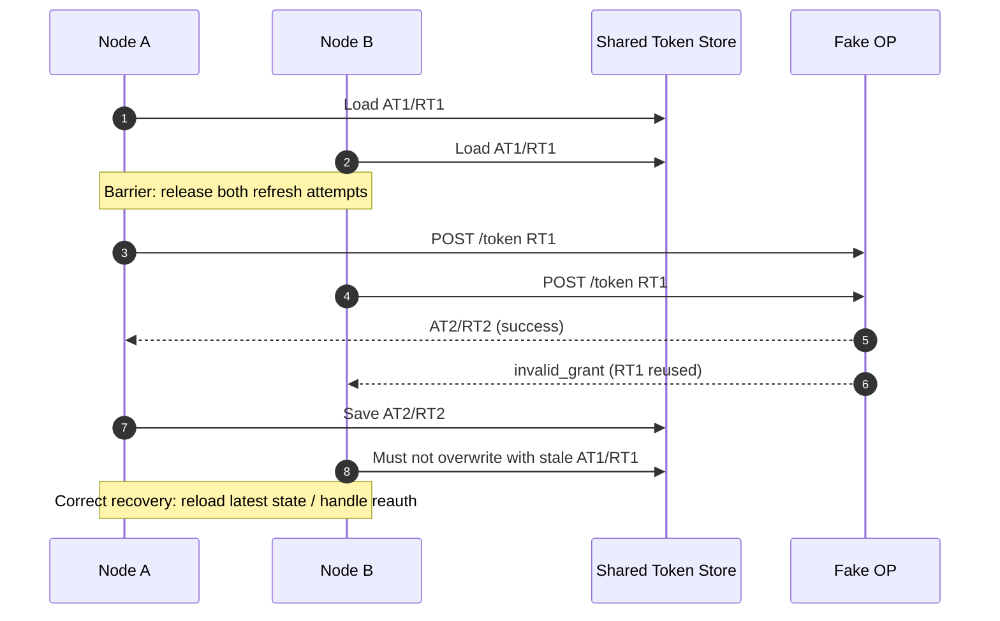
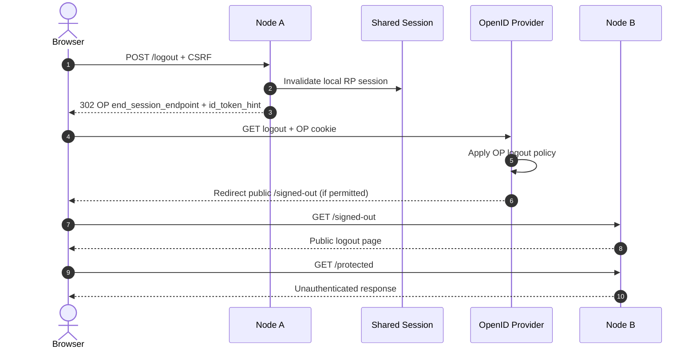

# 31.9. Testing Login, Token Refresh, and Logout Across Multiple Instances

A **Spring Security OAuth 2.0 / OpenID Connect (OIDC) Client** application typically works smoothly during single-machine development. Users open the login page, the app redirects the browser to the OpenID Provider (OP), receives an authorization code, exchanges it for tokens, persists the session, and handles logout. Yet when deployed across **multiple instances** behind a load balancer, a new class of bugs emerges: a request starts on **node A** while the callback lands on **node B**; two nodes refresh the same refresh token simultaneously; or logout runs on A while B still serves the stale session.

These failures usually cannot be caught by a `MockMvc` test that just calls `oauth2Login()`. That test helper injects a mock Authentication for **one request inside one application context**, without testing HTTP cookies, shared sessions, PKCE/`state` correlation, the token endpoint, distributed persistence, concurrency, or OP logout.

This lesson explains how to **integration-test login, token refresh, and logout across multiple instances** in the context of Spring Security OAuth 2.0 OIDC Client, in Chapter **31. Integration Testing**. The content uses **Spring Boot 3.x, Spring Security 6.x, and Spring MVC/Servlet** as primary examples and highlights differences for **WebFlux/Reactive**. All addresses, tokens, keys, and users in examples are fixtures; never use production credentials in tests.

> **Core principle:** A multi-instance test is meaningful only when **at least two genuinely independent application instances** receive HTTP requests over the network while sharing the storage/control plane designed for production. Tests must actively switch nodes between steps, induce refresh races, and verify session invalidation, rather than sending multiple requests into a single `MockMvc`.

## 1. Learning Outcomes

After this lesson, you will be able to:

1. Describe the states that must persist across Authorization Code/OIDC Login: session, `state`, PKCE verifier, `nonce`, authorized client, and user mapping.
2. Distinguish **sticky sessions** from **shared session storage** and understand why sticky routing can mask failover bugs.
3. Design an integration environment with **two or more app processes**, a load balancer with controllable routing, a Redis/session store, authorized client storage, and an OP test double.
4. Test a flow where **login starts on node A and callback executes on node B** while still verifying `state`, PKCE, nonce, issuer, and audience.
5. Verify sessions and authorized clients remain readable when subsequent requests move across nodes.
6. Create a controlled refresh token race when two nodes simultaneously see an expired access token.
7. Detect refresh token reuse/rotation, lost updates, and stale cache bugs; design assertions for safe persistence.
8. Test **local logout**, **RP-Initiated Logout**, **OP-Initiated/Back-Channel Logout**, and token revocation as distinct mechanisms.
9. Ensure logout on A invalidates session access on B per the chosen policy.
10. Use a fake OP or OP sandbox, Testcontainers, WireMock/MockWebServer, HTTP clients, and browser automation within their proper scopes.
11. Apply fault injection: node restarts, Redis failover, OP outages, timeouts, key rotation, duplicate callbacks, and retries.
12. Collect metrics, logs, and traces safely to diagnose issues without leaking tokens or session cookies.

## 2. The Problem: Why Does One Instance Work Yet Multiple Instances Fail?

Suppose the portal runs three replicas:

```text
               https://portal.example.com
                          |
                     Load Balancer
                          |
            +-------------+-------------+
            |             |             |
          Node A        Node B        Node C
          :8081         :8082         :8083
            |             |             |
            +------+------+-------------+
                   |
             Shared Redis
        (Spring Session / WebSession)
                   |
             Shared Database
        (Authorized Clients / Identity)
                   |
             Trusted OpenID Provider
```

This is an illustrative topology. One application may store authorized clients inside the session; another may store them in a database/service. **Verify your actual storage**, rather than assuming both layers share one backend.

### 2.1. Login Failure Across Two Nodes

```text
1. Browser -> Node A: GET /oauth2/authorization/company
2. Node A stores authorization request/state in local HttpSession.
3. Browser authenticates at OP.
4. OP redirects callback -> Node B.
5. Node B has no authorization request/state in its session.
6. Spring Security rejects the callback, typically due to missing authorization request/state mismatch.
```

With sticky sessions enabled, callbacks may coincidentally always hit A, letting tests pass. Yet the moment A restarts or the load balancer shifts routes, the bug surfaces.

### 2.2. Refresh Token Failure Across Two Nodes

```text
Initial shared authorized client:
  Access token AT1 nearly expired
  Refresh token RT1

Node A: loads RT1 -> POST /token grant_type=refresh_token
Node B: loads RT1 -> POST /token grant_type=refresh_token

OP:
  A succeeds -> AT2, RT2
  B reuses RT1 -> invalid_grant / reuse detection
```

Without storage coordination, one node may overwrite the fresh state with stale tokens or cause the provider to revoke the entire refresh token family.

### 2.3. Logout Failure Across Two Nodes

```text
Browser POST /logout -> Node A
Node A clears local SecurityContext or local session.

Browser GET /protected -> Node B
Node B still holds an old copy of the session/token and returns HTTP 200.
```

If the policy is **log out the current session**, this outcome is broken. Still, distinguish the **browser session** from **issued access tokens**: clearing the RP session does not automatically revoke Bearer tokens outside the RP or the OP's SSO session.

## 3. Three State Layers That Must Be Tested Separately

| State Layer | What It Holds | When Used | How It Must Be Shared or Isolated |
| --- | --- | --- | --- |
| **Authorization request** | `state`, redirect URI, PKCE `code_verifier`, OIDC nonce, registration context | Login start → callback | The same login attempt must be readable on whichever node receives the callback |
| **Browser session / SecurityContext** | User Authentication, session ID, CSRF context, application session attributes | After login and on subsequent requests | Every node serving the same browser must see consistent state |
| **OAuth2AuthorizedClient** | Registration ID, principal, access token, refresh token, expiration | Calling downstream APIs, refresh, revoke | Storage must stay consistent by principal/registration; handle concurrent refreshes |

Other layers:

- **ClientRegistration/issuer metadata:** OAuth2 client configuration, must be consistent across nodes.
- **OIDC JWKS/decoder:** verifies ID Tokens; caches may be per-process, yet trust/issuer/alg/audience policies must be uniform.
- **Tenant/account policy:** after login, access must be verified against a trusted source.
- **OP browser session:** lives at the OP; does not automatically vanish when the app invalidates `HttpSession`.
- **CSRF token:** bound to the browser/session and must work when POSTing to a different node.
- **Logout correlation:** if using OP-initiated/back-channel logout, must locate the matching RP session by `sid`/`sub`.

### 3.1. Sharing Redis Does Not Mean Every Token Is Automatically Shared

Spring Session Redis manages sessions. If the application stores authorized clients in a database-backed `OAuth2AuthorizedClientService`, Redis sessions **do not replace that database**. If the app uses `HttpSessionOAuth2AuthorizedClientRepository`, authorized clients may live inside the session; in that case Redis security/privacy/serialization directly affect token storage.

Verify the real beans and wiring in the application:

```text
HttpSessionOAuth2AuthorizationRequestRepository
        -> session-backed authorization request

SecurityContextRepository / HttpSession
        -> session-backed authentication

OAuth2AuthorizedClientRepository
        -> session or service-backed client

OAuth2AuthorizedClientService
        -> memory / JDBC / custom encrypted storage
```

Never run integration tests with an in-memory authorized client service when production uses JDBC if the goal is verifying multi-node persistence.

## 4. Standard Test Topology: Two App Processes and a Controllable OP

An appropriate setup:



Required components:

1. **Two independent JVMs/application contexts** on two different ports—not just two controller beans in one process.
2. **A single fixed public RP address** behind the load balancer, e.g., `https://portal.test.local`.
3. **A mechanism to force specific requests to A or B** strictly inside test infrastructure, never as a public bypass in production.
4. **Redis/session store** and **authorized client store** matching the production topology.
5. **Fake OP/AS** providing authorization, token, JWKS, discovery, and optional end-session/revocation/back-channel endpoints.
6. **Fake downstream Resource Server** accepting access tokens and returning fixture responses/counters.
7. **HTTP client with a cookie jar** or a real browser to preserve session cookies across redirects.
8. **Clock/time control** and fault injection for expiry, rotation, timeouts, and outages.
9. Logs/metrics distinguishing node A/B, request correlation ID, and registration ID without printing raw credentials.

### 4.1. Why Must There Be a Single Fixed Public Redirect URI?

Authorization Code Flow typically uses the redirect URI registered at the OP, such as:

```text
https://portal.test.local/login/oauth2/code/company
```

If the browser starts on A and the callback routes to B, **the redirect URI must remain the RP's public URI**—never swap it to:

```text
http://node-b:8082/login/oauth2/code/company
```

just to make tests work. Doing so alters client registration, cookie domain, TLS/SameSite, and callback semantics.

In tests, the **load balancer** receives the callback on the public URI and forwards it to B according to routing rules controlled by the test harness. The proxy must process `Host`/`Forwarded`/`X-Forwarded-*` from trusted sources only.

### 4.2. Sticky Sessions: Test Both Enabled and Disabled

| Mode | Benefit | Risk Masked |
| --- | --- | --- |
| Sticky routing | Keeps requests on the same node, reducing state lookups | Hides local-session and failover bugs |
| Non-sticky + shared state | Exposes correctness of shared session/authorized client | Requires consistent session/DB behavior |
| Sticky + node failure | Close to production when LB has affinity | Must test failover to another node |
| Cross-node forced routing | Proves A/B read the same state | Must prevent test-only routing bypasses on the Internet |

Do not claim "the system supports multi-instance" simply because sticky sessions are enabled and every step was tested on A.

## 5. Key Elements of Multi-Instance OIDC Login

An Authorization Code + OIDC flow has these steps:



**This is a scenario you must actively test.** If all requests happen to hit B, the A→B handoff is never verified.

### 5.1. Non-Negotiable Login Test Conditions

- `state` from the authorization request matches on callback.
- `code_verifier` matches the sent `code_challenge`; the OP test double must be able to reject invalid PKCE.
- OIDC `nonce` in the ID Token matches the request when required by the flow.
- ID Token `issuer` matches the registered OP.
- ID Token `aud` matches the OAuth2 `client_id`.
- Signature is verified against the configured OP's public JWKS, not a dummy token string.
- `exp`, `iat`, and profile-specific OIDC validators execute.
- Browser cookies use the right domain, path, SameSite, and Secure flags.
- Session ID is created/rotated after authentication per session fixation policy.
- Authorized client is persisted under the right registration and principal.
- Requests hitting another node after callback remain authenticated.
- Login from tenant A never becomes a login for tenant B.

### 5.2. Lost `state` Must Not Be Fixed by Disabling Checks

If routing the callback to B triggers "authorization request not found," the root cause is usually **an inconsistent session/state repository** or the browser failing to send cookies.

Never:

- Disable `state` correlation.
- Disable PKCE/nonce.
- Let callback query parameters pick the Token Endpoint.
- Create a fresh authorization request during callback.
- Accept an authorization code belonging to a different login attempt.

The right fix is inspecting **cookies, session IDs, shared stores, serialization, proxies, and registration bindings**.

## 6. Sample Spring Boot Configuration for Shared Sessions

When using **Spring MVC/Servlet**, a common choice is **Spring Session Redis**.

### 6.1. Gradle Dependencies

```groovy
dependencies {
    implementation 'org.springframework.boot:spring-boot-starter-web'
    implementation 'org.springframework.boot:spring-boot-starter-security'
    implementation 'org.springframework.boot:spring-boot-starter-oauth2-client'

    implementation 'org.springframework.session:spring-session-data-redis'
    implementation 'org.springframework.boot:spring-boot-starter-data-redis'

    testImplementation 'org.springframework.boot:spring-boot-starter-test'
    testImplementation 'org.springframework.security:spring-security-test'
    testImplementation 'org.testcontainers:junit-jupiter'
    testImplementation 'org.testcontainers:testcontainers'
}
```

This example relies on Spring Boot dependency management. Never hardcode mismatched versions incompatible with Spring Security/Session.

### 6.2. `application-it.yml`

```yaml
server:
  forward-headers-strategy: framework
  servlet:
    session:
      timeout: 30m

spring:
  data:
    redis:
      host: ${IT_REDIS_HOST:localhost}
      port: ${IT_REDIS_PORT:6379}

  session:
    redis:
      namespace: oidc-it:sessions

  security:
    oauth2:
      client:
        registration:
          company:
            provider: test-op
            client-id: oidc-it-client
            client-secret: ${IT_OIDC_CLIENT_SECRET}
            client-authentication-method: client_secret_basic
            authorization-grant-type: authorization_code
            redirect-uri: "{baseUrl}/login/oauth2/code/{registrationId}"
            scope:
              - openid
              - profile
        provider:
          test-op:
            issuer-uri: ${IT_OP_ISSUER}
```

Both node A and node B must share:

- **The same** session namespace and Redis store for the test environment.
- The same OP issuer, client ID, redirect URI, and secret trust/configuration.
- **Different** `server.port`, process ID, and logging instance name.
- The same authorized client persistence logic.
- No per-node cookie domain/path if browsers access through a public LB.

`server.forward-headers-strategy=framework` is appropriate only when the reverse proxy **strips/overwrites untrusted forwarded headers**. Never allow Internet clients to spoof `X-Forwarded-Host` and construct `redirect_uri` from it.

### 6.3. Basic Java Security Chain

```java
import org.springframework.context.annotation.Bean;
import org.springframework.context.annotation.Configuration;
import org.springframework.security.config.Customizer;
import org.springframework.security.config.annotation.web.builders.HttpSecurity;
import org.springframework.security.web.SecurityFilterChain;

@Configuration
public class WebSecurityConfig {

    @Bean
    SecurityFilterChain webSecurity(HttpSecurity http)
            throws Exception {

        return http
                .authorizeHttpRequests(auth -> auth
                        .requestMatchers(
                                "/", "/signed-out", "/error",
                                "/assets/**")
                            .permitAll()
                        .anyRequest()
                            .authenticated())
                .oauth2Login(Customizer.withDefaults())
                .logout(logout -> logout
                        .logoutUrl("/logout")
                        .invalidateHttpSession(true)
                        .clearAuthentication(true))
                .build();
    }
}
```

This is a **basic local logout** setup. OP RP-Initiated Logout is added via a success handler in a later section. Never disable CSRF to make tests easier: with browser sessions, `POST /logout` must carry a CSRF token per Spring Security policy.

### 6.4. Redis/Session Serialization

A multi-instance system must align on:

- Spring Boot, Spring Security, and Spring Session versions.
- Session serializer/`ObjectMapper` modules if using JSON.
- Serialization compatibility during rolling upgrades.
- Cookie name/domain/path and session timeout.
- Redis ACLs/TLS, network isolation, eviction, and memory policy.
- Ensuring `SecurityContext`/`OAuth2User`/OIDC principal types deserialize cleanly across nodes.
- Ensuring custom application session attributes serialize safely.

**Never turn Redis into an unprotected store of raw sessions/tokens** just for test convenience. Production requires security controls; tests use dedicated synthetic credentials.

## 7. Session Storage and Authorized Client Storage: Choosing the Right Architecture

Two common models exist.

### 7.1. Authorized Client Stored Inside the Session

```text
Browser cookie SESSION
        |
        v
Spring Session Redis
        |
        +--> SecurityContext
        +--> OAuth2 authorization request state
        +--> OAuth2AuthorizedClient if session repository is used
```

Advantages: tokens stay tied to the browser session; session invalidation cleans up local authorized clients. Drawbacks: sessions hold sensitive access/refresh tokens, subject to serialization, cache TTL/eviction, and loss upon browser logout.

### 7.2. Authorized Client Stored in a Shared Service/Database

```text
Browser cookie SESSION -> shared Redis (SecurityContext)

OAuth2AuthorizedClient:
  key = registrationId + principalName + security context
       |
       v
Shared encrypted JDBC/custom store
```

Advantages: decouples token lifecycle from browser sessions and supports permitted background jobs. Drawbacks: browser logout does not automatically clear service-backed tokens; requires separate cleanup/revocation and concurrency control.

**Never use in-memory `InMemoryOAuth2AuthorizedClientService` to represent a shared DB in a multi-node test**, unless intentionally proving that in-memory state fails to share across nodes.

### 7.3. Objects to Verify After Login

| Object | Verification |
| --- | --- |
| Authorization request | Read properly from session when callback hits B |
| Authentication | Right user, registration, and authorities after callback |
| Session | A and B read the same logical session with the same cookie |
| Authorized client | Right principal/registration; token persisted consistently |
| Token expiry | Refresh triggers when needed per provider policy |
| Tenant membership | Never pulls another user's token/role when switching nodes |
| Session invalidation | After logout, neither A nor B remains authenticated |
| Token revocation | Executed **if** policy/disconnect flow requires it |

## 8. Test Infrastructure: Which Tools to Use?

No single tool covers HTTP browsers, OP protocols, Redis, and multi-process concurrency simultaneously.

| Tool | Purpose | Does Not Replace |
| --- | --- | --- |
| **Testcontainers** | Spins up Redis, DB, and some OP/test services in Docker | Browser redirect/state logic |
| **WireMock/MockWebServer** | Stubs discovery, JWKS, token endpoint, and HTTP failures | Full OIDC protocol state machine if stubs are too simple |
| **Stateful Fake OIDC Provider** | Manages authorization codes, PKCE, nonce, token issuance, and RT rotation | Full production OP policies |
| **Keycloak/OP sandbox in container** | Integration with a real OIDC implementation | All vendor-specific behaviors |
| **Java HttpClient + CookieManager** | Tests HTTP cookies/redirects across nodes | Browser SameSite/CSP behavior |
| **Selenium/Playwright** | Real browser, cookies, redirects, SSO/logout UX | Database concurrency assertions |
| **Toxiproxy/network chaos** | Injects latency, connection drops, timeouts | Identity/security assertions |
| **JUnit 5** | Orchestration and assertions | Infrastructure topology |
| **Metrics/log collection** | Diagnoses node routing, refresh attempts, failures | Standalone proof of token validity |

A solid test suite usually has **multiple layers**: fast unit/controller tests, multi-instance HTTP integration tests, and browser/OP sandbox tests where needed.

### 8.1. Why Is `MockMvc` Not Enough?

`MockMvc` typically runs inside a single application context and mocks Servlet requests/responses. With:

```java
mvc.perform(get("/api/me").with(oidcLogin()))
```

you **inject a mock OIDC Authentication** without hitting `/oauth2/authorization/...`, routing a callback through a load balancer, hitting Redis, or calling the Token Endpoint.

`MockMvc` remains great for per-node URL authorization/method security/CSRF, yet **A→B tests** must hit real HTTP endpoints or at least two contexts backed by shared infrastructure and controlled transport. A test named "multi-instance" running only one context provides none of the required proof.

### 8.2. How Stateful Must an OP Test Double Be?

To seriously test login and refresh, a fake OP needs at minimum:

- Discovery metadata with `issuer` and authorization/token/JWKS endpoints.
- One or more public signing JWKs; test private keys stay inside the OP fixture.
- Authorization Endpoint issuing `code` bound to `client_id`, `redirect_uri`, `code_challenge`, `nonce`, and user fixture.
- Token Endpoint that **redeems codes once only**, verifying client authentication/redirect URI/PKCE.
- ID Tokens **genuinely signed with the test key**, containing valid issuer/audience/nonce/exp.
- Refresh grant supporting token families and optional one-time refresh token rotation.
- Structured `invalid_grant`/`invalid_client`/`temporarily_unavailable` responses.
- Counters for authorize calls, code redemptions, refreshes, and revocation/logout.
- Controls for time, key rotation, and fault injection.

**Never return `"id_token": "fake"` and call it an OIDC integration test**: Spring Security must decode and validate a proper signed ID Token, or the test fails to reflect the protocol.

## 9. Starting Redis with Testcontainers

JUnit 5 example using Docker to launch test-only Redis:

```java
import org.junit.jupiter.api.TestInstance;
import org.springframework.test.context.DynamicPropertyRegistry;
import org.springframework.test.context.DynamicPropertySource;
import org.testcontainers.containers.GenericContainer;
import org.testcontainers.junit.jupiter.Container;
import org.testcontainers.junit.jupiter.Testcontainers;
import org.testcontainers.utility.DockerImageName;

@Testcontainers
@TestInstance(TestInstance.Lifecycle.PER_CLASS)
class SharedRedisInfrastructureIT {

    @Container
    static final GenericContainer<?> REDIS =
            new GenericContainer<>(
                    DockerImageName.parse("redis:7-alpine"))
                    .withExposedPorts(6379);

    @DynamicPropertySource
    static void redisProperties(DynamicPropertyRegistry properties) {
        properties.add(
                "spring.data.redis.host", REDIS::getHost);
        properties.add(
                "spring.data.redis.port",
                () -> REDIS.getMappedPort(6379));
    }
}
```

**Example limitation:** this snippet demonstrates bootstrapping Redis for one Spring Test context. It **does not launch two app instances** or stand up a fake OP yet. To actually test A/B, add a harness that starts two processes/containers and passes the Redis host/port to both, or use a Docker Compose/Testcontainers topology.

### 9.1. Isolation Between Test Cases

If multiple test classes share one Redis:

- Use a distinct namespace per test run.
- Clean up sessions/tokens after tests.
- Never flush a Redis database shared with production.
- Never run tests mutating the same user/tenant concurrently without explicit coordination.
- Set TTLs on fixture sessions.
- Ensure tests never accidentally read sessions from prior runs.

For a shared authorized-client DB, use unique test principals and clean up with transaction/ID prefixes.

## 10. Launching Two App Instances

For clarity, suppose **the same artifact** is launched twice.

### 10.1. Logical Configuration of Each Node

```text
Node A:
  SERVER_PORT=8081
  INSTANCE_ID=A
  IT_REDIS_HOST=redis
  IT_OIDC_ISSUER=https://op.test.local/realms/it
  OIDC_CLIENT_ID=oidc-it-client
  OIDC_CLIENT_SECRET=<test-only-secret>

Node B:
  SERVER_PORT=8082
  INSTANCE_ID=B
  IT_REDIS_HOST=redis
  IT_OIDC_ISSUER=https://op.test.local/realms/it
  OIDC_CLIENT_ID=oidc-it-client
  OIDC_CLIENT_SECRET=<test-only-secret>
```

Environment variable names are illustrative; bind the corresponding properties in `application-it.yml`. Tests may use ephemeral ports instead of 8081/8082 if provisioned by the harness. Both nodes must **point to the exact same session/authorized-client infrastructure**, rather than spinning up separate Redis instances per node.

### 10.2. OP Fixture and Redirect URI Configuration

```text
Public test origin:
  https://portal.test.local

Registered redirect URI at fake OP:
  https://portal.test.local/login/oauth2/code/company

RP Authorization start:
  https://portal.test.local/oauth2/authorization/company

Token Endpoint:
  https://op.test.local/realms/it/token
```

The fake OP may use HTTPS in a test network with a suitable test CA. Never disable TLS hostname/certificate validation in production or copy `trustAll` from test environments.

### 10.3. Test-Only Routing Control

A test load balancer may expose internal APIs:

```text
forceNextRequestTo(A)
forceNextRequestTo(B)
clearStickyMapping()
stopNode(A)
startNode(A)
```

These are **harness pseudo-APIs**, not Spring Security classes. If using a real test ingress, control backend routing via test-only configuration while ensuring Internet users can never select backends via privileged headers.

## 11. Scenario LOGIN-01: Start on A, Callback on B

This is the most fundamental test.

### 11.1. Arrange

- Fake OP has user fixture `alice`.
- Registration `company` is configured on both A and B.
- Shared Redis with a clean session namespace.
- Browser HTTP client holds a cookie jar.
- Load balancer can force per-request routing.
- Fake OP mints codes and signs ID Tokens with the right nonce/issuer/audience.
- Clocks across A/B/OP are reasonably synchronized.

### 11.2. Act

```text
1. route(A)
   GET /oauth2/authorization/company

2. Capture:
   RP session cookie
   Location authorization URL containing state (+ PKCE challenge, nonce)

3. Browser completes authorization at fake OP
   OP authenticates alice, issues one-time code

4. route(B)
   Browser GET public /login/oauth2/code/company?code=...&state=...
   + matching RP session cookie

5. Capture:
   status/redirect, new Set-Cookie if session fixation rotates

6. route(A)
   GET /protected with latest cookie

7. route(B)
   GET /protected with same browser cookie
```

### 11.3. Assert

- Authorization request and callback correlate via the exact `state`.
- Fake OP records a valid `code_verifier` matching `code_challenge` (if PKCE is enabled/required).
- RP verifies the ID Token with the right issuer, audience, and nonce.
- Code is redeemed **once only** at the Token Endpoint.
- Both A and B recognize the authenticated principal.
- Session ID changes after login if session fixation policy applies.
- No second unintended login session is created by routing the callback through B.
- Authorized client is saved for the right registration/principal.
- No tokens/secrets/authorization codes appear in application access logs.

### 11.4. Test Harness Pseudocode

```java
// PSEUDOCODE: the classes below are test harness abstractions,
// not built-in Spring Security classes.
@Test
void loginCanStartOnAAndFinishOnB() {
    TestBrowser browser = harness.newBrowser();

    harness.routeNextTo("A");
    AuthorizationRedirect redirect =
            browser.getAuthorizationStart(
                    "/oauth2/authorization/company");

    assertThat(redirect.state()).isNotBlank();

    FakeOpCallback callback = fakeOp.loginAndAuthorize(
            redirect.url(), "alice-test-account");

    harness.routeNextTo("B");
    browser.followCallback(callback);

    harness.routeNextTo("A");
    assertThat(browser.get("/protected").status()).isEqualTo(200);

    harness.routeNextTo("B");
    assertThat(browser.get("/protected").status()).isEqualTo(200);

    assertThat(fakeOp.authorizationCodeRedeemCount()).isEqualTo(1);
    assertThat(fakeOp.lastCodeVerifierWasValid()).isTrue();
}
```

The value of this pseudocode lies in illustrating **mandatory node switching**—do not expect it to run verbatim by copy-pasting without building the harness/fake OP.

## 12. Login Negative Cases Must Accompany Cross-Node Tests

| ID | Scenario | Expectation |
| --- | --- | --- |
| LOGIN-02 | A/B use **different Redis instances** | Callback B cannot find state; test catches misconfiguration |
| LOGIN-03 | Browser omits RP cookie on callback | Login rejected |
| LOGIN-04 | Callback `state` differs from request | Rejected without redeeming code as valid flow |
| LOGIN-05 | OP returns code for another client | Token Endpoint/RP rejects |
| LOGIN-06 | PKCE verifier mismatches challenge | Fake OP returns `invalid_grant`; RP unauthenticated |
| LOGIN-07 | ID Token `nonce` wrong | RP rejects OIDC Login |
| LOGIN-08 | ID Token issuer/audience wrong | RP rejects, maps no user |
| LOGIN-09 | ID Token signing key absent from OP JWKS | RP rejects signature |
| LOGIN-10 | Code already redeemed, callback resent | No new login from reused code |
| LOGIN-11 | Node A restarts after authorization request | Callback B still works when state persisted properly |
| LOGIN-12 | Redis unavailable on callback | Controlled failure, never bypasses `state` |
| LOGIN-13 | Nodes run different ClientRegistration versions | Detects callback/client mismatch, never swaps token endpoint |
| LOGIN-14 | Multi-tab same session, two `state`s | Verifies correlation isn't overwritten; matches real repository behavior |
| LOGIN-15 | Alpha/Beta distinct issuers | Rejects OP B token during OP A login |
| LOGIN-16 | Wrong proxy public host/scheme | Detects redirect URI mismatch, rejects arbitrary redirects |
| LOGIN-17 | Session serializer A differs from B | Detects deserialization/missing authentication |
| LOGIN-18 | Switch user after logout then log in again | Never reuses previous user's principal/token |

**Especially for multi-tab:** some default authorization request repositories store **one login attempt** per session. When two tabs start concurrently, requests may overwrite each other. Do not assume "having Redis" solves this; test the actual repository, and if UX needs concurrent attempts, design keyed-by-state storage with proper expiry/cleanup.

## 13. Session ID Rotation and Cookie Jar Must Be Simulated Accurately

Spring Security commonly applies session fixation protection upon successful authentication. Depending on Servlet container/Spring Session configuration, the browser may receive a **new session cookie** after callback.

Test mistake:

```text
T0: capture SESSION cookie before login
T1: callback returns new Set-Cookie SESSION
T2: test keeps sending T0 cookie to GET /protected
T3: gets redirect/401 and concludes multi-node sessions are broken
```

A proper HTTP client must:

- Retain cookies by domain/path and relevant attributes.
- Update cookies from the callback's `Set-Cookie` header.
- Keep RP and OP cookies on their respective origins.
- Never assume the session ID stays constant across the entire flow.
- Never send RP cookies to the OP domain.
- In browser E2E, let the real browser enforce SameSite/Secure.
- Verify the old session ID **loses access** when policy mandates session fixation rotation.

### 13.1. Java HTTP Client with Cookie Manager

A skeleton for HTTP test requests:

```java
import java.net.CookieManager;
import java.net.CookiePolicy;
import java.net.http.HttpClient;

CookieManager cookies = new CookieManager(
        null, CookiePolicy.ACCEPT_ORIGINAL_SERVER);

HttpClient browserClient = HttpClient.newBuilder()
        .cookieHandler(cookies)
        .followRedirects(HttpClient.Redirect.NEVER)
        .build();
```

To switch between nodes A and B, send requests through **the same public load balancer URL** and control routing internally; `CookieManager` only handles cookies. To test real browser SameSite policies, use Selenium/Playwright because Java `HttpClient` does not reproduce all browser cookie rules.

## 14. AUTHZ-01: Post-Login Sessions Must Work Across Every Node

After LOGIN-01, use the **latest cookie** to call:

```text
GET /api/profile   -> A -> 200, user=alice
GET /api/profile   -> B -> 200, user=alice
GET /api/admin     -> A -> 403 if alice lacks role
GET /api/admin     -> B -> 403 same policy
```

Assertions:

- `Authentication.getName()` or internal account ID is consistent.
- Authorities match across A and B.
- Node B does not initiate another login flow.
- Required app session data within the same session is intact.
- Never expose `OAuth2AuthorizedClient` objects, refresh tokens, or ID Tokens in JSON.
- Alice's request cannot read Bob's session despite sharing the Redis backend.
- Tenant policies are enforced on every node without relying on unverified routing hints.

### 14.1. Redis Session Store Does Not Guarantee Instant Authorization Updates

If Alice's permissions are revoked in the database while `SecurityContext` holds stale authorities, both A and B may keep trusting that session until the app refreshes/revokes authorization state per policy.

This is not merely a replication bug. Test entitlement/session invalidation whenever business requirements demand **near-real-time revocation**.

### 14.2. Concurrent Session Writes Can Cause Lost Updates

Two requests on A and B modifying the same session attribute can overwrite one another if the store uses last-write-wins. Spring Session shares sessions, yet does not automatically provide transaction isolation for custom attributes.

If the app stores critical workflow state in sessions, test concurrent writes and add an appropriate data model/versioning.

## 15. Token Refresh: Real Manager and Storage Must Be Tested

After login, the OAuth2 Client holds an `OAuth2AuthorizedClient`, typically containing:

```text
registrationId = company
principalName  = alice
accessToken    = AT1 (expiresAt = T1)
refreshToken   = RT1
```

When the access token nears expiry, a configured `OAuth2AuthorizedClientManager` can use `refresh_token` to obtain AT2 (and RT2 if the AS rotates).

### 15.1. Example Manager Bean for Servlet Request Context

```java
import org.springframework.context.annotation.Bean;
import org.springframework.context.annotation.Configuration;
import org.springframework.security.oauth2.client.DefaultOAuth2AuthorizedClientManager;
import org.springframework.security.oauth2.client.OAuth2AuthorizedClientManager;
import org.springframework.security.oauth2.client.OAuth2AuthorizedClientProvider;
import org.springframework.security.oauth2.client.OAuth2AuthorizedClientProviderBuilder;
import org.springframework.security.oauth2.client.registration.ClientRegistrationRepository;
import org.springframework.security.oauth2.client.web.OAuth2AuthorizedClientRepository;

@Configuration
class AuthorizedClientManagerConfig {

    @Bean
    OAuth2AuthorizedClientManager authorizedClientManager(
            ClientRegistrationRepository registrations,
            OAuth2AuthorizedClientRepository repository) {

        OAuth2AuthorizedClientProvider provider =
                OAuth2AuthorizedClientProviderBuilder.builder()
                        .authorizationCode()
                        .refreshToken()
                        .build();

        var manager = new DefaultOAuth2AuthorizedClientManager(
                registrations, repository);
        manager.setAuthorizedClientProvider(provider);
        return manager;
    }
}
```

**Limitation:** `DefaultOAuth2AuthorizedClientManager` fits Servlet `HttpServletRequest` contexts. For scheduled/batch jobs lacking requests, `AuthorizedClientServiceOAuth2AuthorizedClientManager` with service-backed storage is commonly used.

If the app uses a custom manager or provider chain, tests must execute **the exact manager used in production**, rather than substituting a fake manager that skips refresh behavior.

### 15.2. A Service Using the Manager to Call a Fixed API

```java
import org.springframework.security.core.Authentication;
import org.springframework.security.oauth2.client.OAuth2AuthorizeRequest;
import org.springframework.security.oauth2.client.OAuth2AuthorizedClient;
import org.springframework.security.oauth2.client.OAuth2AuthorizedClientManager;
import org.springframework.stereotype.Service;
import org.springframework.web.client.RestClient;

@Service
public class ProfileGateway {

    private final OAuth2AuthorizedClientManager manager;
    private final RestClient resourceApi;

    public ProfileGateway(
            OAuth2AuthorizedClientManager manager,
            RestClient.Builder restClientBuilder) {
        this.manager = manager;
        this.resourceApi = restClientBuilder
                .baseUrl("https://resource-api.test.local")
                .build();
    }

    public String fetchProfile(Authentication authentication) {
        OAuth2AuthorizeRequest authorizeRequest =
                OAuth2AuthorizeRequest
                        .withClientRegistrationId("company")
                        .principal(authentication)
                        .build();

        OAuth2AuthorizedClient client =
                manager.authorize(authorizeRequest);

        if (client == null) {
            throw new IllegalStateException(
                    "No authorized OAuth2 client for user");
        }

        return resourceApi.get()
                .uri("/profile")
                .headers(headers ->
                        headers.setBearerAuth(
                                client.getAccessToken().getTokenValue()))
                .retrieve()
                .body(String.class);
    }
}
```

`https://resource-api.test.local` is the fake Resource Server in the test topology. In production, the URI must come from trusted config/allowlists, never from a caller-controlled `?url=...`. **Never log Bearer tokens or request/response headers.**

### 15.3. Key to Triggering Refresh in Tests

The manager/provider typically decides to refresh based on `expiresAt` plus a configured **clock skew**. You do not necessarily have to wait until the exact second of expiration.

The test harness should control:

- Access token `expires_in` issued by the fake OP.
- The timestamp when refresh is checked, or a controllable `Clock`/provider config if supported by your API version.
- Refresh request count at the OP.
- Authorized client state before and after refresh.
- Token binding to principal and registration.

**Do not issue AT with `expires_in=1` and scatter `Thread.sleep` across hundreds of tests**: it is slow and flaky. Prefer clock control/fixture state wherever possible, plus at least one real-time HTTP end-to-end test.

## 16. REFRESH-01: Refreshing on Another Node After Login

### 16.1. Arrange

- Login finishes on B; authorized client is persisted in shared storage.
- Fake OP issues AT1 with a test-appropriate lifetime.
- RT1 is valid; fake OP is configured to rotate RT1 into RT2.
- Advance/control time until AT1 needs refresh.

### 16.2. Act

```text
1. Browser login completes on B -> AT1 / RT1 persisted.
2. Adjust clock/test state so AT1 needs refresh.
3. Route downstream API call through A.
4. A loads authorized client for Alice/company.
5. A sends refresh grant with RT1 to fake OP.
6. Fake OP returns AT2 / RT2.
7. A persists updated authorized client.
8. Route next request through B.
9. B reads updated AT2 / RT2 and calls downstream.
```

### 16.3. Assert

- Fake OP receives **exactly one refresh** when there is one caller.
- Client authentication method/registration matches.
- `grant_type=refresh_token`, RT1 belongs to Alice/company.
- AT2 targets the fake Resource Server's expected audience.
- RT2 is stored when fake OP rotates.
- Node B never reuses RT1 after A finishes refreshing.
- Bob's or other tenants' authorized clients remain untouched.
- No request bodies containing refresh tokens are logged.

**Pitfall to avoid:** if B holds an uninvalidated local in-memory token cache, B might still read RT1. Tests must detect **cache coherence** bugs, not merely check the new database row.

## 17. REFRESH-02: Two Nodes Refreshing RT1 Concurrently

This is the most critical concurrency test.



### 17.1. Fake OP Must Simulate Refresh Token Rotation Accurately

Simplified state machine inside the fake OP:

```text
RT1: ACTIVE

First valid refresh(RT1):
  -> mark RT1 USED
  -> issue AT2 and RT2
  -> mark RT2 ACTIVE

Second refresh(RT1):
  -> invalid_grant
  -> optionally revoke token family (provider policy)
```

**Atomic** state transitions in the OP test double are essential. If the fake OP lets both refreshes with RT1 succeed, it hides severe races.

Not every OP rotates RTs identically. Some allow a **grace window** or enforce family reuse detection. Configure test modes matching **your actual provider contract**, rather than assuming all OPs share identical semantics.

### 17.2. Use a Barrier to Force the Race Rather Than Relying on Luck

Do not write a test that fires two sequential requests and calls it "concurrent." Instead:

1. Ensure both A and B load the same AT1/RT1 version.
2. Place a barrier/latch in a **test-only storage adapter**, fake OP, or pre-refresh hook.
3. Once both are ready, release them simultaneously.
4. Observe both requests and outcomes.
5. Assert storage is never overwritten back to RT1.
6. Verify subsequent requests can still authorize, or the system transitions cleanly to reauthorization per policy.

```java
// TEST HARNESS PSEUDOCODE: not a specific Spring API.
CountDownLatch bothLoaded = new CountDownLatch(2);
CountDownLatch release = new CountDownLatch(1);

fakeTokenStore.onRead((registration, principal) -> {
    if (registration.equals("company")
            && principal.equals("alice")) {
        bothLoaded.countDown();
        release.await(); // strictly inside test harness thread, with real timeout
    }
});

CompletableFuture<Response> callA = harness.getAsync("A", "/api/profile");
CompletableFuture<Response> callB = harness.getAsync("B", "/api/profile");

assertThat(bothLoaded.await(10, TimeUnit.SECONDS)).isTrue();
release.countDown();

Response a = callA.get(10, TimeUnit.SECONDS);
Response b = callB.get(10, TimeUnit.SECONDS);

assertThat(fakeOp.refreshTokenUseCount("RT1")).isLessThanOrEqualTo(2);
assertThat(sharedStore.latestRefreshToken()).isNotEqualTo("RT1");
```

**Note:** the snippet above only illustrates forcing a race. Asserting `useCount <= 2` is **not sufficient proof of correctness**; ideally, **only one request actually refreshes**, or one succeeds while the other reloads state/recovers/fails safely. Production tests must also assert no token leakage, no overwriting RT2, and no RT family revocation. Under strict token reuse detection, the OP receiving RT1 twice already signals a concurrency bug to fix.

## 18. Concurrency Solutions: Single-Flight, Locking, CAS, and Fencing

Spring Security OAuth2 Client supplies managers/providers for refreshing, yet **do not assume a default manager synchronizes across all nodes** when persisting authorized clients to a shared store. In-JVM synchronization does not coordinate across a cluster.

### 18.1. Single-Flight Within One Process

A map `(registrationId, principal) -> ongoing refresh` lets multiple threads on the same node await one result. Node B has its own map, so local single-flight **does not solve multi-node races**.

### 18.2. Distributed Locking

A logical lock:

```text
oauth-refresh-lock:<registrationId>:<principalReference>
```

can ensure only one worker refreshes a given authorized client at a time. Require:

- Bounded lock timeout/lease.
- Owner identity and fencing if state updates risk arriving late.
- Upon acquiring the lock, **re-read token state** before refreshing.
- Bound lock hold time and Token Endpoint timeout.
- When lock acquisition fails, wait boundedly and reload the token.
- Never put raw refresh tokens or user emails into lock keys/metrics.
- Avoid deadlocks when the OP is unavailable.

**Using Redis `SET NX PX` alone does not guarantee a process holds a lock safely across partitions/failovers.** If a lease expires, a stalled worker can continue and perform a late write. Add storage fencing/version checks when consistency demands it.

### 18.3. Optimistic Concurrency / CAS on the Token Record

A custom authorized client store can track versions:

```text
(registration_id, principal_name, version, encrypted_access_token,
 encrypted_refresh_token, access_expiry, ...)
```

After refresh:

```sql
-- ILLUSTRATIVE: custom application-designed schema,
-- not default JdbcOAuth2AuthorizedClientService SQL.
UPDATE oauth2_authorized_client
SET access_token_ciphertext = :at2,
    refresh_token_ciphertext = :rt2,
    access_expires_at = :expiry,
    version = version + 1
WHERE registration_id = :registration
  AND principal_name = :principal
  AND version = :expected_version;
```

If rows updated equals 0, another worker modified the record. **Never overwrite RT2 with RT1.** Reload and apply the matching policy.

Note: CAS protects DB state alone; if two workers already sent RT1 to the OP simultaneously, reuse detection can still fire. Therefore, under strict RT rotation, combine **serialization before the Token Endpoint call** with **conditional persistence**.

### 18.4. Avoid Holding Database Transaction Locks Too Long Arbitrarily

A naive approach holds a DB row lock across the HTTP call to the Token Endpoint. Network timeouts or OP latency can hold transactions and connections open too long, hurting throughput.

If using row locks, enforce timeouts, right-sized pools, and documented failure modes. Alternatives include **lease + fencing token + CAS**, or routing refreshes through a dedicated coordinator service. Choose based on consistency and operational needs.

### 18.5. Never Retry an RT That May Already Have Been Consumed

If an HTTP timeout occurs after sending RT1, the AS may have already minted RT2 while the client missed the response. Retrying RT1 can trigger reuse detection.

Test the "server processed, response lost" case explicitly. The app must follow AS policy: reloading the shared store, requesting reauthorization, or using a provider-supported recovery mechanism. Never loop RT1 infinitely.

## 19. REFRESH-03: Testing Failures and Recovery

| Scenario | Outcome to Verify |
| --- | --- |
| Unexpired access token | No unnecessary refresh |
| Nearly expired access token | One refresh honoring clock skew |
| RT1 expired/revoked | `invalid_grant`; authorized client handled per policy |
| Wrong client secret | `invalid_client`; never switches tenant/provider |
| Token Endpoint returns 5xx | Bounded retry/backoff; never breaks RT family |
| Timeout after OP processed | Never blindly replays RT1 |
| Shared DB briefly unavailable when saving RT2 | Never returns AT2 while leaving DB stuck on RT1 without recovery |
| Node A crashes after OP minted RT2 | Clear recovery policy; never assumes RT1 can refresh again |
| Two nodes refresh concurrently | No lost updates; avoids revoking family where possible |
| Delayed/cached RT rotation | Node B never reads stale RT1 after A |
| Wrong principal | Never uses Alice's RT for Bob |
| Wrong registration | Never refreshes Company token with Partner client |
| Tenant suspended | Policy blocks refresh/usage even if token unexpired |
| Fake OP rotates signing key | ID Token/JWT validates via trusted JWKS without breaking RT CAS directly |
| Reactive client | Never blocks event loop during lock/fetch/refresh |

## 20. Logout Has Multiple Distinct Meanings

An OIDC Client application must clarify what the product expects when users click "Sign out."

| Kind | Initiated By | What Is Verified |
| --- | --- | --- |
| **Local RP logout** | Browser → app | Session/SecurityContext invalidated cleanly across the cluster |
| **RP-Initiated Logout** | RP → browser redirect to OP | Browser hits right OP `end_session_endpoint` and local logout still completes |
| **OP-Initiated/Back-Channel Logout** | OP → RP endpoint | RP verifies Logout Token and clears matching sessions across the cluster |
| **OAuth2 token revocation** | RP → AS revocation endpoint | Tokens revoked if supported by OP/required by policy |
| **Global sign-out** | Product-specific | All sessions/devices/tokens per security contract |

**Do not treat `LogoutSuccessHandler` as an API that automatically revokes every refresh token or every SSO session.**

## 21. LOGOUT-01: Local Logout on A Must Block New Requests on B

### 21.1. Arrange

- Alice logged in via OIDC across A/B.
- Browser holds the post-login session cookie.
- Session lives in shared Redis.
- Route `/protected` requires authentication.
- `POST /logout` is protected by CSRF.
- App logout policy invalidates the current session.

### 21.2. Act

```text
1. route(A): GET /protected        -> 200
2. route(B): GET /protected        -> 200
3. route(A): POST /logout + CSRF   -> logout response
4. Browser updates cookie jar from Set-Cookie.
5. route(B): GET /protected        -> redirect/login or 401
6. route(A): GET /protected        -> redirect/login or 401
7. Deliberately send OLD session cookie to A/B -> still rejected
```

### 21.3. Assert

- Logout POST does not fail with 403 because the test forgot CSRF.
- When CSRF is missing/wrong, logout **must not execute**.
- Server-side session invalidation takes effect when requests move across nodes.
- Old SecurityContext/Authentication is no longer served on A or B.
- No instance-local session cache persists indefinitely.
- Old browser session ID cannot be reactivated simply by replaying the cookie.
- Bob's or other tenants' session state is never deleted by mistake.
- Response/logout redirect matches the security chain.
- Test does not claim the AT was revoked unless a dedicated revocation protocol ran.

### 21.4. CSRF in Logout Tests

An HTTP client/browser must fetch the CSRF token per the UI pattern in use and submit it with `POST /logout`.

```html
<!-- Sample Spring MVC + Thymeleaf form -->
<form th:action="@{/logout}" method="post">
  <input type="hidden"
         th:name="${_csrf.parameterName}"
         th:value="${_csrf.token}" />
  <button type="submit">Sign out</button>
</form>
```

With browser automation, submitting the real form tests the CSRF/cookie flow. With raw Java `HttpClient`, the harness must parse the form and send the right token; never hardcode a dummy CSRF fixture across requests and claim cross-node token persistence was tested.

### 21.5. Local Logout Does Not Guarantee In-Flight Requests Abort Immediately

If request R1 to B **was already authorized** before A deleted the session, R1 may finish even if logout happens mid-flight. The normal guarantee is that **new requests arriving after session invalidation commits are unauthenticated**.

If business rules require blocking all in-flight writes after logout, enforce authorization/transaction/session-generation checks at business execution time; never expect clearing a cookie alone to halt running threads.

## 22. LOGOUT-02: RP-Initiated OIDC Logout Across Two Nodes

Spring Security Servlet provides:

```java
OidcClientInitiatedLogoutSuccessHandler
```

Illustrative configuration:

```java
import org.springframework.context.annotation.Bean;
import org.springframework.context.annotation.Configuration;
import org.springframework.security.config.annotation.web.builders.HttpSecurity;
import org.springframework.security.oauth2.client.oidc.web.logout
        .OidcClientInitiatedLogoutSuccessHandler;
import org.springframework.security.oauth2.client.registration
        .ClientRegistrationRepository;
import org.springframework.security.web.SecurityFilterChain;

@Configuration
public class OidcLogoutSecurityConfig {

    @Bean
    SecurityFilterChain filterChain(
            HttpSecurity http,
            ClientRegistrationRepository registrations)
            throws Exception {

        var success =
                new OidcClientInitiatedLogoutSuccessHandler(
                        registrations);
        success.setPostLogoutRedirectUri("{baseUrl}/signed-out");

        return http
                .authorizeHttpRequests(auth -> auth
                        .requestMatchers("/", "/signed-out", "/error")
                            .permitAll()
                        .anyRequest()
                            .authenticated())
                .oauth2Login(
                        org.springframework.security.config
                                .Customizer.withDefaults())
                .logout(logout -> logout
                        .logoutSuccessHandler(success)
                        .invalidateHttpSession(true)
                        .clearAuthentication(true))
                .build();
    }
}
```

**This replaces** the local logout chain from Section 6. Do not declare two competing `SecurityFilterChain` beans with default matchers in the same application.

### 22.1. Sequence of Behavior to Test



### 22.2. Assert

- Local RP session is destroyed across the cluster before/with the logout response per handler policy.
- `Location` uses the **trusted OP `end_session_endpoint`**, never a browser-supplied URL.
- `id_token_hint` is the right ID Token, not a refresh/access token.
- `post_logout_redirect_uri` is a public HTTPS URI registered at the OP.
- `/signed-out` is `permitAll` to avoid login loops.
- Browser hits the OP carrying its own OP cookie.
- Even if the OP disallows redirect, the RP session is already logged out.
- New requests on B carrying the old session are rejected.
- Never log raw `Location` headers containing `id_token_hint`.

### 22.3. Never Call OP Logout from a Backend HTTP Client

If the RP issues a `WebClient`/`RestClient` GET to `end_session_endpoint` from the backend, that request does not carry the browser's OP SSO cookie. RP-Initiated Logout is designed as a **browser redirect/user-agent flow**.

When you need OP server-to-server logout notifications, use **Back-Channel Logout** or a registered provider API rather than simulating a browser via backend GETs.

## 23. LOGOUT-03: Back-Channel Logout Arrives on Node B, Session on A Must Terminate

**Back-Channel Logout** is a separate protocol from RP-Initiated Logout. The OP POSTs a **Logout Token** to an RP endpoint; the RP validates the token and locates and terminates matching sessions.

```text
OP server -> POST back-channel logout endpoint (via LB to B)
Node B:
  - Verify JWT signature using trusted OP JWKS
  - Verify iss, aud, events, iat, exp/jti, sid/sub per spec
  - Look up linked session(s) in shared session index
  - Invalidate/cancel sessions per policy

Browser holding a session previously created on A:
  GET /protected -> A -> must be unauthenticated
```

### 23.1. Conditions to Test

- Logout Token has a valid signature, right issuer, and right RP audience.
- Contains the `events` claim per the OIDC Back-Channel Logout spec.
- `sid` or `sub` is used per spec semantics/provider policy.
- Logout Token does not carry a `nonce` like an ID Token.
- Replayed/duplicate Logout Tokens are handled safely and idempotently.
- Tokens from another OP/tenant cannot terminate unrelated sessions.
- Shared session registry finds the right sessions across all nodes.
- Node B handling back-channel requires no browser cookie from the user.
- Session on A/B is invalidated per logout scope.
- OP delivery retries never delete other users' sessions/accounts.

Spring Security Reactive/Servlet support and configuration vary across versions. Whether your project uses built-in `oidcLogout().backChannel(...)` or a custom endpoint, **tests must bind to the real implementation**. Never assume RP-Initiated Logout handlers automatically expose a back-channel endpoint.

## 24. LOGOUT-04: When Is Token Revocation Needed?

If a product offers a **"Disconnect Account"** or "Stop Data Sync" button, logging out the session may not be enough. A database-backed `OAuth2AuthorizedClientService` may still hold refresh tokens and keep background jobs running.

Test revocation separately:

```text
1. Log in as Alice; authorized client is saved.
2. User clicks Disconnect / revokes consent.
3. RP calls the revocation endpoint per RFC 7009 if supported by OP.
4. RP removes the authorized client by principal/registration.
5. Background job can no longer refresh tokens.
6. Session/login UI behavior is defined per policy.
```

Assert the fake OP revocation endpoint receives **the exact token family/client identity**, without printing raw tokens. Token revocation does not equal OP SSO session logout. Conversely, OP SSO logout does not guarantee refresh tokens are revoked on every AS.

### 24.1. Testing "Sign Out Everywhere"

A global sign-out requirement may need:

- Account/tenant-indexed session registry.
- Invalidation of all active sessions across all nodes.
- Back-channel/global OP session handling.
- Revocation of authorized clients/tokens.
- Cancellation of background jobs.
- Auditing and policies for offline clients.

Do not claim a single browser `POST /logout` test verifies global sign-out if the system lacks those mechanisms.

## 25. Fault Injection: Node A Is Killed Mid-Login

A valuable test:

```text
T0: Browser starts login on A.
T1: A writes authorization request/state to Redis and returns 302.
T2: Test terminates process A.
T3: Browser completes login at OP.
T4: LB routes callback to B.
T5: B loads state from Redis, exchanges code, creates session.
T6: Browser accesses /protected via B -> 200.
```

Tests should distinguish two phases:

- If A **returned the redirect before persisting state**, a session-save race can cause failure.
- If state persisted completely before the redirect, B must be able to read it.

Do not only test killing a node after login once state has already been read by B. The defect to catch sits on the **persistence boundary** between redirect and callback.

### 25.1. Node Crashes Mid-Token-Refresh

```text
A sends RT1 -> OP processes and mints RT2
A crashes before writing RT2 to shared DB
B still sees RT1
```

This failure mode cannot always be recovered cleanly if the OP enforces strict rotation without idempotency/grace periods. Never claim a Redis lock alone solves it completely.

Tests must:

1. Inject a crash at the chosen checkpoint.
2. Confirm the DB does not sloppily overwrite RT2 with RT1.
3. Verify behavior when B attempts to authorize.
4. Per AS policy, require reauthorization if unrecoverable.
5. Alert clearly instead of looping RT1 indefinitely.

### 25.2. Node Crashes Mid-Logout

If A receives `POST /logout` and dies before invalidating the session, the browser cannot tell whether logout succeeded. Define the **logout commit boundary** and retry semantics; CSRF/session invalidation should be idempotent where appropriate.

When high assurance is required, record logout events in shared storage and confirm invalidation before returning the response. For in-flight requests, document the exact guarantee clearly.

## 26. Fault Injection: Redis/DB Failure or Failover

| Failure | What to Verify |
| --- | --- |
| Redis unavailable at login start | Never emit an auth redirect with unpersisted `state` if flow cannot recover |
| Redis unavailable at callback | Never bypass state/nonce/PKCE; fail safely |
| Redis failover drops a recent write | Callback/session rejected cleanly; monitored |
| Redis TTL too short | Slow callbacks lose session; clear UX/restart login |
| Redis eviction | Authentication never forged; user may need to re-login |
| Redis partitioned between A/B | Never rely on stale local sessions to allow login/logout violating policy |
| Authorized client DB unavailable | Token refresh writes no corrupt state |
| DB timeout after refresh | Never blindly retry old RT; clear recovery/reauthorization |
| DB replica lag | Node B never reads stale tokens when policy demands read-after-write |
| Stale local cache | Invalidation/versioning blocks old RTs/sessions |
| Redis serializer mismatch | Rolling upgrade never mis-deserializes permissions/tokens |
| Storage cleanup fails on logout | Alert and enforce fail-closed authorization per product requirements |

**Never resolve a Redis outage by disabling Spring Security session checks.** Availability strategies must preserve security boundaries; some flows must fail closed and ask users to retry.

## 27. Fault Injection: OP Errors, Timeouts, or Key Rotation

### 27.1. OP Downtime

Test:

- Authorization endpoint unavailable.
- Token endpoint returns 500/503/429.
- JWKS endpoint unreachable.
- OP metadata returns wrong issuer.
- OP signs ID Token with new `kid`; A has stale cache, B has fresh cache.
- Client secret mid-rotation; A uses S1, B uses S2.
- OP recovers after outage.

Assert:

- Never accept unsigned/wrong-issuer tokens.
- Never switch Token Endpoint to another OP.
- Bounded retry/backoff, avoiding retry storms.
- Errors categorized cleanly: network, `invalid_client`, `invalid_grant`, signature validation.
- Fresh cached JWKS may be used per policy; untrusted new keys must fail closed if unreachable.
- All nodes enforce identical approved issuer/alg/audience policies regardless of key-cache freshness.
- Never log client secrets/RTs while diagnosing.

### 27.2. Key Rotation and Cross-Node Callbacks

A test:

```text
1. A sees OP JWKS = {K1}.
2. OP publishes {K1, K2}, starts signing ID Tokens with K2.
3. Callback lands on B; B refreshes key source per policy.
4. B verifies signed K2 ID Token + iss/aud/nonce.
5. Next request on A remains authenticated via shared session.
```

Do not confuse OP signing key rotation with refresh token rotation; they operate at two separate layers. **Never disable signature validation just because node A does not have K2 in its cache yet.**

## 28. Comprehensive Test Matrix Model

A minimal multi-instance suite:

| ID | Scenario | Node Routing | Key Assertions |
| --- | --- | --- | --- |
| L1 | Same-node login | A → A | Baseline OIDC login |
| L2 | Cross-node login | A → B → A | State/PKCE/nonce + shared session |
| L3 | Node crash after redirect | A (kill) → B | Callback still succeeds when state persisted |
| L4 | Missing session cookie | A → B | Rejected, no bypass |
| L5 | Callback wrong `state` | A → B | No login |
| L6 | Same-browser multi-tab | A/B out-of-order callbacks | Clean correlation or controlled error |
| L7 | Wrong OP/tenant | A → B | Issuer/audience binding |
| A1 | Cross-node profile read | A ↔ B | Consistent auth/principal/authorities |
| A2 | Cross-node authorized client | B → A | Token matches principal/registration |
| R1 | Sequential refresh | A → B | B sees RT2/AT2 |
| R2 | Simultaneous refresh | A ∥ B | No lost updates, strict-RT policy |
| R3 | Refresh timeout | A → B | No unsafe RT replay |
| R4 | Crash after OP issues RT2 | A kill → B | Controlled recovery/reauthorize |
| R5 | Refresh wrong tenant | A/B | No RT/user mix-up |
| R6 | OP error/slow_down | A/B | Retry/budget fits grant |
| O1 | Cross-node local logout | A logout → B protected | Session invalidated |
| O2 | Missing CSRF on logout | A | Does not log out |
| O3 | Replay old session cookie | A logout → B old cookie | Unauthenticated |
| O4 | RP-Initiated Logout | A → OP → B | Right OP/logout URI, local logout |
| O5 | Back-channel to B | B invalidates A's session | Signed Logout Token, session index |
| O6 | Disconnect/revocation | A/B | RT cleanup and job stops per policy |
| O7 | In-flight request at logout | A/B | Guarantee per product policy |
| F1 | Redis outage | A/B | No security-state bypass |
| F2 | Stale DB/cache | A/B | No lost updates or stale permissions |
| F3 | OP JWKS rotation | A/B | Verifies right issuer/key/alg |
| F4 | Rolling deploy config version | A/B | No wrong client ID/secret |
| F5 | Proxy spoofed host | LB → A/B | No open redirect/issuer confusion |
| F6 | Session serialization version drift | A/B | Detects incompatibility |

Split the matrix into **PR smoke tests**, **nightly full integration**, and **pre-release chaos/security tests** to keep pipelines fast.

## 29. A Test Must Never Be Declared Successful Just Because of HTTP 200

Common false positives:

### 29.1. Fake OP Returns 200 Without Checking PKCE

The callback passes even if the RP sends a wrong `code_verifier`. The fake OP must bind code/challenge and reject code reuse.

### 29.2. Test Uses `oidcLogin()` to Populate Session

The post-processor skips the LB, Redis state correlation, Token Endpoint, and OIDC signature verification. Unsuitable as proof for L2.

### 29.3. Test Passes Node A's Session Object Directly to B

If the harness transfers a Java `HttpSession` object between processes itself, it **bypasses the shared store and serialization**. Send the **browser cookie** and let B load the session through real infrastructure.

### 29.4. Token Refresh Test Calls API While AT Is Unexpired

An AT cache hit triggers zero refresh grants; the test fails to prove rotation. Assert the fake OP refresh count and persistence of the new token.

### 29.5. Sequential Calls Labeled as Concurrency

Without a barrier, A may finish refreshing before B even loads RT1. A real race bug stays hidden.

### 29.6. Logout Test Asserts Only 302

A `302` could be an OP redirect; it proves neither session invalidation on B nor OP SSO termination.

### 29.7. Test Checks Only the Database After Logout, Ignoring Sessions

Deleting from `OAuth2AuthorizedClientService` does not clear `SecurityContext`. The browser may remain authenticated on the RP.

### 29.8. Shared Redis Test While Production Uses a Different Session Store

Test topology lacks production semantics. Document differences and run staging tests on equivalent infrastructure.

## 30. Which Tests Need a Real Browser?

An HTTP client with `CookieManager` suffices for many protocol tests, yet **does not fully simulate a browser**.

Browser E2E is needed for:

- SameSite cookies across RP ↔ OP redirects.
- Secure/HttpOnly/domain/path behavior.
- CORS, CSP, or popup login flows.
- Front-channel/RP-Initiated Logout UI.
- Multiple tabs and account switching.
- Login loops after logout or callback.
- Reverse proxy HTTPS redirect URIs.
- SSO cookies living on the OP domain.
- User consent/MFA screens in a sandbox.

### 30.1. Playwright-Style Pseudocode

```javascript
// PSEUDOCODE: testHarness.routeNextTo(...)
// exists only inside the application's test environment.
test("login A -> callback B -> protected A", async ({ page }) => {
  await testHarness.routeNextTo("A");
  await page.goto("https://portal.test.local");

  await page.click("text=Sign in with Company");

  // Fake OP renders login/consent fixture.
  await fakeOp.completeLoginFor("alice-test");

  // Test LB must route callback to B; you may need to set the
  // routing rule BEFORE the fake OP emits the callback redirect.
  await testHarness.routeNextTo("B");

  await page.waitForURL("**/home");
  await testHarness.routeNextTo("A");
  await page.goto("https://portal.test.local/protected");

  await expect(page.locator("[data-test=user]"))
      .toContainText("alice");
});
```

This example conveys the idea; in real timing, **you must configure the callback route before the browser automatically follows the redirect**, typically via a deterministic test proxy. Do not copy this snippet expecting `fakeOp.completeLoginFor`/`testHarness.routeNextTo` to exist out of the box.

### 30.2. When Is Manual Testing Needed?

Real OPs with CAPTCHAs, passkeys, conditional access, MFA, or corporate federation can be hard to automate. Maintain sandbox/test accounts and clarify **what is tested manually**, without tying tests to production credentials.

## 31. Telemetry and Tracing Without Leaking Tokens

Multi-instance failures are hard to diagnose without knowing which node handled a request or which config revision it ran.

### 31.1. Fields Worth Logging/Tracing

```text
event=oauth2_login_callback
instanceId=B
registrationId=company
issuerAlias=company-op
outcome=success
sessionStore=redis
configRevision=42
requestId=opaque-request-id
```

Refresh:

```text
event=oauth2_refresh
instanceId=A
registrationId=company
credentialRevision=7
result=success
tokenStoreVersion=18
refreshDurationMs=84
```

Logout:

```text
event=oauth2_logout
instanceId=A
registrationId=company
type=local-rp-logout
outcome=session-invalidated
```

**Never log** raw `state`, PKCE verifiers, authorization codes, ID/access/refresh tokens, client assertions, client secrets, session cookies, or `id_token_hint`.

### 31.2. Useful Metrics

| Metric | What It Diagnoses |
| --- | --- |
| Login starts/callback successes by instance | Are callbacks crossing nodes? |
| `authorization_request_not_found` | Shared session/cookie issues |
| OAuth2 `invalid_state`/PKCE/nonce failures | Correlation/protocol issues |
| Session store reads/writes/latency | Redis network/cache problems |
| Session deserialization errors | Version drift |
| OAuth2 refresh attempts/successes/failures | RT lifecycle |
| Refresh `invalid_grant`/reuse detections | Concurrent RT1 reuse |
| Distributed lock waits/timeouts | Refresh contention |
| Authorized client CAS conflicts | Is lost-update prevention working? |
| Token Endpoint 5xx/timeouts | OP availability |
| Logout request/session invalidation counts | Cross-node cleanup |
| Post-logout authenticated requests | Session invalidation leakage |
| Back-channel logout token failures | Issuer/sid/session mapping |
| Instance config revision drift | Secret/registration rollovers |
| JWKS unknown `kid` events | Key rotation/outages |
| Test LB actual routing decisions | Did the suite actually switch A/B? |

Avoid high-cardinality labels like raw user IDs/emails/session IDs/refresh tokens. You can use a **non-sensitive random test correlation ID** in test networks to link events.

## 32. Why Tests Need Controllable Time

Token expiry, session timeouts, and refresh concurrency all depend on time. A test prone to flaking:

```java
Thread.sleep(61000); // Wait for token expiry against wall clock.
```

is slow, unstable in CI, and prone to timeouts if clock skew exists.

Better approaches:

1. Fake OP issues ATs with known lifespans.
2. App injects `Clock` or configures clock skew on providers/APIs where supported by version.
3. Test harness controls fake OP issuance timestamps.
4. For session timeouts, use bounded waits and explicit short test TTLs.
5. Every barrier/concurrent test must enforce a timeout; never hang indefinitely.
6. Keep a small set of real-time tests to verify end-to-end behavior, and use deterministic clocks elsewhere.

Avoid skewing clocks between A/B/OP enough to accidentally break `iat`/`exp`/`nonce` and misblame Redis. Test clock skew separately.

## 33. Test Data Lifecycle and Cleanup

A multi-instance suite can generate many sessions, RT families, JWKS fixtures, and test clients.

### 33.1. Use Dedicated Namespaces

```text
testRunId = it-2026-11-16-<random>
session namespace = oidc-it:<testRunId>:sessions
database principals = <testRunId>-alice, <testRunId>-bob
fake OP realm/client = <testRunId>
```

This is a test-data organization model; never embed raw credentials in namespaces or metrics.

### 33.2. Post-Test Cleanup

- Log out/destroy browser contexts.
- Delete test sessions from the run's Redis namespace.
- Clean up fake OP authorization codes, RT families, and signing key fixtures.
- Clean up authorized clients for test principals.
- Reset fault injections/proxy rules.
- Stop application instances and test containers.
- Confirm no dangling ports/background processes linger between CI jobs.
- Never run broad delete commands against Redis/DB outside the test environment.
- Never retain tokens in test reports/artifacts.

### 33.3. Controlled Test Parallelization

Do not run tests that mutate **the same user/RT family** in parallel unless that is specifically the concurrency test. For parallel CI jobs, give each job its own session namespace/DB schema/fake OP state.

## 34. Testing Rolling Deployments and Heterogeneous Config

A real-world scenario:

```text
Node A (version V1):
  client_id = portal-v1
  session serializer = serializer-v1

Node B (version V2):
  client_id = portal-v2
  session serializer = serializer-v2
```

If a flow starts on A and the callback hits B:

- B might use the new client ID to exchange a V1 code.
- The session might fail to deserialize.
- Token audience/issuer validators might differ.
- Authorized client store might write records under a new registration ID.

Rolling-upgrade tests should verify **config/schema/credential compatibility**.

### 34.1. Client Secret Rotation Differs from Client ID Migration

If the AS accepts S1 and S2 for **the same client ID**, A and B can temporarily use different secrets during overlap. If the client ID/issuer changes, that is a **client/identity migration** that may require versioned registration IDs and an in-flight callback window.

### 34.2. Versioned Registrations Approach

```text
company-v1:
  client_id = portal-old
  registration ID = company-v1

company-v2:
  client_id = portal-new
  registration ID = company-v2

New login routing -> company-v2
Old callbacks  -> keep company-v1 active for an approved window
```

Never transfer refresh tokens minted for client V1 over to V2. Preserve issuer/client/trust boundaries and reauthorization policies.

### 34.3. Same Artifact Does Not Guarantee Identical Config

Two JVMs running the same JAR can still read different **environment variables, secrets, mounted configs, or DNS**. Emit non-secret config revisions/issuer aliases, client registration IDs, and security profiles in metrics; never dump full `ClientRegistration`/secrets to logs.

## 35. Testing Same Principal Across Multiple Tenants

The same user may log in via two OPs/tenants:

```text
Alpha OP:
  issuer=alpha
  sub=123

Beta OP:
  issuer=beta
  sub=123
```

Do not treat `sub=123` across two issuers as the same identity. Shared authorized client stores should namespace by registration/trust policy; account mapping must use verified issuer + subject along with internal account/tenant membership.

### 35.1. Minimum Tests

- Log into Alpha on A; call Alpha API on B with the right token.
- Log into Beta on B in a separate browser/session; cannot read Alpha's token.
- Logging out Alpha's session does not accidentally delete Beta's session.
- Refreshing Alpha's RT on A does not corrupt Beta's record.
- Back-channel logout from OP Alpha does not terminate Beta's session.
- Updating Alpha's `ClientRegistration` does not affect Beta's decoder/JWKS.
- Account linking occurs only under verified policy, never based on matching emails alone.

## 36. Servlet and Reactive: Same Problem, Different APIs

Multi-instance principles remain identical, though implementations differ.

| Responsibility | Servlet/MVC | WebFlux/Reactive |
| --- | --- | --- |
| Web security chain | `SecurityFilterChain` / `HttpSecurity` | `SecurityWebFilterChain` / `ServerHttpSecurity` |
| Session | `HttpSession` + Spring Session | `WebSession` + Spring Session |
| Registration lookup | `ClientRegistrationRepository` | `ReactiveClientRegistrationRepository` |
| Authorized client manager | `OAuth2AuthorizedClientManager` | `ReactiveOAuth2AuthorizedClientManager` |
| Authorized client repository | `OAuth2AuthorizedClientRepository` | `ServerOAuth2AuthorizedClientRepository` |
| Request context | Servlet request/response | `ServerWebExchange`, Reactor Context |
| Logout handler | Servlet `LogoutHandler` | `ServerLogoutHandler` |
| OIDC logout success | `OidcClientInitiatedLogoutSuccessHandler` | `OidcClientInitiatedServerLogoutSuccessHandler` |
| HTTP client | `RestClient`/servlet integrations | `WebClient` |
| Common test client | `MockMvc` for unit/slice; real HTTP for multi-node | `WebTestClient` for slice; real HTTP for multi-node |

### 36.1. Reactive-Specific Pitfalls

- Never call `block()` on the Reactor event loop to load sessions/authorized clients or acquire locks.
- `ReactiveSecurityContextHolder` uses Reactor Context; background threads/jobs do not automatically retain user authentication.
- When using WebSession Redis, callback B must read state/nonce/PKCE exactly as saved by A.
- Shared reactive authorized client services still need concurrency control during RT rotation.
- Test `Mono.empty()`/errors from providers as well as transaction/cancellation semantics.
- Inject faults for Redis/reactive DB I/O latency and connection pool exhaustion.
- Never fire detached subscriptions outside the request pipeline to write tokens/sessions.
- Browser semantics for OP cookies/redirects remain the same as Servlet.

### 36.2. Reactive Test Helpers Do Not Replace Multi-Node E2E

`mockOidcLogin()` and `WebTestClient.mutateWith(...)` can test controllers/security within a single application context. They do not prove session replication, OP browser flows, or token refresh races between two processes.

## 37. Splitting Suites by Speed and Responsibility

A pragmatic breakdown:

| Tier | When to Run | Goal |
| --- | --- | --- |
| **Unit tests** | Every commit | Token-policy state machine, CAS logic, identity mapping |
| **MockMvc/WebTestClient** | Every PR | URL/method security, CSRF, controller behavior |
| **Two-node integration smoke** | Every PR or merge | Login A→B, protected A↔B, local logout A→B |
| **Refresh concurrency suite** | Critical PRs/nightly | RT races, stale writes, lock/lease failures |
| **Full OP/browser E2E** | Nightly/release | Cookies, SameSite, redirects, real OIDC conformance |
| **Chaos/failover/security** | Nightly/pre-release | Node crash, Redis failover, OP timeouts, JWKS/key rotation |
| **Production synthetic checks** | Approved, restricted | Health monitoring using a **dedicated test identity**, never user credentials |

Never put production users or real refresh tokens into synthetic tests. When testing in staging/pre-prod, isolate trust domains and test accounts.

## 38. Symptom-Based Troubleshooting

| Symptom | First Suspect | Check |
| --- | --- | --- |
| Login A→A passes, A→B fails | Unshared session/state | Redis namespace, session cookie, serialization |
| Callback `authorization_request_not_found` | Different session ID/cookie or state repo didn't save | Cookie jar, Set-Cookie, Redis TTL |
| `invalid_state` with multiple tabs | Authorization request store overwrote entry | Per-state correlation/repository behavior |
| `invalid_grant` on code redemption | Code used/expired, client mismatch, wrong PKCE | Fake OP audits, code+client binding |
| ID Token nonce failure | Nonce not shared/matched to login attempt | State/nonce storage |
| ID Token issuer failure | Node B using different registration/issuer | Config revision drift |
| A authenticated, B anonymous | B cannot read SecurityContext | Session store/serializer/cookie |
| A and B see different roles | Stale session or differing authorization policy | Config/DB cache revision |
| Multiple refreshes on same RT1 | Missing distributed coordination | Barrier test, lock/CAS, token store |
| B overwrites RT2 with RT1 | Lost update | Optimistic versioning/conditional save |
| `invalid_client` on post-deploy refresh | Inconsistent secret/key rotation | Credential revision, AS overlap |
| Refresh timeout revokes RT family | Unsafe RT1 retry | Retry policy, OP semantics |
| Logout on A leaves B authenticated | Session invalidation not shared | Redis delete/invalidation, stale cache |
| GET `/logout` doesn't log out | Default CSRF/method | POST + CSRF form |
| User logs back in immediately after RP logout | OP SSO session still active | RP-Initiated Logout/OP policy |
| Browser doesn't land on `/signed-out` | OP redirect policy/URI mismatch | `end_session_endpoint`, registered URI |
| Back-channel logout invalidates only node B | Unshared session index | `sid`/`sub` mapping, shared registry |
| Session lost on node restart | Local-only state or Redis dropped write | Persistence boundary, store failover |
| WebFlux times out under load | Blocking Redis/DB/HSM calls | Event-loop/blocking analysis |
| Key rotation fails on one node only | Unsynced JWKS cache | Cache refresh/issuer/alg validations |
| Flaky CI | Non-deterministic sleeps/timeouts/routing | Clock control, barriers, test LB |
| Test passes yet shows zero OP calls | Mocked `oidcLogin()` or unexpired token | Verify fake OP counters and route logs |

### 38.1. Investigation Order

1. Confirm the test actually runs two independent app instances.
2. Confirm requests really reached the intended node (A/B), not just test intent.
3. Inspect public RP host, cookie jar, and forwarded headers.
4. Check `state`/PKCE/nonce/registration correlation without logging raw secrets.
5. Check shared session backend and serializer.
6. Check authorized client storage, principal keys, and token versions.
7. Check fake OP event logs: token grants, code redemptions, refresh counts.
8. If refresh fails, distinguish `invalid_grant`, `invalid_client`, and timeouts.
9. If logout fails, identify whether it is local, OP redirect, back-channel, or revocation.
10. Check node/config revisions and metrics, then narrow down by security boundary.

## 39. Anti-Patterns to Avoid

### 39.1. Using Sticky Sessions as Sole Proof of HA

When a node dies, callbacks still move to another node. Tests must force failover and cross-node state.

### 39.2. Running One JVM with Two Controllers and Calling It Multi-Instance

Tests neither serialization, networking, container instances, nor session persistence.

### 39.3. Using `oidcLogin()` Mock and Claiming OIDC Callback Coverage

Mocks bypass authorize, token exchange, signatures, nonce, and state.

### 39.4. Letting a Fake OP Accept a Fixed RT Infinitely

Fails to catch refresh token rotation races/reuse detection.

### 39.5. Making Tests Pass by Increasing `Thread.sleep`

Masks timing bugs, introduces CI flakiness, and never creates deterministic races.

### 39.6. Letting Node B Read Node A's Session Object Directly

Bypasses Redis serialization and cookie behavior; fails to reflect production.

### 39.7. Using In-Memory Authorized Client Service for a DB-Backed Production App

Tests neither cross-node token availability nor concurrent persistence.

### 39.8. Retrying RT1 Indefinitely on Timeout

Can trigger reuse detection and token family revocation; tests must force the "OP processed, response lost" case.

### 39.9. Clearing Only the Cookie on Logout

Node B can still accept the old session ID if server-side state wasn't invalidated.

### 39.10. Clearing Only SecurityContext and Assuming All Tokens Are Revoked

Access/refresh tokens in service-backed stores and OP sessions have independent lifecycles.

### 39.11. Acting on an Unverified Back-Channel Logout Token

OP events must pass issuer, audience, signature, `events`, and replay checks before terminating sessions.

### 39.12. Disabling TLS/CSRF/state/PKCE/nonce to Avoid Cross-Node Errors

That is a security bypass, not a test fix. Fix state persistence/configuration instead.

### 39.13. Logging Raw Tokens and Cookies to Debug Races

Use correlation IDs, registration aliases, and token version counters—never put credentials in CI artifacts.

### 39.14. Testing Only One Account and One Tenant

Misses cross-user/tenant token leakage and issuer confusion.

### 39.15. Forgetting Session ID Rotation in HTTP Clients

Sending the pre-login cookie after callback yields false errors or misses session fixation checks.

## 40. Exercises and Discussion Questions

**Exercise 1 — Cross-node login.** A saves the authorization request in local `HttpSession`; callback lands on B, which cannot find `state`. How do you fix it?

> Use shared/session-aware authorization request storage and keep the browser cookie intact; never drop `state` validation.

**Exercise 2 — Sticky sessions.** An A→A test passes 100 times. Is that enough to prove HA when A restarts?

> No. Force A→B and node failover.

**Exercise 3 — Cookies.** Browser receives a new `Set-Cookie` after callback yet the test keeps sending the old cookie.

> The test harness broke browser semantics. Update the cookie jar and test session fixation separately.

**Exercise 4 — PKCE.** Fake OP issues a token despite a wrong `code_verifier`. Is the passing login test meaningful?

> Insufficient for PKCE; the fake OP must bind the challenge and reject wrong verifiers.

**Exercise 5 — Nonce.** Callback on B uses an OIDC ID Token nonce from a different request.

> The RP must reject it without creating an authenticated session.

**Exercise 6 — Redis.** Nodes share a Redis server yet use different namespaces.

> Sessions are not shared logically; callbacks/user auth can fail. Align namespaces per test environment.

**Exercise 7 — Token refresh.** AT1 is unexpired so the test skips the Token Endpoint, yet asserts HTTP 200.

> Refresh was never tested. Add expiry/clock control and assert fake OP refresh counts.

**Exercise 8 — Concurrent RT.** A and B both send RT1; OP returns RT2 to A and `invalid_grant` to B.

> Needs coordination and conditional persistence; prevent B from overwriting RT2 or pushing the RT family into reuse detection.

**Exercise 9 — Redis lock.** Lease expires while A is calling the OP; B acquires the lock and refreshes too.

> Requires fencing/CAS/lease policies; never rely on `SET NX` alone as a complete guarantee.

**Exercise 10 — Timeout.** OP processed RT1 yet the response was lost. Should you retry RT1 10 times?

> No. The provider may treat it as replay. Implement bounded recovery or reauthorization per policy.

**Exercise 11 — Logout.** POST logout on A, yet sending the old cookie to B still returns 200.

> Check server-side session invalidation/shared storage/stale caches; this is a failing test for local logout policy.

**Exercise 12 — CSRF.** `POST /logout` omits the token and returns 403. Is logout security broken?

> No. That is expected CSRF defense when browser sessions use CSRF protection.

**Exercise 13 — OP SSO.** RP cleared the local session, yet the user logs right back in without a password.

> The OP SSO session may still be active. Add RP-Initiated Logout if the product expects OP logout.

**Exercise 14 — Back-channel.** OP sends a Logout Token to B for a session originally created via A.

> B must verify the Logout Token and terminate the session via the shared session index; A must no longer grant access.

**Exercise 15 — Token revocation.** Browser logs out, yet a scheduled job still holds an RT in the shared DB.

> Needs separate disconnect/revoke/job-cancellation policies. Local logout does not automatically revoke tokens.

**Exercise 16 — Node crash.** A dies after the OP mints RT2 yet before writing to DB. B still holds RT1.

> This ambiguity cannot always be auto-recovered under strict RT rotation; design reauthorization/incident handling rather than blind retries.

**Exercise 17 — OP key rotation.** A caches JWKS K1; B just fetched K2. A K2-signed callback hits B.

> B must verify signature/issuer/audience/nonce against the trusted key source. A can use the shared authenticated session on subsequent requests without ever accepting unverified K2.

**Exercise 18 — Multi-tenant.** OP Alpha/Beta share `sub=123`. Can they share an authorized client?

> No. Bind trusted issuer, registration, principal, and tenant policy; `sub` is not unique across issuers.

**Exercise 19 — Test coverage.** You have 100 tests using `MockMvc`. Have you proven distributed login/logout?

> Not yet. You need at least two independent processes, real HTTP/cookies/shared storage, and forced node routing.

**Exercise 20 — Global sign-out.** A browser POSTs `/logout` and gets 302. Does this prove all devices/tokens are revoked?

> No. Global sign-out requires a session registry, OP/back-channel/revocation per security contract.

## 41. Final Acceptance Checklist for Multi-Instance Integration Tests

- [ ] At least **two independent app instances/processes** exist.
- [ ] Test routing knows which node actually handled each request.
- [ ] Public redirect URI stays constant when callbacks switch nodes.
- [ ] Session cookie jar and session fixation rotation are handled properly.
- [ ] Authorization request state, PKCE verifier, and nonce are readable across A→B.
- [ ] OP test double genuinely enforces code reuse, PKCE, issuer/audience, and ID Token signing.
- [ ] Redis/session namespace and serialization match on both nodes.
- [ ] Authorized client storage matches the production architecture.
- [ ] Tests cover login A→B and protected access A↔B.
- [ ] Negative tests cover wrong `state`, wrong nonce/issuer/audience, and missing cookies.
- [ ] Node failover between login start and callback is tested.
- [ ] Access token expiry, refresh grant, and RT2 persistence are tested.
- [ ] **Barrier-driven refresh race** exists with a strict RT rotation fixture.
- [ ] Concurrency protection and assertions prevent lost updates/RT reuse.
- [ ] "OP processed, response lost" timeout and clear recovery are tested.
- [ ] Logout A→B and **replaying old session cookies** are tested.
- [ ] Logout POST still enforces CSRF.
- [ ] RP-Initiated Logout is separated from Back-Channel Logout and token revocation.
- [ ] OP/browser E2E exists where needed for cookies, redirects, and SSO.
- [ ] Fault injection covers Redis/DB/OP, rolling upgrades, and config drift.
- [ ] Cross-user/tenant isolation tests are present.
- [ ] Tests never use production secrets/tokens or log raw credentials.
- [ ] Suite cleans up sessions/authorized clients/RT fixtures and test containers.
- [ ] Metrics distinguish nodes, registrations, and config revisions.
- [ ] Neither signature, issuer/audience, state, PKCE, nonce, nor TLS is disabled to pass tests.

## 42. Architecture Summary

```text
                  Browser / Integration Test
                         cookie jar
                             |
                        Public URL
                             |
                       Load Balancer
                         /        \
                        /          \
                      A              B
                      |              |
                      +------+-------+
                             |
                    Shared Session Store
                    - state / PKCE / nonce
                    - SecurityContext
                    - browser session lifecycle
                             |
                    Shared Authorized Client
                    - registration + principal
                    - AT/RT and expiry
                    - concurrency lock/CAS
                             |
                      Fake Trusted OP
                    - authorization code
                    - PKCE/nonce/ID Token
                    - rotating refresh token
                    - logout/revocation events
                             |
                    Fake Resource Server
                    - validate AT / count calls
                             |
                        Test harness
                    - force A/B routing
                    - barriers / clock
                    - crash / timeout
                    - assertions / cleanup

Critical paths:
  LOGIN:   A /authorize start -> B callback -> A protected
  REFRESH: A and B race -> one safe token generation
  LOGOUT:  A invalidates -> B rejects old session
```

### Most Important Takeaways

1. **Multi-instance integration testing is not `MockMvc` authentication testing.** It requires real HTTP across at least two processes, shared infrastructure, and real cookie behavior.
2. **Login tests must exercise A→B**, covering authorization request/state, PKCE verifier, nonce, registration, signed ID Token, and session persistence.
3. **Sticky sessions only help routing**, not failover; always include forced cross-node tests.
4. **Sessions, authorized clients, and OP SSO sessions are distinct layers**, each requiring tests against its real storage/lifecycle.
5. **Refresh token rotation is a major source of races**; force simultaneous access with barriers and assert zero lost updates or reuse.
6. **Distributed locking + CAS/fencing** may be necessary; local synchronization never protects other nodes.
7. **Timeouts during refresh create ambiguous states**; never infinitely retry a refresh token that may already be spent.
8. **Local logout on A must invalidate sessions on B** per policy, even when browsers replay old cookies; POST requires CSRF.
9. **RP-Initiated Logout, Back-Channel Logout, and Token Revocation are three separate mechanisms**; never treat a 302 redirect as global sign-out.
10. **Fault injection must preserve security assertions:** node loss, Redis/DB outages, OP errors, JWKS rotation, and config drift never justify dropping state/PKCE/nonce/signature checks.
11. **Test OPs must be stateful and sign real ID Tokens with test keys** to validate the protocol rather than merely returning HTTP 200.
12. **Observability and cleanup are part of testing**, yet never let raw tokens, secrets, cookies, or authorization codes enter logs or artifacts.

### References

- [Spring Security Reference — OAuth 2.0 Login, Servlet](https://docs.spring.io/spring-security/reference/servlet/oauth2/login/index.html).
- [Spring Security Reference — OAuth 2.0 Client, Servlet](https://docs.spring.io/spring-security/reference/servlet/oauth2/client/index.html).
- [Spring Security Reference — OAuth 2.0 Login, Reactive](https://docs.spring.io/spring-security/reference/reactive/oauth2/login/index.html).
- [Spring Security Reference — OAuth 2.0 Client, Reactive](https://docs.spring.io/spring-security/reference/reactive/oauth2/client/index.html).
- [Spring Security Reference — OIDC Logout, Servlet](https://docs.spring.io/spring-security/reference/servlet/oauth2/login/logout.html).
- [Spring Security Reference — Testing OAuth2, Servlet](https://docs.spring.io/spring-security/reference/servlet/test/mockmvc/oauth2.html).
- [Spring Security Reference — Testing OAuth2, Reactive](https://docs.spring.io/spring-security/reference/reactive/test/web/oauth2.html).
- [Spring Session Reference](https://docs.spring.io/spring-session/reference/).
- [Spring Boot Reference — Testing](https://docs.spring.io/spring-boot/reference/testing/).
- [Testcontainers Java](https://java.testcontainers.org/).
- [WireMock Documentation](https://wiremock.org/docs/).
- [OpenID Connect Core 1.0](https://openid.net/specs/openid-connect-core-1_0.html).
- [OpenID Connect Discovery 1.0](https://openid.net/specs/openid-connect-discovery-1_0.html).
- [OpenID Connect RP-Initiated Logout 1.0](https://openid.net/specs/openid-connect-rpinitiated-1_0.html).
- [OpenID Connect Back-Channel Logout 1.0](https://openid.net/specs/openid-connect-backchannel-1_0.html).
- [RFC 6749 — OAuth 2.0 Authorization Framework](https://www.rfc-editor.org/rfc/rfc6749).
- [RFC 7636 — Proof Key for Code Exchange (PKCE)](https://www.rfc-editor.org/rfc/rfc7636).
- [RFC 7009 — OAuth 2.0 Token Revocation](https://www.rfc-editor.org/rfc/rfc7009).
- [RFC 9700 — OAuth 2.0 Security Best Current Practice](https://www.rfc-editor.org/rfc/rfc9700).
- [OWASP OAuth2 Cheat Sheet](https://cheatsheetseries.owasp.org/cheatsheets/OAuth2_Cheat_Sheet.html).
- [OWASP Session Management Cheat Sheet](https://cheatsheetseries.owasp.org/cheatsheets/Session_Management_Cheat_Sheet.html).
