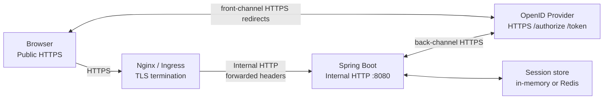

# 31.10. Testing Reverse Proxies, HTTPS, and SameSite Cookies

## Lesson Objectives

In **Spring Security OAuth 2.0/OIDC Client**, a system that works properly on `localhost` may still fail login once placed behind Nginx, HAProxy, Ingress, an API Gateway, or a load balancer. Errors such as **`redirect_uri` turning into HTTP**, **callbacks returning `invalid_state`**, **browsers blocking cookies**, or **succeeding login only to loop back to the login page** often appear only when testing realistic deployments.

After this lesson, you will be able to:

- Trace the **browser HTTPS → reverse proxy/TLS termination → internal Spring Boot HTTP → OpenID Provider → callback** flow and understand the trust boundary of each hop.
- Explain how `Host`, `Forwarded`, `X-Forwarded-Proto`, `X-Forwarded-Host`, `X-Forwarded-Port`, and `X-Forwarded-Prefix` affect the **public base URL** and `redirect_uri`.
- Configure `server.forward-headers-strategy` for Servlet/WebFlux to match the real proxy while preventing **forged forwarded headers/host-header poisoning**.
- Distinguish **HTTPS at the browser**, **HTTP/TLS between proxy and app**, and **TLS to the OP**; understand that TLS termination does not automatically protect internal networks.
- Explain cookie `Secure`, `HttpOnly`, `Path`, `Domain`, `SameSite=Strict/Lax/None`, `__Host-`, and `__Secure-` along with how **schemeful same-site** impacts OIDC login.
- Predict when **SameSite=Lax** works with **top-level GET** callbacks, and when **cross-site POST (`response_mode=form_post`)** callbacks require a different cookie/policy design.
- Test **HttpSession** in Spring MVC/Servlet and **WebSession** in Spring WebFlux; distinguish container session cookies from **Spring Session**.
- Build layered tests: `MockMvc`/`WebTestClient` to verify forwarding and security behavior; **reverse proxy + HTTPS + fake OP + real browser** to verify real cookie behavior.
- Analyze state/session errors across redirects, path prefix rewriting, cookie domains, multi-instance load balancers, logout, and redirect loops.
- Build a positive/negative test checklist, inspect browser DevTools effectively, and protect logs from leaking authorization codes, `state`, ID Tokens, Access Tokens, or session cookies.

---

## 1. Realistic Deployment Problem

Suppose **Learning Portal** is a Spring Boot OAuth2/OIDC Client using Campus Identity:

```text
Public RP URL:
    https://portal.example.org

Public OpenID Provider:
    https://login.example.edu

Internal Spring Boot:
    http://learning-app:8080
```

Diagram:



With Spring Security OAuth2 Login, the browser starts:

```http
GET https://portal.example.org/oauth2/authorization/campus
```

The RP returns a redirect to the OP with the desired `redirect_uri`:

```text
https://portal.example.org/login/oauth2/code/campus
```

If Spring Boot only sees the internal request:

```text
scheme=http
host=learning-app
port=8080
```

it may generate:

```text
http://learning-app:8080/login/oauth2/code/campus
```

or:

```text
http://portal.example.org/login/oauth2/code/campus
```

neither of which matches the **registered redirect URI** at the OP.

Another failure: the RP returns the right HTTP 302, yet the browser omits the session cookie when returning to the callback:

```text
GET /login/oauth2/code/campus?code=...&state=...
```

Spring Security cannot find the saved authorization request, leading to `invalid_state` or missing authorization request errors.

> **Integration goal:** Prove the system works end-to-end when the browser speaks **public HTTPS**, the app receives requests through a **trusted proxy**, the session survives **cross-site redirects**, and all OAuth2/OIDC state/nonce/PKCE validations stay intact.

## 2. Authorization Code Flow Through a Reverse Proxy

```mermaid
sequenceDiagram
    autonumber
    actor Browser
    participant Proxy as Reverse Proxy :443
    participant RP as Spring Boot :8080
    participant OP as OpenID Provider
    participant Store as Session Store

    Browser->>Proxy: HTTPS GET /oauth2/authorization/campus
    Proxy->>RP: HTTP GET + trusted forwarded headers
    RP->>Store: Save AuthorizationRequest / state
    RP-->>Proxy: 302 Location: OP /authorize + https redirect_uri
    Proxy-->>Browser: 302 + RP session cookie attributes
    Browser->>OP: HTTPS GET /authorize (front-channel)
    OP-->>Browser: 302 to RP callback (code, state)
    Browser->>Proxy: HTTPS GET /login/oauth2/code/campus + RP cookie
    Proxy->>RP: HTTP GET + forwarded headers + Cookie
    RP->>Store: Retrieve matching state/session
    RP->>OP: HTTPS POST /token (back-channel)
    OP-->>RP: OAuth2 token response
    RP->>RP: Validate ID Token, nonce, issuer, audience
    RP-->>Proxy: 302 /dashboard; session/security context
    Proxy-->>Browser: 302 /dashboard
    Browser->>Proxy: HTTPS GET /dashboard + cookie
```

Three distinct paths:

1. **Browser ↔ RP proxy:** public HTTPS; the browser decides whether to send cookies based on URL and cookie attributes.
2. **Proxy ↔ Spring Boot:** may be HTTP on a private network; requires header trust and infrastructure protection; this is not a direct browser request.
3. **RP ↔ OP Token Endpoint:** server-to-server back-channel HTTPS; **never uses the browser's session cookie**.

If the callback loses the session, investigate **browser ↔ RP cookies** and authorization request persistence rather than assuming `/token` failed.

## 3. Addresses That Must Be Distinguished

| Address | Example | Role |
| --- | --- | --- |
| Public RP origin | `https://portal.example.org` | Origin the browser uses to access the app |
| Internal app URL | `http://learning-app:8080` | Private endpoint behind the proxy |
| OP issuer | `https://login.example.edu/realms/campus` | Trusted OIDC `iss` |
| Authorization endpoint | `https://login.example.edu/realms/campus/protocol/openid-connect/auth` | Where the browser is redirected |
| Token endpoint | `https://login.example.edu/realms/campus/protocol/openid-connect/token` | Called server-to-server by the RP |
| RP callback URI | `https://portal.example.org/login/oauth2/code/campus` | Where the OP redirects the browser back |
| RP post-login URL | `https://portal.example.org/dashboard` | Post-login UI |
| RP logout return | `https://portal.example.org/signed-out` | Return URI per logout contract |

The **public base URL** does not necessarily match the hostname/port Spring Boot's socket listens on. `ClientRegistration.redirectUri` can be expanded using request data after forwarded-header processing.

### 3.1. Origin and Site Are Not the Same

An **Origin** consists of:

```text
scheme + host + port
```

For example:

```text
https://portal.example.org
https://login.example.org
```

are two different origins.

For SameSite cookies, the concept of **site** involves **scheme and registrable domain** per browser rules. Two subdomains can be different origins yet same-site; differing HTTP/HTTPS schemes can be treated as cross-site under **schemeful same-site**.

Therefore, when evaluating cookies, never assume different hostnames automatically mean cross-site, and never assume the same registrable domain makes every request same-origin.

## 4. Reverse Proxy and TLS Termination

A common deployment:

```text
Browser --HTTPS:443--> Reverse Proxy --HTTP:8080--> Spring Boot
```

The proxy terminates TLS and then talks to the app over a private network.

### 4.1. The App May See HTTP

Without forwarded-header processing:

```java
request.getScheme()     // "http"
request.isSecure()      // false
request.getServerName() // "learning-app" or "portal.example.org"
request.getServerPort() // 8080
```

These values can affect:

- OAuth2 `redirect_uri`.
- Absolute URLs in redirects.
- Cookie `Secure` flag when derived from request security.
- URLs built by `ServletUriComponentsBuilder` or reactive request contexts.
- OIDC logout `post_logout_redirect_uri`.
- Canonical origin/redirect allowlist checks.

### 4.2. Public HTTPS Must Still Be Maintained to the Browser

Do not fix proxy issues by downgrading the public RP to HTTP or adding HTTP callbacks at the OP just to pass. Doing so can expose authorization codes/session cookies in transit.

### 4.3. HTTP Proxy-to-App Is a Deployment Decision

Internal HTTP may be acceptable inside a controlled network zone per threat model, yet it does not mean that link is automatically safe.

When the architecture requires it, use:

```text
Proxy -> Spring Boot HTTPS/mTLS
NetworkPolicy / firewall
Private service discovery
Proxy identity and trust
```

Securing transport and validating forwarded headers are **two separate concerns**.

## 5. `Forwarded` and `X-Forwarded-*`

Proxies commonly add public request metadata:

```http
Host: portal.example.org
X-Forwarded-Proto: https
X-Forwarded-Host: portal.example.org
X-Forwarded-Port: 443
X-Forwarded-For: 203.0.113.10
```

Or the standard RFC 7239 header:

```http
Forwarded: for=203.0.113.10;proto=https;host=portal.example.org
```

Depending on infrastructure, there may also be:

```http
X-Forwarded-Prefix: /portal
```

when the public URL carries a path prefix while the internal app runs at `/`.

### 5.1. Meaning of Each Header

| Header | What It Represents | Risk If Untrusted |
| --- | --- | --- |
| `X-Forwarded-Proto` | External scheme | Wrong HTTP/HTTPS redirects, secure URL confusion |
| `X-Forwarded-Host` | Public host | Host-header poisoning, redirect URI pointing to attacker domain |
| `X-Forwarded-Port` | Public port | URIs get `:8080` appended or wrong `:443` |
| `X-Forwarded-Prefix` | Public base path | Callback missing or duplicating prefix |
| `X-Forwarded-For` | Client IP chain | Audit/rate-limiting on spoofed IPs |
| `Forwarded` | Combined standard info | Conflicting/forged forwarding data |
| `Host` | HTTP request host | Wrong virtual-host routing and absolute links |

### 5.2. `X-Forwarded-For` Does Not Directly Govern SameSite Cookies

SameSite cookies are evaluated by the browser comparing site and request context. However, `X-Forwarded-Proto`/host/prefix can cause the RP to generate broken URLs or cookies.

### 5.3. Multiple Proxy Hops

A request may traverse:

```text
Browser -> CDN -> Load Balancer -> Ingress -> Spring Boot
```

Headers can contain multiple values or be chained. Policy must specify **which hops are trusted**, who strips/overwrites client-supplied headers, and which values the framework reads. Never pick first/last elements with ad-hoc rules undefined by the infrastructure.

## 6. Trust Boundary: Never Accept Forged Forwarded Headers

A dangerous configuration:

```text
Direct Internet -> Spring Boot :8080
```

while Boot trusts:

```http
X-Forwarded-Host: attacker.example
X-Forwarded-Proto: https
```

If the app builds redirect URLs from unauthenticated headers, attackers can make the RP emit `Location` headers to the wrong domain or achieve **host-header poisoning**.

### 6.1. Edge Proxies Must Strip/Overwrite Untrusted Input

Requirements:

- Only **trusted reverse proxies** can connect directly to the backend.
- Proxies never forward raw untrusted `Forwarded`/`X-Forwarded-*` headers from browsers.
- The system overwrites public scheme/host/port values per declared routes.
- Hostnames are allowlisted.
- Gateways block requests with unlisted `Host` headers.
- Never allow users to supply `X-Forwarded-Prefix` or OP URLs.

### 6.2. Spoofing Tests Must Traverse the Real Proxy

A test calling Spring Boot directly with:

```http
X-Forwarded-Host: attacker.example
```

when `ForwardedHeaderFilter` is active will cause the app to build URLs from that input. That proves **the framework trusts the header**, not that the production reverse proxy is bypassable.

A **proper security integration test** sends the request from **outside the proxy** and confirms forged headers are stripped/overwritten or the request is rejected.

### 6.3. Never Treat Forwarded Headers as Authentication

Forwarded headers restore public request properties; they do not prove a user logged in or holds tenant membership. Spring Security must still verify `state`, `nonce`, tokens, sessions, and authorization.

## 7. How Spring Boot Processes Forwarded Headers

In many Spring Boot 3.x releases, you configure:

```yaml
server:
  forward-headers-strategy: framework
```

Common options:

```text
none
native
framework
```

High-level meaning:

- `none`: Boot performs no forwarded-header processing.
- `native`: delegates to the web container/native infrastructure support.
- `framework`: uses Spring Framework's mechanism to interpret forwarded headers.

Verify against your exact Spring Boot version, Servlet container, and real deployment.

### 7.1. Servlet and WebFlux Differ

In Spring MVC/Servlet, the mechanism typically involves:

```java
ForwardedHeaderFilter
```

In WebFlux, the counterpart is:

```java
ForwardedHeaderTransformer
```

Do not register both a custom filter/transformer and uncontrolled container native processing, or forwarded headers may be processed twice.

### 7.2. `framework` Does Not Make Internet Headers Trustworthy

This property tells the framework to **interpret** incoming headers. It **does not authenticate** the upstream reverse proxy or stop browsers from forging headers if the backend is exposed publicly.

Trust guarantees must come from topology, ingress configuration, and network restrictions.

### 7.3. `native` Depends on the Container

For instance, Tomcat provides `RemoteIpValve`, while other servers/containers have their own mechanisms. Trusted proxy IP ranges, header names, and behaviors can differ from `framework`.

Do not apply identical assumptions across Tomcat, Netty, Undertow, and every ingress controller.

## 8. Example Nginx Config at the Public HTTPS Edge

Assuming Nginx terminates public TLS directly on port 443:

```nginx
server {
    listen 443 ssl;
    server_name portal.example.org;

    ssl_certificate     /etc/nginx/tls/fullchain.pem;
    ssl_certificate_key /etc/nginx/tls/privkey.pem;

    location / {
        proxy_pass http://learning-app:8080;

        proxy_set_header Host portal.example.org;
        proxy_set_header X-Forwarded-Proto https;
        proxy_set_header X-Forwarded-Host portal.example.org;
        proxy_set_header X-Forwarded-Port 443;
        proxy_set_header X-Forwarded-For $remote_addr;

        proxy_set_header Forwarded "";
        proxy_set_header X-Forwarded-Prefix "";
    }
}

server {
    listen 80;
    server_name portal.example.org;
    return 301 https://portal.example.org$request_uri;
}
```

This is a conceptual example; add full TLS policies, cipher suites, health checks, timeouts, upstream TLS if required, and security headers per infrastructure standards.

### 8.1. Why Pin the Host?

When the proxy serves only `portal.example.org`, setting:

```nginx
proxy_set_header Host portal.example.org;
```

prevents passing an arbitrary browser-supplied `Host` directly to the backend.

In multi-host deployments, use a controlled allowlist/route mapping—never hardcode one host across all tenants.

### 8.2. If Nginx Sits Behind Another CDN/LB

If an upstream CDN/LB terminates TLS first and calls Nginx over HTTP, `$scheme` inside Nginx will be `http`. In that case:

```nginx
proxy_set_header X-Forwarded-Proto $scheme;
```

**does not reflect public HTTPS**.

Configure the trusted proxy chain properly: the CDN/LB supplies verified metadata, Nginx accepts it only from trusted upstream sources, and normalizes/forwards values to the backend. Never trust arbitrary `X-Forwarded-Proto` headers sent by internet clients.

### 8.3. Never Expose Port 8080 to the Internet

Even when Nginx normalizes headers, if an attacker can connect directly to `learning-app:8080`, they can try overriding forwarding headers. Use firewalls/security groups/Kubernetes NetworkPolicies so only the proxy can reach the app.

## 9. `redirect_uri` in Spring Security OAuth2 Login

A common configuration:

```yaml
spring:
  security:
    oauth2:
      client:
        registration:
          campus:
            provider: campus-op
            client-id: ${OIDC_CLIENT_ID}
            client-secret: ${OIDC_CLIENT_SECRET}
            client-authentication-method: client_secret_basic
            authorization-grant-type: authorization_code
            redirect-uri: "{baseUrl}/login/oauth2/code/{registrationId}"
            scope:
              - openid
              - profile

        provider:
          campus-op:
            issuer-uri: https://login.example.edu/realms/campus
```

Spring Security expands placeholders such as:

```text
{baseUrl}
{registrationId}
```

based on the request/context and registration.

Desired values:

```text
{baseUrl}
    = https://portal.example.org

{registrationId}
    = campus

redirect_uri
    = https://portal.example.org/login/oauth2/code/campus
```

### 9.1. If the App Sees Internal HTTP

It may generate:

```text
http://learning-app:8080/login/oauth2/code/campus
```

or `http://portal.example.org/...`, causing the OP to reject `redirect_uri` or redirecting the browser to the wrong URL.

### 9.2. Registering the Callback at the OP

The OP must allow the exact public redirect URI per provider policy:

```text
https://portal.example.org/login/oauth2/code/campus
```

Avoid broad wildcards, production HTTP redirect URIs, or letting clients pick redirect URIs from untrusted query parameters.

### 9.3. Do Not Confuse OP Issuer with RP Public URL

```text
issuer        = https://login.example.edu/realms/campus
RP base URL   = https://portal.example.org
```

ID Token `iss` is not the callback address. Never alter issuer validation to work around a redirect URI bug.

### 9.4. Callback After HTTPS Termination

The OP redirects the browser back over **public HTTPS**. The proxy forwards the request into Spring Boot, Spring Security retrieves the session/authorization request by state, and exchanges the code at the Token Endpoint.

The back-channel call to the OP generally does not care about the RP's public `Host` beyond the `redirect_uri` parameter in the Token Endpoint protocol.

## 10. Public Prefix and `X-Forwarded-Prefix`

Another setup:

```text
Browser public:
    https://portal.example.org/learning

Spring Boot internal:
    http://learning-app:8080/
```

Proxy rewrite:

```text
/learning/oauth2/authorization/campus
    -> /oauth2/authorization/campus

/learning/login/oauth2/code/campus
    -> /login/oauth2/code/campus
```

When needed, the proxy sends:

```http
X-Forwarded-Prefix: /learning
```

so the framework knows the public base path.

### 10.1. Expected Callback

```text
https://portal.example.org/learning/login/oauth2/code/campus
```

Only that public URI should be registered at the OP.

### 10.2. Avoid Duplicating the Prefix

Wrong:

```text
/learning/learning/login/oauth2/code/campus
```

can happen if the app already configures context path `/learning` while the proxy also adds forwarded prefix `/learning` with inconsistent rewriting.

### 10.3. Avoid Dropping the Prefix

Wrong:

```text
https://portal.example.org/login/oauth2/code/campus
```

when the proxy only routes `/learning/**`. The callback may 404 or hit the wrong app.

### 10.4. Test Both Start and Callback

Do not merely assert `redirect_uri` contains the prefix. Verify a real browser returns to the public callback, the proxy rewrites to the right Spring Security filter, the session cookie has a matching `Path`, and the request does not 404.

## 11. Cookies During an OIDC Login Round-Trip

In Servlet by default, Spring Security may store the Authorization Request in the HTTP session via:

```java
HttpSessionOAuth2AuthorizationRequestRepository
```

In Reactive WebFlux, there is:

```java
WebSessionOAuth2ServerAuthorizationRequestRepository
```

The record holds data used to correlate OAuth2 `state` and the login transaction. The browser identifies the session via a cookie, commonly:

```text
JSESSIONID
```

for Servlet containers or:

```text
SESSION
```

when using Spring Session/Reactive stacks per configuration.

**The cookie name depends on stack/configuration**; do not assume every Spring application uses the same name.

### 11.1. Two Cookies Belonging to Two Origins

RP session cookie:

```text
portal.example.org
```

OP SSO cookie:

```text
login.example.edu
```

The browser manages them separately. The RP's cookie is normally **not sent to the OP**, and the OP's cookie is not automatically sent to the RP callback.

### 11.2. Why Is the RP Cookie Crucial at Callback Time?

```text
Start login:
    RP saves authorization request under session S1
    Browser receives session cookie S1

Callback:
    Browser sends cookie S1 back to RP
    RP looks up authorization request/state in S1
```

If the browser does not send S1, or the app no longer has S1's data, Spring Security cannot match `state`.

### 11.3. The Session Cookie Is Not OAuth2 State

The cookie carries the session identifier; `state` is transaction binding. Both are vital, and neither should ever be printed in logs or substituted for the other.

## 12. `Secure` and `HttpOnly`

A header:

```http
Set-Cookie: SESSION=<opaque-value>; Path=/; Secure; HttpOnly; SameSite=Lax
```

has these meanings:

- **`Secure`**: the browser only sends the cookie in secure URL contexts per browser rules, typically HTTPS.
- **`HttpOnly`**: browser JavaScript cannot read the cookie via `document.cookie`.
- **`Path=/`**: restricts the paths for which the cookie is sent.
- **`SameSite=Lax`**: controls sending the cookie on cross-site requests.
- **`Domain`** if set: controls hostname scope; omit it when a host-only cookie suffices.

### 12.1. TLS Termination Does Not Remove the `Secure` Requirement

The browser accesses:

```text
https://portal.example.org
```

even though the backend sees HTTP. The RP must still emit the session cookie with `Secure` per public HTTPS policy.

### 12.2. `Secure` Cannot Fix an HTTP Public Callback

If the proxy or OP redirects the browser to:

```text
http://portal.example.org/login/oauth2/code/campus
```

a `Secure` cookie will not be sent as expected over HTTP. Never remove `Secure` to make login work; fix the public URL/proxy instead.

### 12.3. `HttpOnly` Is Not CSRF Protection

`HttpOnly` stops scripts from reading the cookie directly, yet the browser still attaches the cookie automatically. Spring Security CSRF protection and OAuth2 `state` remain necessary for their respective flows.

## 13. SameSite: `Strict`, `Lax`, `None`

| Value | General Behavior | Typical Impact on OIDC |
| --- | --- | --- |
| `Strict` | Never sent on cross-site navigations | Easily drops RP session on callbacks from an external OP |
| `Lax` | Sent same-site and on certain top-level cross-site navigations using safe methods like GET | Usually works for **top-level GET** Authorization Code callbacks |
| `None` | Allows sending in cross-site contexts per browser policy | Requires `Secure`; consider if callbacks need cross-site POST or embedding |
| Omitted | Browser applies version/policy default, often Lax-like | Never rely on vague defaults for security-critical flows |

Modern browsers generally require:

```text
SameSite=None
    -> Secure
```

A `SameSite=None` cookie missing `Secure` may be **rejected at `Set-Cookie`**.

### 13.1. `SameSite=Strict`: When Does the Callback Lose the Session?

If the RP is at:

```text
https://portal.example.org
```

and the OP is on a different site:

```text
https://login.example.edu
```

then navigating **from OP to RP** can be a cross-site navigation. A `Strict` RP cookie is typically omitted on that callback.

Outcome:

```text
Callback state received
RP session cookie absent
Saved AuthorizationRequest not found
```

### 13.2. `SameSite=Lax` and GET Callbacks

Standard Authorization Code Flow returns the callback:

```http
GET /login/oauth2/code/campus?code=...&state=...
```

which is a **top-level navigation via GET**. On such cross-site navigations, `Lax` cookies are normally sent, letting Spring Security locate the authorization request.

This does **not** mean `Lax` cookies are sent on every cross-site POST, iframe, or `fetch()`.

### 13.3. `SameSite=None` and `form_post` Callbacks

An OP or application might use OIDC response mode:

```text
response_mode=form_post
```

where the browser sends:

```http
POST /login/oauth2/code/campus
Content-Type: application/x-www-form-urlencoded

code=<code>&state=<state>
```

If this is a cross-site POST, a `SameSite=Lax` cookie **is normally not sent**. An application needing to support this flow may have to design for `SameSite=None; Secure` session cookies or another transaction mechanism.

**Especially important:** Do not just switch the cookie to `None` and call it done. Verify Spring Security callback handling, HTTP method/CSRF policy, OP response mode, browser restrictions, session security, and state validation. Some stacks require dedicated config/extensions for `form_post`.

### 13.4. Do Not Rely on Browser `Lax+POST` Exceptions

Some browsers have legacy compatibility windows for newly created cookies without an explicit `SameSite`. Never rely on that exception as a security contract or as a basis for supporting `form_post`. Set an explicit cookie policy and test on target browsers.

## 14. Same-Site Does Not Mean Same-Origin

Example:

```text
RP = https://portal.company.example
OP = https://login.company.example
```

These may be **same-site** by registrable domain and scheme, even though they are **different origins**.

Conversely:

```text
http://portal.example.org
https://portal.example.org
```

can be treated as **cross-site** under schemeful same-site, despite sharing the exact same hostname.

### 14.1. Test Site Behavior in a Browser Instead of Guessing

Browser tests must account for:

- Public scheme.
- RP and OP hostnames.
- Public suffix/registrable domain rules.
- Navigation type: top-level GET, POST form, iframe, subresource.
- Browser version/privacy policies.

### 14.2. `SameSite` and Third-Party Cookies Are Not Identical

Third-party cookie blocking and SameSite interact, yet are distinct. A top-level navigation to the RP puts the RP into a first-party context at the destination, whereas an embedded iframe sits in a third-party context.

Do not assume "the browser blocks third-party cookies" will always block a top-level GET callback with a `Lax` cookie.

## 15. Cookie `Domain` and `Path`

A host-only cookie:

```http
Set-Cookie: SESSION=<value>; Path=/; Secure; HttpOnly; SameSite=Lax
```

omits `Domain`; the browser binds it strictly to the issuing host.

Another cookie:

```http
Set-Cookie: SESSION=<value>; Domain=example.org; Path=/; Secure; HttpOnly; SameSite=Lax
```

may be sent to all eligible subdomains, unnecessarily widening session exposure.

### 15.1. Prefer Host-Only Session Cookies

In most single-host RPs, keep the cookie scoped solely to `portal.example.org` rather than widening to all `*.example.org`.

### 15.2. `Path` Must Cover the Callback

If a cookie sets:

```text
Path=/learning
```

and the public callback is also:

```text
/learning/login/oauth2/code/campus
```

then the path matches.

Yet if the callback sits outside:

```text
/login/oauth2/code/campus
```

the cookie may not be sent. Never set a `Path` narrower than the endpoints sharing that session.

### 15.3. `Domain` Cannot Make RP Cookies Sent to a Cross-Site OP

Never try configuring a cookie's `Domain` to the IdP's domain (`login.example.edu`) when issued by the RP (`portal.example.org`). Browsers reject domains that don't match the issuing host.

### 15.4. `__Host-` and `__Secure-` Prefixes

Browsers supporting cookie prefixes enforce constraints:

```text
__Secure-...:
    must have Secure and be issued from a secure origin

__Host-...:
    Secure
    Path=/
    no Domain attribute
    issued from a secure origin
```

Prefixes let browsers enforce certain attributes, yet test your stack/session configuration carefully when renaming cookies; never rename the cookie while forgetting the session resolver/serializer.

## 16. Spring MVC/Servlet: Configuring Session Cookies

With Spring Boot Servlet 3.x, for example:

```yaml
server:
  forward-headers-strategy: framework
  servlet:
    session:
      cookie:
        secure: true
        http-only: true
        same-site: lax
        path: /
```

In public HTTPS production, `secure: true` prevents omitting `Secure` when the container only sees internal HTTP.

### 16.1. `SameSite=Lax` Usually Fits OIDC GET Callbacks

When the callback is a top-level GET from a cross-site OP, `Lax` generally lets the browser send the session cookie back to the RP.

### 16.2. Properties Depend on Stack/Version

`server.servlet.session.cookie.same-site` is used across many Spring Boot 3.x releases, yet if the app uses Spring Session or a custom cookie serializer, cookie policies come from another component.

**Inspect the actual `Set-Cookie` header**, rather than reading YAML and assuming the browser receives those attributes.

### 16.3. HTTP Dev May Need Separate Configuration

If running production-like HTTPS in tests:

```text
https://portal.test
```

keeping `Secure` makes sense.

If running `http://localhost:8080` for local dev, `Secure` cookies may not behave like production across all environments/browsers. Never remove `Secure` from production because of this; use an HTTPS test profile or clear local TLS environment instead.

## 17. Spring Session on Servlet: `DefaultCookieSerializer`

When using Spring Session, you may need to configure the cookie serializer:

```java
@Configuration
class SessionCookieConfiguration {

    @Bean
    CookieSerializer cookieSerializer() {

        DefaultCookieSerializer serializer =
            new DefaultCookieSerializer();

        serializer.setCookieName("SESSION");
        serializer.setUseSecureCookie(true);
        serializer.setUseHttpOnlyCookie(true);
        serializer.setSameSite("Lax");
        serializer.setCookiePath("/");

        return serializer;
    }
}
```

Main imports:

```java
import org.springframework.context.annotation.Bean;
import org.springframework.context.annotation.Configuration;
import org.springframework.session.web.http.CookieSerializer;
import org.springframework.session.web.http.DefaultCookieSerializer;
```

### 17.1. Container Session Cookies and Spring Session Cookies Differ

If Spring Session manages session IDs via `SESSION`, editing `server.servlet.session.cookie.*` may have no effect when Spring Session's serializer governs responses.

Likewise, custom security/session filters can alter cookie name, path, domain, or SameSite.

### 17.2. Never Configure Two Conflicting Policy Sources

For example:

```text
Servlet cookie SameSite=Lax
Spring Session serializer SameSite=Strict
```

when the system actually runs Spring Session. Identify which component **actually emits `Set-Cookie`** and inspect it on the wire.

### 17.3. Redis/Session Stores and `invalid_state`

A cookie can be sent properly yet session data still be missing due to:

- Redis/DB session store failures.
- Expired session keys.
- Serialization errors.
- Cluster nodes using per-pod in-memory sessions.
- Session ID rotation incompatible with state persistence.

Tests must not assume every `invalid_state` is caused by SameSite.

## 18. Spring WebFlux: `CookieWebSessionIdResolver`

WebFlux uses `WebSession` and can customize session cookies with:

```java
CookieWebSessionIdResolver
```

Example:

```java
@Configuration
class ReactiveCookieConfiguration {

    @Bean
    WebSessionIdResolver webSessionIdResolver() {

        CookieWebSessionIdResolver resolver =
            new CookieWebSessionIdResolver();

        resolver.setCookieName("SESSION");

        resolver.addCookieInitializer(builder -> builder
            .path("/")
            .httpOnly(true)
            .secure(true)
            .sameSite("Lax")
        );

        return resolver;
    }
}
```

Imports:

```java
import org.springframework.context.annotation.Bean;
import org.springframework.context.annotation.Configuration;
import org.springframework.web.server.session.CookieWebSessionIdResolver;
import org.springframework.web.server.session.WebSessionIdResolver;
```

### 18.1. WebSession Cookies Also Follow Browser Policies

`SameSite`, `Secure`, `Domain`, and `Path` retain the exact same browser semantics whether the app runs Reactor Netty or Tomcat.

### 18.2. Reactive Authorization Request Persistence

Spring Security WebFlux typically uses:

```java
WebSessionOAuth2ServerAuthorizationRequestRepository
```

to store pending authorization requests. If the browser callback omits the `SESSION` cookie, the repository cannot locate the created request.

### 18.3. WebFlux Tests Must Not Infer Behavior from Servlet

`server.servlet.session.cookie.same-site` does not prove reactive `WebSession` cookies changed. Check reactive resolvers/properties for your stack and version, and observe real responses.

## 19. SameSite Matrix for OIDC

Assuming the OP is on a different site from the RP and the cookie belongs to the RP.

| Callback/Request Scenario | `Strict` | `Lax` | `None; Secure` |
| --- | --- | --- | --- |
| OP → RP top-level GET `/login/oauth2/code/...` | Usually **omitted** | Usually **sent** | May be sent per browser policy |
| OP → RP cross-site POST `form_post` | Omitted | Usually omitted | May be sent |
| Cross-site iframe to RP | Omitted | Omitted | May be sent, subject to third-party restrictions |
| RP same-site navigation GET | Sent if path/domain match | Sent | Sent |
| Public HTTP URL with Secure cookie | Not sent over HTTP | Not sent over HTTP | Not sent over HTTP |
| RP → OP `/token` server-to-server | RP browser cookie N/A | N/A | N/A |

**This table illustrates typical behavior**, and does not replace real browser tests. Cookies may still be blocked by `Domain`, `Path`, expiry, third-party privacy settings, prefix rules, or specific browser behavior.

### 19.1. When Should You Use `SameSite=None`?

Only when a concrete analyzed requirement demands it—such as cross-site POST callbacks or embedded SSO—after assessing security impact, never as a blanket fix for login errors.

Requires:

```text
SameSite=None
Secure
Public HTTPS
CSRF/state protections
Browser compatibility tests
```

### 19.2. Never Drop Spring Security CSRF Protection

SameSite is defense-in-depth, not a replacement for CSRF tokens and OIDC `state`. Using `None` exposes cookies to more cross-site contexts; state-changing endpoints must remain protected.

## 20. Testing Public `redirect_uri` with MockMvc

A Servlet integration test can invoke the OAuth2 Login initiation endpoint and read `Location`.

Idea:

```java
@SpringBootTest
@AutoConfigureMockMvc
class RedirectUriBehindProxyTest {

    @Autowired
    MockMvc mvc;

    @Test
    void usesExternalHttpsBaseUrl() throws Exception {

        MvcResult result = mvc.perform(
                get("/oauth2/authorization/campus")
                    .secure(false)
                    .header(
                        "X-Forwarded-Proto", "https"
                    )
                    .header(
                        "X-Forwarded-Host",
                        "portal.example.org"
                    )
                    .header(
                        "X-Forwarded-Port", "443"
                    )
            )
            .andExpect(
                status().is3xxRedirection()
            )
            .andReturn();

        String location =
            result.getResponse().getHeader("Location");

        assertThat(location).isNotNull();

        URI authorizeUri = URI.create(location);

        assertThat(authorizeUri.getHost())
            .isEqualTo("login.example.edu");

        String callback =
            parseFormQuery(authorizeUri.getRawQuery())
                .get("redirect_uri");

        assertThat(callback).isEqualTo(
            "https://portal.example.org/" +
            "login/oauth2/code/campus"
        );
    }
}
```

Here `parseFormQuery(...)` is a test helper decoding form-url-encoded query parameters, not a Spring Security API. When using `@AutoConfigureMockMvc`, verify forwarded-header processing is **actually registered in MockMvc's filter chain** per your Boot version and config.

### 20.1. Query Parsing Helper

An illustrative helper for URL-encoded query keys/values:

```java
static Map<String, String> parseFormQuery(
        String rawQuery) {

    Map<String, String> result = new HashMap<>();

    for (String part : rawQuery.split("&")) {

        String[] pair = part.split("=", 2);

        String key = URLDecoder.decode(
            pair[0], StandardCharsets.UTF_8
        );

        String value = pair.length > 1
            ? URLDecoder.decode(
                pair[1], StandardCharsets.UTF_8
            )
            : "";

        result.put(key, value);
    }

    return result;
}
```

Production-grade helpers must also handle duplicate parameters, nulls, and validation. Here it only illustrates inspecting a test fixture's authorization URL.

### 20.2. If MockMvc Does Not Apply the Filter

You can build `MockMvc` with `ForwardedHeaderFilter` explicitly in test setup, **avoiding double-registering the filter**. A test without the forwarded-header transformer can assert behavior different from production.

### 20.3. What This MockMvc Test Proves

The application **constructs the right authorization redirect URI** when requests arrive with configured forwarded metadata.

It **does not prove** the production proxy strips forged headers, the browser sends the callback cookie, or the OP accepts the redirect URI.

## 21. Negative Tests for Forwarded Headers in MockMvc

Build a case table:

| Simulated Input | Expected |
| --- | --- |
| `X-Forwarded-Proto=https` | Public `redirect_uri` uses HTTPS |
| `X-Forwarded-Proto=http` from trusted proxy test | Policy rejects or does not treat as public HTTPS |
| `X-Forwarded-Host=portal.example.org` | URL uses right host |
| Missing forwarded host | Does not fall back to internal hostname in production config |
| `X-Forwarded-Port=8443` | URL/redirect matches configured public port |
| `X-Forwarded-Prefix=/learning` | Callback includes prefix exactly once |
| Forwarded path prefix duplicates context path | Does not emit `/learning/learning` |
| Forged host `attacker.example` | **From public edge**, must reject/normalize |
| Conflicting `Forwarded` and `X-Forwarded-*` | Consistent canonical trust policy |

### 21.1. Do Not Confuse App-Level Tests with Proxy Security Tests

If MockMvc sends a request straight to the app with `X-Forwarded-Host: attacker.example`, Spring may honor that host per configuration. That is not a proxy security bug if the production backend isn't directly reachable and the proxy strips headers.

To test **host spoofing** end-to-end, send requests **through the proxy** from outside the trust boundary.

### 21.2. Host Allowlists Can Sit at Multiple Layers

Enforce policy at the edge; optionally add host validation in the app for defense-in-depth. With multi-tenant subdomains, map hosts to tenants using an administrated allowlist rather than granting permissions from raw headers.

## 22. Testing WebFlux and `ForwardedHeaderTransformer`

A Reactive test can send:

```text
GET /oauth2/authorization/campus
X-Forwarded-Proto: https
X-Forwarded-Host: portal.example.org
X-Forwarded-Port: 443
```

and assert `Location` contains the public HTTPS `redirect_uri`.

WebTestClient example (context config must include Reactive OAuth2 Client and forwarded-header processing):

```java
@SpringBootTest(
    webEnvironment = SpringBootTest.WebEnvironment.RANDOM_PORT
)
@AutoConfigureWebTestClient
class ReactiveRedirectUriTest {

    @Autowired
    WebTestClient client;

    @Test
    void buildsHttpsRedirectBehindProxy() {

        client.get()
            .uri("/oauth2/authorization/campus")
            .header(
                "X-Forwarded-Proto", "https"
            )
            .header(
                "X-Forwarded-Host",
                "portal.example.org"
            )
            .header(
                "X-Forwarded-Port", "443"
            )
            .exchange()
            .expectStatus().is3xxRedirection()
            .expectHeader().exists("Location");
    }
}
```

This is a first step; stronger tests **parse `Location` and assert `redirect_uri`**, just like Servlet.

### 22.1. Testing at RANDOM_PORT Is Not a Browser HTTPS Test

`WebTestClient` in this example typically speaks HTTP to the test server. Forwarded headers simulate public HTTPS, yet **do not test** TLS certificates, proxy rewrites, or real browser cookie policies.

### 22.2. Class/API Names Depend on Version

Annotations and `WebTestClient` binding vary by Spring Boot/Spring Security version. Keep the real filter chain, reactive registration repository, and forwarded-header transformer in the test context rather than testing an isolated controller and assuming security redirects work.

## 23. Testing `Set-Cookie` on Real Responses

A concrete target:

```http
Set-Cookie: SESSION=<opaque>; Path=/; Secure; HttpOnly; SameSite=Lax
```

Tests should inspect **attributes**, without printing cookie values into reports/logs.

### 23.1. Why Might Cookies Be Absent on Arbitrary Requests?

Servlet containers/Spring Session may only emit a cookie when a session is used or created. A stateless `GET /health` may have **no `Set-Cookie`**.

Therefore, tests must traverse an action that creates/saves a session (such as initiating OAuth2 Login) and capture the actual response.

### 23.2. `Set-Cookie` May Have Multiple Headers

A single response might emit:

```text
SESSION
XSRF-TOKEN
other app cookies
```

Do not assert that **every cookie** shares the same policy without distinguishing cookie types. Session cookies differ from CSRF token cookies or UI preference cookies.

### 23.3. Checking `Secure` Independently of the Internal Request

In proxy tests:

```text
Browser HTTPS -> Proxy -> Backend HTTP
```

assert the browser receives a `Secure` session cookie, even though the internal app saw `request.isSecure=false` before forwarded processing.

### 23.4. Never Log Raw `Set-Cookie`

Test assertions can parse response headers and check:

```text
cookie name = SESSION/JSESSIONID
Secure = present
HttpOnly = present
SameSite = Lax
Path = /
```

without dumping the full `Set-Cookie` header containing the session identifier into CI logs.

## 24. When Do You Need a Real Browser?

`MockMvc` or `WebTestClient` **do not implement full browser cookie policies**. They can send whatever `Cookie` headers the test specifies regardless of SameSite.

Only a real browser reveals:

- Was the cookie actually **stored** after `Set-Cookie`?
- Is `SameSite=None` without `Secure` rejected?
- Is the cookie sent on a top-level cross-site GET callback?
- Is the cookie blocked on cross-site POSTs/iframes?
- What *blocked reason* does the browser report in DevTools?
- HSTS/secure contexts, certificate trust, and redirect navigation.
- Privacy/third-party cookie settings.

### 24.1. Tools

You can use:

```text
Playwright
Selenium/WebDriver
Chrome/Firefox/Safari automation
```

paired with an **HTTPS reverse proxy** and **fake OP**.

Production IdP credentials are never needed in CI.

### 24.2. Why Are Real Hostnames Needed?

A test running solely on:

```text
http://localhost:8080
```

does not accurately reproduce:

```text
https://portal.example.org
  -> https://login.example.edu
```

for schemeful same-site, domain/path scoping, certificates, and browser redirects.

Test environments should use **two test hostnames whose site relationship mirrors production**, browser-trusted TLS certificates, and a production-like reverse proxy topology.

## 25. Building a Production-Like Test Environment

An integration environment can look like:

```text
Browser Test Runner
    |
    v
https://portal.test.example (trusted TLS cert)
    |
    v
Nginx/Ingress
    |
    v
Spring Boot application :8080
    |
    +----> Shared Session Store (if used)
    |
    +----> Test OpenID Provider HTTPS
             /.well-known/openid-configuration
             /authorize
             /token
             /jwks
```

You can use Testcontainers to run the proxy, app dependencies, and OP harness, ensuring both the browser **and the backend** resolve the exact hostnames/issuer properly.

### 25.1. Fake OP Must Honor the OIDC Contract

A real OIDC Integration test needs:

- Consistent Issuer URI.
- Discovery metadata.
- Authorization Endpoint supporting code flow.
- Token Endpoint returning token responses.
- JWKS containing public keys.
- Validly signed ID Token with right `iss`, `aud`, `exp`, `iat`, and `nonce` if used.
- `redirect_uri` validation.
- Transaction-matching `state` return.
- PKCE if required by the client.

Never disable ID Token signature/issuer/audience validation just to test cookies or proxies.

### 25.2. OP Must Redirect to the Exact Public Callback

The fake OP should verify the incoming `redirect_uri`:

```text
https://portal.test.example/login/oauth2/code/campus
```

If it receives:

```text
http://app:8080/login/oauth2/code/campus
```

fail the test **before login**.

### 25.3. Testcontainers Does Not Replace a Browser Cookie Engine

Container networks reproduce proxies and OPs well, yet when verifying SameSite, use Playwright/Selenium with a real browser rather than an HTTP client like `curl`.

## 26. E2E Scenario: GET Callback with SameSite=Lax

### 26.1. Given

```text
RP public = https://portal.test.example
OP public = https://login.test-idp.example
RP backend = http://app:8080
Cookie = Secure; HttpOnly; SameSite=Lax
OIDC response mode = query (GET callback)
```

### 26.2. When

1. Browser opens public HTTPS RP.
2. Browser clicks Login, hitting `/oauth2/authorization/campus`.
3. RP creates a session and stores the Authorization Request.
4. Proxy returns OP redirect with the HTTPS callback URI.
5. Browser navigates to the OP.
6. Fake OP returns authorization code/state via top-level 302 GET.
7. Browser hits `/login/oauth2/code/campus`.
8. RP verifies state and ID Token, then redirects to `/dashboard`.

### 26.3. Then

- RP `Location` contains `redirect_uri=https://portal.test.example/login/oauth2/code/campus`.
- Browser stores the RP session cookie with `Secure`, `HttpOnly`, and `SameSite=Lax`.
- Callback GET carries the right RP cookie, **without sending RP cookies to the OP**.
- AuthorizationRequest is found.
- Token exchange/ID Token validation succeed.
- Browser reaches `/dashboard` with an authenticated session.
- Zero HTTP redirects to internal hosts or plain HTTP.
- Logs contain no raw codes, states, tokens, or cookies.

### 26.4. Why Inspect the Callback Request Too?

Merely seeing a valid `Set-Cookie` does not prove the browser sent it **after a cross-site redirect**. Browser network logs in tests should verify cookie transmission via safe browser APIs without printing cookie values.

## 27. Negative E2E: SameSite=Strict

Suppose the OP is genuinely on a different site than the RP.

```text
RP cookie = Secure; HttpOnly; SameSite=Strict
```

Login begins normally and the browser stores the cookie. Once the OP redirects back to the RP via top-level GET, the browser typically omits the RP cookie on the cross-site navigation.

Expected:

```text
callback reaches RP
state present
session cookie absent
authorization request missing
login rejected
```

Never drop state validation or spin up a blank session to accept the callback just to make the test pass.

### 27.1. Condition for a Meaningful Test

If OP and RP are same-site (different subdomains yet same scheme + registrable domain), `Strict` may behave differently than expected. Use two genuine **cross-site test domains** to verify this case.

### 27.2. Distinguish Strict from Cookie Path Bugs

If the browser omits a cookie, check the blocked reason and cookie attributes. Do not blame `Strict` prematurely if the cookie also has the wrong `Path`/`Domain`.

## 28. Negative E2E: `form_post` with SameSite=Lax

A specialized flow uses:

```text
response_mode=form_post
```

The OP serves an HTML form that auto-POSTs back to the RP callback:

```http
POST /login/oauth2/code/campus
Content-Type: application/x-www-form-urlencoded

code=...&state=...
```

On cross-site POSTs, `Lax` cookies are normally withheld. Depending on Spring Security filter/controller/CSRF config, the callback may fail due to missing session or method policy.

### 28.1. Test Conditions

- The test OP actually responds via `form_post`.
- The RP actually supports this method/route.
- The browser performs a cross-site form submission, not a test client directly POSTing.
- Cookie policy is set to `Lax`.

### 28.2. When the Product Must Support form_post

Consider:

```text
SameSite=None; Secure
```

for the required cookie, combined with OIDC state, CSRF policy, callback validation, and browser privacy constraints.

**Never** assume every Spring Security config supports `form_post` simply by changing the cookie. Run security filter and browser integration tests.

### 28.3. Do Not Rely on Short-Lived Browser Exceptions

Some browsers have compatibility grace behaviors for cookies without an explicit `SameSite`; tests must set `SameSite=Lax` explicitly rather than relying on a Lax+POST grace period.

## 29. Negative Test: `SameSite=None` Missing `Secure`

A response:

```http
Set-Cookie: SESSION=<value>; SameSite=None; HttpOnly; Path=/
```

lacks `Secure`.

Modern browsers normally reject this cookie.

### 29.1. Expected

- Cookie is not stored or is marked blocked.
- Callback arrives without the RP session.
- Login fails state matching.
- Browser DevTools reveals the exact reason more clearly than backend logs.

### 29.2. How to Fix

Never relax CSRF/OIDC state checks. Set:

```text
SameSite=None
Secure=true
Public HTTPS
```

when the use case genuinely requires `None`, and verify certificates/trust.

## 30. Negative Test: Wrong `X-Forwarded-Proto`

Suppose the public browser uses:

```text
https://portal.test.example
```

yet the backend receives:

```http
X-Forwarded-Proto: http
```

The RP may construct an HTTP `redirect_uri`.

### 30.1. Expected

The test must catch:

```text
Expected https callback
Actual http callback
```

At a production public edge, a proper setup must **prevent** internet clients from forcing `X-Forwarded-Proto=http`. Trusted proxies must always reflect the real public scheme.

### 30.2. Never Fix by Adding an HTTP Redirect URI at the OP

Adding an HTTP callback masks the bug while lowering the security boundary.

### 30.3. If CDN → Ingress Has Multiple TLS Hops

Tests should inspect headers across every hop to locate where HTTPS was overwritten with HTTP.

## 31. Negative Test: Forged `X-Forwarded-Host`

A browser sends:

```http
GET /oauth2/authorization/campus
Host: portal.test.example
X-Forwarded-Host: attacker.example
X-Forwarded-Proto: https
```

to the **public proxy endpoint**.

### 31.1. Expected

- The edge proxy rejects invalid host/forwarded combinations or overwrites `X-Forwarded-Host` with `portal.test.example`.
- `redirect_uri` in the OP URL must never become `https://attacker.example/...`.
- The app never trusts raw forwarded headers from browsers.
- Zero open redirects to attacker hosts.

### 31.2. Verify Direct Backend Access Is Restricted

If the private `:8080` backend is reachable directly from the internet, the deployment trust boundary has failed even if the public proxy sanitizes properly.

### 31.3. Multiple Accepted RP Domains?

For multi-tenant subdomains, the edge must allowlist managed domains. You can map hostnames to canonical tenants, yet **never treat a hostname alone as proof of membership**.

## 32. Negative Test: Broken Prefix Rewriting

Topology:

```text
Public: /learning/oauth2/authorization/campus
Internal: /oauth2/authorization/campus
```

### 32.1. Missing Prefix Case

RP emits:

```text
https://portal.test.example/login/oauth2/code/campus
```

while the proxy routes only `/learning/**`.

Result: OP redirects to a URL that never reaches the app.

### 32.2. Duplicated Prefix Case

RP emits:

```text
https://portal.test.example/learning/learning/login/oauth2/code/campus
```

Result: callback likely 404s.

### 32.3. Expected

- Public initiation route reaches the right app.
- `redirect_uri` carries the prefix exactly once.
- OP allows that URI.
- Public callback routes to Spring Security at the right internal path.
- Cookie `Path` covers the callback.
- Post-login redirect stays under the prefix if the UI requires it.

## 33. Testing Multi-Node Sessions

A multi-instance infrastructure:

```text
Browser -> Proxy -> App A
                  -> App B
```

The authorization request may start on App A while the callback lands on App B.

If sessions live in separate in-memory stores:

```text
App A: session S1 holds state
App B: no session S1
```

The browser sends the right cookie yet App B still cannot find the authorization request.

### 33.1. How to Handle

- Spring Session with appropriate Redis/DB.
- Sticky sessions if architecture permits, while understanding failover trade-offs.
- Shared `WebSession` store for Reactive.
- Compatible session serialization across deployments.
- TTL long enough for OIDC login and MFA.

### 33.2. Mandatory Tests

1. Start login through App A.
2. Route callback through App B.
3. Verify state is looked up cleanly from the shared store.
4. Ensure zero token/session leakage across users.
5. Shut down App A before callback and verify failover if HA is required.

### 33.3. Distinguish Wrong Cookies from Broken Server Stores

If the browser callback **includes the Cookie header** yet App B cannot find the session, the fault is not SameSite. Inspect session persistence and routing.

## 34. Redirect Loops Caused by HTTPS and Sessions

A loop:

```text
GET /dashboard
    -> 302 /oauth2/authorization/campus
    -> OP SSO
    -> callback
    -> 302 /dashboard
    -> RP lacks authenticated session
    -> 302 /oauth2/authorization/campus
```

Common causes:

- `Secure` cookie missing or withheld by the browser.
- `SameSite=Strict` on a cross-site callback.
- Wrong session cookie `Path`.
- Wrong cookie `Domain`.
- Missing shared session store.
- Wrong proxy scheme/host/prefix.
- Broken `SecurityContext` persistence.
- App policy redirecting to login instead of returning 403.
- Endless HTTP↔HTTPS redirects across multiple misconfigured proxy hops.

### 34.1. How to Test

Use browser E2E with a redirect count cap and reasonable timeout. Assert the final landing state is an authenticated dashboard or useful error page—**never** infinite retries.

### 34.2. Never Log Raw Callback URLs

Callback queries carry `code` and `state`. Test logs should record a route template such as:

```text
/login/oauth2/code/{registrationId}
```

not the full URL with query parameters.

## 35. Testing HTTPS End-to-End

A test claiming "HTTPS" must verify **TLS at the browser** rather than only seeing `X-Forwarded-Proto=https` in the backend.

### 35.1. Certificate Validation

The browser should access HTTPS with a valid/trusted certificate in the test environment. Avoid configuring tests by default to ignore all certificate errors, which hides broken TLS setups.

### 35.2. HTTP → HTTPS Redirect

A request:

```text
http://portal.test.example/
```

should redirect to HTTPS per policy:

```http
HTTP/1.1 301 Moved Permanently
Location: https://portal.test.example/
```

If using HSTS, note that browser HSTS caches alter behavior; do not hardcode expectations of always seeing an initial plain HTTP network request.

### 35.3. HSTS

In production HTTPS, consider:

```http
Strict-Transport-Security: max-age=31536000
```

only after ensuring HTTPS works across all hosts in scope. `includeSubDomains` or preloading must be deliberate decisions—never enable them when subdomains aren't ready.

### 35.4. Internal End-to-End TLS

If proxy→app TLS/mTLS is required, tests must verify not just the public certificate, but also backend handshake/authentication and that plaintext ports aren't exposed outside policy.

## 36. Testing Logout and Cookie Cleanup

OIDC Logout is also affected by proxies, HTTPS, and cookies.

An RP-initiated logout may emit a redirect:

```text
https://login.example.edu/realms/campus/.../logout
    ?id_token_hint=...
    &post_logout_redirect_uri=https%3A%2F%2Fportal.example.org%2Fsigned-out
```

### 36.1. `post_logout_redirect_uri` Must Use Public HTTPS

If the app sees only internal HTTP, it can generate the wrong return URI; the OP rejects it or sends the browser to the wrong host.

### 36.2. Local Session Cookies Must Be Cleared with Matching Attributes

On logout, the RP must invalidate the session and send cleanup `Set-Cookie` headers with matching name/path/domain. If the cleanup cookie has a different `Path` than the original cookie, the browser may retain the old session identifier.

### 36.3. SameSite and Logout

Logout can traverse cross-site redirects just like login. `Strict`/`Lax`/`None` cookies can affect certain front-channel logout workflows. Back-channel logout from the OP is server-to-server and **does not depend** on browser RP cookies in the same way.

### 36.4. Never Log `id_token_hint`

OIDC logout URLs may carry an ID Token in the query string. Never write full `Location` response headers or raw URLs to logs/traces.

## 37. Using Browser DevTools Properly When Testing

When login fails, inspect the Network/Storage panels:

### 37.1. Login Initiation

Verify:

```text
GET /oauth2/authorization/campus
Status = 302
Location -> OP /authorize
redirect_uri -> public HTTPS RP callback
Set-Cookie -> RP session cookie
```

### 37.2. In the Browser Cookie Store

Check attributes (without sharing values):

```text
Name
Domain
Path
Secure
HttpOnly
SameSite
Expiry
Blocked reason
```

### 37.3. Callback Request

Check:

```text
URL = public HTTPS callback
Method = GET or POST per response mode
Cookie sent? (yes/no)
Status
Redirect destination
```

Never copy raw `code`, `state`, session cookies, or tokens into tickets or logs.

### 37.4. If the Cookie Was Not Sent

Check:

- Was the cookie stored at `Set-Cookie`?
- Are public HTTPS and `Secure` valid?
- Do `Domain`/`Path` match the callback?
- Does `SameSite` match the navigation method/site?
- Did the cookie expire or hit a privacy policy block?
- Does the browser display a specific blocked reason?

### 37.5. If the Cookie Was Sent Yet Still `invalid_state`

Inspect the session store, multi-node routing, repository, expired authorization request, concurrent tabs, or callback state mismatch; do not blame SameSite.

## 38. Separating Unit, Integration, and E2E Tests

| Layer | Tool | What It Proves | What It Cannot Fully Prove |
| --- | --- | --- | --- |
| **Unit** | URL builder/resolver tests | Host/path/registration mapping | Real proxy behavior |
| **Spring Integration** | `MockMvc` | `redirect_uri` with forwarded headers, filter chain | Real browser SameSite/TLS |
| **Reactive Integration** | `WebTestClient` | WebFlux redirect/filter/session behavior | Browser cross-site cookie policy |
| **Proxy Integration** | Nginx/Ingress test harness | Header normalization, routing, TLS endpoint | OIDC token validation without OP |
| **OIDC Integration** | Fake OP, JWKS, real token exchange | State/nonce/JWS/issuer/callback | Browser cookie behavior if HTTP-client-only |
| **Browser E2E** | Playwright/Selenium | HTTPS, SameSite, redirects, browser cookies, UX | Production OP availability if fake OP |
| **Deployment Smoke** | Production-like staging | CDN/LB/Ingress/app/session topology | Rare failures without fault injection |

The goal of this lesson is **combining test layers**, not picking one type and claiming everything is verified.

### 38.1. Mock OIDC Login Is Not Enough

In Spring Security Test:

```java
.with(oidcLogin())
```

or WebFlux:

```java
.mutateWith(mockOidcLogin())
```

builds a mock Authentication for API/controller tests.

It **does not run** browser redirects, TLS, OP Token Endpoints, real ID Token validation, or SameSite enforcement.

### 38.2. Fake OP Must Sign Valid ID Tokens

To test thoroughly, use test signing keys/JWKS and valid claims. Never disable signature/issuer/audience checks in production code just to test a reverse proxy.

## 39. Integration Test Matrix

| # | Scenario | Expected |
| --- | --- | --- |
| 1 | Public HTTPS, internal HTTP | Redirect URI uses `https` |
| 2 | Public port 443 | URI does not expose `:8080` |
| 3 | Custom public port 8443 | URI includes configured public port |
| 4 | Valid `X-Forwarded-Host` | Callback uses exact public host |
| 5 | Forged forwarded host from Internet | Edge rejects/overwrites |
| 6 | Direct exposure of backend port 8080 | Blocked by network policy |
| 7 | Conflicting `Forwarded`/X-Forwarded | Consistent canonical trust policy |
| 8 | Public path `/learning` | Prefix appears exactly once |
| 9 | Missing prefix | Test fails with clear cause |
| 10 | Duplicated prefix | Caught by test |
| 11 | `Secure` cookie from HTTP backend | Browser receives Secure cookie |
| 12 | `HttpOnly` cookie | Browser blocks script reads |
| 13 | SameSite=Lax + cross-site GET callback | Cookie sent; login succeeds |
| 14 | SameSite=Strict + cross-site GET | Cookie withheld; fails closed |
| 15 | SameSite=Lax + cross-site `form_post` | Cookie usually blocked |
| 16 | SameSite=None + Secure + `form_post` | Cookie can be sent; callback handling passes |
| 17 | SameSite=None missing Secure | Browser rejects cookie |
| 18 | Wrong cookie Domain | Browser refuses to store/send |
| 19 | Cookie Path excludes callback | Cookie omitted on callback |
| 20 | Host-only cookie | Not sent to other subdomains |
| 21 | Browser visits HTTP URL | Redirects to HTTPS per policy |
| 22 | HSTS enabled cleanly | Matching HTTPS behavior |
| 23 | OP issuer/JWKS mismatch | Token rejected |
| 24 | Invalid callback `state` | Rejected, never skips state check |
| 25 | Session expires during long MFA | Callback fails closed |
| 26 | Callback hits different node | Shared session works |
| 27 | Browser fails to follow OP redirect | Never treats RP 302 as login success |
| 28 | Login succeeds then dashboard loops | Test catches cookie/session loss |
| 29 | Logout `post_logout_redirect_uri` | Uses public HTTPS URI |
| 30 | Logout cookie cleanup | Session invalidated properly |
| 31 | Browser privacy/third-party settings | Behavior documented per requirements |
| 32 | Logs/traces with `code`/`state` queries | Must be redacted |
| 33 | Proxy→app TLS/mTLS if required | Handshake/access control verified |
| 34 | OAuth2 Login on WebFlux | Right WebSession cookie behavior |
| 35 | OAuth2 Login on Servlet | Right HttpSession/Spring Session behavior |

## 40. Issue Classification for Fast Debugging

| Symptom | Possible Cause | Where to Check |
| --- | --- | --- |
| OP reports `invalid_redirect_uri` | Wrong scheme/host/port/prefix | Authorization `Location`, `ClientRegistration`, proxy |
| Redirects to `http://app:8080` | App sees internal scheme/host | Forwarded headers/Boot config |
| Redirects to `http://portal.example.org` | Wrong/missing `X-Forwarded-Proto` | TLS hops/Ingress |
| Redirect missing `/learning` | Prefix rewrite mismatch | Proxy paths + forwarded prefix |
| Redirect has `/learning/learning` | Prefix applied twice | Context path + proxy config |
| Callback 404 | Wrong route/prefix/method | Proxy callback routing |
| Callback `invalid_state` | Lost cookie or lost state store | Browser cookies, repository, session |
| Cookie lacks Secure | Wrong policy/TLS termination unrecognized | `Set-Cookie`, servlet/session config |
| None cookie rejected | Missing Secure or browser policy | DevTools blocked reason |
| Strict cookie missing on callback | Cross-site navigation | SameSite/response mode |
| `form_post` callback loses session | Lax on cross-site POST | Response mode/SameSite/browser |
| Callback has Cookie yet state missing | Session store/node/TTL | Spring Session/WebSession |
| Dashboard redirect loop | Session/auth persistence/cookie | Browser Network, SecurityContext |
| OP 503 | Provider/network | OP status, Token Endpoint traces |
| ID Token issuer mismatch | Wrong provider/issuer config | Discovery/`ClientRegistration` |
| Login 200 yet API 401 | Access Token audience/expiry | Resource Server/API |
| Wrong logout return URI | Wrong proxy public base URL | Logout handler/proxy |
| Host spoofed to attacker URL | Edge failed to normalize | Proxy trust boundary |
| TLS warning in browser test | Wrong certificate/SNI/hostname | Proxy TLS setup |

## 41. Logging and Observability Principles

A safe log:

```text
event=oidc.login.redirect.created
registrationId=campus
publicScheme=https
publicHostAlias=portal
callbackPath=/login/oauth2/code/campus
requestId=...
```

An error:

```text
event=oidc.callback.failed
registrationId=campus
errorCategory=authorization_request_missing
cookiePresent=false
requestId=...
```

Never log:

```text
raw Set-Cookie value
Cookie header
authorization code
state
nonce
code_verifier
Access Token
ID Token
Refresh Token
client_secret
full Location containing sensitive query params
```

### 41.1. Request/Trace IDs Are Not Session IDs

Use random request/correlation IDs to join logs—never put Session IDs or OAuth2 `state` into logging backends as identifiers.

### 41.2. `X-Forwarded-For` Requires a Trust Policy

If logging client IPs, parse forwarded chains strictly per trusted proxies; never blindly accept untrusted XFF for audit identity or rate limiting.

### 41.3. Protect Redirect URLs in Browser Telemetry

RUM/APM tools may capture full callback URLs automatically. Scrub query parameters from `/login/oauth2/code/{registrationId}` and logout URLs containing `id_token_hint`.

## 42. Pre-Deployment Checklist

### 42.1. Proxy and HTTPS

- Public HTTPS origin/certificate valid.
- HTTP → HTTPS policy clear.
- Backend accepts traffic only from trusted proxies.
- Proxy strips/overwrites untrusted forwarded headers.
- Host allowlist and canonical URL policy.
- Boot forwarded strategy matches Servlet/WebFlux/container.
- Redirect URI contains no internal hostname/port.
- Public prefix handled exactly once.
- Proxy→app TLS/mTLS if required by threat model.

### 42.2. OAuth2/OIDC

- OP has exact public callback URI registered.
- `ClientRegistration` has right issuer/clientId/redirectUri.
- Authorization request and callback preserve exact `state`.
- ID Token signature/issuer/audience/expiry/nonce validations intact.
- PKCE intact when required by flow.
- Token Endpoint back-channel uses proper TLS/trust.
- Logout return URI uses public HTTPS origin.

### 42.3. Cookies and Sessions

- Session cookie has `Secure`/`HttpOnly`.
- `SameSite` chosen per callback method/site.
- `Domain`/`Path` match public callback.
- Cookie `Domain` not widened unnecessarily.
- Spring Session/Servlet/WebFlux enforce one consistent cookie policy.
- Session store supports cluster/failover per architecture.
- Session expiration during long MFA fails closed.
- Logout clears matching cookies/sessions.

### 42.4. Testing

- Spring integration test asserts redirect URI.
- Proxy integration test blocks forged forwarded hosts.
- Browser E2E verifies real SameSite/cookies.
- `form_post` tested if used by OP.
- Cross-site GET + Lax tested.
- Cluster callback tested.
- Redirect loop tested.
- TLS certificate/HTTPS tested.
- Logs/traces contain zero credentials or session IDs.
- Test reports record only non-secret metadata.

## 43. Practice Exercises

### Exercise 1 — Wrong HTTPS Scheme

**Prompt:** Browser visits `https://portal.example.org`, yet the authorization redirect contains:

```text
redirect_uri=http://portal.example.org/login/oauth2/code/campus
```

**Question:** Should you fix it by registering an extra HTTP callback?

**Answer:** No. Check the trusted proxy chain and `X-Forwarded-Proto`/Boot strategy; ensure the public callback uses HTTPS.

### Exercise 2 — Exposed Internal Hostname

**Prompt:** The OP receives:

```text
http://learning-app:8080/login/oauth2/code/campus
```

**Answer:** The app is building URIs from the internal request. Fix public URL metadata via the trusted proxy or a controlled fixed callback config; test the callback too.

### Exercise 3 — SameSite Strict

**Prompt:** Cross-site OP, GET callback, `Strict` RP cookie.

**Answer:** The cookie is normally withheld when the browser returns from the OP. Consider `Lax` for GET callbacks and test in a real browser while keeping state validation intact.

### Exercise 4 — SameSite Lax with form_post

**Prompt:** OP sends a cross-site POST callback.

**Answer:** `Lax` cookies are normally blocked; design for `None+Secure` or another mechanism while supporting route/method/CSRF/OIDC policies.

### Exercise 5 — SameSite None Missing Secure

**Prompt:** Browser refuses to store the cookie.

**Answer:** `None` cookies require `Secure` in modern browsers. Check `Set-Cookie` and public HTTPS.

### Exercise 6 — Callback Has Cookie Yet State Missing

**Prompt:** Cookie is sent, yet App B cannot find the saved authorization request.

**Answer:** Inspect the shared session store, TTL, serialization, and multi-node routing instead of blindly toggling SameSite.

### Exercise 7 — Host Spoofing

**Prompt:** Attacker sends `X-Forwarded-Host: evil.example` from the Internet.

**Answer:** The public edge must reject/overwrite it; the backend must not be directly public; integration tests must traverse the real proxy.

### Exercise 8 — Duplicated Prefix

**Prompt:** Public path `/learning`, app redirects to `/learning/learning/login/oauth2/code/campus`.

**Answer:** Check `X-Forwarded-Prefix`, context path, and proxy rewrite rules so the prefix appears exactly once.

### Exercise 9 — CORS

**Prompt:** A developer wants to enable `Access-Control-Allow-Origin: *` to fix OIDC callback redirects.

**Answer:** OIDC top-level browser navigation is not a standard CORS fetch; fix proxy/cookie/redirect URI instead. Never broaden CORS arbitrarily.

### Exercise 10 — CSRF

**Prompt:** A developer disables Spring Security CSRF and OAuth2 state validation to make login pass.

**Answer:** That is a dangerous fix. Identify the real session cookie/state repository and topology issue.

### Exercise 11 — Spring Session

**Prompt:** YAML sets cookie `Lax`, yet the browser sees `Strict`.

**Answer:** Check which component actually emits `Set-Cookie`, especially Spring Session `DefaultCookieSerializer` and custom filters.

### Exercise 12 — Browser Testing on Localhost

**Prompt:** `MockMvc` passes with `X-Forwarded-Proto=https`, yet production Safari still fails login.

**Answer:** MockMvc does not enforce browser SameSite/TLS policies. Run browser E2E using HTTPS test domains and a production-like topology.

### Exercise 13 — Logout URI

**Prompt:** OP logout sends the browser to `http://app:8080/signed-out`.

**Answer:** Check public origin forwarding and logout return URI registration, and never send ID Tokens to the wrong OP.

### Exercise 14 — Cookie Path

**Prompt:** Cookie `Path=/admin`, callback `/login/oauth2/code/campus`.

**Answer:** Browser omits the cookie on callback; set `Path` to cover all endpoints sharing the session.

### Exercise 15 — Double TLS Termination

**Prompt:** CDN terminates HTTPS, Ingress receives HTTP and sets `X-Forwarded-Proto=http`.

**Answer:** Define trusted hops and preserve the verified external scheme without trusting Internet client input.

## 44. Self-Check Questions

**1. Why does the app see HTTP even when the browser uses HTTPS?**

> The reverse proxy can terminate TLS and forward internal HTTP to the app.

**2. What does `X-Forwarded-Proto` provide?**

> Forwards the public scheme verified by a trusted proxy so the app builds matching URLs.

**3. Is `X-Forwarded-Host` safe when accepted directly from browsers?**

> No. Require edge sanitization/allowlisting and block direct backend exposure.

**4. Should an OAuth2 Client's `redirect_uri` use the public or internal hostname?**

> The public HTTPS URL actually reached by the browser and OP.

**5. Where does `registrationId` appear in the default callback?**

> Typically `/login/oauth2/code/{registrationId}` per Spring Security config.

**6. What failure can SameSite `Strict` cause?**

> RP session cookies are omitted on cross-site OP → RP callbacks.

**7. Which callback does `Lax` typically suit?**

> Top-level cross-site GET navigations in standard Authorization Code Flow.

**8. How does `form_post` affect `Lax` cookies?**

> Cross-site POSTs usually omit `Lax` cookies.

**9. What attribute does `SameSite=None` require?**

> `Secure` and public HTTPS per browser policy.

**10. Does `HttpOnly` replace CSRF tokens?**

> No. It prevents JavaScript from reading cookies, not browsers from sending them.

**11. Should `Secure` be removed to fix an HTTP callback?**

> No; fix public HTTPS/forwarding/callback URIs instead.

**12. Why does cookie `Path` matter?**

> Browsers only send cookies to URLs matching `Path`; the callback must fall within scope.

**13. Is having the same session cookie across two pods enough?**

> No; shared/sticky session state is needed to locate the authorization request.

**14. Does MockMvc test real browser SameSite behavior?**

> No. It checks server logic/headers, without simulating full browser cookie policies.

**15. Does WebTestClient check public proxy certificates?**

> Not when hitting an internal test server; use proxy/browser HTTPS tests.

**16. Does `ForwardedHeaderFilter` protect against forged forwarded headers on its own?**

> No. Trust boundaries must be enforced via proxies, networks, and host allowlists.

**17. When is `X-Forwarded-Prefix` used?**

> When the public app is mounted under a different prefix than its internal path; it must be applied once only.

**18. When the OP rejects `redirect_uri`, what should you check first?**

> Public scheme, host, port, prefix, registered callback URI, and forwarded headers.

**19. If the callback carries a Cookie yet state is missing, what should you inspect?**

> Session repository/store, TTL, multi-tab behavior, and multi-node consistency.

**20. Why never log full `Location` headers?**

> They can contain OAuth2 `state`, `nonce`, or `id_token_hint` during logout.

**21. Are `SameSite` and third-party cookie blocking identical?**

> No. They interact, yet top-level navigations and iframes run in different contexts.

**22. Where should a proxy security test send a forged header?**

> From outside the public edge to verify the proxy strips/overwrites it before reaching the backend.

**23. Does public HTTPS guarantee proxy→app traffic is encrypted?**

> No. That is a separate network/TLS hop needing its own security policy.

**24. What does enabling HSTS require?**

> Working public HTTPS and prior evaluation of domain/subdomain scope.

**25. What is the single most important takeaway in this lesson?**

> **Accurate public redirect URIs, forwarded-header trust, browser cookie/session continuity, and OIDC state/nonce validation**, verified through a real proxy, HTTPS, and browser.

---

## Key Takeaways

Testing **reverse proxies, HTTPS, and SameSite cookies** for **Spring Security OAuth2/OIDC Client** must clearly separate the **public browser origin**, **internal Spring Boot endpoint**, and **OpenID Provider**. With TLS termination, the app may see internal HTTP; `Forwarded`/`X-Forwarded-*` normalized by a trusted proxy enables generating the right public HTTPS `{baseUrl}` and `redirect_uri`. Enabling `server.forward-headers-strategy` does not make Internet headers trustworthy: you need **proxy overwriting, host allowlists, and network isolation**.

The RP's session cookie needs **`Secure`, `HttpOnly`, right `Domain`/`Path`, and matching `SameSite`**. For **top-level GET** OIDC Authorization Code Flow callbacks, `SameSite=Lax` generally works; `Strict` can drop the session on cross-site redirects, while **cross-site `form_post`** typically needs specialized design such as `SameSite=None; Secure` paired with CSRF/OIDC validation and browser tests. Spring Session/Servlet/WebFlux handle cookies differently; inspect **real `Set-Cookie` headers**. `MockMvc`/`WebTestClient` are helpful for forwarded-header/redirect logic, yet **cannot replace browsers**. Combine **real proxy + HTTPS + fake OP + browser E2E**, testing forged headers, path prefixes, multi-node session stores, callbacks, logout, redirect loops, and never logging raw codes/states/tokens.

## References

- [Spring Security — OAuth2 Login (Servlet)](https://docs.spring.io/spring-security/reference/servlet/oauth2/login/index.html): Authorization Code Flow, `ClientRegistration`, and redirect URI.
- [Spring Security — Advanced OAuth2 Login](https://docs.spring.io/spring-security/reference/servlet/oauth2/login/advanced.html): authorization request, callback, extension points.
- [Spring Security — Reactive OAuth2 Login](https://docs.spring.io/spring-security/reference/reactive/oauth2/login/index.html): Reactive/WebFlux login.
- [Spring Boot — How-to: Running Behind a Front-end Proxy Server](https://docs.spring.io/spring-boot/how-to/webserver.html): forwarded headers and reverse proxy configuration per Boot version.
- [Spring Framework — Forwarded Headers](https://docs.spring.io/spring-framework/reference/web/webmvc/filters.html): `ForwardedHeaderFilter` in the Servlet stack.
- [Spring Framework — WebFlux Forwarded Headers](https://docs.spring.io/spring-framework/reference/web/webflux/forwarded-headers.html): `ForwardedHeaderTransformer` and trust boundaries.
- [Spring Session — CookieSerializer](https://docs.spring.io/spring-session/reference/guides/java-custom-cookie.html): cookie serialization and SameSite.
- [RFC 7239 — Forwarded HTTP Extension](https://www.rfc-editor.org/rfc/rfc7239): standard `Forwarded` header.
- [RFC 6265 — HTTP State Management Mechanism](https://www.rfc-editor.org/rfc/rfc6265): cookie syntax and scope.
- [MDN — Set-Cookie](https://developer.mozilla.org/en-US/docs/Web/HTTP/Headers/Set-Cookie): `Secure`, `HttpOnly`, `Domain`, `Path`, and `SameSite` browser behavior.
- [MDN — SameSite Cookies](https://developer.mozilla.org/en-US/docs/Web/HTTP/Guides/Cookies): browser cookie behavior and cross-site restrictions.
- [OpenID Connect Core 1.0](https://openid.net/specs/openid-connect-core-1_0.html): Authorization Code, nonce, and ID Token validation.
- [OAuth 2.0 — RFC 6749](https://www.rfc-editor.org/rfc/rfc6749): authorization code, redirect URI, and state.
- [OAuth2 Security BCP — RFC 9700](https://www.rfc-editor.org/rfc/rfc9700): redirect URI and OAuth2 security best practices.
- [OWASP — Session Management Cheat Sheet](https://cheatsheetseries.owasp.org/cheatsheets/Session_Management_Cheat_Sheet.html): session cookies, HTTPS, and session lifecycle.
- [OWASP — CSRF Prevention Cheat Sheet](https://cheatsheetseries.owasp.org/cheatsheets/Cross-Site_Request_Forgery_Prevention_Cheat_Sheet.html): SameSite defense-in-depth, CSRF protections.
