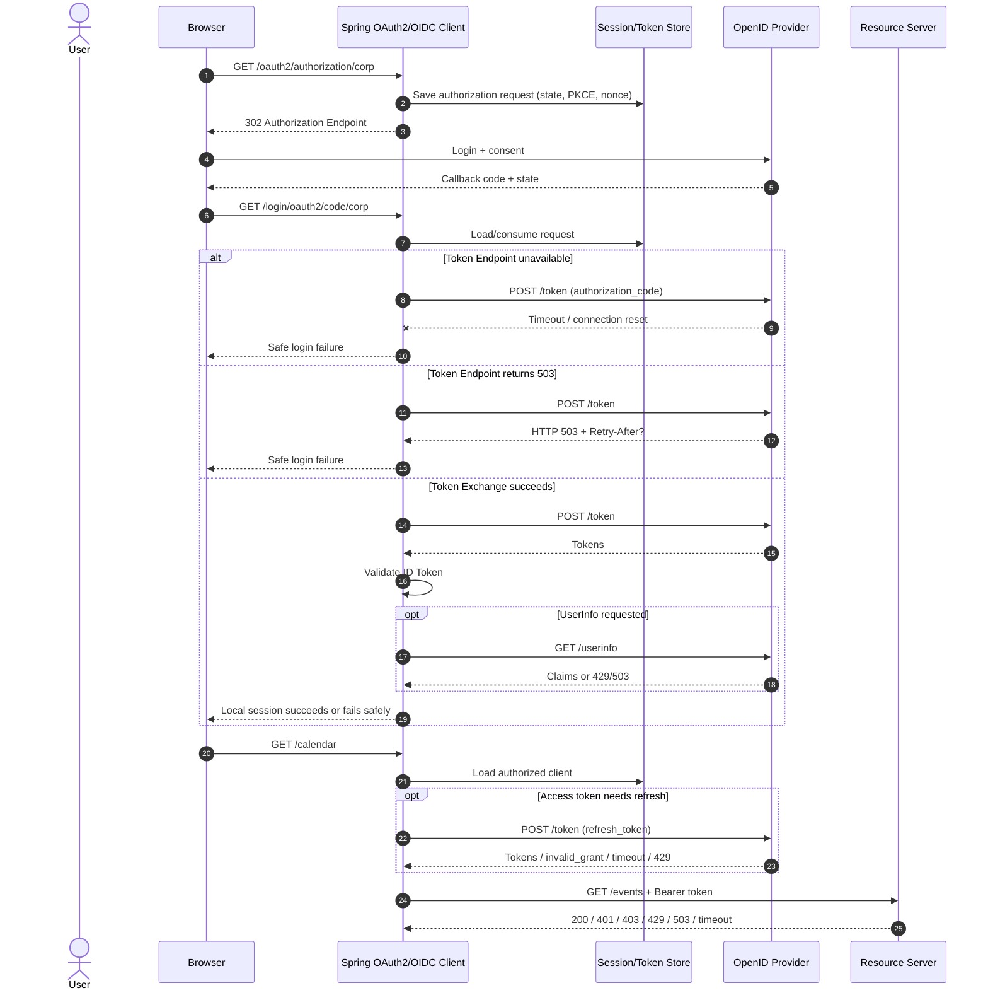
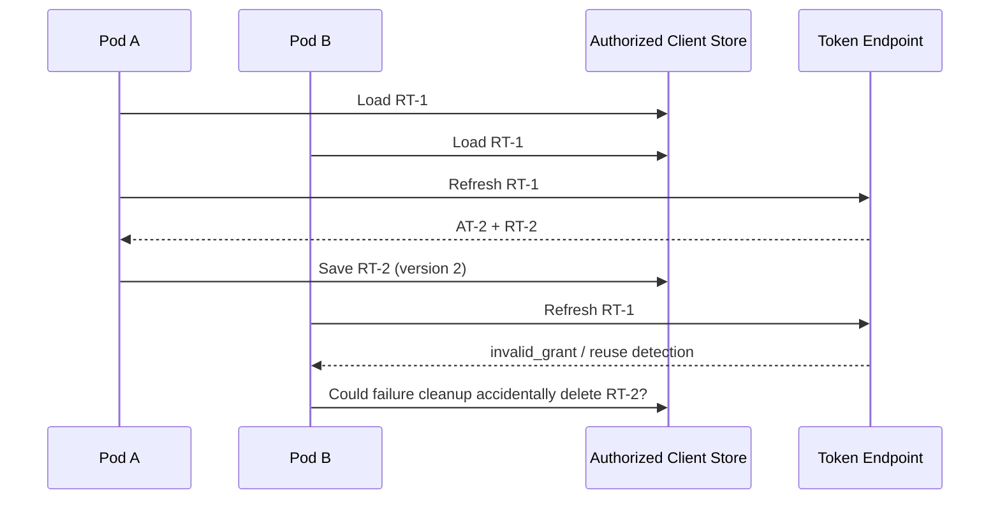
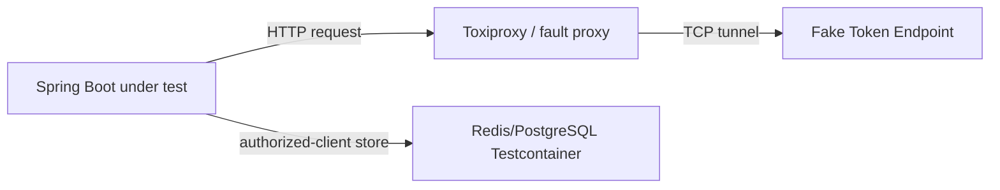

# 31.11. Testing Disconnections, Rate Limits, and Unavailable Providers

A **Spring Security OAuth 2.0/OIDC Client** application may run smoothly in development yet fail in production when depending on an external identity provider or API: network links drop, DNS fails, TLS certificates expire, the Authorization Server returns **HTTP 429 Too Many Requests**, the Token Endpoint returns **503 Service Unavailable**, UserInfo does not respond, or JWKS is not updated in time after the OP rotates its keys.

Such incidents do not only produce technical errors. They affect **user sessions, authorization codes, refresh token rotation, retry policies, provider load, and the security of the entire login flow**. A "quick fix" such as disabling `state` verification, skipping TLS verification, retrying an authorization code indefinitely, or automatically deleting tokens on timeout can turn a temporary outage into a security vulnerability or a mass reconnection incident.

This lesson focuses on **integration testing**: running the real application with Spring Security components configured, while replacing external systems with a fake Authorization Server/OpenID Provider, Resource Server, and network fault injection tools. We do not just check HTTP status codes; we also verify **protected resources, side effects in the token store, retry counts, timeouts, failure handlers, recovery capability, and operational observability**.

> **Principle:** Clearly distinguish between **network errors with no response**, **HTTP 429/503 from the provider**, **OAuth2 error responses with protocol error codes**, **OIDC token validation failures**, and **Bearer 401/403 from the Resource Server**. Do not apply the same retry/cleanup policy to all of them.

## 1. Learning Objectives

After completing this lesson, you will be able to:

1. Identify the external boundaries of a Spring Security OAuth2/OIDC Client and how errors propagate across them.
2. Build a test harness using **MockWebServer**, **WireMock**, or a fault-injecting proxy to simulate a slow provider, HTTP 429, 500/503, connection drops, and recovery.
3. Distinguish between **connect timeout, TLS handshake failure, response timeout, and overall timeout**.
4. Test the **`Retry-After`** header, backoff, jitter, retry limits, and time budgets.
5. Test the Authorization Code Flow when the OP is unreachable or the Token Endpoint is unavailable **without arbitrarily replaying the authorization code**.
6. Test errors in the Refresh Token Grant, including `invalid_grant`, rotation, timeouts, and multiple concurrent refresh requests.
7. Distinguish Token Endpoint `invalid_grant` from Resource Server `invalid_token`/`insufficient_scope`.
8. Test UserInfo/JWKS failures without bypassing `iss`, `aud`, signature, nonce, or `sub` verification.
9. Use **MockMvc**, **WebTestClient**, and **Reactor StepVerifier** within their proper scopes without confusing mock authentication with real protocol testing.
10. Write test assertions for failure handlers, token persistence/cleanup, metrics, and UX state when the provider recovers.

## 2. Sample Architecture and Possible Points of Disruption

Suppose Portal uses Corp OIDC for login, Calendar API is authorized separately, and a Reports service runs in the background:

```text
Browser
   |
   v
Reverse Proxy / Spring Boot Portal (Servlet or WebFlux)
   |                |
   |                +--> Session Store / Authorized Client Store
   |
   +--> Corp OpenID Provider
   |     |- Discovery / .well-known/openid-configuration
   |     |- Authorization Endpoint (via browser)
   |     |- Token Endpoint
   |     |- JWKS Endpoint
   |     |- UserInfo Endpoint (if used)
   |
   +--> Calendar Authorization Server / API
   |     |- Token Endpoint (refresh)
   |     +- Resource Server (events)
   |
   +--> Reports API (service account)
```

Each arrow is a **dependency path** that can fail independently. For instance, Corp OP might lose UserInfo while its Token Endpoint still returns tokens; the Calendar Token Endpoint might be rate-limited even while the data API continues working.

### 2.1. Fault Behavior Diagram



**Two steps often confused:**

- **The Authorization Endpoint is a browser journey.** A backend HTTP client typically cannot "retry" the fact that the browser left Portal and encountered an unreachable OP page. An appropriate recovery UX/flow is needed.
- **The Token Endpoint and Resource Server are called server-to-server.** Timeouts and 429 responses here can be handled by HTTP client policies, but **token grants are not always idempotent**.

## 3. Designing a Fault Taxonomy Before Writing Tests

A diagnosable integration test suite should capture at least:

| Axis | Example Values | Why Needed |
|---|---|---|
| **Stage** | discovery, authorize, callback, token, JWKS, UserInfo, refresh, API | Pinpoints where the failure occurred |
| **Source** | browser, RP, OP, token store, Resource Server, network | Identifies the responsible party |
| **Transport outcome** | DNS failure, connect refused, connection reset, timeout | Whether an HTTP response exists |
| **HTTP status** | 429, 500, 502, 503, 504, 401, 403 | Not sufficient alone to determine root cause |
| **Protocol error** | `invalid_client`, `invalid_grant`, `invalid_token` | Distinguishes OAuth2 errors |
| **Grant type** | authorization_code, refresh_token, client_credentials | Affects safety of retrying |
| **Token state** | valid, expired, revoked, rotated, unknown | Affects cleanup and reauthorization |
| **Outcome** | success, degraded, failure, security rejection | Selects UI state |
| **Retry count** | 0, 1, 2… bounded | Detects retry storms |
| **Recovery** | backoff, reconnect, manual retry, alert | Prevents solving every error by forcing re-login |

An overly broad `provider_down` label cannot distinguish a Token Endpoint `invalid_grant` due to user revocation from a DNS outage preventing JWKS retrieval.

### 3.1. Fault Matrix for the Test Plan

| Test ID | Failure Injection | Stage | Minimum Expectation |
|---|---|---|---|
| F01 | DNS resolution failure | Provider discovery/token | Do not bypass TLS/issuer; error is classified |
| F02 | TCP connection refused | Token/UserInfo/API | Enforces deadline, no infinite retries |
| F03 | Socket closed mid-request/response | Token refresh | Outcome may be unknown; do not assume revocation |
| F04 | Headers slower than timeout | Token/API | Timed out/cancelled; returns safe error |
| F05 | HTTP 429 + `Retry-After` | Token/API | Proper backoff/budget, no traffic amplification |
| F06 | HTTP 503 | OP/API | Fallback, alerting, action-appropriate retry |
| F07 | OAuth2 `invalid_client` | Token Endpoint | Config/credential error, no user retry loop |
| F08 | OAuth2 `invalid_grant` | Refresh Token Grant | Proper connection cleanup, prompts reauthorization |
| F09 | 401 `invalid_token` | Resource Server | Distinguished from refresh; handler acts appropriately |
| F10 | 403 `insufficient_scope` | Resource Server | Does not auto-escalate privileges or try another registration |
| F11 | JWKS unavailable | ID Token validation | Does not accept unverified ID Token |
| F12 | UserInfo `sub` mismatch | OIDC UserInfo | Rejects identity response |
| F13 | OP recovers after outage | Multiple stages | New requests succeed, no retry storm |
| F14 | Two pods refresh same token | Refresh/persistence | Does not overwrite or wrongly delete new token |
| F15 | Redis/token store outage | Local persistence | Fail closed, does not swap another user's token/principal |

This table is a **suggested test plan**; not every system uses all endpoints or token refresh.

## 4. How Integration Tests Differ from Unit Tests

A **unit test** typically checks an error-classification helper or `Mono.timeout` using a fake Publisher. An **integration test** connects multiple real components, for example:

```text
Spring WebClient
  -> OAuth2 filter
  -> Reactive/Servlet authorized-client manager
  -> authorized-client store
  -> HTTP client
  -> Fake Token Endpoint/Resource Server
```

Or:

```text
MockMvc / WebTestClient
  -> Spring Security login filters
  -> AuthorizationRequestRepository
  -> Browser callback simulation
  -> Fake Token Endpoint / JWKS / UserInfo
  -> Authentication / session
```

A test using `oidcLogin()` or `mockOAuth2Login()` in Spring Security Test to simulate a principal does **not** test HTTP redirects, `state`, PKCE, the Token Endpoint, or JWKS. It is very useful for testing business authorization, but insufficient for this lesson.

### 4.1. A Practical Toolkit

| Tool | Used to Test |
|---|---|
| **JUnit 5** | Test organization/lifecycle/assertions |
| **Spring Boot Test** | Loading context and Spring Security wiring |
| **MockMvc** | Servlet security filter chain, callback, session |
| **WebTestClient** | Reactive HTTP contract/handlers |
| **Reactor StepVerifier** | Mono/Flux errors, retries, timeouts, cancellation |
| **MockWebServer (OkHttp)** | HTTP status, header delays, disconnects, body, and request count |
| **WireMock** | Endpoint stubs, fault/latency injection, request journal |
| **Toxiproxy** | Network proxy for cutting connections, latency, bandwidth, resets |
| **Testcontainers** | Spinning up Redis/DB/proxy when testing persistence |
| **Virtual time / Clock** | Testing deadlines/backoff without real waiting at the operator level |
| **Fake OIDC OP** | Token/JWKS/Discovery/UserInfo with scenario-specific responses |

You do not need every tool in a single test. Pick **the layer that matches the behavior you want to prove**.

## 5. Building a Fake Provider: Avoiding Dependency on a Production OP

You should not run integration tests with real Client IDs/secrets against a production identity tenant. Tests should:

- Use a **test-only `ClientRegistration`**.
- Point endpoints to `127.0.0.1` on ports provided by fake servers.
- Generate test JWTs signed with a test-only private key when OIDC validation is needed.
- Use fake users and grants, never real PII.
- Enforce low timeout/retry budgets so CI stays fast and stable.
- Have teardown hooks that shut down fake servers, connections, and containers.
- Ensure raw tokens/codes/secrets are never written to test reports.

### 5.1. Fixture for Token and API Endpoints with MockWebServer

```java
import okhttp3.mockwebserver.MockWebServer;
import org.junit.jupiter.api.AfterEach;
import org.junit.jupiter.api.BeforeEach;

class ProviderFaultHarness {

    MockWebServer tokenServer;
    MockWebServer resourceServer;

    @BeforeEach
    void startServers() throws Exception {
        tokenServer = new MockWebServer();
        resourceServer = new MockWebServer();

        tokenServer.start();
        resourceServer.start();
    }

    @AfterEach
    void stopServers() throws Exception {
        tokenServer.shutdown();
        resourceServer.shutdown();
    }
}
```

This snippet only illustrates lifecycle management. To use it in a Spring Boot integration test, inject the URIs from `tokenServer.url("/token")` and `resourceServer.url("/")` into the test configuration **before the `ClientRegistration`/`WebClient` beans are created**, such as via test configuration or `@DynamicPropertySource` with an appropriate lifecycle.

### 5.2. Why Use Dynamic Ports?

Hardcoded ports like `8081` easily collide when CI runs in parallel. MockWebServer automatically binds to an available port; tests read the actual URL returned by the server rather than guessing a port.

### 5.3. Is It Okay to Use One Fake Provider for Everything?

Yes, though when verifying the boundary between the Token Endpoint and the Resource Server, you should use **two fake servers** or at least cleanly separate routes and logs. If they share one server, tests must assert which requests hit `/token` and which hit `/events`.

## 6. Creating a Test-Only ClientRegistration

If you are only testing the Token Endpoint and downstream API, you do not have to run full OIDC Discovery. You can construct the registration manually:

```java
import org.springframework.security.oauth2.client.registration.ClientRegistration;
import org.springframework.security.oauth2.core.AuthorizationGrantType;
import org.springframework.security.oauth2.core.ClientAuthenticationMethod;

ClientRegistration calendarRegistration(String tokenUri) {
    return ClientRegistration.withRegistrationId("calendar-test")
        .clientId("test-calendar-client")
        .clientSecret("test-only-not-production")
        .clientAuthenticationMethod(
            ClientAuthenticationMethod.CLIENT_SECRET_BASIC
        )
        .authorizationGrantType(
            AuthorizationGrantType.AUTHORIZATION_CODE
        )
        .redirectUri(
            "{baseUrl}/login/oauth2/code/{registrationId}"
        )
        .authorizationUri("https://authorization.example.test/authorize")
        .tokenUri(tokenUri)
        .scope("calendar.read")
        .build();
}
```

Simulating a **user-delegated authorized client** can include a refresh token even though the registration uses `authorization_code` at user consent time. You do not need to create a separate registration with grant type `"refresh_token"` just to test token refresh.

### 6.1. Creating an Expired Authorized Client

```java
import java.time.Instant;
import java.util.Set;

import org.springframework.security.oauth2.client.OAuth2AuthorizedClient;
import org.springframework.security.oauth2.core.OAuth2AccessToken;
import org.springframework.security.oauth2.core.OAuth2RefreshToken;

OAuth2AuthorizedClient expiredClient(
        ClientRegistration registration,
        String principalName) {

    Instant now = Instant.now();

    var access = new OAuth2AccessToken(
        OAuth2AccessToken.TokenType.BEARER,
        "FAKE_EXPIRED_AT",
        now.minusSeconds(3600),
        now.minusSeconds(1800),
        Set.of("calendar.read")
    );

    var refresh = new OAuth2RefreshToken(
        "FAKE_RT_1",
        now.minusSeconds(3600)
    );

    return new OAuth2AuthorizedClient(
        registration, principalName, access, refresh
    );
}
```

An expired access token causes the manager to enter the refresh path, **provided the `refreshToken()` provider is configured**. The `principalName` in the fixture must match the storage key of the authorized client.

## 7. Distinguishing Five Types of Disconnection

Do not lump every network failure into a single `networkError` test:

| Failure Type | Example | HTTP Response? | Appropriate Reaction |
|---|---|---|---|
| DNS lookup failure | Token Endpoint hostname fails to resolve | No | Check DNS, egress, provider config |
| TCP connect failure | `Connection refused`, no route | No | Bounded retry if operation permits |
| TLS handshake failure | Wrong CA/hostname/certificate | No | Fix trust/cert, do not disable verification |
| Connection reset mid-flight | Socket closed after sending request | Possibly no | Outcome unknown; consider idempotency |
| Read/response timeout | Server holds request too long | Status may not be received | Deadline/cancellation, retry per policy |

In particular, a **connection reset after sending a Refresh Token Grant** does not prove the provider never consumed the refresh token. With rotation enabled, an unconditional retry can trigger token reuse detection.

### 7.1. Ambiguous Outcomes

Example:

```text
Client sends POST /token refresh_token=RT-1
  -> OP receives RT-1, issues AT-2/RT-2
  -> socket reset before Client receives response
  -> Client still has RT-1 and does not know RT-2
```

Do not classify this situation as `invalid_grant` merely because no new token arrived. **Without an OAuth2 response, there is no reliable OAuth2 `invalid_grant` error code.**

### 7.2. Do Not "Fix" TLS with Trust-All

A test intentionally using a bad certificate should verify that the client **rejects** the connection. Never work around certificate failures by disabling hostname verification or ignoring certificates in a production `WebClient`/`RestClient`.

## 8. Configuring HTTP Timeouts for WebClient

Reactor Netty example when calling a trusted API:

```java
import java.time.Duration;

import io.netty.channel.ChannelOption;
import reactor.netty.http.client.HttpClient;

import org.springframework.http.client.reactive.ReactorClientHttpConnector;
import org.springframework.web.reactive.function.client.WebClient;

WebClient timedClient(String trustedBaseUrl) {
    HttpClient http = HttpClient.create()
        .option(ChannelOption.CONNECT_TIMEOUT_MILLIS, 1000)
        .responseTimeout(Duration.ofSeconds(2));

    return WebClient.builder()
        .baseUrl(trustedBaseUrl)
        .clientConnector(
            new ReactorClientHttpConnector(http)
        )
        .build();
}
```

**Configuration scope:**

- `CONNECT_TIMEOUT_MILLIS` applies to TCP connect.
- `responseTimeout` applies to HTTP response/reading according to Reactor Netty semantics.
- Connection pool acquire timeout, TLS handshake timeout, and overall operation timeout are separate mechanisms.
- Values like 1–2 seconds are illustrative only, not right for every OP.

### 8.1. Overall Timeout in the Application

```java
Mono<String> call = calendarWebClient.get()
    .uri("/v1/events")
    .retrieve()
    .bodyToMono(String.class)
    .timeout(Duration.ofSeconds(3));
```

`Mono.timeout` caps total elapsed time from subscription to signal at that operator's position. Depending on placement, it may cover waiting on the authorized-client manager, refresh, the API request, and body parsing. **A client-side timeout does not guarantee the remote server cancelled the operation.**

### 8.2. Avoid Misaligned Timeout Budgets

If Token Endpoint, UserInfo, and API calls each allow 10 seconds while the inbound request budget is only 5 seconds, the overall workflow will breach its SLO. Design a **deadline hierarchy** and verify timing at the integration level.

## 9. Testing Real HTTP Response Timeouts with MockWebServer

```java
import java.time.Duration;
import java.util.concurrent.TimeUnit;

import io.netty.channel.ChannelOption;
import okhttp3.mockwebserver.MockResponse;
import okhttp3.mockwebserver.MockWebServer;

import org.junit.jupiter.api.Test;
import org.springframework.http.client.reactive.ReactorClientHttpConnector;
import org.springframework.web.reactive.function.client.WebClient;

import reactor.netty.http.client.HttpClient;
import reactor.test.StepVerifier;

class ProviderTimeoutIT {

    @Test
    void delayedHeadersCauseResponseTimeout() throws Exception {
        try (MockWebServer provider = new MockWebServer()) {
            provider.start();
            provider.enqueue(
                new MockResponse()
                    .setHeadersDelay(2, TimeUnit.SECONDS)
                    .setBody("{\"status\":\"ok\"}")
            );

            HttpClient http = HttpClient.create()
                .option(ChannelOption.CONNECT_TIMEOUT_MILLIS, 1000)
                .responseTimeout(Duration.ofMillis(150));

            WebClient client = WebClient.builder()
                .clientConnector(
                    new ReactorClientHttpConnector(http)
                )
                .build();

            StepVerifier.create(
                    client.get()
                        .uri(provider.url("/slow").toString())
                        .retrieve()
                        .bodyToMono(String.class)
                )
                .expectError()
                .verify(Duration.ofSeconds(5));
        }
    }
}
```

This test uses a **real local HTTP socket**. It proves that a response slower than the deadline fails, not connect timeout. It has no dependency on the public Internet or any real OP hostname.

### 9.1. Be Careful with Exception Types

`WebClient` may wrap Netty timeouts inside `WebClientRequestException`. Integration tests should assert:

- The pipeline terminates with an error, not a success body.
- The request reached the intended fake server.
- No infinite retries occurred.
- Domain error mapping is correct.
- Resources/connections are not leaked or left in a broken state.

If the application defines a stable domain exception such as `ProviderUnavailableException`, assert on that type. Do not couple tests to Netty's exact English error message.

### 9.2. Do Not Use Virtual Time to Fast-Forward Sockets

`StepVerifier.withVirtualTime` helps test Reactor timers/backoff. It **does not speed up MockWebServer `setHeadersDelay` or real TCP sockets**. Keep those two test categories separate to avoid flakiness.

## 10. Testing Socket Reset Errors

MockWebServer supports connection-closing policies:

```java
import okhttp3.mockwebserver.MockResponse;
import okhttp3.mockwebserver.SocketPolicy;

provider.enqueue(
    new MockResponse()
        .setSocketPolicy(SocketPolicy.DISCONNECT_AFTER_REQUEST)
);
```

With `DISCONNECT_AFTER_REQUEST`, the server reads the request and drops the connection before sending a normal response. It simulates cases where **it is unknown how far the server progressed in processing the operation**.

### 10.1. Expectations by HTTP Method

| Request | Should Retry After Reset? |
|---|---|
| Idempotent Resource Server GET | May retry with bounds, if API contract allows |
| State-mutating POST | Requires idempotency key/reconciliation |
| POST Token Endpoint authorization code | Do not blind-retry because code is single-use |
| POST Token Endpoint refresh token | Do not blind-retry due to rotation/reuse risk |
| Client Credentials Grant | Can be considered based on AS contract and rate budget |

**Do not write an interceptor that "retries every IOException 3 times" across all OAuth2 grant requests.**

## 11. Testing HTTP 429 and the Meaning of `Retry-After`

HTTP **429 Too Many Requests** indicates the server is enforcing rate limits. The server may return `Retry-After`, expressed either as **delay-seconds** or an **HTTP-date**.

```http
HTTP/1.1 429 Too Many Requests
Retry-After: 3
Content-Type: application/json

{"error":"rate_limited"}
```

HTTP 429 is a transport/application throttling signal; `rate_limited` in JSON is only a provider-specific example, **not a required core OAuth2 error code**.

### 11.1. What Tests Should Assert

1. The client accurately detects `429` and parses `Retry-After` when present.
2. Retries occur only when the operation **is allowed by policy**.
3. Total attempts are capped.
4. Backoff/jitter is applied to prevent synchronized load spikes.
5. Wait times respect both a maximum cap and the inbound request deadline.
6. When retrying is inappropriate, a recoverable domain error is returned.
7. Tokens are not deleted solely due to HTTP 429.
8. Login flow `state`/PKCE/nonce are not lost.
9. Once the provider recovers, new requests succeed.
10. Metrics never record user IDs or tokens in labels.

### 11.2. Illustrative `Retry-After` Parser

```java
import java.time.Duration;
import java.time.Instant;
import java.time.ZonedDateTime;
import java.time.format.DateTimeFormatter;

public final class RetryAfterPolicy {

    private RetryAfterPolicy() {}

    public static Duration parse(
            String header, Instant now, Duration maxDelay) {

        if (header == null || header.isBlank()) {
            return Duration.ZERO; // Caller chooses default backoff.
        }

        Duration delay;

        try {
            long seconds = Long.parseLong(header.trim());
            delay = Duration.ofSeconds(Math.max(0L, seconds));
        } catch (NumberFormatException notSeconds) {
            try {
                Instant until = ZonedDateTime.parse(
                    header.trim(),
                    DateTimeFormatter.RFC_1123_DATE_TIME
                ).toInstant();
                delay = Duration.between(now, until);
            } catch (RuntimeException malformedDate) {
                return Duration.ZERO; // Fallback decided by caller.
            }
        }

        if (delay.isNegative()) {
            return Duration.ZERO;
        }

        return delay.compareTo(maxDelay) > 0 ? maxDelay : delay;
    }
}
```

The parser supports both common formats and **clamps the delay** to a budget. When the header is missing or malformed, returning zero here lets the external policy apply its default backoff; **zero must not be interpreted as unconditional immediate retry**.

### 11.3. Testing the Parser with a Fixed Clock

```java
import static org.assertj.core.api.Assertions.assertThat;
import org.junit.jupiter.api.Test;

import java.time.Duration;
import java.time.Instant;

class RetryAfterPolicyTest {

    @Test
    void capsLargeDeltaSeconds() {
        Duration delay = RetryAfterPolicy.parse(
            "120",
            Instant.parse("2026-01-01T00:00:00Z"),
            Duration.ofSeconds(10)
        );

        assertThat(delay).isEqualTo(Duration.ofSeconds(10));
    }

    @Test
    void malformedHeaderUsesCallerFallback() {
        Duration delay = RetryAfterPolicy.parse(
            "not-an-http-date",
            Instant.EPOCH,
            Duration.ofSeconds(10)
        );

        assertThat(delay).isZero();
    }
}
```

Do not use real system time when testing HTTP-dates near boundary timestamps, as clock drift makes tests flaky.

## 12. Testing HTTP 429 Responses Through WebClient

A simple example using a fake `ExchangeFunction` to verify HTTP classification without sockets:

```java
import org.junit.jupiter.api.Test;
import org.springframework.http.HttpHeaders;
import org.springframework.http.HttpStatus;
import org.springframework.web.reactive.function.client.ClientResponse;
import org.springframework.web.reactive.function.client.WebClient;
import org.springframework.web.reactive.function.client.WebClientResponseException;

import reactor.core.publisher.Mono;
import reactor.test.StepVerifier;

class WebClientRateLimitTest {

    @Test
    void tooManyRequestsIsNotASuccessBody() {
        WebClient client = WebClient.builder()
            .exchangeFunction(request -> Mono.just(
                ClientResponse.create(HttpStatus.TOO_MANY_REQUESTS)
                    .header(HttpHeaders.RETRY_AFTER, "3")
                    .body("test-only rate limit")
                    .build()
            ))
            .build();

        StepVerifier.create(
                client.get()
                    .uri("https://api.example.test/events")
                    .retrieve()
                    .bodyToMono(String.class)
            )
            .expectError(
                WebClientResponseException.TooManyRequests.class
            )
            .verify();
    }
}
```

**Scope:** this test proves `retrieve()` treats 429 as an HTTP error. It does not test Netty, timeouts, `Retry-After` policy, the OAuth2 authorized-client manager, or cleanup. For true integration tests, use a fake server and the real filter chain.

### 12.1. Fake Server Returns 429 Then 200

```java
provider.enqueue(
    new MockResponse()
        .setResponseCode(429)
        .addHeader("Retry-After", "1")
        .setBody("rate limited")
);

provider.enqueue(
    new MockResponse()
        .setResponseCode(200)
        .setBody("{\"items\":[]}")
);
```

If the request is an **idempotent API GET** and the client has a retry policy, the test can assert a final successful response and that the fake server received **two requests**. If the request is a Refresh Token Grant, **do not default** to retrying with the same token merely because 429 was returned.

## 13. Writing Explicitly Scoped Retry Policies

Example retrying only **Resource Server GET** on 429/503, not applying it to the Token Endpoint:

```java
import java.time.Duration;

import org.springframework.web.reactive.function.client.WebClientResponseException;

import reactor.core.publisher.Mono;
import reactor.util.retry.Retry;

boolean transientApiStatus(Throwable error) {
    if (error instanceof WebClientResponseException response) {
        int status = response.getStatusCode().value();
        return status == 429 || status == 503;
    }
    return false;
}

Mono<String> loadCalendarWithLimitedRetry(WebClient calendarClient) {
    return calendarClient.get()
        .uri("/events")
        .retrieve()
        .bodyToMono(String.class)
        .retryWhen(
            Retry.backoff(2, Duration.ofMillis(100))
                .filter(this::transientApiStatus)
        )
        .timeout(Duration.ofSeconds(3));
}
```

This snippet represents a method inside a class containing `transientApiStatus`. It demonstrates bounded retries, **without yet honoring `Retry-After`**. Reactor's `Retry.backoff` does not automatically interpret HTTP headers. If your policy requires honoring `Retry-After`, parse the header and schedule the wait in a custom retry strategy while still enforcing a deadline/cap.

### 13.1. Measuring Request Counts

`Retry.backoff(2, …)` means **2 retries after the initial attempt** -> at most **3 HTTP attempts**. Tests should assert the actual request count, not just the final outcome.

### 13.2. Errors That Must Not Be Retried in This Example

- HTTP 400/401/403.
- `invalid_grant` or `invalid_client` from the Token Endpoint.
- ID Token signature/issuer/audience validation errors.
- Account ownership/authorization rejections.
- Unresolved TLS certificate errors.
- Token store serialization errors.
- Side-effecting API POST requests without an idempotency contract.

### 13.3. Adding Jitter to Avoid Retry Storms

When many pods receive 429 simultaneously, retrying with the exact same delay causes a **thundering herd**. Jitter/backoff spreads the load. In deterministic tests you may set jitter to zero or use a virtual scheduler, while production needs an appropriate jitter policy.

### 13.4. Rate Limiting Is Not Only HTTP 429

An OP might return 503 under overload, sometimes with `Retry-After`. Conversely, 429 may omit the header. Never hard-code "retry every 503 immediately" or "always retry every 429" without considering the operation, grant type, and SLO.

## 14. Testing Retries with Reactor Virtual Time

```java
import java.time.Duration;
import java.util.concurrent.atomic.AtomicInteger;

import org.junit.jupiter.api.Test;
import org.springframework.web.reactive.function.client.WebClientResponseException;
import org.springframework.http.HttpStatus;
import reactor.core.publisher.Mono;
import reactor.test.StepVerifier;
import reactor.util.retry.Retry;

import static org.assertj.core.api.Assertions.assertThat;

class BackoffPolicyTest {

    @Test
    void stopsAfterTwoRetries() {
        AtomicInteger calls = new AtomicInteger();

        StepVerifier.withVirtualTime(() ->
                Mono.defer(() -> {
                    calls.incrementAndGet();
                    return Mono.<String>error(
                        WebClientResponseException.create(
                            503, "Unavailable", null,
                            new byte[0], null
                        )
                    );
                })
                .retryWhen(
                    Retry.backoff(2, Duration.ofMillis(100))
                        .jitter(0.0)
                )
            )
            .expectSubscription()
            .thenAwait(Duration.ofSeconds(3))
            .expectError()
            .verify();

        assertThat(calls.get()).isEqualTo(3);
    }
}
```

In a synthetic-error test, virtual time lets you verify retry budgets without waiting over the network. Once retries are exhausted, the emitted error may be wrapped as a **retry exhaustion** exception, so avoid asserting on an exact cause type unless it is part of your contract.

### 14.1. Build the Publisher Inside the Supplier

`StepVerifier.withVirtualTime(() -> ...)` requires constructing the pipeline inside the supplier so Reactor Schedulers are properly virtualized. Do not pre-build `Mono.delay`/`Flux.interval` on a real scheduler and expect time to fast-forward.

### 14.2. Virtual Time Does Not Test Real TCP

You still need a separate HTTP integration test with MockWebServer/WireMock to verify request counts, headers, and bodies. Combine both test styles without conflating their scopes.

## 15. Unavailable Authorization Endpoint: UX and Security

In OAuth2 Login, the browser redirects from the RP to the OP. If the OP returns 503 or its domain is unreachable, in some cases **the browser never returns to the RP**, so the RP's `oauth2Login().failureHandler(...)` may **never be invoked**.

### 15.1. What Should Be Tested?

- RP initiation builds the correct authorization URL and `state`, and persists the authorization request.
- OP unavailability before callback never causes the RP to create an authenticated session.
- Pending authorization requests expire / are cleaned up per TTL.
- Users have a manual way to retry once the OP recovers.
- Error pages do not trigger auto-redirect loops.
- Pending state is not stored indefinitely.
- If multiple OPs exist, falling back to another OP is a **product/identity decision**, never assuming the same user or Client is equivalent across providers.

### 15.2. Never Auto-"Log In Locally" When the OP Is Down

An anti-pattern:

```java
// Do not do this to bypass an outage:
// if (providerUnavailable) {
//     return createAuthenticatedPrincipalFromEmail(request);
// }
```

Without a verified OIDC ID Token or a dedicated, trusted local authentication mechanism, the system cannot mint a user identity solely from an email or header.

### 15.3. Previously Authenticated User Sessions

An OP outage **does not necessarily** invalidate all existing local RP sessions immediately. Policies for session timeout, reauthentication, and logout must be defined upfront. Tests should not arbitrarily log out all sessions just because the OP experienced a brief network blip.

## 16. Callback Arrives but Token Endpoint Returns 503/Timeout

After the OP authenticates the user and redirects `code + state` back to the RP, the RP calls the Token Endpoint to exchange the code.

```text
Browser -> RP callback code=CODE-1, state=STATE-1
RP checks saved authorization request/state/PKCE
RP -> POST /token authorization_code
Token Endpoint -> 503 / timeout
```

### 16.1. Key Test Assertions

1. The callback has a valid saved request/session/state.
2. The fake Token Endpoint is injected with a fault.
3. The RP does not create a successful `Authentication` from a failed response.
4. The RP does not promote unverified email/claims into an authenticated principal.
5. The failure handler displays a safe message / correlation ID.
6. Code, verifier, state, Client secret, or token bodies are never logged.
7. The RP never forwards the code to another provider's Token Endpoint.
8. The same authorization code is not retried indefinitely.
9. When the user manually retries, a **new flow with fresh state/code** starts.
10. If the OP may have consumed the code before the response dropped, test the "outcome unknown" policy rather than assuming retry is safe.

### 16.2. Why Not Arbitrarily Retry the Code?

Authorization codes are designed to be **single-use**. When the Token Endpoint times out, the server may already have received and consumed the code. Retrying the same code can trigger `invalid_grant` or distort monitoring. Reliable recovery is typically a fresh Authorization Code Flow, not a blind retry.

### 16.3. `invalid_client` Differs from 503

If the Token Endpoint returns:

```json
{"error":"invalid_client"}
```

this usually indicates a **Client authentication/configuration failure** (secret/key/mTLS/client ID), not a temporary outage where the user should keep retrying. Tests must classify it differently from `503` and alert the integration owner.

## 17. Spring Security Servlet and Reactive: Integration Harness

An application may use either of the two security stacks:

| Servlet MVC | Reactive WebFlux |
|---|---|
| `HttpSecurity` | `ServerHttpSecurity` |
| `SecurityFilterChain` | `SecurityWebFilterChain` |
| `MockMvc` | `WebTestClient` |
| `ClientRegistrationRepository` | `ReactiveClientRegistrationRepository` |
| `OAuth2AuthorizedClientRepository` | `ServerOAuth2AuthorizedClientRepository` |
| `DefaultOAuth2AuthorizedClientManager` | `DefaultReactiveOAuth2AuthorizedClientManager` |
| `OidcUserService` | Reactive OIDC user service |
| `AuthenticationFailureHandler` | `ServerAuthenticationFailureHandler` |

### 17.1. Scope of MockMvc

`MockMvc` can call:

```java
mvc.perform(get("/oauth2/authorization/corp"))
   .andExpect(status().is3xxRedirection());
```

Then inspect `Location` and verify that the session stores the authorization request. However, **checking only the 302 does not test a Token Endpoint outage**. To test the callback, you must establish the saved authorization request and supply appropriate fake OP/token/JWKS responses.

### 17.2. Scope of WebTestClient

`WebTestClient` can verify that a handler returns 503 when the downstream OP/API is unavailable:

```java
webTestClient.get()
    .uri("/api/calendar")
    .exchange()
    .expectStatus().is5xxServerError();
```

If the test mocks `CalendarService` to throw an exception without a real `WebClient`/authorized-client manager, it only verifies **controller exception mapping**, not OAuth2 integration.

### 17.3. Do Not Mock Away What You Need to Test

If the goal is to test `invalid_grant` cleanup in the manager, do not mock the manager to return `Mono.error` and then claim cleanup works. Keep the real manager and stateful real/fake store, inject the failure from the **provider/Token Endpoint dependency**, and observe the side effect.

## 18. Refresh Token Grant When the Provider Is Unavailable

After login, Portal may hold an `OAuth2AuthorizedClient`:

```text
registrationId=calendar
principalName=user-42
accessToken=AT-1 (expired)
refreshToken=RT-1 (still stored)
```

The manager may send:

```http
POST /token HTTP/1.1
Host: fake-provider.test
Content-Type: application/x-www-form-urlencoded

grant_type=refresh_token&refresh_token=EXAMPLE_RT
```

Client authentication is applied separately according to the registration and provider policy.

### 18.1. Distinguishing Four Situations

| Response | Evidence Token Was Revoked? | Action |
|---|---|---|
| HTTP 429 | **No** | Slow down, respect rate budget, do not delete token by default |
| HTTP 503/timeout | **No** | Retry/wait per policy, keep status ambiguous |
| Token Endpoint `invalid_grant` | **Yes, evidence grant is invalid** | Clean up/reauthorize the specific connection |
| Token Endpoint `invalid_client` | Client authentication failure | Fix config/credentials, do not force user password reset |

Never treat every timeout as `invalid_grant`, because that triggers mass reconnection prompts whenever a provider has transient network issues.

### 18.2. Testing the Default Failure Handler

In several manager implementations, Spring Security provides a default failure handler that removes the stored authorized client when reauthorization returns `invalid_grant`. When calling `setAuthorizationFailureHandler(...)` (or `setAuthorizationFailureHandler` on the reactive manager), behavior can change.

Tests must verify:

- `invalid_grant` removes the right authorized client per policy.
- 503/timeout does not delete the refresh token as if revoked.
- Cleanup affects only the **exact registration + principal/connection**.
- Authorized clients for other providers remain untouched.
- Storage failures are not swallowed so the app falsely believes cleanup succeeded.
- After reconnecting, the new grant is saved properly and API calls resume.

### 18.3. Distinguishing Manager Errors from API 401

`invalid_grant` comes from the **Token Endpoint**. Bearer `invalid_token` comes from the **Resource Server**. Both may hook into a shared failure-handler abstraction depending on the integration, but they carry different semantics and originate in different places.

## 19. Refresh Token Rotation and Race Conditions

With refresh token rotation:



A real-world hazard: Pod B's failure handler receives `invalid_grant` and deletes the record keyed by `(registrationId, principalName)` **without checking the version**. If Pod A just saved `RT-2`, Pod B could wipe out the good token.

### 19.1. Controlling Order in Tests

Do not rely on arbitrary `Thread.sleep` calls. Use controlled `Mono`, `Sinks.One`, `CountDownLatch` in the test harness, or a scripted proxy to enforce ordering:

1. Both A and B read RT-1.
2. A receives RT-2 and persists the new version.
3. B receives `invalid_grant` for RT-1.
4. Assert the policy **does not delete RT-2** if the design uses optimistic versioning / conditional cleanup.
5. Assert B does not retry RT-1 indefinitely.
6. Assert the token store does not leak across principals/tenants.

### 19.2. Default Cleanup Does Not Automatically Solve Distributed Races

The default manager cannot tell whether the database already replaced the refresh token if persistence lacks versioning or locking. Where this race is possible, design **single-flight refresh**, optimistic locking, atomic compare-and-swap, and conditional delete by version/context.

### 19.3. Providers May Revoke the Whole Token Family

Some Authorization Servers detect RT-1 reuse and revoke the entire token family. In that case RT-2 may also become invalid. The system must follow provider policy and transition to `RECONNECT_REQUIRED`; never assume RT-2 remains valid unconditionally regardless of reuse detection.

## 20. Rate Limit Budgets Across Multiple Users and Pods

HTTP 429 usually signals quota exhaustion. If one request retries 3 times across 1,000 concurrent requests, total load on the OP grows dramatically.

### 20.1. Common Quota Dimensions

- Per Client ID.
- Per tenant/organization.
- Per user/token.
- Per source IP/region.
- Per endpoint (e.g., Token Endpoint stricter than UserInfo).
- Per time window and maximum concurrent connections.

A per-pod bucket or connection pool **does not enforce a global budget**. If the provider enforces cluster-wide quotas per Client ID, consider distributed quota coordination or synchronized egress limits.

### 20.2. Testing the Thundering Herd Effect

Simulate N concurrent requests when the fake OP begins returning 429:

- Prevent all requests from retrying at the exact same instant.
- Avoid launching hundreds of refreshes for the same principal.
- Enforce wait/cancellation budgets within the inbound request.
- Verify circuit breaker/bulkhead behavior if used in the architecture.
- Users receive a temporary unavailability message rather than an endlessly spinning page.
- Metrics distinguish throttling from invalid credentials.

### 20.3. `Retry-After` Does Not Authorize Exceeding Deadlines

If a provider asks to wait 60 seconds while Portal's request SLO is 5 seconds, do not hold the user HTTP request open for 60 seconds. Return a retry-later message, enqueue a background retry **only for safe, consented operations**, or prompt the user to try again later.

## 21. Circuit Breakers, Bulkheads, and Health Checks

A circuit breaker opening on high error rates can reduce load on the OP, but it must be scoped to the right dependency. Never trip a circuit for **all providers** just because the Calendar Token Endpoint is failing.

### 21.1. States to Test

```text
CLOSED
  -> transient errors exceed threshold
  -> OPEN (fail fast, do not send new requests)
  -> after cooldown
  -> HALF_OPEN (allow a few probes)
  -> if probe succeeds: CLOSED
     if probe fails: OPEN
```

### 21.2. Circuit Breaker Test Cases

- N consecutive 503s reaching the threshold -> breaker transitions to OPEN.
- Subsequent requests fail fast; fake server receives no further requests.
- After cooldown, probes are permitted.
- Provider recovers -> breaker returns to CLOSED.
- User-level 401/403 responses **should not** count by default as an OP-wide outage.
- User consent denial (`access_denied`) should not open the breaker.
- One provider being down does not fail other providers via a shared breaker.
- Metrics/alerts fire on OPEN/HALF_OPEN transitions.

If using Resilience4j Reactor integration, check exact dependencies and wiring for your version. This is an **optional safeguard**, not a built-in feature of `oauth2Login()`.

### 21.3. Health Checks Do Not Replace Security Validation

A passing OP health probe does not prove token signatures, issuers, or audiences are valid. Conversely, a health check lacking permissions or getting rate-limited does not necessarily mean user login is broken. Keep dependency reachability separate from protocol correctness.

## 22. Unavailable UserInfo Endpoint

After the Token Endpoint returns tokens, an OIDC RP **may** call the UserInfo Endpoint for additional claims. Not every OIDC flow calls UserInfo.

### 22.1. Test Scenarios

- UserInfo timeout.
- UserInfo returns 503.
- UserInfo returns 429 with `Retry-After`.
- UserInfo returns HTTP 401 `invalid_token`.
- UserInfo returns HTML instead of JSON.
- UserInfo returns JSON missing an optional `email`.
- UserInfo returns a `sub` different from the verified ID Token.
- UserInfo is absent in OP metadata while required by application config.

### 22.2. Do Not Drop Identity Verification to "Degrade"

If UserInfo `sub` differs from the ID Token `sub`, the RP must **reject the UserInfo response**. Never fall back to accepting an email from a mismatched response. If UserInfo is unavailable and the app only uses it for optional profile fields, fallback can be considered **under an approved policy**, but ID Token issuer/audience/signature/nonce validation must never be weakened.

### 22.3. Test Domain Behavior Rather Than Just HTTP 503

- If UserInfo is mandatory to build the principal: login fails safely.
- If UserInfo is optional by design: login may succeed using verified claims from the ID Token, without synthesizing unverified claims.
- Never flip `email_verified=false` to true when profile data is unavailable.
- Emit telemetry with `stage=userinfo`, `category=provider_unavailable`.
- Never log raw UserInfo profile JSON containing PII.

## 23. Disrupted JWKS and OIDC Discovery

An OP can issue an authorization code and tokens successfully while the RP **fails to fetch JWKS** to verify the ID Token signature.

### 23.1. Cases

| Incident | Expectation |
|---|---|
| Discovery endpoint returns 503 at startup | Clear app/config handling; never accept an arbitrary issuer |
| Initial JWKS fetch times out | Never accept an unverified ID Token |
| JWKS cache still holds a valid key | Behavior matches tested cache policy |
| OP rotates signing key | RP refreshes JWKS safely without skipping signature verification |
| JWKS returns invalid JSON / missing key | Validation fails, alert fires |
| Token `iss`/`aud` mismatch | Always rejected, even while JWKS is healthy |
| Unknown `kid` | Look up key via safe mechanism, never fetch arbitrary URLs from the token |

### 23.2. Never Do "Best Effort Login" with Unsigned Claims

When JWT verification fails, never decode the Base64 payload and trust its email/`sub`. **Availability must never be traded for breaking authentication boundaries.**

### 23.3. Separating Key Rotation Tests from Outage Tests

- Normal key rotation: OP publishes new key, RP fetches updated JWKS and verifies.
- JWKS outage: RP lacks a matching key and must fail closed when unable to verify.
- Wrong issuer/audience: not an outage; must reject.
- Clock skew: validate `exp`/`iat`, do not inflate skew tolerance just to bypass checks.

## 24. Resource Server Returning 401/403, 429, and 503

After login, the Client calls the API with an access token:

```text
GET /calendar/events
Authorization: Bearer AT-2
```

When the API returns:

```http
HTTP/1.1 401 Unauthorized
WWW-Authenticate: Bearer error="invalid_token"
```

that is a **Bearer token rejection** from the Resource Server, not `invalid_grant` from the Token Endpoint. When the API returns:

```http
HTTP/1.1 403 Forbidden
WWW-Authenticate: Bearer error="insufficient_scope"
```

permissions are missing and cannot be fixed automatically via token refresh.

### 24.1. Action Matrix for Tests

| Response | Clean Up Token? | Retry? | UI |
|---|---|---|---|
| 401 Bearer `invalid_token` | Per OAuth2 filter/failure policy | Only per explicit reacquire/reauthorize flow | Token/connection may need refresh/reconnect |
| 403 `insufficient_scope` | Per policy; never auto-escalate scope | No infinite retries | Missing permission/consent |
| 429 | Not by default | Safe requests only + Retry-After/budget | Temporarily throttled |
| 503 | Not by default | Idempotent GETs may retry | Service temporarily unavailable |
| Network timeout | Not by default | Depends on idempotency/ambiguity | Unknown outcome; retry safely |

### 24.2. WebClient OAuth2 Filter Has Its Own Handler

In WebFlux, `ServerOAuth2AuthorizedClientExchangeFilterFunction` can be constructed with a `ReactiveOAuth2AuthorizedClientManager` or with `ReactiveClientRegistrationRepository` + `ServerOAuth2AuthorizedClientRepository`. Its default failure handler behavior can **differ by constructor**.

Tests must verify whether **Resource Server HTTP 401/403** actually triggers the configured cleanup handler. A manager `invalid_grant` test alone does not prove the filter handles 401 correctly.

### 24.3. Do Not Send Tokens to the Wrong Origin

When testing unavailable providers, do not swap a trusted API URL for an arbitrary user-supplied URL while keeping the Bearer token attached. Pin trusted base URLs and restrict HTTP redirects/egress. **Retrying against a different host can leak tokens** even when token selection used the right registration.

## 25. Local Sessions While the OP Is Down

A common product question: **"If the OP loses connectivity, are users already logged into Portal logged out?"**

There is no one-size-fits-all answer:

- Local sessions may stay valid per `HttpSession`/`WebSession` TTL.
- The OP SSO session exists independently.
- Refresh tokens for external APIs have their own lifecycle.
- Policy may require reauthentication for sensitive actions.
- Account disable/revoke events from the OP may require dedicated security handling.

Tests should encode the **session continuity policy** and assert it directly rather than logging everyone out simply because one integration API slows down.

### 25.1. Distinguishing Reconnect from Retry Later

```text
CONNECTED
  -> valid token

TEMPORARILY_UNAVAILABLE
  -> 429 / 503 / timeout, no evidence of revocation

RECONNECT_REQUIRED
  -> invalid_grant or token/grant revocation info

DISCONNECTED
  -> user disconnects / admin revokes per policy
```

A timeout is not enough to transition `CONNECTED` to `RECONNECT_REQUIRED`. An authentic `invalid_grant` from the Token Endpoint usually signals cleanup and reauthorization.

### 25.2. UX When the Provider Recovers

After an outage, users can retry fresh requests; the app should:

- Not force Corp re-login if the local session is valid and policy does not require it.
- Not reuse already-consumed authorization codes.
- Only refresh/reconnect external connections according to actual state.
- Avoid session/login redirect loops.
- Display a short, safe message without leaking raw provider errors.
- Provide a support correlation code independent of OAuth2 `state`.

## 26. MockMvc: Token Endpoint Unavailable Login Scenario

A Servlet integration test can follow this sequence:

```text
1. Start Spring Boot app with test-only ClientRegistration.
2. Start fake OIDC provider:
   - Authorization Endpoint
   - Token Endpoint
   - JWKS
   - UserInfo (if used by app)
3. MockMvc GET /oauth2/authorization/corp.
4. Read redirect URI and session storing OAuth2AuthorizationRequest.
5. Fake OP issues authorization response code + state.
6. MockMvc GET /login/oauth2/code/corp with same session/state.
7. Fake Token Endpoint returns 503 or disconnects.
8. Assert failure handler runs, does not create authenticated session.
9. Assert token store does not save an invalid authorized client.
10. Assert logs do not contain code/state/Client secret.
```

### 26.1. Tests Must Not Skip Initiation

Do not send a callback with `code=fake` and `state=random` without a saved authorization request and then blame the Token Endpoint. Spring Security will reject the callback **at correlation check before reaching the Token Endpoint**.

### 26.2. Prove Which Stage Failed Using Request Counts

To prove a Token Endpoint 503 failure, assert that the fake Token Endpoint **actually received the request** while the RP stayed unauthenticated. If the fake endpoint received nothing, the failure happened earlier in callback `state`/session/config handling.

### 26.3. Limitations of MockMvc with OIDC Login Mock

`SecurityMockMvcRequestPostProcessors.oidcLogin()` creates a mock authentication useful for controller security tests, but it **does not execute the Authorization Code Flow or JWKS validation**. Do not use it to claim an unavailable-provider flow was tested.

## 27. WebTestClient: External API 503 Scenario

Example using a hypothetical `/calendar/events` API controller:

```java
import org.junit.jupiter.api.Test;
import org.springframework.beans.factory.annotation.Autowired;
import org.springframework.boot.test.autoconfigure.web.reactive.WebFluxTest;
import org.springframework.boot.test.mock.mockito.MockBean;
import org.springframework.test.web.reactive.server.WebTestClient;

import reactor.core.publisher.Mono;

import static org.mockito.Mockito.when;

@WebFluxTest(CalendarController.class)
class CalendarEndpointTest {

    @Autowired
    WebTestClient client;

    @MockBean
    CalendarService calendarService;

    @Test
    void unavailableCalendarIsReportedSafely() {
        when(calendarService.loadEvents())
            .thenReturn(Mono.error(
                new CalendarUnavailableException("test-only")
            ));

        client.get()
            .uri("/calendar/events")
            .exchange()
            .expectStatus().is5xxServerError();
    }
}
```

This is a **controller slice test**, not full OAuth2 HTTP integration. `CalendarController`, `CalendarService`, `CalendarUnavailableException`, and the exception mapper must exist in the application; if the endpoint requires authentication, configure appropriate mock authentication/filters. Newer Spring Boot versions provide `@MockitoBean` instead of `@MockBean`.

### 27.1. Real Integration Tests Must Keep WebClient and the Manager

To assert retry/cleanup behavior, do not mock away `CalendarService`. Replace the **Token Endpoint and Resource Server** with fake HTTP servers, keep the real Spring Security filter/manager/store in the context, and inspect side effects.

## 28. Testcontainers and Toxiproxy: Controlled Network Fault Injection

For systems with DB/Redis or microservices, MockWebServer only simulates an HTTP server. Sometimes lower-level network testing is needed:

- Cutting TCP connections between the client and fake OP.
- Injecting latency before/between packets.
- Throttling bandwidth.
- Dropping packets or resetting connections.
- Recovering the proxy after an interval.

**Toxiproxy** (often run via Testcontainers) can act as a proxy between the Spring app and the fake provider. Proxy only **test systems**, avoiding accidental changes to production routing.

### 28.1. Setup Diagram



A test can:

1. Boot the app and fake Token Endpoint.
2. Create a proxy route to the fake server.
3. Configure `ClientRegistration` `tokenUri` to point at the proxy.
4. Perform an initial refresh successfully.
5. Enable a toxic causing latency or disconnect.
6. Call again and assert timeout/error classification.
7. Disable the toxic and assert recovery.
8. Verify the DB did not store corrupt tokens or duplicate principals.

### 28.2. Faults to Keep Separate

- Toxiproxy dropping a connection **after sending** a request differs from failing **before connecting**.
- A network fault differs from an HTTP 503 response carrying status/body.
- A Redis outage differs from a Token Endpoint outage.
- Provider recovery does not mean old tokens stay valid if rotation already happened.

### 28.3. Keeping Tests Reproducible

- Manage proxies/containers using test framework lifecycles.
- Use dynamic ports and explicit routing.
- Set deadlines on every test; clean up in `finally` or lifecycle hooks.
- Do not run parallel tests sharing one faulted proxy without isolation.
- Log **non-sensitive** fault seeds/schedules to reproduce failures.
- Never spam a public OP endpoint to simulate outages or rate limits.

## 29. Testing Outages at Application Startup

Provider discovery may execute at startup. If `issuer-uri` causes Spring Boot to fetch metadata eagerly, a fake OP returning 503 can trigger an **ApplicationContext startup failure** rather than an HTTP login failure.

### 29.1. Scenarios

- Discovery unreachable at startup.
- Metadata returns 200 but `issuer` mismatches.
- Metadata lacks an endpoint required by the integration.
- Wrong DNS/TLS.
- Issuer comes back online; restart or refresh configuration per policy.
- With multiple providers, one provider being down affects shared startup.

### 29.2. Note on Fake OIDC Metadata

A minimal fake OpenID Provider for discovery/OIDC login may need:

```json
{
  "issuer": "http://127.0.0.1:PORT",
  "authorization_endpoint": "http://127.0.0.1:PORT/authorize",
  "token_endpoint": "http://127.0.0.1:PORT/token",
  "jwks_uri": "http://127.0.0.1:PORT/jwks",
  "userinfo_endpoint": "http://127.0.0.1:PORT/userinfo",
  "response_types_supported": ["code"],
  "subject_types_supported": ["public"],
  "id_token_signing_alg_values_supported": ["RS256"]
}
```

`PORT` is a placeholder replaced by the dynamic port in the test. This metadata is only a minimal example; a complete fake OP must satisfy the contract of the Spring version and OIDC flow under test. Using localhost HTTP for fake test servers differs from production: **production OIDC endpoints must use TLS per security policy**.

### 29.3. Do Not Test Only Successful Startup

Some architectures choose to **fail fast** if issuer metadata cannot load. Others use statically configured/cached metadata by policy. Tests must verify the intended behavior rather than bypassing issuer validation just so the app always boots.

## 30. Multiple Providers: Outage Isolation

Suppose Portal supports:

```text
corp  -> Company OP
partner -> Partner OP
calendar -> Calendar OAuth2 provider
```

If the Calendar API hits a rate limit, **Corp OIDC Login** should still work normally. If the Partner Token Endpoint goes down, do not send a Partner authorization code to the Company Token Endpoint hoping it works.

### 30.1. Tests

- Company OP down while Partner OP works -> login fallback follows explicit policy and mapping.
- Calendar Token Endpoint 429 -> zero increase in requests to Company Token Endpoint.
- Provider A JWKS invalid -> never validate Provider A's ID Token using Provider B's key.
- `ClientRegistration` ID/issuer remains pinned across callbacks.
- Resource Server A 401 -> does not remove Provider B's authorized client.
- Global rate limiter does not mistakenly throttle unrelated traffic sharing no quota.
- Error messages may safely identify the provider without exposing internal details.

### 30.2. Never Auto-Merge Users Across OPs

If a user shares the same email across two issuers, never treat them as one identity simply because one OP is unavailable. Identity mapping must rely on verified `(iss, sub)` and explicit account-linking policy.

## 31. Backpressure and Bounded Concurrency When a Provider Slows Down

Being reactive does not make unbounded concurrency safe. If 1,000 concurrent requests all notice an expiring access token, all 1,000 might trigger refreshes simultaneously.

### 31.1. What to Bound

- Concurrent token refreshes per principal/connection.
- Concurrent calls to the Token Endpoint per Client/tenant.
- HTTP connection pool size.
- Queue length/bulkhead capacity.
- Retry budget.
- Overall response deadline.
- Redis/database connection pool size.

### 31.2. Overload Tests

Use a fake server that holds requests open and increments counters:

1. Issue N concurrent requests.
2. Fake Token Endpoint responds slowly or with 429.
3. Assert there are no unbounded concurrent attempts.
4. Assert retries remain bounded.
5. Cancel inbound requests when deadlines expire.
6. Assert the application returns to normal after the provider recovers.
7. Assert token refresh races do not cause stale writes.

### 31.3. Circuit Breakers and Backpressure Do Not Replace OAuth2 Security

Never "preserve availability" by using an access token with the wrong audience, skipping issuer verification, or calling endpoints unauthenticated while assuming a valid user.

## 32. Provider Recovery Scenarios After Unavailability

Integration tests often omit the **recovery** phase: once the fake OP switches back to HTTP 200, does the system recover cleanly?

### 32.1. Sample Test Script

```text
T0: Fake Token Endpoint returns 503.
T1: A user calls an API requiring refresh.
T2: Application returns a transient error; token store is not deleted.
T3: Burst of new requests is throttled by retry budget/circuit breaker.
T4: Fake Token Endpoint switches to 200 and issues AT-2/RT-2.
T5: After cooldown, a valid request refreshes successfully.
T6: Authorized client store saves AT-2/RT-2 for the correct principal.
T7: Resource Server accepts AT-2 and returns 200.
T8: Metrics reflect provider recovery; no tokens are leaked.
```

### 32.2. Should Old Requests Be Retried Automatically?

It depends on the business operation. Idempotent GETs may have bounded retries. Side-effecting POSTs have ambiguous prior outcomes and need idempotency/reconciliation. Authorization Code and Refresh Token grants must never be replayed blindly.

### 32.3. Should Caches/JWKS Be Flushed on Provider Recovery?

Do not blindly wipe all signing keys or metadata. Follow the JWT decoder's cache/key-rotation policy; when a matching key is missing, reload JWKS safely before verifying.

## 33. Observability: Distinguishing Outages from Invalid Credentials

A safe structured event:

```json
{
  "event": "oauth2_provider_dependency_failure",
  "stage": "TOKEN_REFRESH",
  "dependency": "calendar-token-endpoint",
  "registration_id": "calendar",
  "grant_type": "refresh_token",
  "category": "HTTP_RATE_LIMIT",
  "http_status": 429,
  "retry_attempt": 0,
  "retry_after_seconds": 3,
  "correlation_id": "independent-random-id"
}
```

Compared with:

```json
{
  "event": "oauth2_provider_dependency_failure",
  "stage": "TOKEN_REFRESH",
  "dependency": "calendar-token-endpoint",
  "registration_id": "calendar",
  "category": "PROTOCOL_INVALID_GRANT",
  "oauth_error_code": "invalid_grant",
  "connection_state": "RECONNECT_REQUIRED"
}
```

### 33.1. Never Log

```text
authorization code
state
nonce
PKCE code_verifier
access_token / refresh_token / id_token
Authorization header
client_secret / private key
Cookie / Set-Cookie
full callback or logout URL
raw UserInfo profile
untrusted provider error_description
```

Never reuse OAuth2 `state` or raw session IDs as correlation IDs. Generate an independent internal ID.

### 33.2. Recommended Metrics

| Metric | Safe Labels | What It Shows |
|---|---|---|
| `oauth2_token_requests_total` | provider alias, grant, outcome | Token exchange/refresh failures |
| `oauth2_provider_http_errors_total` | dependency, status group | 429/503 per endpoint |
| `oauth2_provider_timeouts_total` | dependency, timeout type | Transport/deadline timeouts |
| `oauth2_retry_attempts_total` | dependency, operation | Retry storms |
| `oauth2_authorized_client_cleanup_total` | registration, error category | Cleanup from `invalid_grant`/`invalid_token` |
| `oidc_login_failures_total` | registration, stage | OP/login reliability |
| `oauth2_circuit_breaker_state` | dependency, state | Open/half-open/closed state |
| `oauth2_provider_latency` | dependency, operation | p95/p99 trend |

Avoid user IDs/emails, tokens, full URLs, dynamic exception messages, or raw `error_description` as metric labels due to **PII and high cardinality**.

### 33.3. Context-Aware Alerts

- Spike in `invalid_client` after secret rotation -> alert integration owner.
- High Token Endpoint 429 rate -> alert capacity/quota owner.
- OP-wide 503/timeouts -> dependency incident.
- Spike in state mismatches after proxy/session deployment -> inspect cookies/routing, never bypass state.
- JWKS validation failures -> alert security/identity owner, never disable signatures.
- Mass `invalid_grant` errors with refresh rotation -> inspect concurrent refreshes/storage/races.

## 34. Incident Investigation Runbook

When a report comes in that "login or API calls are failing," follow this order:

1. **Isolate the stage:** authorization redirect, callback, Token Endpoint, JWKS, UserInfo, refresh, or Resource Server?
2. **Identify the provider/`ClientRegistration`** from trusted configuration.
3. **Check whether an HTTP response exists:** timeouts/connection resets differ from 429/503 JSON.
4. **Check the grant type:** `authorization_code`, `refresh_token`, or `client_credentials`.
5. **Inspect HTTP status and `Retry-After`** if the provider responded.
6. **Read the OAuth2 error code** from a valid protocol response; never guess it from a timeout.
7. **Compare request counts and retry budget:** is there a thundering herd?
8. **Inspect the authorized client store:** is the token intact, or was it mistakenly deleted?
9. **Check concurrency/races** if refresh token rotation is enabled.
10. **Inspect session/authentication:** were users logged out against policy?
11. **Verify security invariants:** state/PKCE/nonce/issuer/audience were never bypassed.
12. **Cross-check provider health / OP audit logs** if accessible.
13. **Verify a fake provider recovery test case** to confirm the fix.
14. **Record findings with a safe correlation ID**, without pasting tokens into tickets.

### 34.1. Symptom-to-Cause Reference Table

| Symptom | Where It Occurs | What to Check |
|---|---|---|
| Browser cannot reach OP | DNS/network/browser | Authorization URL, OP availability |
| OP displays 503 | Authorization Endpoint | Provider incident, user retries fresh flow |
| Callback fails state check | RP callback | Session/cookie/Redis, do not disable validation |
| Token Endpoint `invalid_client` | OP/token | Client credentials/tenant/auth method |
| Code exchange timeout | RP -> Token Endpoint | Ambiguous code consumption; do not blind-replay |
| Refresh `invalid_grant` | OP/token | Revocation/rotation, clean up connection |
| Refresh timeout | Network | Do not delete token as revoked |
| Prolonged HTTP 429 | OP/API | Quota, `Retry-After`, budget/throttling |
| API 503 | Resource Server | Circuit breaker, idempotent retry |
| API 401 `invalid_token` | Resource Server | Bearer token lifecycle, handler |
| API 403 `insufficient_scope` | Resource Server | Scope/authorization, do not retry |
| JWKS unavailable | RP/OP metadata | Cache, network, do not disable signature check |
| UserInfo `sub` mismatch | OP/UserInfo | Reject identity response |
| New token deleted after race | Manager/storage | Stale `invalid_grant` cleanup |
| App fails to start when OP down | Discovery/startup | `issuer-uri`/discovery strategy |
| Local Portal logout after Calendar 503 | Application policy | Decouple external connections from login session |

## 35. Exercises and Suggested Answers

### Exercise 1. Fake OP Returns 429

Fake Token Endpoint returns `Retry-After: 5`. The client enforces a 2-second inbound deadline. Should the request wait 5 seconds?

**Hint:** Do not exceed the deadline. Return a temporary unavailable / retry-later status per policy; enqueue background retries only when the operation is safe.

### Exercise 2. Connect Timeout vs. Response Timeout

MockWebServer accepts the connection and reads the request, then delays headers for 3 seconds.

**Hint:** This is a **response timeout**, not a connect timeout.

### Exercise 3. Socket Reset After Refresh

Client sends RT-1 and the socket resets before any response arrives. Should RT-1 be treated as revoked?

**Hint:** There is no reliable OAuth2 error; the outcome may be unknown. Apply a recovery policy rather than infinite retries.

### Exercise 4. `invalid_grant`

Fake Token Endpoint returns HTTP 400 JSON `{"error":"invalid_grant"}` when using RT-1.

**Hint:** Classify as a Token Endpoint Refresh Token Grant error, clean up/reauthorize that specific connection; do not try a different Token Endpoint.

### Exercise 5. 503 Then 200

A Calendar API GET has a policy of at most 2 retries; the fake server returns 503 followed by 200.

**Hint:** Assert exactly two actual requests were sent and the final response succeeded; ensure no unnecessary third request occurred.

### Exercise 6. Non-Idempotent POST

A Create Calendar Event call times out after the server received the request.

**Hint:** Do not blind-retry. Require an idempotency key/reconciliation per the API contract.

### Exercise 7. OP Authorization Page Down

The browser never returns to the RP; the login failure handler does not execute.

**Hint:** This can be normal behavior. Test the UX when the user retries after OP recovery; do not expect the RP handler to process a callback that never happened.

### Exercise 8. JWKS 503

An ID Token looks valid, yet the RP fails to fetch the new signing key.

**Hint:** Never drop signature/issuer/audience validation. Fail closed or use a verified cached key per policy.

### Exercise 9. UserInfo Returns HTTP 503

The application requires UserInfo to build the principal.

**Hint:** Fail login safely and display a clear error. If only optional profile fields are needed, fallback must follow an explicit policy without dropping `sub` matching.

### Exercise 10. API 403

The Calendar API returns `insufficient_scope`.

**Hint:** Do not retry with a token carrying the same scope or fall back to another provider; user consent/permissions are needed.

### Exercise 11. Retry Storm

50 pods receive 429 simultaneously and all retry after exactly 1 second.

**Hint:** Add jitter, global/per-provider budgets, and concurrency limiters/bulkheads.

### Exercise 12. Circuit Breaker Counts 401 as Outage

After 100 users hit expired tokens, the OP circuit breaker opens.

**Hint:** Separate user-level authorization errors from dependency availability. Do not feed every 4xx status into failure thresholds.

### Exercise 13. User A/B

User A's refresh fails and a custom handler deletes every authorized client for that registration.

**Hint:** Ownership bug. Scope cleanup strictly to the matching principal/connection while preserving User B's token.

### Exercise 14. Token Rotation Race

A saves RT-2, while B uses RT-1, gets `invalid_grant`, and deletes the new token.

**Hint:** Use version-based conditional cleanup, optimistic locking/atomicity, and race tests.

### Exercise 15. Mocking the Principal and Calling It an Integration Test

A test uses `oidcLogin()` and a mocked service returning 503.

**Hint:** That tests controller UX, not the real OP/network/Token Endpoint. Pair it with fake OP/HTTP client integration tests.

### Exercise 16. DNS Failure in CI

A team picks a random public domain to force test timeouts.

**Hint:** Flaky and hard to diagnose. Use a deterministic local fake server/Toxiproxy or network harness.

### Exercise 17. `Retry-After` HTTP-Date

The provider returns a timestamp in the past.

**Hint:** The parser must not yield a negative delay; apply default backoff/cap per policy.

### Exercise 18. Session During an Outage

Corp OP is down while a user holds a valid local Portal session and the Calendar API still works.

**Hint:** Do not force-logout the entire Portal unless policy dictates. Test session continuity explicitly.

### Exercise 19. Token Logging

To debug 429s, an HTTP interceptor logs the full `Authorization` header and refresh request body.

**Hint:** High credential leak risk; log only stage/status/grant/provider alias and correlation ID.

### Exercise 20. Provider Recovery

Fake OP recovers from 503 to 200, yet the circuit breaker stays OPEN permanently.

**Hint:** Test cooldown -> HALF_OPEN -> CLOSED transitions using controlled clocks and probes.

## 36. Integration Testing Checklist

- [ ] Separate DNS/connect/TLS/reset/read timeout/overall timeout failures.
- [ ] Fake providers use dynamic endpoints/ports and test-only credentials.
- [ ] Never hit a production OP to induce 429s or outages.
- [ ] For Servlet apps, test filter chain/callback/session via MockMvc where appropriate.
- [ ] For WebFlux apps, test HTTP contracts with WebTestClient and reactive chains with StepVerifier.
- [ ] Never confuse mock `oidcLogin()` with OIDC protocol testing.
- [ ] Authorization requests preserve `state`/PKCE/nonce even when the OP goes down.
- [ ] Token Endpoint `authorization_code` 503/timeout never produces a bogus local `Authentication`.
- [ ] Never retry authorization codes indefinitely or send a code to a different OP.
- [ ] Token Endpoint `invalid_client` and `invalid_grant` are classified separately from 503.
- [ ] HTTP 429 tests cover `Retry-After` delta-seconds/HTTP-date, malformed headers, and caps.
- [ ] Retries enforce max attempts, jitter, overall deadlines, and operation safety.
- [ ] Include 503->200 recovery tests with request-count assertions.
- [ ] Never retry non-idempotent POSTs without an idempotency policy.
- [ ] Refresh 429/503/timeout never deletes tokens as revoked by default.
- [ ] Refresh `invalid_grant` cleans up strictly the matching registration/principal.
- [ ] Test concurrent refresh rotation with conditional cleanup to avoid deleting newer tokens.
- [ ] Distinguish Resource Server 401/403 from Token Endpoint errors.
- [ ] WebClient OAuth2 filter failure handlers are configured and tested for the constructor used.
- [ ] 403 `insufficient_scope` triggers neither retry loops nor privilege escalation.
- [ ] Unavailable JWKS/Discovery never disables signature/issuer/audience validation.
- [ ] UserInfo `sub` mismatches are always rejected.
- [ ] Session continuity when external providers go down obeys documented policy.
- [ ] Circuit breaker/bulkhead/rate-budget behavior is tested if implemented.
- [ ] Network fault tests use fake servers/Toxiproxy rather than random Internet endpoints.
- [ ] Assert cleanup/side effects, not merely HTTP status codes.
- [ ] Logs/metrics omit tokens, codes, state, nonce, verifiers, and Client secrets.
- [ ] Distinguish temporary outages from `RECONNECT_REQUIRED`.
- [ ] Runbooks define stage, grant type, owner, and recovery actions.
- [ ] Teardown closes fake servers, proxies, and containers so CI leaks no resources.
- [ ] Test scopes are reported honestly: unit, HTTP integration, full OIDC contract.

## 37. References

1. [Spring Security Reference — OAuth2 Login (Servlet)](https://docs.spring.io/spring-security/reference/servlet/oauth2/login/index.html): authorization code, callback, and Spring Security login flow.
2. [Spring Security Reference — OAuth2 Client (Servlet)](https://docs.spring.io/spring-security/reference/servlet/oauth2/client/index.html): `ClientRegistration`, authorized client manager, refresh, and API integration.
3. [Spring Security Reference — Reactive OAuth2 Client](https://docs.spring.io/spring-security/reference/reactive/oauth2/client/index.html): reactive authorized-client infrastructure and token refresh.
4. [Spring Security API — ServerOAuth2AuthorizedClientExchangeFilterFunction](https://docs.spring.io/spring-security/reference/api/java/org/springframework/security/oauth2/client/web/reactive/function/client/ServerOAuth2AuthorizedClientExchangeFilterFunction.html): Bearer filter and failure handler.
5. [Spring Framework — WebClient](https://docs.spring.io/spring-framework/reference/web/webflux-webclient.html): reactive HTTP client.
6. [Spring Framework — WebTestClient](https://docs.spring.io/spring-framework/reference/testing/webtestclient.html): WebFlux integration testing.
7. [Project Reactor — Testing](https://projectreactor.io/docs/core/release/reference/testing.html): StepVerifier and virtual time.
8. [Reactor Netty Reference](https://projectreactor.io/docs/netty/release/reference/index.html): transport/HTTP client configuration and timeouts.
9. [WireMock Documentation](https://wiremock.org/docs/): HTTP stubbing, latency, and faults.
10. [OkHttp MockWebServer](https://square.github.io/okhttp/): scriptable fake HTTP responses.
11. [Toxiproxy](https://github.com/Shopify/toxiproxy): simulating network faults between services.
12. [Testcontainers](https://java.testcontainers.org/): testing databases/Redis/proxies in containers.
13. [RFC 6749 — OAuth 2.0 Authorization Framework](https://www.rfc-editor.org/rfc/rfc6749): authorization code and token error semantics.
14. [RFC 6750 — Bearer Token Usage](https://www.rfc-editor.org/rfc/rfc6750): `invalid_token` and `insufficient_scope`.
15. [RFC 7636 — PKCE](https://www.rfc-editor.org/rfc/rfc7636): verifier/challenge.
16. [RFC 9700 — OAuth 2.0 Security Best Current Practice](https://www.rfc-editor.org/rfc/rfc9700): token protection, refresh rotation, mix-up defense.
17. [RFC 6585 — Additional HTTP Status Codes](https://www.rfc-editor.org/rfc/rfc6585): HTTP 429 Too Many Requests.
18. [RFC 9110 — HTTP Semantics](https://www.rfc-editor.org/rfc/rfc9110): HTTP status codes and `Retry-After`.
19. [OpenID Connect Core 1.0](https://openid.net/specs/openid-connect-core-1_0.html): ID Token/issuer/audience/nonce/UserInfo.
20. [OWASP Logging Cheat Sheet](https://cheatsheetseries.owasp.org/cheatsheets/Logging_Cheat_Sheet.html): avoiding logging secrets in logs/telemetry.

## 38. Summary

**Testing disconnections, rate limits, and unavailable providers** for a Spring Security OAuth2/OIDC Client requires going well beyond a single HTTP 503 test. The system must distinguish failures at the **Authorization Endpoint, callback, Token Endpoint, JWKS, UserInfo, Refresh Token Grant, and Resource Server**, while knowing whether an **authentic HTTP response** was received or only a transport failure occurred.

For 429s, honor `Retry-After`, quotas, backoff/jitter, and deadlines; for 503s/timeouts, never treat tokens as revoked by default; for Token Endpoint `invalid_grant`, clean up/reauthorize the specific principal's authorized client; and for API 401/403 responses, separate invalid credentials from missing permissions. **Authorization codes and refresh tokens are single-use / rotated**, so blind retries can cause new failures worse than the original outage.

A reliable integration test suite uses **fake providers, injected latency/disconnects, request-count assertions, token-store side-effect checks, and recovery scenarios**, pairing MockMvc/WebTestClient/StepVerifier at the appropriate layer. Combined with security assertions (never bypassing `state`, PKCE, signatures, issuer, audience, or `sub`), controlled cleanup, redacted logs, and a clear runbook, applications recover much more safely without compromising user identity or access control.
