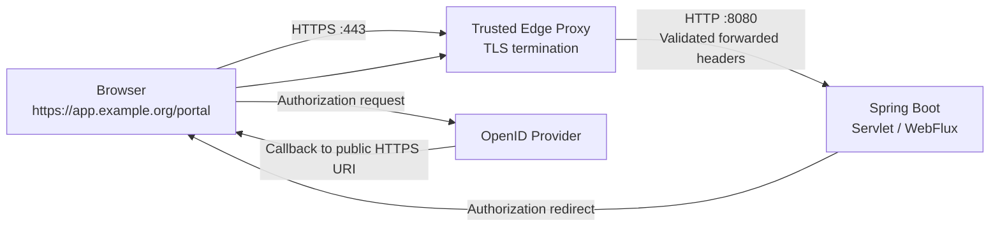
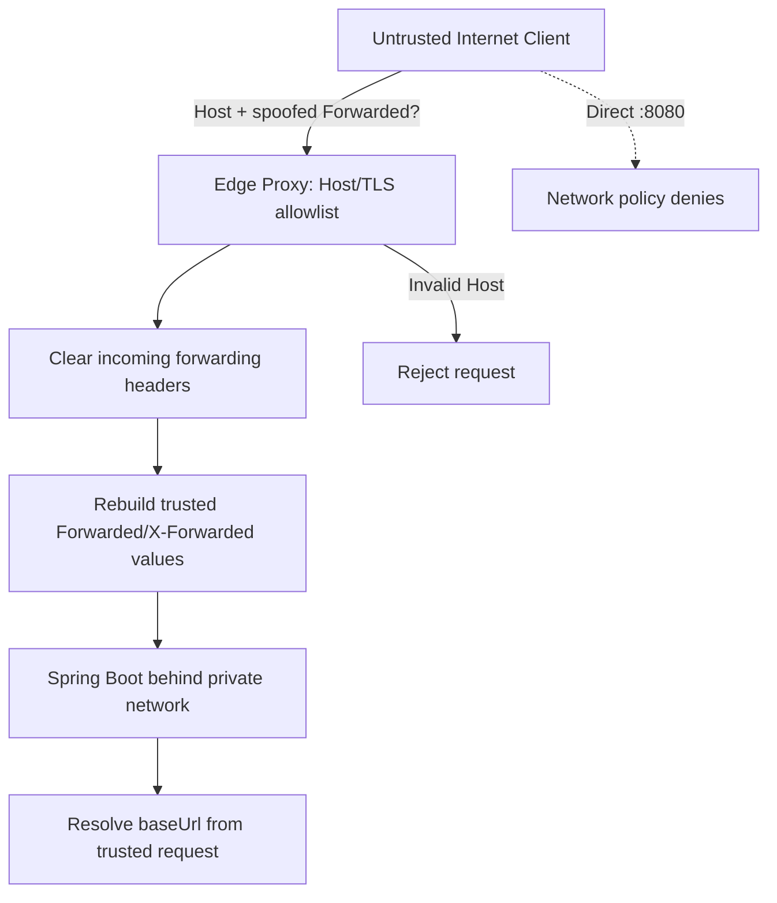
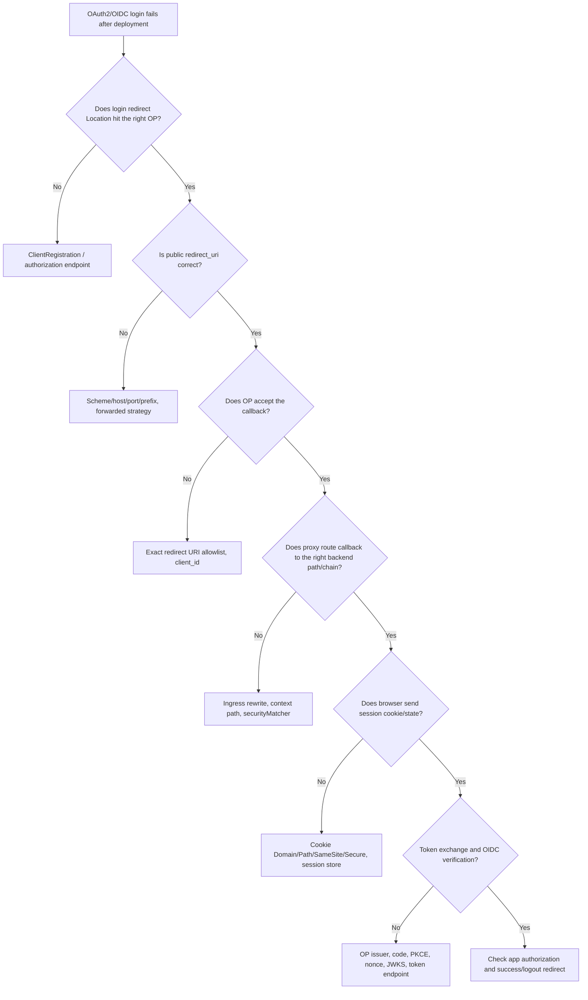

# 32.2. Forwarded Headers, Reverse Proxies, and Application Base URL

When deploying a **Spring Security OAuth 2.0 / OpenID Connect (OIDC) Client** to production, the application typically does not receive HTTPS directly from the browser. In front of Spring Boot there may be a **load balancer**, **API gateway**, **Kubernetes Ingress**, **reverse proxy**, or a chain of multiple proxies. The external system uses a public URL such as `https://login.example.org/portal`, while the application actually receives internal requests at `http://spring-app:8080`.

This mismatch directly impacts sensitive steps of OAuth2/OIDC:

- Spring Security constructs `redirect_uri` from the **base URL** it infers from the request.
- The OpenID Provider (OP) accepts only registered callback URIs, typically following exact matching rules.
- The browser must return to the right public hostname/path to send the session cookie and restore the saved `state`.
- OIDC logout may require a `post_logout_redirect_uri` belonging to the public origin.
- The application generates absolute redirects, links, or response headers based on scheme, host, port, and context path.
- An attacker may attempt to **spoof `Host`/`Forwarded`/`X-Forwarded-*`** to influence URLs generated by the application if the proxy does not enforce a clear trust boundary.

Therefore, **forwarded headers are not merely HTTP infrastructure configuration**: they sit directly on the path of the **Authorization Code Flow, OIDC logout, and session security**.

This lesson covers the full **public URL vs. internal URL** model, `Forwarded` and `X-Forwarded-*` headers, Spring Boot's three `server.forward-headers-strategy` options, Servlet `ForwardedHeaderFilter`, Reactive `ForwardedHeaderTransformer`, Nginx and prefix routing examples, using `{baseUrl}` in Spring Security, multi-tenant scenarios, defending against header spoofing, and production diagnostics.

> **Core principle:** the backend must reconstruct the public base URL only from headers that a **trusted edge proxy has actively validated, stripped of old values, and rewritten**. Never treat `X-Forwarded-Host` or `Forwarded` arriving directly from the Internet as trustworthy data.

## 1. Problem: public origin differs from upstream origin

Consider an application published at:

```text
Browser:
  https://app.example.org/portal

Load balancer / ingress:
  https://app.example.org:443

Spring Boot upstream:
  http://orders-oidc-client:8080
```

This is the same application, but with **two different perspectives**:

| Attribute | What the browser sees | What the backend may see without proxy handling |
|---|---|---|
| Scheme | `https` | `http` |
| Host | `app.example.org` | `orders-oidc-client` |
| Port | `443` (implicit in default HTTPS URL) | `8080` |
| External path prefix | `/portal` | May be stripped before upstream |
| Login start URL | `/portal/oauth2/authorization/company` | `/oauth2/authorization/company` |
| OAuth2 callback | `/portal/login/oauth2/code/company` | `/login/oauth2/code/company` |

Spring Security needs to know the **public-facing request URL** to generate the right `redirect_uri`, rather than passing `http://orders-oidc-client:8080` directly to the OP.

Desired callback example:

```text
https://app.example.org/portal/login/oauth2/code/company
```

If the application infers:

```text
http://orders-oidc-client:8080/login/oauth2/code/company
```

the OP may return `invalid_redirect_uri`, `redirect_uri_mismatch`, or an equivalent error, and the browser cannot use that internal address either.

### 1.1. Request diagram and trust boundary



Two flows must be distinguished:

1. **Inbound HTTP**: browser → proxy → RP. The public scheme/host/path must be reconstructed accurately.
2. **Outbound OAuth2**: RP → OP token endpoint/JWKS/UserInfo. These endpoints come from approved `ClientRegistration`/provider metadata and **must never change based on the request's `X-Forwarded-Host`**.

### 1.2. Reverse proxies can rewrite paths

Not every proxy preserves the original request path. There are two deployment approaches:

- **Path-preserving**: browser sends `/portal/orders`, backend still receives `/portal/orders`.
- **Prefix-stripping**: browser sends `/portal/orders`, proxy removes `/portal`, backend receives only `/orders`.

These two approaches require different Spring configurations. Never simultaneously set context path `/portal` on the backend **and** add `X-Forwarded-Prefix: /portal` without verification, as that easily produces `/portal/portal`.

## 2. What is Base URL?

In web and Spring Security contexts, the application's **base URL** is the public URL portion used as the foundation for building full URLs:

```text
https://app.example.org/portal
|----| |-------------| |----|
scheme       host         base path
```

We can distinguish:

- **Origin**: scheme + host + port, e.g. `https://app.example.org`.
- **Application base URL**: origin + context path/public prefix, e.g. `https://app.example.org/portal`.
- **Callback URI**: base URL + login processing path, e.g. `https://app.example.org/portal/login/oauth2/code/company`.
- **Issuer URI**: OP identifier, e.g. `https://id.example.net/realms/main`; **not** the RP's base URL.
- **Resource Server URL**: API target, which may belong to a completely different hostname.

### 2.1. Why does base URL matter in OAuth2?

Spring Security typically lets you configure:

```yaml
spring:
  security:
    oauth2:
      client:
        registration:
          company:
            redirect-uri: "{baseUrl}/login/oauth2/code/{registrationId}"
```

When the browser initiates login for `company`, Spring Security resolves the template into a concrete URI:

```text
https://app.example.org/portal/login/oauth2/code/company
```

The URI is then placed in the authorization request (the `redirect_uri` parameter). The OP matches it against the callback URI registered for `client_id`.

If the base URL is taken from the internal request, this URI may have the wrong scheme, host, port, or prefix.

### 2.2. `{baseUrl}` is a framework placeholder, not a Spring property

Two different ways of writing it:

```yaml
redirect-uri: "{baseUrl}/login/oauth2/code/{registrationId}"
```

and:

```yaml
redirect-uri: "https://app.example.org/login/oauth2/code/company"
```

The first relies on the request URL and forwarded-header handling; the second is a fixed URI.

Do not think of `{baseUrl}` as an environment variable `BASE_URL` automatically pulled from a separate property. It is a placeholder in the OAuth2 Client configuration resolved per request by Spring Security.

### 2.3. When is a fixed public base URL needed?

Tasks that have **no current HTTP request**, such as email invitations, scheduled jobs, or notification links, lack request headers from which to infer a base URL.

For such cases, a deployment-managed property such as:

```yaml
app:
  public-base-url: https://app.example.org/portal
```

can be useful. This is an **application-defined property**, not a default property that automatically controls all of `oauth2Login()`.

For OAuth2 redirects, choose a clear policy: a template based on trusted proxied requests, or a fixed/approved public URI per registration. Do not mix the two sources inconsistently.

## 3. Common forwarded headers

Reverse proxies typically add headers so the backend knows the original request details.

| Header | Example | Interpretation |
|---|---|---|
| `Forwarded` | `for=203.0.113.15;proto=https;host=app.example.org` | RFC 7239 standard format describing info across proxies. |
| `X-Forwarded-Proto` | `https` | Original scheme on the public/client side. |
| `X-Forwarded-Host` | `app.example.org` | Original/public host of the request. |
| `X-Forwarded-Port` | `443` | Public port. |
| `X-Forwarded-For` | `203.0.113.15` | Client/proxy IP chain; not a URL authority. |
| `X-Forwarded-Prefix` | `/portal` | External path prefix when proxy strips/rewrites paths, supported by some frameworks. |
| `X-Forwarded-Ssl` | `on` | Legacy header from some proxies; should not be used as the primary contract without reason. |
| `X-Real-IP` | `203.0.113.15` | De facto header recording remote IP; insufficient to reconstruct origin. |
| `Host` | `app.example.org` | HTTP authority of the request; may be forwarded or replaced by the proxy. |

Headers starting with `X-Forwarded-` are **common conventions**, not all part of a single standard. `Forwarded` has its own standardized format.

### 3.1. Example metadata passed through a proxy

Browser sends:

```http
GET /portal/oauth2/authorization/company HTTP/1.1
Host: app.example.org
```

Proxy terminates HTTPS and forwards to the backend:

```http
GET /oauth2/authorization/company HTTP/1.1
Host: orders-oidc-client:8080
X-Forwarded-Proto: https
X-Forwarded-Host: app.example.org
X-Forwarded-Port: 443
X-Forwarded-Prefix: /portal
X-Forwarded-For: 203.0.113.15
```

This is a **prefix-stripping** design. If Spring Boot **is allowed to trust the proxy-generated headers**, it can compute the public base URL as `https://app.example.org/portal`.

### 3.2. `Forwarded` per RFC 7239

Example:

```http
Forwarded: for=203.0.113.15;proto=https;host=app.example.org
```

When multiple proxies participate, the header can contain multiple elements. Ordering and trust level depend on the proxy chain. Do not pick the first or last element by guesswork and treat it as authentic data.

### 3.3. `X-Forwarded-For` is not `X-Forwarded-Host`

- `X-Forwarded-For` provides network peer/client IP information.
- `X-Forwarded-Host` provides the public hostname used by the browser.
- `X-Forwarded-Proto` identifies the public scheme.
- `X-Forwarded-Prefix` helps restore the public base path.

A system that only enables remote IP handling will not necessarily handle **host, scheme, and prefix**, which are what determine the OAuth2 `redirect_uri`.

### 3.4. Header names are not proof of trust

An attacker can send on their own:

```http
X-Forwarded-Host: arbitrary.example
X-Forwarded-Proto: https
```

If the application or proxy passes those values straight to the backend, Spring can infer an attacker-chosen origin. Therefore **forwarded headers are safe only after a trust boundary is enforced at the proxy**.

## 4. Trust rule: strip first, set afterwards

A secure deployment has three layers:

1. **Edge/ingress permits only configured Hostnames** and terminates TLS per policy.
2. **The proxy strips inbound `Forwarded`/`X-Forwarded-*` sent by the browser**, then sets new values from the request validated at the trusted edge.
3. **The backend is reachable only from trusted proxies**, receiving forwarded headers from a controlled source; the application does not expose internal ports directly to the Internet.

### 4.1. Sample trust boundary



Important: `ForwardedHeaderFilter` and `ForwardedHeaderTransformer` help the framework **consume headers**, but they do not decide on their own whether headers came from a trusted proxy. **Filtering the source before the backend receives the data is a deployment responsibility.**

### 4.2. Why not just check the value `https`?

`X-Forwarded-Proto=https` does not prove the browser actually connected over HTTPS. A direct HTTP client can add that header itself if the backend is public and the application trusts the header.

Configuring the application to process forwarded headers without blocking direct access to the backend can cause security decisions, redirects, and cookie behavior to rely on spoofed data.

### 4.3. Why not trust a tenant admin's `X-Forwarded-Host`?

A user with tenant admin privileges does not implicitly have the right to decide the application's public origin. If the system allows custom domains, the domain must be verified/managed and reliably mapped to the tenant.

Do not take an arbitrary `X-Forwarded-Host` to:

- Build an OAuth2 redirect URI.
- Choose an OP issuer.
- Select the tenant being logged into.
- Set a cookie Domain.
- Send password-reset links.
- Build absolute callback links in emails.

If custom-domain multi-tenancy is needed, maintain an **approved host registry** and validate ownership/routing independently of headers.

## 5. Spring Boot `server.forward-headers-strategy`

Spring Boot provides the property:

```yaml
server:
  forward-headers-strategy: framework
```

Common options:

| Value | Meaning | When appropriate |
|---|---|---|
| `none` | Do not configure forwarded header processing via this property strategy. | Not behind a proxy, or managing origin via another approach. |
| `native` | Use the web server/container's native forwarded header handling. | Infrastructure/container supports it and semantics fit. |
| `framework` | Use Spring Framework infrastructure: Servlet filter or Reactive transformer. | Need scheme/host/prefix handling with Spring Framework behavior. |

Syntax can also be written as:

```properties
server.forward-headers-strategy=framework
```

**Do not select `framework` merely to fix a redirect error without ensuring the proxy sanitizes headers.** That setting tells the application «understand the headers», not «the headers are safe».

### 5.1. `framework` on Servlet

With the Spring MVC/Servlet stack, Boot can use Spring Framework's **`ForwardedHeaderFilter`** to wrap the request/response so downstream components observe the public origin reflected by the headers.

### 5.2. `framework` on WebFlux

With the Reactive/WebFlux stack, Boot can integrate **`ForwardedHeaderTransformer`** to adjust the request URI/path from forwarded headers before reactive handlers receive the request.

### 5.3. `native` on a Servlet container

Tomcat and several web servers have native mechanisms, such as Tomcat's `RemoteIpValve`. It can handle remote IP/proto/host/port according to configuration and a trusted proxy list.

However, **native support varies in scope**, especially regarding `X-Forwarded-Prefix`. If the application lives at `/portal` and the proxy strips it, verify whether the native strategy restores the prefix properly.

### 5.4. `none` does not disable all custom code

`none` only disables Boot's strategy for this property. If the application manually registers `ForwardedHeaderFilter` or another gateway filter, headers can still be processed. Thus, when diagnosing, inspect the **actual stack/beans and proxy**, not just a single property.

### 5.5. Do not register duplicate processing unchecked

If Boot already auto-configures `framework` handling, manually registering another `ForwardedHeaderFilter` can cause double processing, alter URLs, or make filter ordering hard to diagnose.

When a custom filter/transformer is needed, decide **which component owns it** and inspect Boot's active strategy rather than enabling multiple mechanisms for the same purpose simultaneously.

## 6. Servlet: `ForwardedHeaderFilter`

`ForwardedHeaderFilter` is a Servlet filter in Spring Framework that processes standard and de facto forwarded headers so subsequent request handlers see the right public URL.

Example using the Boot property:

```yaml
server:
  forward-headers-strategy: framework
  servlet:
    session:
      cookie:
        secure: true
        http-only: true
        same-site: lax
```

If you choose Boot auto-configuration, **you usually do not need to create another filter bean for the same purpose**.

### 6.1. Registering the filter in Java

When the application **does not use** Boot's auto-configuration strategy or needs reasonable customization:

```java
import org.springframework.context.annotation.Bean;
import org.springframework.context.annotation.Configuration;
import org.springframework.web.filter.ForwardedHeaderFilter;

@Configuration
public class ForwardedHeadersConfiguration {

    @Bean
    ForwardedHeaderFilter forwardedHeaderFilter() {
        return new ForwardedHeaderFilter();
    }
}
```

This is an alternative to Boot's configured mechanism, not something to add unconditionally to every application.

### 6.2. What is `removeOnly`?

`ForwardedHeaderFilter` supports a mode that **only strips forwarded headers** without applying their values to the request. Conceptually:

```java
ForwardedHeaderFilter filter =
    new ForwardedHeaderFilter();

filter.setRemoveOnly(true);
```

This mode is useful when the application **does not want to trust** forwarded headers yet wants to prevent downstream components from accidentally reading those values.

**`removeOnly=true` does not help Spring build a public base URL from proxy headers.** If using this mode, you need another way to set the right scheme/host/path or configure static URIs.

### 6.3. Filter order and Spring Security

Forwarded-header handling should run before OAuth2 request/redirect logic computes URLs. If registering the filter manually, verify the filter order and Servlet registration so the security chain actually sees the processed request.

Do not just define a Bean and assume every request/context passes through the filter; test a production-like chain and real proxy.

### 6.4. APIs to read URLs after forwarded headers are processed

In Servlet, APIs such as:

```java
request.getScheme();
request.getServerName();
request.getServerPort();
request.getContextPath();
```

can reflect the public origin/context path once the forwarded-header filter has been applied.

This is also why the same controller produces different absolute redirects with or without the filter.

## 7. Tomcat `RemoteIpValve` and `native` strategy

With embedded Tomcat, Spring Boot can use native remote IP/proxy configuration when selecting:

```yaml
server:
  forward-headers-strategy: native
```

Some Tomcat properties that tune handling:

```yaml
server:
  tomcat:
    remoteip:
      protocol-header: x-forwarded-proto
      remote-ip-header: x-forwarded-for
```

This is an **illustrative example**, not a complete trusted-proxies policy. Check your Boot/Tomcat version and settings such as internal proxies/trusted proxies according to your real infrastructure.

### 7.1. Why are trusted proxy IPs important?

If the container accepts `X-Forwarded-Proto`/`X-Forwarded-For` from any connection, a caller hitting the backend directly can spoof the request origin or client IP.

The native handler must trust connections only from **known proxy addresses/ranges** within a controlled network design.

### 7.2. `native` does not automatically solve all URL prefixes

A Tomcat native handler may handle proto/remote address well yet fail to restore `/portal` stripped by an ingress with the semantics needed for `{baseUrl}`.

When using native:

- Test scheme/host/port.
- Test external prefix/context path.
- Test the OAuth2 authorization redirect.
- Test the OP callback and post-logout redirect.
- Do not assume `X-Forwarded-Prefix` is supported identically to the Spring Framework filter.

### 7.3. Should you choose native or framework?

There is no single right choice for every container/proxy combination:

- Choose `native` if the container integrates cleanly and trusted-proxy controls fit.
- Choose `framework` if you need Spring Framework's behavior, especially when external prefixes are passed per framework convention.
- Choose `none` if you do not use forwarded headers or use another base URL/redirect strategy.

Whichever you choose, **the edge must still sanitize headers and the backend must not be directly reachable outside the trust boundary**.

## 8. Spring WebFlux: `ForwardedHeaderTransformer`

In WebFlux, Servlet filters are not used to process requests. Spring Framework provides **`ForwardedHeaderTransformer`**; it transforms request details before `WebFilter`/handlers receive them.

With Spring Boot WebFlux:

```yaml
server:
  forward-headers-strategy: framework
```

is a common choice when the application runs behind a proxy.

### 8.1. Configuring via Java if owning the transformer yourself

Conceptual example when not relying on Boot auto-configuration:

```java
import org.springframework.context.annotation.Bean;
import org.springframework.context.annotation.Configuration;
import org.springframework.web.server.adapter.ForwardedHeaderTransformer;

@Configuration
public class ReactiveForwardedHeadersConfiguration {

    @Bean
    ForwardedHeaderTransformer forwardedHeaderTransformer() {
        return new ForwardedHeaderTransformer();
    }
}
```

If the framework/container already configures a transformer, avoid registering a second one.

### 8.2. Reactive transformer still requires a trusted proxy

`ForwardedHeaderTransformer` does not inherently know whether `X-Forwarded-Host` came from the edge gateway or a browser/attacker. Protecting the header source is an infrastructure requirement just like in Servlet.

### 8.3. `removeOnly` in reactive

Spring Framework versions include a transformer mode that only removes forwarded headers rather than trusting them. The concept mirrors Servlet `removeOnly`: suitable when you do not want requests to process client-supplied values.

Do not use remove-only mode and expect `{baseUrl}` to reflect public HTTPS/prefix automatically.

### 8.4. Inspecting the request URL in WebFlux

In a reactive handler with `ServerWebExchange`:

```java
URI requestUri = exchange.getRequest().getURI();
```

When the transformer is applied properly before the handler, the URI can reflect the external scheme/host/path passed by the trusted proxy.

If you need to build absolute links in backend jobs, there is no request/exchange to read. Use an **approved public base URL configuration** rather than trying to fabricate a fake `ServerWebExchange`.

## 9. Nginx: proxy configuration at the public root path

Assume the public URL is:

```text
https://app.example.org/
```

and the backend listens on:

```text
http://spring-app:8080/
```

**Single-host** Nginx example:

```nginx
server {
    listen 443 ssl;
    server_name app.example.org;

    ssl_certificate     /etc/tls/app.example.org.crt;
    ssl_certificate_key /etc/tls/app.example.org.key;

    location / {
        proxy_pass http://spring-app:8080;

        proxy_set_header Host app.example.org;

        # Rewrite the public URL verified by the edge itself.
        proxy_set_header X-Forwarded-Host app.example.org;
        proxy_set_header X-Forwarded-Proto https;
        proxy_set_header X-Forwarded-Port 443;

        # If this is the true edge: do not trust the client-sent chain.
        proxy_set_header X-Forwarded-For $remote_addr;

        # Do not forward uncontrolled inbound RFC Forwarded header.
        proxy_set_header Forwarded "";

        proxy_http_version 1.1;
    }
}
```

**Limitations of the example:** this is the pattern for an edge **at the head of the trust chain serving a single hostname**. If Nginx sits behind another load balancer, `$remote_addr` may be the LB's IP, and reconstructing IP/scheme/host must rely on a configured trusted chain. If there are multiple public hosts, do not hardcode the same host into all server blocks.

### 9.1. Why use a fixed value instead of request input?

In a single-domain server, the value:

```nginx
proxy_set_header X-Forwarded-Host app.example.org;
```

comes from operator configuration, not from an inbound browser `X-Forwarded-Host`.

This reduces host-header poisoning risks. For a multi-host server, use a **server-side validated hostname mapping**, and never pass arbitrary `$http_x_forwarded_host` to the backend.

### 9.2. TLS cannot be omitted in production examples

`ssl_certificate` only illustrates certificate placement. Real deployments require:

- Valid certificates and well-protected private keys.
- Appropriate TLS versions/ciphers.
- HTTP → HTTPS redirect at the edge.
- HSTS per domain policy when appropriate.
- No public HTTP endpoint transmitting plaintext session cookies.
- Protecting the proxy → app connection per network trust model; internal TLS/mTLS when required.

### 9.3. Do not rely on `$scheme` if an upstream proxy already terminated TLS

If Nginx receives HTTP from a load balancer that terminated HTTPS, `$scheme` inside Nginx is `http`. Sending:

```nginx
proxy_set_header X-Forwarded-Proto $scheme;
```

in this situation causes the backend to see `http` even though the browser used HTTPS.

Identify **which hop confirms the public scheme**. If Nginx receives forwarded info from a trusted LB, configure validation and the trust chain; if Nginx is the TLS edge, the public scheme can be explicitly set to `https`.

## 10. Nginx: `/portal` prefix-stripping deployment

Assume the browser uses:

```text
https://app.example.org/portal/
```

but the Spring MVC/WebFlux upstream uses the root application path:

```text
http://spring-app:8080/
```

One possible configuration is:

```nginx
server {
    listen 443 ssl;
    server_name app.example.org;

    ssl_certificate     /etc/tls/app.example.org.crt;
    ssl_certificate_key /etc/tls/app.example.org.key;

    location = /portal {
        return 301 /portal/;
    }

    location /portal/ {
        # The trailing "/" on the upstream URI makes Nginx strip /portal/
        # per proxy_pass URI replacement rules.
        proxy_pass http://spring-app:8080/;

        proxy_set_header Host app.example.org;
        proxy_set_header X-Forwarded-Host app.example.org;
        proxy_set_header X-Forwarded-Proto https;
        proxy_set_header X-Forwarded-Port 443;
        proxy_set_header X-Forwarded-Prefix /portal;
        proxy_set_header X-Forwarded-For $remote_addr;
        proxy_set_header Forwarded "";
    }
}
```

Here:

| Browser URL | Upstream request path |
|---|---|
| `/portal/` | `/` |
| `/portal/oauth2/authorization/company` | `/oauth2/authorization/company` |
| `/portal/login/oauth2/code/company` | `/login/oauth2/code/company` |
| `/portal/signed-out` | `/signed-out` |

If Spring Framework processes `X-Forwarded-Prefix` properly, `{baseUrl}` can resolve to `https://app.example.org/portal`.

### 10.1. Keep the backend root path

With this strip-prefix design, **do not simultaneously** set:

```yaml
server:
  servlet:
    context-path: /portal
```

if the backend actually receives paths after stripping. Doing so can cause the app to expect `/portal` a second time or compute callbacks incorrectly.

### 10.2. Check the slash in `proxy_pass`

Nginx applies different rules between:

```nginx
proxy_pass http://spring-app:8080;
```

and:

```nginx
proxy_pass http://spring-app:8080/;
```

when used inside `location /portal/`. A trailing slash can change the path forwarded upstream.

This is a frequent source of **404 on callback** even when the OP redirects to the right URI.

### 10.3. Public prefix affects more than `redirect_uri`

It also affects:

- Login start URL.
- Callback processing URL.
- CSS/JS assets if the app generates absolute paths.
- SavedRequest and success redirects.
- Logout URL and `post_logout_redirect_uri`.
- Cookie Path (browsers scope cookies by public path).
- Absolute links returned in REST/HATEOAS.
- Reverse proxy location matching.

A test checking only `Location` at login start is insufficient if the browser callback does not land on the right route.

## 11. Nginx: path-preserving approach

Another option is **not stripping** `/portal`, letting Spring Boot actually run with this context path:

```yaml
server:
  servlet:
    context-path: /portal
  forward-headers-strategy: framework
```

Nginx passes the original request path unchanged:

```nginx
location /portal/ {
    proxy_pass http://spring-app:8080;

    proxy_set_header Host app.example.org;
    proxy_set_header X-Forwarded-Host app.example.org;
    proxy_set_header X-Forwarded-Proto https;
    proxy_set_header X-Forwarded-Port 443;
    proxy_set_header X-Forwarded-For $remote_addr;
    proxy_set_header Forwarded "";
}
```

Here **you do not need to manually add `X-Forwarded-Prefix=/portal`** if the backend context path is already `/portal` and all URLs are preserved.

### 11.1. The two approaches must not be implicitly mixed

| Property | Prefix-stripping | Path-preserving |
|---|---|---|
| Public path | `/portal/orders` | `/portal/orders` |
| Upstream path | `/orders` | `/portal/orders` |
| Servlet context path | Usually `/` | `/portal` |
| `X-Forwarded-Prefix` header | May need `/portal` | Usually unnecessary |
| Expected `{baseUrl}` | `https://app.example.org/portal` | `https://app.example.org/portal` |
| Typical risk | Missing prefix if header is not handled | Double prefix if X-Forwarded-Prefix is added improperly |

Both approaches can produce **the same public callback**, but requests are processed differently. In operations, pick one approach and document the contract for the ingress, Spring context path, and OP redirect URI.

## 12. Kubernetes Ingress and API Gateway

In Kubernetes, a request typically traverses:

```text
Browser HTTPS
  |
  v
Cloud Load Balancer
  |
  v
Ingress Controller
  |
  v
Kubernetes Service
  |
  v
Spring Boot Pod
```

**There is no single Ingress annotation configuration across all controllers.** NGINX Ingress, Traefik, HAProxy, Envoy/Gateway API, or cloud-specific gateways each have their own path-rewriting and forwarded-header behaviors.

### 12.1. Decisions that must be aligned

- Does TLS terminate at the Load Balancer or the Ingress?
- Does the Ingress receive HTTP or HTTPS from the LB?
- What is the trusted source of client IP/public host/public proto?
- Strip prefix or preserve path?
- Is the `Forwarded` header preserved/rewritten?
- Which component emits `X-Forwarded-Prefix`?
- Are direct Internet connections to Pods/Services blocked?
- Does the app use `framework` or `native`?
- What public `Path` and `Secure` flags should cookies have?

### 12.2. Do not copy annotations blindly

For example, Ingress Controller A may have a regex-based rewrite-target annotation; Controller B does not support the same semantics. Copying configs can cause callbacks to be rewritten incorrectly or paths to fail to match as expected.

Confirm the **actual upstream path received** and headers in a test environment rather than relying on annotation names.

### 12.3. Health checks are not OAuth2 login

Internal health checks may hit the Pod without forwarded headers and over HTTP. This is usually **not a problem** if the health endpoint does not generate absolute login redirects.

Do not require every internal health check to spoof public HTTPS headers just for the app to run. Properly decouple health/monitoring endpoints from URL generation/security flows.

## 13. How does Spring Security generate `redirect_uri`?

A sample registration:

```yaml
spring:
  security:
    oauth2:
      client:
        registration:
          company:
            provider: company-oidc
            client-id: ${OIDC_CLIENT_ID}
            client-secret: ${OIDC_CLIENT_SECRET}
            client-authentication-method: client_secret_basic
            authorization-grant-type: authorization_code
            redirect-uri: "{baseUrl}/login/oauth2/code/{registrationId}"
            scope:
              - openid
              - profile
        provider:
          company-oidc:
            issuer-uri: https://id.example.net/realms/main
```

With public base URL:

```text
https://app.example.org/portal
```

Spring Security computes:

```text
registrationId = company

redirect_uri =
  https://app.example.org/portal/login/oauth2/code/company
```

The `redirect_uri` parameter is URL-encoded when attached to the authorization request. The browser may see:

```text
https://id.example.net/realms/main/.../auth?
  response_type=code
  &client_id=...
  &redirect_uri=https%3A%2F%2Fapp.example.org%2Fportal%2Flogin%2Foauth2%2Fcode%2Fcompany
  &state=...
```

This is an illustrative URL, not a live OP URL to call directly.

### 13.1. Register the exact URI at the OP

In the OP client configuration, register the matching callback URI:

```text
https://app.example.org/portal/login/oauth2/code/company
```

Even if the OP permits wildcard redirect URIs, **prefer exact URIs** and avoid broad hostname/path wildcards or open redirects in callbacks.

### 13.2. Wrong scheme

The public URI requires:

```text
https://app.example.org/portal/login/oauth2/code/company
```

but Spring generates:

```text
http://app.example.org/portal/login/oauth2/code/company
```

A common sign is that the backend does not understand TLS termination, or the proxy fails to pass/handle `X-Forwarded-Proto`.

### 13.3. Wrong host

Spring generates:

```text
https://spring-app:8080/login/oauth2/code/company
```

Investigate `Host`/`X-Forwarded-Host`, proxy Host forwarding, trusted proxy handling, and whether the backend is using an internal address to calculate absolute URLs.

### 13.4. Wrong port

Spring generates:

```text
https://app.example.org:8080/login/oauth2/code/company
```

Investigate `X-Forwarded-Port`, host parsing with port, native container handling, and public 443. Whether an implicit 443 or explicit `:443` is used in the callback may differ from the provider's exact-matching rules; register and send consistent URIs.

### 13.5. Wrong prefix

Spring generates:

```text
https://app.example.org/login/oauth2/code/company
```

when the browser needs `/portal/login/oauth2/code/company`. Check path stripping and `X-Forwarded-Prefix` or `context-path` per one of the two architectures above.

## 14. Protecting `redirect_uri` against header spoofing

If an attacker can control the public host Spring trusts, they can cause an authorization request to be built with:

```text
redirect_uri=https://attacker-chosen.example/login/oauth2/code/company
```

An OP with strict exact redirect URI configuration may reject it, but **OP validation must not be treated as the sole layer of defense**. Loose/wildcard matching or other application features using public absolute URLs can widen the impact.

### 14.1. Defense-in-depth

- The proxy accepts only registered Hosts.
- Strip and reconstruct forwarded headers from trusted sources.
- Keep the backend private without exposing the upstream port publicly.
- Each registration's `redirect_uri` uses an approved public host/path.
- Register exact redirect URIs at the OP.
- For multi-tenant custom domains, verify domain ownership and tenant mapping.
- Never construct `redirect_uri` directly from a query parameter.
- Do not allow open redirects in the callback.
- Monitor discrepancies between the actual generated `redirect_uri` and the expected public URI.

### 14.2. Do not let requests choose `registrationId` unchecked

`/oauth2/authorization/{registrationId}` is a Spring Security routing key. In applications with multiple OPs and tenants, users must only be allowed to access registrations permitted by policy. Do not infer an issuer or credential from a self-declared `Host`.

## 15. Spring Security Servlet SecurityFilterChain

A basic Servlet configuration:

```java
import org.springframework.context.annotation.Bean;
import org.springframework.context.annotation.Configuration;
import org.springframework.security.config.Customizer;
import org.springframework.security.config.annotation.web.builders.HttpSecurity;
import org.springframework.security.web.SecurityFilterChain;

@Configuration
public class SecurityConfiguration {

    @Bean
    SecurityFilterChain securityFilterChain(HttpSecurity http)
            throws Exception {

        return http
            .authorizeHttpRequests(auth -> auth
                .requestMatchers(
                    "/", "/login", "/signed-out",
                    "/assets/**"
                ).permitAll()
                .anyRequest().authenticated()
            )
            .oauth2Login(Customizer.withDefaults())
            .oauth2Client(Customizer.withDefaults())
            .build();
    }
}
```

This snippet does not configure forwarded headers directly; they are handled in **the proxy + Spring Boot/Framework HTTP infrastructure**. OAuth2 Login uses the processed request to construct redirect URLs.

### 15.1. Do not confuse login start with callback

| Purpose | Common default Servlet path |
|---|---|
| Initiate Authorization Request | `/oauth2/authorization/{registrationId}` |
| Receive Authorization Code callback | `/login/oauth2/code/{registrationId}` |

If the public prefix is `/portal`, the browser uses:

```text
/portal/oauth2/authorization/company
/portal/login/oauth2/code/company
```

The proxy may strip the prefix so upstream Spring handles the default paths. Ensure **both paths** are routed properly, not just login start.

### 15.2. When customizing the redirection endpoint

If using:

```java
.oauth2Login(oauth2 -> oauth2
    .redirectionEndpoint(redirection -> redirection
        .baseUri("/custom/callback/*")
    )
)
```

then the registration's `redirect-uri` and the OP callback allowlist must also match. Do not change the servlet matcher and forget to update the corresponding `redirect-uri`.

An example URI when using a custom callback:

```yaml
redirect-uri: "{baseUrl}/custom/callback/{registrationId}"
```

### 15.3. The callback must pass through the right filter chain

With multiple `SecurityFilterChain` beans, a securityMatcher may accidentally exclude the callback or login-start path from the chain that configures `oauth2Login()`. The browser may then receive a 404/401 or a redirect loop even when forwarded headers are right.

Do not assume every callback error is caused by the proxy. Verify the full route → chain → OAuth2 filters flow.

## 16. Spring WebFlux SecurityWebFilterChain

On WebFlux, the corresponding security config is:

```java
import org.springframework.context.annotation.Bean;
import org.springframework.context.annotation.Configuration;
import org.springframework.security.config.Customizer;
import org.springframework.security.config.annotation.web.reactive.EnableWebFluxSecurity;
import org.springframework.security.config.web.server.ServerHttpSecurity;
import org.springframework.security.web.server.SecurityWebFilterChain;

@Configuration
@EnableWebFluxSecurity
public class ReactiveSecurityConfiguration {

    @Bean
    SecurityWebFilterChain springSecurityFilterChain(
            ServerHttpSecurity http) {

        return http
            .authorizeExchange(exchanges -> exchanges
                .pathMatchers(
                    "/", "/login", "/signed-out",
                    "/assets/**"
                ).permitAll()
                .anyExchange().authenticated()
            )
            .oauth2Login(Customizer.withDefaults())
            .oauth2Client(Customizer.withDefaults())
            .build();
    }
}
```

If the proxy strips `/portal`, `ForwardedHeaderTransformer` helps WebFlux observe the request's public origin/prefix in the framework-supported way.

### 16.1. Servlet and WebFlux handle requests differently

- Servlet uses `HttpServletRequest` and `ForwardedHeaderFilter`.
- WebFlux uses `ServerHttpRequest`/`ServerWebExchange` and `ForwardedHeaderTransformer`.
- Both can use `server.forward-headers-strategy=framework` in Boot, though the underlying implementations differ.
- Do not add a Servlet `ForwardedHeaderFilter` to a pure Netty/WebFlux server expecting it to process requests.

### 16.2. Outbound WebClient must not take Host from inbound proxies

`WebClient` calls token endpoints/JWKS/UserInfo/Resource Servers using trusted URLs from registration or API config. Inbound forwarded headers are for building public-facing RP links, **not directives for choosing outbound credential destinations**.

Do not forward `X-Forwarded-Host` from the browser to the OP/token endpoint as a «fix» to make login work.

## 17. OIDC logout and `post_logout_redirect_uri`

OIDC RP-Initiated Logout can redirect the browser from the RP to the OP's `end_session_endpoint`, after which the OP sends the user back to a registered **post-logout redirect URI**.

Example:

```text
Logout starts:
  https://app.example.org/portal/logout

OP logout endpoint:
  https://id.example.net/realms/main/.../logout

post_logout_redirect_uri:
  https://app.example.org/portal/signed-out
```

Like the login callback, `post_logout_redirect_uri` must not come from the internal backend URL.

### 17.1. Servlet logout success handler

Example:

```java
import org.springframework.context.annotation.Bean;
import org.springframework.context.annotation.Configuration;
import org.springframework.security.oauth2.client.registration.ClientRegistrationRepository;
import org.springframework.security.oauth2.client.oidc.web.logout.OidcClientInitiatedLogoutSuccessHandler;
import org.springframework.security.web.authentication.logout.LogoutSuccessHandler;

@Configuration
public class OidcLogoutConfiguration {

    @Bean
    LogoutSuccessHandler oidcLogoutSuccessHandler(
            ClientRegistrationRepository registrations) {

        OidcClientInitiatedLogoutSuccessHandler handler =
            new OidcClientInitiatedLogoutSuccessHandler(registrations);

        handler.setPostLogoutRedirectUri("{baseUrl}/signed-out");
        return handler;
    }
}
```

Attach the handler to `HttpSecurity.logout(...)` in the same security chain:

```java
.logout(logout -> logout
    .logoutSuccessHandler(oidcLogoutSuccessHandler)
)
```

These are configuration fragments; ensure the handler is injected into the SecurityFilterChain and that the OP supports the logout endpoint. `/signed-out` should be a public page.

### 17.2. WebFlux logout success handler

On the Reactive stack, there is a corresponding class:

```java
import org.springframework.security.oauth2.client.oidc.web.server.logout
    .OidcClientInitiatedServerLogoutSuccessHandler;
import org.springframework.security.oauth2.client.registration
    .ReactiveClientRegistrationRepository;

OidcClientInitiatedServerLogoutSuccessHandler handler =
    new OidcClientInitiatedServerLogoutSuccessHandler(registrations);

handler.setPostLogoutRedirectUri("{baseUrl}/signed-out");
```

In this example, `registrations` is a `ReactiveClientRegistrationRepository`. Attach the handler to `ServerHttpSecurity.logout(...)` per WebFlux configuration.

**Note on examples:** the two declarations above are fragments illustrating the API and dependencies, not complete Java classes to paste verbatim. The Servlet handler and Reactive handler have different types.

### 17.3. OP registers post-logout URIs separately

The OP may require a `post_logout_redirect_uri` list separate from the login `redirect_uri` list.

Example:

```text
Login redirect:
  https://app.example.org/portal/login/oauth2/code/company

Post-logout redirect:
  https://app.example.org/portal/signed-out
```

Do not assume registering the login callback automatically permits the post-logout URI.

### 17.4. Right base URL alone does not guarantee complete logout

- The RP local session may have been invalidated.
- The OP SSO session may or may not remain.
- The OAuth2 authorized client/Refresh Token may still reside in the store.
- The browser may fail to complete the redirect to the OP.
- The OP may not support RP-Initiated Logout.

Forwarded headers fix the public redirect URL; **they do not replace token revocation or logout policy**.

## 18. Session cookies when TLS terminates at the proxy

Suppose the browser uses HTTPS while the backend sees HTTP. If cookies are issued based on the wrong internal perception, the browser may not receive proper `Secure`/`SameSite` attributes.

Example production cookie:

```http
Set-Cookie: __Host-SESSION=<opaque>; Path=/; Secure; HttpOnly; SameSite=Lax
```

This is the pattern for an app running at the root path of a public host. If the app uses `/portal`, choosing the `__Host-` prefix still requires `Path=/` and no `Domain`; if you want a `Path=/portal` cookie, **you cannot simultaneously satisfy the `__Host-` requirements**.

### 18.1. `Secure` must reflect external HTTPS

It can be set explicitly:

```yaml
server:
  servlet:
    session:
      cookie:
        secure: true
        http-only: true
        same-site: lax
```

With Spring Session or WebFlux, the cookie writer/serializer/resolver may differ; configure the exact component that emits `Set-Cookie`.

### 18.2. `SameSite=Lax` and OIDC GET callback

The common Authorization Code Flow returns to the RP via a top-level GET. `SameSite=Lax` is usually appropriate for the browser to send the RP session cookie when returning from a cross-site OP.

`SameSite=Strict` can prevent the session cookie from being sent on the cross-site callback, causing Spring Security to fail to find the saved authorization request `state`.

`SameSite=None; Secure` may be needed for certain supported cross-site POST/iframe flows, but it increases CSRF defense requirements and demands reviewing browser policies.

### 18.3. Cookie Domain does not determine base URL

A browser cookie with `Domain=example.org` does not mean Spring Security will use `https://example.org` as the public base URL; URL generation depends on the request origin/context path or explicit URI config.

Conversely, properly handled forwarded hosts do not guarantee the cookie domain/path is right.

### 18.4. Avoid configuring cookies dynamically from `X-Forwarded-Host`

Do not do:

```java
String domain = request.getHeader("X-Forwarded-Host");
// Putting domain directly into Set-Cookie without validation.
```

Especially with multi-tenant custom domains, cookies should be scoped to the permitted public host without widening `Domain` to a parent domain.

## 19. `state`, sessions, and callbacks behind a proxy

When initiating OAuth2 login, Spring Security typically stores `OAuth2AuthorizationRequest` with `state` in the session/WebSession. The OP redirects the browser back to the callback; the RP needs to retrieve the original request.

If the browser hits the callback **without sending the session cookie**, or the callback lands on a node that cannot read the session store, Spring Security may report:

```text
authorization_request_not_found
invalid_state_parameter
```

Proxy-related causes include:

- The public callback host differs from the host used when starting login.
- HTTP/HTTPS transitions prevent the `Secure` cookie from being sent.
- The cookie Path does not cover the callback after prefix rewriting.
- The cookie Domain does not match the public host.
- Multiple backend instances without a shared session store.
- Proxy/ingress routes the callback to a different service.
- Forwarded prefix is inconsistent between start and callback.
- Session expires while the user completes MFA or consent.
- Redirects between `www` and non-`www` change the cookie host.

### 19.1. Do not disable `state` to work around proxy errors

`state` is the defense linking the authorization response to the original request. Disabling or ignoring `state` because callbacks lose sessions opens up login CSRF/callback injection risks.

Fix **host/scheme/prefix/cookie/session routing**, not by breaking OAuth2 checks.

### 19.2. Every step should target the same public hostname

If initiation starts at:

```text
https://app.example.org/portal/oauth2/authorization/company
```

but the callback is generated as:

```text
https://api.example.org/portal/login/oauth2/code/company
```

then `app.example.org`'s host-only session cookie will not be sent to `api.example.org`. Unless the application has an explicit multi-host cookie/session design, use **the same approved host**.

### 19.3. Browsers differ from internal HTTP clients

An internal health check to `http://spring-app:8080` does not need browser session cookies. When debugging OAuth2, inspect real public browser navigation and proxy processing, rather than sending `curl` straight to upstream and assuming the UI behaves the same way.

## 20. Spring Session and multiple instances

When a deployment runs:

```text
Browser
   |
Load Balancer
  / \
Pod A  Pod B
  \   /
 Redis / JDBC Spring Session
```

An OAuth2 authorization request may be initiated on Pod A while the callback arrives at Pod B. If sessions exist only in Pod A's memory, the callback will not find the saved request.

### 20.1. Forwarded headers do not solve session replication

Configuring `server.forward-headers-strategy=framework` handles only public URL metadata. It **does not share `HttpSession`/`WebSession`** across nodes.

Possible solutions:

- Shared Spring Session store (Redis/JDBC) suitable for your stack.
- Sticky sessions when permitted and limitations are understood.
- A repository storing authorization requests outside the session per a dedicated security design.
- A specialized stateless flow with appropriate state/PKCE binding if explicitly architected.

### 20.2. Keep the same public origin across all replicas

If Pod A and Pod B differ in forwarded strategy or context path, the browser may receive a changing redirect URI across login attempts.

Keep consistent:

- Spring Boot version/configuration.
- ClientRegistration redirect URI.
- Proxy routes.
- Session cookie name/path/domain/flags.
- Session store namespace/secret.
- App public base URL/tenant catalog.
- Trusted headers policy.

### 20.3. Do not log cookies to trace sessions

When debugging lost sessions, use correlation IDs and safe metadata logs. Do not print raw `Cookie`/`Set-Cookie` or Access/Refresh Tokens; a session ID is itself a replayable credential.

## 21. Multi-tenant and custom domains

A SaaS may give each tenant a public domain:

```text
https://alpha.customer-a.example
https://login.customer-b.example
```

Each tenant may use a different OP registration. A request arriving for public Host A does not implicitly prove the user is authorized in tenant A.

### 21.1. Safe mapping

```text
Trusted public hostname
  -> approved tenant ID
  -> approved client registration
  -> approved issuer/redirect URIs
  -> tenant authorization policy
```

Do not use:

```text
Client-supplied X-Forwarded-Host
  -> turned into tenant ID
  -> dynamically builds issuer-uri
  -> generates arbitrary redirect_uri
```

### 21.2. Host allowlists are needed at both edge and app

- The proxy accepts configured/verified domains.
- The app maintains an approved hostname registry distinguishing tenants.
- Only the tenant owning a domain may use that domain.
- Callback URIs at the OP are registered for the right registration/domain.
- Use host-only cookies where appropriate; avoid sharing raw session cookies across tenants.
- Never use email/`sub` alone as proof that two tenants share an identity.

### 21.3. The number of redirect URIs can grow large

If the OP does not safely support dynamically registered redirect URIs, each custom domain may need configuration at the OP or use **a canonical login domain** owned by the application.

Example:

```text
Tenant custom domain:
  https://alpha.customer.example

Canonical login host:
  https://auth.saas.example

OP callback:
  https://auth.saas.example/login/oauth2/code/alpha
```

This design requires clear session/tenant correlation and a return URL allowlist; do not simply change `redirect_uri` and expect the custom domain's browser cookie to be shared with the canonical auth domain.

### 21.4. Do not let users pick `redirect_uri` freely

If a login API accepts `?return_to=https://...`, the post-login target URL must stay within policy (relative paths or approved absolute hosts). Otherwise, the system risks creating an **open redirect** and increasing OAuth2 credential/token exposure.

Internal UX `return_to` must never be confused with the `redirect_uri` registered at the OP.

## 22. Host header poisoning and absolute URL generation

Beyond the OAuth2 callback, many parts of an application generate absolute URLs from inbound requests:

- Password reset.
- Email verification.
- Download links.
- HATEOAS `Location` headers.
- Self-service SSO setup links.
- OpenAPI server URLs.
- OIDC front-channel logout/post-logout redirects.
- Error pages or saved-request redirects.

If the application trusts a forged `Host`/`X-Forwarded-Host`, URLs can be redirected to an attacker-controlled host.

### 22.1. Use relative redirects when possible

Within an application that only needs internal page navigation:

```text
Location: /dashboard
```

typically reduces reliance on public scheme/host compared to:

```text
Location: https://app.example.org/dashboard
```

However, **OAuth2 `redirect_uri` and registered callbacks usually require absolute URIs**, so not every case can be solved with relative redirects.

### 22.2. Do not use `getHeader("Host")` to build security-sensitive links

A controller concatenating:

```java
String host = request.getHeader("Host");
String url = "https://" + host + "/reset?token=...";
```

is dangerous if Host is not validated from a trusted source.

For email/background links, use a **configured public base URL / approved host registry**, not an arbitrary request Host.

### 22.3. `Forwarded` and `X-Forwarded-*` coexisting

Some proxies may set both RFC `Forwarded` and `X-Forwarded-*` headers. If values conflict, behavior depends on filter/container/version.

**Do not rely on unverified implicit precedence.** Design a single contract: the proxy strips untrusted headers and writes a consistent set; the app uses one chosen processing mechanism.

## 23. Multi-hop proxy chains

A real system may have:

```text
Browser
  -> CDN/WAF
  -> Cloud Load Balancer
  -> Ingress
  -> Service Mesh Sidecar
  -> Spring Boot
```

Not every hop observes public HTTPS and the original client IP. Therefore distinguish:

- **Valid edge**: where public host, TLS, and remote client connection are verified.
- **Trusted internal proxies**: where header context can be inherited per policy.
- **Untrusted networks/clients**: where any forwarded headers may be forged.

### 23.1. Contract between proxies

A design should specify:

1. Which hop may create `Forwarded` or `X-Forwarded-*`.
2. Which hop may append client IP.
3. Which hop must strip Internet-supplied values.
4. Which hostnames are accepted.
5. Which public ports and protocols are approved.
6. Which prefix is added/stripped at which hop.
7. When a request is rejected for inconsistent headers.
8. Which proxies the backend allows connections from.

### 23.2. `X-Forwarded-For` can contain a list

Example:

```http
X-Forwarded-For: 203.0.113.15, 10.1.2.3
```

Do not assume the leftmost value is always the real client IP if the proxy closest to the browser accepted a spoofed header and appended without sanitizing. Define trusted hops and parse per policy.

### 23.3. Do not use header IPs as identity

A user behind NAT/proxy may share an IP with thousands of people. IP/Forwarded-For can support rate limiting and auditing once validated, **never replacing OIDC authentication/authorization**.

### 23.4. Backend reachable only from trusted proxies

Even if the app filters properly, restrict network access:

```text
Internet -> 443 edge proxy
Internal proxy -> 8080 Spring Boot
Internet -X-> 8080 Spring Boot
```

Enforce this with firewalls/security groups/Kubernetes NetworkPolicy/VPC routing depending on infrastructure.

## 24. Systems with both HTTP and HTTPS

Some deployments listen on HTTP port 80 to redirect to HTTPS. **Never issue OAuth2 login/session cookies over HTTP** when production requires HTTPS.

Public flow example:

```text
http://app.example.org/portal
  -> 301/308
https://app.example.org/portal
  -> start OIDC login
```

The HTTPS upgrade should happen **before** initializing login state and sensitive `Set-Cookie` headers.

### 24.1. Redirect loops

A loop typically looks like:

```text
Browser HTTPS
  -> Proxy HTTP upstream
  -> Spring thinks request is HTTP
  -> Spring redirects to HTTPS
  -> Browser HTTPS again
  -> Proxy HTTP upstream
  -> ...
```

Causes include `X-Forwarded-Proto` not being passed/trusted, or the app forcing HTTPS based on the upstream scheme. Inspect public transport and proxy trust rather than unconditionally disabling HTTPS enforcement.

### 24.2. HSTS depends on hostname

HSTS applies per browser hostname/site policy. With multi-tenant custom domains, do not enable `includeSubDomains` or preload on a shared parent domain unless HTTPS is controlled across every subdomain.

Forwarded headers do not set HSTS automatically; that is a separate edge/application response header decision.

### 24.3. Is internal backend HTTP safe?

This depends on your network threat model. In zero-trust, multi-zone, or sensitive environments, proxy → backend may also require TLS or mTLS.

Even when internal traffic uses HTTP, request headers like session cookies travel over that connection. Evaluate network isolation, encryption, and traffic visibility rather than assuming «internal is safe».

## 25. Do not confuse OP issuer URI with RP base URL

Spring Boot has two completely distinct groups of URLs:

```yaml
spring:
  security:
    oauth2:
      client:
        registration:
          company:
            provider: company-oidc
            redirect-uri: "{baseUrl}/login/oauth2/code/{registrationId}"
        provider:
          company-oidc:
            issuer-uri: https://id.example.net/realms/main
```

- `issuer-uri` = OP identity/trust root used for discovery/OIDC verification.
- `redirect-uri` = callback at the RP, which must reflect the application's **public base URL**.
- `authorization-uri` and `token-uri` = endpoints defined by the provider, not derived from the RP Host.
- `post_logout_redirect_uri` = post-logout callback at the RP per policy.

**Do not replace `issuer-uri` with `https://app.example.org` to fix the RP's redirect URI**. Doing so breaks the identity boundary and can break OIDC discovery/token verification.

### 25.1. When the OP sits behind its own proxy

Sometimes the OP itself sits behind a reverse proxy. In that case, the **OP's** issuer/metadata also needs proper public URL and forwarded settings on the OP side.

However, that is **OP configuration**, separate from the Spring Boot RP. The RP must verify the OP issuer against the registered value, never guessing the issuer from the RP's public host.

### 25.2. Token endpoint can have a different hostname

Even when the public OP issuer is `https://id.example.net`, the token endpoint may reside on a different origin provided by trusted metadata. Never alter the token endpoint using the RP's inbound `X-Forwarded-Host`.

## 26. Production profiles and environment-specific URLs

Environments typically differ:

| Environment | Public base URL | Callback registration |
|---|---|---|
| Local | `http://localhost:8080` | `http://localhost:8080/login/oauth2/code/company` |
| Staging | `https://staging.example.org/portal` | `https://staging.example.org/portal/login/oauth2/code/company` |
| Production | `https://app.example.org/portal` | `https://app.example.org/portal/login/oauth2/code/company` |

Depending on the OP, localhost HTTP may be acceptable for dev, but **production should not use HTTP callbacks**.

### 26.1. Separate client registrations per environment

Use separate client IDs/secrets and redirect allowlists for dev/staging/prod when supported by the provider and governance process. Do not add broad wildcards just so one client registration accepts every preview environment.

### 26.2. Can one registration have multiple callback URIs?

Many OPs allow registering multiple exact callback URIs for a single client. Still, each authorization request sends **one** specific `redirect_uri` and it must be allowed.

Allowing multiple callbacks at the OP does not fix an application generating the wrong public scheme/host/prefix or a browser losing its session cookie.

### 26.3. Preview deployments

If every Pull Request gets a dynamic preview hostname, design one of:

- Login disabled in previews, or
- Dedicated test IdP/registration with managed callback lifecycle, or
- Canonical auth host/redirect proxy with a clear security policy.

Do not open unbounded `https://*.example.org/*` wildcards if the wildcard spans untrusted tenants/subdomains.

## 27. When the app needs an absolute base URL outside a request

One way to build links in a Servlet controller:

```java
import org.springframework.web.servlet.support.ServletUriComponentsBuilder;

String baseUrl = ServletUriComponentsBuilder
    .fromCurrentContextPath()
    .build()
    .toUriString();
```

Once `ForwardedHeaderFilter` has processed the request, the result can reflect the public scheme/host/context path.

However, this code **must not be used directly** to create security-significant URLs from requests that have not passed through trusted proxy/Host validation.

### 27.1. For background jobs

Example config:

```yaml
app:
  public-base-url: https://app.example.org/portal
```

An email service can read this startup-validated property and append server-controlled paths to build links.

Do not attempt to call `ServletUriComponentsBuilder.fromCurrentContextPath()` when no Servlet request exists; it requires a request context.

### 27.2. Multi-tenant email links

If each tenant has a custom public domain, email links should use the **approved tenant hostname mapping**, not `Host` from the original request and not an `X-Forwarded-Host` value saved from an arbitrary request.

### 27.3. Do not concatenate URLs as unencoded strings

Instead of:

```java
String url = baseUrl + "/reset?email=" + email;
```

use a URI builder and properly encode path/query parameters; never allow user input to become the scheme/authority when constructing links.

## 28. Testing with MockMvc: forwarding and redirect URI

A Servlet integration test can verify the **authorization request redirect** after Spring Boot processes forwarded headers.

Assume the test context has:

- A `SecurityFilterChain` with `oauth2Login()`.
- Registration `company` with a test authorization endpoint.
- `server.forward-headers-strategy=framework`.
- No live OP required because the test only inspects the redirect.

Test example:

```java
import static org.assertj.core.api.Assertions.assertThat;
import static org.springframework.test.web.servlet.request
    .MockMvcRequestBuilders.get;
import static org.springframework.test.web.servlet.result
    .MockMvcResultMatchers.status;

import java.net.URI;
import java.net.URLDecoder;
import java.nio.charset.StandardCharsets;

import org.junit.jupiter.api.Test;
import org.springframework.beans.factory.annotation.Autowired;
import org.springframework.boot.test.autoconfigure.web.servlet.AutoConfigureMockMvc;
import org.springframework.boot.test.context.SpringBootTest;
import org.springframework.test.web.servlet.MockMvc;
import org.springframework.test.web.servlet.MvcResult;
import org.springframework.web.util.UriComponentsBuilder;

@SpringBootTest(properties = {
    "server.forward-headers-strategy=framework"
})
@AutoConfigureMockMvc
class ForwardedOidcRedirectTest {

    @Autowired
    MockMvc mockMvc;

    @Test
    void usesPublicHttpsOriginForCallback() throws Exception {

        MvcResult result = mockMvc.perform(
                get("/oauth2/authorization/company")
                    .header("X-Forwarded-Proto", "https")
                    .header("X-Forwarded-Host", "app.example.org")
                    .header("X-Forwarded-Port", "443")
            )
            .andExpect(status().is3xxRedirection())
            .andReturn();

        URI location = URI.create(
            result.getResponse().getHeader("Location")
        );

        String encodedRedirect =
            UriComponentsBuilder.fromUri(location)
                .build()
                .getQueryParams()
                .getFirst("redirect_uri");

        assertThat(encodedRedirect).isNotBlank();

        String redirectUri = URLDecoder.decode(
            encodedRedirect,
            StandardCharsets.UTF_8
        );

        assertThat(redirectUri).isEqualTo(
            "https://app.example.org/login/oauth2/code/company"
        );
    }
}
```

**Conditions for the example:** `company` must be configured in the test context with a fixed test `authorization-uri`. If the app defaults to `issuer-uri` and triggers discovery at startup, create a test profile or test `ClientRegistrationRepository` to avoid calling the production OP.

### 28.1. What does this test verify?

- Spring Security routes the request into the right login-start filter.
- Public HTTPS scheme/host/port are used when calculating `redirect_uri`.
- The URI is attached to the authorization redirect to the OP per registration.
- No OP/token endpoint response is needed.

### 28.2. What does this test not verify yet?

- Whether the trusted edge proxy actually strips spoofed headers.
- Public host DNS/TLS/certificates.
- Browser cookies/SameSite.
- Callback and `state` correlation.
- Token exchange/JWKS/ID Token validation.
- Spring Session across a cluster.
- Prefix-stripping semantics if `X-Forwarded-Prefix` is not in the test.

Therefore, tests must be supplemented with proxy integration/E2E tests in the deployment environment.

### 28.3. Testing prefix separately

For the prefix-stripping approach, you can add:

```java
.header("X-Forwarded-Prefix", "/portal")
```

and expect:

```text
https://app.example.org/portal/login/oauth2/code/company
```

Do this only when the test context accurately models the stripped upstream path and your framework/version supports `X-Forwarded-Prefix` as expected.

### 28.4. Do not use mock headers to prove they are trustworthy

In MockMvc, you deliberately supply `X-Forwarded-Host` from the test and the filter uses it. This proves the **URL construction mechanism**, not that the **production proxy sanitizes headers**.

To test anti-spoofing, test **through the public edge endpoint** or inspect network configuration, Host allowlists, and header rewriting at the true trust boundary.

## 29. Testing WebFlux with WebTestClient

In WebFlux, you can test login start with `WebTestClient` when the context includes the registrations/security config:

```java
webTestClient
    .get()
    .uri("/oauth2/authorization/company")
    .header("X-Forwarded-Proto", "https")
    .header("X-Forwarded-Host", "app.example.org")
    .header("X-Forwarded-Port", "443")
    .exchange()
    .expectStatus().is3xxRedirection()
    .expectHeader().exists("Location");
```

To verify the exact `redirect_uri`, parse `Location` from the response and compare against the approved callback.

### 29.1. Reactive `@WebFluxTest` may lack security config/registrations

A WebFlux slice test does not automatically load all Beans and client registrations of the application. To verify **real login redirect wiring**, use an appropriate test context/imports or `@SpringBootTest` with a test OP registration.

### 29.2. `mockOidcLogin()` does not test base URL

`mockOidcLogin()` mocks an already-authenticated OIDC user to test endpoint authorization. It **bypasses the Authorization Code redirect/callback**, so it does not prove `{baseUrl}` is generated properly.

To test forwarded headers and `redirect_uri`, actually send a request to the **login start endpoint** through the proper security chain.

### 29.3. WebTestClient does not simulate full browser policy

It can check headers and redirect responses, but it does not replace a browser for `SameSite`/`Secure` cookie enforcement, mixed content, or real cross-site login flows.

## 30. Testing through the proxy with an HTTP client

When testing staging, send requests to the **public URL** rather than the upstream container port:

```bash
curl -I https://staging.example.org/portal/
```

To inspect the login redirect:

```bash
curl -sS -D - -o /dev/null \
  "https://staging.example.org/portal/oauth2/authorization/company"
```

Inspect `Location` (without following redirects). The OP authorization URL may contain `client_id`, `redirect_uri`, `state`, and `code_challenge`.

### 30.1. Do not copy raw login URLs into public tickets

The authorization request URL contains `state` and flow parameters. Even though state is not an Access Token, it is data from an active login session; limit sharing, log safely, and avoid pasting into public channels.

### 30.2. Verify only in your own environment

Do not use login/forwarding behavior on a service you do not administer to probe hostnames, headers, or endpoints. Testing must take place in staging/proxies controlled by your team.

### 30.3. Diagnosing HTTPS redirect loops

```bash
curl -sS -I https://staging.example.org/portal/
```

If you receive a 302/301 pointing repeatedly to the same URL, compare the public scheme and upstream scheme across proxy config and trusted forwarded handling. Do not follow redirects infinitely while debugging.

### 30.4. Inspecting `Set-Cookie`

```bash
curl -sS -D - -o /dev/null \
  "https://staging.example.org/portal/oauth2/authorization/company"
```

Look for cookie flags in headers, keeping in mind:

- `curl` does not enforce full browser SameSite policy.
- Cookies may only be issued on specific steps.
- To verify sessions across real callbacks, use browser E2E/test OP.
- Never put raw cookie values into logs or reports.

## 31. Callback failure scenarios

| Symptom | Likely proxy/base URL cause | What to check |
|---|---|---|
| OP reports `redirect_uri_mismatch` | RP-generated URI does not match registration. | Scheme, host, port, prefix, exact callback. |
| Redirect to `http://spring-app:8080` | Backend uses internal request origin. | Forwarded strategy, Host/proto headers. |
| Redirect to `http://app.example.org` | Public HTTPS scheme lost. | `X-Forwarded-Proto`, LB/TLS termination, trust chain. |
| Redirect to `https://app.example.org:8080` | Internal port retained. | `X-Forwarded-Port`, native handler, request host. |
| Callback missing `/portal` | Prefix stripped but not restored. | `X-Forwarded-Prefix` or context path strategy. |
| Callback has `/portal/portal` | Double prefix. | Both context path and forwarded prefix active. |
| OP redirects right but RP returns 404 | Proxy rewrites path wrongly or filter matcher misses. | Upstream request path, `SecurityFilterChain`. |
| `authorization_request_not_found` | Session/state lost. | Cookie host/path/SameSite, shared session, callback routing. |
| Login succeeds then redirects to HTTP | Absolute success URL or proxy scheme wrong. | SavedRequest, redirect strategy, forwarded headers. |
| Endless HTTPS redirects | App sees internal HTTP despite browser HTTPS. | Trusted proto header, HTTPS enforcement. |
| Browser rejects cookie | Cookie flags/scope incompatible with public URL. | `Secure`, `Domain`, `Path`, `SameSite`. |
| Logout goes to `http://spring-app:8080` | `{baseUrl}` wrong during logout. | Logout handler/post-logout URI/proxy. |
| Logout does not return to RP | OP does not allow `post_logout_redirect_uri`. | OP registration, exact URI. |
| Only one tenant fails | Tenant-specific host mapping/registration/prefix wrong. | Approved host→tenant→registration catalog. |
| Fails only behind Ingress | Ingress strip/rewrite/forwarded chain differs from local. | Actual headers, ingress controller semantics. |
| Fails only after scale-out | Unshared session store, replicas differ in config. | Session registry/Redis/JDBC, deployment config. |
| Generated URL uses attacker host | Host-header poisoning/header spoofing. | Stop accepting untrusted forwarded headers, check logs. |
| JWT `iss` mismatch | OP issuer/trust config wrong. | Do not fix via RP base URL; check OP metadata. |
| Downstream API returns 401 | Access Token audience/scope/expiry. | Do not confuse outbound OAuth2 with inbound proxy. |

### 31.1. Layer-by-layer troubleshooting workflow



Do not patch multi-layer issues with a blunt workaround such as disabling CSRF, removing state validation, or accepting overly broad wildcard callbacks.

## 32. Pre-release configuration verification workflow

A release can verify the following:

**Proxy and URL contract**

- Public scheme/host/port and external prefix are documented.
- Upstream scheme/host/path are clearly known.
- Only one prefix strategy: path-preserving or prefix-stripping.
- Edge Host allowlist and TLS routing are accurate.
- Edge strips/rebuilds forwarded headers from untrusted clients.
- Upstream is reachable only from trusted proxies.
- Spring Boot `framework`/`native` strategy is deliberately chosen.
- No duplicate forwarded filters/transformers.

**OAuth2/OIDC**

- `ClientRegistration.redirectUri` matches the real callback.
- OP has the exact login callback URI registered.
- `/oauth2/authorization/{registrationId}` is routed properly.
- `/login/oauth2/code/{registrationId}` is routed properly.
- `state`/PKCE/nonce validation is not bypassed.
- OP `issuer-uri` is independent and verified properly.
- Post-logout URI is registered separately if using OIDC logout.

**Session/browser**

- Session cookie matches public Host/Path.
- `Secure` and `HttpOnly` enabled in production.
- `SameSite` fits GET/form-post flow.
- No overly broad `Domain` shared across tenants.
- Session store is shared across replicas if needed.
- Local logout invalidates the session rather than merely clearing the cookie.

**Security/operations**

- Forwarded values are never used to select issuer/tenant outside policy.
- No logging of raw Authorization/Cookie/Set-Cookie/code/token.
- Logs distinguish upstream path from public path without exposing secrets.
- Monitoring tracks 3xx redirect loops, callback 4xx/5xx, and state correlation errors.
- A rollback plan exists when changing Ingress, public hostname, or context path.

## 33. Logging and observability

When debugging URL generation, include safe metadata:

```text
event=oidc.authorization_request
registration=company
tenant=alpha
publicOriginAlias=app-prod
publicPrefix=/portal
proxyHop=ingress
redirectUriMatchesPolicy=true
responseStatus=302
correlationId=opaque-event-id
```

Avoid logging:

```text
Cookie: JSESSIONID=...
Set-Cookie: SESSION=...
Authorization: Bearer ...
RefreshToken=...
Authorization Code=...
state=<raw-random-value>
id_token_hint=...
```

### 33.1. How to log public URIs?

A URI containing `state` or an authorization code must not be logged verbatim. To track redirect errors, log **scheme, approved host alias, port, path, registration ID, and a validity boolean**, without recording sensitive query parameters.

### 33.2. Useful metrics

- `redirect_uri_mismatch` rate per registration/environment.
- Login start → callback success/failure counts.
- `authorization_request_not_found` per proxy route.
- 302 redirect loops after gateway changes.
- Cookie rejection events where browser telemetry is appropriate.
- Login callback 404s due to path rewrites.
- OP logout post-redirect failures.
- Host/header-policy rejection rates.

Never put raw session IDs, emails, or Access Tokens into metric labels.

### 33.3. Avoid public debug endpoints returning all headers

A `/debug/headers` endpoint returning raw `Forwarded`, `Host`, `Cookie`, and Authorization headers can leak credentials/PII. If needed in staging, restrict access, redact values, and remove it after diagnosis.

## 34. Runbook for changing the public hostname

Suppose you change:

```text
https://old.example.org/portal
  -> https://app.example.org/portal
```

This is not just updating a single DNS record.

Steps:

1. Approve the new public hostname and TLS certificate.
2. Register the new callback in the OP for every relevant client registration.
3. Register the new post-logout URI if used.
4. Update the proxy Host allowlist and forwarding contract.
5. Update canonical public-base-url/app config if used.
6. Verify login-start and callback paths/prefixes.
7. Evaluate host-only cookies: old cookies on `old.example.org` do not automatically transfer to `app.example.org`.
8. Evaluate session migration/reauthentication; do not force browsers to send cookies cross-host outside policy.
9. Verify tenant host mappings.
10. Roll out incrementally and monitor redirect failures.
11. Remove the old URI/hostname from the allowlist once no longer needed, per the rollback plan.
12. Do not leave broad wildcard callbacks in place merely to avoid migration errors.

### 34.1. Host changes do not necessarily change the OP issuer

If the RP moves from `old.example.org` to `app.example.org` while the OP remains `https://id.example.net`, `issuer-uri` does not need to change.

Do not alter the issuer just because the callback host changed.

### 34.2. Blue/green deployments

During rollout, Pod A may run the old config while Pod B runs the new config. If traffic splits between the two versions, login start may build the new callback while the callback hits an old pod that does not understand the URL/path/session.

Ensure **both versions agree on the public URL contract** during the rollout window, or use compatible routing/stickiness/versioned paths.

## 35. Runbook for changing the ingress prefix

Suppose the app previously ran at:

```text
https://app.example.org/
```

and is migrating to:

```text
https://app.example.org/portal/
```

Components to synchronize:

- `/portal` at the edge route.
- Strip vs. preserve path.
- `X-Forwarded-Prefix` or `context-path` strategy.
- Client registration callback URI.
- OP allowlist.
- Static asset URLs.
- Application success redirect links.
- Logout `post_logout_redirect_uri`.
- Cookie Path and session callback visibility.
- CSRF/session middleware if the frontend relies on paths.
- Monitoring/health endpoints.
- Docs and onboarding links.

### 35.1. Double prefix in practice

If the backend context path is already `/portal` and the proxy also sets `X-Forwarded-Prefix=/portal` in a way where the filter applies both, it can generate:

```text
https://app.example.org/portal/portal/login/oauth2/code/company
```

Do not fix this by registering that extra URI at the OP; fix the **source of path duplication**.

### 35.2. Missing prefix

If the proxy strips `/portal` without supplying the external prefix to the request context, it can generate:

```text
https://app.example.org/login/oauth2/code/company
```

If the app is published only under `/portal`, the callback will 404 or route to another service.

### 35.3. Test login from the public start URL

Do not test only `/oauth2/authorization/company` directly against upstream. Test:

```text
https://app.example.org/portal/oauth2/authorization/company
```

and confirm `redirect_uri` matches the **external URI**.

## 36. When should you use a static URI instead of `{baseUrl}`?

One way to reduce reliance on forwarded headers in a **single fixed-hostname** deployment is to declare:

```yaml
spring:
  security:
    oauth2:
      client:
        registration:
          company:
            redirect-uri: https://app.example.org/portal/login/oauth2/code/company
```

### 36.1. Advantages

- Does not derive host/scheme from the request specifically for the login callback.
- Easy to reconcile with the OP allowlist.
- Can be unambiguous in single-domain production environments.
- Reduces the risk of a header spoof altering the generated callback.

### 36.2. Limitations

- Dev/staging/prod require different configurations.
- Multi-tenant custom domains cannot share a single static URI if each tenant needs its own callback.
- Starting login on hostname A with a fixed callback on hostname B can lose session/state unless cross-host authentication is explicitly designed.
- Post-logout or other base URLs may still depend on forwarded headers.
- Other absolute links in the app still require the right public origin.

**A static URI does not replace proxy trust/security setup**, nor is it an automatic solution for cookie/session routing.

### 36.3. Pick one source of truth

For each OAuth2 registration, determine the public callback from either:

1. **An approved static URI**, or
2. **A trusted request origin reconstructed from the proxy**, bound to an approved host/tenant policy.

Never let the client supply an arbitrary URI via query/header to override either.

## 37. SSRF and forwarded headers: two distinct risks

Inbound forwarded headers serve public URL construction, whereas SSRF happens when the backend is tricked into sending outbound HTTP requests to an unintended destination.

An anti-pattern:

```java
String issuer = "https://" + request.getHeader(
    "X-Forwarded-Host"
) + "/.well-known/openid-configuration";
```

carries both **host spoofing** risk and potential **SSRF** if the backend fetches that URL.

**Never derive the issuer from the RP's public host.** OP identification must come from `ClientRegistration`/a trusted provider catalog, decoupled from the request URL.

### 37.1. Do not change the token endpoint to fix callbacks

A `redirect_uri_mismatch` error is never a reason to change `token-uri`, `jwk-set-uri`, or `issuer-uri`. Those endpoints belong to a separate provider trust boundary.

### 37.2. Never forward browser credentials to a header-derived URL

A WebClient carrying an Access Token must never choose its base URL from `X-Forwarded-Host`; otherwise, Bearer Tokens could be sent to an attacker-controlled host.

## 38. Key anti-patterns

### 38.1. Enabling `framework` while leaving the backend port public

Attackers can send forwarded headers directly. Secure the edge/proxy and network isolation first.

### 38.2. Copying browser-sent `X-Forwarded-Host` verbatim

Fails to distinguish client-provided from proxy-generated headers. Strip and reconstruct values at the trusted edge.

### 38.3. Using `X-Forwarded-Proto=$scheme` at the wrong TLS layer

If the proxy receives HTTP behind an HTTPS-terminating LB, `$scheme` does not reflect public HTTPS. Establish a clear trust chain.

### 38.4. Using `server.forward-headers-strategy=none` when callbacks require public HTTPS

The app may generate `http://backend:8080`. If not using headers, use a consistent static public URI strategy.

### 38.5. Using `native` assuming it understands all `X-Forwarded-Prefix` cases

Container support varies. Verify URI output through a real proxy.

### 38.6. Using context path and forwarded prefix together without verification

Easily causes `/portal/portal` or route mismatches.

### 38.7. Using wildcard redirect URIs to cure mismatches

Expands the surface for OAuth2 redirect abuse. Fix the base URL and OP exact registration.

### 38.8. Disabling `state` validation when browsers lose sessions

Session loss usually stems from cookie host/path/SameSite/clustering. Disabling state weakens login security.

### 38.9. Letting attackers choose Host to generate absolute links

Risks password-reset poisoning, open redirects, phishing, and callback confusion. Use an approved public host registry.

### 38.10. Keeping raw session cookies in proxy logs

Cookies are replayable credentials. Redact before writing logs/traces.

### 38.11. Letting all subdomains share the same Domain cookie

Especially dangerous with tenant-controlled subdomains. Prefer host-only cookies or standard SSO via the OP.

### 38.12. Treating a passing `mockOidcLogin()` as testing forwarded headers

Mock login bypasses the authorization redirect URI. Test login-start and proxy paths separately.

### 38.13. Treating `curl` to the internal backend as testing public callbacks

Requests bypassing the reverse proxy do not reflect public headers, prefixes, TLS, or browser cookies.

### 38.14. Hardcoding production base URLs in test/staging

Can cause the OP to redirect browsers to the production host. Separate registrations/callback URIs per environment.

### 38.15. Letting the app blindly append forwarded headers per request

Only trusted edges/proxies should manage the header chain. Browsers must never dictate host/protocol/prefix policy.

## 39. Secure reference architecture

```text
              Public browser: HTTPS
           https://app.example.org/portal
                        |
                        v
               Trusted Edge / WAF
           - validate Host/approved domain
           - TLS termination / HSTS policy
           - remove client Forwarded headers
           - build trusted proto/host/port
           - define prefix rewrite behavior
                        |
                        v
                 Ingress / Gateway
           - preserves trusted header contract
           - forwards /portal or strips prefix
           - no direct Internet -> app port
                        |
                        v
                 Spring Boot App
       server.forward-headers-strategy=framework
           / native when appropriate
                        |
          +-------------+-------------+
          |                           |
          v                           v
  Public URL reconstruction     Security filter chain
  scheme/host/port/prefix       OAuth2 Login / CSRF
          |                           |
          +-------------+-------------+
                        |
                        v
           ClientRegistration(company)
           redirect-uri = {baseUrl}/login/
                          oauth2/code/{registrationId}
                        |
                        v
            Authorization Code Flow
             OP verifies exact callback
                        |
                        v
                 Browser callback
            HTTPS approved host/path
                        |
                        v
              RP session cookie/state
              SecurityContext/authorized
                 client persistence
                        |
                        v
                Protected application

Other independent boundaries:
  - OP issuer trust, JWKS and token endpoints
  - OIDC logout post-redirect allowlist
  - Session storage on multiple replicas
  - Tenant hostname/registration authorization
  - Outbound token destination restrictions
  - Redacted logs and incident response
```

The crux of the architecture is that **public host, prefix, and OAuth2 callback are aligned end-to-end across browser → edge → app → OP → browser**, while provider issuer and token endpoints remain a separate trust boundary.

## 40. Recommended rollout sequence

When taking a Spring Security OAuth2/OIDC Client to production behind a reverse proxy:

1. **Define public scheme, host, port, and base path** in the deployment contract.
2. **Define upstream scheme/host/path**, whether stripping prefix or preserving path.
3. **Choose exactly one prefix model** and document it for both ingress and application.
4. **Set a Host allowlist at the trusted edge**, rejecting unapproved hosts.
5. **Strip inbound `Forwarded`/`X-Forwarded-*` from clients** and rewrite verified values at the trusted proxy.
6. **Restrict backend ports** so only trusted proxies can connect.
7. **Select Boot forwarded strategy** (`framework`/`native`/`none`) based on stack and container.
8. **Avoid duplicate ForwardedHeaderFilter/Transformer** when Boot already configures one.
9. **If using native, verify actual prefix support**, not just scheme/remote IP.
10. **Use an explicit `redirect-uri`** with `{baseUrl}` from trusted context or an approved static URI.
11. **Register exact callbacks at the OP** per client registration/environment.
12. **Test login start through the public URL** and parse the emitted `redirect_uri`.
13. **Test the callback route through the proxy** and verify the right security filter chain.
14. **Keep `state`/PKCE/nonce validation**, never disabling them to work around proxy issues.
15. **Verify session cookie Host/Domain/Path/Secure/SameSite** when the browser returns from the OP.
16. **Use a shared session store if running multiple replicas** when required by the model.
17. **Register the proper post-logout URI** if using OIDC RP-Initiated Logout.
18. **Keep issuer/JWKS/token endpoints separate from RP base URL**, never deriving OP from the Host header.
19. **If multi-tenant**, govern the approved host → tenant → registration mapping.
20. **Redact logs/traces**, never recording raw state, code, session IDs, or tokens.
21. **Add monitoring** for redirect mismatches, callback 404s, state loss, and redirect loops.
22. **Test through the real edge/proxy** with browser/E2E tests for cookies and paths, not only MockMvc.
23. **Prepare hostname/prefix change runbooks**, updating OP registrations before rollout.
24. **Verify blue/green consistency** so pods never emit different callback URLs.
25. **Maintain rollback procedures and security reviews** whenever proxy forwarding behavior changes.

## 41. References

- [Spring Boot Reference — Running Behind a Front-end Proxy Server](https://docs.spring.io/spring-boot/reference/how-to/webserver.html#howto.webserver.use-behind-a-proxy-server)
- [Spring Boot Reference — Embedded Web Servers](https://docs.spring.io/spring-boot/reference/web/servlet.html)
- [Spring Framework API — ForwardedHeaderFilter](https://docs.spring.io/spring-framework/docs/current/javadoc-api/org/springframework/web/filter/ForwardedHeaderFilter.html)
- [Spring Framework API — ForwardedHeaderTransformer](https://docs.spring.io/spring-framework/docs/current/javadoc-api/org/springframework/web/server/adapter/ForwardedHeaderTransformer.html)
- [Spring Framework Reference — Forwarded Headers](https://docs.spring.io/spring-framework/reference/web/webmvc/filters.html)
- [Spring Security Reference — OAuth2 Login (Servlet)](https://docs.spring.io/spring-security/reference/servlet/oauth2/login/index.html)
- [Spring Security Reference — OAuth2 Login (Reactive)](https://docs.spring.io/spring-security/reference/reactive/oauth2/login/index.html)
- [Spring Security Reference — OAuth2 Client](https://docs.spring.io/spring-security/reference/servlet/oauth2/client/index.html)
- [Spring Security Reference — OIDC Logout (Servlet)](https://docs.spring.io/spring-security/reference/servlet/oauth2/login/logout.html)
- [Spring Security API — OidcClientInitiatedLogoutSuccessHandler](https://docs.spring.io/spring-security/reference/api/java/org/springframework/security/oauth2/client/oidc/web/logout/OidcClientInitiatedLogoutSuccessHandler.html)
- [Spring Security API — OidcClientInitiatedServerLogoutSuccessHandler](https://docs.spring.io/spring-security/reference/api/java/org/springframework/security/oauth2/client/oidc/web/server/logout/OidcClientInitiatedServerLogoutSuccessHandler.html)
- [RFC 7239 — Forwarded HTTP Extension](https://www.rfc-editor.org/rfc/rfc7239)
- [RFC 9110 — HTTP Semantics](https://www.rfc-editor.org/rfc/rfc9110)
- [Nginx — proxy_pass](https://nginx.org/en/docs/http/ngx_http_proxy_module.html#proxy_pass)
- [Nginx — proxy_set_header](https://nginx.org/en/docs/http/ngx_http_proxy_module.html#proxy_set_header)
- [OpenID Connect Core 1.0](https://openid.net/specs/openid-connect-core-1_0.html)
- [OpenID Connect RP-Initiated Logout 1.0](https://openid.net/specs/openid-connect-rpinitiated-1_0.html)
- [OAuth 2.0 Authorization Framework — RFC 6749](https://www.rfc-editor.org/rfc/rfc6749)
- [OAuth 2.0 Security Best Current Practice — RFC 9700](https://www.rfc-editor.org/rfc/rfc9700)
- [OWASP Session Management Cheat Sheet](https://cheatsheetseries.owasp.org/cheatsheets/Session_Management_Cheat_Sheet.html)
- [OWASP Unvalidated Redirects and Forwards Cheat Sheet](https://cheatsheetseries.owasp.org/cheatsheets/Unvalidated_Redirects_and_Forwards_Cheat_Sheet.html)

**Conclusion:** In a Spring Security OAuth2/OIDC Client, **the reverse proxy determines the public URL seen by the browser and the OpenID Provider**, while Spring Boot may only know an internal HTTP upstream. `Forwarded`/`X-Forwarded-Proto`/`X-Forwarded-Host`/`X-Forwarded-Port`/`X-Forwarded-Prefix` help reconstruct the right scheme, host, port, and prefix so `{baseUrl}` produces accurate `redirect_uri` and `post_logout_redirect_uri` values. However, only headers that a **trusted edge has stripped of prior values, validated for Host, and rewritten under control** may be used; never enable forwarded header processing while leaving the backend exposed directly to the Internet. Consistently choose **`framework`, `native`, or a static URI**, distinguish **prefix-stripping** from **path-preserving**, register exact callbacks at the OP, test browser session cookies and `state` across real redirects, and protect multi-tenant host mappings. Only when those boundaries align across the browser, proxy, Spring Security, and OP can your system avoid redirect mismatches, callback 404s, redirect loops, lost sessions, and header spoofing in production.
