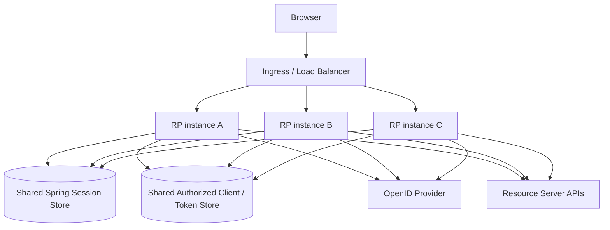
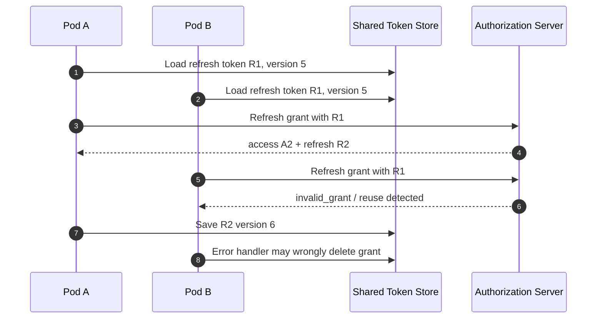

# 32.3. Multi-Instance Deployment with Shared Sessions and Token Store

> **Module:** Spring Security OAuth 2.0 OIDC Client  
> **Chapter:** 32. Deployment and Operations  
> **Context:** Spring Boot/Spring Security application acting as an OAuth2 Client/OpenID Connect Relying Party (RP), deployed with two or more instances behind a load balancer. This lesson distinguishes Servlet and Reactive/WebFlux, HTTP session storage, authorization requests, SecurityContext, OAuth2 authorized clients, access/refresh tokens, and cluster operational concerns.

When running an OAuth2/OIDC Login application on a single machine, many default settings appear to work flawlessly: the user clicks Login, the app stores `state` in the HTTP session, receives the callback with an authorization code, exchanges the code for tokens, builds a `SecurityContext`, and keeps the user logged in across subsequent requests.

However, when scaling from one instance to three instances behind a load balancer, requests from the same browser can land on **different machines**:

```text
Request 1  -> instance A: start OIDC Login, save state
Request 2  -> instance B: receive callback code + state
Request 3  -> instance C: GET /dashboard after login
Request 4  -> instance A: call API on user's behalf with access token
```

If A stores session/state only in A's RAM, B cannot read the initial transaction. If authorized clients/tokens reside only in C's memory, A cannot find the refresh token. If two instances concurrently refresh a token with rotation enabled, they can invalidate the old refresh token or overwrite the new state. If a new version rollout breaks deserialization of old sessions, users can be logged out en masse even while Redis still holds the data.

Therefore, **multi-instance deployment is not just increasing replica counts**. A reliable OIDC Client system must clearly separate:

1. **Shared sessions:** browser session state, `SecurityContext`, authorization request/state, and login data that must persist across requests/instances.
2. **Shared token store:** `OAuth2AuthorizedClient`, access/refresh tokens, registration ID, and principal identity stored under strict controls so all instances can use them when needed.
3. **Token refresh coordination:** preventing multiple instances from concurrently using a rotating refresh token.
4. **Consistent configuration and identity:** every instance agrees on the same ClientRegistration, issuer, redirect URI, session serialization, and tenant identity.
5. **Secure operations:** protecting Redis/DB, cookies, secrets, TTLs, logout/revocation, monitoring, rollouts, and recovery when the store fails.

**Core thesis:** `Spring Session` solves a major part of **HTTP/WebSession sharing**, but **it does not automatically turn an in-memory `OAuth2AuthorizedClientService` into a shared token store**, nor does it solve distributed refresh races or token revocation at the Authorization Server.

---

## 1. Learning objectives

After this lesson, you will be able to:

1. Explain why an OIDC login callback can fail when the request starts on pod A and returns to pod B.
2. Distinguish session, `SecurityContext`, authorization request/state, authorized client, access token, and refresh token.
3. Determine the scope of `HttpSessionOAuth2AuthorizationRequestRepository` and its session-backed equivalents in WebFlux.
4. Use Spring Session with Redis or JDBC to share sessions in a Servlet cluster.
5. Understand how WebFlux uses `WebSession` and a reactive session repository instead of Servlet `HttpSession`.
6. Distinguish `OAuth2AuthorizedClientRepository` from `OAuth2AuthorizedClientService` and their Reactive variants.
7. Use a JDBC-based authorized client service on Servlet or design a persistent reactive token store when needed.
8. Explain why sticky sessions are not a reliable substitute for shared state.
9. Design authorized client storage keys around registration, principal, and trusted tenant identity.
10. Identify refresh token overwrite risks when the AS uses refresh token rotation.
11. Propose single-flight/distributed lock/CAS mechanisms to coordinate refreshes.
12. Design cookies, HTTPS, reverse proxies, redirect URIs, and forwarded-header trust properly behind a load balancer.
13. Distinguish local RP logout, logout across all RP sessions, OP SSO logout, and token revocation.
14. Design session/token TTL, invalidation, and cleanup without leaking credentials.
15. Evaluate HA, failover, consistency, caching, encryption, Redis/JDBC security, and disaster recovery.
16. Execute rolling deployments without invalidating all sessions due to schema/serialization/config drift.
17. Build a minimum two-instance test matrix with a mock OAuth2/OIDC provider, token rotation, and node failures.
18. Operate with metrics, traces, and safe logs that never record raw access/refresh tokens, codes, or session IDs.

## 2. What does a single-instance application hide?

In local development:

```text
Browser
  |
  v
Spring Boot instance A
  |-- HttpSession/WebSession in RAM
  |-- Authorization Request state in session
  |-- SecurityContext in session
  |-- InMemoryOAuth2AuthorizedClientService
  |-- Local refresh token cache
  +-- OIDC ClientRegistration from application.yml
```

All requests hit A, so in-memory state usually remains intact.

When running on Kubernetes or with autoscaling:



The load balancer can route requests to any healthy pod. When a pod restarts, the system must decide **which data must survive** and which data may be lost.

### 2.1. Stateless pods do not mean a stateless application

An RP that uses browser sessions and stores refresh tokens is still **stateful**, even if pods are stateless with respect to local filesystem/RAM. “Stateless pod” in practice means critical state is offloaded to a shared backend rather than depending on a single long-lived process.

### 2.2. Session and token stores may share physical infrastructure yet have different responsibilities

Redis can store both session records and a custom token store, yet their data and lifecycles remain distinct:

- Sessions have a TTL tied to browser login.
- Refresh tokens have independent expiry/rotation/revocation.
- Session invalidation does not revoke refresh tokens by default.
- Token stores require stronger encryption/access control than many session metadata fields.
- Token refresh requires concurrency control; session sharing does not solve that.

## 3. Distinguishing types of state

| State | When created? | Purpose? | Where to store across multiple instances? |
|---|---|---|---|
| `HttpSession` / `WebSession` | Browser accesses app with session | Cookie → server-side session | Spring Session Redis/JDBC or shared session backend |
| `SecurityContext` | Login succeeds | Principal, Authentication, authorities | Inside appropriate shared session/context repository |
| Authorization Request and `state` | Before redirecting to OP | Binds callback to login attempt | Shared session/transaction store with proper cookie/correlation |
| OIDC `nonce` / PKCE verifier | Before redirecting to OP | Validates ID Token/code exchange | Protected transaction context, accessible by callback instance |
| `ClientRegistration` | Config initialization/provider provisioning | Client ID, grant, issuer/endpoints, redirect | Consistent config/registry across all instances |
| `OAuth2AuthorizedClient` | After successful token grant | Tokens and associated registration/principal | Shared session or persistent token store per policy |
| Access token | After grant/refresh | Calls Resource Server | Protected authorized-client store, never logged |
| Refresh token | When issued by AS | Requests new access tokens | Protected durable store if surviving restarts/cross-pod |
| OP SSO session | Managed by OP | Provider SSO | Not directly owned/deleted by RP |
| Permission/tenant state | Business database/policy service | Business authorization | Shared authoritative source with freshness policy |
| Logout/revocation version | On user lock, logout-all, permission change | Blocks old sessions/tokens | Shared authoritative store/cache with invalidation |

Do not dump everything into `HttpSession` and assume all data shares the same TTL and security policy.

## 4. Three typical failure modes after scaling out

**Failure 1 — Callback state not found:**

```text
Pod A receives /oauth2/authorization/corporate
  -> saves OAuth2AuthorizationRequest into A's RAM session

Browser visits OP, returns to /login/oauth2/code/corporate
Pod B receives callback
  -> B's session has no authorization request
  -> authorization_request_not_found / invalid_state
```

**Failure 2 — Post-login requests lose Authentication:**

```text
Pod A handles callback successfully, saves SecurityContext locally
Pod C receives /dashboard
  -> no session/context found
  -> redirects back to Login
```

**Failure 3 — Authorized client not found:**

```text
Pod B stores access + refresh token in InMemoryOAuth2AuthorizedClientService
Pod A handles API call on user's behalf
  -> loadAuthorizedClient(...) returns null
  -> cannot call API / forces reauthorization
```

All three failures share a similar “login works intermittently” symptom yet live in **different storage layers**.

## 5. Multi-instance OIDC flow

```mermaid
sequenceDiagram
    autonumber
    participant B as Browser
    participant LB as Load Balancer
    participant A as RP pod A
    participant OP as OpenID Provider
    participant S as Shared Session Store
    participant T as Shared Token Store
    participant C as RP pod B

    B->>LB: GET /oauth2/authorization/corporate
    LB->>A: Route request
    A->>S: Save session + state/nonce/PKCE context
    A-->>B: 302 OP Authorization Endpoint
    B->>OP: Authorization Request
    OP-->>B: Redirect code + state
    B->>LB: GET callback + session cookie
    LB->>C: Route callback to another pod
    C->>S: Load authorization request; verify state
    C->>OP: Exchange code, validate OIDC tokens
    OP-->>C: Access Token / ID Token / refresh token
    C->>T: Save authorized client by principal/registration
    C->>S: Save SecurityContext/session
    C-->>B: Redirect to application page
    B->>LB: GET /dashboard
    LB->>A: Route to A
    A->>S: Load SecurityContext
    A-->>B: Authenticated response
```

The cluster meets baseline requirements when **the pod receiving the callback does not need to be the pod that initiated login**, and post-login requests do not need to return to the exact pod that created Authentication.

## 6. What problem does Spring Session solve?

Spring Session replaces the container/server's local session store with an abstraction backed by a shared store.

For Servlet:

```text
HttpSession API
   |
   v
Spring Session Filter / SessionRepository
   |
   +--> Redis
   +--> JDBC
   +--> other version-appropriate backends
```

For WebFlux:

```text
WebSession
   |
   v
Spring Session WebSession integration
   |
   +--> Reactive session repository/Redis or appropriate backend
```

When Spring Security uses the session to hold `SecurityContext`, CSRF tokens, or OAuth2 authorization requests, a shared session repository allows multiple instances to read the same session via the cookie.

### 6.1. What does Spring Session not do automatically?

It does not automatically:

- End the SSO session at the OP.
- Revoke access/refresh tokens at the AS.
- Convert every local-memory service into a distributed service.
- Synchronize `ClientRegistration` definitions across pods.
- Prevent duplicate refresh token requests.
- Keep account permissions in the session fresh.
- Encrypt tokens stored elsewhere.
- Fix cookie/forwarded-host/redirect-URI misconfigurations.
- Prevent an in-flight already-authenticated request from completing after session deletion.

Those responsibilities require explicit design.

## 7. Servlet: using Spring Session with Redis

Example Gradle dependencies for Spring Boot Servlet:

```kotlin
dependencies {
    implementation("org.springframework.boot:spring-boot-starter-web")
    implementation("org.springframework.boot:spring-boot-starter-security")
    implementation("org.springframework.boot:spring-boot-starter-oauth2-client")

    implementation("org.springframework.boot:spring-boot-starter-data-redis")
    implementation("org.springframework.session:spring-session-data-redis")
}
```

When Spring Boot auto-configuration detects Spring Session Redis and the app uses the Servlet stack, it provides the beans/filters needed to persist sessions in Redis. For version-specific setups or custom `SessionRepository` beans, configure accordingly. **Do not enable two session repository mechanisms side by side without knowing which bean is active.**

### 7.1. Example application-prod.yml

```yaml
spring:
  data:
    redis:
      host: ${REDIS_HOST}
      port: ${REDIS_PORT:6379}
      username: ${REDIS_USERNAME:}
      password: ${REDIS_PASSWORD}
      ssl:
        enabled: true
  session:
    redis:
      namespace: "spring:session:oidc-rp:prod"

server:
  servlet:
    session:
      timeout: 30m
      cookie:
        name: APP_SESSION
        http-only: true
        secure: true
        same-site: lax
```

This is an illustrative baseline for Spring Boot 3.x; property support and serializer/index settings depend on version and backend. Test actual `Set-Cookie`, TTL, and session behavior on your running version.

**Never commit Redis passwords to Git.** Use a secret manager or least-privilege Pod secret injection. Redis must be reachable only from permitted networks/identities.

### 7.2. Separating environments by namespace

Do not share the same namespace/cache database across local, staging, and production. If two apps or versions read the same session keys with incompatible serializers/classes, deserialization failures or session mix-ups can occur.

Example:

```text
spring:session:oidc-rp:staging
spring:session:oidc-rp:prod
```

Namespaces are not a standalone security boundary: keep Redis credentials, ACLs, and network access isolated per environment.

### 7.3. Redis TLS and passwords do not replace network isolation

Use TLS, Redis ACLs, private networking, firewalls, resource quotas, backups, and auditing. Do not expose Redis directly to the Internet just because TLS is enabled.

## 8. Servlet: Spring Session JDBC

If your organization already operates an HA RDBMS and does not want to add Redis, Spring Session JDBC can be a good fit.

```kotlin
dependencies {
    implementation("org.springframework.boot:spring-boot-starter-jdbc")
    implementation("org.springframework.session:spring-session-jdbc")
}
```

Example configuration:

```yaml
spring:
  datasource:
    url: jdbc:postgresql://session-db.internal:5432/oidc_session
    username: ${SESSION_DB_USER}
    password: ${SESSION_DB_PASSWORD}
  session:
    jdbc:
      table-name: SPRING_SESSION
      initialize-schema: never

server:
  servlet:
    session:
      timeout: 30m
```

Requirement: the official Spring Session schema matching your version must be provisioned via managed migrations (Flyway/Liquibase or schema deployment pipelines). `initialize-schema: never` assumes the schema already exists; do not use it if unprovisioned.

### 8.1. Redis or JDBC for sessions?

| Criterion | Redis | JDBC |
|---|---|---|
| Typical latency | Suited for fast session lookups | Depends on DB/connection pool |
| TTL/expiration | Native key expiration and repository policy | Cleanup jobs/schema/queries |
| HA | Redis replication/failover/managed service | DB clustering/managed HA |
| Operational footprint | Adds Redis if not already operated | Leverages existing RDBMS |
| Storage model | Serialized/session attributes | Session tables/serialized attributes |
| Query/audit | Requires design outside session data | DB tools work, though querying raw session payloads is discouraged |
| Scaling pressure | Redis memory/capacity | DB I/O, pool, transaction contention |
| Backup | Must be designed per SLA | Follows DB backup policy |

There is no universally “best” backend for all systems. Choose based on latency, HA, cost, compliance, session volume, and operational maturity.

## 9. Cookies remain the key to locating a session

Even when sessions live in Redis/JDBC, the browser still carries a cookie holding the session identifier.

```text
Browser cookie: APP_SESSION=opaque-id
    |
    v
Load Balancer
    |
    +--> Pod A -> shared store lookup opaque-id
    +--> Pod B -> shared store lookup opaque-id
```

The cookie must be sent properly by the browser on both login initiation and the OP callback.

### 9.1. Attributes that must be controlled

- `HttpOnly` to restrict JavaScript access to the cookie.
- `Secure` for HTTPS.
- `SameSite` compatible with login/logout flows and CSRF policy.
- Narrow `Domain`; avoid unnecessary domain-wide sharing.
- `Path` matching the app context.
- Consistent TTL/session timeout.
- Real HTTPS from the browser and trusted proxy headers.
- Session fixation protection upon successful authentication.

### 9.2. SameSite=Lax is not a universal answer

A standard OIDC Authorization Code callback is a top-level GET navigation, usually compatible with `SameSite=Lax`. However, flows using `response_mode=form_post` or iframes/front-channel have different semantics; `SameSite=None; Secure` may be needed in certain cases. Decide per flow/OP/browser and test across supported browsers.

**Do not switch SameSite to None app-wide to fix a bug without investigating CSRF and cookie exposure.**

## 10. Authorization Request Repository and callbacks

In Spring Security Servlet, the repository commonly uses the session:

```java
org.springframework.security.oauth2.client.web.HttpSessionOAuth2AuthorizationRequestRepository
```

It stores the authorization request so callbacks carrying `code`/`state` can be correlated. When Spring Session shares `HttpSession`, pod B can load the request saved by pod A, provided cookies, sessions, and the shared store work properly.

### 10.1. Data that must survive across the callback

- Selected `ClientRegistration` or registration-related context.
- Random `state` and authorization request.
- PKCE `code_verifier` if used by the flow.
- OIDC `nonce` and related attributes.
- Redirect URI/scopes/provider-specific parameters.
- Tenant/login intent context if the app is multi-tenant.

Never replace `state` with a predictable `tenantId`; `state` must still enforce correlation/CSRF protection. Never allow a callback query parameter `?tenant=...` to override trusted transaction state.

### 10.2. Multiple tabs and concurrent login attempts

A shared session store **does not automatically** guarantee that the repository supports parallel authorization requests in the same browser session. Test your repository/version behavior or design a state-keyed transaction store if the product requires concurrent multi-tab logins.

## 11. SecurityContext across multiple requests and pods

After successful login, Spring Security saves Authentication/SecurityContext according to the configured session/context repository.

```text
Pod B handles callback
  -> Valid OIDC principal
  -> GrantedAuthorities mapped
  -> SecurityContext saved to shared session
  -> Browser receives/keeps session cookie

Pod C handles next request
  -> session cookie lookup
  -> restore SecurityContext
  -> URL/method authorization
```

**Important:** a shared session does not mean authorities stay perpetually fresh. If a role is revoked at the OP/database, the stored context may still carry old authorities until refresh/re-login/invalidation or a dynamic authorization check.

### 11.1. Session serialization

Session attributes must be compatible with the serializer/codec used by Spring Session. Placing non-serializable custom objects or arbitrary Jackson polymorphic typing into the session can cause:

- Serialization/deserialization errors on other pods.
- Oversized sessions or missing classes in new versions.
- Unreadable SecurityContext after a rollout.
- Untrusted deserialization risks if unsafe polymorphic typing is opened up.

Keep session payloads minimal; use serialization configurations supported by Spring Session/Spring Security and restrict trusted types. Do not blindly enable broad default typing to “fix” deserialization errors.

## 12. WebFlux: using WebSession and Spring Session Reactive

WebFlux does not use Servlet `HttpSession`; it uses `WebSession` and an appropriate `ServerSecurityContextRepository` inside the reactive request pipeline.

```text
WebFlux ServerWebExchange
  -> WebSessionManager
  -> Spring Session integration
  -> shared ReactiveSessionRepository
```

With Redis, Spring Session provides reactive session support via the appropriate version/starter. Do not mix `@EnableRedisHttpSession` (Servlet) into pure WebFlux; when configuring manually, use the corresponding WebSession/Reactive repository mechanism.

### 12.1. Differences from Servlet

| Aspect | Servlet | WebFlux |
|---|---|---|
| Request/session | `HttpServletRequest` / `HttpSession` | `ServerWebExchange` / `WebSession` |
| Security configuration | `HttpSecurity` / `SecurityFilterChain` | `ServerHttpSecurity` / `SecurityWebFilterChain` |
| SecurityContext | Servlet session repository | Reactive `ServerSecurityContextRepository` |
| Session sharing | Spring Session servlet filter | Reactive WebSession integration |
| OAuth2 auth request repository | `OAuth2AuthorizationRequestRepository` | `ServerAuthorizationRequestRepository` implementation |
| Authorized client repository | `OAuth2AuthorizedClientRepository` | `ServerOAuth2AuthorizedClientRepository` |
| Token service | `OAuth2AuthorizedClientService` | `ReactiveOAuth2AuthorizedClientService` |
| Blocking calls | Servlet blocking model | Avoid blocking on the event loop |

### 12.2. Do not wire blocking JDBC directly onto the reactive event loop

If a custom WebFlux authorized-client store uses blocking JDBC, use an appropriate offload/scheduler model or use R2DBC/reactive Redis APIs. Blocking I/O inside reactive token refreshes causes latency spikes and event loop starvation.

### 12.3. WebSession also needs a shared backing store

If pod A keeps `WebSession` in local memory, pod B receiving the callback will still hit state errors just like Servlet. The reactive stack does not magically make an application stateless.

## 13. How do session store and authorized-client store relate?

A common point of confusion:

```text
Spring Session
    -> browser session / SecurityContext / state

OAuth2 Authorized Client Store
    -> ClientRegistration ID + principal
    -> access token + refresh token + metadata
```

An authorized client can be stored in the session repository or in a separate service, depending on configuration.

### 13.1. Two token persistence models

**Model A — Session-bound tokens:**

```text
Browser session SESSION-123
  -> OAuth2AuthorizedClient for corporate
  -> access/refresh token
```

Pros: follows the session lifecycle, relatively simple for small web apps. If Spring Session is shared, pods reading the same session can see the authorized client.

Limitations: tokens do not outlive the session; hard to share with background jobs; lifecycle is tied to the browser; refresh races can still occur.

**Model B — Principal/registration-bound tokens in a shared service:**

```text
(registrationId, principalName)
  -> encrypted access token
  -> encrypted refresh token
  -> expiry/version
```

Pros: API integrations can survive across sessions/pods, suitable for offline access/background jobs when policy permits.

Limitations: requires defining identity namespace/tenant, encryption, expiration, revocation, access control, and refresh concurrency.

Do not pick Model B just for “sharing”; it brings heavier security and compliance responsibilities.

## 14. Servlet: OAuth2AuthorizedClientRepository and OAuth2AuthorizedClientService

Key interfaces:

```java
org.springframework.security.oauth2.client.web.OAuth2AuthorizedClientRepository
org.springframework.security.oauth2.client.OAuth2AuthorizedClientService
```

**Repository** takes request/response/Authentication in the Servlet environment to load/save/remove authorized clients.

**Service** operates on `registrationId` and `principalName`, decoupled from a specific HTTP request.

Common implementations:

```java
HttpSessionOAuth2AuthorizedClientRepository
AuthenticatedPrincipalOAuth2AuthorizedClientRepository
InMemoryOAuth2AuthorizedClientService
JdbcOAuth2AuthorizedClientService
```

### 14.1. InMemoryOAuth2AuthorizedClientService is not shared across pods

If A and B each hold an in-memory bean:

```text
Pod A: (corporate, user-1) -> refresh token R1
Pod B: (corporate, user-1) -> none
```

Pod B cannot read R1. Load balancer sticky sessions may hide the bug briefly, but pod restarts/failovers still wipe local data.

### 14.2. HttpSessionOAuth2AuthorizedClientRepository works with Spring Session

If the authorized client is stored **inside the shared HTTP session**, other pods can read it. However, it remains a **per-session** token. If a background job needs the token while the browser is offline or the session expired, this choice does not fit.

## 15. Servlet: using JdbcOAuth2AuthorizedClientService

Spring Security provides `JdbcOAuth2AuthorizedClientService` on the Servlet OAuth2 Client stack to persist authorized clients via JDBC.

Example beans:

```java
package example.config;

import org.springframework.context.annotation.Bean;
import org.springframework.context.annotation.Configuration;
import org.springframework.jdbc.core.JdbcOperations;
import org.springframework.security.oauth2.client.JdbcOAuth2AuthorizedClientService;
import org.springframework.security.oauth2.client.OAuth2AuthorizedClientService;
import org.springframework.security.oauth2.client.registration.ClientRegistrationRepository;
import org.springframework.security.oauth2.client.web.AuthenticatedPrincipalOAuth2AuthorizedClientRepository;
import org.springframework.security.oauth2.client.web.OAuth2AuthorizedClientRepository;

@Configuration
public class AuthorizedClientStoreConfiguration {

    @Bean
    OAuth2AuthorizedClientService authorizedClientService(
            JdbcOperations jdbc,
            ClientRegistrationRepository registrations) {

        return new JdbcOAuth2AuthorizedClientService(
            jdbc,
            registrations
        );
    }

    @Bean
    OAuth2AuthorizedClientRepository authorizedClientRepository(
            OAuth2AuthorizedClientService service) {

        return new AuthenticatedPrincipalOAuth2AuthorizedClientRepository(
            service
        );
    }
}
```

In a `SecurityFilterChain`, ensure OAuth2 Login/OAuth2 Client/authorized client manager use the **chosen** repository/service, without accidentally creating an extra in-memory store on another branch. Wiring APIs and auto-configuration may vary across Spring Security/Boot versions; test with two pods to confirm real persistence.

### 15.1. Authorized client schema differs from Spring Session schema

Spring Session JDBC uses tables like `SPRING_SESSION`/`SPRING_SESSION_ATTRIBUTES` in its own schema. `JdbcOAuth2AuthorizedClientService` uses the OAuth2 Authorized Client schema, typically table `oauth2_authorized_client`.

**Do not arbitrarily repurpose a session table to store tokens.** Apply the official DDL/migrations matching your Spring Security version; separately evaluate keys, data types, encryption, indexes, and cleanup.

### 15.2. “JDBC” does not automatically encrypt raw token values

Access/refresh tokens must be protected at rest and in transit. Evaluate whether the default implementation relies on DB encryption, volume encryption, or application-layer encryption. For strict compliance requirements, build a custom token service that encrypts before writing and manages keys separately.

Do not assume “stored in PostgreSQL” makes tokens safe from DB dumps, backups, SQL query access, or operator accounts.

## 16. WebFlux: Reactive authorized-client repositories/services

On WebFlux, the corresponding contracts are:

```java
org.springframework.security.oauth2.client.web.server.ServerOAuth2AuthorizedClientRepository
org.springframework.security.oauth2.client.ReactiveOAuth2AuthorizedClientService
```

In-memory or WebSession implementations can suit tests or small apps. If tokens must be shared outside sessions, build a **reactive durable token service** backed by Redis/R2DBC or an organization-supported backend.

### 16.1. Do not assume a one-to-one JDBC service equivalent

A Servlet class like `JdbcOAuth2AuthorizedClientService` cannot be dropped in directly as a `ReactiveOAuth2AuthorizedClientService` without handling reactive contracts/execution. Check official implementations in your version; if no suitable backend exists, write a well-tested adapter/service that never blocks the event loop.

### 16.2. Reactive contract pseudocode

```java
public interface TenantTokenStore {

    Mono<StoredAuthorizedClient> find(
        String tenantId,
        String registrationId,
        String principalKey
    );

    Mono<Void> saveIfVersion(
        StoredAuthorizedClient client,
        long expectedVersion
    );

    Mono<Void> delete(
        String tenantId,
        String registrationId,
        String principalKey
    );
}
```

This is an **illustrative application-designed interface**, not a Spring Security API. When integrating, accurately convert to/from `OAuth2AuthorizedClient`, protect token values, and handle transactional/optimistic operations.

### 16.3. Service and repository do not share identical semantics

`ServerOAuth2AuthorizedClientRepository` is tied to Web exchanges/principals; `ReactiveOAuth2AuthorizedClientService` can be used by a reactive authorized-client manager without a browser request. Choose service vs. repository based on where tokens are consumed.

## 17. Choosing session-bound or durable authorized clients?

| Requirement | Session-bound token | Shared persistent token store |
|---|---|---|
| Browser web app calling APIs in-session | Usually fits | Also fits |
| User logout deletes local delegated connection | Simpler | Requires explicit cleanup |
| Background sync job while user is offline | Usually unsuitable | Fits if grant/policy allows |
| Multiple sessions sharing one API integration | Split per session | Can share by principal/tenant |
| Pod restarts while user is logged in | Survives if session is shared | Survives |
| Token outlives session | Inconvenient | Possible |
| Concurrent refresh token rotation | Still races across concurrent in-session requests | Races cluster-wide, requires coordination |
| Audit/revoke connection | Tied to session | Easier via connection record, needs clear lifecycle |
| Store security risk | Tokens inside session backend | Centralized refresh token store, needs strict protection |

A product may use **both**: OIDC web login sessions for identity and a durable integration token store for offline API connections, under separate policies.

## 18. Authorized client key structure must reflect true identity

Spring Security service APIs typically look up by:

```text
(registrationId, principalName)
```

In multi-tenant SaaS, never set `principalName="123"` if `sub=123` can exist across two issuers.

Example:

```text
Tenant Acme:   issuer A, sub=123
Tenant Globex: issuer B, sub=123
```

If registration/service keys collide, a pod can load someone else's token.

### 18.1. Safe identity keys

An application may use:

```text
principalKey = internalUserId
```

when account linking/membership has been verified and token policies allow sharing.

Or namespace by:

```text
tenantId + issuer + subject
```

when delegated grants are isolated per tenant/issuer.

Never use mutable emails as the primary token key; emails can change or be reassigned. Avoid principal keys derived from raw request queries.

### 18.2. ClientRegistration ID must be properly scoped

The same AS may issue multiple Client IDs for different tenants. If stored under the same `registrationId` while tokens have different audiences/scopes/resources, an authorized-client record can be overwritten incorrectly. You may need separate registrations or a richer storage key/model.

## 19. Token cache keys and audience/resource

A Client may call multiple APIs:

```text
access token A -> audience reports-api
access token B -> audience billing-api
```

If cached solely by:

```text
client_id
```

then a token for `reports-api` might be sent to `billing-api`. Even caching by `registrationId,principalName` requires review if the same registration requests tokens for multiple resources/scopes.

Define clearly:

- Issuer/AS and Client registration.
- Trusted principal/tenant.
- Grant type.
- Target resource/audience and actual scopes when token grants vary by request.
- Token expiry and sender constraints.
- Distinction between server-to-server Client Credentials and delegated Authorization Code grants.

**Never reuse an access token solely because it shares the same Client ID** if the Resource Server audience does not match.

## 20. Distributed refresh token rotation risks

Some Authorization Servers use refresh token rotation: each successful refresh issues a new refresh token, invalidating the old one or flagging reuse.

Scenario:



If B's error handler interprets `invalid_grant` as “the refresh token was definitely revoked” and deletes the authorized client, it can wipe out the fresh R2 just saved by A.

### 20.1. Shared stores do not solve races by themselves

Having both A and B read the same DB makes tokens available, but does not prevent them from **reading the same R1 before either updates it**. That is a coordination problem.

### 20.2. Practical impact

- Users are randomly forced to re-login/re-consent.
- Background jobs lose delegated access.
- AS triggers token-family reuse detection and revokes the entire token family.
- DB overwrites a fresh token with a stale token.
- Multiple pods cause a “refresh storm”, overloading the Token Endpoint.

## 21. Single-flight token refresh

**Single-flight** means at most one actor executes a refresh for a given logical authorized client at a time.

Recommended flow:

```text
Request needs access token
    |
    v
Load authorized client + expiry/version
    |
    +-- token still valid --> use token
    |
    +-- near expiry --> acquire coordination key
                         |
                         +-- won lock:
                         |      re-read record
                         |      if still needed -> refresh
                         |      atomic persist token+version
                         |      release lock
                         |
                         +-- lost lock:
                                wait/backoff with limit
                                re-read new token
                                never blindly reuse R1
```

The coordination key can be built from:

```text
tenant + registration + principal + resource-context
```

Never use a raw refresh token as a Redis key or log label.

### 21.1. Re-read after acquiring the lock

Between initially detecting an expired token and acquiring the lock, another pod may have finished refreshing. The lock winner must re-read the record/version before deciding whether to call the Token Endpoint.

### 21.2. Timeouts and failure policies are mandatory

A distributed lock must never be held indefinitely. Require:

- Reasonable lock TTL.
- Unique owner token.
- Safe release only by the owner.
- Bounded wait timeout.
- Graceful handling when the AS is unresponsive.
- Backoff/jitter to prevent thundering herds.
- Metrics for lock contention and refresh failures.

A naive Redis `SETNX` followed by an unconditional `DEL` can delete another pod's lock after the old lock expired and was reacquired. Use owner-aware unlock/transactional primitives.

## 22. Compare-and-set (CAS) for token records

With an RDBMS, use an optimistic version column:

```text
AuthorizedClient:
  tenantId=acme
  registrationId=corporate
  principalKey=usr-9001
  refreshTokenCiphertext=...
  version=7
```

When persisting a refresh result:

```sql
UPDATE oauth_authorized_client_secure
SET access_token_ciphertext = :new_access,
    refresh_token_ciphertext = :new_refresh,
    version = version + 1,
    updated_at = CURRENT_TIMESTAMP
WHERE tenant_id = :tenant_id
  AND registration_id = :registration_id
  AND principal_key = :principal_key
  AND version = :expected_version;
```

If affected rows = 0, the record changed or no longer exists; **re-read and classify**. Never overwrite unconditionally.

### 22.1. CAS and locks solve two different angles

- **Lock/single-flight:** limits concurrent refresh requests to the AS.
- **CAS:** prevents a stale/failed response from overwriting a newer record.

Both may be needed, especially with refresh token rotation. The SQL above illustrates a **custom token store**, not the default `JdbcOAuth2AuthorizedClientService` schema.

### 22.2. Handling `invalid_grant` during a race

If pod B receives `invalid_grant` after pod A already saved R2:

1. Re-read the record/version.
2. If a newer refresh token version already exists, do not delete R2 due to the stale request's error.
3. If no newer version exists and the AS confirms the grant is invalid, execute the failure policy (remove/re-authorize).
4. Record a safe audit event; never log refresh tokens.
5. Never retry R1 endlessly.

## 23. Redis distributed locks also have limits

Logical example:

```text
Acquire:
  SET lock:key owner-random NX PX 5000

Release:
  only DEL if GET lock:key == owner-random
  execute atomic check/delete using an appropriate script or primitive
```

This is a **conceptual model**, not copy-paste production code. Evaluate failures during network partitions, lock TTL shorter than Token Endpoint latency, and fencing/record versions to prevent stale writers.

### 23.1. Holding a lock does not guarantee transaction completion

A pod may succeed at the AS refresh and crash before saving R2. Recovery depends on AS rotation/reuse semantics; you cannot safely “retry verbatim” a refresh token already invalidated by the AS in all cases. Design graceful reauthorization and align on the provider contract.

## 24. Token expiry and session TTL differ

Example:

```text
RP HTTP session TTL:       30 minutes idle
Access token TTL:           5 minutes
Refresh token TTL:         14 days
OP SSO session:            per OP policy
```

These lifecycles are independent.

- Access token expiration does not necessarily end the RP session.
- RP session expiration does not automatically revoke a refresh token in a durable DB.
- Refresh token revocation does not automatically delete the RP session.
- A live OP SSO session may allow the user to re-login quickly.
- A JWT access token may still be accepted by a Resource Server until expiry even if the RP deletes the authorized-client record.

### 24.1. Retention policy must be intentional

A web-only app may delete authorized clients when the session ends. An offline sync app may retain delegated refresh tokens after browser logout per disclosed consent/UX.

Do not assume “logging out” means all API grants have been revoked.

## 25. Logout across a cluster

Concepts to separate:

| Action | Direct effect |
|---|---|
| Local logout on pod A | Invalidates the current request's session in the shared store |
| Logout all RP devices | Deletes all RP sessions for the internal account via session index |
| RP-Initiated Logout | Asks the OP to end the related SSO session if the OP supports it |
| OIDC Back-Channel Logout | OP sends a Logout Token to the RP; RP validates and removes targeted sessions |
| Remove authorized client | Deletes local/repository token record |
| RFC 7009 revocation | Asks the AS to revoke tokens/grants; not synonymous with RP logout |
| Deactivate internal user | Blocks login/authorization per application policy, optionally paired with invalidation/revocation |

### 25.1. Local logout with shared sessions

If pod A deletes the browser's session ID in Redis/JDBC, a subsequent request carrying the old cookie to pod B will no longer find a SecurityContext for that session.

However, an already-authenticated request running on pod B prior to invalidation may still finish. For sensitive operations, add an account/session revocation version check near the commit point.

### 25.2. Logout-all requires a session index

Spring Session can look up sessions by principal on supporting backends/configs, such as the `FindByIndexNameSessionRepository` abstraction (for implementations that support it). With multiple OIDC issuers, `principalName` may differ across `sub` values. To support logout-all per internal user, index by a trusted internal account ID rather than username/email alone.

## 26. Session index and multi-provider

Example:

```text
internalUserId=usr-9001
  RP session S1 -> issuer Corporate, sub corp-734
  RP session S2 -> issuer Partner,   sub partner-81
  RP session S3 -> issuer Corporate, sub corp-734
```

RP logout-all must locate S1, S2, and S3. Indexing solely by `sub` can miss other identities or accidentally delete a different issuer's user.

### 26.1. Index should hold minimal metadata

You may need:

- Internal user ID.
- RP session ID (protected as sensitive metadata).
- Issuer and subject.
- OIDC OP session ID `sid` if supported by provider/logout protocol.
- Client registration ID.
- Tenant ID.
- Created/last-seen/expiration timestamps.
- Revocation version.

Never store raw access/refresh tokens in the session index or metric labels.

## 27. Multi-tenant token isolation

Suppose two tenants both have `sub=123` on two different OPs. If the token store uses key:

```text
(corporate, "123")
```

and `corporate` is reused or the identity namespace is ambiguous, the wrong delegated token can be returned.

Enforce bindings across:

1. Tenant verified from routing/account membership.
2. OIDC principal issuer and subject authenticated by the OP.
3. Registration ID/Client ID matching the grant.
4. Principal storage key namespaced by verified internal identity.
5. Target API resource/audience/scope.
6. Authorization policy when loading tokens from the service/repository.

**Never** let a request query `?principal=someoneElse` decide which authorized client is loaded.

### 27.1. Sharing physical storage still requires logical partitioning

A single RDBMS can store tokens for all tenants, but every query must enforce tenant/identity constraints, row-level access controls by design, and auditing. Per-tenant encryption keys may be appropriate for compliance. Never build dynamic table names directly from tenant input.

## 28. SecurityContext, roles, and stale sessions

Shared Spring Session makes `SecurityContext` consistent across pods, which can **amplify** stale-authority issues: every pod reads the same outdated role.

For example, if a user has `ROLE_ADMIN` removed at the OP:

```text
T0: Login -> SecurityContext ROLE_ADMIN saved in session
T1: Admin revokes role at OP
T2: Pod B reads old session -> ROLE_ADMIN still present
```

Options depending on product needs:

- Invalidate RP sessions upon deprovisioning/role-change events.
- Perform dynamic authorization checks against the source of truth.
- Store a permission version/epoch in the session.
- Enforce session age/re-authentication policies.
- Use Back-Channel Logout if supported by the OP and event semantics fit.

Do not assume refreshing an access token automatically updates the OIDC Login `SecurityContext`; token refresh and OIDC login Authentication have separate lifecycles.

## 29. Reverse proxies, forwarded headers, and redirect URIs

A cluster typically has:

```text
Browser HTTPS https://app.example.test
  -> TLS termination at ingress
  -> Internal HTTP http://rp-service:8080
```

Spring Security needs to generate `redirect_uri` matching the public URL registered with the OP:

```text
https://app.example.test/login/oauth2/code/corporate
```

If it generates:

```text
http://rp-service:8080/login/oauth2/code/corporate
```

the OP will reject it due to redirect URI mismatch.

### 29.1. Forwarded header trust boundary

Ensure:

- Ingress strips/rewrites `Forwarded` and `X-Forwarded-*` from untrusted clients.
- Spring Boot/framework is configured to process forwarded headers per topology and version.
- Trust only known proxies/networks.
- Validate public hostnames against an allowlist.
- Use HTTPS for both browser and OP endpoints.
- Never allow query `redirect_uri` or spoofed Host to alter trusted ClientRegistration settings.

### 29.2. Secure cookies and HTTP backends

Even if upstream traffic to the pod is HTTP, the browser still receives a `Secure` cookie because external transport is HTTPS. If the app misdetects the scheme due to missing/wrong forwarded headers, it may fail to set cookies/redirects properly.

Verify the **actual response outside the ingress**, not just internal `curl` calls to a pod.

## 30. Can sticky sessions replace a shared store?

**Sticky sessions** attempt to pin a browser to the same pod using load balancer cookies/IPs.

Pros:

- Can reduce session cache misses.
- Can be useful as a temporary routing optimization.

Limitations:

- Pod crash/restart → local sessions are lost.
- Autoscaling/rolling deployments → users are moved to other pods.
- NAT/mobile networks/IP affinity are unstable.
- OP callbacks may hit a different node depending on infrastructure.
- Background jobs, WebSockets, or API calls have different routing.
- A refresh token can still be used by multiple pods if stored in a shared service.
- Does not solve multi-region failover.

**Sticky sessions are an optimization, not a consistency/durability guarantee.** If the product requires failover without dropping logins, use shared session state and test cross-pod flows.

## 31. Keep session data as minimal as possible

Avoid storing:

- Entire ORM entity graphs.
- Unnecessarily large UserInfo responses.
- Long-lived Client secrets.
- Raw HTTP requests/responses.
- Mutable objects sensitive to class versions.
- Non-serializable internal caches.
- Data easily fetched from the database.
- Access tokens inside debug attributes or custom session indexes.

Sessions should hold precisely what is required for authentication/session semantics. Account for memory pressure, network payload size, latency, and serialization compatibility.

### 31.1. OidcUser holds claims: watch privacy

An OIDC principal may hold personal claims and group memberships. Treat the Spring Session backend as sensitive data storage, not a “harmless” Redis cache. Enforce ACLs, encryption, retention, and log redaction.

### 31.2. Do not mutate an object and forget to persist it

Depending on `SessionRepository`, flush mode, and serialization, deep mutations to mutable session attributes may not be persisted if the framework does not detect the attribute changed. Prefer immutable snapshots or explicitly re-setting the session attribute via the proper API; test behavior when another pod reads immediately after an update.

## 32. Serialization compatibility during rolling deployments

During a rollout:

```text
Pod A runs version 1
Pod B runs version 2
Both read the same user's session
```

If version 2 changes packages/classes, field types, serializers, or JWT principal structures, version 1 may fail to read sessions written by version 2 and vice versa.

### 32.1. Risk-mitigation strategies

- Maintain session serialization compatibility between concurrently running versions.
- Keep arbitrary custom classes out of the session.
- Use framework-supported serializers/libraries.
- Snapshot old sessions → test reading on the new version and vice versa for blue/green rollouts.
- Maintain versioned session payloads/migration policies when needed.
- Prepare a clean fallback with clear re-login prompting if sessions cannot be preserved.
- Never enable untrusted deserialization just to bypass class-mapping errors.

### 32.2. Session ID/cookie name is also a contract

If a new deployment changes cookie name, domain, path, or session namespace, users may be logged out even though the old backend store remains intact. Manage such changes as deliberate migrations.

## 33. OAuth2 Client configuration must be consistent across all pods

Every pod handling the same Client registration must agree on:

- Registration ID.
- Issuer/provider metadata.
- Client ID and Client authentication method.
- Client secret/private key/secret reference version.
- Redirect URI.
- Scopes and provider-specific parameters.
- Authorized-client storage implementation.
- JWT decoder/key cache/allowed signing algorithms.
- Authorization Request Repository policy.
- Tenant-to-registration mapping.

### 33.1. Config drift errors

```text
Pod A:
  registration corporate -> client-id portal-v1

Pod B:
  registration corporate -> client-id portal-v2
```

A initiates the Authorization Request, B receives the callback and uses a different Client ID to exchange the code. The AS may reject with `invalid_grant`/`invalid_client`, or ID Token audience validation fails.

### 33.2. Secret rotation requires a dual-version strategy

Do not rotate the Client secret at the OP while updating only half the pods. When the AS supports overlap, schedule staged rotation; otherwise, drain traffic or handle in-flight logins gracefully. Monitor callback error rates and never log Client secrets during investigation.

## 34. Dynamic ClientRegistration and configuration versioning

In multi-tenant SaaS, registrations may live in a DB/config registry rather than `application.yml`.

```text
Tenant onboarding control plane
   -> validate issuer/client/redirect
   -> publish versioned registration
   -> pods cache config
   -> OAuth2 authorization & token exchange
```

Notes:

- Pod A and B must observe the same registration version or a valid snapshot for the transaction.
- Define cache invalidation and expiry policies.
- Never fetch arbitrary issuer metadata from a browser query.
- Define behavior when a tenant is disabled mid-login/callback.
- Changing Client ID/issuer is a security-boundary change, not just a cache refresh.
- Callbacks must fail closed if the registration is no longer trusted.

## 35. Redis availability and failover

If the Redis session store goes down temporarily:

- Requests carrying cookies cannot load `SecurityContext`.
- Login callbacks cannot read authorization request/state.
- Session saves fail after token exchange.
- Logout/invalidation may fail to complete cleanly.
- Login storms may occur as users retry.

Define SLAs for:

- Redis HA/failover/sentinel/managed cluster service.
- Connection timeouts and pooling.
- Bounded retry/backoff.
- Network partitions.
- Appropriate persistence/backups.
- Memory eviction policy and quotas.
- Monitoring p95/p99 latency and error rates.
- Fail-closed behavior for authentication data.

**Never** allow anonymous requests to inherit prior logged-in privileges or fall back to an unauthenticated session that accesses sensitive resources when Redis fails.

### 35.1. Eviction policy

If Redis evicts session keys due to memory pressure, users can be logged out randomly. Monitor memory/evictions and capacity; never run high-SLA production sessions on a shared Redis cluster lacking isolation/quotas.

## 36. JDBC availability and transaction pressure

When the session/token store uses JDBC:

- Connection pool exhaustion can slow down or time out logins.
- DB failover can abort transactions saving tokens.
- Deadlocks/lock contention can occur when multiple threads refresh the same principal.
- Expired session cleanup jobs can create load spikes.
- Incompatible schema migrations during rollout can break requests.
- Lagging read replicas may miss freshly written state/tokens.

### 36.1. Read-after-write matters for callbacks

The Authorization Request is written at login initiation and read back at callback. If the backend routes reads to replicas with replication lag, the callback pod may not see the saved state even though the primary DB committed.

Token refresh also requires strong consistency so old refresh tokens are not reused. Design consistency/read routing per workflow rather than blindly routing all reads to replicas.

## 37. Multi-region deployments carry extra risks

An application running in two regions may have:

```text
Region A: RP A + Redis A
Region B: RP B + Redis B
```

If sessions/token records replicate only eventually, a cross-region callback may miss state, or both regions may refresh R1 concurrently before replication completes.

Options:

- Regional affinity + clear failover policy, accepting re-login on failover.
- Globally consistent shared store matching SLA/latency.
- Replication mechanism + fencing/versioning/conditional writes.
- Region-specific Client registrations/redirect URIs if required by architecture.

Do not assume “Redis replication” provides transactionally consistent sessions and refresh tokens across regions by default.

## 38. Authorization Server availability is outside the shared store

Even when Redis/JDBC is healthy, the OP/AS can suffer an outage:

- New logins cannot complete.
- Valid non-expired access tokens can still call APIs.
- Refresh token grants may be blocked by Token Endpoint errors.
- Remote OIDC logout may fail to complete.
- UserInfo/JWKS discovery outages can impact logins.

Never retry the AS endlessly on 429/503; apply timeouts/backoff, metrics, and clear UX. Never disable TLS or JWT signature validation to “rescue” a login outage.

### 38.1. Graceful behavior

Depending on threat model:

- Preserve valid active authenticated sessions if policy permits.
- Return clear login errors for new sessions.
- Never silently switch providers to another issuer unauthorized by the user/tenant.
- Pause background jobs when tokens cannot refresh.
- Never send access tokens to an API with the wrong audience as a fallback.

## 39. Encryption for shared token stores

Refresh tokens are high-value credentials. If a DB dump or Redis snapshot leaks, attackers may attempt to mint new access tokens depending on AS policy.

Protections:

1. TLS between pods and stores.
2. Private networks/firewalls.
3. Least-privilege DB/Redis ACLs.
4. Encryption at rest (disk/managed DB).
5. Application-level encryption when required by the threat model.
6. KMS/vault-managed keys and rotation.
7. No logging of raw tokens, Client secrets, or session cookies.
8. Restricted backup/export access.
9. Retention/cleanup.
10. Incident revocation/rotation playbook.

### 39.1. Token encryption keys must be available to every decrypting pod

If pod A encrypts with a local key and pod B uses a different key, B cannot decrypt tokens. Use consistent key management per environment/tenant with versioned key identifiers and a rotation policy.

### 39.2. Never hardcode a key in source code

`static final String KEY = "123456..."` in Git is not secret management. Never log key material or bake it into container images.

## 40. Token metadata and logs

Enable observability without exposing credentials:

```text
event=oauth2_authorized_client_load
registrationId=corporate
principalRef=opaque-hmac-or-internal-id
outcome=hit
store=jdbc
durationMs=12
traceId=...
```

```text
event=oauth2_token_refresh
registrationId=corporate
outcome=invalid_grant
retry=false
versionChanged=true
traceId=...
```

Avoid:

```text
refresh_token=...
access_token=...
id_token=...
authorization_code=...
code_verifier=...
Cookie: APP_SESSION=...
Authorization: Bearer ...
```

### 40.1. Labels must have bounded cardinality

Metrics like `oauth_refresh_failures{registration="corporate",error="invalid_grant"}` are useful. Putting raw session IDs, token hashes, or emails into metric labels is both dangerous and causes cardinality explosions.

## 41. Metrics to monitor

| Suggested metric | Operational question |
|---|---|
| `sessions.active` | How many RP sessions are active? |
| `session.store.load_latency` | Are Redis/JDBC session reads slow? |
| `session.store.errors` | Is the session backend throwing errors? |
| `oauth.callback.state_mismatch` | Are callbacks failing state/cookie correlation? |
| `oauth.callback.cross_pod_success` | Are cross-pod callbacks succeeding? |
| `oauth.authorized_client.store_miss` | Unexpected missing records in the token store? |
| `oauth.token.refresh_attempts` | Refresh rate per registration? |
| `oauth.token.refresh_invalid_grant` | Invalid grants/races? |
| `oauth.token.refresh_lock_wait` | Coordination lock contention? |
| `oauth.token.cas_conflicts` | Are stale writers being caught? |
| `oauth.login.success_rate` | Login health across multiple pods? |
| `oauth.login.duration` | End-to-end login latency? |
| `authz.denied_by_tenant` | Any cross-tenant authorization denials? |
| `session.invalidations` | Are logouts/session expiries steady? |

These names are **application instrumentation suggestions**, not all emitted by Spring Security out of the box. Measure them genuinely, aggregate by instance/registration, and set alert thresholds against baselines.

## 42. Distributed tracing in login/refresh

An OIDC login spans browser redirects, so a single server-side HTTP trace cannot cover the whole flow end-to-end. Use a server-side transaction correlation ID, stored/protected alongside the authorization request, to safely link logs across steps.

```text
attemptRef=login-opaque-42
  pod=A phase=authorization_start
  pod=B phase=callback_received
  pod=B phase=token_exchange_success
  pod=C phase=session_restored
```

Never use raw `state`, authorization code, `nonce`, or session ID as a log correlation ID. Bound TTL/retention and privacy of event references.

### 42.1. Avoid logging URLs containing codes

```text
/login/oauth2/code/corporate?code=...&state=...
```

can leak into ingress/APM logs. Use the normalized route `/login/oauth2/code/{registrationId}` in tracing. Do not fix only the Spring logger while forgetting CDN, WAF, access logs, and HTTP client wiretaps.

## 43. Minimum technical testing requires two real instances

A single-instance `MockMvc` test cannot prove a shared session/token store works.

Test harness:

```text
Fake OP/AS
  |
  +-- OAuth2 authorize/token/JWKS/UserInfo
  |
Browser with cookie jar
  |
  v
Load Balancer with forced routing
  |-- Pod A
  |-- Pod B
  |
  +-- Shared Redis/JDBC session store
  +-- Shared token store
```

You must be able to **force the initial request to A and the callback to B**, then send the third request back to A. Leaving distribution to chance in a load balancer can route everything to A and miss failures.

### 43.1. A good Fake OP must enforce protocol checks

Do not let a fake OP issue tokens for arbitrary codes:

- Verify `state` correlation at the RP.
- Verify PKCE challenge/verifier where applicable.
- Bind codes to Client ID/redirect URI.
- Enforce single-use codes.
- Issue signed ID Tokens with test public JWKS.
- Include accurate `iss`/`aud`/`nonce`.
- Support refresh token rotation for testing race scenarios.

Mock OIDC Authentication is useful for policy tests, but **does not test cross-pod callbacks/token exchanges**.

## 44. Lab A — Callback A → B and session B → A

**Goal:** prove Spring Session is genuinely shared.

1. Start a test Redis/JDBC session backend.
2. Run two RP instances A/B with identical registration/serializer configs.
3. Have the browser initiate `/oauth2/authorization/corporate` via A.
4. Fake OP returns the callback redirect.
5. Force the callback onto B, carrying the same browser cookie.
6. B reads the authorization request, verifies state, and exchanges the code.
7. After login, browser calls `/dashboard` via A.
8. A reads `SecurityContext` from the shared store and grants access.
9. Restart B, continue requests via A, and verify the session persists per policy.
10. Never log real cookies/codes/tokens.

**Expected outcome:** login flow and SecurityContext are independent of the initial pod.

## 45. Lab B — Shared session backend loss

**Goal:** verify fail-closed behavior and UX.

1. Establish an authenticated session via the fake OP.
2. Stop the test Redis/DB session backend.
3. Send a protected request with the old browser cookie.
4. Verify no unauthenticated privilege escalation occurs.
5. Observe HTTP status/UX per policy.
6. Restore the session backend.
7. Verify session recovery or re-login requirement per persistence/failover behavior.
8. Monitor store error/latency metrics.
9. Prevent retry storms from clients/pods.

**Expected outcome:** store outages are handled safely, alerted on, and never silently fall back to valid authentication.

## 46. Lab C — InMemory token store vs. JDBC shared token store

**Goal:** observe that session sharing does not automatically share every authorized client.

1. Run pods A/B with shared Spring Session but local `InMemoryOAuth2AuthorizedClientService`.
2. Create an authorized client via an API integration on A.
3. Attempt to load the same registration/principal from B.
4. Observe the missing record when the service is truly per-pod in-memory.
5. Switch to a properly wired shared JDBC authorized-client service.
6. Save from A, load from B.
7. Verify token metadata/expiry/registration match.
8. Delete the authorized client on B, read again on A to confirm deletion.
9. Ensure raw tokens never appear in output.

**Expected outcome:** a durable shared token store solves cross-pod authorized-client persistence separately from shared sessions.

## 47. Lab D — Two pods concurrently refreshing one token

**Goal:** reproduce a refresh token rotation race.

1. Fake AS issues R1 with a nearly expired access token.
2. Store authorized client version 1 in the shared store.
3. Send API requests requiring refresh concurrently to two pods.
4. Without coordination: let A/B both read R1; observe duplicate refreshes/`invalid_grant`.
5. Enable single-flight per logical authorized client.
6. The lock-winning pod re-reads, refreshes, and persists R2 via CAS.
7. The other pod waits/backs off and re-reads R2.
8. Verify only one valid refresh request is made when possible.
9. Simulate a pod crash before saving and verify fallback policy.
10. Never delete R2 just because the stale request got `invalid_grant`.

**Expected outcome:** reuse/races are prevented, and stale writes never corrupt the new record.

## 48. Lab E — Rolling deployment and serialization

**Goal:** verify session compatibility across versions.

1. Deploy pod A at version v1 and pod B at version v2.
2. Create an OIDC session on v1.
3. Route a request carrying the cookie to v2.
4. Confirm `SecurityContext` deserializes cleanly.
5. Have v2 update a shared session attribute.
6. Route a request back to v1 and confirm compatibility per rollout design.
7. Test a custom session payload version mismatch in a test environment to observe the failure mode.
8. Restore safe serializer/schema migration.
9. Verify cookie name, Redis namespace, and ClientRegistration did not drift unintentionally.

**Expected outcome:** rollouts do not log users out due to unexpected session serialization drift.

## 49. Lab F — Proxy, cookies, and redirect URI

**Goal:** verify public browser URLs behind a load balancer.

1. Run RP A/B behind a TLS-terminating ingress.
2. Register `https://app.example.test/login/oauth2/code/corporate` at the fake OP.
3. Initiate login via the public hostname.
4. Confirm the Authorization Request `redirect_uri` matches.
5. Inspect `Set-Cookie` HttpOnly/Secure/SameSite/Domain/Path.
6. Test the callback hitting a different pod.
7. Send an untrusted `X-Forwarded-Host`; ensure redirect target does not change.
8. Test browser flows with GET callback or `form_post` if supported by the OP.
9. Verify custom tenant domain policies.

**Expected outcome:** URLs and cookies are accurate at both the Internet edge and backend.

## 50. Lab G — Logout all RP sessions

**Goal:** verify the session index across multiple pods.

1. Log in as the same internal user from a test laptop browser and test mobile browser.
2. Distribute requests across A/B.
3. Verify both sessions carry accurate identity/tenant mappings.
4. Trigger logout for the current session; only that session is invalidated.
5. Log in again and trigger authorized logout-all.
6. Locate/delete all RP sessions by internal user ID.
7. Verify new requests from both browsers require Authentication.
8. Confirm OP SSO cookies/grants remain a separate concern.
9. Test same `sub` across two issuers to ensure another user's account is not deleted.

**Expected outcome:** logout-all operates within the RP session store scope without promising remote global logout.

## 51. Lab H — Token encryption and key rotation

**Goal:** confirm all pods can read encrypted tokens.

1. Create test KMS/secret key version K1.
2. Pod A encrypts the authorized client on save.
3. Pod B decrypts on load and calls the fake API successfully.
4. Rotate to K2 with a decrypt-K1/re-encrypt-K2 policy.
5. New pods read both old and new records.
6. Confirm a pod lacking KMS permissions is safely denied.
7. Verify a DB dump contains no raw refresh tokens.
8. Verify logs/APM/backups are protected.
9. Never use production secrets in test fixtures.

**Expected outcome:** encryption and rotation coordinate cleanly cluster-wide.

## 52. Lab I — Multi-tenant token isolation

**Goal:** prevent tenant A's token from being used by tenant B.

1. Create issuers A/B both issuing `sub=123`.
2. Create two Client registrations or namespaces per policy.
3. Log in/authorize both users.
4. Store tokens under trusted identity keys.
5. Attempt to load tenant B using identity A; must deny/return not found.
6. Call fake `reports-api` with an access token carrying the right audience.
7. Attempt to send a token for `billing-api` to `reports-api`; must deny.
8. Verify account linking does not rely on matching emails.
9. Verify cache invalidation when a tenant is disabled.

**Expected outcome:** shared stores do not break trust boundaries between tenants/providers.

## 53. Lab J — Chaos and failover

**Goal:** verify resilience when a pod or store instance fails.

1. Run 3 pods and an HA test session/token backend.
2. Establish a login/authorized client via pod A.
3. Kill A after redirecting to the OP.
4. Send the callback to B; verify login succeeds while the shared session remains.
5. Kill B while C uses a valid non-expired access token.
6. Simulate Redis failover or DB primary failover.
7. Observe session/token store latency, errors, and circuit behavior.
8. Ensure no security downgrades or allow-all fallbacks occur.
9. When the backend recovers, verify request behavior meets SLA.
10. Record RTO/RPO for session and token state.

**Expected outcome:** real availability is measured rather than assumed from having multiple pods.

## 54. Minimum test matrix

| Scenario | Expectation |
|---|---|
| A starts login, B receives callback | State/nonce/PKCE context read properly |
| B completes login, C handles next request | SecurityContext restored |
| A restarts between login and callback | B handles callback per shared session policy |
| Session cookie missing | No unauthorized login |
| Wrong callback state | Rejected |
| Client registration differs between A/B | Test detects failure and config drift |
| Redis/JDBC outage | Fail closed, no privilege leakage |
| Sticky sessions disabled | Login/sessions still work |
| Session TTL expires | Re-authentication required per policy |
| Per-pod in-memory authorized client | Cross-pod load finds no record |
| JDBC shared authorized client | Save on A / Load on B with right identity |
| Refresh token rotation race | Single-flight/CAS prevents stale writes |
| B gets stale invalid_grant | Does not delete new R2 saved by A |
| Client secret rotation | Clear policy for in-flight logins |
| Wrong token audience | Does not call wrong-audience API |
| Same sub across different issuers | Principal/tokens not shared |
| Logout session S1 | S2 is not inadvertently deleted |
| Logout-all internal user | All RP sessions for that user invalidated |
| OIDC back-channel sid | Only sessions matching issuer/client/sid invalidated |
| DB/Redis backup leak simulation | Tokens encrypted and access restricted |
| v1/v2 rolling mixed pods | Session serialization compatible |
| Host spoof/`X-Forwarded-Host` | Does not alter redirect URI illicitly |
| Cookie Secure/SameSite | Browser callbacks match flow |
| Spring WebFlux event loop | Token store does not block arbitrarily |
| Claims/role revoked | SecurityContext freshness meets policy |
| 3-pod failover | No reliance on a single pod's memory |
| Metrics/logs | No raw codes/tokens/cookies logged |

## 55. Common symptoms and causes

| Symptom | Likely cause | Safe investigation |
|---|---|---|
| OIDC callback intermittently fails with `authorization_request_not_found` | Local session or missing cookie | Force A→B routing, check store lookup/Set-Cookie |
| Redirects back to Login immediately after login | SecurityContext not persisted/shared | Check Spring Session, context repository |
| Pod A has token for API call, B does not | `InMemoryOAuth2AuthorizedClientService` | Verify store/service bean and shared DB |
| `invalid_grant` spikes when scaling pods | Refresh rotation race | Log event version/lock contention, test with fake AS |
| Fresh refresh token lost after error | Stale error handler deletes/overwrites | Check CAS/re-read version and failure policy |
| Users logged out after deployment | Serialization/cookie/namespace drift | Cross-version session read test |
| Redirect URI uses internal HTTP host | Proxy headers/base URL wrong | Check trusted forwarded headers and OP registration |
| Cookie not sent on callback | SameSite/Secure/Domain/Path | Browser network test |
| Cannot log in despite healthy Redis | OP/AS outage or wrong Client config | Token Endpoint/discovery metrics |
| Redis evicts session keys | Memory/quota/eviction pressure | Redis capacity/eviction metrics |
| JDBC sessions slow | DB pool/cleanup/replication lag | DB latency and connection metrics |
| Pod B misses newly created session | Read replica lag/flush mode | Read-after-write consistency review |
| User A mistakenly gets user B's token | Principal key/tenant collision | Audit trusted identity namespace |
| User remains admin after role revocation | Stale SecurityContext | Permission freshness/session invalidation policy |
| Local logout leaves OP SSO active | Separate lifecycles | RP-Initiated/Back-Channel support |
| WebFlux stalls when loading tokens | Blocking JDBC on event loop | Reactive store/R2DBC/offload |
| One node logs many auth codes | Raw query logging | Proxy/APM redaction, incident handling |
| Session readable but token fails to decrypt | Mismatched KMS/key version across pods | Key rollout/decrypt policy |

## 56. Misconceptions to avoid

| Misconception | Reality |
|---|---|
| “Having 3 pods means the app is HA.” | Requires shared state, HA storage, and failover tests. |
| “Sticky sessions replace Redis/JDBC.” | Pod restarts/failovers still lose local sessions. |
| “Spring Session automatically shares all OAuth2AuthorizedClients.” | Only data stored in the session; separate in-memory services stay local. |
| “Redis alone solves refresh races.” | Shared storage does not automatically provide single-flight/CAS. |
| “Deleting the old refresh token on invalid_grant is always right.” | May delete a fresh R2 record just updated by another pod. |
| “Access token expiry means the HTTP session expired.” | The two TTLs are independent. |
| “Session expiry means the AS revoked the grant.” | Not by default. |
| “Using a DB means tokens are adequately encrypted.” | Must evaluate encryption/ACLs/backups. |
| “Same sub across two issuers is the same user.” | Identities must be namespaced by issuer. |
| “A token with the same Client ID can call any API.” | Audience/resource/scope constraints still apply. |
| “Redis replication always guarantees read-after-write.” | Depends on topology and consistency model. |
| “HTTP backend means cookies do not need Secure.” | Browser-facing HTTPS and Secure cookies are still required. |
| “X-Forwarded-Host is always trustworthy.” | Headers can be spoofed if proxy trust is misconfigured. |
| “Same codebase means every pod has the same Client config.” | Secrets/env/caches/versions can drift. |
| “Shared SecurityContext means role revocations take effect immediately.” | Cached contexts can be stale. |
| “WebFlux has no sessions.” | WebFlux has `WebSession` and a reactive session lifecycle. |
| “Servlet JDBC token service drops straight into WebFlux.” | Reactive APIs differ; never block the event loop. |
| “RP logout-all kills OP SSO sessions across all devices.” | Requires provider support and a separate contract. |
| “Passing `mockOidcLogin()` proves cross-pod callbacks work.” | Mocks bypass authorization state, callbacks, and token exchange. |
| “One node reading a session proves the shared store works.” | Must force cross-pod A→B tests and restarts. |

## 57. Self-check questions

**1.** Pod A saves an OAuth2 authorization request, and pod B receives the callback. Why can a state error occur?

*Hint:* the authorization request lives in A's local session, which B cannot read.

**2.** Does Spring Session Redis automatically replace `InMemoryOAuth2AuthorizedClientService` with a shared service?

*Hint:* no; they are separate responsibilities.

**3.** When tokens live in `HttpSessionOAuth2AuthorizedClientRepository` and sessions are shared, can another pod read them?

*Hint:* yes, if sharing the same session/serialization and properly configured, though tokens remain tied to the session lifecycle.

**4.** When should you use a persistent authorized-client service?

*Hint:* when tokens are needed across browser sessions, pods, or background jobs under user consent.

**5.** Why does a refresh token rotation race often surface after scaling up replicas?

*Hint:* two pods concurrently read R1 and both attempt to refresh.

**6.** What does CAS protect against?

*Hint:* preventing a stale writer from overwriting a newer record version.

**7.** Why shouldn't a pod receiving `invalid_grant` delete the authorized client immediately?

*Hint:* another pod may have already persisted a newer token.

**8.** Are shared sessions still needed if the ingress uses sticky routing?

*Hint:* yes, if failovers/rolling deploys must not drop user sessions.

**9.** Why does a user still hold an old role after the OP revokes a group?

*Hint:* `SecurityContext` in the RP session does not refresh automatically.

**10.** Is `SameSite=Lax` suitable for every OIDC callback?

*Hint:* no, `response_mode=form_post` and browser policies differ.

**11.** Why must token keys distinguish issuer/tenant?

*Hint:* identical `sub`/email/registration values can cause collisions or cross-tenant leakage.

**12.** Why shouldn't WebFlux run blocking JDBC on the event loop?

*Hint:* it stalls non-blocking processing and spikes application-wide latency.

**13.** When upgrading from version 1 to 2, what can break shared sessions even though Redis still has data?

*Hint:* serializer/class compatibility or cookie/namespace changes.

**14.** If the session backend loses connectivity, may the app fall back to allow-all so users can keep working?

*Hint:* absolutely not.

**15.** When the access token expires while the refresh token is still valid, must the RP session terminate?

*Hint:* not necessarily; depends on token refresh and session policies.

**16.** Does logging out of the current browser automatically revoke refresh tokens in a durable token store?

*Hint:* not by default.

**17.** What test proves callbacks genuinely survive pod switching?

*Hint:* a fake OP flow with browser cookies, starting on A, calling back to B, and sending follow-up requests to A/C.

**18.** Can a raw session ID be used as a Prometheus label for correlation?

*Hint:* no; it is a sensitive identifier and causes high cardinality.

## 58. Pre-production deployment checklist

1. **Session store:** Servlet/WebFlux uses the stack-appropriate shared Spring Session backend?
2. **Cross-pod callback:** Forced A→B in tests; state/nonce/PKCE still match?
3. **SecurityContext:** Log in on pod B, then hit pod A and verify authenticated access?
4. **Cookies:** Secure/HttpOnly/SameSite/Domain/Path verified from a browser outside the ingress?
5. **Proxy:** Redirect URI uses the right public HTTPS host; forwarded headers trusted safely?
6. **Authorized client:** Clear choice of session-bound vs. service-based? Any accidental in-memory bean left in prod?
7. **Token store:** Persistent shared backend, schema, encryption, ACLs, and backup policy in place?
8. **Principal key:** Registration/tenant/issuer/subject mapping collision-free?
9. **Audience:** Token cache and API destinations match target resource/scope?
10. **Refresh coordination:** Single-flight, lock TTL/owner, re-read, and CAS enabled when AS rotates refresh tokens?
11. **invalid_grant:** Error handler does not wipe newer token versions on stale request failures?
12. **Redis/JDBC:** HA, monitoring, capacity, failover, TTL, and read-after-write consistency evaluated?
13. **Multi-instance config:** Client ID/secret/issuer/registration mappings consistent across pods?
14. **Dynamic tenants:** Registration cache versioning and in-flight callbacks have clear policies?
15. **Serialization:** Old sessions readable by mixed versions during rolling updates?
16. **Role freshness:** Revoked permissions have an SLA and appropriate invalidation/checks?
17. **Logout:** Local RP, logout-all, OP logout, and revocation clearly separated?
18. **Background jobs:** Post-logout token usage aligns with consent and retention policy?
19. **Observability:** Store errors, refresh contention, and state mismatches have metrics and alerts?
20. **Logs:** Zero raw tokens/codes/verifiers/cookies/ID Tokens in proxy/APM/app logs?
21. **Incidents:** Runbooks ready for revoke/rotate, key compromise, DB dumps, and token leakage?
22. **Tests:** Two pods, fake OP, refresh races, failover, rollouts, and cross-tenant denials executed?
23. **DR:** RTO/RPO defined for both session and durable token stores?
24. **Production rollout:** Canary/blue-green has a rollback strategy that does not break session serialization or ClientRegistration?

## 59. References

- [Spring Session Reference](https://docs.spring.io/spring-session/reference/): session abstraction and backing stores.
- [Spring Session — Redis](https://docs.spring.io/spring-session/reference/guides/boot-redis.html): Spring Boot integration with Redis for sessions.
- [Spring Session — JDBC](https://docs.spring.io/spring-session/reference/configuration/jdbc.html): Servlet sessions over JDBC.
- [Spring Session — WebFlux](https://docs.spring.io/spring-session/reference/webflux.html): reactive WebSession integration (check path for your version).
- [Spring Security — Servlet OAuth2 Client](https://docs.spring.io/spring-security/reference/servlet/oauth2/client/index.html): authorized clients, repository/service, and token managers.
- [Spring Security — Servlet OAuth2 Login](https://docs.spring.io/spring-security/reference/servlet/oauth2/login/index.html): Authorization Code flow, sessions, and redirects.
- [Spring Security — Reactive OAuth2 Client](https://docs.spring.io/spring-security/reference/reactive/oauth2/client/index.html): reactive authorized-client manager/service/repository.
- [Spring Security — Reactive OAuth2 Login](https://docs.spring.io/spring-security/reference/reactive/oauth2/login/index.html): WebFlux login flow.
- [Spring Security — Logout](https://docs.spring.io/spring-security/reference/servlet/authentication/logout.html): local session logout.
- [Spring Security — OIDC Logout](https://docs.spring.io/spring-security/reference/servlet/oauth2/login/logout.html): RP-Initiated/Back-Channel Logout.
- [Spring Security API — JdbcOAuth2AuthorizedClientService](https://docs.spring.io/spring-security/reference/api/java/org/springframework/security/oauth2/client/JdbcOAuth2AuthorizedClientService.html): JDBC persistence for Servlet authorized clients.
- [Spring Security API — OAuth2AuthorizedClientService](https://docs.spring.io/spring-security/reference/api/java/org/springframework/security/oauth2/client/OAuth2AuthorizedClientService.html): load/save/remove contract.
- [Spring Security API — AuthenticatedPrincipalOAuth2AuthorizedClientRepository](https://docs.spring.io/spring-security/reference/api/java/org/springframework/security/oauth2/client/web/AuthenticatedPrincipalOAuth2AuthorizedClientRepository.html): Servlet repository backed by a service.
- [Spring Security API — ReactiveOAuth2AuthorizedClientService](https://docs.spring.io/spring-security/reference/api/java/org/springframework/security/oauth2/client/ReactiveOAuth2AuthorizedClientService.html): Reactive authorized-client service contract.
- [Spring Security API — ServerOAuth2AuthorizedClientRepository](https://docs.spring.io/spring-security/reference/api/java/org/springframework/security/oauth2/client/web/server/ServerOAuth2AuthorizedClientRepository.html): Reactive web authorized-client repository.
- [Spring Security API — HttpSessionOAuth2AuthorizationRequestRepository](https://docs.spring.io/spring-security/reference/api/java/org/springframework/security/oauth2/client/web/HttpSessionOAuth2AuthorizationRequestRepository.html): stores authorization request/state in session.
- [Spring Boot Reference — Session](https://docs.spring.io/spring-boot/reference/web/spring-session.html): Spring Session auto-configuration and session options.
- [Spring Boot Reference — Reverse Proxy Support](https://docs.spring.io/spring-boot/reference/how-to/webserver.html): forwarded headers and server customization.
- [OpenID Connect Core 1.0](https://openid.net/specs/openid-connect-core-1_0.html): ID Token, issuer/audience/nonce, and login.
- [RFC 6749 — OAuth2 Authorization Framework](https://www.rfc-editor.org/rfc/rfc6749): authorization code, token, and refresh grants.
- [RFC 7636 — PKCE](https://www.rfc-editor.org/rfc/rfc7636): code verifier/challenge.
- [RFC 7009 — Token Revocation](https://www.rfc-editor.org/rfc/rfc7009): revoking tokens and grants.
- [RFC 9700 — OAuth2 Security BCP](https://www.rfc-editor.org/rfc/rfc9700): Client, token, refresh rotation, issuer, and redirect security.
- [OWASP OAuth2 Cheat Sheet](https://cheatsheetseries.owasp.org/cheatsheets/OAuth2_Cheat_Sheet.html): OAuth2 Client security practices.
- [OWASP Session Management Cheat Sheet](https://cheatsheetseries.owasp.org/cheatsheets/Session_Management_Cheat_Sheet.html): cookie/session lifecycle and session protection.

**Conclusion:** For a multi-instance Spring Security OAuth2/OIDC Client, **Spring Session solves sharing browser sessions, SecurityContext, and authorization request/state**, whereas **the shared authorized-client/token store** must be architected around where tokens actually live: a session-bound repository or a persistent service, without accidentally leaving `InMemoryOAuth2AuthorizedClientService` running locally on each pod. Once tokens are shared, refresh token rotation introduces a real concurrency problem requiring single-flight, re-reads, and atomic versioned updates to prevent overwriting or deleting fresh tokens. In addition, every pod must maintain consistent ClientRegistration/issuer/redirect URIs, proper cookie and proxy trust, compatible session serialization, HA and encrypted storage, and clear permission freshness. Only when **login starts on A, callbacks hit B, follow-up requests hit C, concurrent token refreshes run, and failovers** are all tested do you have evidence that your RP cluster works properly—not merely because Kubernetes reports enough replicas.
