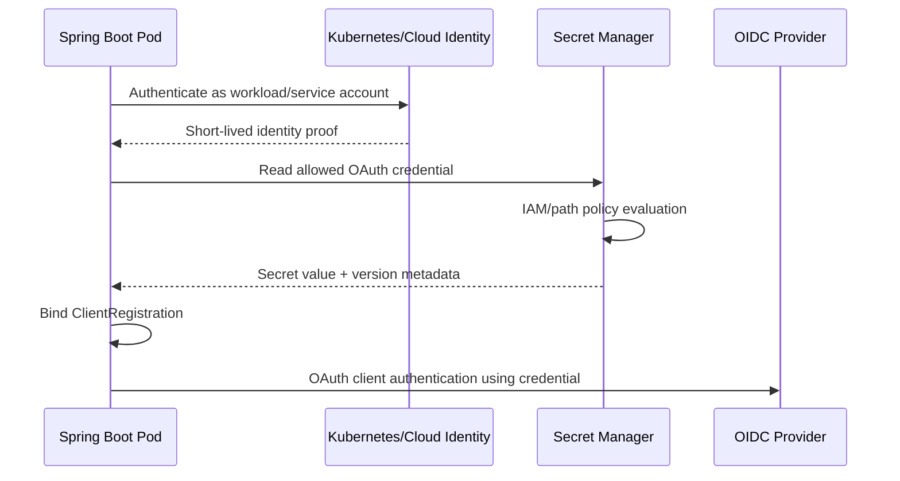
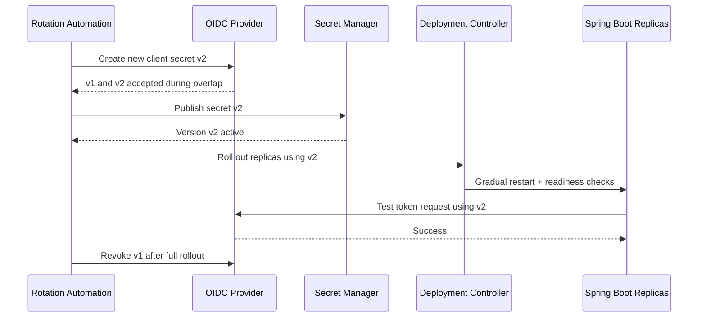

# 32.4. Provisioning Secrets and Configuration from a Secret Manager

A **Spring Security OAuth 2.0/OIDC Client** application can run fine in development when `client-id`, `client-secret`, and `issuer-uri` are written directly into `application.yml`. In production, however, that approach quickly creates serious risks: secrets leak into Git, build files, container images, CI logs, support tickets, or configuration copies across multiple servers.

In real deployments, OAuth client credentials should be managed via a **secret manager** or a controlled secret-provisioning mechanism, such as HashiCorp Vault, AWS Secrets Manager, Azure Key Vault, Google Cloud Secret Manager, or a secret operator/volume authorized via Kubernetes.

The challenge is not just “reading a string from somewhere other than YAML”. You need to answer:

- How does the application **authenticate to the secret manager** without storing yet another long-lived bootstrap secret?
- At what point are secrets injected into the Spring `Environment`, `ClientRegistration`, or OAuth token client?
- When **rotating a client secret**, do running replicas, pending authorization callbacks, and background refresh tasks keep working?
- If the secret manager loses connectivity, should the application fail startup or use a cached copy?
- How do you avoid accidentally exposing secrets, refresh tokens, or private keys in logs, Actuator endpoints, heap dumps, and diagnostics?
- With multiple tenants/issuers, can tenant A's credentials be read or used for tenant B?

In this lesson, a **secret manager** is a store/issuer of secret values enforcing authentication, authorization, auditing, and rotation policies. It differs from simply storing strings in an environment variable or a Kubernetes Secret, even though those mechanisms can act as **delivery channels** from the secret manager to the application.

---

## 1. Learning objectives

After this lesson, you will be able to:

1. Classify which secrets truly require protection in an OAuth2/OIDC Client.
2. Distinguish `client_id`, `client_secret`, issuer metadata, private keys, and access/refresh tokens.
3. Explain the **bootstrap identity → secret manager → application configuration** model.
4. Use Spring Boot externalized configuration to supply secrets without committing them to source.
5. Compare provisioning via environment variables, file mounts, `configtree:`, and native secret-manager integrations.
6. Understand how to use Spring Cloud Vault or secret-manager clients following least privilege.
7. Know the limitations of Kubernetes Secrets, External Secrets Operator, and CSI volumes.
8. Design secret-reading paths for multi-tenant OAuth registrations.
9. Rotate client secrets, `private_key_jwt` keys, and mTLS certificates without mixing security domains.
10. Analyze impacts on `authorization_code`, `refresh_token`, and `client_credentials` flows.
11. Design fail-closed behavior, bootstrap readiness, retry/backoff, and emergency rollback.
12. Establish auditing, redaction, tests, and runbooks for production operations.

## 2. Deployment context

Suppose a BFF/Relying Party application:

```text
Public app:
  https://portal.example.org

Issuer:
  https://login.example.org/realms/company

Registration ID:
  company

OAuth client ID:
  portal-prod

Client authentication:
  client_secret_basic

Redirect URI:
  https://portal.example.org/login/oauth2/code/company
```

A common demo configuration:

```yaml
spring:
  security:
    oauth2:
      client:
        registration:
          company:
            provider: company
            client-id: portal-prod
            client-secret: hard-coded-secret-NOT-FOR-PRODUCTION
            client-authentication-method: client_secret_basic
            authorization-grant-type: authorization_code
            redirect-uri: "{baseUrl}/login/oauth2/code/{registrationId}"
            scope: openid,profile,email
        provider:
          company:
            issuer-uri: https://login.example.org/realms/company
```

In production, **the `client-secret` value must never be written verbatim in the repository**. If a secret was ever committed, deleting that line from the current Git HEAD is not enough: the secret may still exist in Git history, build artifacts, or forks/clones. Exposed credentials must be **revoked/rotated** per incident procedure.

### 2.1. Sound provisioning architecture


Key takeaway: the application obtains OAuth credentials using its **workload identity**, not because a master secret able to read every credential is baked into the image.

## 3. Which secrets belong in a secret manager?

Not every attribute in a `ClientRegistration` is a secret.

| Data | Usually a secret? | Recommended management location |
|---|---|---|
| `registrationId` | No | Versioned configuration |
| `client_id` | Usually not a secret | Configuration, registry |
| `client_secret` | **Yes** | Secret manager |
| `issuer-uri` | Not a secret, but **security-sensitive** | Trusted versioned config |
| `authorization-uri` | Not a secret | Trusted provider metadata |
| `token-uri` | Not a secret, but requires trust | Trusted provider metadata |
| `jwk-set-uri` | Not a secret | Trusted discovery/config |
| `redirect-uri` | Not a secret, but security-critical | Versioned config + OP registration |
| `scope` | No | Versioned policy/config |
| Private key for `private_key_jwt` | **Yes** | KMS/HSM/secret manager, export-restricted policy |
| mTLS client private key | **Yes** | KMS/PKI/secret store |
| mTLS client certificate | More public than private key | Certificate lifecycle/PKI |
| User's access token | **Yes** | Protected authorized-client token store |
| User's refresh token | **Yes, high sensitivity** | Encrypted authorized-client store |
| Authorization code | Short-lived credential | Kept only within protocol transaction; never logged |
| PKCE code verifier | Per-transaction secret | Session/authorization request store |
| OIDC `state`/`nonce` | Protected correlation values | Authorization transaction/session, not long-lived config |
| Token signing public JWKS | No | OP-hosted public endpoint |
| OP's token signing private key | **Yes**, but belongs to OP | OP/KMS/HSM, never placed in RP |

### 3.1. Client ID is not synonymous with client secret

`client_id` identifies the OAuth client and often appears in the browser authorization URL. It is not a password.

`client_secret` is the credential used by the OP to authenticate a **confidential client** at the Token Endpoint. If exposed, attackers can exploit it under conditions matching enabled grants and policies.

### 3.2. Issuer URI is not secret, yet must be trusted

If a request can choose arbitrarily:

```text
issuer-uri=https://attacker.example
```

the application may perform unintended discovery, SSRF, or send client authentication to a malicious token endpoint in a flawed design.

Therefore, never take `issuer-uri` from arbitrary input just because it is non-secret. It must reside in **trusted client registration configuration**.

### 3.3. Refresh token is not client secret

`client-secret` authenticates the OAuth client to the OP.

`refresh_token` is a grant credential issued to the client in a specific authorization context. It must be protected via **appropriate authorized-client storage**, not mixed into a shared secret manager key across all users.

### 3.4. Public clients may have no client secret

Mobile, native, and browser public clients cannot protect a static client secret merely by embedding it in the app bundle. Public clients typically use Authorization Code + PKCE and `ClientAuthenticationMethod.NONE` per provider policy.

Do not “provision a secret” for a public client when the security model cannot truly keep a secret confidential.

## 4. Four layers to design separately

A secure deployment separates:

1. **Source of truth:** where secrets live with versioning, policies, and auditing.
2. **Authentication:** how the workload proves its identity to read secrets.
3. **Delivery:** how secrets reach the app via API, environment, mounted volume, or Spring PropertySource.
4. **Consumption/lifecycle:** how Spring Security uses values in `ClientRegistration`/token clients and switches to new versions upon rotation.

```text
Source of truth       Authentication       Delivery        Consumption
----------------     ----------------     -------------   ---------------------
Vault / cloud SM  <-  Workload identity ->  env/configtree -> ClientRegistration
                                                |
                                                +-> token endpoint client auth
```

Replacing the secret store alone while ignoring bootstrap identity or runtime rotation does not yield a complete solution.

### 4.1. Trust model

- Browser and user input: **untrusted to select secret paths**.
- Reverse proxy: trusted only after network/forwarded-header policies are enforced.
- CI/CD: authorized only to deploy and read needed secrets, not read every tenant.
- Workload service account: identity authorized per application/environment.
- Secret manager: source of truth and audit log.
- Spring `Environment`: holds secrets **in process memory**; still requires guarding against introspection/log leaks.
- OAuth Token Endpoint: a trusted network destination from registration/provider metadata.

## 5. Common provisioning models

| Model | How it works | Pros | Limitations |
|---|---|---|---|
| Environment variable | Platform/sidecar supplies `CLIENT_SECRET` | Easy Spring Boot integration | Secret resides in process env; updates usually require restart |
| Mounted file | Secret agent/CSI writes file to read-only volume | Not an env var, file can update | Spring usually does not auto-rebind `ClientRegistration` |
| Spring `configtree:` | Each file under a directory maps to a property | Fits container secrets cleanly | Usually binds at startup; refresh managed separately |
| Spring Cloud Vault | Vault PropertySource/ConfigData | Integrates with Spring lifecycle/config | Depends on versions/ACLs/auth/bootstrap |
| Cloud SDK/PropertySource integration | App or framework reads AWS/Azure/GCP secrets | Uses cloud IAM natively | Must manage caching/retries/SDK credentials |
| External Secrets Operator | Operator syncs secret manager → Kubernetes Secret | App avoids calling manager directly | Secret still exists in Kubernetes API/etcd |
| Secrets Store CSI Driver | Mounts provider secrets into Pod | File-based, rotation support depends on provider | App must reload; provider/driver behaviors vary |
| Sidecar/agent | Agent authenticates and writes secrets to filesystem | Decouples credential fetch from app | Adds agent operations, file permissions, reload complexity |

No single model is best for all environments. Choose based on blast radius, rotation requirements, failure semantics, and IAM practices.

## 6. Configuring Spring Boot as “identity in YAML, secret from outside”

Keep non-secret values in `application.yml`:

```yaml
spring:
  security:
    oauth2:
      client:
        registration:
          company:
            provider: company
            client-id: portal-prod
            client-secret: ${OIDC_COMPANY_CLIENT_SECRET}
            client-authentication-method: client_secret_basic
            authorization-grant-type: authorization_code
            redirect-uri: "https://portal.example.org/login/oauth2/code/company"
            scope:
              - openid
              - profile
              - email
        provider:
          company:
            issuer-uri: "https://login.example.org/realms/company"
```

`${OIDC_COMPANY_CLIENT_SECRET}` is a Spring placeholder replaced by a runtime-supplied property/environment value. **Never put a default secret** inside the placeholder.

Avoid:

```yaml
client-secret: ${OIDC_COMPANY_CLIENT_SECRET:dev-secret}
```

in production, because if the variable is missing, the application could start up with an insecure default credential or fail in hard-to-diagnose ways.

### 6.1. Secret manager keys need not match YAML property names

You can use a manager key:

```text
prod/portal/oauth/company/client-secret
```

and have the delivery layer map it to:

```text
OIDC_COMPANY_CLIENT_SECRET
```

You do not need to force the secret manager to match Spring Boot's naming convention. Keep this mapping versioned and restrict changes to trusted admins/automation.

### 6.2. Spring Boot relaxed binding

Alternatively, the platform can supply directly:

```text
SPRING_SECURITY_OAUTH2_CLIENT_REGISTRATION_COMPANY_CLIENT_SECRET
```

Spring Boot can bind the environment variable to property:

```text
spring.security.oauth2.client.registration.company.client-secret
```

For registration IDs containing dots, hyphens, or dynamic names, verify how relaxed binding handles map keys, casing, and delimiters. Simple names like `company` are straightforward; for many dynamic tenant IDs, prefer a registry and test concrete mappings.

### 6.3. Avoid secrets in command-line arguments

Never pass:

```bash
java -jar app.jar --spring.security.oauth2.client.registration.company.client-secret=REAL_SECRET
```

because process arguments can appear in process listings, diagnostics, or CI logs. Choose a secure delivery channel instead of command-line arguments.

## 7. Spring Boot PropertySources and binding timing

Spring Boot has multiple configuration sources that can define the same property:

```text
application.yml
environment variables
configtree imports
external ConfigData sources
system properties
command-line arguments
custom PropertySources
```

Actual precedence depends on Spring Boot version, config-data import ordering, and property source registration order.

### 7.1. Avoid one source unintentionally overriding another

Example:

```text
Vault:
  client-secret = secret-v2

Container environment:
  CLIENT_SECRET = secret-v1
```

If binding reads the stale value from a higher-precedence property source, the secret manager rotated yet the app still uses v1.

Establish **one authoritative source** for each credential and test property binding in the target environment.

### 7.2. When is ClientRegistration created?

Spring Boot typically binds `OAuth2ClientProperties` and builds `ClientRegistrationRepository` during application context startup.

If the secret is not yet provided at that time, you may see:

- Unresolved placeholders.
- `ClientRegistration` missing a secret.
- OAuth2 login/refresh failing with `invalid_client`.
- Context startup failures depending on binding/validation.

**Mounting a file after the bean has already been created does not automatically make Spring Security use the new secret.**

### 7.3. Boot properties are runtime config, not an absolute vault

Once bound, the client secret value lives in heap/process memory. A secret manager reduces storage/distribution risks, but does not eliminate memory dumps, debug endpoints, or accidental object logging.

## 8. Model A: platform-supplied environment variables

Example runtime-supplied env var:

```text
OIDC_COMPANY_CLIENT_SECRET=<redacted value>
```

Spring Boot reads it via:

```yaml
client-secret: ${OIDC_COMPANY_CLIENT_SECRET}
```

Pros:

- Easy to adopt.
- App does not need a direct secret manager SDK dependency.
- Standard Spring Boot startup/binding stays unchanged.
- Secrets can be injected by the platform/CD pipeline.

### 8.1. Security limits of environment variables

Environment variables are not inherently “encrypted”. Values may be readable by:

- Processes with debug/inspect permissions.
- Crash dumps/heap dumps.
- Endpoints exposing environment/config.
- CI/CD logs or workflow steps printing variables.
- Container orchestrator metadata or privileged host tooling.
- Child processes inheriting the environment.

If your threat model requires minimizing secret lifetime in process environments, use file mounts, agents, or non-exportable key operations.

### 8.2. Updates usually do not take effect automatically

A running process generally does not observe updated environment variables when a secret manager rotates a value. With env delivery, a **rolling restart** or explicit lifecycle refresh is typically required.

### 8.3. Never use echo to debug secrets

Avoid:

```bash
echo "$OIDC_COMPANY_CLIENT_SECRET"
```

in CI logs or production shells. Verify property injection via **presence/metadata checks** that never print the value.

## 9. Model B: mounted files and configtree

If the platform mounts secrets as files:

```text
/run/secrets/oidc/
└── spring.security.oauth2.client.registration.company.client-secret
```

the file contents are **the raw secret value** (no JSON wrapper, unless you parse it yourself).

Spring Boot can import a config tree:

```yaml
spring:
  config:
    import: "configtree:/run/secrets/oidc/"
```

And the registration declares only non-secret attributes:

```yaml
spring:
  security:
    oauth2:
      client:
        registration:
          company:
            provider: company
            client-id: portal-prod
            client-authentication-method: client_secret_basic
            authorization-grant-type: authorization_code
            redirect-uri: "https://portal.example.org/login/oauth2/code/company"
            scope: openid,profile,email
        provider:
          company:
            issuer-uri: "https://login.example.org/realms/company"
```

### 9.1. Why does the filename contain dots?

With `configtree:`, the filename becomes the property key. The file:

```text
spring.security.oauth2.client.registration.company.client-secret
```

represents the exact property Spring OAuth2 client registration binding expects.

### 9.2. Read-only mounts and file permissions

In production:

- Mount read-only where supported by the platform.
- Grant only the app's UID/GID read permission.
- Restrict access from sidecars and debug pods.
- Do not mount secrets for unrelated apps/tenants into the same Pod.
- Never bake this volume into container images or artifact uploads.

### 9.3. Avoid delivering the same secret via both paths

If a YAML placeholder reads an env var **and** configtree simultaneously writes the same property, precedence conflicts can arise. Pick one clear mapping.

### 9.4. File refresh does not equal bean refresh

A CSI driver/agent may update the file upon rotation. Spring Boot `ConfigData`/`ClientRegistrationRepository` normally does not automatically swap the bound `ClientRegistration` object.

You need a rolling restart or a controlled, tested refresh mechanism. Never claim “enabling CSI rotation makes the OAuth client use the new secret automatically”.

## 10. What is a Kubernetes Secret in this architecture?

A Kubernetes `Secret` is an API resource for delivering sensitive data to Pods. It is **not equivalent** to a managed secret manager with policies, version history, and HSM operations.

Example secret consumed via `secretKeyRef`:

```yaml
apiVersion: apps/v1
kind: Deployment
metadata:
  name: portal
spec:
  replicas: 3
  selector:
    matchLabels:
      app: portal
  template:
    metadata:
      labels:
        app: portal
    spec:
      serviceAccountName: portal-oidc
      containers:
        - name: app
          image: registry.example/portal:1.2.3
          env:
            - name: OIDC_COMPANY_CLIENT_SECRET
              valueFrom:
                secretKeyRef:
                  name: portal-oidc-client
                  key: client-secret
```

This shows only the injection slice of a Deployment, not a full production manifest.

### 10.1. Never commit a Secret containing real data

A `Secret` manifest with base64 `data:` is not securely encrypted just because it is not human-readable.

Never commit:

```yaml
data:
  client-secret: <base64-of-real-secret>
```

to Git—even a private repo—unless an approved encryption/SOPS/Sealed Secrets solution is applied per security policy.

### 10.2. RBAC and encryption at rest

Kubernetes Secrets require:

- Namespace/RBAC restricting `get/list/watch` permissions.
- Encryption at rest for etcd per platform policy.
- No shared service accounts with cluster/namespace-wide secret read permissions.
- Reviewing admission policies and audit logs.
- Blocking unnecessary debug/exec access into Pods holding secrets.
- Isolating networks and workloads by tenant/security boundary.

### 10.3. Updating a Secret does not automatically update Pod env vars

When a Kubernetes Secret is updated, **environment variables already injected into running containers generally do not change**. You need a rollout restart or a controller watching changes to restart Pods in a controlled manner.

## 11. Model C: External Secrets Operator

An architecture:

```text
AWS/Azure/GCP/Vault Secret Manager
    |
    v
External Secrets Operator
    |
    v
Kubernetes Secret
    |
    v
Pod env vars / volume
    |
    v
Spring Boot ClientRegistration
```

The operator uses its own or resource-scoped workload identity/credentials to read secrets from the external manager and sync them into Kubernetes Secrets per policy.

### 11.1. Advantages

- The app avoids integrating each provider's SDK.
- The secret manager remains the source of truth.
- Versions and refresh intervals can be synchronized.
- Easy to consume via `secretKeyRef` or mounted volumes.
- The app needs only standard Spring Boot externalized configuration.

### 11.2. Limitations

- Secrets exist inside the Kubernetes API/etcd after sync.
- The operator holds privileges to read external secrets; protect its identity and namespace isolation.
- Refresh intervals do not guarantee the app uses new secrets immediately.
- Operator or IAM failures can leave secrets stale.
- CRD schemas/API versions change across External Secrets Operator releases.

### 11.3. Resource pseudocode

```yaml
# PSEUDOCODE — API version, fields, and secret-store references
# must be verified against the running External Secrets Operator version.
apiVersion: external-secrets.io/v1
kind: ExternalSecret
metadata:
  name: portal-oidc-client
spec:
  refreshInterval: 1h
  secretStoreRef:
    name: production-secret-store
    kind: SecretStore
  target:
    name: portal-oidc-client
  data:
    - secretKey: client-secret
      remoteRef:
        key: prod/portal/oidc/company
        property: client-secret
```

Adjust if your cluster uses `v1beta1` or a different schema. This sample illustrates **mapping** and contains no real credentials.

### 11.4. Never let tenants pick an arbitrary `remoteRef`

An external secret resource created from untrusted user input could pull another tenant's credentials. Restrict who can create `ExternalSecret` objects and enforce remote path policies.

## 12. Model D: Secrets Store CSI Driver

A CSI driver can mount secrets directly as a filesystem inside containers:

```text
External secret manager
   |
   v
Secrets Store CSI Provider
   |
   v
Pod volume: /run/secrets/oidc/client-secret
   |
   v
Spring configuration binding
```

Some providers offer rotation/reconciliation options, though the app must still handle file changes.

### 12.1. Benefits

- No need to create Kubernetes `Secret` objects if using mounted files directly.
- Easy to pair with `configtree:` or explicit file reads.
- Filesystem permissions can be enforced.
- Can be updated via provider rotation.

### 12.2. Risks

- Secrets exist as plaintext bytes in the Pod filesystem/volume.
- Any sidecar/container with access to the volume can read the secrets.
- No automatic Spring `ClientRegistration` rebinding by default.
- Startup races can occur if mount/provider is not ready yet.
- Some rotation mechanisms use atomic symlink swaps; file watchers may need to watch the parent directory rather than the old inode.

### 12.3. Operational conditions

Test that:

1. The volume is ready before app startup.
2. The app reads the exact key and file path.
3. The runtime user has read permission.
4. File contents lack unwanted wrappers or encoding artifacts.
5. Secret updates reach the Pod.
6. The app actually uses the new version after restart/refresh.
7. Failures when the provider is temporarily unreachable follow a clear policy.

## 13. Model E: Spring Cloud Vault

With HashiCorp Vault, Spring Cloud Vault can act as a ConfigData/PropertySource feeding secrets into the Spring Environment. Depending on Spring Boot/Spring Cloud versions, `spring.config.import` can be used.

An **illustrative** configuration:

```yaml
spring:
  application:
    name: portal-prod
  config:
    import: "vault://"
  cloud:
    vault:
      uri: "https://vault.internal.example"
      authentication: KUBERNETES
      kubernetes:
        role: portal-prod
      kv:
        enabled: true
        backend: secret
        application-name: portal-prod
```

What this configuration means:

- The app calls Vault over HTTPS.
- Vault uses Kubernetes authentication to verify the service account/workload.
- The KV backend supplies properties mapped into the Spring Environment.
- `spring.security.oauth2.client.registration.company.client-secret` can be supplied from a trusted Vault secret path/property.

### 13.1. Versions and KV paths

Spring Cloud Vault supports KV versions/paths, contexts/application names, profiles, and namespace settings depending on version.

With KV v2, the actual API path and CLI path may differ:

```text
Logical KV mount:
  secret/

Application context:
  portal-prod

Value:
  spring.security.oauth2.client.registration.company.client-secret
```

Do not copy one path blindly across systems and conclude Vault “could not find the secret”. Check KV v1/v2 mounts, context resolution, and profile-specific paths for your Spring Cloud Vault version.

### 13.2. Bootstrap chicken-and-egg

The application must authenticate to Vault **before retrieving the OAuth client secret**.

Never configure:

```text
VAULT_TOKEN=<permanent root token embedded in image>
```

A better approach is Kubernetes ServiceAccount JWT, AWS IAM, Azure Managed Identity, or an equivalent workload authentication method.

### 13.3. Vault policies

For example, an application needing only:

```text
secret/data/portal-prod/*
```

must not read:

```text
secret/data/portal-other/*
secret/data/root/*
secret/data/all-tenants/*
```

Policies must target the actual paths/capabilities of your Vault KV version. These paths illustrate boundaries, not a complete policy engine config.

### 13.4. Never use Vault root tokens in production apps

Root/admin tokens have overly broad privileges. Issue short-lived service-account-scoped tokens/identities and let Vault manage auditing, expiration, and revocation.

## 14. Cloud secret managers: common patterns

Three common examples:

- **AWS Secrets Manager** paired with IAM roles for workload identity, or IRSA/EKS Pod Identity depending on EKS setup.
- **Azure Key Vault** paired with Managed Identity/Workload Identity.
- **Google Cloud Secret Manager** paired with workload identity/service accounts.

SDK details, ConfigData starters, Spring Cloud integrations, and Kubernetes operators differ by version, but the architecture is consistent:

```text
Workload identity
  -> cloud IAM evaluation
  -> get secret version
  -> secret value
  -> Spring property / ClientRegistration
```

### 14.1. What should a single secret hold?

Two strategies:

**A dedicated field:**

```text
prod/portal/company/client-secret
  -> <secret value>
```

**A JSON secret:**

```json
{
  "client_id": "portal-prod",
  "client_secret": "<redacted>",
  "version": "v7"
}
```

If JSON contains multiple fields, the delivery/PropertySource layer must parse and map them accurately. Avoid secret manager key names dictated by browser input.

### 14.2. Version pinning and aliases

Some secret managers allow referencing:

```text
latest/current
specific immutable version
staged version such as AWSCURRENT / AWSPREVIOUS
```

Do not use `latest` blindly if rollouts require deterministic versions. Conversely, permanently pinning an old version blocks rotation.

Choose a clear strategy: versioned rollouts, controlled metadata aliases, and rollback support.

### 14.3. IAM roles must be scoped down to the resource

The production Portal app should only be able to read the production Portal secret. Never grant `secretsmanager:GetSecretValue`/`Secret Manager Secret Accessor` or equivalent org-wide if unnecessary.

### 14.4. Do not grant write/delete if the app only needs read

The OAuth client runtime typically only **reads** secrets. Rotate/create/delete permissions belong to separate automation/admin workflows, not the default runtime role.

## 15. Bootstrap identity: never store one master secret to fetch another

An anti-pattern:

```text
application.yml:
  secret-manager-password: permanent-master-password

Secret manager:
  oauth-client-secret: ...
```

You have simply moved the risk from one secret to another without improving the trust boundary.

### 15.1. Workload identity

A better approach:



### 15.2. Desired properties

- Identity is issued by a trusted environment.
- Bootstrap tokens are short-lived and revocable.
- No static cloud access keys committed.
- IAM policies have narrow resource scopes.
- Auditing tracks which workload read which secret.
- The application can rotate secrets without editing source code.
- Metadata such as secret version/age is observable without exposing values.

### 15.3. Kubernetes ServiceAccount is insufficient if RBAC/IAM is wrong

If multiple Pods share a service account able to read all secrets, compromising one Pod creates a large blast radius. Use dedicated service accounts per application/environment paired with separate cloud/Vault role mappings.

## 16. Never let callers choose the secret path

Wrong:

```java
@GetMapping("/tenant/login")
String login(@RequestParam String tenant) {
    String path = "secrets/" + tenant + "/oidc/client-secret";
    String secret = secretManager.read(path);
    // ...
}
```

If `tenant` is arbitrary input, callers can probe or abuse the mapping, potentially reading another tenant's credentials if the IAM role is overly broad.

### 16.1. Right design

```text
Untrusted tenant hint
   |
   v
Trusted tenant registry
   |
   v
Approved registration ID
   |
   v
Approved secret reference
   |
   v
IAM-authorized secret read
```

Mappings change only via authenticated admin/onboarding workflows. Users must never supply full secret paths, issuer URLs, or token endpoints at runtime.

### 16.2. Secret reference is not a credential

A registry might store:

```text
registrationId=alpha-oidc
clientId=alpha-portal-prod
issuerUri=https://id.alpha.example
secretRef=secret://prod/portal/tenants/alpha/client-secret
```

`secretRef` is merely a policy-governed address; the code still needs IAM authorization to read the value.

### 16.3. Multi-tenant blast radius

With hundreds of tenant registrations, consider per-tenant identities/roles or at least grouping by trust boundaries. Never allow a single lookup bug to retrieve every tenant's credentials.

## 17. ClientRegistration and secret rotation

Spring Security uses `ClientRegistration` to hold client ID, client authentication method, endpoints, and client secret details.

Example:

```java
ClientRegistration registration =
    ClientRegistration.withRegistrationId("company")
        .clientId("portal-prod")
        .clientSecret(secretFromTrustedSource)
        .clientAuthenticationMethod(
            ClientAuthenticationMethod.CLIENT_SECRET_BASIC)
        .authorizationGrantType(
            AuthorizationGrantType.AUTHORIZATION_CODE)
        .authorizationUri("https://login.example.org/authorize")
        .tokenUri("https://login.example.org/token")
        .redirectUri("https://portal.example.org/login/oauth2/code/company")
        .scope("openid", "profile", "email")
        .build();
```

`secretFromTrustedSource` is supplied by the secret delivery layer, never from a request.

### 17.1. Already-bound objects do not auto-update

If the manager updates the value in Vault from v1 to v2 while the app's `ClientRegistrationRepository` still holds object v1, the Token Endpoint continues receiving client authentication with v1.

### 17.2. Verify the application actually uses v2

Do not only check “Vault now has version v2”. Confirm:

- The file/env/config source was updated.
- The runtime refreshed/restarted per strategy.
- `ClientRegistration` uses the right credential version.
- The Token Endpoint accepts the new version.
- No Pods continue using the old version past the overlap window.

### 17.3. Never log the entire ClientRegistration

`ClientRegistration` can hold the client secret. Never print the object with `toString()` or serialize it to a diagnostic endpoint.

## 18. Rotating client secrets: standard flow with overlap window

Scenario: the provider supports **two simultaneously valid client secrets** for a brief period.



### 18.1. Deployment steps

1. Verify whether the OP supports credential overlap.
2. Create the new secret on the OP side.
3. Write the new version to the secret manager.
4. Trigger delivery/sync to the runtime.
5. Rolling restart/refresh application replicas.
6. Monitor `invalid_client`, token acquisition errors, and readiness.
7. Confirm all replicas are running the new version.
8. Revoke the old version after the safety window.
9. Audit and update the rotation schedule.

### 18.2. What if the OP does not support overlap?

A brief outage may occur if the secret is changed at the OP before the app updates. Plan a maintenance window, blue-green deployment, or atomic cutover matching OP and deployment platform capabilities.

Never claim zero-downtime rotation when the provider allows only one active client secret at a time.

### 18.3. Pending Authorization Code Flow callbacks

A browser may have started login while the RP used v1, then returned to the callback after the OP changed secrets. The Token Endpoint checks client authentication at callback time.

If v1 is already revoked and a replica lacks v2 yet, it may return `invalid_client`. Overlap/staged rollouts reduce failures for in-flight login transactions.

### 18.4. Refresh token flows also use client authentication

When an access token expires, the RP sends a refresh token grant. For confidential clients, the Token Endpoint normally authenticates the client. Broken secret rotation can cause widespread refresh failures.

## 19. Multi-node consistency during rotation

A system with three replicas:

```text
Node A -> client-secret v2
Node B -> client-secret v1
Node C -> client-secret v2
```

If the OP accepts only v2, requests hitting Node B can fail intermittently depending on load balancing.

### 19.1. Metrics to watch

- Ready replica count.
- Credential version metadata per replica.
- Timestamp of last secret refresh/restart.
- `invalid_client` by app instance/registration.
- Token Endpoint latency/status.
- Pending authorization request count, if available.
- Authorized-client refresh failure rate.

**Never put actual secret values into metrics.** Non-sensitive version IDs can be used to detect deployment skew.

### 19.2. Config reloads must be atomic

Do not update client ID first and secret second, or token endpoint first and issuer second, across two observable steps. When multiple registration fields change together, use an **immutable versioned config snapshot**.

### 19.3. Rollback

If v2 causes errors:

1. Check whether v1 is still accepted by the OP.
2. If so, revert to the last-known-good config version per policy.
3. If v1 was already revoked, do not assume rollback is still possible.
4. Investigate why secret v2 was rejected.
5. Never redeploy a compromised credential.

## 20. `private_key_jwt` and mTLS rotation differ from `client_secret`

Not all OAuth client authentication uses `client_secret_basic`.

| Method | Secret to protect | Operation during rotation |
|---|---|---|
| `client_secret_basic` | Shared client secret | Publish new secret, roll out, revoke old |
| `client_secret_post` | Shared client secret | Similar; watch request body logging |
| `client_secret_jwt` | Shared HMAC secret | Rotate secret and assertion signing config |
| `private_key_jwt` | Client signing private key | Key rollover, `kid`, public JWK registration at OP |
| mTLS client auth | TLS private key + certificate | Certificate/chain replacement, client mapping at OP |
| `none` (public client) | No static confidential client credential | Use PKCE and appropriate client policy |

### 20.1. `private_key_jwt`

A client assertion JWT contains key claims:

```json
{
  "iss": "portal-prod",
  "sub": "portal-prod",
  "aud": "https://login.example.org/token",
  "iat": 1794800000,
  "exp": 1794800300,
  "jti": "<unique-id>"
}
```

It is signed by the client's private key and sent to the Token Endpoint. The OP verifies it against the registered public key/JWK.

A secret manager may hold the private key, or KMS/HSM can perform signing operations without exporting the private key. Whenever feasible, **non-exportable keys** reduce the risk of key material exposure.

### 20.2. mTLS

With mTLS, manage:

- Client private key.
- Certificate chain and trusted roots.
- Certificate renewal.
- Mapping the certificate to the OAuth client registration.
- HTTP client TLS configuration.
- Keeping key/cert pairs synchronized during rollout.
- Verifying Token Endpoint connections actually present the right client certificate.

Do not swap a certificate file while forgetting to update the private key or keystore configuration.

### 20.3. Do not store OP JWKS public keys in a secret manager as if they were client secrets

JWKS published by the OP contain public signing keys for the RP to verify ID Tokens. They are not RP confidential client secrets; the OP's private signing key belongs to the OP and must never be requested by the RP.

## 21. Auth method must match the provisioned secret

A registration:

```yaml
spring:
  security:
    oauth2:
      client:
        registration:
          company:
            client-authentication-method: client_secret_basic
```

uses a different secret type than a registration requiring `private_key_jwt`.

### 21.1. `invalid_client` after rotation may not mean the secret value is wrong

Possible causes:

- Secret is valid, but `client-authentication-method` is wrong.
- Client ID belongs to a different realm.
- Token Endpoint URL is wrong.
- Key/`kid`/certificate is not registered at the OP yet.
- Secret version has not rolled out to one replica.
- Proxy stripped the HTTP Authorization header.
- Assertion signature has the wrong `aud`.
- Client is disabled at the OP.

Runbooks must check **registration metadata, auth method, and secret version** rather than simply telling operators to “re-paste the secret”.

### 21.2. Do not switch from Basic to POST arbitrarily to troubleshoot

With `client_secret_post`, the secret sits in the request body and may be logged by gateways/HTTP debuggers. Only switch methods per OP contract and security requirements.

### 21.3. Never satisfy `client_credentials` with a test token

Client Credentials Grant must still be authenticated by the AS. Test fixtures never replace production credential management.

## 22. Access/refresh token storage is a related but separate concern

`OAuth2AuthorizedClient` contains:

```text
ClientRegistration
principalName
accessToken
optional refreshToken
```

Spring Security typically stores authorized clients via:

- `OAuth2AuthorizedClientRepository` in Servlet requests/sessions.
- `OAuth2AuthorizedClientService`, backed by memory/JDBC/custom storage.

### 22.1. Why not place each user's refresh token under the same client-secret key?

Client secret:

```text
prod/portal/company/client-secret
```

User refresh token:

```text
registrationId=company
principalName=user-725
refreshToken=RT-1
```

They have different lifecycles, ownership, and revocation semantics. Storing per-user refresh tokens in a general secret manager requires careful concurrency, tenant isolation, throughput, and cleanup design; it is not Spring Security's default choice.

### 22.2. Protecting refresh tokens in the token store

- Encryption at rest/KMS per policy.
- Least-privilege database permissions.
- Avoid logging or serializing `OAuth2AuthorizedClient`.
- Partition by registration/principal/tenant.
- Support refresh token rotation and conditional update/delete.
- Revoke/delete procedures on logout, user disconnect, or tenant disablement.

### 22.3. Secret manager outages and token store outages differ

The app may boot with a provisioned client secret while the token database is temporarily impaired, or vice versa. Separate these two failure modes in monitoring and runbooks.

## 23. Fail-closed startup when a secret is missing

If an OAuth registration is **mandatory** for the application to function, it should not boot into a “ready” state when the secret has not been provisioned.

Wrong example:

```java
String clientSecret =
    env.getProperty("OIDC_COMPANY_CLIENT_SECRET", "default-secret");
```

Safer principle:

```java
String clientSecret =
    env.getRequiredProperty("OIDC_COMPANY_CLIENT_SECRET");

if (clientSecret.isBlank()) {
    throw new IllegalStateException(
        "Required OIDC client credential is missing");
}
```

Never include secret values in exception messages.

### 23.1. Validating with Spring `@ConfigurationProperties`

If the app has a custom configuration abstraction:

```java
import org.springframework.boot.context.properties.ConfigurationProperties;
import jakarta.validation.constraints.NotBlank;

@ConfigurationProperties(prefix = "app.oidc")
public record OidcSecrets(
    @NotBlank String clientSecret
) {}
```

This is an example custom property class. For validation to activate, you need the JSR/Jakarta Bean Validation dependency and appropriate `@Validated`/configuration binding setup. It does not automatically replace Boot OAuth2 Client properties unless you write mapping code.

### 23.2. Do not validate by logging the secret

Wrong:

```java
log.info("Loaded OIDC secret: {}", clientSecret);
```

Right:

```java
log.info("Required OIDC credential loaded: registration={}",
         "company");
```

If rotation confirmation is needed, log the **non-secret version identifier** from the secret manager rather than naively hashing the secret and broadcasting a fingerprint outside the required scope.

### 23.3. Readiness differs from liveness

- **Liveness:** the process is alive and the event loop/HTTP server is running.
- **Readiness:** the process has sufficient configuration and essential dependencies to accept traffic per policy.

If a required secret is missing, failing startup or failing readiness can be appropriate. Never make the liveness probe depend directly on every external secret manager request, as a transient outage can trigger a restart storm.

## 24. What if the secret manager is unavailable?

Possible failure modes:

1. Cannot read secret at bootstrap.
2. Secret manager returns 403 due to IAM.
3. Secret path does not exist.
4. Secret version was revoked/deleted.
5. Network timeout/TLS trust failure.
6. Manager is rate-limiting requests.
7. Manager returns malformed data.
8. Secret exists but is rejected by the OP.
9. Rotation occurred while the manager was unreachable.
10. Local cache holds a stale secret.

### 24.1. Fail-closed does not mean endless retries

If bootstrap lacks a trusted credential, never fall back to a default secret or disable OAuth authentication. Retries can still be applied to transient errors using:

- Exponential backoff and jitter.
- Bounded attempts/deadlines.
- Rate-limit awareness.
- Circuit breakers where appropriate.
- Clear readiness/error states.
- No spamming the secret manager or OP.

### 24.2. 403 errors differ from 503 errors

**403/permission denied:** wrong IAM/policy/identity. Blind retries will not fix it.

**503/network timeout:** possibly transient; bounded retries are reasonable before failing/recovering per policy.

### 24.3. Last-known-good cache

An application may cache validated secret versions to reduce runtime dependency. However, this is a security and operational decision:

- Where does the cache live and is it encrypted?
- Has the secret been revoked or compromised?
- How long is the cache TTL?
- Who can read the cache?
- If the secret manager reports “revoked”, may the app continue using the cache?
- Does it violate rotation policy?

**Never silently fall back indefinitely to a revoked secret.**

### 24.4. Protect configuration sources against downgrade

If a Vault fetch fails and the app falls back to an older secret baked into the image months ago, that is a dangerous downgrade. Eliminate unapproved default/legacy fallback secrets.

## 25. What happens if the secret manager goes down after startup?

Once `ClientRegistration` is bound with a valid client secret, the app can continue executing OAuth token exchanges without calling the manager on every request, depending on delivery/caching architecture.

Scenarios:

| Mechanism | Manager outage after startup | Impact |
|---|---|---|
| Env injection | App keeps injected value | Can continue until rotation/restart |
| Configtree bound at startup | Bean holds read value | App does not auto-reload |
| Direct API fetch per token request | Every call depends on manager | Token calls can fail while manager is down |
| Cached SDK/PropertySource | Uses cache per policy | Subject to TTL/revocation limits |
| Sidecar file delivery | Existing file may remain | Requires stale-secret policy |
| Runtime signing via KMS/HSM | Each signature may depend on remote key service | Outage can block client assertions |

Do not choose “read the secret manager on every HTTP request” just to feel safer; weigh latency, availability, rate limits, and non-exportable key requirements.

## 26. Service accounts, IAM, and permission partitioning

A guiding principle:

```text
runtime role portal-prod:
  can READ only prod/portal/oidc/company/client-secret

runtime role analytics-prod:
  cannot READ prod/portal/oidc/company/client-secret
```

### 26.1. Least privilege

- Read only secrets required by the workload.
- Do not grant list permissions across all secret paths if unnecessary.
- Never grant delete/rotate/write permissions to runtimes.
- Never share an identity between staging and production.
- Never grant `"*"` to temporarily resolve `AccessDenied` and forget to revoke it.
- Audit service account identities per namespace/project.

### 26.2. Environment isolation

```text
dev/portal/oidc/company
staging/portal/oidc/company
prod/portal/oidc/company
```

Never allow a staging role to read a production secret. Use separate client IDs/registrations for production and staging whenever possible.

### 26.3. Separate roles for rotation

Automation that rotates secrets does not need permissions to modify all application configs. An application runtime that reads secrets does not need permissions to create new versions at the OP.

Separation of duties shrinks the blast radius and produces a clear audit trail.

## 27. Multi-tenant: configuration and secrets per registration

A SaaS platform has:

```text
tenant alpha
  registrationId: alpha-oidc
  issuer: https://id.alpha.example
  clientId: alpha-portal-prod
  secretRef: secret://prod/tenant/alpha/oidc/client-secret

tenant beta
  registrationId: beta-oidc
  issuer: https://id.beta.example
  clientId: beta-portal-prod
  secretRef: secret://prod/tenant/beta/oidc/client-secret
```

### 27.1. One issuer can serve multiple tenants

Two registrations may share an issuer yet have different client IDs and client secrets. Never cache secrets **by issuer alone**.

Wrong:

```java
Map<String, String> clientSecretByIssuer;
```

as it can mix client authentication credentials across multiple registrations.

### 27.2. One tenant can have multiple IdPs

Tenant Alpha may have separate registrations for employees and partners. Each registration has its own client authentication contract; the registry must accurately map secret reference, issuer, and redirect URI.

### 27.3. Never use tenant hints as secret manager ACLs

`?tenant=alpha` is only a pre-login routing hint. The app must select from a trusted registry and then authorize access to the tenant per policy after OIDC login is verified.

### 27.4. Avoid overly detailed secret paths in logs if sensitive

Tenant/organization names in secret paths may be sensitive internal metadata. Structured logging can use a registration alias or opaque ID instead of the full path.

## 28. Rotating many registrations: avoid “big bang” changes

Suppose thousands of tenants use independent credentials. A migration rotating all secrets simultaneously can cause a massive outage.

Better approach:

1. Version secrets per registration.
2. Canary a non-sensitive tenant/registration first.
3. Roll out in batches/tiers.
4. Monitor `invalid_client` per registration.
5. Halt rollout if error rates cross thresholds.
6. Preserve rollback windows per OP support.
7. Audit who changed mappings or secret references.

### 28.1. Consistent config snapshots

A record might include:

```text
registrationId = alpha-oidc
issuer = https://id.alpha.example
clientId = alpha-portal-prod
clientAuthMethod = client_secret_basic
secretRef = secret://.../v8
configVersion = 17
```

The app should apply snapshots atomically. Never switch `clientId` to a new value while keeping the old secret version.

### 28.2. Never reuse a `registrationId` for a different issuer without migration

Old authorized clients/refresh tokens may still be stored under that registration ID. When changing issuer/client ID, perform proper migration/cleanup and protect pending login flows.

### 28.3. Revocation must be explicitly defined

Deleting a secret manager entry does not automatically revoke credentials at the OP. Changing a client secret at the OP also does not automatically revoke user refresh tokens; that depends on OP policy. Keep these operations distinct.

## 29. Secret rotation and concurrent authorized-client refreshes

A logged-in user holds:

```text
Authorized client:
  clientRegistration = company
  accessToken = AT-1
  refreshToken = RT-1
```

When the access token expires, Spring Security may send:

```http
POST /token HTTP/1.1
Authorization: Basic <client-credential>
Content-Type: application/x-www-form-urlencoded

grant_type=refresh_token&
refresh_token=<RT-1>
```

If the client secret rotated yet one replica still uses the old version, the OP may return `invalid_client`.

If the refresh token rotated and another request uses the old token, the OP may return `invalid_grant`.

### 29.1. Do not confuse the two errors

| Error | What to investigate |
|---|---|
| `invalid_client` | Client secret/key/mTLS/`ClientAuthenticationMethod`/issuer |
| `invalid_grant` | Authorization code/refresh token validity, reuse, rotation, binding |
| `invalid_scope` | Requested scope/client policy |
| `access_denied` | User/OP authorization policy at the Authorization Endpoint |

### 29.2. Never blindly retry

On `invalid_client`, retrying the refresh token with the same wrong secret fixes nothing. Fix the credential/configuration.

On `invalid_grant` under strict refresh rotation, retrying the old RT can trigger reuse detection. Coordinate the token store/reauthorization per policy.

### 29.3. Stale deletes

If one refresh request fails while another successfully saved RT-2, the failure handler must not wipe the newer record via an unconditional remove. Use version-aware/conditional update-delete in high-concurrency systems.

This is a **token-store lifecycle problem**, not solved merely by putting the client secret in Vault.

## 30. Secrets in CI/CD pipelines

Pipelines may need to:

- Deploy application images.
- Create/verify secret references.
- Configure workload IAM.
- Rotate secrets via dedicated automation.
- Verify the production runtime picks up the right version.

However, the pipeline does not necessarily need to read the **actual secret value**.

### 30.1. Build once, deploy many

A sound pattern:

```text
Build image:
  no environment-specific client secret

Deploy to dev:
  dev workload identity -> dev secret

Deploy to staging:
  staging workload identity -> staging secret

Deploy to prod:
  prod workload identity -> prod secret
```

Do not rebuild images every time a secret rotates, and never bake secrets into Docker layers.

### 30.2. Avoid Docker ARG/ENV holding secrets at build time

Wrong:

```dockerfile
ARG OIDC_CLIENT_SECRET
ENV OIDC_CLIENT_SECRET=$OIDC_CLIENT_SECRET
```

If the build pipeline passes production secrets, values can leak into image metadata, layers, and build caches.

### 30.3. Use CI workload identity

When CI needs to modify secrets/roles, prefer OIDC federation or short-lived CI platform credentials. Never store long-lived cloud keys in repository variables when workload federation is viable.

### 30.4. Never dump the environment on failure

Debug scripts running `env`, `printenv`, or dumping all Spring properties can expose secrets. Print only redacted keys/metadata.

## 31. Docker and local development

Locally, use a dedicated test secret:

```text
OIDC_COMPANY_CLIENT_SECRET=local-test-only-value
```

Never put a production client secret on a laptop when a dev OAuth client can be used.

### 31.1. `.env` files are not inherently secure

A `.env` file holding secrets is plaintext. If used locally:

- Add `.env` to `.gitignore`.
- Restrict file permissions.
- Never sync to unapproved public cloud drives.
- Never share screenshots/terminal histories showing values.
- Delete/rotate immediately if accidentally committed or leaked.

### 31.2. Docker Compose secrets

Compose supports secret/file mounts depending on how it is run. The app can use `configtree:/run/secrets/...` if each file is mounted with the matching property name.

Do not assume Compose secrets are encrypted inside a secure external manager. Know the source file and host permissions.

### 31.3. Tests must not use production client secrets

Unit/MockMvc tests use synthetic fixtures. Integration tests against a mock OP use fake client credentials and test RSA keys.

## 32. Never expose secrets through Actuator

Spring Boot Actuator exposes runtime inspection endpoints such as `health`, `env`, `configprops`, `beans`, and `heapdump` depending on configuration.

An app holding client secrets in the Spring Environment must be careful:

- Never expose `/actuator/env` or `configprops` publicly.
- Never disable sanitization to debug in production.
- Protect Actuator with network controls and authentication/authorization.
- Never allow uncontrolled downloads of `heapdump`.
- Audit exposed endpoints via `management.endpoints.web.exposure.include`.
- Never log startup binding values or full configuration properties.

### 32.1. Expose only `health` publicly if policy allows

A minimal configuration:

```yaml
management:
  endpoints:
    web:
      exposure:
        include: health,info
```

This illustrates limited exposure; verify `health`/`info` details do not expose sensitive internals either. Accessing env/configprops should happen only through controlled operator channels.

### 32.2. Heap dumps can contain secrets

Even if secrets are no longer in the environment, `ClientRegistration` or HTTP clients can hold secret values in memory. Treat heap dumps and core dumps as sensitive data requiring encryption, access control, and retention policies.

### 32.3. Java exceptions

Never include secrets in exception text:

```java
throw new IllegalStateException(
    "Invalid client secret: " + secretValue);
```

Replace with:

```java
throw new IllegalStateException(
    "OIDC client credential failed validation for registration company");
```

## 33. Logging and HTTP wire debugging

Many OAuth2 errors occur at the Token Endpoint. Enabling raw HTTP wire logging can accidentally print:

```http
Authorization: Basic <base64-client-id-and-secret>
```

or:

```text
client_secret=...
refresh_token=...
client_assertion=...
access_token=...
id_token=...
```

### 33.1. Recommended structured logging

```json
{
  "event": "oidc_client_authentication_failed",
  "registrationId": "company",
  "issuerAlias": "corporate-sso",
  "grantType": "refresh_token",
  "oauthErrorCode": "invalid_client",
  "credentialVersion": "v8",
  "appInstance": "portal-7d5f",
  "correlationId": "op-req-123"
}
```

Values are illustrative and contain no actual credentials.

### 33.2. Error descriptions also need redaction

Never unconditionally log raw Token Endpoint response bodies. An AS may include sensitive information in `error_description` or custom fields.

### 33.3. Alert on error spikes after rotation

Example signals:

- Spike in `invalid_client` on a recently rotated registration.
- Replicas still using an old credential version.
- Secret fetch 403/404 errors.
- Client assertions rejected for wrong `kid`/`aud`.
- Token Endpoint timeouts/rate limits.
- Readiness failures after a rolling deployment.

## 34. Auditing: who read the secret, who modified the secret?

The secret manager should maintain audit logs for:

- Which identity/workload read the secret.
- Secret ID/path or resource ID.
- Secret version returned.
- Timestamps of read/rotate/revoke actions.
- Policy outcome (allow/deny).
- Admins/automation updating secret references.
- Break-glass access.

Never log the **secret value**.

### 34.1. Questions to answer during an incident

1. Which credentials might be affected?
2. Which workloads ever read them?
3. Was there cross-tenant or cross-environment read access?
4. Have credentials been rotated/revoked at the OP?
5. Do old secret versions still linger in caches, Pods, images, or logs?
6. Are existing authorized-client tokens impacted per OP policy?
7. Do sessions or refresh tokens need invalidation?
8. Have all replicas transitioned to the new version?

### 34.2. Rotation must preserve audit trails

Do not overwrite a secret value and erase all history when the platform provides immutable versions and audit metadata. Retain version history per retention/security policy for investigations, without exposing old secrets to runtimes.

## 35. Testing secret provisioning configurations

There are at least four testing layers.

| Layer | Objective | How to test |
|---|---|---|
| Unit/config binding | Properties map correctly | Test with `ApplicationContextRunner` or Spring Boot test properties |
| Integration secret delivery | Workload reads the right secret source | Test with Vault/mock cloud manager/CSI/ESO sandbox |
| OAuth client integration | `ClientRegistration` uses credential to call Token Endpoint | Fake OP/Token Endpoint returning success or `invalid_client` |
| Deployment/rotation | Multi-node switches versions cleanly | Staging rollout/chaos/rotation drills |

### 35.1. Unit binding

In a test profile, supply a synthetic secret:

```text
OIDC_COMPANY_CLIENT_SECRET=test-only-client-secret
```

Verify `ClientRegistrationRepository.findByRegistrationId("company")` binds the expected client ID, auth method, and secret, **without printing the secret into test logs**.

### 35.2. Testing missing secrets

Omit the required property. Startup/readiness must fail per policy without falling back to a default production credential.

### 35.3. Testing wrong secrets

Have the fake Token Endpoint reject client authentication with `invalid_client`. The app must surface a clear error without disabling client auth or retrying endlessly.

### 35.4. Testing secret version changes

Start with v1, update delivery to v2, and verify the app actually uses v2 after rollout/refresh as designed. Do not only assert that the external manager returns v2.

### 35.5. Testing isolation

Use a staging identity and attempt to read a production secret path in a sandbox. Expect `permission denied` from the manager/IAM.

### 35.6. Testing logs

Verify synthetic secrets never appear in:

- Spring startup logs.
- Failed OAuth token request logs.
- HTTP traces.
- Exposed Actuator responses.
- Test failure diagnostics.
- CI artifacts.

## 36. Sample deployment runbook for a confidential OIDC client

Assume Kubernetes, an external secret manager, and Spring Boot.

### 36.1. OP preparation step

Register:

```text
client_id = portal-prod
client_authentication_method = client_secret_basic
redirect_uri = https://portal.example.org/login/oauth2/code/company
scopes = openid profile email
```

Ensure Authorization Code Flow/PKCE policies align with your Spring Security version and OP profile.

### 36.2. Secret creation step

An admin creates the credential at the OP and stores it in the secret manager resource:

```text
prod/portal/oidc/company/client-secret
```

Never copy it into Git, images, wikis, or tickets. Record secret resource ID/version metadata instead of the value in audits/issues.

### 36.3. IAM grant step

Grant the `portal-prod` workload identity read permission solely for that secret resource. Separate staging/prod and do not grant write/delete.

### 36.4. Delivery step

Choose one method:

- Env injection via `secretKeyRef`.
- Configtree volume via CSI.
- Spring Cloud Vault PropertySource.
- Cloud SDK/managed secret property integration.

Do not enable multiple overriding property channels without a clear precedence policy.

### 36.5. Spring config step

```yaml
spring:
  security:
    oauth2:
      client:
        registration:
          company:
            provider: company
            client-id: portal-prod
            client-secret: ${OIDC_COMPANY_CLIENT_SECRET}
            client-authentication-method: client_secret_basic
            authorization-grant-type: authorization_code
            redirect-uri: "https://portal.example.org/login/oauth2/code/company"
            scope: openid,profile,email
        provider:
          company:
            issuer-uri: "https://login.example.org/realms/company"
```

If binding directly via `configtree:`, remove placeholders that could unintentionally override the same property.

### 36.6. Startup verification step

Verify:

- Workload acquires its identity.
- Secret source is accessible.
- Credential key has a value and expected version.
- `ClientRegistration` binds the right auth method and client ID.
- Issuer discovery/metadata connects to the trusted provider.
- Readiness turns OK only when mandatory conditions are met.
- Logs contain no secrets.

### 36.7. Authorization verification step

Log in with a test user through the sandbox/staging OP. Observe the Authorization Code Flow and token exchange succeed; never log authorization codes or ID Tokens.

### 36.8. Refresh verification step

If the OP issues refresh tokens, verify the authorized client service can refresh once the access token needs renewal, and that the Token Endpoint accepts the new client credential.

### 36.9. Rollback/rotation verification step

Run a rotation drill in staging, exercising v1/v2 overlap and rollback within OP policy.

## 37. “Fast startup” vs. Secret Manager availability

An application with many registrations may need to load hundreds of secrets at startup.

### 37.1. Avoid uncontrolled sequential fetches

For example, N tenants × network latency can slow startup or hit manager rate limits. Consider:

- Batch retrieval if supported by the provider and permitted by ACLs.
- Bounded concurrency.
- Caching/versioned snapshots.
- On-demand loading for inactive registrations.
- Backoff on rate limits.
- Startup readiness policies scoped to critical registrations.

### 37.2. Lazy loading also carries risks

If a client secret is fetched only upon first login, the first user pays the secret manager latency/failure cost. Decide on preloading, circuit breakers, and alerting so outages are not discovered first via production user traffic.

### 37.3. Never widen IAM permissions just to simplify batching

Batching is not a justification for one workload to read secrets belonging to every business tenant. If IAM boundaries become too wide, consider splitting services or roles.

## 38. Direct secret manager integration in Java

Some apps fetch secrets via SDK at startup and construct `ClientRegistration` programmatically.

Illustrative interface:

```java
public interface TrustedSecretReader {

    SecretVersion read(String approvedSecretReference);
}

public record SecretVersion(
    String value,
    String versionId
) {}
```

Service:

```java
public final class OidcRegistrationFactory {

    private final TrustedSecretReader secrets;
    private final TrustedRegistrationRegistry registry;

    public OidcRegistrationFactory(
            TrustedSecretReader secrets,
            TrustedRegistrationRegistry registry) {
        this.secrets = secrets;
        this.registry = registry;
    }

    public ClientRegistration registration(String registrationId) {
        TrustedRegistrationConfig config =
            registry.requireApproved(registrationId);

        SecretVersion credential =
            secrets.read(config.clientSecretRef());

        return ClientRegistration
            .withRegistrationId(config.registrationId())
            .clientId(config.clientId())
            .clientSecret(credential.value())
            .clientAuthenticationMethod(
                ClientAuthenticationMethod.CLIENT_SECRET_BASIC)
            .authorizationGrantType(
                AuthorizationGrantType.AUTHORIZATION_CODE)
            .authorizationUri(config.authorizationUri())
            .tokenUri(config.tokenUri())
            .jwkSetUri(config.jwkSetUri())
            .redirectUri(config.redirectUri())
            .scope(config.scopes())
            .build();
    }
}
```

`TrustedRegistrationRegistry` and `TrustedRegistrationConfig` are **application abstractions**, not built-in Spring Security classes. The example underscores that secret references must originate from trusted config.

### 38.1. Never print `SecretVersion.value()`

`versionId` metadata can be logged if non-sensitive, while `value()` must always be redacted.

### 38.2. API calls must have timeouts

Secret manager HTTP SDKs/clients require timeouts, bounded retry policies, and TLS validation. Never allow startup to hang indefinitely because the secret service is unreachable.

### 38.3. Secret snapshots require atomic reloads

If implementing a dynamic registration repository, swap the entire immutable snapshot reference atomically once all fields are validated. Never partially mutate a `ClientRegistration` mid-request.

### 38.4. Never put secrets into cache keys

Cache by stable secret reference/version, not by secret value. Prevent logs/metrics from printing cache keys containing secrets.

## 39. Secret managers and non-exportable private keys

Some architectures want clients to use `private_key_jwt` without ever letting the app read private key bytes.

### 39.1. HSM/KMS signing

Instead of:

```text
secret manager -> download PEM private key -> JVM signs
```

you can use:

```text
Spring token client
  -> prepare JWT signing input
  -> remote KMS/HSM sign request
  -> signed client_assertion
  -> Token Endpoint
```

This reduces private key material exposure, though it requires integrating the signing API, managing `kid`/algorithms, timeouts, and IAM permissions.

### 39.2. Do not claim all KMS providers integrate out of the box with Spring Security

Spring Security offers extension points for token request client authentication and JWT assertion signing; integrating a remote signer may require custom signers/encoders/token request customization compatible with your version.

### 39.3. Restrict signing permissions

A workload must only be permitted to sign with the key belonging to its own OAuth client, never on behalf of other applications.

### 39.4. Signing outages

If KMS/HSM is unavailable, `private_key_jwt` client assertions cannot be created. Define appropriate readiness/retry/failure policies rather than falling back to weak secrets disallowed by the OP.

## 40. Threat model: leakage paths to consider

| Leakage path | Example | Mitigation |
|---|---|---|
| Git history | `client-secret` previously committed | Secret scanning, revoke/rotate |
| Container image | Docker `ARG`/`ENV` holding values | Build once, runtime injection |
| CI logs | `env`/`set -x`/debug output | Mask/redact, least-privilege pipeline |
| Pod spec/etcd | Broad Kubernetes Secret access | RBAC, encryption at rest, namespace isolation |
| Process environment | Operator/host inspection | Restrict access, prefer files/KMS when needed |
| File volume | Secret mount readable by other containers | Permissions, read-only mount, pod isolation |
| Actuator | `env`/`configprops` exposed | Restrict endpoints, sanitization |
| HTTP wire log | Basic auth/refresh token requests | Disable/redact sensitive logging |
| Exceptions | Message prints raw secret | Generic error + correlation ID |
| Heap/core dumps | JVM objects holding secrets | Access control, encryption, retention |
| Metrics tags | Secret or user ID as label | Low-cardinality approved metadata |
| Multi-tenant lookup | User picks arbitrary secret path | Trusted registry + IAM partitioning |
| Secret manager outage | Fail-open/default secret | Fail-closed, bounded retries |
| Rotation race | Node v1, node v2 | Overlap, rolling rollout, version observability |
| Wrong token endpoint | Secret sent to malicious endpoint | Trusted issuer/provider configuration |
| Admin mistake | Secret deleted/revoked too early | Runbook, approvals, rollback window |

## 41. Common errors and analysis

### 41.1. Unresolved placeholder

Symptom:

```text
Could not resolve placeholder OIDC_COMPANY_CLIENT_SECRET
```

Checklist:

- Did env/ConfigData/volume supply the right key?
- Is the right profile/environment active?
- Typo in the property name?
- Does the secret manager ACL allow reading?
- Was the file mounted before Spring startup?
- Which property source has higher precedence?

Never fix this by putting a default secret in production YAML.

### 41.2. `invalid_client` right after rollout

Check:

- Has the OP accepted the new secret yet?
- Are Client ID, realm, and token endpoint right?
- Does the auth method match?
- Is any replica still on v1?
- Has the secret manager version alias switched?
- Did the app restart/rebind?
- Did a proxy strip/modify the Basic Authorization header?

### 41.3. Only one Pod fails

Possible causes:

- Stale env variable on an older Pod.
- CSI sync/mount on a different version.
- Inconsistent workload identity/permissions.
- Stale secret manager cache.
- Config drift.
- Clock skew affecting `private_key_jwt`.

### 41.4. All Pods fail when Vault is down

If all Pods restart and fail to read Vault at bootstrap, a cascading outage can occur. Check restart policies, liveness/readiness, rate limits, and last-known-good policies.

### 41.5. Refresh token errors after rotation

Distinguish client authentication `invalid_client` from refresh grant `invalid_grant`. Both can rise during a rotation incident, yet they have distinct root causes.

### 41.6. Secret manager returns 403

IAM/workload identity/role policy issue. Never “fix” with a root token or wildcard permissions.

### 41.7. Secret mounted yet Spring still uses the old value

The app bound configuration at startup. You need a rollout or an explicit reload architecture. Do not assume a file update updates the client registration automatically.

## 42. Anti-patterns to avoid

### 42.1. Committing client secrets in `application.yml`

Can leak via Git history and build artifacts.

### 42.2. Using production secrets in local tests

Increases blast radius and risks accidentally calling the live OP.

### 42.3. Granting root/admin secret-manager tokens to apps

Violates least privilege.

### 42.4. Baking static cloud access keys into container images

Creates unmanageable credential lifecycles.

### 42.5. Falling back to a default secret when fetch fails

Can fail open or mask misconfigurations.

### 42.6. Printing full `ClientRegistration` to logs

May contain the client secret.

### 42.7. Letting users pick secret paths

Risks cross-tenant credential access.

### 42.8. Treating Kubernetes base64 as encryption

Base64 is merely encoding.

### 42.9. Assuming CSI/ESO rotation equals live bean rotation

Spring client registrations usually do not auto-refresh in place.

### 42.10. Revoking the old secret before all Pods receive the new one

Causes `invalid_client` errors or outages.

### 42.11. Using issuer as a secret cache key

One issuer can host multiple client registrations.

### 42.12. Sending client secrets to a token endpoint from an untrusted discovery URL

Risks credential exfiltration/SSRF; config must be trusted.

### 42.13. Using a refresh token store as a secret manager

The two credential types have different owners and lifecycles.

### 42.14. Rotating only in the secret manager and forgetting the OP

The new secret will not be accepted by the Token Endpoint.

### 42.15. Rotating only at the OP and forgetting applications

Old replicas keep sending revoked credentials.

### 42.16. Having CI print the full environment when debugging

Can leak numerous secrets.

### 42.17. Treating secret manager 403s as transient regardless of policy

Never retry a permissions error endlessly.

### 42.18. Disabling TLS validation to read Vault/KMS

Secret delivery requires transport trust. Manage test certificates properly; never disable SSL verification in production.

### 42.19. Using tenant A's client secret as a fallback for tenant B

Breaks tenant isolation and causes client authentication confusion.

### 42.20. Assuming file permissions suffice when a container runs multiple untrusted processes

Requires pod/container isolation, OS restrictions, network policies, and workload trust.

## 43. Production readiness checklist

1. **Have all secrets requiring protection been classified?** Client secrets, signing keys, mTLS private keys, refresh tokens?
2. **Are Client ID and issuer metadata separated from secret values?**
3. **Have secrets ever been committed to Git history, images, or CI logs?**
4. **Is the secret manager clearly established as the source of truth?**
5. **Does the app bootstrap using workload identity rather than static root tokens?**
6. **Is IAM restricted to reading only the target resource and environment?**
7. **Are secret paths/references resolved solely from a trusted registry?**
8. **Is TLS/endpoint trust properly configured for reading the secret manager?**
9. **Is the delivery model (env/file/ConfigData/SDK) explicitly chosen?**
10. **Could property source precedence overwrite a new secret with an old one?**
11. **Does a missing/blank secret fail closed?**
12. **Do readiness/liveness probes have distinct policies for manager outages?**
13. **Are bounded retries implemented, distinguishing 403 from 503?**
14. **Is it documented when `ClientRegistration` binds and how it reloads?**
15. **Does version metadata exist to observe config skew across replicas?**
16. **Does rotation have an OP credential overlap window or maintenance plan?**
17. **Are pending authorization callbacks and refresh tasks accounted for?**
18. **Are `invalid_client` and `invalid_grant` clearly distinguished?**
19. **Are `private_key_jwt`/mTLS key/certificate lifecycles supported if used?**
20. **Are user access/refresh tokens protected in a dedicated authorized-client store?**
21. **Do Kubernetes Secrets enforce RBAC, encryption at rest, and network isolation?**
22. **Do CSI/ESO updates actually cause the app to adopt the new version?**
23. **Are Actuator `env`/`configprops`/`heapdump` endpoints blocked from public access?**
24. **Do HTTP logging/tracing redact Basic/Bearer/`client_assertion` values?**
25. **Are audit logs complete for secret reads, rotations, and revocations?**
26. **Do negative tests exist for missing secrets, wrong versions, and IAM denials?**
27. **Has multi-replica rolling rotation been tested in staging?**
28. **Is a rollback runbook ready if the OP does not support overlap?**
29. **Are runtime and rotation automation privileges separated?**
30. **Are multi-tenant secret references isolated per registration/tenant?**

## 44. Summary

Provisioning OAuth2/OIDC client credentials via a secret manager is a **design chain**, not just moving `client-secret` out of `application.yml`:

```text
Trusted workload identity
    |
    v
Secret manager IAM / audit
    |
    v
Versioned secret
    |
    v
Approved delivery mechanism
    |
    v
Spring Environment / ClientRegistration
    |
    v
Token Endpoint client authentication
    |
    v
Rotation monitoring and rollback policy
```

Core principles:

1. **Never hardcode client secrets** in source code, images, or CI command lines.
2. **Use workload identity and least privilege** to read only the required secret, never root/master credentials.
3. **Identify OAuth clients and issuers via trusted configuration**; fetch only secret values from the secret manager, never letting the browser choose secret paths.
4. **Understand when Spring binds `ClientRegistration`**: updating a secret in Vault/CSI/Kubernetes does not automatically update the running runtime.
5. **Coordinate rotation across both the OP and applications**, handling multi-node skew, pending callbacks, and refresh token calls.
6. **Client secrets differ from user refresh tokens**; each has its own storage, rotation, and revocation rules.
7. **Fail closed and observe via metadata**, never exposing tokens, client secrets, private keys, or session state in logs or Actuator.

A sound solution makes a Spring Security OAuth2/OIDC Client deployment reproducible, scalable across environments and tenants, capable of controlled credential rotation, and debuggable during incidents without pulling secret values out of their protection boundary.

## 45. References

- [Spring Security — OAuth 2.0 Client (Servlet)](https://docs.spring.io/spring-security/reference/servlet/oauth2/client/index.html): `ClientRegistration`, `OAuth2AuthorizedClientManager`, and token lifecycles.
- [Spring Security — OAuth 2.0 Login](https://docs.spring.io/spring-security/reference/servlet/oauth2/login/index.html): Authorization Code Flow and OIDC Login.
- [Spring Boot — Externalized Configuration](https://docs.spring.io/spring-boot/reference/features/external-config.html): property sources, placeholders, `configtree:`, and configuration imports.
- [Spring Boot — Actuator Endpoints](https://docs.spring.io/spring-boot/reference/actuator/endpoints.html): endpoint exposure and management security.
- [Spring Cloud Vault — Reference](https://docs.spring.io/spring-cloud-vault/reference/): ConfigData, authentication, and Vault KV integration.
- [HashiCorp Vault — Documentation](https://developer.hashicorp.com/vault/docs): Vault auth, policies, KV versioning, and audit devices.
- [Kubernetes — Secrets](https://kubernetes.io/docs/concepts/configuration/secret/): Secret objects, env/volume injection, and security.
- [Kubernetes — Encrypting Confidential Data at Rest](https://kubernetes.io/docs/tasks/administer-cluster/encrypt-data/): encryption at rest.
- [External Secrets Operator — Documentation](https://external-secrets.io/latest/): external secret stores and Kubernetes reconciliation.
- [Secrets Store CSI Driver](https://secrets-store-csi-driver.sigs.k8s.io/): secret volumes and rotation behavior.
- [AWS Secrets Manager](https://docs.aws.amazon.com/secretsmanager/latest/userguide/intro.html): AWS secret versions, IAM, and rotation.
- [Azure Key Vault](https://learn.microsoft.com/en-us/azure/key-vault/general/overview): Azure secrets, keys, certificates, and identities.
- [Google Cloud Secret Manager](https://cloud.google.com/secret-manager/docs): Google Cloud secret versions and IAM.
- [RFC 6749 — OAuth 2.0 Authorization Framework](https://www.rfc-editor.org/rfc/rfc6749): confidential clients, token endpoint authentication, and grants.
- [RFC 7523 — JWT Profile for OAuth 2.0 Client Authentication](https://www.rfc-editor.org/rfc/rfc7523): JWT client assertions and token requests.
- [RFC 8705 — OAuth 2.0 Mutual-TLS Client Authentication](https://www.rfc-editor.org/rfc/rfc8705): mTLS client authentication and certificate-bound tokens.
- [RFC 9700 — Best Current Practice for OAuth 2.0 Security](https://www.rfc-editor.org/rfc/rfc9700): OAuth2 security, token protection, and client protections.
- [OWASP — Secrets Management Cheat Sheet](https://cheatsheetseries.owasp.org/cheatsheets/Secrets_Management_Cheat_Sheet.html): secrets lifecycle, provisioning, rotation, and storage.
- [OWASP — Logging Cheat Sheet](https://cheatsheetseries.owasp.org/cheatsheets/Logging_Cheat_Sheet.html): redaction and protecting sensitive data in logs.
