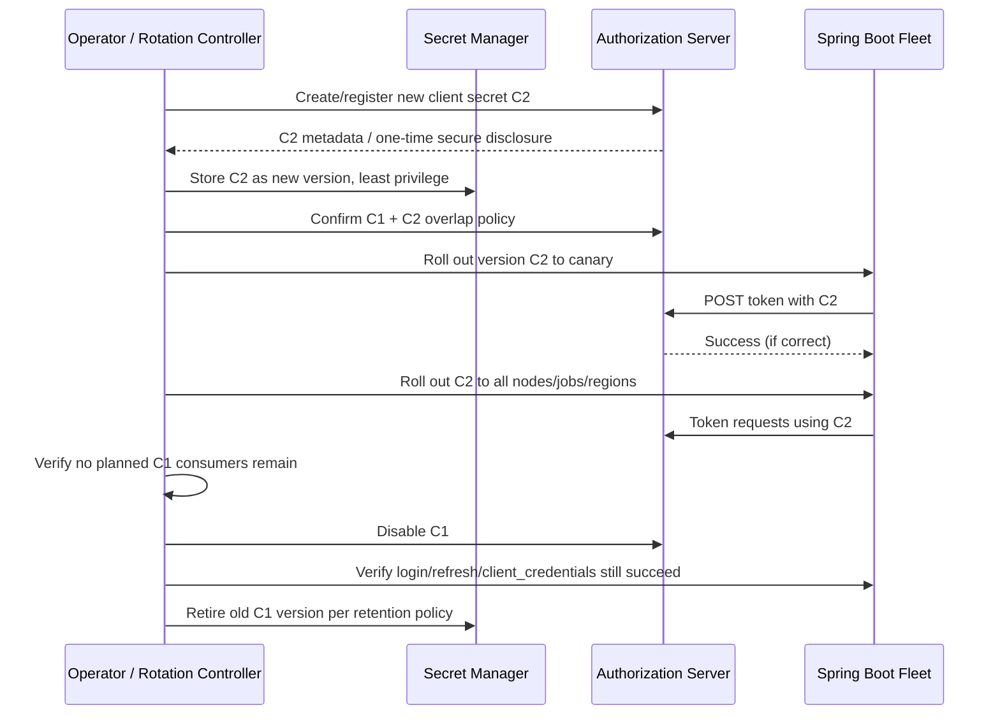

# 32.5. Rotating Client Secrets, Certificates, and Client Keys

## 1. Context: OAuth2 Client credentials also have a lifecycle

In a **Spring Security OAuth 2.0 / OpenID Connect (OIDC) Client** system, the application typically registers one or more `ClientRegistration` entries with an OpenID Provider (OP) / Authorization Server (AS). To exchange authorization codes, refresh tokens, or perform other OAuth operations, the application may need to **authenticate itself** to the AS.

For example, an Employee Portal application using the Authorization Code Flow:

```text
Browser                         Employee Portal                    OIDC Provider
   |                                  |                                   |
   |--- Sign in --------------------->|                                   |
   |                                  |--- Authorization Request -------->|
   |<--------------------- Redirect / consent ---------------------------|
   |--- Callback code + state ------->|                                   |
   |                                  |--- POST /token ------------------>|
   |                                  |    client_id + client_secret      |
   |                                  |    code + redirect_uri            |
   |                                  |<-- ID Token, Access Token --------|
   |<-- Authenticated session --------|                                   |
```

Over time, the AS may require rotating `client_secret` by security policy, an mTLS certificate may approach expiry, or the private key signing `private_key_jwt` may need replacement. If updated hastily, running nodes may continue using the old credential, causing logins, token refreshes, or outbound API calls to fail. Conversely, keeping old credentials too long prolongs exposure risk.

**Credential rotation** is the controlled process of replacing an **OAuth client's** credential, verifying the new credential works, retiring the old credential, and ensuring application instances and secret stores no longer rely on the revoked credential.

Key takeaway: **rotating a secret is not merely editing one line of YAML**. It spans AS-side configuration, secret distribution, runtime versions, token endpoint client authentication, refresh token lifecycles, rollback, auditing, and more.

> **Principle:** You must know **which credential authenticates the client, which AS accepts it, which node holds which version, and when the old credential may be revoked**. Never assume every AS supports two simultaneously active credentials; zero-downtime rotation depends on the provider and client authentication mechanism.

This lesson belongs to chapter **32. Deployment and Operations** of the **Spring Security OAuth 2.0 OIDC Client** module, focusing on Java 17+, Spring Boot 3.x, and Spring Security 6.x with Servlet/WebFlux. Paths, secrets, certificates, domains, and client IDs in examples are illustrative; code/config may require adjustment for your exact version and provider contract.

### Learning objectives

After this lesson, you will be able to:

1. Distinguish client secrets, private keys, public JWKs, X.509 certificates, truststores, and OP signing keys.
2. Understand `client_secret_basic`, `client_secret_post`, `client_secret_jwt`, `private_key_jwt`, and OAuth mTLS client authentication.
3. Plan rotation with overlap/grace periods or coordinated changeover when the AS allows only one credential.
4. Structure Spring Boot configuration so secrets are never committed to repositories or artifacts.
5. Know when to reload/rebuild `ClientRegistrationRepository` and when a rolling restart/deployment suffices.
6. Design workflows to replace private keys/JWKs and mTLS certificates, including `kid`, key aliases, public key registration, and certificate expiry.
7. Evaluate impacts on Authorization Codes, refresh tokens, token revocation, logout, and sender-constrained access tokens.
8. Implement observability, testing, and incident response runbooks without leaking secrets.
9. Avoid confusing **OAuth Client** keys with **OP ID Token signing** keys or **Resource Server** keys.
10. Apply safe rotation across multiple clients, tenants, regions, and clusters.

---

## 2. Terminology table: secrets, keys, and certificates are not the same thing

| Component | Who holds / publishes it? | Purpose | May it be public? |
| --- | --- | --- | --- |
| **OAuth `client_id`** | Issued by AS, used by client | Identifies the OAuth application within the AS | Usually yes |
| **`client_secret`** | RP confidential client and AS/verification service | Authenticates client via `client_secret_basic/post`, or key material for `client_secret_jwt` | **No** |
| **Client private key** | Held by OAuth client | Signs JWT client assertions (`private_key_jwt`), or performs TLS private-key operations | **No** |
| **Client public JWK/JWKS** | Registered by client at AS | AS verifies `private_key_jwt` signatures | Yes |
| **Client X.509 certificate** | Client/PKI, corresponding cert published | TLS client identity for mTLS or public-key verification | Cert is public; private key **no** |
| **Truststore** | Client runtime | Trusts server TLS certificates/CAs, optionally mTLS trust policy | Typically holds only trust anchors/public certs |
| **Keystore** | Client runtime/KMS/HSM | Stores private keys and certificate chains/aliases per application | Access must be strictly controlled |
| **OP signing private key** | **OpenID Provider** | Signs ID Tokens / sometimes access tokens | **No**; OAuth client does not own it |
| **OP JWKS public keys** | Published by OP via `jwks_uri` | RP/Resource Server verifies OP-issued tokens | Yes |
| **TLS server certificate** | OP/token endpoint or API server | Server proves TLS identity | Cert is public; private key on server |
| **Access/refresh token** | Issued by AS, stored/used by OAuth client | Resource access / obtaining new tokens | **No**, bearer or sender-constrained credential |

Two easily confused pairs:

- **Client private key ↔ client public JWK**: used by the AS to verify the **client's** `private_key_jwt`.
- **OP private signing key ↔ OP public JWKS**: used by the RP to verify **OP-issued ID Tokens**.

Rotating the client private key **does not automatically change** the OP ID Token signing key; conversely, the OP rotating ID Token signing keys **does not automatically require** the client to rotate `client_secret`. They are two distinct trust relationships.

### 2.1. Client secret is not refresh token

`client_secret` is an application credential authenticating **the application itself** to the AS. `refresh_token` is a credential issued by the AS for a grant, used to obtain new access tokens. Both can appear in the same request:

```http
POST /oauth2/token HTTP/1.1
Host: identity.example.test
Content-Type: application/x-www-form-urlencoded
Authorization: Basic <redacted-client-authentication>

grant_type=refresh_token&refresh_token=<redacted>
```

Changing the client secret affects this request if the AS requires the new credential; **however, rotating the secret does not necessarily revoke already-issued refresh tokens**. That depends on the AS, whether `client_id` stays the same or changes, token binding, and provider policy.

### 2.2. TLS server certificates and TLS client certificates

An HTTPS connection may authenticate only the **server**:

```text
OAuth Client -- HTTPS --> Token Endpoint
                 |
                 +-- Server presents its TLS certificate
                 +-- Client verifies hostname/CA/chain
```

When using **mutual TLS (mTLS)**:

```text
OAuth Client -- mTLS --> Token Endpoint
          |
          +-- Server verifies Client X.509 certificate
          +-- Client verifies Server TLS certificate
```

A TLS server certificate renewal at the OP is not an “OAuth Client key rotation”. The client might only need an updated truststore if the CA changed. With mTLS, changing the **client cert/private key** must be trusted/updated at the AS per profile.

### 2.3. `kid` and aliases have separate scopes

- `kid` in a client JWK is a hint for the AS to pick the public key verifying a client assertion.
- `kid` in an ID Token header helps the RP pick the **OP signing public key**.
- `alias` in a Java Keystore selects an entry/private key at runtime.
- `client_id` identifies an OAuth client inside an Authorization Server.
- `registrationId` identifies a `ClientRegistration` in Spring.

A `kid` string can collide between two unrelated JWKS sets; it is **not a global client or tenant identifier**.

---

## 3. OAuth Client authentication methods and rotatable material

### 3.1. `client_secret_basic`

For a confidential client, the application sends client ID/secret via HTTP Basic authentication to the Token Endpoint:

```http
POST /oauth2/token
Authorization: Basic <base64-of-form-encoded-client-id-and-secret>
Content-Type: application/x-www-form-urlencoded

grant_type=authorization_code&code=<redacted>&redirect_uri=<registered-uri>
```

Basic encoding is **credential packaging, not encryption**. Protect it with HTTPS/TLS and never route through untrusted proxies or logs. RFC 6749 §2.3.1 specifies form-URL-encoding client ID and secret before creating the Basic credential.

Material to rotate: the AS client's **`client_secret`**.

### 3.2. `client_secret_post`

Credentials travel in the form body:

```http
POST /oauth2/token
Content-Type: application/x-www-form-urlencoded

grant_type=authorization_code
&code=<redacted>
&client_id=employee-portal
&client_secret=<redacted>
```

Providers may support this, but follow the registered method. When rotating, watch out for proxy/HTTP body logging and redaction. Never switch from Basic to POST just to “test” if the AS rejects it.

### 3.3. `client_secret_jwt`

The OAuth client signs a **JWT client assertion using HMAC** with secret material shared between the AS and client, sending it to the Token Endpoint per JWT Bearer Client Authentication (RFC 7523 / OIDC profile).

The material to rotate remains the **shared secret**. Some AS implementations restrict HMAC algorithms, secret length, and replay/`jti`; never use an overly short client secret for signing algorithms requiring sufficient entropy.

### 3.4. `private_key_jwt`

The OAuth client signs a **JWT client assertion with an asymmetric private key**. The AS verifies the signature using the public key/JWKS registered for that `client_id`.

```text
Client registration:
  client_id = employee-portal
  token_endpoint_auth_method = private_key_jwt
  jwks_uri / registered public jwks = client's PUBLIC keys

Runtime:
  client PRIVATE signing key (KMS/HSM/keystore)

Token request:
  client_assertion_type =
    urn:ietf:params:oauth:client-assertion-type:jwt-bearer
  client_assertion = signed JWT
```

A JWT assertion typically contains:

```json
{
  "iss": "employee-portal",
  "sub": "employee-portal",
  "aud": "https://identity.example.test/oauth2/token",
  "iat": 1780000000,
  "exp": 1780000060,
  "jti": "random-unique-one-time-identifier"
}
```

Timestamps are illustrative. Depending on profile/AS contract, `aud` may be the Token Endpoint URL or an AS-specified audience identifier; **never hardcode the same rule blindly for every OP**. `jti` must be sufficiently random/unique; assertions should have short lifetimes, synchronized system clocks, and proper replay controls.

Material to rotate: **client private signing key**, **public JWKS registered at the AS**, and potentially key IDs/aliases. Changing `kid` while retaining a compromised private key is not a real rotation.

### 3.5. OAuth mTLS: `tls_client_auth` and `self_signed_tls_client_auth`

RFC 8705 defines OAuth 2.0 Mutual-TLS Client Authentication and Certificate-Bound Access Tokens. Two modes:

- `tls_client_auth`: AS binds the client to a certificate identity via registered PKI/subject fields.
- `self_signed_tls_client_auth`: AS uses a self-signed certificate/key registered via metadata/JWKS per profile.

Material to rotate: **client TLS private key + X.509 certificate**, updating identity/cert registration at the AS, key manager/HTTP connector on the client, and potentially token bindings.

Do not confuse an OAuth client's mTLS certificate with the OP's **HTTPS server** certificate.

### 3.6. Public clients and PKCE

SPA/native clients are typically **public clients** that cannot safely keep a shared secret inside a binary or browser. With Authorization Code + PKCE, clients may use `client-authentication-method: none` per AS configuration and security profile requirements.

Do not “rotate a client secret” by embedding a new secret in a JavaScript bundle or mobile binary: it is no longer a secret. Public-client security relies on PKCE, redirect URI restrictions, platform protections, and dedicated policies.

### 3.7. Selection table

| Method | Client-side credential | AS-side coordination step | Rotation pitfalls |
| --- | --- | --- | --- |
| `client_secret_basic` | Shared client secret | Add/replace secret for `client_id` | No overlap, rolling nodes fail |
| `client_secret_post` | Shared client secret | Same as above | Secret leaks in body logging |
| `client_secret_jwt` | HMAC shared secret | Add/replace secret and alg policy | `jti`/clock/alg/replay |
| `private_key_jwt` | Private signing key | Register new public JWK/JWKS | AS does not know new key/`kid` yet |
| `tls_client_auth` | TLS private key + cert | Register new identity/cert profile | TLS handshake, subject mismatch |
| `self_signed_tls_client_auth` | Private key + self-signed cert | Register certificate/thumbprint/profile | Lack of overlap window |
| Public + PKCE | No client secret | Redirect/PKCE registration | Attempting to hide secrets in browser |
| M2M `client_credentials` | Any valid confidential credential | AS client config | Scheduled jobs still using old credential |

---

## 4. Scope and goals of a rotation

### 4.1. Triggers

Rotation can be triggered by:

- Secret/key reaching scheduled expiry per security policy.
- Certificate nearing expiration.
- Credential appearing in source control, logs, or tickets.
- Personnel or vendor access changes.
- Migrating from secret-based authentication to key-based/mTLS.
- Moving environments, regions, or tenants.
- Confirmed or suspected compromise incident.
- Provider changing algorithms, certificate authorities, or registration policies.
- Restructuring client registrations or upgrading infrastructure.

**Scheduled rotation** can leverage timed overlap. **Emergency rotation** after compromise prioritizes cutting off attacker access and may accept brief disruption.

### 4.2. Practical goals

A complete plan must ensure:

1. New credentials are generated via a strong CSPRNG/HSM/KMS.
2. The AS receives the exact new credential under the right `client_id`/tenant.
3. The Spring Security runtime uses the new credential for token, refresh, and revocation requests.
4. No node still relies on the old credential past the overlap window.
5. The old credential is disabled at the AS and purged from secret stores/versions per retention policy.
6. Zero plaintext secrets exist in Git, CI logs, images, heap dumps, or observability systems.
7. Metrics, auditing, and rollback/failure responses are prepared beforehand.

### 4.3. Zero downtime is not automatic

To rotate without downtime when the AS supports **only one active secret**, every node would have to switch at the exact instant the AS switches; rolling deployments during the transition will produce errors. With overlap:

```text
T0  Old credential C1 active
T1  Register/add C2; AS accepts C1 and C2
T2  Rollout client configuration to C2
T3  Confirm all nodes, jobs, regions use C2
T4  Disable C1; verify C1 rejected
T5  Remove old secret versions and close change
```

If the provider lacks dual-secret/public-key/cert overlap, plan a **coordinated cutover**, throttle token requests/refreshes during the switchover window, or use a suitable proxy/secret-broker architecture. Never promise zero downtime solely from a rolling restart.

### 4.4. Distinguishing “create”, “activate”, “retire”, “destroy”

| State | Meaning | Verification needed |
| --- | --- | --- |
| Generated | New credential created but not yet trusted by AS | Do not send runtime requests with it |
| Registered/standby | AS knows the new credential; not yet used for signing/auth | Can test in staging or controlled probe |
| Active | Runtime uses the new credential; AS accepts it | Real token requests/refreshes pass |
| Overlap | Old and new both work | Set deadline, monitor credential usage |
| Retired | AS no longer accepts the old credential | Test rejection; do not casually revert |
| Destroyed | Secret/private key deleted from stores per policy | Audit/retention complete |

Deleting a secret in Kubernetes alone does not mean the AS has invalidated it.

---

## 5. Inventory before changing any credential

For each OAuth Client, document **non-secret metadata**:

| Field | Example | Purpose |
| --- | --- | --- |
| Environment | `production` | Avoid editing staging/prod by mistake |
| Tenant / issuer alias | `north-workforce` | Separate trust domains |
| Spring registration ID | `north-employee-web` | Internal mapping |
| OAuth client ID | `portal-north` | AS mapping |
| AS/token endpoint alias | `north-op` | Identify verifying authority |
| Client auth method | `client_secret_basic` | Know what credential type rotates |
| Secret/key version ID | `v2` / `key-2026-11` | Track adoption without logging secret values |
| Secret manager reference | `secret://.../client-secret` | Distribution source |
| Deployments/regions | `web-eu, web-apac` | Rollout checklist |
| Workloads | `login-web, sync-worker` | Avoid missing background clients |
| Client registration/JWKS refs | Public key IDs/cert metadata | Update exact target locations |
| Rotation owner/approver | Team/role | Authorized change control |
| Certificate expiry | Expiration date | Alert/rotate ahead of expiry |
| Credential disable deadline | UTC timestamp | Prevent indefinite overlap |

Never put `client_secret` or PEM private keys into inventory tables, issue trackers, or public docs.

### 5.1. One application can use multiple registrations

```text
employee-portal:
  corporate-oidc-web -> authorization_code, user login
  calendar-delegated -> authorization_code, delegated API
  internal-reporting -> client_credentials, M2M batch
  hr-mtls -> client_credentials + mTLS, external HR API
```

Each registration may have a different credential owner, token endpoint, and rotation schedule. Rotating `corporate-oidc-web` does not mean updating `hr-mtls` as well.

### 5.2. One credential can be used in many places

An active secret may exist in:

- Spring Boot web pods.
- Scheduled batch jobs.
- WebFlux services.
- Old blue/green deployments.
- Disaster-recovery regions.
- Canaries.
- Sidecars/proxies.
- CI integration tests.
- Unsynced secret copies in another cluster.
- Rolling workers / long-running JVM processes.

If C1 is retired while a nightly job still runs C1, failures will surface hours later rather than immediately after deploy.

### 5.3. Identify all endpoints requiring client authentication

Not just the login Token Endpoint:

- Authorization Code → Token Endpoint.
- Refresh Token → Token Endpoint.
- Client Credentials → Token Endpoint.
- Token Revocation (RFC 7009) if the AS requires client authentication.
- Token Introspection (RFC 7662) if the client acts as an authorized introspection caller.
- Pushed Authorization Requests (PAR) or other profiles using client authentication.
- Backchannel/token exchange endpoints or extension contracts per provider.

OP logout redirects and ID Token JWKS verification do not use the client secret by default. Do not send credentials indiscriminately to every endpoint just because they share an issuer.

---

## 6. Spring Boot configuration: never embed client secrets in code

### 6.1. Configuring Authorization Code/OIDC Login with environment variables

For a confidential client using `client_secret_basic`:

```yaml
spring:
  security:
    oauth2:
      client:
        registration:
          workforce:
            provider: workforce-provider
            client-id: ${OIDC_CLIENT_ID}
            client-secret: ${OIDC_CLIENT_SECRET}
            client-authentication-method: client_secret_basic
            authorization-grant-type: authorization_code
            redirect-uri: "{baseUrl}/login/oauth2/code/{registrationId}"
            scope:
              - openid
              - profile
              - email

        provider:
          workforce-provider:
            issuer-uri: https://identity.example.test/realms/workforce
```

Secrets **never appear as literal values** in the file. Spring Boot resolves `${OIDC_CLIENT_SECRET}` at runtime from the Environment or an appropriate PropertySource.

However, **environment variables also carry risks**:

- They can leak via diagnostic dumps, process environments, orchestrator configs, or container admin privileges.
- Passing secrets via command-line arguments exposes them in shell history and process listings.
- Logging Spring Environment/actuator/config properties without masking can expose secrets.
- Updating environment variables in a deployment usually **does not update a running JVM's environment**.

In production, use a secret manager and secret delivery enforcing least privilege, encryption, auditing, rotation, and revocation, paired with workload identity/mounts/CSI/config integration per platform.

### 6.2. Distinguish secret reference from secret value

A clean declaration records only a **reference**:

```text
registrationId = workforce
clientId = portal-workforce
credentialRef = secret-manager://prod/oauth/portal-workforce/current
credentialVersion = v17
```

The runtime is authorized to read `credentialRef` via its workload identity and holds the secret value in process memory when calling the AS. Avoid:

```yaml
# ANTI-PATTERN:
client-secret: very-real-production-secret
```

And avoid committing `.env` files with secrets into Git, image layers, or CI artifacts.

### 6.3. Startup checks and fail-fast

An application can fail startup if a required property is missing. That is far safer than silently booting with an empty/placeholder config:

```text
OIDC_CLIENT_SECRET missing
    -> block deployment readiness / configuration error
    -> do not silently switch to "none"
```

Never fix a startup failure by setting `client-authentication-method: none` when the client is confidential and the AS requires client authentication.

For `client_secret_basic`/`client_secret_post`, verify:

- `client-id` matches the right environment/tenant.
- `client-secret` matches the right version for that `client_id`.
- The authentication method is accepted by the AS.
- `issuer-uri`/`token-uri` points to the right AS.
- The runtime has permission to read the secret without KMS/secret-manager errors.
- HTTPS TLS and proxies work properly.

### 6.4. `ClientRegistration` is usually built at application startup

Spring Boot binds `spring.security.oauth2.client.registration.*` into `ClientRegistration` and constructs `ClientRegistrationRepository` or `ReactiveClientRegistrationRepository` depending on stack.

This means:

```text
Secret Manager:
  current = C2

Old JVM instance:
  ClientRegistration created with C1 at startup

Result:
  JVM may keep using C1 even after current secret points to C2
```

**Do not assume** modifying the secret store automatically reloads the secret inside already-constructed Spring Security objects. With Kubernetes environment variables, a rolling restart/redeployment is the standard way for JVMs to pick up the new value.

Even with dynamically updated secret volumes, **new file bytes do not guarantee the client authentication flow reloads the file**. You need an integration that reloads/verifies keys and swaps runtime clients safely.

### 6.5. A `SecurityFilterChain` does not need to know the secret directly

```java
package com.example.portal.security;

import org.springframework.context.annotation.Bean;
import org.springframework.context.annotation.Configuration;
import org.springframework.security.config.Customizer;
import org.springframework.security.config.annotation.web.builders.HttpSecurity;
import org.springframework.security.web.SecurityFilterChain;

@Configuration
public class OAuth2WebSecurityConfig {

    @Bean
    SecurityFilterChain filterChain(HttpSecurity http)
            throws Exception {

        return http
                .authorizeHttpRequests(authorize -> authorize
                        .requestMatchers("/", "/login", "/error").permitAll()
                        .anyRequest().authenticated())
                .oauth2Login(Customizer.withDefaults())
                .build();
    }
}
```

`oauth2Login()` consumes the configured registration/authorized-client infrastructure; never hardcode `client-secret` directly in `SecurityFilterChain` or controllers.

For WebFlux apps, use `SecurityWebFilterChain` and `ServerHttpSecurity`; secret and rotation principles are identical, even though HTTP client and token response APIs differ.

---

## 7. Client secret rotation flow with overlap

### 7.1. Prerequisites

Zero-downtime secret replacement requires the AS to support **two concurrently valid credentials/versions** for a window. Providers may offer:

- Two active secrets.
- “Primary/secondary” secrets.
- New secret + grace window.
- Client key versions.
- Secret rotation API with `not-before`/expiration.
- Only one active secret (no overlap).

Never assume a provider supports dual secrets until verified via docs and testing.

### 7.2. Standard sequence



**Never paste secret C2 into console logs, chat messages, or issue trackers** when creating/registering it. The AS may display the secret only once; handle it strictly through protected secret channels.

### 7.3. Phase A — Preparation

1. Confirm the registration ID and AS client ID for the right environment.
2. Identify every workload sharing the credential, including batch jobs, DR, and canaries.
3. Check how long the AS allows overlap and how new credentials are generated.
4. Note timeouts, retries, Token Endpoint volume, and low-traffic windows.
5. Set up metrics for 401/`invalid_client`/`invalid_grant` and latency.
6. Record credential version IDs (never values).
7. Prepare a rollback plan within the C1 window and a non-rollback plan after retirement.
8. Ensure operators have scoped least-privilege access with proper approvals/checks.

### 7.4. Phase B — Register new credential

Depending on the AS, creating C2 may:

- Activate C2 alongside C1 automatically.
- Require explicitly activating C2.
- Immediately invalidate C1 upon creating C2.
- Behave differently per tenant/client type.

If creating C2 invalidates C1 immediately, **do not proceed with an overlap plan**; switch to a coordinated cutover or pause the change to adjust.

### 7.5. Phase C — Test C2 before full rollout

Use a **canary app node** configured with C2 to execute a representative OAuth flow:

- Real Authorization Code login in staging/test tenant or a controlled production account if policy permits.
- Token request via `client_credentials` for M2M registrations.
- Token refresh using an authorized client **owned by the canary and authorized for testing** per OP policy.
- Token revocation/introspection if the client uses those endpoints.

Never test by calling the Token Endpoint with a random user's refresh token. Never log secrets, access tokens, or refresh tokens while testing.

When the canary succeeds, confirm `issuer`, `client_id`, exact secret version, and endpoint. An HTTP 200 from a proxy without an actual OAuth exchange is not proof of client authentication.

### 7.6. Phase D — Roll out across the entire runtime

When using environment variables/Boot config, execute a controlled rolling deployment:

```text
old pods: C1
new pods: C2
AS accepts: C1 and C2 during overlap
```

Verify:

- New pods actually pick up C2.
- No forgotten old deployments remain.
- No paused workers wake up later still holding C1.
- DR regions and cron jobs also updated.
- No JVM cache/keystore/snapshot holds C1 as the active credential.
- No Secret Manager `current` alias flips back to C1 due to a race between automation jobs.

**Do not log C2 to prove the new version is active**; log a controlled internal version ID or key alias, and never log a weak-hash fingerprint of the secret.

### 7.7. Phase E — Retire C1

Once all known consumers are confirmed on C2:

1. Disable C1 at the AS.
2. Verify the AS genuinely rejects C1 per test policy.
3. Monitor across a long enough window covering scheduled jobs and canaries.
4. Remove C1 from runtime configs and secret manager versions per retention/recovery policy.
5. Audit backups, pipeline artifacts, and permissions.
6. Close the change record with timestamps, owner, and outcome—without raw credentials.

If `invalid_client` appears on a batch job after retiring C1, prioritize updating the job's stale secret rather than re-enabling C1 indefinitely.

### 7.8. When the AS supports only one active secret

Model:

```text
AS recognizes only C1
  |
  | rotate at time T
  v
AS recognizes only C2
```

Around time T:

- Nodes still on C1 will fail with `invalid_client`.
- Nodes switching to C2 before T will fail if they use C2 too early.
- In-flight Authorization Code callbacks/tokens may fail.
- Background job refreshes/`client_credentials` calls may fail.

Mitigations: coordinated cutover, synchronized config refresh, temporarily throttling token grants in the switchover window, and rapid verification. For strict high-availability requirements, work with the provider on multiple-credential support or an auth method permitting key overlap. Never build an endless “retry every old secret” fallback, as it expands exposure and prolongs compromise windows.

---

## 8. Spring Security runtime: reload secrets in the right place

### 8.1. Updating the secret manager differs from updating in-memory registrations

If the application uses the default:

```java
ClientRegistrationRepository registrations;
```

and a `ClientRegistration` was built from C1 at startup, setting `current=C2` in the Secret Manager does not update the live object to C2.

A safe, operationally simple strategy:

```text
Rotate C2 in AS and Secret Manager
     -> Launch new application deployment with C2
     -> Validate canary/rollout
     -> Retire C1 when no old consumers remain
```

This aligns with **immutable deployments**. You do not need custom hot-reloading if the provider supports a sufficient overlap window.

### 8.2. When dynamic reloading is required

For long-lived or multi-tenant applications, a dynamic repository may be needed. An example illustrating only the idea of an **atomic snapshot** of registrations:

```java
package com.example.portal.security;

import java.util.Map;
import java.util.Objects;
import java.util.concurrent.atomic.AtomicReference;

import org.springframework.security.oauth2.client.registration.ClientRegistration;
import org.springframework.security.oauth2.client.registration.ClientRegistrationRepository;

public final class VersionedClientRegistrationRepository
        implements ClientRegistrationRepository {

    private final AtomicReference<Map<String, ClientRegistration>> snapshot;

    public VersionedClientRegistrationRepository(
            Map<String, ClientRegistration> initialRegistrations) {

        snapshot = new AtomicReference<>(
                Map.copyOf(initialRegistrations));
    }

    @Override
    public ClientRegistration findByRegistrationId(String registrationId) {
        return snapshot.get().get(registrationId);
    }

    public void replaceAllValidated(
            Map<String, ClientRegistration> newRegistrations) {

        Objects.requireNonNull(newRegistrations);

        // Caller must validate trusted issuer, client IDs, endpoints,
        // secret versions, permissions and deployment coordination.
        snapshot.set(Map.copyOf(newRegistrations));
    }
}
```

This is a **design fragment**, not a complete rotation solution. It only ensures a single lookup sees a consistent map. It **does not** guarantee:

- Token response clients / HTTP request factories were reloaded.
- Private-key JWT signing sources or TLS `SSLContext` were swapped.
- Authorized clients saved under C1 no longer reference the old `ClientRegistration`.
- In-flight requests are not still using snapshot C1.
- OIDC decoder / authorization code manager caches were properly reset.
- The AS currently accepts C2 or no longer accepts C1.
- Requests avoid mix-up when issuers or client IDs change.
- Multiple nodes concurrently run the same generation.

For dynamic updates, the entire **versioned configuration + credential source + authorized client + HTTP token request path** must remain consistent. Never treat `AtomicReference` as proof of zero downtime.

### 8.3. Existing authorized clients and stale `ClientRegistration`

An `OAuth2AuthorizedClient` typically retains its associated `ClientRegistration`. If a persisted record or manager holds a registration built with C1, post-rotation refreshes might still use the old client metadata depending on implementation/storage path.

Evaluate:

- Is `OAuth2AuthorizedClientService` InMemory, JDBC, or custom?
- Upon loading, does the service return the old registration object or resolve from the new repository?
- Which registration does `AuthorizedClientManager` pull for refreshes?
- Does the cache key `(registrationId, principalName)` distinguish credential generations?
- Could a refresh token from an old AS/client be sent to a new Token Endpoint?
- If `client_id` or issuer changed, must reauthorization be enforced?

Rotating **the secret for the same `client_id`/issuer** is very different from changing **the client registration identity**. Never reuse a registration ID for an entirely different issuer/client without handling the authorized client store.

### 8.4. Secret read failures require an explicit policy

If the application fails to fetch C2 from the secret manager:

- For new deployments: fail startup/readiness per policy when the credential is required.
- For already-running runtimes: continue using C1 within the overlap window **only if C1 is still accepted by the AS and permitted by security policy**.
- If C1 was compromised or retired: never fall back to C1.
- Never log secret contents or exceptions containing payloads.
- Alert owners and prevent automation from marking rotation successful.

### 8.5. Spring Cloud refresh or dynamic property sources

Some systems use `@RefreshScope` or config refresh events; what actually refreshes depends on **bean lifecycles, OAuth2 client infrastructure, token HTTP clients, and custom caches**.

You cannot assume the entire OAuth2 Login/refresh flow uses C2 just because a “refresh configuration” endpoint returns 200. Run integration tests verifying the **actual credential version sent in Token Endpoint requests**, paired with rollback/roll-forward policies.

---

## 9. Moving from client secrets to `private_key_jwt`

### 9.1. Pros and cons

With `private_key_jwt`, the client **does not send a static shared secret** on every Token Endpoint request. Instead, it sends a JWT assertion signed with its private key:

```text
OAuth Client signing private key (not exported)
    |
    v
Sign client_assertion JWT
    |
    v
POST token request with client_assertion
    |
    v
AS selects client's registered public JWK
    |
    v
Verify signature + iss/sub/aud/exp/jti
    |
    v
Authenticate OAuth client
```

Advantages can include:

- Private keys stay in KMS/HSM or keystores without sharing secrets between client and AS.
- Multiple public keys can be registered and rotated using `kid`.
- The AS can enforce strong key type/algorithm policies.
- Signed assertions have short lifetimes, limiting reuse of any specific assertion.

However, **`private_key_jwt` carries its own risks**: private key compromise, JWT replay if `jti/exp` policies are weak, wrong audience, AS missing the new public key, cluster nodes using old keys, or non-overlapping key rotation.

### 9.2. Distinguish signing keys from TLS certificates

With `private_key_jwt`, the private signing key may live in an HSM/KMS or keystore. Some providers register **public JWKs** directly; others require X.509 certificates or JWK `x5c`.

An X.509 certificate can represent a public key, yet **that does not mean** the token endpoint uses mTLS. When the token endpoint auth method is `private_key_jwt`, client authentication is the **JWT assertion signature**, even if the key carries a certificate.

### 9.3. Register the new public JWK before signing with the new private key

Example:

```json
{
  "keys": [
    {
      "kty": "RSA",
      "use": "sig",
      "alg": "RS256",
      "kid": "portal-signing-2026-10",
      "n": "<old-public-modulus>",
      "e": "AQAB"
    },
    {
      "kty": "RSA",
      "use": "sig",
      "alg": "RS256",
      "kid": "portal-signing-2026-11",
      "n": "<new-public-modulus>",
      "e": "AQAB"
    }
  ]
}
```

Both `n` values are placeholders, not runnable JWKs. The AS must hold the new public key before the client starts signing with the new private key.

If the provider uses `jwks_uri` pointing to a client-hosted JWKS:

- The URL must be HTTPS and trusted.
- The AS must be able to fetch/refresh the JWKS per policy.
- Do not remove the old public key before in-flight assertions expire plus an appropriate cache window.
- Keep client `kid` and private key synchronized.
- Protect the host and cache/CDN serving the public JWKS; never publish private JWK fields.

### 9.4. Structure of a client assertion JWT with Nimbus — standalone example

The snippet below illustrates **building an assertion with an RSA private key**. It does not configure Spring Security's token response client by itself; wiring depends on your Spring Security version and provider profile.

```java
package com.example.portal.security;

import java.security.interfaces.RSAPrivateKey;
import java.time.Instant;
import java.util.Date;
import java.util.UUID;

import com.nimbusds.jose.JOSEObjectType;
import com.nimbusds.jose.JWSAlgorithm;
import com.nimbusds.jose.JWSHeader;
import com.nimbusds.jose.crypto.RSASSASigner;
import com.nimbusds.jwt.JWTClaimsSet;
import com.nimbusds.jwt.SignedJWT;

public final class PrivateKeyJwtAssertions {

    public static String create(
            String clientId,
            String expectedAudience,
            String keyId,
            RSAPrivateKey privateKey) throws Exception {

        Instant now = Instant.now();

        JWTClaimsSet claims = new JWTClaimsSet.Builder()
                .issuer(clientId)
                .subject(clientId)
                .audience(expectedAudience)
                .issueTime(Date.from(now))
                .expirationTime(Date.from(now.plusSeconds(60)))
                .jwtID(UUID.randomUUID().toString())
                .build();

        SignedJWT signed = new SignedJWT(
                new JWSHeader.Builder(JWSAlgorithm.RS256)
                        .keyID(keyId)
                        .type(JOSEObjectType.JWT)
                        .build(),
                claims);

        signed.sign(new RSASSASigner(privateKey));
        return signed.serialize();
    }

    private PrivateKeyJwtAssertions() {
    }
}
```

**Requirements for real integration:**

- `expectedAudience` must come from the **AS client authentication contract**, never from an unverified browser/token payload.
- `clientId` must be registered at the AS.
- Load the private key from a secure source; never hardcode PEMs in classes or logs.
- `keyId` must match the registered public JWK.
- `iat/exp` must satisfy clock skew and OP policies; keep assertion TTL short.
- `jti` must be sufficiently unique, and the AS should enforce replay protection per profile.
- The algorithm must be permitted by the AS; never allow `alg=none` or downgrades.
- JWT assertions are sensitive credentials—**never log the raw serialized value**.
- Token requests must send the exact `client_assertion_type` and `client_assertion` per RFC 7523; the HTTP client must never send assertions to the wrong AS.

### 9.5. Integrating with Spring Security OAuth2 Client

Spring Security provides extension points for **token response clients** and **client authentication parameter converters**, including JWT client authentication mechanisms in corresponding versions.

Because APIs vary across Spring Security 6.x minor releases (`RestTemplate`-based vs. `RestClient`-based token clients, Servlet vs. Reactive), do not copy a converter class from a different version's docs while ignoring wiring.

Deployment model:

```text
ClientRegistration:
  clientAuthenticationMethod = private_key_jwt
        |
        v
AccessTokenResponseClient for authorization_code/refresh_token/client_credentials
        |
        v
Client assertion signing component
  -> private key for current key version
  -> client_id, aud, iat, exp, jti, kid
        |
        v
Token Endpoint
        |
        v
AS verifies registered public key & assertion claims
```

Check **every grant path** to see which token response client it uses: authorization code login, refresh token, and client credentials may need separate configuration depending on Spring Security version and manager setup.

### 9.6. Rotating `private_key_jwt`

```text
1. Generate new private key K2 in secure key store/HSM.
2. Export only public JWK P2, set new kid.
3. Register P2/JWKS at AS alongside P1.
4. Verify AS can see P2.
5. Deploy signer using K2/kid2 to canary.
6. Exercise token/refresh requests.
7. Roll out K2 to all clients/workers.
8. Observe assertions signed with K1 no longer in normal use.
9. Retire public P1 from AS after overlap/replay window.
10. Disable/destroy private K1 per policy.
```

**Never remove K1 from the AS right at the start of rollout** while nodes still sign with K1, unless it is an emergency compromise requiring immediate invalidation.

---

## 10. Rotating X.509 client certificates and mTLS keys

### 10.1. When an OAuth Client uses mTLS

With mTLS, the app may use a certificate/private key to authenticate to the AS at the Token Endpoint, or to call a Resource Server using certificate-bound access tokens per RFC 8705.

A credential bundle includes:

```text
OAuth Client TLS identity:
  private key K1         <- secret, in keystore/HSM
  public certificate C1 <- public certificate/chain
  key alias              <- selects runtime entry
  trust anchors          <- verifies server certificate
```

When a certificate expires or nears expiry, **replace the certificate** on schedule. For security-grade rotation, rotate the key pair as well when procedures allow; renewing a certificate over **the same private key** is not true key rotation.

### 10.2. Distinguish renewal from key rotation

| Operation | Certificate changes? | Private key changes? | Consequence |
| --- | --- | --- | --- |
| Renew certificate, reuse key | Yes | No | Certificate lifetime extends; key compromise risk remains |
| Key rotation + new certificate | Yes | Yes | AS/clients must trust the new public identity |
| Change CA/trust chain | Possibly | Possibly not | Truststore/PKI policies require updates |
| Server TLS certificate renewal | On OP/API server | Not an OAuth client key | Client checks trust/hostname; does not alter client auth |
| Certificate-bound token rotation | Client mTLS cert changes | Usually yes | Tokens bound to old cert may fail with new cert |

If a private key is compromised, renewing the certificate on the same key **does not remediate** the incident.

### 10.3. Identify the exact mTLS profile

Before replacing C1 with C2, confirm with the provider:

- `tls_client_auth` or `self_signed_tls_client_auth`?
- Which CA, subject DN/SAN, or certificate thumbprint/JWK does the AS trust?
- Can multiple certs/keys be registered for the same client ID?
- Does the Token Endpoint have an mTLS-specific endpoint alias?
- Does HTTP traffic pass through a proxy/service mesh performing TLS termination?
- Does the AS verify the client certificate during the TLS handshake or at the application layer?
- Does the Resource Server require certificate-bound tokens?
- Do server or client truststores need updating?
- Does the issued certificate include the `clientAuth` Extended Key Usage per profile?
- Does SNI/hostname validation against the server TLS certificate work properly?

Do not confuse **certificate trust** (trusting a CA/subject) with **certificate-bound tokens** (access tokens bound to the certificate's fingerprint/key).

### 10.4. Illustrative Spring Boot SSL Bundle

Spring Boot 3.1+ provides **SSL bundles** for supported components. A file-based JKS/PKCS12 configuration:

```yaml
spring:
  ssl:
    bundle:
      jks:
        oauth-client:
          keystore:
            location: file:/run/secrets/oauth-client-keystore.p12
            password: ${OAUTH_CLIENT_KEYSTORE_PASSWORD}
            type: PKCS12
          key:
            alias: oauth-client-2026
```

The `spring.ssl.bundle.*` block alone **only defines SSL material**. It **does not automatically force OAuth2 Token Endpoint calls** to use this certificate in all Spring Security versions/setups. You must wire the bundle into the HTTP transport **actually used by the OAuth2 token response client**.

Never commit `.p12` files containing private keys. K8s secret volumes also need RBAC/namespace restrictions, secret encryption, and pod mount policies.

### 10.5. Example `RestClient` with a TLS client certificate

With Spring Framework 6.1+ and the JDK HTTP client, you can build a REST client using an `SSLContext` from the bundle:

```java
package com.example.portal.security;

import java.net.http.HttpClient;

import org.springframework.boot.ssl.SslBundles;
import org.springframework.context.annotation.Bean;
import org.springframework.context.annotation.Configuration;
import org.springframework.http.client.JdkClientHttpRequestFactory;
import org.springframework.web.client.RestClient;

@Configuration
public class MtlsHttpConfiguration {

    @Bean
    RestClient clientCertificateRestClient(
            RestClient.Builder builder,
            SslBundles sslBundles) {

        var bundle = sslBundles.getBundle("oauth-client");

        var javaHttpClient = HttpClient.newBuilder()
                .sslContext(bundle.createSslContext())
                .followRedirects(HttpClient.Redirect.NEVER)
                .build();

        return builder.clone()
                .requestFactory(
                        new JdkClientHttpRequestFactory(javaHttpClient))
                .build();
    }
}
```

Important limitations:

- This is an **HTTP transport demo**, not a complete OAuth2 Client credentials configuration.
- You must configure the OAuth2 **`AccessTokenResponseClient`/client authentication** to use this HTTP transport for Token Endpoint calls; wiring APIs depend on your Spring Security minor version and Servlet/Reactive stack.
- With certificate-bound access tokens, outbound Resource Server HTTP clients may also need the matching client certificate.
- Verify alias, key password, cert chain, TLS versions/ciphers, and truststore policies.
- Never allow `RestClient` to send client certificates/Authorization headers to arbitrary user-supplied URLs.
- An `HttpClient`/`SSLContext` built once retains old key material; updating the `.p12` file does not swap it automatically.

### 10.6. mTLS rotation with overlap

Sample workflow:

```text
1. Generate K2 in secure key store/HSM.
2. Obtain X.509 C2 with correct subject/SAN/EKU/chain.
3. Register/approve C2 at AS, keep C1 accepted if possible.
4. Deploy key material K2/C2 to canary.
5. Build new SSLContext / HTTP client using K2/C2.
6. Test token endpoint mTLS handshake + client auth.
7. Test API with certificate-bound token minted under C2.
8. Roll out to all nodes, workers, regions.
9. Stop new requests using C1.
10. Retire C1 at AS after token/connection overlap policy.
11. Remove K1/C1 from old runtime/keystores per retention policy.
```

If the provider **accepts only one certificate**, plan a coordinated changeover and outage-risk mitigation just as with secret-only rotation.

### 10.7. Certificate-bound access tokens complicate rollovers

With RFC 8705 certificate-bound tokens, the AS may issue tokens carrying a confirmation binding such as:

```json
{
  "cnf": {
    "x5t#S256": "<base64url-cert-sha256-thumbprint>"
  }
}
```

If access token T1 is bound to certificate C1:

```text
Token T1 bound to certificate C1
    |
    +-- API call presenting C1 -> may be accepted if all checks pass
    |
    +-- API call presenting C2 -> must fail token/certificate binding
```

**Do not assume** token T1 remains usable once the HTTP connector switches to C2. You may need to:

- Keep C1/K1 alive safely long enough to drain in-flight calls or token TTL, if uncompromised and allowed by provider policy.
- Mint new tokens bound to C2 before shifting API traffic.
- Separate connection pools/HTTP clients by certificate version during overlap.
- Ensure refresh/token requests authenticate properly and handle the new token binding.
- In a compromise, revoke C1/T1 immediately instead of keeping fallbacks active.

That is why mTLS rotation requires coordinating the **AS, OAuth Client, and Resource Server**, not just one deployment.

### 10.8. Long-lived TLS connections and connection pools

An established mTLS connection can remain alive in a connection pool depending on endpoint/proxy policies. When certificate C1 is retired:

- Existing established connections may not renegotiate immediately.
- Connection reuse can make rotation tests fail to reflect new connections.
- Certificate expiry/OCSP/CRL handling depends on TLS stack/PKI policies.
- You may need to drain old connections and initialize a fresh HTTP client/`SSLContext`.
- Avoid killing all connections abruptly if that drops in-flight requests unnecessarily; align with zero-downtime/incident plans.

A `curl` mTLS check on one workstation does not replace testing the transport inside the running JVM/container.

### 10.9. Keystore/truststore security

- Keystore and key passwords are managed secrets; never store them in Git.
- Keep private keys non-exportable in HSM/KMS where supported by platform/provider.
- Restrict read permissions on mounted files and aliases.
- Never log PEMs, keystore bytes, passwords, or TLS handshake secrets.
- Truststores hold trusted CAs; never enable “trust all” to work around server certificate errors.
- Update the truststore when server CAs change, while always preserving hostname/certificate path validation.
- Audit certificate issuance and revoke old certificates when appropriate.

---

## 11. Rotation impacts on Authorization Codes, Refresh Tokens, and Token Stores

### 11.1. Client secret changes while `client_id` stays the same

Common scenario:

```text
Before:
  client_id = employee-portal
  secret = C1

After:
  client_id = employee-portal
  secret = C2
```

When the client registration identity stays constant, the AS may continue honoring existing refresh tokens as long as requests authenticate with C2 and no token/grant policy changed.

**However, there is no portable guarantee across all providers.** An AS may enforce security rules that:

- Invalidate old refresh tokens upon secret rotation.
- Rotate/revoke token families on client compromise.
- Require user reauthorization after changing client auth methods.
- Alter scopes/consent/audience during rotation.
- Bind grants to a specific certificate or key version.

Test with an **authorized client for a permitted test account**, rather than inferring behavior from “secret updated” status in a console.

### 11.2. Changing `client_id` usually means creating a new OAuth client

```text
Old:
  client_id = employee-portal-A
  registrationId = workforce

New:
  client_id = employee-portal-B
  registrationId = workforce-v2
```

Changing client ID is not just rotating a secret. Existing authorization codes, refresh tokens, and consents are usually **bound to the old client** and may not work with the new client. You must:

- Register redirect URIs and scopes for client B.
- Create a new `ClientRegistration` with a distinct/versioned registration ID.
- Migrate login traffic in a controlled way.
- Re-evaluate consent/reauthorization.
- Migrate authorized client store/key namespaces and revoke old grants per policy.
- Never send client A's refresh token to the Token Endpoint as if it belonged to client B.

### 11.3. In-flight Authorization Codes during secret replacement

Suppose a user starts OIDC Login under C1 before rollout, and the callback arrives after the AS switches to C2.

The browser authorization request carries client ID, redirect URI, state, and PKCE depending on flow; when **redeeming the code** at the Token Endpoint, the client must present whatever credential **the AS accepts at that moment**.

If the AS accepts only C2 while the callback node still uses C1, the token request may return `invalid_client`. With overlap, both C1 and C2 remain valid during the grace window.

Never work around this by sending the same authorization code to multiple Token Endpoints, as codes are typically single-use and bound to AS/client/redirect URI/PKCE.

### 11.4. Refresh token rotation is not client credential rotation

Two distinct rotations:

| Type | Who generates new? | Target | What does Token Endpoint require? |
| --- | --- | --- | --- |
| **Client secret rotation** | AS/client admin | Replaces OAuth client auth credential | C2 accepted by AS |
| **Client signing key rotation** | Client KMS/AS registration | Replaces client assertion signing key | Assertion signed by K2 verified by AS |
| **Client mTLS certificate rotation** | Client PKI + AS registration | Replaces TLS identity | TLS cert C2 accepted |
| **Refresh token rotation** | Authorization Server | Replaces refresh token per refresh grant | Valid client auth + current refresh token |
| **OP signing key rotation** | OpenID Provider | Replaces ID Token signing key | Client verifier refreshes OP JWKS |

If logout/refresh returns `invalid_grant`, the cause is likely a revoked/reused refresh token, wrong client, expiry, or concurrent rotation. On `invalid_client`, investigate client authentication method, secret, key, certificate, and registration first.

### 11.5. Authorized client stores hold tokens, not client secrets

In Spring Security, `OAuth2AuthorizedClient` holds `ClientRegistration`, an access token, and an optional refresh token. Token stores like JDBC/InMemory store authorized clients by a key typically derived from `registrationId` and `principalName`.

When rotating a secret:

- Do not blindly wipe all authorized clients if the AS still allows refreshes for the same client.
- Do not blindly keep all of them if the event is a credential compromise.
- Verify how your implementation loads/rebinds `ClientRegistration` before refreshing.
- If issuer or client ID changes, plan explicit migration/re-auth.
- DB backups/caches holding refresh tokens are separate secrets with their own retention and incident policies.

### 11.6. Logout and revocation

`OidcClientInitiatedLogoutSuccessHandler` performs OIDC RP-Initiated Logout; **it is not client credential rotation**.

If the application performs RFC 7009 revocation:

- The revocation endpoint may require client authentication using the new C2/K2/cert.
- Revocation requests should not send old C1 after retirement.
- Failures to revoke old tokens upon credential replacement must be monitored separately.
- Never claim logout revoked all access/refresh tokens if the revocation request failed.

In a credential compromise, incident response may require **revoking grants/tokens** in addition to disabling the client secret or private key.

### 11.7. Refresh races when one node rotates credentials

```text
Node A -> has C2
Node B -> still has C1
AS -> accepts C2 only

Node A refreshes R1 -> succeeds; R2 issued
Node B concurrently attempts refresh R1 -> invalid_client/invalid_grant
```

Two issues can coincide: credential migration mismatch and refresh-token rotation concurrency. Track observability by **credential version + registration + node**, never logging raw refresh tokens.

When the token store is shared, refresh coordination/optimistic versioning is needed independently of secret rotation.

---

## 12. Multi-tenant, multi-region, and multiple credentials

### 12.1. Each tenant may have its own credential

A SaaS application:

```text
Tenant north:
  issuer = https://id.north.example.test
  client_id = portal-north
  secret_ref = secret-manager://oauth/north/v3

Tenant south:
  issuer = https://id.south.example.test
  client_id = portal-south
  key_ref = kms://oauth/south/private-key-k2
```

Never use South's key/secret when calling North's Token Endpoint, even if two accounts share `sub` or have colliding client ID strings.

A rotation job must update **only the exact tenant + issuer + client registration + credential version**.

### 12.2. Never fetch secrets from a browser-supplied tenant parameter

Anti-pattern:

```java
// ANTI-PATTERN thinking:
String tenantId = request.getParameter("tenant");
String clientSecret = secretManager.get("/oauth/" + tenantId + "/secret");
String tokenEndpoint = request.getParameter("tokenUri");
```

Here, the browser controls both credential selection and destination. If an attacker can send North's credential to an arbitrary `tokenUri`, that is **credential exfiltration and SSRF**.

Require:

1. A trusted tenant registry.
2. Membership/authorization checks for users or workloads.
3. Unique registration IDs bound to issuers.
4. An AS/token endpoint allowlist.
5. Backend-only management of credential references.
6. Outbound HTTP restrictions.
7. Auditing whenever config/secret versions change.

### 12.3. Prevent one tenant's rotation from breaking other tenants

When South rotates signing key K2:

- North's client secret does not change.
- North's authorized clients are not deleted.
- North's Token Endpoint never receives assertions signed with South's key.
- North's OP JWKS used to verify ID Tokens is unrelated to South's client JWKS.
- Alerts/rollbacks must be scoped to tenant/registration rather than triggering uncontrolled global restarts or secret swaps.

### 12.4. Synchronizing credential generations across regions

Suppose:

```text
region A -> secret C2 active
region B -> secret C1 active
region C -> disaster recovery standby with C1
```

Before retiring C1 at the AS, verify:

- Which version will Region C boot with on failover?
- Does Region B have long-lived workers or stale JVM registrations?
- Has secret manager replication completed?
- Are canary/blue-green deployments still serving requests?
- Do cached HTTP token response clients hold old client auth headers?
- Could scheduled cron/DR exercises use C1 the next day?

Maintain regional inventory, canaries, and metrics. Never treat “deployment succeeded” in Region A alone as the signal for global credential retirement.

### 12.5. Credential version namespaces and pinning

Some teams pin an **immutable version ID** in deployments:

```text
Deployment release 2026.11.16-1
  OIDC_SECRET_VERSION = v17
```

This makes adoption easier to trace than a mutable `current` alias.

Trade-off:

- Pinning versions is deterministic with clear rollbacks, though it requires redeploying to switch.
- Dynamic `current` enables quick updates yet makes atomicity across AS, secret manager, and JVM caches harder.

Choose one consistent policy; avoid mixing approaches where Node A loads v17, Node B loads latest, and the AS retires v17 without signaling.

---

## 13. Secret manager, KMS/HSM, and operational rules

### 13.1. Why use a secret manager?

An appropriate secret manager provides:

- Encrypted-at-rest secret storage.
- Identity-based workload access instead of hardcoded credentials.
- Versioning and optional rotation hooks.
- Read/update audit logs.
- Least privilege per environment/tenant.
- Reduced copying of secrets through Git, email, or tickets.
- Controlled expiration and deletion.
- Optional dynamic secrets or certificate issuance depending on provider.

Yet a secret manager **cannot guarantee on its own** that the AS accepted the new credential, that the token client reloaded, or that all pods finished rolling out. Rotation orchestration must coordinate all pieces.

### 13.2. Least-privilege permissions

Separate roles:

- Runtime workload: **read current credential only**.
- Rotation controller: generate/write new versions, activate/retire upon approval.
- AS client administrator: update client auth credentials.
- Security ops: audit/incident access, without raw secret access for every staff member.
- CI pipeline: deploy references/versions without printing plaintext secrets to logs.
- Developer workstation: use test credentials; never copy production private keys.

Never grant every pod permission to read all tenant secrets.

### 13.3. KMS/HSM signing

With `private_key_jwt`, private keys can be non-exportable; the app asks KMS/HSM via API to sign a digest/message and receives the signature rather than reading raw PEM bytes.

Consider:

- Compatible RSA/EC algorithms and JOSE signature formats.
- KMS key version/alias and key ID mapping to the public JWK.
- Latency, QPS quotas, and retry budgets at the Token Endpoint.
- Key creation, activation, disablement, and destruction lifecycles.
- KMS outages: fail client authentication rather than falling back to a hardcoded private key.
- Auditing signing operations without logging raw client assertions.
- Multi-region signing and key replication policies.

Moving from a local RSA private key to KMS signing is a crypto-adapter change requiring integration tests, not merely updating `client-secret`.

### 13.4. Secret zeroization is limited inside the JVM

Java `String` and many Spring configuration objects retain credentials in heap memory until GC; zeroizing every copy reliably is difficult. Therefore:

- Minimize copies of secrets in memory.
- Never pass secrets in application events or logs.
- Never put secrets in HTTP query parameters.
- Protect heap dumps, crash reports, and diagnostic endpoints.
- Enable heap dumps only under strict retention and access controls.
- When non-exportable keys are required, use HSM/KMS.
- After rotation completes, restart/recycle processes holding old secrets if required by your threat model.

Never promise “the secret was wiped from the JVM” just because you mutated a Map or skipped `System.getenv`.

### 13.5. Secrets in CI/CD

Anti-pattern:

```bash
# ANTI-PATTERN: may leak in shell history / CI logs.
echo "real-client-secret-value"
```

Instead:

- Inject secrets via secret manager / workload identity.
- Pass only versions/references if the pipeline does not need raw values.
- Mask env vars in build logs.
- Never run `env` or dump full configs in CI.
- Never pass secrets in Docker `ARG`/image layers.
- Never commit keystore private keys to repositories.
- Never leave HTTP Basic credentials or client assertions in test snapshots.

CI “masking” can miss encoded/base64 variants; **never logging credentials in the first place** is the stronger policy.

### 13.6. Incident response differs from scheduled rotation

If a client secret or private key is exposed:

1. Identify affected clients, tenants, and issuers.
2. Assess exposure scope and whether attackers may have used the credential.
3. Generate a new credential over a secure channel and deliver it to trusted workloads.
4. **Disable the compromised credential early** per incident policy, accepting temporary availability loss if needed.
5. Evaluate revoking/rotating refresh tokens, access tokens, or grants per AS profile.
6. Inspect Token Endpoint audit logs and anomalous `client_credentials` activity.
7. Scrub the credential from exposed locations, preventing reintroduction from Git history, backups, or images.
8. Tighten detection, access control, retention, and CI secrets governance.
9. For mTLS, evaluate certificate-bound tokens and revoke the compromised certificate.
10. Document the postmortem and rotation outcome without raw secrets.

Never leave a compromised C1 active for days just because C2 rollout is incomplete if doing so violates security risk acceptance; the incident commander/security owner must make an informed priority call.

---

## 14. Observability for credential rotation

### 14.1. You cannot judge rotation merely by “pod healthy”

A pod can return `GET /health = 200` while Token Endpoint authentication fails after the AS retires C1.

Readiness/startup probes usually do not issue token requests. You must observe **per client registration, grant, credential version, and rollout phase**.

Questions to answer:

- Are login callbacks seeing `invalid_client`?
- Are M2M jobs obtaining access tokens?
- Are refresh token requests spiking in `invalid_grant` or `invalid_client`?
- Which nodes still use the old credential version?
- Is there divergence across canary, old deployment, and DR regions?
- Do AS audit logs confirm C1 is no longer used?
- Which client certificate is presented during mTLS handshakes?
- Is the new `private_key_jwt` `kid` accepted by the AS?
- Are tokens bound to C1 while outbound clients already switched to C2?

### 14.2. Suggested metrics

The names below are **design suggestions**, not all automatically emitted by Spring Security:

| Metric | Meaning | Helpful safe labels |
| --- | --- | --- |
| `oauth2.client_auth.attempts` | Total OAuth Client auth attempts | registration alias, grant, result |
| `oauth2.client_auth.failures` | Rate of `invalid_client`/failures | reason category, AS alias |
| `oauth2.token_endpoint.duration` | `POST /token` latency | endpoint alias, grant, status family |
| `oauth2.token_endpoint.errors` | HTTP/transport errors | status group, reason |
| `oauth2.refresh.failures` | Refresh token errors | `invalid_grant`/`invalid_client`/timeout |
| `oauth2.credential.version_active` | Credential generation active in runtime | immutable version ID, instance |
| `oauth2.credential.version_stale` | Runtime still holding unwanted version | registration alias, region |
| `oauth2.credential.rotation_stage` | Rollout progress (gauge/event) | planned/active/retired |
| `oauth2.client_assertion.failures` | JWT client assertion signing or validation errors | `kid_alias`, reason |
| `oauth2.mtls.handshake.failures` | TLS client certificate/chain errors | AS alias, TLS error category |
| `oauth2.mtls.cert_expiry_days` | Days remaining on client certificate | certificate alias |
| `oauth2.bound_token.failures` | Certificate-bound token rejected | client/Resource Server alias |
| `oauth2.secret_manager.read_failures` | Failure reading current credential | environment, secret alias |
| `oauth2.client_auth.method_mismatch` | Config differs from AS policy | method alias |
| `oauth2.credential.old_version_used` | Old credential still used past schedule | registration alias, deployment |

Avoid metric labels containing raw client secrets, private key material, access/refresh tokens, raw JWT assertions, arbitrary issuer URLs, or user emails. With large tenant counts, bound label cardinality and comply with internal data policies.

### 14.3. Log the right information without exposing credentials

A safe log event:

```text
INFO event=oauth2_client_credential_selected
     registration=workforce
     issuer_alias=workforce-prod
     auth_method=client_secret_basic
     credential_version=v17
     deployment=web-2026-11-16
     result=ready

WARN event=oauth2_token_request_failed
     registration=workforce
     grant=refresh_token
     phase=client_authentication
     reason=invalid_client
     credential_version=v16
     region=apac
     correlation_id=oauth2-93c2
```

Never log:

```text
client_secret=...
Authorization: Basic ...
client_assertion=<JWT>
private_key_pem=...
refresh_token=...
access_token=...
token_response_body=...
```

**Note:** credential version is also operational metadata; restrict access and never derive it directly from untrusted input. Never take an unkeyed checksum of a low-entropy secret to “hide” it and log it publicly.

### 14.4. HTTP logging filters that need protection

Common leakage points:

- `RestClient`/`WebClient` request tracing.
- Reverse proxy/ingress logs.
- Service mesh sidecar access logs.
- HTTP request/response body logging in debug mode.
- APM spans capturing headers/bodies.
- Failed request exception dumps.
- CI test snapshots and WireMock recorded traffic.
- Heap dumps/thread dumps when credentials are attached to metadata.
- Application diagnostics/actuator endpoints.

Configure redaction at minimum for:

```text
Authorization
Proxy-Authorization
Cookie / Set-Cookie
client_secret
client_assertion
refresh_token
access_token
id_token
code
password
private_key
```

Never assume observability tooling automatically masks fields inside form bodies or encoded Basic headers.

### 14.5. Classifying errors by stage

| Stage | Symptom | Meaning |
| --- | --- | --- |
| Reading secret | Secret manager denied/timeout | Runtime lacks C2 |
| Building `ClientRegistration` | Missing/invalid property | Client config is invalid |
| Building JWT assertion | KMS signer unavailable | Request never reached AS |
| mTLS connection | TLS handshake failure | Client certificate/key/chain/trust problem |
| Token Endpoint | OAuth `invalid_client` | AS rejects client authentication |
| Token Endpoint | OAuth `invalid_grant` | Grant/refresh token/code invalid or unusable by current client |
| Resource Server | `invalid_token` | Access token invalid/incompatible |
| Resource Server | `insufficient_scope` / HTTP 403 | Permission/scope/authorization |
| OIDC ID Token validation | JWKS/`invalid_signature` | OP signing key/verifier, not client credential by default |
| Logout/revocation | Failed revocation client authentication | Rotation did not cover revocation endpoint |

### 14.6. Practical monitoring targets

A rotation dashboard should display:

- Expected vs. actual credential generation per node/region.
- Acceptance rate of the new credential at the AS/token endpoint.
- Usage of the old credential dropping to zero over a window covering batch and DR.
- Login/refresh/M2M success rates remaining within SLO.
- Certificate expiry and retirement timestamps.
- Client auth errors separated from network/AS outages.
- Disabled credential history and corresponding audit events.

A deployment is complete only when **the AS rejects the old credential per policy and all known consumers work with the new credential**, or the owner explicitly documents an exception/risk acceptance.

---

## 15. Testing rotation with a fake AS and synthetic credentials

### 15.1. Never use production secrets in tests

Prepare synthetic test data:

```text
client_id = portal-test
old_secret = synthetic-C1
new_secret = synthetic-C2
issuer = https://issuer.example.test
token_endpoint = https://issuer.example.test/oauth2/token
kid_old = signing-test-1
kid_new = signing-test-2
```

For `private_key_jwt`, generate dedicated test key pairs; for mTLS, generate a test CA/cert chain inside the test environment. **Never copy production private keys or refresh tokens** into test fixtures.

### 15.2. Unit testing credential version selection logic

If the application has a component returning credentials per registration:

```java
public interface ClientCredentialSource {
    ClientCredential currentFor(String registrationId);
}
```

This is an **illustrative application interface**, not a standard Spring Security API.

Unit tests should verify:

- `workforce` retrieves the allowlisted credential version.
- `reporting-m2m` does not accidentally receive workforce's secret.
- Unknown registrations are rejected without falling back to a global default secret.
- Stale versions are blocked after retirement.
- Secret read failures do not return empty strings or `clientAuthenticationMethod=none`.
- Two threads read a consistent atomic snapshot during a rotation event.
- Credential values never appear in debug/`toString` output.

If the component caches credentials, test cache invalidation/TTL of the **client authentication source**, not just the secret manager API.

### 15.3. Integration testing secret overlap

Fake Authorization Server with two active secrets:

```text
AS accepts:
  C1 = true
  C2 = true

Client with C1:
  POST /token -> success

Client with C2:
  POST /token -> success

AS retires C1:
  C1 -> invalid_client
  C2 -> success
```

Separate assertions:

1. The new runtime genuinely sends C2, not merely the fake AS returning 200 unconditionally.
2. C1 is rejected after disablement.
3. Related grants continue working per policy.
4. The HTTP client does not send credentials to the wrong host.
5. Logs/traces contain zero secrets.
6. Exception handling does not cause the client to downgrade to a weaker method.

### 15.4. Testing without overlap

Fake AS:

```text
T0: C1 accepted, C2 rejected.
T1: AS switches to C2.
T2: C1 rejected, C2 accepted.
```

Simulate:

- Old and new pods sending requests near T1.
- An in-flight login callback.
- A batch job refreshing a token.
- Retry behavior on `invalid_client`.
- Roll-forward/rollback within AS policy windows.

If tests demand 100% request success while the AS allows only one secret without coordination, the design cannot meet zero-downtime requirements. Never “fix” the test by making the fake AS accept both when production AS does not.

### 15.5. Testing `private_key_jwt` rotation

A fake AS with a key registry:

```text
Registered:
  kid1 -> public key P1
  kid2 -> public key P2

Client:
  assertion signed K2 with kid2

Expected:
  AS verifies signature with P2
  valid iss/sub/aud/iat/exp/jti
  grant succeeds
```

Negative cases:

- Client signs with K2 but header has `kid=kid1`.
- AS has not published/registered P2 yet.
- `aud` points to a different issuer's Token Endpoint.
- `iss`/`sub` differs from client ID.
- Expired assertion or large clock skew.
- Reused `jti` when the AS enforces replay detection.
- Wrong `alg`/`kty` or invalid signature.
- Client uses another tenant's key.
- Assertion logged raw or sent to an arbitrary URL.

Cryptographic verification tests must use **real test key pairs**, not a mock verifier that always passes.

### 15.6. Testing mTLS certificate rotation

Test cases:

| Case | Data | Expectation |
| --- | --- | --- |
| Old C1 valid | Certificate/client registration matches policy | Handshake/client auth succeeds |
| New C2 registered | New cert with valid subject/chain | Succeeds |
| C2 not registered | Not yet trusted by AS | TLS/client auth rejected per profile |
| Expired cert | `notAfter` in the past | TLS/client auth fails |
| Wrong key alias | Keystore picks wrong private key | Handshake/signing fails |
| Wrong certificate chain | Untrusted CA/issuer | TLS/client auth fails |
| No client certificate | HTTP client presents no cert | AS rejects when mTLS required |
| Bound token T1 + C1 | Matching confirmation binding | Resource Server may accept when token is valid |
| Bound token T1 + C2 | Mismatched binding | Resource Server rejects |
| Old connection pool | `SSLContext`/connection reuses C1 | Detect, drain/rebuild per policy |
| Wrong AS host | Cert sent to unapproved destination | Client egress policy blocks |

This is a **test contract**, not test execution results. Set up a real mock HTTPS server with TLS handshake verification, not just a unit-mocked `RestClient`.

### 15.7. Spring Security token client integration tests

Depending on the app, token requests can flow through:

- Authorization Code token exchange client.
- Refresh Token response client/provider.
- Client Credentials authorized-client manager.
- Custom revocation/introspection clients.
- Servlet `RestClient`-based or reactive `WebClient`-based transport.

A smoke test covering only `grant_type=client_credentials` does not prove OIDC authorization code login uses credential C2 if the two flows use separate client instances/configs.

Write separate integration tests or use a fake OP supporting all grants used by the project.

### 15.8. Testing before and after retirement

```text
Before retirement:
  C2 works.
  C1 works only during intended overlap.

After retirement:
  C2 works on all nodes/flows.
  C1 fails client authentication.
  Logs report failures without credential contents.
  Runtime no longer selects C1 for new requests.
```

Do not test old credential rejection using a client that happens to have a cached non-expired access token: without a fresh Token Endpoint request, the test has not proved C1 is disabled.

### 15.9. Negative testing checklist

Tests should cover:

- Unknown client ID.
- Wrong secret for the right client ID.
- Right secret sent to the wrong Authorization Server.
- Wrong client auth method.
- Expired/disabled credential.
- Secret manager unavailable.
- Stale registration inside a long-running JVM.
- Logout/revocation using old client auth.
- Cross-tenant credential selection.
- Non-overlap switchover.
- Runtime fallback to a compromised old secret blocked.
- Logs/trace redaction.

---

## 16. Practical scenarios

The following scenarios describe **architecturally expected outcomes**, not live OAuth provider executions.

### 16.1. Case A — Secret C2 created, yet app still uses C1

```text
AS:
  accepts C1 + C2

Secret Manager:
  current -> C2

Spring Boot JVM:
  ClientRegistration from startup, clientSecret = C1

Expected:
  Node may still use C1.
  Requires controlled reload/restart or properly integrated dynamic repository.
  Do not retire C1 before confirming nodes switched.
```

### 16.2. Case B — AS retires C1 too early

```text
AS:
  C1 disabled

App region A:
  uses C2

App region B:
  uses C1

Expected:
  Region B token requests -> invalid_client.
  Local browser sessions do not necessarily terminate immediately.
  Failures may surface later during refresh/token exchange.
```

### 16.3. Case C — AS supports overlap

```text
T0 C1 active.
T1 C1+C2 accepted.
T2 app fleet rolls to C2.
T3 verified all jobs/regions use C2.
T4 C1 disabled.

Expected:
  No lost logins/M2M tokens just because some nodes
  switch earlier than others during overlap.
```

### 16.4. Case D — Changing client ID instead of secret

```text
Old client_id:
  portal-A

New client_id:
  portal-B

Old refresh token:
  issued to portal-A

Expected:
  Do not use A's refresh token as B's token.
  Requires separate reauthorization/migration policy.
```

### 16.5. Case E — Client secret changes while ID Token JWKS does not

```text
AS OAuth client:
  secret C1 -> C2

OP signing key:
  same key kid=op-signing-A

Expected:
  ID Token signature verification still uses OP JWKS.
  Do not alter OP JWKS just because client secret changed.
```

### 16.6. Case F — OP rotates signing key while client secret stays unchanged

```text
OP:
  signing kid OP-A -> OP-B

Client:
  client-secret remains C2

Expected:
  RP must refresh OP JWKS per policy.
  Client authentication secret rotation is not required.
```

### 16.7. Case G — `private_key_jwt` uses an unregistered key

```text
Client:
  signs assertion K2, kid=signing-2

AS:
  knows only public P1

Expected:
  invalid_client/signature/key-selection error.
  Register P2 before using K2.
```

### 16.8. Case H — Client assertion has wrong audience

```text
Client:
  aud = South Token Endpoint

Request:
  sent to North Token Endpoint

Expected:
  North AS rejects assertion per profile.
  Never send assertions to random endpoints.
```

### 16.9. Case I — Clock skew expires assertion

```text
Client:
  iat/exp computed with wrong system clock

AS:
  verifies JWT time claims

Expected:
  Client authentication fails.
  Fix NTP/time sync and lifetime policy;
  do not extend expiration indefinitely.
```

### 16.10. Case J — New mTLS cert not yet accepted by OP

```text
Client:
  presents C2

AS:
  only trusts C1 identity

Expected:
  TLS handshake or client auth fails.
  Requires coordinated cert registration/trust update.
```

### 16.11. Case K — Certificate-bound access token still bound to C1

```text
Access token T1:
  cnf fingerprint of C1

HTTP client:
  now presents C2

Expected:
  API rejects T1 if it correctly enforces certificate binding.
  Reacquire token bound to C2; do not disable binding.
```

### 16.12. Case L — Token Endpoint behind proxy or client transport omits client cert

```text
App:
  SSL Bundle defined with C2

Actual OAuth2 token HTTP client:
  default transport, no mTLS configured

Expected:
  AS rejects mTLS client authentication.
  SSL Bundle configuration alone does not guarantee wiring.
```

### 16.13. Case M — Keystore file changes, yet JVM keeps using C1

```text
Mounted file:
  new PKCS12 containing C2

Existing RestClient/SSLContext:
  built from C1

Expected:
  New file does not automatically replace old SSLContext.
  Rebuild transport/rollout and confirm handshake.
```

### 16.14. Case N — Secret manager read denied

```text
Secret reference:
  /oauth/workforce/current

Workload identity:
  no permission to read version C2

Expected:
  Fail configuration/credential load according to policy.
  Alert, fix RBAC; no hardcoded-secret fallback.
```

### 16.15. Case O — Scheduled job still uses C1 days later

```text
Web fleet:
  C2 active

Nightly batch:
  old image with C1

AS:
  C1 retired

Expected:
  Nightly job invalid_client.
  Inventory/rotation verification must cover scheduled workloads.
```

### 16.16. Case P — Tenant North mistakenly uses South's secret

```text
Registration:
  north-oidc

Credential source:
  south-client-secret

Expected:
  Refuse wrong mapping.
  Do not send South secret to North AS.
  Audit tenant-registry/secret-reference validation.
```

### 16.17. Case Q — Retrying with C1 after C1 compromise

```text
C2 request fails due to transient AS outage.
Code attempts fallback to C1.

C1:
  compromised and disabled.

Expected:
  Fallback C1 prohibited.
  Fail closed and investigate AS outage.
```

### 16.18. Case R — Browser login still appears to work due to existing session

```text
Already authenticated user:
  existing HttpSession

Client secret C1:
  retired

User:
  GET /home -> 200

Expected:
  This does not prove Token Endpoint client auth uses C2.
  Tests must trigger a new login/token exchange or refresh call.
```

### 16.19. Case S — Refresh tokens revoked by AS on auth method change

```text
Old:
  client_secret_basic

New:
  private_key_jwt

AS policy:
  previous grants need reauthorization

Expected:
  Some refresh tokens return invalid_grant.
  App handles reauthorization; no unauthorized token reuse.
```

### 16.20. Case T — No standby key during compromise

```text
Private key K1:
  suspected leaked

K2:
  not yet registered

Expected:
  Security owner chooses emergency response
  (disable K1, re-register K2, potential outage)
  rather than silently continuing compromised K1.
```

---

## 17. Troubleshooting by symptom

| Symptom | Likely cause | Action |
| --- | --- | --- |
| Token Endpoint `invalid_client` right after rotate | AS has not activated C2, or app still holds C1 | Check client ID/secret version/overlap |
| Only one region fails with `invalid_client` | Region not rolled out, stale secret reference | Audit region/pod version, roll out |
| Existing sessions work, new logins fail | HTTP session alive, token exchange failing | Test new login and client auth status |
| Refresh fails hours later | Cached old registration/secret, cron schedule | Check manager/store/workload |
| `invalid_grant` after changing client ID | Refresh token belongs to old client | Reauthorization/migration |
| `invalid_grant` with same client ID | Token rotation/reuse/revocation/expiry | Investigate grant lifecycle and concurrency |
| `private_key_jwt` rejected | Wrong kid/key/aud/jti/alg/time | Reconcile AS public key registry and assertion policy |
| AS cannot see new public JWK | Stale JWKS cache/registration | Publish P2, verify AS fetch/refresh |
| TLS `bad_certificate` / handshake failure | mTLS cert/chain/key/CA/subject mismatch | Reconcile C2 and AS trust policy |
| TLS hostname mismatch | Wrong server TLS certificate/URL | Fix hostname/cert/truststore, never trust-all |
| Certificate-bound API token 401 | Token bound to C1 while client presents C2 | Reacquire C2-bound token |
| Cert C2 mounted, handshake still sends C1 | Existing `SSLContext`/connection pool | Rebuild/drain old connections per policy |
| PKCS12 parse/key alias error | Wrong password, key type, alias, or corrupt file | Check keystore metadata/permissions |
| Secret Manager 403 | Insufficient workload identity/RBAC | Grant narrowly scoped read access |
| Secret Manager outage | Runtime cannot read C2 | Recover per policy; no raw fallback |
| OAuth auth method mismatch | AS expects `private_key_jwt`, client still sends Basic | Align registration and token request client |
| `client_secret_post` rejected | AS accepts only Basic or another policy | Follow provider contract |
| New logins fail while M2M succeeds | Only one grant's token client updated | Inspect authorization code token response path |
| M2M fails while browser login succeeds | Different Client Credentials manager/registration | Inspect job token path |
| Revocation fails after rotation | Revocation client still holds old credential | Update revocation HTTP client |
| App sends another tenant's cert | Global `SSLContext`/`ClientRegistration` cache | Scope credential sources per tenant/AS |
| DR region forgotten | Standby image/secret replica stale | DR inventory/failover testing |
| Secret rotated yet ID Token signature fails | Independent OP JWKS/issuer issue | Diagnose ID Token validation; don't blindly re-rotate client secret |
| Audit shows C1 still active | Unupdated node/job or AS did not disable | Locate owner and retire on schedule |
| C1 disabled, C2 still fails | Wrong deployment/AS registration/method | Recheck rollout, coordinated cutover |
| Spike in HTTP 429 after rollout | Retry storm / Token Endpoint quota | Add backoff, jitter, rate limiting |
| Credentials leaked in APM traces | HTTP header/body instrumentation | Stop logging, rotate compromised secret, run incident response |
| New client secret committed to Git | Human process leak | Remove access, rotate, remediate history, audit |

### 17.1. Distinguishing `invalid_client` and `invalid_grant`

**`invalid_client`** usually involves client authentication:

```text
client_id + authentication method + secret/key/cert
                                  |
                                  v
                             Authorization Server
                                  |
                                  +-- invalid_client
```

**`invalid_grant`** usually involves the authorization code, refresh token, or grant itself:

```text
Authenticated client + code/refresh token
                           |
                           v
                     Authorization Server
                           |
                           +-- invalid_grant
```

Exact error codes can vary by AS/gateway implementation. Still, classifying client authentication first prevents baselessly “wiping all authorized clients” over a few post-rotation `invalid_client` responses.

### 17.2. HTTP status is not the whole story

An AS may return OAuth error JSON with HTTP 400 or 401, whereas an mTLS handshake failure occurs **before HTTP**. Therefore:

- HTTP 401/400 `invalid_client` → inspect OAuth response and client auth.
- TLS handshake exception → inspect keystore/chain/cert/trust/transport.
- HTTP 503/timeout → inspect AS/network availability.
- HTTP 429 → inspect provider quotas and retry storms.
- `invalid_grant` → inspect grant/refresh lifecycle.
- API 401 with `invalid_token` → inspect access token binding/audience/expiry.
- Login failed after successful token exchange → inspect ID Token claims/JWKS/UserInfo/application mapping.

Do not try to solve every problem by “rotating the client secret again”.

---

## 18. Operational runbook: from preparation to credential retirement

### 18.1. Pre-scheduling decision flow

```text
Request to rotate OAuth client credential
           |
           v
Exact AS + client_id + registrationId + tenant identified?
           |
           +-- No -> run inventory first; never change blindly
           |
           v
Credential type?
           |
           +-- Shared secret
           |      -> Basic/Post/HMAC secret policy
           |
           +-- Private signing key
           |      -> public JWKS/client assertion policy
           |
           +-- mTLS X.509 cert/key
           |      -> certificate trust + token binding policy
           |
           v
Does AS support old/new overlap?
           |
           +-- Yes -> register C2, canary, rolling rollout,
           |          verify fleet, retire C1
           |
           +-- No -> coordinated cutover,
           |         document possible interruption
           |
           v
Is the old credential compromised?
           |
           +-- Yes -> incident response:
           |          prioritize disabling C1,
           |          review grants/tokens/logs
           |
           v
Does the app have proper runtime reload behavior?
           |
           +-- Unsure -> test canary, use controlled redeploy
           |
           v
Token/refresh/revocation/cert-bound paths tested?
           |
           +-- No -> add tests before retirement
           |
           v
All nodes/jobs/regions on new version?
           |
           +-- No -> hold C1 retirement only if policy permits,
           |         escalate stale consumers
           |
           v
Disable C1 in AS and verify old credential rejected
           |
           v
Monitor new login/refresh/M2M + certificate-bound APIs
           |
           v
Retire old secret/key material and close audit record
```

### 18.2. Before the changeover window

A change ticket/runbook should capture:

| Item | Non-sensitive example data |
| --- | --- |
| Change ID | `OAUTH-ROTATION-2026-11` |
| Owner/approver | Team/role, never credentials |
| Scope | `prod / workforce / employee-portal` |
| Client identity | `registrationId=workforce`, `clientId=employee-portal` |
| Credential type | `client_secret_basic` / `private_key_jwt` / `mTLS` |
| Old version alias | `v16` |
| New version alias | `v17` |
| AS overlap support | `dual-secret yes/no` |
| Grace-window deadline | Exact timestamp with clear UTC timezone |
| Nodes/jobs | Web fleet, batch, DR, canary |
| Synthetic smoke-test identities | Approved test accounts |
| Rollback | Only within overlap, or roll-forward |
| Alert owners | Identity ops, security, platform |
| Success criteria | New auth passes + old retired + no stale consumers |

Never place client secrets C1/C2, private keys, keystore passwords, or raw client assertions in tickets.

### 18.3. During the overlap window

Observe:

```text
AS accepts C1 and C2.

Canary:
  C2 -> Token Endpoint success.

Full fleet:
  credential version by node/region.
  authorization code / refresh / M2M success.

No unexplained client-auth failures.
No unknown old credential consumers.
```

If an old node still uses C1, determine whether it is:

- An old deployment actively draining.
- A forgotten batch/cron/DR workload.
- A long-lived process that did not reload.
- Cached HTTP auth settings / `ClientRegistration`.
- A race between the secret manager alias and runtime reload.

Never extend overlap indefinitely for an unowned consumer. Past the deadline, escalate and make an explicit risk decision.

### 18.4. After retiring the old credential

Perform a controlled check **confirming C1 is rejected by the AS**, without accidentally printing production credentials into logs or authenticating against the wrong endpoint.

Next:

- Exercise a new login flow.
- Exercise a refresh token flow with a test account.
- Exercise an M2M job.
- Exercise optional revocation endpoint client auth.
- Exercise mTLS Resource Server bound tokens if applicable.
- Observe through a sufficiently long scheduled-job cycle.
- Confirm rollback cannot silently re-enable a retired/compromised C1.

### 18.5. When errors occur mid-window

Response workflow:

1. **Classify:** secret read failure, wrong version, `invalid_client`, `invalid_grant`, mTLS handshake, wrong key/aud, or AS outage.
2. **Isolate:** scope to registration/tenant/region/node/grant rather than rolling back the entire system blindly.
3. **Check AS state:** is C2 active, and is C1 still active or already disabled?
4. **Check runtime:** active credential generation, token response client/`SSLContext`/authorized-client cache.
5. **Decide:** roll out C2, bounded retry, coordinate with AS, or roll back **only if C1 is uncompromised and still permitted**.
6. **Stay fail-closed:** never disable TLS verification, client authentication, JWT signatures, or tenant routing to “get past” an error.
7. **Record events:** audit with redacted metadata and owners.
8. **Close out:** verify new credential success and old credential status; update the runbook.

### 18.6. When is rollback no longer safe?

Rolling back to C1 may be **prohibited** when:

- C1 was compromised.
- The AS permanently deleted C1 and disallows reactivation.
- The client auth method changed and C1 is no longer valid.
- Access tokens are already bound to C2 and reverting to C1 breaks binding.
- Rollback would route credentials to the wrong AS/tenant.
- A security incident requires invalidating all old grants.

In those cases, **roll forward**: fix C2 registration, permissions, transport, or keys—or register C3 safely—rather than attempting to revive C1.

---

## 19. Frequently asked questions

### 19.1. Does rotating the client secret force all users to log in again?

**Not by default.** If `client_id`/issuer stay the same and the AS accepts existing refresh tokens with the new client secret, sessions/grants can continue working. However, an AS may revoke grants during security incidents or auth-method/client-identity changes. Check provider policy and verify with test accounts.

### 19.2. Does rotating the secret invalidate ID Token signatures?

Not directly. ID Tokens are signed by the **OP's signing private key** and verified by the client via OP JWKS. Client secrets authenticate the **OAuth client** at the Token Endpoint. Post-rotation signature errors should be diagnosed via issuer/JWKS/OP keys rather than rotating the client secret again.

### 19.3. Should `client_id` rotate alongside `client_secret`?

Not necessarily. Scheduled secret rotation typically keeps the same client ID. Changing `client_id` creates a new OAuth client and may require registering redirect URIs, consent, and reauthorization.

### 19.4. Can the same secret be shared across all tenants?

No. Each AS/client/tenant trust domain needs separate credential policy and ownership. A shared global secret widens the blast radius and risks sending credentials to an unauthorized issuer.

### 19.5. Why does the app still report `invalid_client` after updating the Secret Manager?

The JVM may have booted with the old credential, `ClientRegistration`/HTTP token clients may still hold C1, or the client auth method may mismatch the AS. Run a controlled reload/redeploy and confirm token requests use the right version.

### 19.6. Can Spring `@RefreshScope` alone hot-rotate secrets?

You cannot guarantee a single annotation reloads all OAuth2 Client infrastructure. You must evaluate `ClientRegistrationRepository`, authorized-client managers, token response clients, private signing sources, `SSLContext`, and caches per version. Controlled restarts are usually simpler when the AS supports overlap.

### 19.7. What if the AS does not allow two active secrets simultaneously?

Use a coordinated cutover synchronizing deployment and AS switchover; account upfront for brief downtime/failed token requests. Never assume a plain rolling restart yields zero downtime.

### 19.8. Must the new secret be tested before retiring the old secret?

**Yes**, whenever the provider permits overlap and security policy does not demand emergency disablement. Run a real canary/token exchange against the AS for the right client. Seeing “new credential created” in a console is insufficient.

### 19.9. Does `private_key_jwt` mean the private key is sent to the AS?

No. The client **signs a JWT assertion with its private key**, and the AS verifies it with the registered public key. The private key stays inside client KMS/HSM/keystore and never enters HTTP requests.

### 19.10. Is `kid` in a client JWT the same as `kid` in an ID Token?

They belong to different key domains. Client assertion `kid` selects the **client's public key at the AS**; ID Token `kid` selects the **OP's public signing key at the RP**.

### 19.11. Does changing `kid` without changing the private key count as key rotation?

No. `kid` is merely identifier/key-selection metadata. If private key K1 was leaked, setting `kid=K2` while still signing with K1 does not remove compromise risk.

### 19.12. Should the new public JWK be published before or after signing with the new private key?

**Before**, for overlapping rotation. The AS needs the new public key before it can verify assertions signed by K2. In an emergency key compromise, prioritize containment and coordinate outage recovery if overlap is impossible.

### 19.13. How long should a JWT client assertion live?

Typically very short (for example, around 60 seconds in samples), with exact TTL, clock skew, and `jti` policies dictated by the AS/profile. Avoid long-lived or reusable assertions. Always verify limits against your provider.

### 19.14. Which mTLS certificate must rotate: server cert or client cert?

Depends on scope. **Server TLS certs** belong to the AS/API server and require client trust validation. **Client certs/private keys** belong to the OAuth client for mTLS auth and optional token binding. The two are not interchangeable.

### 19.15. Is renewing a certificate while keeping the same private key enough?

It suffices for some **certificate expiry renewals**, but not **private key rotation**. If the key was compromised or policy mandates key renewal, generate a new key pair.

### 19.16. Why does the API return 401 after rotating the mTLS client cert even though the Token Endpoint issued a token?

If the access token was bound to certificate C1 while the outbound API client presents C2, a compliant Resource Server rejects the mismatched confirmation binding. Acquire a fresh token bound to C2 or plan an appropriate overlap.

### 19.17. Is swapping the PKCS12 file in Kubernetes enough?

Not by default. `SSLContext`/HTTP clients may have already loaded C1 and retain old connection pools. Reload/rebuild the transport or do a controlled restart and verify the TLS handshake presents C2.

### 19.18. Should `TrustAllStrategy` or disabling TLS hostname verification be used during cert rotation?

**No.** That disables server authentication and can cause the client to send credentials to an impostor endpoint. Fix the CA chain, certificate, hostname, or truststore safely.

### 19.19. On `invalid_client` after rotation, should all refresh tokens be deleted?

Do not reactively delete them. `invalid_client` usually points to OAuth client authentication. Diagnose secret/key/cert/AS method first. Wiping tokens forces unnecessary user reauthorization without fixing the root cause.

### 19.20. What about `invalid_grant` after rotation?

Check grant binding, client ID, refresh token rotation/revocation, expiry, concurrent refreshes, and AS policy. If client identity changed, reauthorization may be required. Never fall back to a refresh token from another client/issuer.

### 19.21. Do Client Credentials jobs need to rotate together with OIDC Login?

Only if they share **the same credential/client registration** or AS policy. M2M registrations are normally separate from browser login and need their own inventory and smoke tests.

### 19.22. Can rotation affect logout?

Yes, if the app calls RFC 7009 revocation or another endpoint requiring client authentication. OIDC RP-Initiated Logout redirects and RFC 7009 revocation are separate mechanisms. Test the right client credentials on every path.

### 19.23. How often should secrets be rotated?

No single cadence fits every product. Follow organizational policy, threat profile, AS capabilities, credential/certificate lifetimes, regulatory rules, and automation maturity. **Emergency-rotate immediately upon compromise** per incident policy without waiting for the schedule.

### 19.24. Can production private keys be stored in `application.yml`?

No. Use KMS/HSM or controlled keystores/secret managers with strict read permissions, keeping them out of Git and CI logs. When non-exportable keys are required, a KMS/HSM signing adapter is better than plaintext PEMs in config.

### 19.25. Can credentials be baked into Docker images and rotated by rebuilding images?

Doing so leaves secrets inside image layers, registry caches, and artifacts. Keep credentials out of images and distribute them at runtime via secret managers and version references. Rebuilding an image does not erase old published layers holding past secrets.

### 19.26. Should the client automatically fall back from C2 to C1 if the Token Endpoint errors?

Only if **explicitly defined in overlap policy**, C1 is uncompromised, and fallback neither leaks secrets nor extends lifetime unexpectedly. A controlled deployment rollback within the overlap window is usually cleaner; **never enable unbounded automatic fallback** in production.

### 19.27. Can a retired credential still linger in a heap dump?

Yes. Runtime objects, `String` instances, config properties, or HTTP clients may retain old bytes in memory/process snapshots. Protect diagnostics, minimize copies, and recycle processes per threat model; never promise full zeroization solely from changing a config reference.

### 19.28. If Secret Manager auto-rotates, does Spring Boot automatically use the new secret?

Not guaranteed. Rotation APIs/secret version aliases solve only part of the chain. Verify runtime propagation, bean reloads, client auth methods, Token Endpoint acceptance, and token store compatibility.

### 19.29. How do you know for sure credential C1 was revoked?

Verify the **AS no longer accepts C1** via supported safe checks/metadata/audits, while confirming the fleet no longer uses C1. Removing C1 from a local secret store while the AS still honors it is not revocation.

### 19.30. Should you log a hash of the client secret to identify its version?

Do not log hashes of potentially weak/guessable secrets. Use an opaque credential **version ID**, KMS key alias, or system-managed deployment generation. Never turn a hash into a public credential fingerprint.

### 19.31. Is sharing one private key across two OAuth clients safe?

Separate key material per client/trust boundary whenever feasible to minimize blast radius. If the AS/PKI has a legitimate shared-key profile, enforce separate permissions, `kid`, audience governance, and incident plans. Never assume a shared private key makes two `client_id` entries equivalent.

### 19.32. Must access/refresh tokens be revoked if the client private key leaks?

Assess with the AS and security incident owner. A leaked key can allow attackers to impersonate the client and obtain tokens within existing grants/scopes. Depending on severity and provider, you may need to revoke grants/tokens and rotate client identity, not just swap keys.

### 19.33. Why do blue/green deployments easily retain stale credentials?

Blue and green may both serve traffic during overlap. Until old blue drains and stops, blue token requests can still send C1. The same applies to DR and canaries. Base credential retirement on **real runtime inventory**, not just the new release's status.

### 19.34. If a provider changes its TLS server CA, must the OAuth client secret rotate?

Not directly. Update the client's trusted CA chain/truststore as needed without disabling TLS verification. The OAuth client secret retains its own lifecycle. If both happen together, separate them to avoid unnecessary credential changes.

### 19.35. What is the minimum evidence of a successful rotation?

At minimum:

- New credential accepted by the AS.
- Critical grant paths succeed.
- Nodes, jobs, and regions run the new version.
- Old credential rejected by the AS or retired per approved policy.
- Zero credential leaks in logs or artifacts.
- Downstream token/refresh/mTLS behavior verified.
- Audit, owner sign-off, and change closure complete.

---

## 20. Summary

**Rotating client secrets, certificates, and client keys** in Spring Security OAuth2/OIDC is not a simple string edit. It is **updating a trust relationship between the OAuth Client and the Authorization Server**.

Key takeaways:

1. **Identify the exact credential type:** `client_secret_basic/post` uses a shared secret; `client_secret_jwt` uses an HMAC secret; `private_key_jwt` uses a private signing key and registered public JWKS; mTLS uses a client certificate and private key.
2. **Never confuse keys:** Client signing keys/certs differ from OP private signing keys/JWKS used to verify ID Tokens; server TLS certs also differ from client mTLS certs.
3. **Verify AS overlap:** Zero downtime is viable only when auth method, runtime reload, and AS grace policies align; otherwise, coordinated cutovers may cause brief interruptions.
4. **Keep secrets outside code:** Use secret managers/KMS/HSM/keystores with versioning and RBAC; never commit secrets, PEM private keys, or keystore credentials to Git.
5. **Understand runtime lifecycles:** Updating a secret store does not automatically reload `ClientRegistration`, token response clients, `SSLContext`, or authorized client caches.
6. **Canary real grants:** Test Authorization Code, refresh token, Client Credentials, and revocation/introspection if applicable—not just `GET /health`.
7. **Order key/JWKS rotation:** Public key P2 must be known to the AS before the client signs assertions with private key K2; balance overlap against emergency compromise.
8. **Mind mTLS token binding:** Access tokens bound to C1 may be rejected once the HTTP client presents C2; plan token reacquisition and connection pool draining.
9. **Refresh tokens are not client secrets:** Rotating the secret on the same client ID may leave existing grants intact; changing client ID/issuer or responding to compromises may require reauthorization/revocation.
10. **Isolate tenants/regions/jobs:** Never send one client's credential to another's Token Endpoint; check DR, cron, blue/green, and old pods.
11. **Observe without leaking secrets:** Log version IDs, registrations, AS aliases, and status codes—never credentials, client assertions, tokens, or Basic headers.
12. **Retire completely:** AS rejects the old credential; all known consumers run the new one; old versions are purged per policy; audit records are closed.

### Lifecycle diagram to remember

```text
INVENTORY
   |
   v
GENERATE C2 / K2 / CERT2
   |
   v
REGISTER OR APPROVE AT AS
   |
   v
VALIDATE NEW CREDENTIAL IN CANARY
   |
   v
ROLLOUT TO APP + WORKERS + REGIONS
   |
   v
VERIFY REAL TOKEN/REFRESH/M2M REQUESTS
   |
   v
RETIRE OLD C1 / K1 / CERT1 AT AS
   |
   v
VERIFY OLD CREDENTIAL REJECTED
   |
   v
DELETE/RESTRICT OLD MATERIAL + AUDIT
```

**Conclusion:** Rotation succeeds when **the new credential works in every required place, the old credential is no longer accepted per policy, and the system preserves client identity, token binding, issuer/tenant isolation, and security controls**—not merely when a Secret Manager displays a new version.

### References

- [Spring Security — OAuth 2.0 Client (Servlet)](https://docs.spring.io/spring-security/reference/servlet/oauth2/client/index.html)
- [Spring Security — OAuth 2.0 Client Core Interfaces (Servlet)](https://docs.spring.io/spring-security/reference/servlet/oauth2/client/core.html)
- [Spring Security — Authorization Grants for OAuth 2.0 Client (Servlet)](https://docs.spring.io/spring-security/reference/servlet/oauth2/client/authorization-grants.html)
- [Spring Security — OAuth 2.0 Login (Servlet)](https://docs.spring.io/spring-security/reference/servlet/oauth2/login/index.html)
- [Spring Security — OAuth 2.0 Client (Reactive)](https://docs.spring.io/spring-security/reference/reactive/oauth2/client/index.html)
- [Spring Security — OAuth 2.0 Login (Reactive)](https://docs.spring.io/spring-security/reference/reactive/oauth2/login/index.html)
- [Spring Security API — ClientRegistration](https://docs.spring.io/spring-security/reference/api/java/org/springframework/security/oauth2/client/registration/ClientRegistration.html)
- [Spring Security API — OAuth2AuthorizedClient](https://docs.spring.io/spring-security/reference/api/java/org/springframework/security/oauth2/client/OAuth2AuthorizedClient.html)
- [Spring Boot — SSL Bundles](https://docs.spring.io/spring-boot/reference/features/ssl.html)
- [Spring Boot — Spring Security OAuth2 Client Configuration](https://docs.spring.io/spring-boot/reference/web/spring-security.html)
- [RFC 6749 — OAuth 2.0 Authorization Framework](https://www.rfc-editor.org/rfc/rfc6749)
- [RFC 7523 — JWT Profile for OAuth 2.0 Client Authentication and Authorization Grants](https://www.rfc-editor.org/rfc/rfc7523)
- [RFC 8705 — OAuth 2.0 Mutual-TLS Client Authentication and Certificate-Bound Access Tokens](https://www.rfc-editor.org/rfc/rfc8705)
- [RFC 7591 — OAuth 2.0 Dynamic Client Registration Protocol](https://www.rfc-editor.org/rfc/rfc7591)
- [RFC 7592 — OAuth 2.0 Dynamic Client Registration Management Protocol](https://www.rfc-editor.org/rfc/rfc7592)
- [RFC 7009 — OAuth 2.0 Token Revocation](https://www.rfc-editor.org/rfc/rfc7009)
- [RFC 7636 — Proof Key for Code Exchange](https://www.rfc-editor.org/rfc/rfc7636)
- [RFC 8414 — OAuth 2.0 Authorization Server Metadata](https://www.rfc-editor.org/rfc/rfc8414)
- [RFC 9700 — OAuth 2.0 Security Best Current Practice](https://www.rfc-editor.org/rfc/rfc9700)
- [RFC 7515 — JSON Web Signature](https://www.rfc-editor.org/rfc/rfc7515)
- [RFC 7517 — JSON Web Key](https://www.rfc-editor.org/rfc/rfc7517)
- [OpenID Connect Core 1.0 — Client Authentication / ID Token](https://openid.net/specs/openid-connect-core-1_0.html)
- [OWASP — Secrets Management Cheat Sheet](https://cheatsheetseries.owasp.org/cheatsheets/Secrets_Management_Cheat_Sheet.html)
- [OWASP — Transport Layer Security Cheat Sheet](https://cheatsheetseries.owasp.org/cheatsheets/Transport_Layer_Security_Cheat_Sheet.html)
