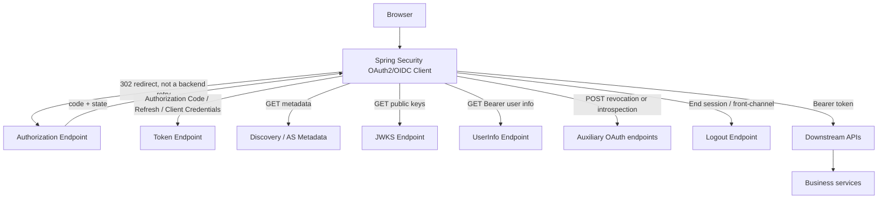
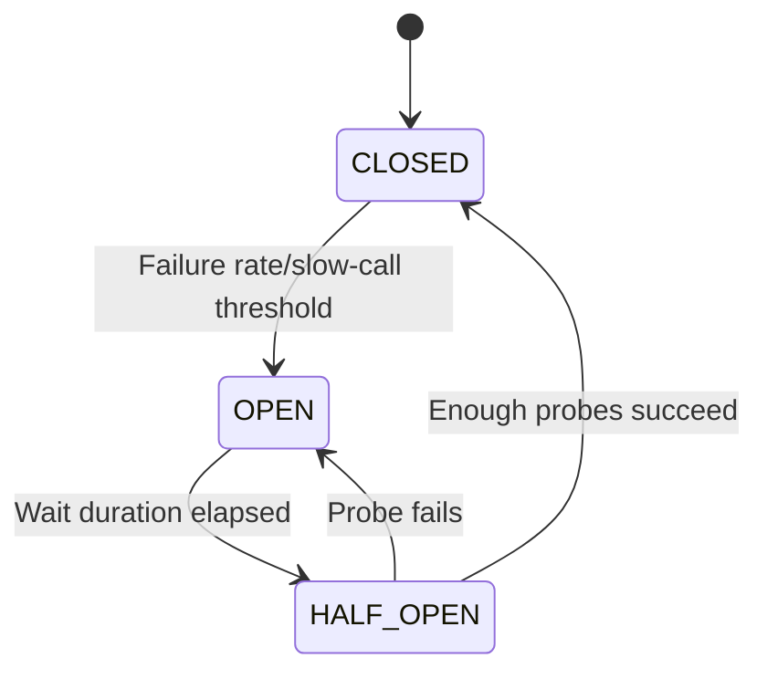

# 32.7. Endpoint-Specific Retries, Backoff, and Circuit Breakers

## 1. Why can't a single retry policy fit every OAuth2/OIDC call?

A **Spring Security OAuth 2.0/OIDC Client** application does not call just one HTTP API. Across the login, token refresh, and resource access lifecycle, it may communicate with:

- **Authorization Endpoint**: redirects the browser for user authentication.
- **Token Endpoint**: exchanges authorization codes, refreshes tokens, obtains `client_credentials` tokens, or runs other grants.
- **OpenID Provider Discovery / Authorization Server Metadata**: loads issuer information and endpoints.
- **JWKS Endpoint**: loads public keys to verify JWT/ID Token signatures.
- **UserInfo Endpoint**: fetches user claims using an access token.
- **Introspection / Revocation Endpoint**: checks or revokes tokens, depending on architecture.
- **End Session / Logout Endpoint**: coordinates logout between RP and OP.
- **Downstream Resource Servers**: Inventory, Billing, Reports, and other APIs receiving access tokens.

These requests have completely different semantics. A `GET /jwks` can usually be retried within bounds on a `503`; however, a `POST /token` carrying a **single-use authorization code** cannot be casually retried on timeout because you do not know whether the Authorization Server already consumed the code. A refresh token with **rotation** is even riskier if a retry replays the old refresh token.

**Retrying is a business-semantics and security decision, not merely a blanket handler for every HTTP 5xx.**

> Safe default policy: **never automatically retry** an OAuth2/OIDC call that mutates state or uses one-time credentials, unless there is an explicit idempotency/replay contract with the provider. Retry only operations that are safe to replay, classified by error type, with dedicated timeouts, backoff, jitter, budgets, and circuit breakers.

### 1.1. Learning objectives

After this lesson, you will be able to:

1. Distinguish **transient failures**, protocol errors, config errors, rate limiting, and security errors.
2. Decide which endpoints may be retried and which must not be retried.
3. Explain why `authorization_code` and rotating refresh tokens cannot be retried blindly.
4. Set timeouts for connect, TLS handshake, response, and total request duration.
5. Calculate total time consumed by retries/backoff against login or API latency budgets.
6. Design exponential backoff with jitter and attempt limits.
7. Understand `Retry-After` in `429`/`503` responses and when not to use it to replay requests.
8. Design circuit breakers scoped by **provider/issuer + endpoint + operation type**.
9. Distinguish circuit breakers, rate limiters, bulkheads, caches, and retries.
10. Separate **downstream GET** retries from OAuth2 token acquisition logic.
11. Use Reactor `Retry.backoff(...)` on a targeted WebFlux/WebClient client.
12. Use Resilience4j with Spring `RestClient` or `WebClient` in a controlled manner.
13. Handle `401 invalid_token`, `400 invalid_grant`, and `403` without causing login loops or retry storms.
14. Manage JWKS/metadata caching and key rotation without bypassing signature verification.
15. Mitigate refresh stampedes when multiple threads/instances need fresh tokens.
16. Observe retries, breaker states, timeouts, and token errors without logging secrets.
17. Test with fault injection and verify non-replayable requests are never replayed.
18. Build an outage runbook for Authorization Servers and downstream APIs.

## 2. Endpoint map and failure points



If you attach a generic retry filter to all outbound HTTP requests:

```text
allRequests
    .retry(3)
```

you can inadvertently:

- Send an **authorization code twice** to the Token Endpoint.
- Replay an **already-rotated refresh token**.
- Multiply tokens minted under `client_credentials`.
- Replay an HTTP `POST /payments`, creating duplicate charges.
- Turn a brief outage into a **retry storm**.
- Keep browser login requests hanging too long.
- Resend bearer tokens to an untrusted host after redirects/fallbacks.
- Mask `invalid_client`, `invalid_grant`, wrong issuer, or TLS certificate errors.

Therefore **never attach retries to a shared `WebClient.Builder` or `RestClient.Builder`** if that builder is shared across token clients, UserInfo, revocation, and multiple downstream services.

## 3. Classify errors before deciding to retry

### 3.1. Recoverable transient failures

Examples:

- TCP connection refused during a pod rolling restart.
- Connection reset to a JWKS or read-only API.
- `502 Bad Gateway` while upstream shifts nodes.
- Short-lived `503 Service Unavailable`.
- `504 Gateway Timeout` on a read-only operation.
- `429 Too Many Requests` with `Retry-After` on a replay-safe operation.
- Temporary DNS resolution failure (only for configured/approved hosts).

Even when an error is transient, **retry only if the request is safe to replay** and retry budget remains.

### 3.2. Protocol/credential errors — never retry blindly

| HTTP/OAuth2 error | Common meaning | Handling |
| --- | --- | --- |
| `400 invalid_grant` | Expired/used code, wrong verifier, redirect URI, or invalid refresh token | Stop; never replay grant |
| `400 invalid_request` | Parameters violate contract | Fix code/config |
| `400 unsupported_grant_type` | Provider does not support grant | Fix registration |
| `400 invalid_scope` | Scope not permitted | Fix scopes/consent |
| `401 invalid_client` | Invalid client authentication | Fix secret, cert, or client assertion |
| `401 invalid_token` at API | Expired token or wrong issuer/audience/signature/revocation | Check token lifecycle and API; don't retry endlessly |
| `403 insufficient_scope` | Missing permissions/scopes | Authorization workflow; don't repeat request |
| OIDC `login_required` | Requires user interaction | Trigger appropriate flow, don't retry in background |
| OIDC `interaction_required` | Requires prompt/consent/MFA | Return to user interaction |
| Issuer/audience/nonce mismatch | Trust boundary or token validation error | **Fail closed**, security investigation |
| TLS certificate/hostname failure | Cannot verify endpoint | **Never** downgrade TLS or switch hosts |

`400`, `401`, and `403` are generally **not automatic retry signals**. Some downstream APIs define specific semantics, which must be explicit in their contract.

### 3.3. Unknown outcomes from timeouts

This is the most dangerous case.

```text
RP sends POST /token(code=C1)
       |
       +-- AS receives, consumes code, mints tokens
       |
       +-- Network timeout before RP reads response
```

The RP only knows **no response arrived**, not whether the AS processed it. Resending `code=C1` may return `invalid_grant`; with a rotating refresh token, the second request can even trigger **replay detection / token-family revocation** depending on the provider.

**A timeout does not prove the server never executed the operation.**

## 4. Retries must follow idempotency semantics

An operation is **idempotent** if repeating it with the same inputs leaves the final state equivalent to executing it once. Yet “HTTP GET” does not automatically guarantee a downstream service obeys the contract, and “HTTP POST” is not always non-idempotent; check **actual semantics**.

| Criterion | Question |
| --- | --- |
| Safe/read-only? | Can re-calling create or mutate data? |
| Idempotent? | Do N calls leave the same final state as 1 call? |
| One-time credential? | Does it carry a single-use code/refresh token/nonce/assertion? |
| Replay semantics? | Does the provider support repeating via an idempotency key? |
| Delivery certainty? | On timeout, do you know whether the AS/API processed it? |
| Rate limit? | Will replaying lock out the client/tenant or inflate cost? |
| Security binding? | Does the retry still target the exact issuer, registration, audience, and endpoint? |
| Deadline? | Is there budget left for the waiting browser/user? |

**Rule:** HTTP method is only an initial hint; the **endpoint contract** and **security token lifecycle** decide.

### 4.1. “At-least-once” does not suit every OAuth2 operation

Automatic retries inherently risk **at-least-once delivery**. For:

- Authorization Code Token Exchange: authorization code is **one-time**.
- Rotating Refresh Token: refresh token may be **one-time**.
- Payments / side-effecting downstream POSTs: may create duplicate business transactions.

Without an idempotency guarantee, enforce **at-most-one automatic attempt** and hand off to a defined recovery flow.

## 5. Endpoint-by-endpoint policy table

| Endpoint / operation | Nature | Recommended retry | Circuit breaker? | Recovery |
| --- | --- | --- | --- | --- |
| Authorization Endpoint via browser | User interaction, redirect | **No automatic server-side retry** | Not a backend POST CB; monitor availability | Show login error / restart flow |
| Authorization Code → Token Endpoint | One-time code, possibly consumed | **No automatic retry** | Can fail fast on availability, never switch AS | Restart login flow |
| Refresh Token (rotation) | Potentially one-time, unknown outcome | **No blind retry** | Can protect Token Endpoint; separate policy | Reauthorize/relogin per provider |
| `client_credentials` Token Endpoint | Mints token, side effects/quotas | Bounded retry **only if provider contract allows** | Yes | Cache token, fail fast, recover after outage |
| Token Exchange RFC 8693 | Mints new token, delegation/context | No automatic retry unless replay semantics known | Yes | Recover per contract |
| Discovery/AS Metadata `GET` | Reads config | Short retry on transient errors | Yes | Cache verified metadata; fail closed |
| JWKS `GET` | Reads public keys | Short retry on transient errors | Yes | Cache keys per policy, never skip signature |
| UserInfo `GET` | Reads user claims with bearer token | Short retry if approved and safe | Yes | Fallback only optional claims per policy |
| Introspection `POST` | Read-like protocol op, rate-limited | Conditional per AS contract | Yes | Fail authentication/authorization closed |
| Revocation `POST` | Token state mutation / security-sensitive | Conditional/best-effort, not blind | Yes | Queue/record per policy, local session invalidation |
| RP-Initiated Logout/End Session | Browser redirect / user interaction | No backend login/logout replay | Monitor separately | Local logout + user guidance |
| Downstream API `GET` | Usually read-only | Bounded retry on transient errors | Yes, per API | 503/cached non-security data per policy |
| Downstream `PUT`/`DELETE` | Idempotent per contract | Only if downstream guarantees it | Yes | Verify state |
| Downstream resource-creating `POST` | Usually side-effecting | No, unless idempotency key/contract | Yes | Idempotency workflow |
| Webhook/event publish | Possibly at-least-once | Dedupe/idempotency contract | Yes | Queue/DLQ/controlled replay |

**This is a recommended starting policy**, not fixed defaults in Spring Security. Each AS/provider and downstream service may have its own limits or idempotency mechanisms.

## 6. Authorization Endpoint: do not turn navigation into background retries

A login begins at:

```text
GET /oauth2/authorization/corporate
```

Spring Security creates an authorization request with `state`, optionally PKCE `code_challenge` and OIDC `nonce`, persists the request, and returns `302 Location` to the OP.

If the OP temporarily errors:

- The browser can display an error page or let the user retry.
- The application **should not fire multiple background authorization requests** with fresh state/nonce behind the user's back.
- Never silently switch providers/issuers if the OP is unresponsive.
- Never “try multiple login endpoints” within the same flow.
- Ensure restarting the flow mints **fresh state/nonce/PKCE verifier**, never reusing a timed-out transaction.

A circuit breaker on the Token Endpoint HTTP client **does not govern** browser redirects to the Authorization Endpoint the same way. Separate **front channel** from **back channel**.

### 6.1. When the OP login page returns 503

Reasonable handling:

```text
User sees:
“Login service is currently unavailable.
 Please try signing in again later.”

Application:
Do not create an authenticated session.
Do not change issuer/tokenUri.
Do not bypass state/PKCE/nonce.
```

You may provide a **“Try signing in again”** button triggered deliberately by the user, rather than looping redirects automatically.

## 7. Authorization Code Token Exchange: no automatic retry

The call:

```http
POST /token
Content-Type: application/x-www-form-urlencoded

grant_type=authorization_code&
code=ONE_TIME_CODE&
redirect_uri=https%3A%2F%2Fportal.example.com%2Flogin%2Foauth2%2Fcode%2Fcorporate&
code_verifier=...
```

An authorization code:

- Has a short lifetime.
- Is bound to a specific client ID and redirect URI.
- May be bound to a PKCE verifier.
- **Is single-use**.

If the response is lost after the AS consumes the code, a second request usually cannot retrieve the same token response.

### 7.1. Never do this

```java
// WRONG: applying a shared retry to every HTTP method.
webClient.post()
    .uri(tokenUri)
    .bodyValue(tokenRequest)
    .retrieve()
    .bodyToMono(TokenResponse.class)
    .retry(3);
```

`retry(3)` can transmit the same authorization code multiple times without inspecting errors.

### 7.2. When token exchange fails

Reasonable workflow:

1. Classify the error: OAuth2 `invalid_grant`, `invalid_client`, timeout, HTTP 5xx, TLS, network.
2. Log a sanitized event with registration ID/issuer alias—never code, verifier, or secret.
3. Never automatically replay the authorization code.
4. Never create an `OAuth2AuthorizedClient` or authenticated session without verified token validation.
5. Let the user start **a fresh authorization flow** when appropriate.
6. Investigate Token Endpoint availability if many flows fail together.

`invalid_grant` **is not necessarily an outage**: it can stem from a wrong PKCE verifier, redirect URI mismatch, or an already-used/expired code. Retries rarely fix it.

### 7.3. What does a circuit breaker at the Token Endpoint mean?

A breaker can **fail fast before sending a new token request**, easing pressure when the AS is down. However:

- A CB **never makes code replay safe**.
- When the breaker is open, **do not send the code**, and fail/restart the flow cleanly.
- A breaker must never redirect to another issuer's Token Endpoint.
- Some Spring Security versions lack a single uniform hook wrapping every token client; identify the extension point on `OAuth2AccessTokenResponseClient` or its reactive counterpart for your version.

## 8. Refresh Token Rotation: greater risk than ordinary timeouts

Suppose the RP holds refresh token `R1`:

```text
RP                 Authorization Server
 | POST /token(R1)         |
 |------------------------>|
 |                  consume R1
 |                  issue R2 + A2
 |<--- response lost ------|
 | timeout
```

If the RP retries `R1`:

```text
POST /token(R1) 2nd attempt
```

the AS may:

- Return `invalid_grant` because R1 was already consumed.
- Treat it as a refresh token replay.
- Revoke the token family or trigger incident controls.
- Have a provider-specific grace window, which **must not be assumed**.

### 8.1. Why isn't “refresh token is an HTTP POST” enough reasoning?

The issue is not simply HTTP POST; it is the **token lifecycle** and **unknown commit state**. When the response is lost, the RP lacks R2 and cannot derive R2 from R1.

**Default:** never automatically retry rotating refresh requests on unknown outcomes.

### 8.2. Recovery policy should follow the provider

Options:

- If the provider returns `invalid_grant` on refresh: invalidate/clear the authorized client and prompt reauthorization per policy.
- If the provider documents an explicit grace/idempotency contract: implement that specific tested logic.
- If the refresh never left because a circuit breaker **blocked before sending**: you may attempt later on schedule while a valid token remains, without treating it as replaying an already-sent request.
- If the old access token is still unexpired, you may keep using it **until expiry** within permitted audiences/scopes; never use an expired access token.
- For high availability, review provider token rotation design, clock skew, and concurrency coordination.

### 8.3. Never recover by overwriting another user's authorized client

`OAuth2AuthorizedClient` must be keyed tightly by:

```text
registrationId
principalName
tenant/issuer context if the app is multi-tenant
```

A refresh failure for user A must never delete or swap user B's token. For service principals, likewise use account/workload-specific keys.

## 9. `client_credentials`: retriable, but not by assumption

Grant:

```http
POST /token
grant_type=client_credentials
scope=inventory.read
```

Usually does not consume single-use credentials like authorization codes or rotating refresh tokens. Therefore **some systems** allow short retries on `502/503/504`, timeouts, or connection errors.

However, the Token Endpoint may:

- Mint a new token per request.
- Enforce audit/rate-limit/quota accounting.
- Incur JWT signing or external client authentication costs.
- Use mTLS/`private_key_jwt` with short-lived assertions.
- Cap concurrent active tokens.

Always check the **provider contract** rather than assuming this POST is universally idempotent.

### 9.1. Conservative policy

If the provider permits safe replay:

```text
maxAttempts = 2 (including initial attempt)
retryOn     = defined transient network errors, 502/503/504
retryOn429  = only when Retry-After and budget permit
neverRetry  = 400 invalid_scope, 401 invalid_client,
              TLS trust failure, issuer mismatch
backoff     = 150–400ms + jitter, tightly bounded
```

Numbers are **design examples to tune against SLOs and provider quotas**, not Spring Security defaults.

### 9.2. Caching tokens is the first line of defense

If a `client_credentials` token lives 5–15 minutes, calling the Token Endpoint on **every API request** is an anti-pattern. Use `OAuth2AuthorizedClientManager` or `ReactiveOAuth2AuthorizedClientManager` with proper caching and expiry skew to:

- Reuse unexpired access tokens.
- Reduce Token Endpoint load.
- Prevent retry storms during traffic spikes.
- Never send expired tokens.
- Partition tokens by registration/resource/tenant.

Enable retries only after eliminating unnecessary token requests.

## 10. Token Exchange and other grants

OAuth 2.0 Token Exchange (RFC 8693), Device Authorization Grant, JWT bearer assertions, and other extension grants each carry distinct semantics. Never group them all under:

```text
POST /token -> retryable
```

Specifically:

- Token exchange may carry a subject token, actor token, and new audience.
- JWT client assertions carry `jti`/`exp`; the AS may enforce replay checks.
- Device flow has a **polling interval** and standardized `authorization_pending` / `slow_down` errors—that is **protocol polling**, not arbitrary automatic retry.
- For rotating refresh grants, duplicate requests can trigger security incidents.
- For authorization codes, duplicate requests violate one-time-use expectations.

Design **per-grant policies**, even when every grant hits the same Token Endpoint URL.

## 11. Discovery and Authorization Server Metadata: `GET` with bounded retries

Example OIDC Discovery:

```text
GET https://sso.example.com/realms/staff/.well-known/openid-configuration
```

Or OAuth Authorization Server Metadata per RFC 8414.

Usually a metadata read; short retries are acceptable when:

- The host/issuer is **approved**.
- The error is transient.
- Startup/request budget remains.
- Retries cannot loop endlessly.
- It stays on the exact trusted HTTPS URL without switching to unknown endpoints.

### 11.1. Errors you must not retry

- Metadata `issuer` mismatches expected issuer.
- URL points to private IPs or metadata services (SSRF).
- TLS hostname/certificate validation fails.
- Metadata is invalid JSON or lacks required fields.
- Provider advertises a Token Endpoint outside approved trust policies.
- Two distinct AS instances attempt to share an issuer identifier.

These are **configuration/trust failures**, not availability failures.

### 11.2. Boot startup vs. runtime discovery

If the app calls discovery at startup:

```text
App startup -> OP metadata endpoint unavailable
```

it can fail to start. Do not place **infinite retries** inside bean constructors or dependency initialization because they:

- Hang deployments indefinitely.
- Obscure health/readiness signals.
- Create request avalanches against the OP when many pods start at once.
- Cannot fix TLS or issuer mismatches.

Options:

- Use approved static provider endpoints where trust and rotation policies allow.
- Warm up/refresh metadata with an operational TTL.
- Reflect dependency health accurately in readiness probes.
- Use short budgeted retries in a control-plane component without blocking forever.
- Consider caching **issuer-verified** metadata for an approved duration.

**Never let metadata caching become a way to bypass issuer verification.**

## 12. JWKS Endpoint: read-only yet security-critical dependency

A JWK Set is typically fetched via:

```http
GET /.well-known/jwks.json
```

or the OP metadata's `jwks_uri`.

JWKS contains **public keys**, yet key-fetch/refresh policies directly affect the correctness of **JWT signature validation**.

### 12.1. When to retry?

Bounded retries are fine for:

- `502`, `503`, `504`.
- Temporary I/O errors.
- Temporary DNS failures for a trusted host.
- Remaining latency budget.
- Cache misses or refreshing an unseen `kid`.

However:

- Never retry `401/403` endlessly.
- Never retry endlessly when the OP publishes a malformed key set.
- Never switch to a JWKS URI taken from a token header (`jku`/`x5u`) unless explicitly approved.
- Never skip signature checks when JWKS is temporarily unreachable.
- Never accept arbitrary JWT algorithms or `alg=none`.

### 12.2. Caching, rotation, and unknown `kid`

A scenario:

```text
Cached JWKS:
  kid=old-key

Incoming ID Token:
  kid=new-key
```

The app can refresh JWKS per policy to look up `new-key`. If refreshing fails:

- For an **unknown kid**: cannot verify signature → **reject**; never “trust because issuer matches”.
- For a **known trusted kid**: cached keys may be used within an approved TTL while validators continue checking signature, issuer, audience, and expiry.
- Never hold cached keys indefinitely to work around OP outages or key revocations.
- Never share one JWKS cache across distinct issuers/tenants merely because they share a hostname.

### 12.3. Caching does not replace circuit breakers

Caching reduces requests sent to the OP. Circuit breakers shed load once a dependency fails. Retries handle transient errors on a **single request**. The three mechanisms serve distinct purposes.

```text
JWT validation
   -> cached trusted JWKS?
      -> yes: verify signature
      -> no/new kid: allowed fetch (short timeout, bounded retry, CB)
           -> validated keys: verify signature
           -> cannot fetch/verify: fail closed
```

Never return `authenticated=true` just because decoded token claims look plausible.

## 13. UserInfo Endpoint: relatively safe GET, yet carries a bearer token

OIDC UserInfo is typically:

```http
GET /userinfo
Authorization: Bearer <access_token>
```

Per the OIDC contract, this fetches user claims. Retrying can make sense when:

- The endpoint supports read-only semantics.
- Retries go back to the **same trusted OP**.
- The bearer token is still valid.
- The error is `429`, `502`, `503`, `504`, or transient I/O.
- Overall login budget remains.

**Do not** automatically retry when:

- `401 invalid_token`: token was rejected; don't repeat the same token.
- `403`: denied by scopes/consent/policy.
- `400` malformed request.
- `iss`/`sub`/TLS/trust mismatch.
- Redirects to an unapproved host.

### 13.1. UserInfo timeouts cannot always be ignored

Some apps use UserInfo solely for **avatar/display name**; others rely on UserInfo claims for **membership** or mandatory authorization attributes.

Rule:

- If claims are required for authentication/authorization → **fail closed** or enforce defined policy.
- If claims are purely UI enrichment → degrade using **verified claims from the ID Token** or omit optional fields.
- Always verify **UserInfo `sub` matches ID Token `sub`** per OIDC requirements.
- Never reuse another user's cached profile data just to make login “faster”.

### 13.2. Retries and redirects

An HTTP client that auto-follows redirects can leak Bearer tokens to unfamiliar hosts if misconfigured. For UserInfo:

- Trust only HTTPS endpoints from approved metadata.
- Disallow arbitrary redirect hosts.
- Ensure Authorization headers are never forwarded to untrusted origins.
- If the OP moves endpoints, update metadata via your trust process rather than guessing URLs.

## 14. Introspection Endpoint: POST yet state-reading

OAuth2 Token Introspection (RFC 7662) typically uses:

```http
POST /introspect
Content-Type: application/x-www-form-urlencoded

token=...
```

It returns whether a token is active along with provider metadata.

Semantically, introspection is **typically read-only state inspection**, so some deployments permit limited retries on transient outages. Still:

- The endpoint is HTTP POST.
- Rate limits and auditing may apply.
- It carries sensitive tokens.
- It uses its own client authentication.
- It may be called on **every API request** with opaque tokens.

Therefore maintain a dedicated `introspection` policy; **never reuse the Token Endpoint policy**.

### 14.1. Fail closed when the token cannot be verified

If the Resource Server cannot introspect and lacks a **policy-valid cached introspection result**, never treat the token as active.

```text
Introspection timeout
    ≠
token valid
```

Depending on system SLOs, the API may return `503 Service Unavailable` instead of `401` to indicate dependency unavailability, but **never grant access** without verifying the token.

### 14.2. Caching introspection responses

Short-TTL caching is possible if allowed by provider contracts and security policy. Balance:

- Availability.
- Token revocation propagation.
- Token `exp`.
- Revocation requirements.
- Cache isolation by issuer/client/audience/tenant.
- Never caching `active=true` longer than security permits.

No single TTL fits every system.

## 15. Revocation Endpoint: best effort does not mean infinite retries

OAuth2 Token Revocation (RFC 7009) may be called on user logout or client token revocation:

```http
POST /revoke
Content-Type: application/x-www-form-urlencoded

token=...
token_type_hint=refresh_token
```

Token revocation may support idempotent retries at the AS per spec/provider, yet note:

- Requests carry secret tokens.
- Providers enforce rate limits.
- Timeouts can happen **after the token was already revoked**.
- You may not know which token or token family was affected.
- Client authentication may change.
- Browser logouts should not block on long retry chains.

### 15.1. Recommended logout/revocation policy

1. **Clear local sessions** and local authorized-client state per policy immediately, without waiting for remote revocation to succeed.
2. Call revocation with a short timeout.
3. If remote revocation fails, log a sanitized event and execute recovery.
4. If the provider commits to idempotent revocation and token handling is safe, use bounded retries or a TTL-bounded queue.
5. Never persist raw refresh tokens long-term in poorly protected queues just for later retries.
6. Never claim “the token was revoked at the OP” if the request was unconfirmed.

**Important:** local logout and remote revocation are separate outcomes. Monitor/alert on remote revocation failures per security requirements.

## 16. End Session / OIDC Logout: browser interaction, not backend retries

RP-Initiated Logout typically redirects the browser to the OP End Session Endpoint:

```text
RP -> 302 browser -> OP end_session_endpoint
```

This endpoint may require:

- `id_token_hint`.
- `post_logout_redirect_uri`.
- `state`.
- OP session cookies.
- User interaction.

Do not do:

```text
If the browser has not returned yet:
  backend sends 5 logout requests to the OP
```

because the browser/OP session context does not necessarily exist on the backend.

### 16.1. When OP logout is unavailable

- Terminate the local application session per policy.
- Never assume the remote SSO session was definitely cleared without confirmation.
- Display a clear message advising the user to close their browser session or retry SSO logout.
- Preserve CSRF protection on logout initiation per security configuration.
- Avoid redirecting users to unregistered URLs or a different OP.

## 17. Downstream APIs: choose retries by HTTP method **and** business semantics

For example, the Portal calls:

```text
GET /inventory/items/{id}
GET /reports/{id}
POST /billing/charges
PUT /preferences/{id}
DELETE /sessions/{id}
```

### 17.1. Read-only GETs

A semantically clean GET can usually be retried on:

- Transient connect/read timeouts.
- `502`, `503`, `504`.
- `429` when handling `Retry-After` and rate budgets.
- Small attempt counts with backoff + jitter.

**Never** retry:

- `401`/`403`.
- `404` for nonexistent resources.
- `400` validation errors.
- Wrong issuer/audience/token.
- TLS certificate failures.
- Hosts from unapproved redirects/SSRF.

### 17.2. PUT and DELETE

By HTTP semantics, PUT/DELETE are **idempotent in final state**, yet implementations may fire side effects such as publishing events or charging fees. Verify the downstream contract.

For example, `DELETE /session/42` may be safe to repeat and return `404` on the second call; however, if side-effect events are not deduplicated, retries still cause harm.

### 17.3. POST with an idempotency key

When downstream supports:

```http
POST /payments
Idempotency-Key: checkout-req-abc123
```

it can ensure the same key and payload execute the business action at most once.

Retries may be allowed **when the contract explicitly guarantees**:

- Keys are generated **once per business operation**.
- Keys stay identical across attempts.
- Body, principal, tenant, and audience remain unchanged.
- Key scope and TTL are documented.
- Downstream returns consistent results or supports status polling.

**Never invent an `Idempotency-Key` header and assume the API deduplicates automatically.** The server must implement, test, and document those semantics.

## 18. Timeouts: no safe retry exists without a deadline

Every HTTP request needs explicit bounds:

- DNS resolution timeout.
- TCP connect timeout.
- TLS handshake timeout.
- Response header/read timeout.
- Idle timeout when streaming.
- Overall operation deadline.

Suppose a login callback has a 5-second budget for dependencies. If a request retries 3 times with a 3-second timeout and 2-second backoff, **total elapsed time easily blows past 5 seconds**.

### 18.1. Estimation formula

For at most \(n\) attempts:

\[
T_{\text{worst}} \approx
\sum_{i=1}^{n} T_{\text{attempt},i}
+
\sum_{i=1}^{n-1} D_i
\]

Where:

- \(T_{\text{attempt},i}\): max timeout per attempt.
- \(D_i\): delay/backoff before the next attempt.

Example:

```text
maxAttempts = 3 (1 initial + 2 retries)
perAttemptTimeout = 1.0 s
backoff delays = 0.2 s, 0.4 s

Worst approximate = 3.0 + 0.6 = 3.6 s
```

Also budget for controller logic, token acquisition, JWT verification, DB calls, network scheduling, and browser redirects. OS/proxy timeouts can alter real-world latency further.

### 18.2. Timeouts by endpoint

| Endpoint | Typical preferred budget | Notes |
| --- | --- | --- |
| Authorization Code Token | Short, no retry | Browser is waiting on login |
| Refresh Token | Short, unknown outcome needs recovery | Never replay rotating tokens |
| Client Credentials Token | Short + bounded conditional retry | Prefer caching/single-flight |
| JWKS/Discovery | Bounded network retries | Preload/cache trusted metadata |
| UserInfo | Tightly bounded within login budget | Depends on essential vs. optional claims |
| Introspection | Very sensitive to API latency | Cache with TTL/policy if permitted |
| Revocation | Short best effort | Do not delay local logout |
| Downstream GET | Per API SLO | Dedicated budget and breaker/bulkhead |
| Downstream payment POST | No default retry | Idempotency key if supported |

**Tune numbers to p95/p99 SLOs, provider limits, and dependency topology**, rather than using one timeout everywhere.

## 19. Exponential backoff and jitter

A simple backoff sequence:

\[
D_k = \min(D_{\max}, D_0 \times 2^{k-1})
\]

Where:

- \(D_0\) is the base delay.
- \(D_{\max}\) is the maximum delay.
- \(k=1\) corresponds to the first retry.

Example:

```text
Retry 1: 200 ms
Retry 2: 400 ms
Retry 3: 800 ms
Retry 4: 1.6 s
```

If 10,000 pods all retry at these exact intervals, they can trigger a **thundering herd** against the AS as it recovers.

### 19.1. Adding jitter

A full-jitter variant:

\[
D_k = U(0, \min(D_{\max}, D_0 \times 2^{k-1}))
\]

An equal-jitter variant keeps half the base delay and randomizes the other half.

Goal: spread client retries across time to dampen synchronized spikes.

Never use jitter to justify 20 retries. Jitter de-synchronizes traffic but does not cap total load by itself.

### 19.2. `maxAttempts` or `maxRetries`?

Libraries name this differently:

```text
maxAttempts = 3 -> 1 initial + 2 retries
retry(3)    -> typically 3 retries after initial (up to 4 total)
```

In Reactor:

```java
Retry.backoff(2, Duration.ofMillis(200))
```

means up to **2 retries** after the initial attempt, not 2 attempts total.

In Resilience4j:

```java
maxAttempts(3)
```

means **up to 3 attempts total**.

Confusing the two can unexpectedly double production retry load.

## 20. `Retry-After` and HTTP 429/503

A server may return:

```http
HTTP/1.1 429 Too Many Requests
Retry-After: 3
```

or:

```http
HTTP/1.1 503 Service Unavailable
Retry-After: Wed, 18 Nov 2026 10:00:00 GMT
```

`Retry-After` can be **integer seconds** or an **HTTP-date** per HTTP semantics.

### 20.1. How to handle it

1. **Consider retrying only if the operation permits replay.**
2. Parse both `Retry-After` formats properly.
3. Clamp to a maximum wait and overall budget.
4. Apply a per-provider rate limiter if needed.
5. Never waive the overall deadline just to wait out `Retry-After`.
6. When the header is malformed, negative, or huge, apply a bounded fallback or fail.
7. Never replay `authorization_code` or rotating refresh grants merely because the provider returned 429.
8. Add jitter when many clients observe the same delay, without violating the provider's minimum wait.

**`Retry-After` is not a license to violate idempotency or single-use constraints.**

### 20.2. When 429 comes from the Token Endpoint

If a `client_credentials` provider allows retries, apply an appropriate wait. If an Authorization Code exchange receives 429 after the code was sent, replaying the code may still be unsafe if the outcome is unknown. Confirm exact semantics with the provider rather than assuming 429 is always retriable.

### 20.3. 429 is rate limiting, not always a CB failure

If one client is rate-limited by quota, tripping a circuit breaker for the **entire issuer** can disrupt healthy clients/tenants.

Separate:

- **Rate limiter:** bounds request counts.
- **Retry:** handles transient errors when replay is permitted.
- **Circuit breaker:** detects dependency outages to fail fast.
- **Bulkhead:** caps concurrent requests.
- **Cache/single-flight:** eliminates redundant calls.

## 21. Circuit breakers: three states and purpose

Circuit breakers typically use three states:



- **CLOSED:** requests pass through; the breaker records outcomes.
- **OPEN:** dependency is skipped; fails fast with e.g. `CallNotPermittedException`.
- **HALF_OPEN:** lets a limited number of probe requests through to decide whether to close or reopen.

It **does not** make requests safe to retry, fix OAuth2 credentials, validate issuers, or replace timeouts.

### 21.1. Distinguish retries from breakers

| Mechanism | Question answered |
| --- | --- |
| Timeout | “How long at most may one attempt wait?” |
| Retry | “After an error, repeat the same operation, and how many times?” |
| Backoff/jitter | “How long to wait before the next attempt?” |
| Circuit breaker | “Should we even send new requests to a failing dependency?” |
| Bulkhead | “How many requests may consume resources concurrently?” |
| Rate limiter | “How many requests may be sent within a time window?” |
| Cache | “Do we need to call the dependency at all?” |
| Single-flight | “Can concurrent callers share one in-flight token/refresh operation?” |

Do not overload one tool to do everything.

## 22. Design breakers per endpoint, not just per hostname

One issuer may expose:

```text
https://sso.example.com/authorize
https://sso.example.com/token
https://sso.example.com/jwks
https://sso.example.com/userinfo
```

If the JWKS endpoint returns `503`, the Token Endpoint is not necessarily down. If the Token Endpoint returns `invalid_client`, that is a **config failure** for one client, not necessarily an AS outage.

### 22.1. Suggested breaker names

```text
oidc.corporate.discovery.get
oidc.corporate.jwks.get
oidc.corporate.userinfo.get
oidc.corporate.token.authorization_code
oidc.corporate.token.refresh_token
oidc.corporate.token.client_credentials

downstream.inventory.get
downstream.billing.post
downstream.reports.get
```

Avoid creating a separate breaker **per user** due to cardinality/memory explosion. Use stable registry names keyed by approved provider/issuer alias and endpoint operation category.

### 22.2. Classify exceptions for the breaker

Record availability failures such as:

- Connect/read timeouts.
- TCP reset/connect failures.
- `502`, `503`, `504`.
- Certain `500`s if the provider contract treats them as transient.
- Slow calls exceeding SLA thresholds.

Typically **do not** record breaker failures for:

- `400 invalid_grant`.
- `401 invalid_client`.
- `403 insufficient_scope`.
- User-triggered authorization `access_denied`.
- ID Token issuer/audience mismatches.
- TLS trust misconfigurations (though these must alert).
- `404` from a misconfigured endpoint URL.
- Natural client cancellations from user actions.

Counting `invalid_grant` toward the failure rate lets a batch of expired browser sessions trip the Token Endpoint breaker even while the OP is completely healthy.

### 22.3. Valid fallbacks when a breaker is OPEN

| Operation | Acceptable fallback |
| --- | --- |
| JWKS | Cached trusted keys still within validation/TTL |
| Discovery | Trusted cached metadata within TTL, keeping issuer checks |
| Client Credentials | Existing **unexpired** access token matching audience/scope |
| UserInfo optional profile | Return verified ID Token claims only or omit UI enrichment |
| UserInfo essential security claims | **Never** grant access without verification |
| Introspection | Cached validation within TTL/policy only; never accept unknown tokens |
| Authorization Code Token | Fail login/restart; never fake a successful login |
| Refresh token | No replay; reauthorize when needed |
| Downstream GET | Cached non-security response if policy permits |
| Payment POST | Never assume payment succeeded |
| OP Logout | Local logout; never claim remote SSO logout succeeded |

Fallbacks must never trade security for availability.

## 23. Resilience4j: organizing policies in Spring Boot

A common approach uses **Resilience4j** for circuit breakers, retries, rate limiters, and bulkheads.

Illustrative Gradle snippet:

```gradle
dependencies {
    implementation 'org.springframework.boot:spring-boot-starter-webflux'
    implementation 'org.springframework.boot:spring-boot-starter-security'
    implementation 'org.springframework.boot:spring-boot-starter-oauth2-client'

    implementation 'io.github.resilience4j:resilience4j-circuitbreaker'
    implementation 'io.github.resilience4j:resilience4j-retry'
    implementation 'io.github.resilience4j:resilience4j-reactor'

    // Depending on stack/Resilience4j version, a starter may be used:
    // implementation 'io.github.resilience4j:resilience4j-spring-boot3'
}
```

**Do not pick a Resilience4j version by copying from an old blog post.** Choose a major version compatible with your Spring Boot 3/4 and Spring Security versions; verify JDK/Actuator/Micrometer compatibility in official docs. Some Resilience4j starter versions targeting Spring Boot 3 are not automatically compatible with Boot 4.

### 23.1. Never use one global `Retry` for all operations

Instead of:

```text
oauth2AllEndpoints:
  retryOnException: any
  attempts: 5
```

use:

```text
corporate-jwks-read: retryable, bounded
corporate-userinfo-read: retryable, bounded
corporate-auth-code-token: NO_RETRY
corporate-refresh: NO_RETRY_UNLESS_PROVIDER_CONTRACT
corporate-client-credentials: CONDITIONAL_RETRY
reports-get: retryable, bounded
billing-post: NO_RETRY_UNLESS_IDEMPOTENCY
```

Policies may share timeout/telemetry conventions, yet **never share replay permissions**.

## 24. WebClient: bounded retries for downstream GETs

An example for a **read-only Reports API GET**, not the Token Endpoint:

```java
import io.github.resilience4j.circuitbreaker.CircuitBreaker;
import io.github.resilience4j.reactor.circuitbreaker.operator
    .CircuitBreakerOperator;
import org.springframework.web.reactive.function.client.WebClient;
import org.springframework.web.reactive.function.client
    .WebClientRequestException;
import org.springframework.web.reactive.function.client
    .WebClientResponseException;
import reactor.core.publisher.Mono;
import reactor.util.retry.Retry;

import javax.net.ssl.SSLException;
import java.time.Duration;

final class ReportsReadClient {

    private final WebClient reportsClient;
    private final CircuitBreaker reportsGetBreaker;

    ReportsReadClient(
            WebClient reportsClient,
            CircuitBreaker reportsGetBreaker) {

        this.reportsClient = reportsClient;
        this.reportsGetBreaker = reportsGetBreaker;
    }

    Mono<ReportDto> getReport(String reportId) {
        return reportsClient.get()
            .uri("/reports/{id}", reportId)
            .retrieve()
            .bodyToMono(ReportDto.class)

            // Per-attempt timeout; placed before retryWhen.
            .timeout(Duration.ofSeconds(1))

            // 2 retries + 1 original request = at most 3 attempts.
            .retryWhen(Retry
                .backoff(2, Duration.ofMillis(200))
                .maxBackoff(Duration.ofMillis(800))
                .jitter(0.5)
                .filter(ReportsReadClient::retryableGet)
                .onRetryExhaustedThrow(
                    (spec, signal) -> signal.failure()))

            // Breaker outside retry => observes one logical call.
            .transformDeferred(
                CircuitBreakerOperator.of(reportsGetBreaker))

            // Deadline for the entire logical call.
            .timeout(Duration.ofSeconds(4));
    }

    private static boolean retryableGet(Throwable error) {
        if (error instanceof WebClientResponseException http) {
            int status = http.getStatusCode().value();
            return status == 429
                || status == 502
                || status == 503
                || status == 504;
        }

        if (error instanceof WebClientRequestException requestError) {
            // Do not retry TLS trust / certificate errors.
            for (Throwable cause = requestError;
                    cause != null;
                    cause = cause.getCause()) {

                if (cause instanceof SSLException) {
                    return false;
                }
            }

            // Other I/O errors require provider-specific review.
            return true;
        }

        // java.util.concurrent.TimeoutException from .timeout()
        return error instanceof java.util.concurrent.TimeoutException;
    }
}
```

`ReportDto` is an application-defined DTO. Add full imports and corresponding configuration beans to compile.

### 24.1. Intentional limitations of the example

- Intended solely for a **GET** confirmed safe/read-only by the downstream contract.
- `reportsClient` has a **trusted base URL**, never taking absolute URLs from user input.
- `retryableGet` is an **illustrative** predicate; production should separate DNS, connect timeouts, TLS, cancellations, and proxy errors per policy.
- If `429` includes `Retry-After`, handle the header with a dedicated retry strategy; this example **does not parse that header**.
- An outer timeout can cancel the reactive operation; inspect breaker/cancellation metrics for your version.
- For streaming/Flux responses, retrying mid-stream can duplicate emitted items; design separately.
- A circuit breaker placed outside retry counts **logical operations**, not individual physical attempts. Track attempt-level metrics separately.
- Never reuse this example for `POST /token` or `POST /payments`.

### 24.2. Why retry only 429/502/503/504 and not all 5xx?

This is a conservative policy. A `500 Internal Server Error` may be transient, or it may be deterministic from bad request data. Only add `500` for GETs **after verifying** provider contracts and metrics show it is safe.

Do not retry `401` merely because an access token may have expired; refresh token lifecycles and request replay need dedicated logic.

### 24.3. Where does `.retryWhen(...)` sit?

Given the chain:

```text
HTTP GET
  -> per-attempt timeout
  -> retryWhen
  -> breaker
  -> total deadline
```

retry triggers **resubscription**, re-executing the HTTP GET. If the chain wraps another Publisher with side effects such as token refresh, **those side effects would also repeat**.

Draw operator boundaries precisely so retries **only re-execute** the approved operation.

## 25. Separating OAuth2 token acquisition from API GET retries

When `WebClient` integrates Spring Security OAuth2, bearer tokens may be fetched/refreshed by an OAuth2 exchange filter. Placing retries outside the **entire WebClient exchange chain** can re-trigger token authorization logic on every attempt.

Example:

```text
WebClient request
   -> OAuth2 authorized client lookup/refresh
   -> downstream GET
   -> retry entire publisher
```

Verify framework version and filter behavior to know whether retries re-invoke the manager. **Never attach a shared retry filter to all outbound clients**, especially those hitting the Token Endpoint.

### 25.1. Safer strategy

1. Select the right `OAuth2AuthorizedClient` for registration/principal/resource.
2. Ensure the token is valid or let the manager handle acquisition/refresh per policy.
3. Issue the outbound request to the **trusted downstream API**.
4. Retry only **business GETs** on transient network/API errors when replay-safe.
5. Never treat downstream 401 as an infinite retry signal: detect invalid/expired tokens and run at most **one controlled recovery pass** if supported.

Once a request sends a bearer access token to an API, retrying the GET with the same token is **safe only while** the token remains valid and the API method is truly safe. Never alter token audience/issuer in reaction to an API error response.

### 25.2. Do not attach tokens to arbitrary URLs

With `WebClient`, maintain **separate clients per downstream service**:

```java
@Bean
WebClient reportsWebClient(WebClient.Builder builder) {
    return builder
        .clone()
        .baseUrl("https://reports-api.example.com")
        .build();
}
```

When using an OAuth2 filter, scope the registration/authorized-client context specifically to Reports instead of defaulting bearer attachment to all requests.

**Strictly forbid** letting a request parameter override the trusted base URL and leak bearer tokens or retries to an unknown external host.

## 26. Blocking RestClient: Resilience4j policy for GETs

In Servlet apps, many downstream calls use `RestClient` or `RestTemplate`. Example `RestClient` GET with dedicated retry and circuit breaker:

```java
import io.github.resilience4j.circuitbreaker.CircuitBreaker;
import io.github.resilience4j.retry.Retry;
import io.github.resilience4j.retry.RetryConfig;
import io.github.resilience4j.core.IntervalFunction;
import java.util.function.Supplier;

final class InventoryClient {

    private final RestClient inventoryRestClient;
    private final Retry getRetry;
    private final CircuitBreaker getBreaker;

    InventoryClient(
            RestClient inventoryRestClient,
            CircuitBreaker getBreaker) {

        this.inventoryRestClient = inventoryRestClient;
        this.getBreaker = getBreaker;

        RetryConfig config = RetryConfig.custom()
            .maxAttempts(3) // 1 initial + 2 retries
            .intervalFunction(
                IntervalFunction.ofExponentialRandomBackoff(
                    200L, 2.0, 0.5))
            .retryOnException(RemoteErrors::retryableGet)
            .build();

        this.getRetry =
            Retry.of("inventory-get", config);
    }

    InventoryDto getInventory(String id) {

        Supplier<InventoryDto> read = () ->
            inventoryRestClient.get()
                .uri("/inventory/{id}", id)
                .retrieve()
                .body(InventoryDto.class);

        Supplier<InventoryDto> retried =
            Retry.decorateSupplier(getRetry, read);

        Supplier<InventoryDto> protectedCall =
            CircuitBreaker.decorateSupplier(
                getBreaker, retried);

        return protectedCall.get();
    }
}
```

In this example:

- `InventoryDto` is a project-defined DTO.
- `RemoteErrors.retryableGet(Throwable)` is an application-written predicate, **not built into** Resilience4j.
- `IntervalFunction`/builder APIs may differ across Resilience4j versions; verify your version.
- `inventoryRestClient` must have a trusted base URL and request-factory timeouts.
- The breaker sits **outside** retry so each logical call records one CB outcome; track physical retry attempts separately.
- Never use this structure for OAuth2 Authorization Code or rotating Refresh Token grants.

### 26.1. Illustrative blocking predicate

```java
static boolean retryableGet(Throwable error) {
    if (error instanceof RestClientResponseException http) {
        int status = http.getStatusCode().value();

        return status == 429
            || status == 502
            || status == 503
            || status == 504;
    }

    if (error instanceof ResourceAccessException access) {
        for (Throwable cause = access;
                cause != null;
                cause = cause.getCause()) {

            if (cause instanceof SSLException) {
                return false;
            }
        }

        return true;
    }

    return false;
}
```

This is an illustrative classifier; production must also evaluate `SocketTimeoutException`, DNS, connection resets, proxies, cancellations, and wrapped exceptions. **Do not assume every `ResourceAccessException` is transient**; classify by root cause and trust policy.

### 26.2. `RestClient` must configure connect/read timeouts

Retry policies do not replace HTTP client timeouts.

Example with JDK `HttpClient`:

```java
HttpClient httpClient = HttpClient.newBuilder()
    .connectTimeout(Duration.ofSeconds(1))
    .followRedirects(HttpClient.Redirect.NEVER)
    .build();

JdkClientHttpRequestFactory requestFactory =
    new JdkClientHttpRequestFactory(httpClient);

requestFactory.setReadTimeout(Duration.ofSeconds(2));

RestClient restClient = RestClient.builder()
    .requestFactory(requestFactory)
    .baseUrl("https://inventory-api.example.com")
    .build();
```

Classes come from `java.net.http` and Spring Web. `Redirect.NEVER` preserves control over bearer tokens and target endpoints, whereas callback/browser redirects are a separate flow not handled by this `RestClient`.

## 27. Circuit breaker configuration with Resilience4j

A `CircuitBreaker` for Reports GET can be configured as:

```java
CircuitBreakerConfig config =
    CircuitBreakerConfig.custom()
        .slidingWindowSize(50)
        .minimumNumberOfCalls(20)
        .failureRateThreshold(50.0f)
        .slowCallRateThreshold(60.0f)
        .slowCallDurationThreshold(
            Duration.ofSeconds(2))
        .waitDurationInOpenState(
            Duration.ofSeconds(30))
        .permittedNumberOfCallsInHalfOpenState(3)
        .recordException(
            RemoteErrors::countsAsAvailabilityFailure)
        .build();

CircuitBreakerRegistry registry =
    CircuitBreakerRegistry.of(config);

CircuitBreaker reportsBreaker =
    registry.circuitBreaker("reports.get");
```

All parameters are **illustrative** and must be tuned to SLOs, traffic, and provider quotas.

### 27.1. `minimumNumberOfCalls` prevents noise

With a 50% failure threshold and only one request, a single error will trip the breaker unless a suitable minimum call count is set.

For low-traffic issuers, consider:

- Count-based sliding windows with sensible minimum calls.
- Time-based sliding windows and alerting.
- Manual operational overrides.
- Dedicated health probes.
- Never tripping a breaker for an entire tenant from a couple of isolated errors.

### 27.2. Circuit breakers do not automatically honor `Retry-After`

`waitDurationInOpenState` is how long the breaker stays open before entering `HALF_OPEN`, **not** the server-supplied HTTP `Retry-After` duration.

To integrate rate limiting/server throttling, add a separate policy. Never dynamically mutate breaker `waitDuration` from an untrusted response header without bounds.

## 28. Ordering timeouts, retries, breakers, and bulkheads

Decorator/operator order changes behavior.

### 28.1. Breaker outside retry

```text
CircuitBreaker
    └── Retry
         └── HTTP Request
```

Pros:

- The CB records **one logical operation**.
- If the final retry succeeds, the logical operation counts as a success.
- An OPEN CB blocks operations **before** the retry layer fires requests.

Limitations:

- Retries can generate heavy load while CB metrics see only the logical result.
- Physical attempts and retry-after waits must be recorded separately.
- If timeouts/cancellations sit outside, verify how CB metrics record them.

### 28.2. Breaker inside retry

```text
Retry
    └── CircuitBreaker
         └── HTTP Request
```

Pros:

- The CB records each physical attempt.
- Fast failures trip the breaker sooner when a dependency truly fails.

Limitations:

- When the CB opens, retries may repeatedly hit `CallNotPermittedException` if the predicate is misconfigured.
- One user request can contribute multiple failure samples and trip the breaker prematurely.
- Logical outcomes cannot be inferred directly from attempt counts.

**Never retry `CallNotPermittedException`.** An open breaker is a fail-fast signal, not an error to retry 5 times.

### 28.3. Bulkheads and total deadlines

A complete layering model:

```text
Ingress request deadline
   └── Bulkhead (cap in-flight)
       └── CircuitBreaker
           └── Retry (replay-safe only)
               └── Per-attempt timeout
                   └── HTTP client
```

Goals:

- Prevent exhausting the HTTP connection pool when downstream fails.
- Prevent retries from starving Servlet worker thread pools.
- Never block Reactor event loops with synchronous sleep/backoff.
- Never keep browser logins hanging indefinitely.
- Define a policy for queued requests when the bulkhead is full (fail fast or backpressure).

## 29. Rate limiting and retry budgets across multiple instances

Suppose 100 pods each send 100 req/s to JWKS/UserInfo. If every request retries 3 times, an OP outage can trigger 30,000 outbound attempts/s.

A **retry budget** caps retries relative to original requests or an absolute quota:

```text
Original outbound calls: 1000/s
Retry budget: at most 100/s
Maximum retries per logical call: 2
```

This is a design example, not a Spring Security default.

### 29.1. Centralized vs. local policies

- Local per-instance limiters are simple to deploy, yet total traffic scales with pod count.
- Distributed limiters protect provider/tenant quotas.
- Discovery/JWKS can use shared caches or coordinated refreshes.
- Token acquisition requires **single-flight**, not just retry budgets.
- Downstream APIs have their own rate limits.

When a provider returns 429, coordinate load shedding rather than letting every pod ramp up retries simultaneously.

## 30. Token refresh thundering herds and single-flight

A cached access token nears expiry:

```text
Request 1..1000:
  see access token nearly expired
  concurrently call refresh_token grant
```

If all use the **same rotating refresh token**, concurrent refreshes can:

- Send the old token simultaneously.
- Trigger refresh-token reuse detection.
- Lose the newly issued refresh token.
- Corrupt authorized-client storage.
- Cause login failures even while the OP is healthy.

### 30.1. Solutions

1. Standardize token cache keys on `(registrationId, principalName, resource/tenant context)` where applicable.
2. Refresh slightly early for reasonable clock skew, without refreshing prematurely on every request.
3. Allow only **one in-flight refresh per authorized client key** at a time.
4. Synchronize authorized-client state updates via optimistic locking/CAS across instances.
5. Persist new tokens only from valid refresh responses.
6. On unknown refresh outcomes, apply provider-specific recovery—**never blindly replay R1**.
7. Never share refresh tokens across unrelated users or tenants.
8. Test concurrent refreshes and crash/timeout scenarios in integration tests.

### 30.2. Single-flight differs from distributed locks

In-process single-flight:

```text
Map<TokenKey, Mono<TokenResponse>> inFlight
```

deduplicates calls within **one JVM**. Across multiple pods, use distributed coordination or data-store compare-and-swap to prevent cross-node concurrency races.

A poorly scoped `Mono.cache()` can retain errors or tokens too long; never use a single global cached Publisher across all principals. Caches need clear keys, TTLs, cleanup, token confidentiality, and invalidation.

### 30.3. Never assume the framework eliminates every race automatically

`OAuth2AuthorizedClientManager` orchestrates acquisition, refresh, and persistence, while single-flight behavior, locking, and cross-pod safety depend on version, repository, and configuration. Write **concurrency integration tests** rather than assuming “the manager handles everything”.

## 31. `OAuth2AuthorizedClientManager` and retry boundaries (Servlet)

In Servlet OAuth2 Client:

```java
OAuth2AuthorizedClientProvider provider =
    OAuth2AuthorizedClientProviderBuilder.builder()
        .authorizationCode()
        .refreshToken()
        .clientCredentials()
        .build();
```

Depending on the app:

```java
DefaultOAuth2AuthorizedClientManager manager =
    new DefaultOAuth2AuthorizedClientManager(
        registrations,
        authorizedClientRepository);

manager.setAuthorizedClientProvider(provider);
```

`registrations` and `authorizedClientRepository` are Spring Security dependencies supplied by the application.

**Note:** Servlet `DefaultOAuth2AuthorizedClientManager` is tied to request/response context, whereas `AuthorizedClientServiceOAuth2AuthorizedClientManager` fits service/background contexts. Never pass the request-bound manager to worker threads assuming Servlet request attributes exist.

### 31.1. Why not wrap all of `authorize(...)` in a generic Retry?

A call:

```java
OAuth2AuthorizedClient client = manager.authorize(request);
```

can:

- Return a cached token.
- Fetch a token via `client_credentials`.
- Refresh a token.
- Require reauthorization depending on grant.

If you wrap:

```java
retryTemplate.execute(context ->
    manager.authorize(request));
```

a grant-unaware `retryTemplate` **can replay rotating refresh requests** or other unsafe operations.

Instead:

- Configure error/retry policies on the **specific grant/token client** where the framework provides extension points.
- Separate `client_credentials` managers/services if needed.
- Enforce no-retry on `authorization_code` and rotating refreshes.
- Maintain clear fail-closed failure handlers.
- Never retry a manager call merely because it returned `null` (the grant may not be eligible).

## 32. Reactive AuthorizedClientManager and WebClient

In WebFlux, you have:

```java
ReactiveOAuth2AuthorizedClientManager
```

and some setups attach:

```java
ServerOAuth2AuthorizedClientExchangeFilterFunction
```

to `WebClient`.

Understand the two layers:

1. **Token lifecycle:** the manager/authorized-client provider calls the AS when a token is needed.
2. **Business HTTP:** `WebClient` sends the access token to call APIs.

A retry attached to the **entire request publisher** can repeat the token lifecycle depending on filter ordering.

### 32.1. Recommended design

- Use token managers matching each grant and registration.
- Use dedicated downstream `WebClient` beans with fixed approved base URLs.
- For safe business GETs, place retries on the specific service/API client.
- On API 401s, never blindly retry 10 times with the same token.
- If the manager refreshes on 401/expiry per policy, allow at most **one bounded recovery pass** to prevent recursion.
- Never send bearer tokens when redirected to another host.
- For `client_credentials`, never use a fake end-user principal when caching tokens.

### 32.2. Transaction boundaries matter

If `getReport()` combines:

```text
authorize() → get token → GET /reports
```

retrying the entire method invokes `authorize()` repeatedly. If the token nears expiry, one attempt may trigger refresh rotation. Wrap retries **solely around the GET** or explicitly ensure authorization is safe to repeat.

## 33. OIDC Login SLOs and acceptable degradation

During login, steps may include:

```text
Callback received
  -> validate state/issuer
  -> token exchange (one-time)
  -> ID Token validation/JWKS lookup
  -> optional UserInfo
  -> authorized-client persistence
  -> create session
```

If you apply unbounded retries to JWKS and UserInfo, the browser may wait until the reverse proxy closes the connection. By then the authorization code is already consumed; refreshing the callback page replays the code and hits `invalid_grant`.

### 33.1. End-to-end flow budget

Example policy:

```text
Callback RP deadline: 6 seconds

Token Exchange: 2 seconds, no auto retry
JWKS: cached or at most 1 short retry
UserInfo: 1 second + optional short retry if safe
Persistence + response: reserve remaining budget
```

This is an example, not a universal recommendation. Measure provider p95/p99 latency, TLS handshakes, JWKS cache hit rates, and service SLOs.

### 33.2. Never accept “partial success” with unverified tokens

If ID Token signature/issuer/audience/nonce verification fails or keys cannot be fetched to verify:

```text
Authentication = not established.
```

Never build an `OidcUser` from an unverified decoded JWT payload just to keep logins flowing.

### 33.3. Graceful degradation applies only to non-security data

An avatar service outage may hide profile avatars. A group-membership outage **must never** silently promote everyone to admin or preserve stale roles indefinitely.

## 34. Multi-tenant: which issuer is failing?

For SaaS, e.g.:

```text
Tenant Acme:
  issuer=https://sso.example.com/realms/acme
  token endpoint=/realms/acme/token

Tenant Beta:
  issuer=https://sso.example.com/realms/beta
  token endpoint=/realms/beta/token
```

They share a hostname yet differ in realm, route, quotas, and key rotation.

Circuit breakers, caches, and metrics must:

- Key on **full issuer**, not hostname alone.
- Isolate token acquisition by tenant registration.
- Prevent Acme's `invalid_client` from tripping Beta's breaker.
- Never substitute Beta's Token Endpoint for Acme's.
- Never use access tokens with another tenant's issuer/audience.
- Never share one refresh-token single-flight lock across all users.
- Keep metric labels stable to avoid cardinality explosions.

### 34.1. Cardinality trade-offs

With millions of tenants, do not allocate millions of breaker names indiscriminately. You may group by **approved provider group + endpoint** if tenants share an availability boundary and quota, while always keeping token caches and credentials **isolated per tenant**.

Balance isolation against memory/observability overhead without compromising security boundaries.

## 35. TLS, proxies, redirects, and SSRF: retries must never alter trust boundaries

A connection error reaching:

```text
https://login.corporate.example/token
```

never permits:

```text
Retry to http://login.corporate.example/token
Retry to https://random-backup.example/token
Retry to issuer URL from untrusted callback
```

Any of those can leak authorization codes, client secrets, or refresh tokens.

### 35.1. Never retry certificate errors

When a TLS certificate is invalid, expired, or mismatches the hostname:

- Fail closed.
- Alert operations.
- Never disable hostname verification or trust managers.
- Never downgrade/retry over HTTP.
- Never blindly accept self-signed keys in production.
- Never trust client-supplied proxy/forwarded headers.

A provider may fix a broken certificate later, yet blind retries **never substitute for trust verification**.

### 35.2. DNS and host pinning

If a trusted OP domain updates DNS, the HTTP client can re-resolve on reconnect. Never let an attacker-controlled issuer/redirect URL steer retries toward private IPs or metadata services. For dynamic providers, enforce issuer approval, egress policies, and SSRF defenses before publishing registrations.

### 35.3. Block bearer propagation on redirects

Auto-following `302` responses on a downstream API can send access tokens to unapproved hosts if HTTP client/filter code forwards Authorization headers improperly.

Best practices:

- Disable auto-follow redirects on security-sensitive HTTP clients or strictly validate destinations.
- Pin trusted base URLs.
- Never retry redirected requests to another issuer/API based on unverified responses.
- Send tokens only to resources matching their audience.

## 36. Observability: measure both physical attempts and logical operations

To tell whether retries are helping availability or worsening an outage, distinguish:

- **Logical call**: one request initiated by the application.
- **Physical attempt**: each actual HTTP request sent over the wire.
- **Retry**: attempt #2 and beyond.
- **Circuit breaker rejection**: blocked request with **zero HTTP attempts**.
- **Timeout**: whether it fired at connect, read, per-attempt, or whole-operation.
- **Backoff wait**: delay spent waiting between attempts.

### 36.1. Suggested metrics

```text
oauth2_endpoint_requests_total{
    issuer_alias="corporate",
    operation="jwks_get",
    result="success"
}

oauth2_endpoint_attempts_total{
    issuer_alias="corporate",
    operation="jwks_get",
    status_family="5xx"
}

oauth2_endpoint_retries_total{
    issuer_alias="corporate",
    operation="jwks_get",
    reason="503"
}

oauth2_circuit_breaker_state{
    issuer_alias="corporate",
    operation="userinfo_get",
    state="open"
}

oauth2_token_grant_failures_total{
    issuer_alias="corporate",
    grant="refresh_token",
    error_category="invalid_grant"
}

downstream_retry_exhausted_total{
    service="reports",
    operation="get"
}
```

These are **illustrative metric names**, not Spring Security defaults. Resilience4j/Micrometer integrations emit their own metrics; avoid conflicts or cardinality explosions.

### 36.2. Never log secrets

Never log:

```text
authorization code
code_verifier
refresh_token
access_token
id_token
client_secret
Authorization: Basic/Bearer
Cookie/Set-Cookie
full Location header containing state/code
raw UserInfo claims/PII
```

Log instead:

```text
event=oauth2_endpoint_failure
registrationId=corporate
issuerAlias=corp-staff
operation=token_refresh
attempt=1
retriable=false
httpStatus=503
outcome=reauthorization_required
```

For correlation, use a **token-free trace ID** or an app-generated random opaque request ID. Never use raw `state` as a metric label.

### 36.3. Alerts must distinguish failure types

| Symptom | Investigate |
| --- | --- |
| UserInfo p99 rises | Network/OP outage, read timeouts/backoff |
| Sudden spike in JWKS cache misses | Key rotation, unknown `kid`, metadata |
| Token Endpoint `invalid_client` spikes | Credential rotation, client config |
| Refresh `invalid_grant` spikes | Reuse detection, concurrency, expiry |
| Breakers OPEN across all issuers | Shared network/proxy/DNS outage |
| Retry attempts spike without logical success rising | Retry storm, overly broad classifier |
| 429s spike | AS quota / rate limiting |
| API 401s after login | Wrong token audience/issuer/expiry |
| Browser login timeouts spike | Overall deadline, Token/JWKS/UserInfo latency |
| SSL handshake failures spike | Cert rotation/truststore/proxy |
| Revocation errors spike | Remote logout/revocation availability |

## 37. Fault injection: test policies instead of assuming they work

An integration test suite should use a fake OP/downstream able to:

```text
Return 200 / success.
Return 429 + Retry-After.
Return 502/503/504.
Delay headers/response body reads.
Close connection before request arrives.
Close connection after request was accepted.
Return OAuth2 error JSON.
Return invalid issuer/audience/signature.
Count every incoming request.
Record request method/path without logging secrets.
```

MockWebServer or WireMock can simulate all of these. Distinguish **requests that never reached the server** from **requests accepted whose response was lost**.

### 37.1. Testing `GET /jwks`

Given:

```text
1st GET /jwks -> 503
2nd GET /jwks -> 200 trusted JWK Set
```

When: the client needs to refresh JWKS.

Then:

- Retries strictly within policy.
- Bounded backoff applied.
- Exact trusted issuer/`jwks_uri` used.
- Public key loaded and used to verify signature.
- Rejects unknown `kid` if both attempts fail.
- Total latency stays within budget.

### 37.2. Testing `POST /token` `authorization_code`

Given:

```text
Fake Token Endpoint:
    receives request, consumes code,
    then drops connection before responding
```

Then:

```text
Token Endpoint call count = 1.
No automatic second POST with same code.
No authenticated session created.
No successful authorized client saved.
User can restart login flow with fresh state/code.
```

A test returning `500` before consuming the code misses the dangerous **unknown-outcome case**.

### 37.3. Testing rotating refresh tokens

Given:

```text
R1 is consumed.
AS mints R2, yet response is lost.
```

Then:

```text
No automatic replay R1.
No unauthorized reuse of old refresh token.
No cross-user token overwrite.
Recovery follows provider policy.
```

Also test two concurrent requests needing refresh for the same authorized client:

```text
At most one refresh in flight per token key
```

when single-flight/distributed coordination is implemented.

### 37.4. Testing `client_credentials`

If the provider permits replay:

```text
POST /token(client_credentials)
1st attempt -> temporary 503
2nd attempt -> valid token
```

Assert:

- Configured max attempts respected.
- Delay/backoff within expected bounds.
- Client credentials never leaked in logs.
- No retries on `invalid_client`/`invalid_scope`.
- No repeated token issuance per API call while cached token is valid.

### 37.5. Testing UserInfo

Given:

```text
First GET /userinfo -> 503
Next GET -> 200
```

Expected: bounded retry if UserInfo is read-safe per contract.

Given:

```text
GET /userinfo -> 401 invalid_token
```

Expected: **never retry endlessly** with the same access token. If UserInfo claims are mandatory, login fails closed per policy.

### 37.6. Testing Downstream GET and POST

```text
GET /reports/42:
    502, then 200
    -> bounded retry, one logical success

POST /billing/charge:
    response timeout after body received
    -> no automatic retry without idempotency key contract
```

For downstream POSTs with idempotency keys, test:

- Same key across retries.
- Same payload/tenant/principal.
- Server creates only one charge.
- Reusing the key with a different payload → rejected.

## 38. Illustrative JUnit and WebClient retry tests

A test using a mock HTTP server can assert GET attempt counts. The snippet below shows **how to wire the test fixture**; add imports, fake server setup, and the `CircuitBreaker` bean.

```java
@Test
void retriesReportsGetOnceAfter503() {
    fakeReports.enqueue(
        new MockResponse().setResponseCode(503));

    fakeReports.enqueue(
        new MockResponse()
            .setResponseCode(200)
            .setHeader(
                "Content-Type", "application/json")
            .setBody("""
                {"id":"report-42","status":"ready"}
                """));

    ReportDto report = reportsReadClient
        .getReport("report-42")
        .block(Duration.ofSeconds(5));

    assertThat(report.id()).isEqualTo("report-42");

    assertThat(fakeReports.getRequestCount())
        .isEqualTo(2);
}
```

`fakeReports` is an OkHttp `MockWebServer` fixture and `ReportDto` is application-defined. Calling `.block()` inside a **test method** is fine to collect test results, but **never put `.block()` inside production WebFlux handlers**.

### 38.1. Test not retrying 401

```java
@Test
void doesNotRetryUnauthorizedReportsGet() {
    fakeReports.enqueue(
        new MockResponse().setResponseCode(401));

    StepVerifier.create(
            reportsReadClient.getReport("report-42"))
        .expectError(
            WebClientResponseException.Unauthorized.class)
        .verify(Duration.ofSeconds(5));

    assertThat(fakeReports.getRequestCount())
        .isEqualTo(1);
}
```

### 38.2. Testing OPEN breaker

Configure a breaker with a low threshold **for testing only**:

```text
First N logical calls -> 503
Breaker transitions CLOSED -> OPEN
Next logical call:
    no new HTTP attempt
    error CallNotPermittedException
```

Assert **request count does not increase** while the breaker is OPEN. If the retry layer retries `CallNotPermittedException`, the policy is misconfigured.

### 38.3. Testing deadline

Fake Reports server responds after 5 seconds. Client total deadline is 4 seconds.

Assert:

- Logical call fails within bounded duration.
- No endless retries.
- Event loop is not blocked.
- Timeout is classified properly in metrics.
- Cancellation/connection release matches client stack behavior.

**Avoid razor-thin timing assertions in tests** (e.g., asserting exactly 200 ms in CI); use safe tolerances to avoid flakiness.

## 39. Endpoint policy test matrix

| ID | Endpoint/operation | Fault | Expectation |
| --- | --- | --- | --- |
| R01 | JWKS GET | 503 then 200 | Bounded retry, verify signature |
| R02 | JWKS GET | Unknown `kid`, fetch fails | Reject JWT, never skip signature |
| R03 | Discovery GET | Transient 502 | Bounded retry / cached trusted metadata |
| R04 | Discovery GET | Wrong metadata issuer | Reject, do not retry as outage |
| R05 | Authorization Endpoint | Browser page unavailable | No backend replay; user restarts flow |
| R06 | Authorization Code Token | Response lost after code consumed | Exactly one token POST |
| R07 | Authorization Code Token | `invalid_grant` | No retry |
| R08 | Authorization Code Token | Wrong PKCE verifier | No retry, login fails |
| R09 | Refresh Token rotating | Lost response after R1 consumed | No R1 replay |
| R10 | Refresh Token rotating | 2 concurrent refresh attempts | Single-flight/CAS policy |
| R11 | Client Credentials Token | Approved transient 503 | Bounded conditional retry |
| R12 | Client Credentials Token | `invalid_client` | No retry |
| R13 | Client Credentials Token | 429 | Honor quota/`Retry-After` only if safe |
| R14 | UserInfo GET | 503 then 200 | Bounded retry if safe |
| R15 | UserInfo GET | 401 `invalid_token` | No blind retry |
| R16 | UserInfo GET | Redirect to foreign host | No bearer propagation |
| R17 | Introspection POST | Timeout | Fail closed, policy-specific retry |
| R18 | Revocation POST | 503 | Local logout, remote status tracked |
| R19 | Logout front-channel | OP unavailable | Never claim silent remote success |
| R20 | Downstream GET | 502 then 200 | Bounded retry |
| R21 | Downstream GET | 401/403 | No retry |
| R22 | Downstream POST | Connection drops after commit | No retry without idempotency contract |
| R23 | Downstream POST | Same idempotency key | Server deduplicates |
| R24 | Downstream PUT | Safe/replayable per contract | Bounded conditional retry |
| R25 | Any token endpoint | TLS hostname mismatch | Fail closed, no HTTP fallback |
| R26 | Any OAuth endpoint | Issuer mismatch | Fail closed, no endpoint switching |
| R27 | Any OAuth endpoint | Invalid client secret | No retry; config alert |
| R28 | Breaker | OPEN | No outbound request |
| R29 | Breaker | HALF_OPEN probe | Limited permits |
| R30 | Retry | Max attempts exhausted | Return bounded failure |
| R31 | Retry | `Retry-After` exceeds deadline | Stop / wait outside call only if appropriate |
| R32 | Retry | Many pods hit 503 | Jitter/budget dampens herd |
| R33 | JWKS cache | Known key and valid cache | Local verify |
| R34 | JWKS cache | Key expired/unknown and fetch fails | Reject |
| R35 | Token cache | Access token still valid | Reuse for matching audience/tenant |
| R36 | Token cache | Access token expired | Never send stale token |
| R37 | Multi-tenant | Acme `invalid_client` | Beta breaker stays healthy |
| R38 | WebClient | Retry wrapper wraps refresh | Test catches unintended token requests |
| R39 | Observability | Error event | No raw tokens, codes, or secrets |
| R40 | Login | Callback total deadline exceeded | Fail/restart safely, no code replay |

## 40. Outage runbook for Authorization Server incidents

### Step 1 — Identify which endpoint is failing

Never just say “OIDC is down”. Separate:

```text
Authorization Endpoint / browser login
Token Endpoint authorization_code
Token Endpoint refresh_token
Token Endpoint client_credentials
JWKS GET
Discovery GET
UserInfo GET
Revocation / logout
```

because endpoints differ in availability and retry semantics.

### Step 2 — Classify response and scope

- `429` or `503`?
- HTTP 5xx or TLS/hostname error?
- `invalid_client`/`invalid_grant`?
- One tenant/registration or all?
- One pod/region or system-wide?
- Callback/code or API read?
- Are duplicate/replayed token requests happening?

### Step 3 — Assess blast radius

- Are per-endpoint circuit breakers opening?
- Is the retry attempt ratio spiking?
- What are the token cache hit ratio and JWKS cache behavior?
- Is there a refresh stampede?
- What are user login p95/p99 and API availability?
- Are provider rate limits being breached?

### Step 4 — Pick the right layer's recovery

| Issue | Action |
| --- | --- |
| Transient JWKS outage | Use trusted cache within TTL, bounded refresh |
| Token Endpoint outage | Fail fast / restart login flow after recovery |
| Unknown outcome on rotating refresh | Provider-specific reauthorization, no replay |
| Client Credentials outage | Cache valid tokens / controlled retry if contract allows |
| Optional UserInfo field failing | Omit UI enrichment if policy permits |
| Security UserInfo claim failing | Fail closed |
| Reports GET outage | Breaker / limited retry / cached non-sensitive response |
| Uncertain Billing POST | Idempotency / transaction reconciliation |
| Invalid TLS cert | Fix trust/cert; never disable verification |
| Invalid client secret | Rotate/update secret; no retry storm |

### Step 5 — Recover and verify

- Confirm OP health via appropriate probe/known endpoint.
- Confirm breakers transition `HALF_OPEN` → `CLOSED` per policy.
- Verify new `authorization_code` flows succeed without replaying old codes.
- Verify refresh semantics and token caching.
- Confirm JWT signature/issuer/audience/nonce validation remains intact.
- Monitor physical attempts vs. logical calls and rate limits.
- Clear incident alerts after SLOs stabilize.

### Step 6 — Postmortem

Record:

- Affected endpoints/grants.
- User/tenant impact scope.
- Actual timeout/retry budgets.
- Breaker thresholds and state transitions.
- Token issuance/refresh concurrency behavior.
- Stale cache / unknown `kid` incidents.
- Any credential leakage or duplicate side effects.
- Policy updates and tests to add.

Never include raw tokens, client secrets, or authorization codes in incident reports.

## 41. Production design checklist

### 41.1. Endpoint classification

- [ ] Inventory all OAuth2/OIDC endpoints by issuer/registration.
- [ ] Every endpoint/grant has an explicit replay-safety policy.
- [ ] Authorization Code Token Exchange defaults to **no retry**.
- [ ] Rotating refreshes default to **no blind retry**.
- [ ] Client Credentials retries exist only per provider contract.
- [ ] JWKS/Discovery GETs use bounded retries and trusted caches.
- [ ] UserInfo retries run only when safe and within login budget.
- [ ] Introspection failures never silently grant access.
- [ ] Revocation/logout distinguish local from remote outcomes.
- [ ] Downstream POSTs never retry without an idempotency guarantee.

### 41.2. Timeouts, backoff, and breakers

- [ ] Connect, read, per-attempt, and overall timeouts configured.
- [ ] Total retries + backoff stay inside SLO/deadlines.
- [ ] `maxAttempts` semantics verified for the chosen library.
- [ ] Backoff uses jitter and a maximum cap.
- [ ] `Retry-After` is parsed and clamped properly.
- [ ] Retry budgets/rate limiters exist for multi-pod fleets.
- [ ] CB does not record `invalid_grant`/`invalid_client` as outages.
- [ ] CBs never bleed across unrelated issuers/operations.
- [ ] `CallNotPermittedException` is never retried.
- [ ] Metrics separate physical attempts from logical calls.
- [ ] Bulkheads and connection pool limits exist where needed.

### 41.3. Tokens and trust boundaries

- [ ] Never use expired tokens as fallbacks.
- [ ] Authorized clients cached by exact registration/principal/resource.
- [ ] Refresh single-flight/CAS matches concurrency needs.
- [ ] JWKS cache enforces TTL and key rotation policies.
- [ ] Unknown signing keys → fail closed if unfetched/unverified.
- [ ] `iss`, `aud`, `nonce`, and signature validation never skipped.
- [ ] Never change issuer/Token Endpoint from callback or token input.
- [ ] Never disable TLS hostname/certificate validation.
- [ ] Never send Bearer/Basic credentials to untrusted redirect hosts.
- [ ] Never build token/JWKS endpoints from user-supplied URLs.

### 41.4. Testing and operations

- [ ] Fault injection tests for 502/503/504/429/timeouts.
- [ ] Tests for lost response after code/refresh token consumption.
- [ ] Tests asserting 0 extra POSTs for `authorization_code`/rotating refresh.
- [ ] Tests verifying bounded retry counts and durations.
- [ ] Tests verifying OPEN breakers emit 0 outbound HTTP calls.
- [ ] Tests for cache misses, unknown `kid`, and issuer mismatches.
- [ ] Tests comparing GET retries vs. POST idempotency keys.
- [ ] Tests for multi-instance thundering herds and refresh races.
- [ ] Tests asserting zero secrets in logs.
- [ ] Dashboards and runbooks covering OP and downstream endpoints.
- [ ] Upgrade/downgrade tests ensuring Spring Security/Resilience4j changes preserve policy.

## 42. Practice exercises

### Exercise A — Classify 12 endpoints

Define policies for:

```text
/authorize
/token grant=authorization_code
/token grant=refresh_token
/token grant=client_credentials
/token grant=token-exchange
/.well-known/openid-configuration
/jwks
/userinfo
/introspect
/revoke
/logout
GET /reports/{id}
```

For each operation, specify:

```text
safeToReplay
retryOn
maxAttempts
perAttemptTimeout
totalDeadline
backoff/jitter
breakerName
fallbackPolicy
```

Explain why the three Token Endpoint grants do not share the same retry policy.

### Exercise B — Retry JWKS GET

Build a fake JWKS server returning `503`, `503`, `200` with a valid JWK Set. Use bounded backoff + jitter. Test:

- Total attempts stay within limit.
- Keys load from the trusted URI.
- JWT signatures are still verified.
- If all attempts fail and no matching key exists → reject JWT.

### Exercise C — No retry for authorization codes

Fake Token Endpoint consumes the code and drops the connection. Assert the RP sends **exactly one** token request. Then start a **new flow** with fresh code/state/PKCE and verify login can succeed.

### Exercise D — Rotating refresh concurrency

Model `R1 → R2` on a fake OP. Have 20 concurrent callers refresh the same authorized client. Implement single-flight/CAS and assert zero duplicate R1 usage.

### Exercise E — Client Credentials rate limits

Fake Token Endpoint returns `429 Retry-After: 2`. If provider policy permits replay, check the timeout budget: API requests may fail fast rather than waiting past the deadline. Measure retry attempts and cache hits.

### Exercise F — Circuit breaker for Reports GET

Have the fake Reports API return `503` repeatedly to open the breaker. Assert the next request never hits the server. In `HALF_OPEN`, send valid probes and verify the breaker closes per policy.

### Exercise G — No retries on 401/403

Configure Reports GET to return `401` and `403`. Assert each logical call makes only **one** HTTP attempt without repeatedly re-fetching tokens or calling another API.

### Exercise H — Idempotency for Billing POST

Fake Billing API accepts `Idempotency-Key`. First call commits the charge and drops the connection; second call sends the same key. Assert only one charge is created and the server returns a consistent result.

### Exercise I — Multi-tenant isolation

Create Acme and Beta sharing a host with different realms. Trigger `invalid_client` for Acme. Assert:

- No availability retries for Acme.
- Beta token requests are not blocked by Acme's breaker.
- Beta's tokens/issuer/keys are never used for Acme.

### Exercise J — Secret-free tracing

Enable test HTTP instrumentation. Execute `authorization_code`, refresh token, UserInfo, and API calls. Verify logs/traces are sanitized and contain no raw codes, `code_verifier`, tokens, secrets, or Cookies.

## 43. Review questions

**1. Why shouldn't every HTTP 5xx be retried?**

Because the server may have already processed the operation before the response was lost. For one-time grants or side-effecting POSTs, retries can cause replay errors or duplicate side effects.

**2. Should Authorization Code Token Exchange auto-retry by default?**

No. The code may already be consumed; restart the login flow on failure.

**3. Why is retrying a rotating refresh token dangerous?**

The first request may have rotated R1 → R2 while the response was lost; replaying R1 can be flagged as a reuse attack.

**4. Can Client Credentials Grant be retried?**

Only when the provider contract allows it, with bounded attempts, backoff, timeouts, and rate limiting.

**5. Why cache access tokens?**

To avoid calling the Token Endpoint on every API request, reducing load and retry storms.

**6. Under what conditions may Discovery GET retry?**

Trusted issuer/endpoint, transient network/5xx errors, bounded deadline, and no trust mismatches.

**7. May signature validation be skipped if JWKS GET fails?**

No. Without a matching trusted key, fail closed.

**8. What should happen when an ID Token has an unknown `kid` and cached JWKS only holds the old key?**

Refresh the trusted JWKS; if a matching key cannot be fetched/verified, reject the token.

**9. Should UserInfo 401 be retried repeatedly with the same bearer token?**

No. Handle invalid tokens/scopes/authorization per policy.

**10. Can a failed Revocation POST be reported as a successful OP logout?**

No. Local logout and remote revocation are two distinct outcomes.

**11. Why doesn't `Retry-After` permit replaying an authorization code?**

It only advises when to retry an HTTP request if retrying is already permitted; it does not override one-time code semantics.

**12. What does exponential backoff achieve?**

Increases wait times between retries to ease pressure on struggling dependencies.

**13. What does jitter achieve?**

Spreads retry timestamps across callers, dampening thundering herds.

**14. How many max attempts does `Retry.backoff(2, ...)` mean?**

Typically up to 3 attempts: 1 initial plus 2 retries.

**15. What does `Resilience4j maxAttempts(3)` mean?**

At most 3 total attempts.

**16. Does a circuit breaker make a non-idempotent operation safe to retry?**

No. A CB only permits or blocks requests based on availability signals.

**17. Should an OPEN circuit breaker's `CallNotPermittedException` be retried?**

No; fail fast.

**18. Why use separate breakers for JWKS and the Token Endpoint?**

Availability and error semantics differ; a failing JWKS endpoint does not mean the Token Endpoint is down.

**19. Should `invalid_grant` count as a breaker failure?**

Usually no; it often reflects code/PKCE/refresh credential issues rather than an AS outage.

**20. How does a bulkhead differ from a circuit breaker?**

A bulkhead caps concurrency/resources; a breaker short-circuits requests once dependency errors cross thresholds.

**21. Why is a retry budget needed across multiple pods?**

To prevent an N-fold traffic amplification causing a retry storm during provider outages.

**22. How does single-flight help token refreshes?**

Lets concurrent callers sharing the same token key await one in-flight refresh instead of spending the same refresh token concurrently.

**23. Is in-process single-flight sufficient across multiple pods?**

Not on its own; multi-pod setups need distributed coordination/CAS or an equivalent design.

**24. Why not wrap all of `OAuth2AuthorizedClientManager.authorize()` in a generic retry?**

The manager executes different grants, including rotating refreshes; a generic retry ignores grant-specific semantics.

**25. What does a timeout after the server receives a POST mean?**

Unknown outcome: the server may have committed even though the client missed the response.

**26. Can a downstream GET retry on 403?**

Usually no. 403 is an authorization/policy denial, not a transient availability error.

**27. When may a downstream payment POST retry?**

When the downstream exposes a genuine idempotency contract/key and the caller preserves key, payload, tenant, and deadline.

**28. May a JWKS cache be used indefinitely while the OP is down?**

No. Enforce TTL, key rotation, revocation, and security policies.

**29. May the client switch the Token Endpoint to another issuer when the AS fails?**

No. That breaks trust boundaries and risks leaking codes or client credentials.

**30. Which error groups should a good runbook separate?**

By endpoint/grant, transient vs. protocol vs. credential vs. TLS, tenant/region, retry/breaker/caching, and token lifecycle.

## 44. References

- [RFC 6749 — The OAuth 2.0 Authorization Framework](https://www.rfc-editor.org/rfc/rfc6749)
- [RFC 9700 — Best Current Practice for OAuth 2.0 Security](https://www.rfc-editor.org/rfc/rfc9700)
- [RFC 7636 — Proof Key for Code Exchange](https://www.rfc-editor.org/rfc/rfc7636)
- [RFC 7009 — OAuth 2.0 Token Revocation](https://www.rfc-editor.org/rfc/rfc7009)
- [RFC 7662 — OAuth 2.0 Token Introspection](https://www.rfc-editor.org/rfc/rfc7662)
- [RFC 8693 — OAuth 2.0 Token Exchange](https://www.rfc-editor.org/rfc/rfc8693)
- [RFC 8414 — OAuth 2.0 Authorization Server Metadata](https://www.rfc-editor.org/rfc/rfc8414)
- [RFC 9207 — OAuth 2.0 Authorization Server Issuer Identification](https://www.rfc-editor.org/rfc/rfc9207)
- [RFC 9110 — HTTP Semantics (including Retry-After)](https://www.rfc-editor.org/rfc/rfc9110)
- [OpenID Connect Core 1.0](https://openid.net/specs/openid-connect-core-1_0.html)
- [OpenID Connect Discovery 1.0](https://openid.net/specs/openid-connect-discovery-1_0.html)
- [OpenID Connect RP-Initiated Logout 1.0](https://openid.net/specs/openid-connect-rpinitiated-1_0.html)
- [Spring Security — OAuth2 Client Core, Servlet](https://docs.spring.io/spring-security/reference/servlet/oauth2/client/core.html)
- [Spring Security — OAuth2 Client Authorization Grants, Servlet](https://docs.spring.io/spring-security/reference/servlet/oauth2/client/authorization-grants.html)
- [Spring Security — OAuth2 Client Core, Reactive](https://docs.spring.io/spring-security/reference/reactive/oauth2/client/core.html)
- [Spring Security — OAuth2 Client Authorization Grants, Reactive](https://docs.spring.io/spring-security/reference/reactive/oauth2/client/authorization-grants.html)
- [Spring Security — OAuth2 Login, Servlet](https://docs.spring.io/spring-security/reference/servlet/oauth2/login/index.html)
- [Spring Security — OAuth2 Login, Reactive](https://docs.spring.io/spring-security/reference/reactive/oauth2/login/index.html)
- [Spring Framework — WebClient](https://docs.spring.io/spring-framework/reference/web/webflux-webclient.html)
- [Spring Framework — RestClient](https://docs.spring.io/spring-framework/reference/integration/rest-clients.html#rest-restclient)
- [Project Reactor — Retry Specification](https://projectreactor.io/docs/core/release/reference/coreFeatures/error-handling.html#_retrying)
- [Resilience4j — CircuitBreaker](https://resilience4j.readme.io/docs/circuitbreaker)
- [Resilience4j — Retry](https://resilience4j.readme.io/docs/retry)
- [Resilience4j — RateLimiter](https://resilience4j.readme.io/docs/ratelimiter)
- [Resilience4j — Bulkhead](https://resilience4j.readme.io/docs/bulkhead)
- [OWASP OAuth 2.0 Cheat Sheet](https://cheatsheetseries.owasp.org/cheatsheets/OAuth2_Cheat_Sheet.html)

**Takeaway:** **Retries, backoff, and circuit breakers must be designed per endpoint and per grant**, never via a blanket HTTP filter. Discovery/JWKS `GET`s and downstream `GET`s may use bounded retries on transient errors within budget; UserInfo may retry if read-safe per policy. **Authorization Code Token Exchanges and rotating Refresh Tokens must never be blindly retried** because a timed-out request may have already consumed the code or rotated R1 to R2. `client_credentials` retries only conditionally per provider contract; revocation, introspection, logout, and business POSTs each require dedicated policies. Backoff + jitter + retry budgets curb retry storms; circuit breakers and bulkheads contain blast radii without **making non-idempotent operations safe to replay**. In Spring Security, preserve token lifecycles, issuer/audience/PKCE/nonce/TLS validation, trusted endpoints, and tenant isolation; never fall back to expired tokens or skip signature validation. Test **unknown-outcome timeouts, concurrent refresh rotation, OPEN breakers, physical attempt counts, and log sanitization** before shipping to production.
