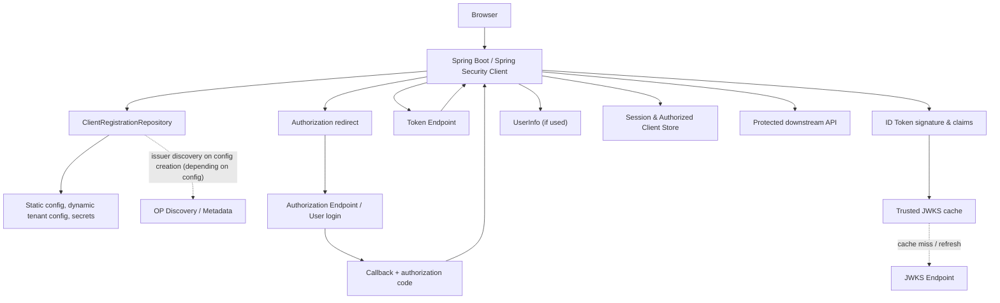

# 32.8. Readiness, Startup, and Dependencies on Discovery or JWKS

## 1. Problem: the application is healthy, yet users cannot log in

A **Spring Security OAuth 2.0/OIDC Client** application can hit two opposite failure modes:

**Scenario A — Fails to start up:**

```text
09:00  Kubernetes creates a new Spring Boot pod
09:00  ApplicationContext starts building OAuth2 ClientRegistration
09:00  issuer-uri config triggers metadata fetch from IdP
09:00  Discovery endpoint times out or DNS fails
09:00  Context initialization fails -> container cannot serve requests
09:01  Pod restarts, calls discovery again
09:02  Multiple pods restart together, stalling the deployment
```

**Scenario B — Both startup and readiness are green, yet logins fail:**

```text
09:00  Pod boots with pre-known provider metadata
09:01  Kubernetes readiness = UP
09:10  IdP JWKS endpoint suffers an outage
09:11  User starts OIDC login; OP issues ID Token with a new kid
09:11  Decoder cannot find matching public key in cache
09:11  OIDC Login fails, even though /actuator/health/readiness remains UP
```

Both scenarios can be technically accurate. Application readiness, startup success, and **the ability to complete a specific OIDC Login flow** are related yet distinct concepts.

This lesson answers:

- When does configuring `issuer-uri` execute OIDC discovery?
- When does Spring Security need to fetch JWKS?
- Should a pod stop receiving traffic if an IdP/JWKS endpoint fails?
- How should Kubernetes configure `startupProbe`, `readinessProbe`, and `livenessProbe`?
- Can network dependencies at startup be reduced without bypassing security validation?
- During an IdP or JWKS outage, how should the system degrade, retry, and recover?
- How do you prove those policies via testing and operational observability?

**Scope:** Spring Boot with Spring Security OAuth2/OIDC **Client**, especially Servlet/MVC. Most points also apply to WebFlux; the end of the lesson compares them. Code snippets illustrate Spring Boot 3.x/Spring Security 6.x; verify APIs and cache behaviors against your project's exact versions.

---

## 2. Distinguishing four commonly conflated states

| Concept | Question to answer | Typical mechanism |
|---|---|---|
| **Startup** | Has the Spring Boot process initialized enough components to begin serving? | ApplicationContext, bean initialization, startup checks |
| **Liveness** | Is the process alive or wedged/broken enough to require a restart? | Kubernetes liveness probe |
| **Readiness** | Should this instance receive new traffic right now? | Kubernetes readiness probe, Spring Boot `ReadinessState` |
| **Functional/dependency availability** | Does a feature like `Login with Corporate IdP` currently work? | Dependency monitoring, canary login, synthetic checks |

Example:

```text
Application process running             = true
HTTP server serving /api/health         = true
Kubernetes liveness                     = true
Kubernetes readiness                    = true
Corporate OIDC Login                    = temporarily unavailable
Existing authenticated user API traffic = still working
```

There is no contradiction: the application can keep serving many features while the IdP has an outage.

### 2.1. Startup failures differ from runtime outages

- **Startup failure:** `ClientRegistration` cannot be created because discovery runs during bean creation.
- **Runtime outage:** `ClientRegistration` already exists; later the Token Endpoint, JWKS, UserInfo, or authorization endpoint becomes unreachable.

They require **two different mitigations**. HTTP request retries cannot fix a failed bean initialization.

### 2.2. Liveness is not a whole-system check

If liveness directly calls an Internet-hosted IdP and returns `DOWN` during an IdP outage, Kubernetes will restart **every application pod**, even though the pods themselves are healthy.

Restarts can:

- Wipe useful JWKS caches.
- Amplify cold-start and discovery traffic against a struggling IdP.
- Drop sessions if the session store is not durable.
- Prolong outages and disrupt unrelated workloads.
- Trigger restart loops instead of recovery.

**Principle:** never tie liveness probes to external dependency health.

### 2.3. Readiness must answer a traffic-routing question

Readiness differs from liveness: returning `DOWN` removes the pod from service endpoints receiving traffic. However, if **all pods** turn Unready because of a shared IdP outage, the workload loses all endpoints and knocks out features that do not even need the IdP.

Readiness decisions must align with **an instance's ability to serve essential traffic** and degradation strategy, not “every external service is UP”.

---

## 3. Dependencies of an OIDC Client flow

An OIDC login typically involves:



These dependencies are needed at **different times**:

| Dependency | Potentially needed at startup? | Potentially needed at runtime? |
|---|---|---|
| Local `application.yml`/env | Yes | On reload/config change |
| Secrets manager | Yes, if loading credentials during config creation | Rotation/token requests |
| IdP discovery metadata | Yes, if registrations build via issuer discovery at init | When dynamic registrations are created/updated |
| Authorization Endpoint | Usually not needed for JVM boot | When the browser starts login |
| Token Endpoint | Not necessarily needed at startup | Code exchange, refresh token, client credentials |
| JWKS Endpoint | Depends on prewarming/decoder initialization | When ID Token verification fetches/refreshes keys |
| UserInfo Endpoint | Usually not needed at startup | Login/profile flow if required |
| Session store | Depends on initialization/config | Every request needing session/auth-request state |
| Authorized client store | Depends on startup/migrations | Loading/saving access/refresh tokens |
| Resource Server API | Usually not needed at startup | Business API calls |
| DNS/TLS/proxy | Depends on invoked dependencies | All relevant outbound calls |

Do not assume “JWKS always loads at startup” or “discovery is always lazy”. Actual behavior depends on how registrations/decoders are constructed, config, Spring Security version, and customizations.

---

## 4. `issuer-uri` and discovery can tie startup to the IdP

Spring Boot commonly allows declaring:

```yaml
spring:
  security:
    oauth2:
      client:
        registration:
          corporate:
            client-id: ${OIDC_CLIENT_ID}
            client-secret: ${OIDC_CLIENT_SECRET}
            authorization-grant-type: authorization_code
            redirect-uri: "{baseUrl}/login/oauth2/code/{registrationId}"
            scope:
              - openid
              - profile
              - email
        provider:
          corporate:
            issuer-uri: https://login.example-idp.com/realms/workforce
```

When creating `ClientRegistration` from `issuer-uri`, Spring Security/Boot can use provider metadata discovery to populate:

```text
authorization_endpoint
token_endpoint
jwks_uri
userinfo_endpoint
issuer
supported provider capabilities
```

In standard auto-registration configs, building the registration can issue a **network request right at startup**. If the discovery endpoint is unreachable, bean initialization or `ApplicationContext` startup fails.

### 4.1. Distinguish two paths

**Path A — Building registrations via discovery:**

```java
ClientRegistrations.fromIssuerLocation(issuer)
```

This API queries provider metadata from the issuer location. Calling it at startup creates a network dependency **at invocation time**.

**Path B — Building registrations from known metadata:**

```java
ClientRegistration.withRegistrationId("corporate")
    .authorizationUri(...)
    .tokenUri(...)
    .jwkSetUri(...)
    .issuerUri(...)
    // ...
    .build();
```

This avoids the **discovery network call during registration creation** because endpoint fields are pre-supplied. Still, it does not eliminate later runtime network dependencies for ID Token validation or the Token Endpoint.

### 4.2. Do not confuse with Resource Server `issuer-uri`

An app may also configure:

```yaml
spring:
  security:
    oauth2:
      resourceserver:
        jwt:
          issuer-uri: https://login.example-idp.com
```

That configures a **JWT Resource Server**. Resource Server decoder startup/discovery/cache behavior differs from OAuth2 Client's `ClientRegistrationRepository` and OIDC ID Token decoder.

This lesson focuses on **OAuth2/OIDC Client**; when an application acts as both Client and Resource Server, inspect **both** dependency paths.

### 4.3. Discovery endpoints are not arbitrary URLs

OIDC Discovery and OAuth2 Authorization Server Metadata define metadata locations per issuer/protocol. APIs like `ClientRegistrations.fromIssuerLocation(...)` may try supported discovery endpoints.

Never hardcode a guessed metadata URL if the provider publishes a different endpoint; also verify that `issuer` inside metadata matches the trusted issuer.

---

## 5. Is JWKS necessarily fetched at startup?

**No single answer applies universally.**

In many deployments, metadata/`ClientRegistration` is known at startup, while public keys are fetched **when the decoder needs to verify an ID Token**, usually after the Token Endpoint responds on the first callback.

In other setups, apps proactively:

- Prewarm JWKS.
- Initialize decoders/`JWKSource` performing network I/O.
- Run synthetic validation.
- Use shared caches or custom HTTP clients.
- Fetch metadata and key sets together during initialization.

Therefore, **measure your application's actual behavior** rather than guessing from property names.

### 5.1. First-login failure scenario

```text
T0 App starts successfully with known metadata
T1 /actuator/health/readiness = UP
T2 JWKS Endpoint unavailable
T3 First user login receives signed ID Token
T4 Decoder has no cached public key
T5 Signature cannot be verified -> login fails
```

Green readiness does not prove the system has tried fetching JWKS.

### 5.2. Prewarming does not guarantee perpetual provider availability

```text
T0 Prewarm JWKS succeeds
T1 Readiness = UP
T2 OP rotates signing key
T3 JWKS endpoint down
T4 New ID Token signed by K2 unknown to local cache
```

A successful startup prewarm does not guarantee all future logins succeed. Prewarming only reduces cold-cache latency and catches certain config errors early.

### 5.3. Cached keys are verification data only

JWKS holds **public keys**; never treat JWKS caches like client secrets or private keys. Never treat a cached key as trusted forever without enforcing issuer, algorithm, TTL, and key-retirement policies.

---

## 6. Choosing a startup strategy: fail-fast or resilient startup?

There is no single right answer for every app.

### 6.1. Fail-fast when the IdP config is mandatory

```text
Startup
    -> resolve issuer metadata
    -> verify required registration
    -> if cannot obtain required config:
           application startup fails
```

**Pros:**

- Misconfigured issuers/metadata are caught before pods take traffic.
- The app never runs with unverified login configs.
- Simple when the workload serves **solely** an IdP-dependent flow.

**Cons:**

- A brief discovery outage blocks scale-outs and rolling deploys.
- Every new pod requires the dependency up at startup time.
- Restarting all pods together can induce a self-inflicted full outage.
- Startup times become slower or erratic due to network timeouts/retries.

### 6.2. Resilient startup with approved metadata

```text
Startup
    -> load previously validated provider metadata from local/config store
    -> construct ClientRegistration
    -> mark local application ready
    -> perform IdP operations when feature needs them
```

**Pros:**

- Avoids mandatory discovery calls on every cold start.
- Pods can serve features independent of the IdP.
- Scale-outs are less blocked by an IdP outage.

**Cons:**

- Metadata can become stale if endpoints, issuers, or key policies change.
- Adds versioning, validation, and rollback overhead.
- Token/JWKS/UserInfo calls still require the remote provider.
- Tampered or untrusted stored metadata introduces security risk.

### 6.3. Difference between “offline startup” and “skipping validation”

**Valid offline startup** still enforces trusted provider configs, JWT signature/issuer/audience/nonce checks, and endpoint trust.

**Wrong:**

```text
Discovery unavailable -> disable issuer validation.
JWKS unavailable -> accept unsigned ID Token.
```

**Right:**

```text
Discovery unavailable -> use approved snapshot if policy permits.
JWKS unavailable -> validate only with trusted cached keys
                    if still permitted; otherwise reject login.
```

### 6.4. Hybrid policy

A SaaS may specify:

```text
Core application:
    Startup depends on local config + database/session store.

Optional social IdP:
    Discovery outage does not block pods from serving traffic.

Mandatory corporate IdP:
    Do not enable login until metadata/trust are approved;
    drop whole-pod readiness only if the entire service truly cannot
    serve meaningful traffic.
```

Document policies by business criticality and SLO rather than applying a blanket `if (idpDown) readinessDown` across all tenants.

---

## 7. Spring Boot Actuator and Application Availability

Spring Boot tracks application availability via:

- `LivenessState`: whether the application is alive.
- `ReadinessState`: whether the application is ready to accept traffic.

With Spring Boot Actuator, Kubernetes probes can hit health groups like:

```text
/actuator/health/liveness
/actuator/health/readiness
```

Path availability and configuration depend on Spring Boot version, deployment environment, and properties. Spring Boot detects Kubernetes environments and configures probes automatically, or you can enable them explicitly locally/in tests.

### 7.1. Example `application.yml`

```yaml
management:
  endpoints:
    web:
      exposure:
        include: health,info
  endpoint:
    health:
      probes:
        enabled: true
      show-details: never
```

`show-details: never` is a safe setting for public health endpoints. Detailed dependency status should reside on a protected internal channel.

### 7.2. Do not assume Actuator probes the IdP automatically

`/actuator/health/readiness` does not run OIDC logins, token exchanges, or JWKS signature validation merely because `spring-boot-starter-oauth2-client` is on the classpath.

To measure IdP availability, write a dedicated dependency monitor/health indicator per policy—**without necessarily attaching it to the readiness group**.

### 7.3. Health on a separate management port

If management endpoints run on a separate port, probes may report UP while the main application port is stuck or failing traffic.

Spring Boot supports exposing probe paths on the main server port in supported versions. Check your version/deployment and **test the actual port**.

### 7.4. Protect Actuator

Never expose all of:

```text
/actuator/**
```

to the Internet. Expose only required probes and enforce ingress/network policies. Metrics, `env`, `configprops`, `heapdump`, or `loggers` can leak sensitive details if left open.

---

## 8. Kubernetes: `startupProbe`, `readinessProbe`, `livenessProbe`

A Deployment might configure:

```yaml
apiVersion: apps/v1
kind: Deployment
metadata:
  name: portal-bff
spec:
  replicas: 3
  selector:
    matchLabels:
      app: portal-bff
  template:
    metadata:
      labels:
        app: portal-bff
    spec:
      containers:
        - name: portal
          image: registry.example/portal-bff:1.4.0
          ports:
            - name: http
              containerPort: 8080
          startupProbe:
            httpGet:
              path: /actuator/health/liveness
              port: http
            periodSeconds: 5
            failureThreshold: 24
          livenessProbe:
            httpGet:
              path: /actuator/health/liveness
              port: http
            periodSeconds: 10
            failureThreshold: 3
          readinessProbe:
            httpGet:
              path: /actuator/health/readiness
              port: http
            periodSeconds: 5
            failureThreshold: 3
```

Numbers are illustrative. Tune them to actual startup times, CPU/memory limits, and rollout SLOs.

### 8.1. Role of each probe

**`startupProbe`**

- Gives the application adequate time to start.
- While the startup probe has not succeeded, Kubernetes holds off liveness/readiness probes per startup probe semantics.
- Exceeding the failure threshold triggers container restarts.
- Cannot rescue an application context that **repeatedly fails initialization due to discovery**; fix the dependency, config, or startup strategy.

**`livenessProbe`**

- Detects wedged processes or broken internal states needing restart.
- Must not include remote IdP/JWKS checks.

**`readinessProbe`**

- Controls whether the pod stays in Service endpoints receiving traffic.
- Can depend on critical local initialization, session, or database policies.
- Avoid turning a shared provider outage into all pods going Unready if the app can still serve traffic.

### 8.2. `failureThreshold × periodSeconds` budget

Configuration:

```text
startupProbe:
    periodSeconds=5
    failureThreshold=24
```

grants roughly **120 seconds** of probe budget, excluding exact request timings, scheduling delays, and timeouts. It is not an automatic SLA or a guarantee against being killed at exactly 120 seconds.

### 8.3. Never point all three probes at a remote IdP check

Operationally wrong:

```text
startupProbe -> GET IdP /jwks
readinessProbe -> GET IdP /jwks
livenessProbe -> GET IdP /jwks
```

A JWKS outage will restart every pod, do nothing to improve IdP availability, and wipe still-valid key caches.

### 8.4. Rolling updates and minimum availability

To reduce risk, consider:

- Multiple replicas.
- Rolling updates with appropriate `maxUnavailable`/`maxSurge`.
- `PodDisruptionBudget` where applicable.
- Never restarting the entire fleet when discovery fails.
- Graceful shutdown.
- Limiting restart storms/thundering herds.
- Alerting when new pods stay unready while old pods still serve.

Parameters must match real capacity and scheduling; no sample YAML guarantees zero downtime across all clusters.

---

## 9. What should pod readiness actually depend on?

Dependency classification:

| Dependency | Include in liveness? | Include in readiness? | Reason |
|---|---|---|---|
| JVM/application process health | Yes, via health state | Can be | Checks the instance |
| Local configuration load/validation | Not directly | **Yes if mandatory** | App lacks config to process traffic |
| Session store mandatory for all requests | No | Possibly, per SLO | Without sessions, BFF may fail completely |
| Local DB essential to all APIs | No | Possibly | Prerequisite for core business logic |
| Optional analytics service | No | Usually no | Can degrade |
| One of several OIDC providers | **No** | Usually **no** for whole pod | Provider-specific outage |
| OIDC discovery endpoint | **No** | Depends on startup policy | May only be needed at config creation |
| JWKS endpoint | **No** | Usually no as remote polling | Cached and needed only on verification |
| Token Endpoint | **No** | Depends on login-only architecture | Login may fail while other APIs work |
| Non-essential downstream API | No | Usually no | Degrade feature |
| Trust-critical local metadata missing | No | **Yes, if unable to process safely** | Cannot serve requests within contract |

### 9.1. Decide based on “meaningful traffic”

If the app solely serves a login endpoint and **100% of requests require the IdP**, an IdP outage leaves instances unable to fulfill their core purpose. Weigh **readiness vs. global availability** based on routing, fallbacks, capacity, and SLOs.

However, when **all replicas depend on one IdP**, marking every pod Unready turns a login outage into a platform-wide `503` even for logout, error pages, and working APIs. Readiness is a product/operational choice, not automatic “absolute safety”.

### 9.2. Never use readiness to bypass authentication

If the Identity Provider is down, keeping readiness UP **never** allows unauthenticated requests into protected APIs. `SecurityFilterChain` and OIDC token validations remain **fail closed**.

### 9.3. Multi-tenant apps have no single login state

If 1 out of 500 tenants loses its IdP:

```text
Corporate IdP Alpha = DOWN
Corporate IdP Beta  = UP
Social login         = UP
Existing sessions    = SERVING
```

Marking the entire pod `Unready` because of Alpha causes unnecessary collateral damage. Use **provider/tenant-specific availability monitoring** separate from pod readiness.

---

## 10. Health groups for essential internal components

You can write a `HealthIndicator` verifying **local config was loaded and validated**.

Suppose the app defines `LocalClientConfigState` (**an application-defined interface**):

```java
public interface LocalClientConfigState {

    boolean hasValidatedRequiredRegistrations();

    long activeConfigVersion();
}
```

Spring Boot Actuator indicator:

```java
import org.springframework.boot.actuate.health.Health;
import org.springframework.boot.actuate.health.HealthIndicator;
import org.springframework.stereotype.Component;

@Component("requiredClientConfig")
public final class RequiredClientConfigHealthIndicator
        implements HealthIndicator {

    private final LocalClientConfigState config;

    public RequiredClientConfigHealthIndicator(
            LocalClientConfigState config) {
        this.config = config;
    }

    @Override
    public Health health() {
        if (!config.hasValidatedRequiredRegistrations()) {
            return Health.down()
                .withDetail("reason", "REQUIRED_CONFIG_NOT_READY")
                .build();
        }

        return Health.up()
            .withDetail(
                "configVersion", config.activeConfigVersion()
            )
            .build();
    }
}
```

**Important:** `health()` reads only **already-updated local state**. It never performs OIDC Discovery, JWKS GETs, or token exchanges on every probe request.

### 10.1. Configuring the readiness group

Example:

```yaml
management:
  endpoint:
    health:
      probes:
        enabled: true
      group:
        readiness:
          include: readinessState,requiredClientConfig
      show-details: never
```

In some Spring Boot versions, check actual properties/APIs for health groups and indicator names. Verify after deployment that `/actuator/health/readiness` reflects the intended group.

### 10.2. Never expose secrets in health details

Health reports must never include:

```text
clientSecret
accessToken
refreshToken
privateKey
full provider metadata with internal secrets
```

Even `configVersion` can be internal metadata; expose only fields appropriate for the endpoint's access level. `show-details: never` reduces exposure to external callers.

### 10.3. When local config is missing

If a registration required for the entire application is missing, the indicator returns `DOWN` so readiness keeps traffic off the pod. Liveness can remain `UP` because the process is not wedged.

If an optional provider is missing, track its status in a separate dependency monitor without necessarily flipping the critical-config indicator to `DOWN`.

---

## 11. Do not call the IdP from a `HealthIndicator` every 5 seconds

Easy to write, harmful in production:

```java
@Override
public Health health() {
    // Anti-example: do not use on every kube probe.
    String jwks = restClient.get()
        .uri("https://idp.example/jwks")
        .retrieve()
        .body(String.class);

    return Health.up().build();
}
```

Suppose:

```text
200 pods
readinessProbe every 5 seconds
```

this probe alone generates roughly 40 continuous JWKS requests/second, before counting retries, deployments, or outages.

### 11.1. Risks

- Adds load to the IdP right during an outage.
- Probe timeouts knock application pods Unready.
- Retries amplify traffic during slow networks.
- Kubernetes misinterprets IdP errors as unhealthy app pods.
- Turns the JWKS endpoint into a hard dependency for every route.

### 11.2. Better alternative: monitor outside the probe path

A **background dependency observer** can periodically run bounded checks:

```text
ProviderAvailability:
    providerAlias
    lastMetadataSuccessAt
    lastJwksSuccessAt
    lastTokenExchangeSuccessAt (dedicated synthetic flow)
    recentFailureCategory
    currentCircuitState
```

It emits metrics/alerts or updates a UX availability map **without blocking Kubernetes probes on direct GETs**.

Never treat a `200 GET /jwks` as proof that the Token Endpoint, authorization flow, consent, or ID Token validation all work. Synthetic logins may be needed for end-to-end verification and must use test identities/credentials.

---

## 12. Dependency health is not functional login health

Compare three checks:

```text
HEAD /jwks -> 200
GET /.well-known/openid-configuration -> 200
Synthetic Authorization Code Login -> success
```

They prove very different things.

| Check | What it proves | What it does not prove |
|---|---|---|
| JWKS HTTP reachable | Keyset can be fetched from that URL | Key signing fresh tokens, Token Endpoint, login UX |
| Discovery metadata reachable | Metadata can be read | Correct client secret, granted scopes, working callbacks |
| Token Endpoint reachable | Endpoint responds | Full authorization code flow/nonce/session |
| Synthetic OIDC login | One test transaction succeeded | Every tenant/user/provider is error-free |
| Existing user API works | Current sessions/tokens work | New logins still work |
| Readiness UP | Pod may take traffic per local policy | Entire IdP ecosystem is healthy |

### 12.1. Synthetic logins need dedicated identities

Never use real user or uncontrolled production accounts. If synthetic monitors run continuously, enforce:

- Dedicated test account/tenant.
- Test client secret managed in a vault.
- Rate limits and bounded schedules.
- No sensitive scopes beyond test needs.
- No long-lived sessions/tokens left behind.
- No logging of authorization codes/tokens.
- Provider permission for synthetic automation.

### 12.2. Synthetic logins are not readiness probes

A full browser Authorization Code Flow involves multiple redirects and network hops; it is unsuitable as a frequent Kubernetes probe deciding pod traffic membership.

---

## 13. Discovery at startup: fail-fast requires time bounds

If startup must call metadata endpoints, prevent indefinite blocking.

Include:

```text
DNS lookup
TLS handshake
TCP connect timeout
HTTP response read timeout
Total startup deadline
Bounded retry
Backoff + jitter
```

### 13.1. Target

```text
Startup time budget = 90s
Local config init   = 3s
Database ready      = 10s
Discovery           = bounded within remaining budget
```

Numbers are illustrative. Startup deadlines must exceed realistic p95/p99 startup times without being unbounded.

### 13.2. There is no single global timeout property for all Spring OAuth2 Client HTTP calls

Distinguish the HTTP clients used by:

- Provider discovery (`ClientRegistrations.fromIssuerLocation` or Boot binding).
- Authorization Code Token Response Client.
- Refresh Token Response Client.
- JWKS/`JWKSource`.
- OIDC UserInfo Client.
- Application `RestClient`/`WebClient`.

Setting timeouts on **one** `RestClient` bean does not automatically apply to every internal Spring Security HTTP call.

To enforce timeouts reliably, identify the **extension points for your library version** and configure the HTTP client on each dependency path.

### 13.3. Excessive retries cannot fix a wrong host

If the issuer URI is wrong or the certificate is untrusted, endless retries only stall startup. Classify:

- Temporary DNS failure.
- Connect timeout.
- HTTP 429/503.
- HTTP 404/invalid metadata.
- Issuer mismatch.
- TLS hostname/certificate validation error.

Some transient errors warrant bounded retries; configuration/trust errors should fail quickly and report clearly internally rather than waiting several minutes.

---

## 14. Approved metadata cache model

To reduce hard startup dependencies, a multi-tenant application can use a **versioned provider metadata snapshot**.

Example:

```json
{
  "registrationId": "tenant-a__corporate",
  "issuer": "https://login.tenant-a.example",
  "authorizationUri": "https://login.tenant-a.example/oauth2/authorize",
  "tokenUri": "https://login.tenant-a.example/oauth2/token",
  "jwkSetUri": "https://login.tenant-a.example/keys",
  "userInfoUri": "https://login.tenant-a.example/userinfo",
  "metadataVersion": 17,
  "approvedAt": "2026-11-01T10:00:00Z"
}
```

This is an **application-specific metadata store**, not JSON that Spring Security produces as a persistent registry by itself.

### 14.1. Required properties

- **Issuer is pinned/approved**, never trusting user-supplied URLs.
- Endpoints and redirect URIs are validated.
- Version/signer/audit trail is tracked.
- Rollback and TTL/revalidation policies exist.
- Secret material stays separately in a secret manager.
- Untrusted tenant configs cannot arbitrarily alter `jwkSetUri`.
- Snapshots update via a control-plane workflow, not a shared mutable live object.
- Runtime constructs `ClientRegistration` from the **trusted snapshot**.

### 14.2. What does a snapshot solve?

If the discovery endpoint suffers an outage while the snapshot remains valid:

```text
Application startup
    -> read approved metadata snapshot v17
    -> initialize registration
    -> readiness based on required local state
```

This avoids calling remote discovery **at that moment**.

### 14.3. What does a snapshot not solve?

- Token Endpoint still requires the remote AS for exchanges/refreshes.
- JWKS endpoint may still be needed for unknown signing keys.
- Authorization Endpoint must still serve the browser.
- Metadata can change or be revoked.
- The provider can revoke the OAuth client.
- UserInfo Endpoint can go down.

Snapshots are an **availability trade-off**, not a way to eliminate IdP dependencies.

---

## 15. Building `ClientRegistration` without discovery on the hot path

Illustrative Java example:

```java
import org.springframework.security.oauth2.client.registration.ClientRegistration;
import org.springframework.security.oauth2.core.AuthorizationGrantType;
import org.springframework.security.oauth2.core.ClientAuthenticationMethod;

public ClientRegistration registrationFromApprovedSnapshot(
        ApprovedOidcConfig cfg,
        String resolvedClientSecret) {

    return ClientRegistration
        .withRegistrationId(cfg.registrationId())
        .clientId(cfg.clientId())
        .clientSecret(resolvedClientSecret)
        .clientAuthenticationMethod(
            ClientAuthenticationMethod.CLIENT_SECRET_BASIC
        )
        .authorizationGrantType(
            AuthorizationGrantType.AUTHORIZATION_CODE
        )
        .redirectUri(
            "{baseUrl}/login/oauth2/code/{registrationId}"
        )
        .scope("openid", "profile")
        .issuerUri(cfg.issuer())
        .authorizationUri(cfg.authorizationUri())
        .tokenUri(cfg.tokenUri())
        .jwkSetUri(cfg.jwkSetUri())
        .userInfoUri(cfg.userInfoUri())
        .userNameAttributeName("sub")
        .clientName("Corporate OIDC")
        .build();
}
```

`ApprovedOidcConfig` is an **application type** you must define, validate, and version. This illustrates configuration, not a default discovery mechanism.

### 15.1. Why avoid `fromIssuerLocation()` on every request?

If `findByRegistrationId()` calls:

```java
ClientRegistrations.fromIssuerLocation(issuer).build();
```

on every login request, the application:

- Repeats metadata HTTP requests.
- Increases latency and network coupling.
- Risks thundering herds.
- Risks SSRF if issuers are unapproved.
- Loses control over when metadata updates take effect.

Instead, cache immutable versioned registrations paired with controlled **background/control-plane revalidation**.

### 15.2. Never build a half-baked registration and bypass validation

If `issuer`, `jwkSetUri`, or Token Endpoint is missing, valid OIDC login may be impossible. Never insert attacker-controlled or blank placeholders into security-critical configs just to turn readiness green.

### 15.3. Authentication method per provider

`client_secret_basic` is only an example. Providers may require `client_secret_post`, `private_key_jwt`, or mTLS. Snapshots and runtime HTTP token clients must match both the provider contract and Spring Security version.

---

## 16. Lazy initialization: a double-edged sword

Techniques deferring bean/registration creation until the first request can shorten startup.

However:

```text
Startup success
    ->
Readiness UP
    ->
First login request blocks while discovery/JWKS loads
```

shifts failures from startup onto the first user, spikes tail latency, and amplifies load when concurrent requests arrive together.

### 16.1. Lazy is not graceful degradation

To operate reliably, include:

- Reasonable timeouts.
- Concurrency control / single-flight.
- Safe error UX.
- Dedicated health/metrics.
- Cache and revalidation policies.
- Circuit breakers or rate limiting where appropriate.
- No skipping of signature/issuer validation.

### 16.2. When is prewarming useful?

If a provider is mandatory and heavy login traffic is expected right after deployment, prewarming trusted metadata/JWKS can:

- Eliminate cold-cache latency.
- Catch JWKS DNS/TLS/certificate errors early.
- Briefly reduce unknown-kid failures.

Keep prewarming bounded so it never becomes a pointless readiness-failure loop.

### 16.3. Prewarming must never expose private keys

JWKS needs only **public keys**. Never use prewarming hooks to fetch raw client secrets or private keys from untrusted network hosts.

---

## 17. JWKS cache: availability coupled to signature correctness

A decoder may hold a set of public keys:

```text
Trusted issuer: https://login.example-idp.com
JWKS cache:
    K1 (kid=2026-10)
    K2 (kid=2026-11)
```

When receiving an ID Token:

```text
JWS header: alg=RS256, kid=2026-11
```

the decoder selects the matching key from the trusted set, verifies the signature, and then validates OIDC claims.

### 17.1. JWKS outage while cache holds the matching key

If the cache still holds trusted public K1 and receives a valid token signed by K1, the decoder **can** verify it without a network call, depending on cache and trust policies.

Never claim every JWKS outage causes an instant login outage.

### 17.2. JWKS outage with a new `kid`

```text
Cache=[K1]
IdP begins signing K2
JWKS endpoint=503
```

Without a trusted K2 public key, the client **must not accept** K2 ID Tokens. That is the right security behavior, even though logins temporarily fail.

### 17.3. Never fall back to decoding payloads without signatures

Wrong:

```text
JWKS GET failed
    -> parse JWT header/payload
    -> trust sub/email/roles without signature
```

That is an authentication bypass.

### 17.4. Refresh-on-unknown-`kid` depends on implementation

Some Nimbus/`JWKSource` configurations refresh JWKS upon encountering an uncached `kid`; some custom caches rely on TTLs or manual refreshes.

Never assume **every version of Spring Security** automatically refetches on every unknown `kid`. Test the actual behavior of `OidcIdTokenDecoderFactory` / your configured decoder in your app.

### 17.5. Removing K1 remotely does not instantly purge local caches

Remote:

```text
JWKS=[K2]
```

A pod may still cache:

```text
JWKS=[K1,K2]
```

for some time depending on TTL/invalidation. In an emergency key compromise, take additional incident measures rather than just editing remote JSON and assuming all sessions are safe.

---

## 18. Cache TTL, HTTP headers, and key rotation

A JWKS endpoint may return:

```http
Cache-Control: public, max-age=300
ETag: "jwks-v21"
```

However, **effective JWKS cache TTL** does not necessarily equal `Cache-Control` if the client library uses its own cache ignoring HTTP cache semantics.

Questions to verify:

1. Is caching managed by Nimbus, Spring, or a custom adapter?
2. What is the actual cache TTL?
3. Does unknown-`kid` refresh trigger?
4. Is there negative caching or a refresh cooldown?
5. Are conditional GETs (`ETag`, `304`) supported?
6. If the JWKS endpoint times out, is the stale cache retained?
7. Is the cache scoped per issuer, per registration, or app-wide?
8. Is reusing a `kid` with new key material handled cleanly?
9. When registration v2 changes the endpoint, can v1's cache still be used?
10. When many pods rotate together, do JWKS GETs spike?

### 18.1. Do not build SLOs on guessed TTLs

If an operator says:

> “JWKS Cache-Control is 5 minutes, so Spring definitely refreshes after 5 minutes.”

treat that as a hypothesis to verify with tests and telemetry, not a general guarantee.

### 18.2. Pre-publish signing keys

A clean rotation sequence:

```text
T0: JWKS=[K1], signing=K1
T1: JWKS=[K1,K2], signing=K1
T2: After sufficient overlap, signing=K2
T3: Keep K1 in JWKS long enough per policy
T4: JWKS=[K2], retire K1
```

This requires coordination between IdP and clients. Cached JWKS cannot predict K2 before the provider publishes it.

---

## 19. When an IdP is down, UX must reflect the true scope of failure

An application can continue operating for users who already hold valid sessions:

```text
Already authenticated Alice:
    /api/dashboard -> OK
    /api/orders -> OK if downstream does not need IdP

New user Bob:
    /oauth2/authorization/corporate
    -> IdP unavailable
    -> cannot sign in
```

Do not:

- Log out every user just because a discovery health check failed.
- Let anonymous users into protected APIs.
- Loop OAuth2 redirects endlessly.
- Display stack traces or raw issuer/JWKS URLs.
- Say “incorrect password” when Token Endpoint/JWKS fails.

Reasonable message:

> Unable to reach the organization's sign-in service right now. Please try again later. If the error persists, provide the support code to your administrator.

### 19.1. Signing in with another provider

If the app supports multiple methods, offer an alternative sign-in method **only when business and security policies allow**.

Never silently fall back from a mandatory MFA corporate IdP to a lower-assurance social login for high-assurance accounts.

### 19.2. Logged in, yet needing a refresh token

A valid session does not guarantee all downstream integrations work while the Token Endpoint is down.

You may see:

```text
BFF session authenticated
Access token expired
Refresh endpoint timeout
API integration unavailable
```

In that case, report **temporary resource connection failure** rather than calling it an expired BFF session.

---

## 20. Readiness and fail-closed security do not conflict

A system can keep readiness UP during an OP outage while maintaining:

```text
New OIDC login without verified ID Token -> DENY

Protected API without valid session -> DENY

Downstream call without valid access token -> DENY

Existing authenticated session with valid app policy -> ALLOW
```

This is not “fail open”.

### 20.1. Distinguish availability degradation from authorization bypass

**Availability degradation:** a feature becomes unavailable due to a dependency failure without loosening security.

**Authorization bypass:** skipping authentication/authorization to make a feature appear operational.

Readiness controls traffic routing; it is not an instruction for Spring Security to skip checks.

### 20.2. Policies must be clear per feature

| Feature | IdP down | Typical decision |
|---|---|---|
| New OIDC Login | Cannot verify | Reject / degrade safely |
| User with valid session | Can continue | Follow session/local authorization policy |
| ID Token signature validation | No trusted key | Reject |
| Access token refresh | Token Endpoint down | Bounded retry/error |
| Service `client_credentials` | Token Endpoint down | Never mint fake access tokens |
| Health/status page | Can serve | Requires no login flow |
| Local-only business APIs | Can serve | Provided other dependencies are ready |

---

## 21. Timeouts, retries, and circuit breakers: never share one policy

Different HTTP calls carry different semantics.

| Operation | Retriable? | Key notes |
|---|---|---|
| GET discovery metadata | Yes, bounded on transient errors | Prevent SSRF, validate issuer |
| GET JWKS | Yes, bounded | Guard against refresh storms |
| GET UserInfo | Depends on HTTP/client semantics | Carries access token/PII and auth context |
| POST authorization code exchange | **Extremely cautious** | One-time-use code; AS may have processed it |
| POST refresh token grant | **Extremely cautious** | Refresh token rotation/replay detection |
| POST `client_credentials` token request | Retriable per provider policy | Rate limits and duplicate token issuance |
| Protected business POST | Per idempotency contract | Avoid duplicate transactions |

### 21.1. Retries need jitter

If 300 pods boot together and all fail discovery:

```text
Retry exactly at 1s, 2s, 4s, 8s...
```

every pod creates synchronized traffic spikes. Use bounded exponential backoff with jitter wherever workflows permit.

### 21.2. A circuit breaker is not proof of OIDC validity

An `OPEN` circuit breaker stops hammering a failing IdP. It only signals that outbound calls are throttled by operational policy—**never asserting** that issuers, identities, or tokens are valid.

When the breaker allows traffic again, still enforce full JWT signature/issuer/audience/nonce validation.

### 21.3. Never apply unbounded automatic retries in a Servlet filter

A callback request to the Token Endpoint needs a deadline. Retrying endlessly on a filter thread can exhaust the Servlet thread pool and spike latency across all requests.

### 21.4. Log metadata, never credentials

When retrying token requests, never log:

```text
client_secret
authorization_code
code_verifier
refresh_token
Authorization header
raw ID Token
```

Log `operation`, `stage`, `errorClass`, `providerAlias`, duration, and correlation ID.

---

## 22. Container network connectivity is part of real readiness

When running in Kubernetes, the IdP/JWKS may sit behind:

```text
Pod
    -> Cluster DNS
    -> NAT/Egress Gateway
    -> Corporate Proxy
    -> TLS trust store
    -> IdP / JWKS Endpoint
```

Real-world failures:

- DNS resolution fails.
- Egress NetworkPolicy blocks host/port.
- Corporate HTTP proxy is unconfigured on the discovery/JWKS HTTP client.
- New TLS certificate chain missing from the JVM truststore.
- Clock drift breaks ID Token `exp`, `iat`, `nbf` checks.
- Hostname/redirect URI mismatches behind a reverse proxy.
- Egress firewall rate limits.
- Service mesh mTLS/egress rules differing from local.

### 22.1. Why localhost tests are insufficient

A local fake OP works easily when app and test server share a machine/JVM, whereas production relies on DNS, TLS chains, proxies, ingress, and network policies.

Run deployment smoke/synthetic tests in a production-like environment without real credentials.

### 22.2. Controlled network diagnostics

A diagnostic command inside a pod (run by an authorized operator) can inspect:

```text
DNS
TLS handshake
HTTP status
Response latency
Issuer metadata exact-match
JWK Set URI reachability
```

There is no need to send client secrets or tokens when merely checking public discovery/JWKS endpoints.

### 22.3. SSRF in dynamic discovery

If the app lets tenant admins add issuer URLs, never run discovery against arbitrary hosts, loopback, or private networks solely from user input. Enforce issuer approval, HTTPS, allowed hosts/IP ranges, redirect restrictions, egress policies, and metadata verification.

---

## 23. Dynamic multi-tenant provider loading

In a SaaS app:

```text
tenant-alpha -> issuer Alpha
tenant-beta  -> issuer Beta
tenant-gamma -> issuer Gamma
```

If startup requires discovery **simultaneously for all tenants**, one broken issuer can block the app for every tenant.

### 23.1. Do not turn every tenant IdP into a global startup dependency

Instead of:

```text
Startup:
    for every tenant:
        fetch discovery
        fetch JWKS
    if one fails:
        fail whole app
```

you can use:

```text
Startup:
    load approved registrations from trusted config store
    validate required local invariants
    start serving

Per tenant:
    availability state / background revalidation
    runtime OAuth2 flow fail closed if provider unavailable
```

This fits when using approved metadata snapshots and policy does not require every tenant to be able to log in before the instance serves traffic.

### 23.2. Multi-tenant readiness is not a boolean “all IdPs healthy”

A single pod readiness bit cannot represent:

```text
Alpha login OK
Beta login degraded
Gamma login OK
```

Use provider-specific health/status and UX, while pod readiness primarily reflects platform traffic capability.

### 23.3. Never key JWKS caches solely by `kid`

Two issuers can share a `kid`:

```text
Alpha kid=current, key=AlphaK1
Beta  kid=current, key=BetaK1
```

Keys/caches must be bound to the trusted issuer/JWKS source. Otherwise one provider can affect another provider's token verification.

### 23.4. Config version changes on a running pod

With a dynamic `ClientRegistrationRepository`, use immutable snapshots keyed by:

```text
(registrationId, activeVersion)
```

and explicit invalidation policies. When issuer or JWKS URI changes, refresh the matching decoder/cache/registration lifecycle per your implementation; never let custom caches keep using the old issuer.

---

## 24. Cached keys and secrets: two separate lifecycles

### 24.1. JWKS public keys

- Used to **verify** JWS/ID Tokens.
- Can be cached to reduce network traffic.
- Require issuer/key/algorithm trust.
- Rotate when the OP rotates signing keys.

### 24.2. OAuth client credentials

- Used to **authenticate the client** at the Token Endpoint.
- May be client secrets, private key JWTs, or mTLS certificates/keys.
- Must live in a secret manager or secure memory.
- Have independent rotation/expiration lifecycles.

### 24.3. Refresh tokens

- Used to obtain new access tokens.
- Can be rotated or revoked.
- Must be protected as credentials.
- Have no direct coupling to public JWKS caches.

A successful startup with a warm JWKS cache does not mean `client_secret` is valid. Conversely, a valid `client_secret` does not guarantee the JWKS endpoint is reachable.

---

## 25. When should readiness actively include dependencies?

Three tiers can be considered:

### Tier A — Local core readiness

```text
App initialized
Required configuration validated
Critical local stores available according to policy
```

Suitable when most app features remain usable during an IdP outage.

### Tier B — Functional readiness per route/service

An architecture can split workloads:

```text
auth-bff-service:
    serves only login/token broker
business-api-service:
    serves existing sessions/local APIs
```

Here **auth-bff** readiness can be stricter than **business-api**, because their traffic contracts differ. Still, polling the remote IdP continuously risks knocking the entire auth tier Unready without aiding recovery.

### Tier C — Deployment gating instead of pod readiness

A rollout can require:

```text
CI/release gate:
    required issuer discovery reachable
    test OIDC login succeeds
    JWKS validation success
```

before promoting a version. **This is an alternative** to having every pod continuously poll the IdP inside Kubernetes readiness probes.

### 25.1. Bound remote dependencies in release gates

A provider outage at deploy time may warrant holding the previous release or pausing rollout. Still, a single passing smoke test cannot replace runtime monitoring, since the provider can fail right after the test.

---

## 26. Startup readiness and the Spring Boot lifecycle

Spring Boot initializes the context, starts the embedded web server, runs `ApplicationRunner`/`CommandLineRunner`, and publishes application availability events along its lifecycle.

Note: **never emit `ReadinessState.ACCEPTING_TRAFFIC` too early**, before mandatory local initialization finishes.

### 26.1. Required local initialization

Example:

```text
Load tenant registrations from trusted DB/config snapshot
Validate local required fields
Prepare session/authorized-client stores
Register critical services
Only then mark local readiness
```

If an asynchronous initialization step continues after Spring Boot startup, use a dedicated readiness indicator or manage `AvailabilityChangeEvent` around the real lifecycle rather than assuming Spring Boot knows your custom task is still running.

### 26.2. `AvailabilityChangeEvent`

Spring Boot supports updating availability state via events. Watch lifecycle ordering: Spring Boot may emit readiness transitions after runners. If custom code publishes `ACCEPTING_TRAFFIC` prematurely, it does not guarantee later steps finished.

A simpler pattern is a health indicator reading **local `criticalInitializationDone` state** inside the readiness group, reporting UP only once verified.

### 26.3. `startupProbe` does not replace readiness

`startupProbe` protects the app during boot from premature liveness kills; it does not control traffic after startup finishes. `readinessProbe` governs Service endpoint membership.

---

## 27. Case study: all pods restart due to an IdP outage

**Broken design:**

```text
livenessProbe:
    GET /health
    /health:
        GET OIDC discovery
        GET JWKS
```

**Timeline:**

```text
1. IdP loses connectivity.
2. /health on all pods returns DOWN.
3. Kubernetes restarts pods.
4. New pods attempt discovery and fail startup.
5. Zero pods left serving, even for existing user APIs.
6. When IdP recovers, all pods boot together -> network spike.
```

**Design fix:**

- Liveness reflects process/container health only.
- Readiness reflects local instance ability to serve core traffic.
- IdP/JWKS availability lives in a dedicated dependency monitor.
- Static/approved metadata snapshots let startup proceed during discovery outages if policy permits.
- Bounded retries/jitter and sound rollout policies.
- Keep old pods alive when rolling updates fail readiness.
- Handle login failures with safe UX; never bypass JWT validation.

### 27.1. Never mask symptoms by raising `failureThreshold` indefinitely

Giving Kubernetes a 20-minute window hides a single timeout yet never fixes an app that **hard-requires remote issuer metadata** and always fails during an IdP outage. Re-evaluate startup dependencies.

---

## 28. Case study: green readiness, yet first login fails due to JWKS

**Environment:**

```text
Spring ClientRegistration created from approved metadata.
No login since deployment.
JWK cache cold.
```

**Incident:**

```text
IdP JWKS endpoint returns 503.
First OIDC callback carries a valid signed ID Token.
Decoder has no trusted public key.
Validation fails.
```

**Is this a readiness bug?**

Not necessarily. Readiness only states the pod can serve traffic per policy. If the app serves other routes, readiness UP may be completely right.

**What to do?**

- Monitor the JWKS endpoint and ID Token validation error rates.
- Use bounded timeouts and safe failure handlers.
- Consider prewarming keys for mandatory providers.
- Separate login availability from pod readiness.
- Never accept unsigned claims.
- Measure SLOs for first-login-after-deploy.

### 28.1. Should every provider be prewarmed?

Not necessarily. With thousands of tenant IdPs, prewarming all of them causes huge startup latency and network storms. Prioritize active high-traffic tenants/providers with bounded concurrency, metadata TTLs, and policy-driven background warming.

---

## 29. Case study: issuer discovery succeeds, yet JWKS URI is broken

Suppose metadata returns:

```json
{
  "issuer": "https://login.example-idp.com",
  "authorization_endpoint": "https://login.example-idp.com/authorize",
  "token_endpoint": "https://login.example-idp.com/token",
  "jwks_uri": "https://keys.example-idp.com/jwks"
}
```

Discovery returns HTTP 200 and parses cleanly. However, `keys.example-idp.com` has broken DNS or an invalid TLS certificate.

Result:

```text
Startup with discovery: success
OAuth2 authorization redirect: success
Authorization Code Token exchange: success
ID Token verification: failure
```

A startup check hitting only discovery **misses** the JWKS issue.

### 29.1. Validation during onboarding

Verify the trusted JWKS URI, certificate, and reachability at onboarding—recognizing that onboarding checks do not guarantee perpetual runtime uptime.

### 29.2. Never disable TLS

If the JWKS endpoint has a broken TLS certificate, never configure “trust all certificates” in production. That lets attackers swap public keys and forge tokens.

---

## 30. Case study: new `kid` and stale JWKS cache

```text
T0: Cache contains K1
T1: IdP publishes [K1,K2]
T2: IdP signs new ID Tokens with K2
T3: App receives K2 ID Token
```

Two outcomes depending on decoder/cache implementation:

- Unknown `kid` triggers a JWKS refresh → fetches K2 → verifies successfully.
- Cache does not refresh immediately → logins fail temporarily until TTL/revalidation updates.

### 30.1. Never assume implementation behavior

Integration tests must run against the **exact Spring Security/Nimbus versions** deployed. A blog post saying “Nimbus auto-refreshes on unknown kid” does not prove every cache adapter behaves that way.

### 30.2. Required test

```text
Cold cache with K1.
Warm cache by successful K1 validation.
Remote JWKS becomes [K1,K2].
Token signed by K2 arrives.
Observe:
    acceptance/rejection,
    JWKS HTTP fetch delta,
    latency,
    recovery time,
    security invariants.
```

### 30.3. Never turn key rotation into a liveness failure

A decoder seeing an unknown `kid` does not mean the JVM died or wedged. Liveness must never flip to DOWN because an ID Token failed verification.

---

## 31. Monitoring: track startup and dependencies separately

A system needs at least three signal groups.

### 31.1. Startup metrics

```text
application_startup_duration_seconds
oauth2_registration_initialize_duration_seconds
oauth2_discovery_requests_total{outcome="success|failure"}
oauth2_discovery_duration_seconds
application_startup_failures_total{reason="DISCOVERY_TIMEOUT"}
```

These are **illustrative custom metric names**; Spring Boot does not emit all of them verbatim by default.

### 31.2. Runtime identity dependency metrics

```text
oidc_jwks_fetch_requests_total{provider="corporate",status_class="5xx"}
oidc_id_token_validation_total{provider="corporate",reason="UNKNOWN_KID"}
oauth2_token_endpoint_requests_total{grant="authorization_code",outcome="failure"}
oauth2_login_attempts_total{provider="corporate",outcome="success|failure"}
oauth2_refresh_failures_total{reason="INVALID_GRANT"}
```

### 31.3. Kubernetes readiness/liveness metrics

```text
Pod ready/unready transitions
Container restart count
Startup probe failures
Readiness probe failures
Deployment rollout progress
Available replicas
Time-to-ready after pod creation
```

### 31.4. Correlate deployments and rotations

Useful metadata:

```text
appVersion
Spring Security/Nimbus version
providerAlias
registrationConfigVersion
pod/region
JWKS cache age, if available
issuer configuration version
IdP incident/rotation window
```

Never log raw ID Tokens, access/refresh tokens, client secrets, authorization codes, code verifiers, or session cookies.

### 31.5. Cardinality

Avoid raw tenant/user IDs, attacker-supplied `kid` values, trace IDs, or correlation IDs in metric labels. Keep correlation IDs in structured logs/traces and use bounded categories in metrics.

---

## 32. Distinct alerts for startup and runtime login

| Signal | Meaning | Action |
|---|---|---|
| Pod `CrashLoopBackOff` on rollout | Possible startup init/discovery failure | Check startup stage logs, config, dependencies |
| Ready replicas drop | Pods excluded from traffic | Separate local app failures from readiness dependencies |
| `issuer_metadata` timeouts spike | Discovery/provider/network outage | Check egress/DNS/TLS/proxy and retry policy |
| JWKS unknown-`kid` spike | Key rotation or forged tokens | Check trusted JWKS updates / OP timeline |
| JWKS 503 yet logins succeed | Cache holds valid key | Monitor without restarting |
| Login failures spike after key rotation | Cache/OP key mismatch | Test known key transition |
| `invalid_client` spikes after deploy | Client-secret/auth method mismatch | Check credentials/config version |
| Refresh `invalid_grant` spikes | Token lifecycle/rotation | Do not confuse with JWKS |
| Token Endpoint latency rises | OP/network saturation | Bounded timeouts, degraded UX |
| Existing sessions work, new logins fail | OP dependency outage | Never invalidate existing sessions blindly |
| All pods Unready simultaneously | Shared dependency in readiness or core DB | Inspect health group and ingress |
| Readiness green yet 100% logins fail | Missing functional monitor | Dedicated synthetic sign-in / dashboard |

### 32.1. SLOs: measure the actual user journey

Startup SLOs and OIDC login SLOs differ:

```text
Startup readiness within expected deadline
Login success rate for provider A
Login latency from initiation to callback completion
JWKS refresh recovery time after rotation
```

Never cite “100% Pod readiness” as proof of “100% successful user logins”.

---

## 33. Safe logging for discovery/JWKS

A diagnostic event:

```json
{
  "event": "oidc.jwks.refresh.failure",
  "stage": "ID_TOKEN_VALIDATION",
  "providerAlias": "corporate",
  "registrationConfigVersion": 18,
  "podRef": "portal-7cd9",
  "networkErrorClass": "READ_TIMEOUT",
  "remoteStatusClass": "5xx",
  "correlationId": "c-80e3d",
  "retryable": true
}
```

Never record:

```text
Authorization: Basic ...
Authorization: Bearer ...
clientSecret
accessToken
refreshToken
idToken
raw session ID
authorizationCode
state
codeVerifier
private JWK
```

### 33.1. Still bound logging of public JWKS JSON

JWKS contains public keys, yet dumping entire HTTP responses into logs bloats storage, leaks provider metadata, and risks log injection if spoofed. Log key counts, safe error categories, and response status instead of raw bodies.

### 33.2. OAuth2 Callback URLs contain secrets

Never log full request URIs:

```text
/login/oauth2/code/corporate?code=...&state=...
```

because authorization code and state sit in query parameters. Reverse proxies, ingress, and tracing instrumentation must mask them as well.

---

## 34. Runbook: app fails startup due to discovery

**Symptoms:**

```text
Spring Boot context initialization fails
Unable to resolve provider configuration from issuer URI
TLS/connection/read timeout
Pod repeatedly restarts
```

**Steps:**

1. Pinpoint the failing startup stage: bean creation, discovery request, metadata parse, or TLS.
2. Confirm the configured issuer from trusted config (never log secrets).
3. Check DNS/egress/proxy from inside the pod environment.
4. Check TLS certificate/hostname and JVM truststore.
5. Check whether returned metadata `issuer` matches the configured issuer exactly.
6. Confirm the URL is the OIDC issuer rather than the authorization endpoint.
7. Check whether the IdP is having an outage or rate limiting.
8. Check whether old pods of the prior deployment are still running.
9. Review whether fail-fast startup is mandatory.
10. If an approved metadata snapshot exists and policy allows, consider bootstrapping from the snapshot.
11. Keep rolling deployments safe; never restart healthy old pods en masse.
12. Once root cause is clear, apply controlled mitigation and monitor recovery.

**Do not:** disable issuer validation, switch to an untrusted issuer host, accept insecure TLS, or raise startup retries endlessly without classifying errors.

### 34.1. How to escalate for support

Operations may need:

```text
deployment version
timestamp
pod ID
safe error stage
issuer/provider alias
correlation ID
network error class
```

Never ask users or operators to send client secrets or tokens.

---

## 35. Runbook: JWKS outage while app readiness stays UP

**Symptoms:**

```text
Readiness = UP
Existing sessions = OK
New OIDC Login = failures
JWKS fetch = timeout/503
```

**Steps:**

1. Distinguish ID Token signature validation errors from issuer/audience/nonce errors.
2. Check whether the OP recently rotated signing keys.
3. Verify remote JWKS from the trusted endpoint (respecting egress policy).
4. Check the key ID in use and effective cache state if instrumented.
5. Check which Pods hold K1 cached and which have fetched K2.
6. Verify unknown-`kid` refresh/TTL behavior for your actual Spring/Nimbus version.
7. Check timeouts/retries to avoid triggering a JWKS fetch storm.
8. Keep logins failing closed when no trusted matching key exists.
9. If the outage persists, display “login service temporarily unavailable” UX.
10. Upon recovery, verify signed ID Token validations succeed and monitor login latency.

**Do not:** skip JWT signature checks or reuse keys from another issuer just because `kid` matches.

---

## 36. Runbook: liveness causes all pods to restart

**Symptoms:**

```text
IdP outage starts
Kubernetes liveness probes fail
Pod restart counts increase
All replicas unavailable
```

**Remediation:**

1. Inspect the exact health groups used by the liveness endpoint.
2. Find any custom health indicator calling IdP/JWKS/Token Endpoints.
3. Remove external dependency checks from liveness.
4. Align readiness with core traffic policy instead of sharing the same deep check.
5. During rolling updates, retain old pods if new pods fail startup.
6. Re-evaluate appropriate `startupProbe` budgets.
7. Bound discovery/JWKS retries when multiple new pods boot simultaneously.
8. Add separate synthetic login alerts.
9. Run an outage drill to confirm restarts no longer cascade.

Restarting a genuinely wedged pod is expected; only eliminate restarts triggered by external outages that restarting cannot cure.

---

## 37. Integration testing: simulating a discovery outage at startup

Distinguish two configurations.

### 37.1. Case A — Registrations built from issuer discovery

```yaml
spring:
  security:
    oauth2:
      client:
        registration:
          corporate:
            client-id: portal-test
            client-secret: test-secret
            scope: openid,profile
        provider:
          corporate:
            issuer-uri: http://127.0.0.1:9009
```

**Test setup:**

```text
Fake OP discovery server unavailable at context startup.
```

**Expectation:** if the project invokes discovery when building `ClientRegistration` at startup, context initialization should fail. Tests should assert the failure category/time budget without assuming identical exception messages across all Spring Boot versions.

### 37.2. Case B — Registrations built from approved endpoints

```text
Fake OP offline
ClientRegistration constructed from trusted snapshot
ApplicationContext starts
Application readiness reflects local policy
First new login may fail when remote service needed
```

**Expectation:** the app starts when local config and critical stores satisfy policy; runtime OIDC flows still fail closed if tokens cannot be verified.

### 37.3. Test against the real application context

You cannot test startup bean creation using `MockMvc` after a fully mocked context has already started.

Use `ApplicationContextRunner` or a fresh context/process launched with dynamic test properties and the fake OP state configured **before** context startup.

### 37.4. Never rely on a hardcoded TCP port that might collide

In integration tests, start the fake OP on a random port, expose the actual base URI, and inject it into properties before context initialization. Avoid hardcoding `:9009` in parallel test suites.

---

## 38. Testing JWKS caching at runtime

A dedicated test suite:

```text
Test OP:
    /.well-known/openid-configuration
    /authorize
    /token
    /jwks

Test keys:
    K1 private/public
    K2 private/public

Client:
    actual Spring Security OIDC Login pipeline
```

Scenario:

1. OP publishes `[K1]`, signs with K1; login succeeds.
2. Reuse the exact same decoder/cache instance.
3. OP publishes `[K1,K2]`.
4. OP signs with K2; observe behavior while client caches `[K1]`.
5. Trigger/await refresh per **known cache config**.
6. K2 login succeeds once the decoder holds K2.
7. OP retires K1, cache updates to `[K2]`.
8. K1 ID Tokens are rejected once the effective trusted cache no longer holds K1.
9. JWKS 503 with cold cache → fails closed.
10. JWKS 503 with matching cached key → behaves per trust/cache policy.
11. Unknown `kid` + invalid signature → rejected.
12. Wrong issuer/audience/nonce → rejected even with valid signature.

### 38.1. Do not use `oidcLogin()` to test JWKS

The `MockMvc` post-processor:

```java
mockMvc.perform(
    get("/api/me").with(oidcLogin())
);
```

fabricates a mock authenticated principal. It **does not** issue authorization redirects/callbacks, call the Token Endpoint, or exercise JWKS fetching/signed ID Token verification.

To test JWKS, run the real decoder against signed JWT fixtures; to test the full OIDC Client, run the **real authorization callback pipeline** against a fake OP.

### 38.2. Make cache expiration tests deterministic

Avoid `Thread.sleep(300_000)` in CI. Instead:

- Use a test-configured short TTL if supported by the cache implementation.
- Control a custom cache clock.
- Use a cache adapter with an invalidation hook.
- Separate cold-cache and warm-cache tests.
- Use Awaitility with bounded deadlines.
- Run longer compatibility suites outside PR gates if needed.

Never pretend creating a new decoder instance tests “cache TTL expired” on a long-lived decoder.

---

## 39. Testing Kubernetes probes during dependency failures

A Kubernetes/Kind test environment can execute:

```text
T0 Deploy 3 healthy pods
T1 Fake IdP healthy
T2 Verify liveness & readiness UP
T3 Force JWKS endpoint 503
T4 Verify:
       pod liveness remains UP
       readiness follows documented policy
       login attempts fail safely if cannot verify
       existing session APIs remain available as designed
       restart count does not spike
T5 Restore JWKS
T6 Verify login recovery
```

### 39.1. Test startup outages separately

```text
T0 Fake discovery endpoint down
T1 Deploy new pods
T2 Observe startup behavior per configured bootstrap mode
T3 Ensure old pods remain available during rolling update
T4 Restore IdP, verify recovery without manual insecure changes
```

### 39.2. If Kubernetes is not in the PR pipeline

Unit/integration-test health indicators and process startup separately, and run deployment outage drills periodically in staging. State the exact scope of each test rather than claiming `MockMvc` verified Kubernetes routing.

---

## 40. Negative security test cases

| Input / incident | Expectation |
|---|---|
| Wrong issuer in discovery metadata | Reject trusted registration / fail per policy |
| Discovery URL pointing to untrusted private/loopback IP | Block per SSRF policy |
| JWKS endpoint redirected to untrusted host | Reject per egress policy |
| Malformed JWKS JSON | Never verify ID Token with broken data |
| Empty JWKS keys | No matching key → fail closed |
| JWKS 503, cold cache | Reject ID Token |
| JWKS 503, K1 cached | Verify only if cached key remains trusted/valid |
| ID Token unknown `kid` | Refresh per policy or reject |
| ID Token header `kid=K2`, signed with private K3 | Reject |
| ID Token `alg=none` | Reject |
| Valid signature, wrong `iss` | Reject |
| Valid signature, wrong `aud` | Reject |
| Valid signature, wrong `nonce` | Reject |
| Token key from tenant Beta used in Alpha | Reject |
| Wrong client secret | Token Endpoint `invalid_client`, don't blame user |
| Callback state mismatch | Reject, do not create session |
| Unapproved change of JWKS source | Reject |
| IdP outage | Never skip authentication checks |
| Exposed probe HTTP output | No secrets or stack traces leaked |
| Spoofed `X-Forwarded-Host` | Never produce arbitrary `redirect_uri` |

### 40.1. “Fail closed” applies at the authentication decision

Without a trusted public key, never accept an ID Token. Yet failing closed **does not require restarting the entire JVM or turning every route into 503**.

That is the distinction between a security decision and an availability policy.

---

## 41. Comparison with WebFlux

In Spring WebFlux:

| Servlet/MVC | WebFlux |
|---|---|
| `HttpSecurity` | `ServerHttpSecurity` |
| `SecurityFilterChain` | `SecurityWebFilterChain` |
| `ClientRegistrationRepository` | `ReactiveClientRegistrationRepository` |
| `OAuth2AuthorizedClientManager` | `ReactiveOAuth2AuthorizedClientManager` |
| Servlet HTTP clients | Reactive HTTP clients / `WebClient` |
| `HttpSession` | `WebSession` and reactive security context |
| Servlet filter thread pool | Reactor event loops and nonblocking pipelines |

Unchanged principles:

- Never couple liveness to the IdP.
- Readiness reflects traffic-serving capability.
- Discovery/JWKS can introduce network dependencies when queried.
- JWKS/signature validation always fails closed.
- Timeouts and cache policies must target the actual HTTP client/decoder.
- Separate external dependency health from platform readiness where appropriate.

### 41.1. Never block the Reactor event loop

If a reactive startup or health indicator runs blocking HTTP or blocking JDBC directly on the event loop, it causes high latency or deadlocks. Use reactive APIs or offload blocking work onto a dedicated scheduler.

### 41.2. Same provider, yet caching can differ

Servlet OIDC decoders and reactive OAuth2 Clients may use different HTTP/JWK abstractions. Never assume Servlet cache test results prove reactive deployment behavior.

---

## 42. Anti-patterns to avoid

### Anti-pattern 1 — Liveness calling `GET` OIDC discovery

**Consequence:** IdP outage ⇒ pod restart loop.

### Anti-pattern 2 — Readiness requiring all tenant IdPs to be UP

**Consequence:** one tenant outage ⇒ entire SaaS pulled from Service endpoints.

### Anti-pattern 3 — Testing only Actuator UP and declaring login healthy

**Consequence:** JWKS/Token Endpoint failures go undetected.

### Anti-pattern 4 — Disabling JWT signature validation on JWKS timeout

**Consequence:** authentication bypass.

### Anti-pattern 5 — Lazy discovery on every login request

**Consequence:** latency, SSRF risk, thundering herds.

### Anti-pattern 6 — Hardcoding multi-minute `Thread.sleep` to test caches

**Consequence:** slow, flaky CI.

### Anti-pattern 7 — Ignoring client secret/token endpoint because JWKS check is green

**Consequence:** token exchange fails despite working JWKS fetches.

### Anti-pattern 8 — Putting raw OAuth2 credentials into health responses or logs

**Consequence:** sensitive credential leakage.

### Anti-pattern 9 — Trusting any `jku` URL inside token headers

**Consequence:** SSRF and forged key trust.

### Anti-pattern 10 — Exposing `management.endpoints.web.exposure.include: '*'` unprotected

**Consequence:** leaks environment, config, metrics, and admin controls.

### Anti-pattern 11 — Restarting all pods to “refresh JWKS”

**Consequence:** cold-cache storms and lost availability; prefer approved refresh/invalidation.

### Anti-pattern 12 — Assuming JWKS HTTP `Cache-Control` equals Nimbus TTL

**Consequence:** mispredicted key rotation behavior.

### Anti-pattern 13 — Assuming `idpDown` invalidates all existing sessions

**Consequence:** unnecessary loss of functionality; define explicit session policies.

### Anti-pattern 14 — Sharing `kid` caches without namespacing by issuer

**Consequence:** cross-provider key confusion.

### Anti-pattern 15 — Assuming one shared timeout covers all OAuth2/JWKS clients

**Consequence:** HTTP calls outside that client still hang; configure each integration path.

### Anti-pattern 16 — Remote failure ⇒ relaxing login checks

**Consequence:** accepting unverified tokens or anonymous access.

---

## 43. Applied scenarios

### A. OIDC Discovery outage right during a rolling deployment

**Decision:** keep old pods running, evaluate hard startup dependencies and bootstrapping from approved snapshots; never restart all pods.

### B. JWKS endpoint outage while K1 remains cached

**Decision:** valid ID Tokens signed with K1 can still verify under trusted cache policies; monitor the outage and alert.

### C. JWKS endpoint outage, OP signs with uncached K2

**Decision:** reject K2 ID Token authentication; never skip signature validation.

### D. IdP A outage while B and C stay healthy

**Decision:** monitor provider A separately, keep app/pod readiness up, and allow B/C per security policy.

### E. `ClientCredentials` service needs a new token while Token Endpoint is down

**Decision:** reuse unexpired tokens if valid for the grant/policy; once expired, fail bounded without fabricating tokens.

### F. One pod starts fetching JWKS continuously due to unknown-`kid` traffic

**Decision:** inspect refresh policies/cooldowns/concurrency, rate limits, and safe telemetry.

### G. Readiness on management port is UP while main app port hangs

**Decision:** check main-port health path, networking, and probe topology; test the actual serving path.

### H. Truststore lacks a new CA certificate

**Decision:** update the truststore/certificate chain; never enable trust-all TLS.

### I. Tenant admin updates the issuer URI

**Decision:** inspect approved metadata/trust domain, snapshot version, and identity mapping; never treat it as a harmless URL edit.

### J. ID Token signed with K2 verifies, yet issuer is wrong

**Decision:** reject; signature verification is only one of the required OIDC checks.

### K. Kube readiness returns DOWN due to IdP, dropping all service endpoints

**Decision:** review dependency criticality and decouple external health from pod readiness.

### L. App boots cleanly, yet old login sessions survive after key compromise

**Decision:** key rotation does not invalidate `SecurityContext` sessions automatically; apply incident/session revocation policies.

### M. JWKS prewarm fails for an optional provider

**Decision:** degrade that provider per policy rather than blocking platform-wide startup.

### N. Updated provider metadata points Token Endpoint to an unfamiliar host

**Decision:** verify allowlists/approvals and TLS/SSRF policies; never blindly trust all endpoints just because metadata returned HTTP 200.

### O. JWKS `max-age` is 300, yet the cache refreshes at a different interval

**Decision:** measure actual Nimbus/cache behavior and pin versions/configs rather than inferring from HTTP headers.

### P. Pods boot together and simultaneously GET discovery

**Decision:** remove hard startup discovery dependencies where appropriate, cache approved metadata, bound concurrency/jitter, and stage rollouts.

---

## 44. Self-check questions

**1. How do `startup`, `liveness`, and `readiness` differ?**  
Startup tracks initialization; liveness asks whether the process needs a restart; readiness asks whether the instance should take new traffic.

**2. Can discovery cause startup failures?**  
Yes, if Spring Boot/Spring Security fetches metadata when constructing `ClientRegistration` and the IdP is unreachable.

**3. Is JWKS always fetched at startup?**  
No. It may be fetched when the decoder first verifies an ID Token, depending on version, config, and prewarming.

**4. Why keep IdP/JWKS checks out of liveness?**  
Restarting the app cannot fix a remote outage and instead causes restart loops and wipes caches.

**5. Does readiness UP prove OIDC Login works?**  
No. It reflects the instance's readiness policy, not end-to-end login functionality.

**6. With 500 tenants and one IdP down, should the pod turn Unready?**  
Usually not platform-wide; weigh traffic contracts and provider-specific degradation.

**7. Does a metadata snapshot remove all IdP dependencies?**  
No. Token Endpoint, JWKS, and authorization endpoint may still be required at runtime.

**8. Does a JWKS outage always break login when the cache holds a matching key?**  
Not necessarily, depending on cache/trust policies and which key signed the token.

**9. What if JWKS is down and a token is signed with an uncached new key?**  
Without a trusted verification key, reject the ID Token.

**10. Does `kid` alone prove a token is valid?**  
No. Signature and claims must still be verified.

**11. Can liveness UP with readiness DOWN be valid?**  
Yes. The process is alive, just not ready to accept traffic.

**12. Can `startupProbe` fix a wrong issuer URI?**  
No. It only grants startup time; broken config/trust still must be fixed.

**13. Is there a single timeout property covering all OIDC/JWKS HTTP calls?**  
Never assume so. Identify the actual HTTP clients and extension points.

**14. Why shouldn't authorization code exchanges retry endlessly?**  
Codes are typically single-use and the Token Endpoint may have already processed the timed-out request.

**15. Can JWKS rotation cause login failures on only one pod?**  
Yes. Pods maintain independent caches and lifecycles.

**16. How do you test warm-cache key rotation?**  
Reuse the same decoder/cache instance across K1 → K2 rather than instantiating a fresh decoder at every step.

**17. Does `MockMvc` `oidcLogin()` test JWKS fetching?**  
No. You need signed JWTs, a fake OP, and the real OIDC decoder.

**18. Does HTTP 200 on the discovery endpoint prove the token endpoint works?**  
No. They are separate dependencies.

**19. Should correlation IDs be placed in metric labels?**  
No, cardinality explodes; put them in logs/traces instead.

**20. If a JWT header has `jku` pointing to an unknown host, may the app fetch it?**  
No under standard security policy; trust only the configured JWKS source.

**21. Must existing sessions re-verify the ID Token on every request?**  
Not necessarily. Spring Security can persist `SecurityContext` in the session.

**22. Why doesn't removing a key from remote JWKS automatically log out all users?**  
It only updates published public keys without invalidating local sessions.

**23. Should a `HealthIndicator` polled frequently by kube make remote `GET /jwks` calls?**  
Usually no—it generates load, timeouts, and improper readiness coupling.

**24. Are startup SLOs and login SLOs the same?**  
No. Pod readiness and successful user login are two distinct user journeys.

**25. What is the single most important principle?**  
Decouple instance availability from dependency/functional health while keeping OIDC/JWS verification strictly fail closed.

---

## 45. Deployment and operations checklist

| Item | Control |
|---|---|
| `issuer-uri` startup behavior | Confirm whether network discovery runs during registration creation |
| Metadata validation | Exact-match issuer, trusted endpoints/TLS |
| Required local config | Health indicator, readiness only after initialization |
| `startupProbe` | Sufficient boot budget without hiding broken configs forever |
| `livenessProbe` | Process-only health, zero remote IdP/JWKS calls |
| `readinessProbe` | Core traffic capability, avoid shared external failure coupling |
| Actuator | Minimal exposure, protected details |
| Proxy topology | Probe the right app port, trusted forwarded headers |
| Metadata snapshot | Versioned, approved, audited, cache invalidation |
| JWKS fetch | Bounded timeout, trusted URL, safe retries |
| JWKS cache | Verify TTL, unknown-`kid` refresh, key rotation |
| OIDC ID Token | Signature, issuer, audience, nonce, time validation |
| Optional provider degradation | Provider-specific UX and metrics |
| Multi-tenant | Isolate registration/issuer/key caches |
| `client_secret` lifecycle | Secret manager, never confuse with JWKS |
| Token Endpoint errors | Classify `invalid_client` and `invalid_grant` |
| Refresh token errors | Concurrency/replay/backoff and reconnect policies |
| Synthetic login | Dedicated test account, bounded schedule, never run as kube probe |
| Rolling update | Retain old pods when new pods fail readiness |
| Observability | Startup, discovery, JWKS, and login metrics/traces/logs |
| Secrets redaction | Zero codes, tokens, secrets, or cookies in logs |
| Security outages | Fail closed, never bypass signature/TLS checks |
| Integration tests | Startup outage, warm cache K1→K2, JWKS 503 |
| Deployment drills | IdP outage, Kube probes, first login and recovery |
| Incident response | Key compromise requires separate session/authorization policies |

### Conclusion

In a **Spring Security OAuth 2.0/OIDC Client**, a well-engineered deployment never conflates three separate realities:

1. **The application starts successfully** — depends on bean/config initialization; `issuer-uri` discovery can create a startup network dependency.
2. **A pod is ready to receive traffic** — governed by readiness policy, not a guarantee that every Identity Provider or JWKS endpoint is up.
3. **An OAuth2/OIDC Login flow succeeds** — requires the Authorization Server, Token Endpoint, state/PKCE, ID Token signature validation, JWKS trust, and session persistence at runtime.

Operational principles:

- Keep external IdP/JWKS failures out of **liveness** to prevent restart storms.
- Include only truly essential components in **readiness**, with separate provider-specific availability monitoring.
- Reduce startup discovery dependencies with **approved** metadata snapshots where architecture permits.
- Never confuse startup JWKS prewarming with guaranteed future JWT validation.
- Test JWKS caches against your **actual decoder, TTL, and key-rotation policy**, covering unknown `kid` and key retirement.
- Handle outages with timeouts, bounded retries, jitter, observability, and safe error UX.
- **Never disable issuer, signature, audience, nonce, or TLS validation just to make the application look healthy.**

**A pod can remain ready while a provider is degraded; that stays safe as long as every authentication path fails closed and provider-independent operations remain properly protected by policy.**

## References

- [Spring Boot — Kubernetes Probes](https://docs.spring.io/spring-boot/reference/actuator/endpoints.html#actuator.endpoints.kubernetes-probes) — liveness/readiness health groups and Kubernetes integration.
- [Spring Boot — Application Availability](https://docs.spring.io/spring-boot/reference/features/spring-application.html#features.spring-application.application-availability) — `LivenessState`, `ReadinessState`, and lifecycle.
- [Spring Boot — Actuator Health](https://docs.spring.io/spring-boot/reference/actuator/endpoints.html) — `HealthIndicator`, health groups, and endpoint exposure.
- [Spring Security — OAuth2 Client Core](https://docs.spring.io/spring-security/reference/servlet/oauth2/client/core.html) — `ClientRegistration` and provider metadata.
- [Spring Security — OAuth2 Login Core](https://docs.spring.io/spring-security/reference/servlet/oauth2/login/core.html) — OIDC Client registration and login flow.
- [Spring Security — OAuth2 Login Advanced](https://docs.spring.io/spring-security/reference/servlet/oauth2/login/advanced.html) — token responses, OIDC user services, and customizations.
- [Spring Security API — ClientRegistrations](https://docs.spring.io/spring-security/reference/api/java/org/springframework/security/oauth2/client/registration/ClientRegistrations.html) — `fromIssuerLocation(...)`.
- [Spring Security API — OidcIdTokenDecoderFactory](https://docs.spring.io/spring-security/reference/api/java/org/springframework/security/oauth2/client/oidc/authentication/OidcIdTokenDecoderFactory.html) — ID Token decoder path.
- [Spring Security — JWT Resource Server](https://docs.spring.io/spring-security/reference/servlet/oauth2/resource-server/jwt.html) — Resource Server decoder/metadata dependencies, distinct from OIDC Client.
- [OpenID Connect Discovery 1.0](https://openid.net/specs/openid-connect-discovery-1_0.html) — OP metadata, issuer, and JWKS URI.
- [OpenID Connect Core 1.0](https://openid.net/specs/openid-connect-core-1_0.html) — ID Token verification.
- [RFC 8414 — OAuth2 Authorization Server Metadata](https://www.rfc-editor.org/rfc/rfc8414) — discovery metadata.
- [RFC 7517 — JSON Web Key](https://www.rfc-editor.org/rfc/rfc7517) — JWK/JWKS.
- [RFC 7515 — JSON Web Signature](https://www.rfc-editor.org/rfc/rfc7515) — JWS and key IDs.
- [RFC 9700 — OAuth 2.0 Security Best Current Practice](https://www.rfc-editor.org/rfc/rfc9700) — OAuth2 security principles.
- [Kubernetes — Configure Liveness, Readiness and Startup Probes](https://kubernetes.io/docs/tasks/configure-pod-container/configure-liveness-readiness-startup-probes/) — probe semantics.
- [Kubernetes — Deployments](https://kubernetes.io/docs/concepts/workloads/controllers/deployment/) — rolling updates and replica availability.
- [OWASP — SSRF Prevention Cheat Sheet](https://cheatsheetseries.owasp.org/cheatsheets/Server_Side_Request_Forgery_Prevention_Cheat_Sheet.html) — issuer/discovery URL validation.
