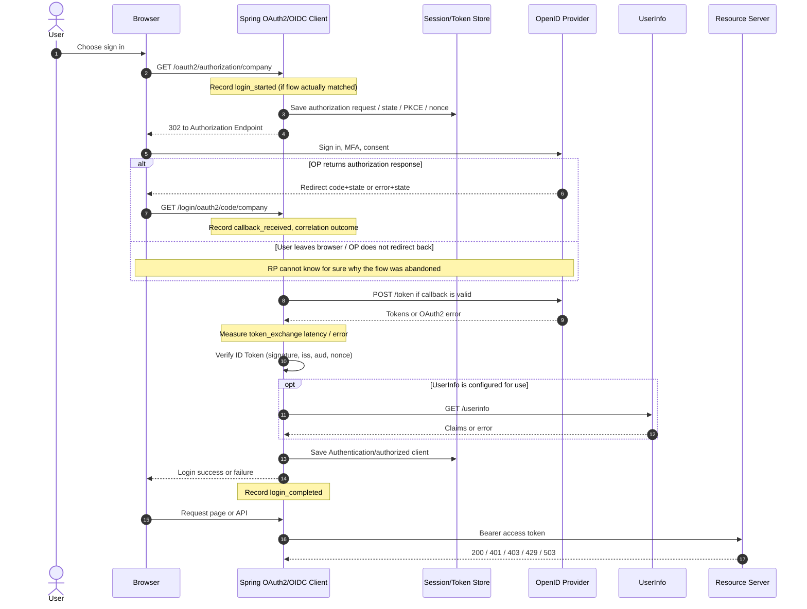
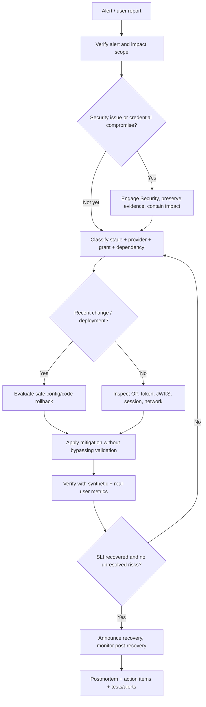

# 32.11. Dashboards, Alerting, and Login Incident Response Runbooks

A **Spring Security OAuth 2.0/OIDC Client** system may be configured completely—logging in successfully via an OpenID Provider (OP), obtaining access tokens, and calling APIs—yet in production it can still suffer **login outages** caused by network issues, callbacks, sessions, Token Endpoint/JWKS failures, expired client secrets, provider rate limits, or authentication policy changes. These incidents often cross a single service boundary and can impact thousands of users.

Therefore, merely “logging when an exception occurs” is not enough. You need **dashboards observing the login journey**, **SLIs/SLOs measuring quality accurately**, **alerts capable of distinguishing user errors from system errors**, and **incident response runbooks with owners, severity levels, mitigation options, exit criteria, and postmortems**.

This lesson focuses on operating a **Spring Security OAuth2 Client / OIDC Relying Party** for **Servlet/Spring MVC** or **Reactive WebFlux** applications, potentially using multiple `ClientRegistration`s and downstream Resource Servers. Examples use **Micrometer**, **Prometheus/Grafana**, structured logs, tracing, and several Spring Security hooks. This is an **illustrative architecture**: custom metric names defined here do not mean Spring Security automatically emits them; thresholds and SLOs must be tuned to production data, business requirements, and actual observability capabilities.

> **Number-one rule:** A login failure dashboard must distinguish between **user-initiated cancellation**, **OP policy denial**, **callbacks blocked by security checks**, **Token Endpoint/JWKS/UserInfo failures**, **internal infrastructure failures**, and **post-login external API errors**. Never use a single aggregate “OAuth errors” chart to conclude a provider is down.

## 1. Learning Objectives

After this lesson, you will be able to:

1. Diagram the data flow and identify every measurement point in OAuth2 Authorization Code + OIDC Login.
2. Distinguish **login initiation**, **callback arrival**, **login completion**, **session continuation**, and **post-login token refresh/API calls**.
3. Design **SLIs**, **SLOs**, error budgets, and synthetic probes without miscounting users who cancel consent or abandon the OP website.
4. Build dashboards segmented by provider/registration, login stage, error cause, latency, and infrastructure dependencies.
5. Create metrics with Micrometer, export via Prometheus, and interpret PromQL with the right denominators.
6. Use Spring Security success/failure hooks for Servlet and WebFlux without accidentally dropping default behavior.
7. Emit structured logs/traces **without exposing codes, state, nonce, access/refresh/ID tokens, Client secrets, or session cookies**.
8. Design alerts based on impact level, minimum traffic gates, error rates, latency, provider outages, and security signals.
9. Run an incident from **detection -> triage -> mitigation -> recovery -> verification -> communication -> postmortem**.
10. Prepare detailed runbooks for callback/session errors, `invalid_client`, `invalid_grant`, JWKS, UserInfo, OP 429/503, secret rotation, refresh tokens, and multi-provider incidents.

## 2. Observe the Whole Journey, Not Just the /login Page

An OIDC Login involves multiple HTTP exchanges and multiple actors:



### 2.1. Seven Key Observation Points

| Point | Signal | Meaning | Limitations |
|---|---|---|---|
| **Authorization initiation** | `login_started` | RP starts creating the redirect | Does not mean the user reached the OP |
| **Authorization response/callback** | `callback_received` | Browser returned to RP | Missing callbacks can be user abandonment, OP outage, or cookie/browser issues |
| **Callback correlation** | `callback_validated` / `callback_rejected` | Whether state/session/request matches | Rejection can be a legitimate security block |
| **Token Endpoint** | request count, latency, `invalid_client`, `invalid_grant`, 429/5xx | Provider issues tokens or rejects | Must attach `grant_type` |
| **OIDC validation/JWKS** | signature/issuer/audience/nonce errors, JWKS fetch | RP verifies identity | Must not bypass when provider is down |
| **UserInfo/account mapping** | latency, subject mismatch, profile errors | Enrich claims / map internal account | UserInfo is not mandatory in every flow |
| **Login outcome** | success, failure, user_cancelled, security_rejected | Processing outcome at RP | Does not cover flows abandoned without returning |

**Important blind spot:** if a user navigates to the OP and closes the tab, or the OP shows an error page without redirecting back to the RP, the RP server may see only `login_started` and never see a callback. Never label every incomplete flow an “OP failure” without evidence from browser telemetry or synthetic journeys.

### 2.2. Why Not Lump API 401s Into OAuth Login Failures?

After OIDC Login, a user may access the Portal normally while an external API returns **401 `invalid_token`**. That is a **Resource Server / authorized client** error, not an RP failure to verify OIDC Authentication.

Similarly, a revoked Calendar refresh token may require the user to **reconnect Calendar**, not necessarily log out of the Portal. Dashboards must have separate panels for **login** and **API/refresh token lifecycle**.

## 3. Defining a Stable Event Taxonomy

The following labels are **application operational definitions**, not standard OAuth2 error codes:

```text
Stage:
  AUTHORIZATION_INITIATION
  AUTHORIZATION_RESPONSE
  CALLBACK_CORRELATION
  TOKEN_EXCHANGE
  ID_TOKEN_VALIDATION
  JWKS_OR_DISCOVERY
  USERINFO
  ACCOUNT_MAPPING
  SESSION_PERSISTENCE
  TOKEN_REFRESH
  RESOURCE_SERVER_CALL
  LOGOUT

Outcome:
  success
  system_failure
  user_cancelled
  security_rejected
  unknown_or_abandoned

Error category:
  user_denied
  invalid_request
  invalid_client
  invalid_grant
  state_mismatch
  authorization_request_missing
  pkce_mismatch
  wrong_issuer_or_audience
  invalid_signature
  jwks_unavailable
  userinfo_invalid
  connection_timeout
  tls_failure
  rate_limited
  remote_5xx
  storage_unavailable
  business_mapping
  other
```

An example record:

```json
{
  "event": "oauth2_login_failure",
  "registration_id": "company",
  "stage": "TOKEN_EXCHANGE",
  "outcome": "system_failure",
  "category": "invalid_client",
  "grant_type": "authorization_code",
  "dependency": "company_token_endpoint",
  "http_status": 401,
  "correlation_id": "random-internal-id"
}
```

**Essential point:** `invalid_grant` on **authorization_code** and `invalid_grant` on **refresh_token** share the same protocol error code, yet have different root causes and recoveries. If you store only the error code and omit `grant_type`, operational charts will mislead remediation.

### 3.1. Error Codes That Should Be Distinguished

| Protocol error/status | Where commonly seen | Primary meaning |
|---|---|---|
| `access_denied` | Authorization response | User/OP denied authorization |
| `invalid_request` | Authorization/Token Endpoint | Request missing/malformed parameter |
| `invalid_client` | Token Endpoint | Client authentication or configuration mismatch |
| `invalid_grant` | Token Endpoint | Grant expired/invalid/already used/revoked |
| `temporarily_unavailable` | Authorization Endpoint | Provider temporarily unavailable |
| `invalid_token` | UserInfo or Resource Server | Bearer access token rejected |
| `insufficient_scope` | UserInfo or Resource Server | Missing permission/scope |
| HTTP 429 | OP/Token/UserInfo/API | Rate limiting, may include `Retry-After` |
| HTTP 503 | OP/Token/UserInfo/API | Service unavailable |
| TLS/DNS/connect/read timeout | Transport layer | May not yield HTTP status or OAuth error |

Never display raw OP `error_description` verbatim to users or put it into metric labels; it is external data that may contain PII, URLs, or unstable text.

## 4. SLIs: Measuring the Quality of a Login System

An **SLI (Service Level Indicator)** is a concrete measurement; an **SLO (Service Level Objective)** is the acceptable target over time. They must be tied to a **population definition** and data source.

### 4.1. Suggested SLIs

| SLI | Numerator / denominator | What it measures |
|---|---|---|
| **Resolved login completion ratio** | Successful logins / all logins with an RP-processed outcome | Quality of the portion of the flow visible from the RP |
| **Technical login success ratio** | Successes / (successes + system failures) | Technical quality, excluding policy-defined cancellations |
| **Callback acceptance ratio** | Callbacks passing correlation / callbacks received by RP | State/session/multi-tab anomalies and tampering |
| **Token exchange success ratio** | Successful token requests / all token exchanges for that grant | OP/Client credentials/PKCE |
| **Token Endpoint p95/p99 latency** | Duration histogram | Token issuance/refresh latency |
| **JWKS/Discovery availability** | Successful metadata/key fetches / total attempts | Health of validation dependencies |
| **UserInfo success ratio** | Successes / requests to UserInfo | Only meaningful if the flow actually calls UserInfo |
| **Synthetic login success** | Completed E2E canary journeys / executed journeys | Connects browser, redirect, Token, OIDC, and session |
| **Refresh success ratio** | Successful refreshes / refresh attempts | Token lifecycle, not direct login |
| **Downstream API success ratio** | Protected API successes / attempted calls | Post-login, belongs to API dependency |

### 4.2. The Denominator Trap

Suppose you observe:

```text
1000 login_started
700 callback_received
620 login_success
40 system_failure
40 user_cancelled
300 no callback / unobserved
```

Do not compute `620 / 1000` and claim the OP has only 62% availability. Those remaining 300 could be users leaving the flow, opening multiple tabs, going offline, or hitting OP/browser issues. With server-side telemetry alone, you cannot separate them all.

**An appropriate breakdown:**

- Measure `technical login success` over the **resolved outcome** population, excluding `user_cancelled` from the technical denominator under a documented policy.
- Measure the `completion funnel` separately: started -> callback -> success, explicitly noting unclassified flow abandonment.
- Use **synthetic browser logins** or privacy-compliant client-side telemetry to observe end-to-end behavior.
- Require a **minimum traffic gate** when alerting on ratios, since a handful of isolated requests easily create false spikes.

### 4.3. Should Security Rejections Be Excluded from SLOs?

It depends on the SLO's purpose. A `state_mismatch` caused by an attacker sending a forged callback represents **security controls working properly**, and should not count as a “system failed login.” Yet a jump in state mismatches right after a deployment may reflect a session/cookie bug, which is an availability incident. The solution is:

- Keep the `security_rejected` group separate.
- Watch for abnormal spikes relative to baseline.
- Use synthetic/canary probes to confirm whether legitimate flows are impacted.
- Never disable state/PKCE/nonce validation just to improve an SLO.

### 4.4. Illustrative SLOs

An organization might set targets over a 30-day window:

```text
Technical login success ratio >= 99.9%
Token Endpoint p95 latency < 1.5 s
Synthetic OIDC login completion >= 99.5%
Callback state mismatch anomaly: within approved baseline threshold
```

These numbers are **design examples only**, not mandatory targets for every OP or Spring Security defaults. SLOs must reflect client/provider contracts, user volume, evaluation windows, and which requests are counted. For low-traffic logins, synthetic journeys and event-based alerts are often more valuable than 5-minute ratios.

## 5. Error Budgets and Burn Rate

If the technical SLO is 99.9% over a period, the error budget is the **maximum allowable share of technical failures within the same population and window**. Burn rate expresses how much faster the error budget is being consumed than expected.

### 5.1. Why Multiple Windows Are Needed

An alert for “failure rate above 10% in 1 minute” can false-page when there are only 2 attempts. Conversely, a 24-hour window delays detecting a complete outage that just began.

Common design:

- **Short window** to catch fast-spreading incidents (a few minutes).
- **Long window** to verify sustained impact (tens of minutes to a few hours).
- **Traffic gate** to avoid alerting on overly small samples.
- **Synthetic signals** to support low-traffic systems or missing callbacks.
- **Provider/stage segmentation** to route to the right on-call team.

### 5.2. Separating Availability and Security Alerts

- Availability alert: technical login failures / latency / Token Endpoint 503.
- Security alert: `state_mismatch`, wrong issuer/audience/signature, suspicious account linking, abnormal token reuse.
- Operational warning: provider 429, Redis saturation, signing key rotation, secret nearing expiration.
- User choice/UX: user-cancelled `access_denied` generally does not need an on-call page.

Do not turn every `access_denied` into a P1 incident; conversely, do not ignore waves of state mismatches just because they are “not system errors.”

## 6. Designing Metrics: Names, Units, and Tags

Use **Micrometer** with counters, timers, and gauges carrying clear semantics:

| Suggested Metric | Type | Usable Tags |
|---|---|---|
| `oauth2.login.started` | Counter | registration, flow |
| `oauth2.login.callback` | Counter | registration, outcome |
| `oauth2.login.completed` | Counter | registration, outcome, stage/category |
| `oauth2.token.requests` | Timer/Counter | registration, grant, outcome, error |
| `oauth2.userinfo.requests` | Timer | provider alias, outcome |
| `oauth2.jwks.requests` | Timer | provider alias, outcome |
| `oauth2.authorized_client.refresh` | Counter | registration, outcome, error |
| `oauth2.authorized_client.cleanup` | Counter | registration, reason |
| `oauth2.session.store.errors` | Counter | storage kind, operation |
| `oauth2.login.synthetic` | Gauge/Counter | provider alias, outcome, region |
| `oauth2.provider.circuit.state` | Gauge | provider alias, state |
| `oauth2.provider.retries` | Counter | dependency, operation, outcome |

These are **custom example names**. Prometheus exporters typically translate them into underscore form with appropriate suffixes (`oauth2_login_completed_total` for a Counter depending on configuration). Do not assume these metrics appear automatically just because Spring Boot Actuator is enabled.

### 6.1. Tags Must Have Low Cardinality

**Acceptable:** `registrationId` from a fixed set, `providerAlias`, `grant_type`, `stage`, `outcome`, HTTP status class, allowlisted OAuth2 error code, normalized region.

**Unacceptable:** user ID, email, `sub`, dynamic tenant ID when tenant count is large, session ID, `state`, `nonce`, authorization code, access/refresh token, raw URL, full IP, or `error_description`.

If supporting tens of thousands of dynamic tenant registrations, **`registrationId` itself becomes high-cardinality**. In that case, group by provider family, issuer alias, or a bounded dimension instead of putting every registration ID into time-series labels.

### 6.2. Events Can Be Double-Counted

A browser redirect can be retried, a callback can be re-submitted, and a user can open multiple tabs. Do not treat filter invocation counts as “unique humans attempting to sign in.” Define units clearly: **authorization attempts**, **callback requests**, **resolved outcomes**, or **unique sessions** (if collection is privacy-compliant).

### 6.3. Timers Must Measure the Exact Dependency

`oauth2.token.requests` should measure the call to the Token Endpoint, not include the entire time a user spends typing a password on the OP. An **end-to-end login latency** measured from RP authorization request creation to callback includes **human think time**; do not compare it directly with Token Endpoint p95.

## 7. Building an On-Call Overview Dashboard

The top-level dashboard should answer four questions within seconds:

1. **Is there a significant incident happening right now?**
2. **Who is affected: which provider, registration, or region?**
3. **At which login step is it failing?**
4. **Is this an availability failure, config/secret issue, security rejection, or user choice?**

### 7.1. Suggested Dashboard Layout

```text
┌───────────────────────────────────────────────────────────────────────┐
│  LOGIN HEALTH  |  technical success  |  synthetic login  |  incidents │
├─────────────────────┬───────────────────────┬─────────────────────────┤
│ attempts / successes│ errors by stage        │ providers / regions     │
│ 1m, 5m, 1h, 24h      │ initiation/callback/...│ company/partner/region │
├─────────────────────┴───────────────────────┴─────────────────────────┤
│ LOGIN FUNNEL: started -> callback -> token -> OIDC validated -> success│
├──────────────────────┬──────────────────────┬─────────────────────────┤
│ Token endpoint p95/99 │ JWKS/UserInfo health │ Session/Redis failures  │
├──────────────────────┴──────────────────────┴─────────────────────────┤
│ 429/503/timeout/invalid_client/invalid_grant by provider and grant    │
├───────────────────────────────────────────────────────────────────────┤
│ Current deploys, credential rotation, provider incident annotations   │
├───────────────────────────────────────────────────────────────────────┤
│ Security anomalies: state mismatch, wrong issuer, nonce/signature     │
└───────────────────────────────────────────────────────────────────────┘
```

### 7.2. “Golden Signals” Panel

| Signal | Specific Dashboard View |
|---|---|
| **Traffic** | Login started/callbacks/completed per minute by provider |
| **Errors** | Technical failures, user cancels, and security rejects separated |
| **Latency** | Token Endpoint, UserInfo, JWKS, session store, refresh p50/p95/p99 |
| **Saturation** | HTTP connection pools, threads/event-loops, Redis/DB pools, queues, rate-limit budgets |

With **Servlet**, thread pool saturation and session store latency can cause callbacks to fail. With **WebFlux**, event-loop blocking or connection pool saturation can spike latency even when overall CPU looks low. Dashboards must show **internal infrastructure** alongside OP metrics.

### 7.3. Funnel Panels Require Clear Caveats

```text
Started at RP:      10,000
Callback received:   8,300
Token exchange tried: 8,100
ID Token validated:   7,940
Login success:        7,900
```

Do not conclude the 1,700 missing callbacks are an “OP failure” without browser telemetry. Analyze further:

- User cancelled / closed the tab.
- Consent/MFA delay.
- OP displayed an error page without redirecting.
- Browser cookie/redirect policies.
- Callback routed to the wrong instance.
- Multiple tabs causing flows to supersede one another.

### 7.4. Provider Detail Panel

Selecting `company`:

- 429/503 from Authorization/Token/UserInfo endpoints.
- Token exchange `invalid_client`/`invalid_grant` by grant.
- JWKS fetch errors/rotation.
- Callback state mismatches.
- Synthetic browser login.
- Changes to OAuth scopes/client credentials.
- Last deployment/change event.

Never automatically use provider B's token to “fall back” for provider A during an outage. Multi-provider setups can recover independently, but identities must never be swapped automatically.

## 8. Illustrative PromQL: Error Ratios and Traffic

Suppose custom metrics are exported as:

```text
oauth2_login_completed_total{
  registration="company",
  outcome="success|system_failure|user_cancelled|security_rejected"
}
```

To measure the system-wide **technical system failure ratio** over 15 minutes:

```promql
sum(increase(oauth2_login_completed_total{outcome="system_failure"}[15m]))
/
clamp_min(
  sum(increase(oauth2_login_completed_total{outcome=~"success|system_failure"}[15m])),
  1
)
```

**Explanation:** the denominator includes only outcomes attributable to success or technical failure. If there are zero requests, the expression evaluates to `0` due to `clamp_min`; **do not treat that as proof of 100% availability**. Pair it with traffic gates and synthetic canaries to distinguish “zero traffic.”

### 8.1. Successful Logins by Provider

```promql
sum by (registration) (
  increase(oauth2_login_completed_total{outcome="success"}[10m])
)
```

### 8.2. Technical Errors by Provider

```promql
sum by (registration) (
  increase(oauth2_login_completed_total{outcome="system_failure"}[10m])
)
```

### 8.3. Errors by Stage

Suppose a separate counter `oauth2_login_errors_total` has `stage` and `category` labels:

```promql
sum by (stage, category) (
  increase(oauth2_login_errors_total[30m])
)
```

Never place tokens, user emails, or unbounded error descriptions into these labels.

### 8.4. P95 Token Endpoint Latency

Suppose a custom histogram `oauth2_token_duration_seconds_bucket` is emitted:

```promql
histogram_quantile(
  0.95,
  sum by (le, registration, grant) (
    rate(oauth2_token_duration_seconds_bucket[5m])
  )
)
```

If you only use a `Timer` without publishing histogram buckets, this query will not return results. Configure histogram/SLO buckets in Micrometer accordingly and verify the actual series name in Prometheus. Do not assume every `Timer` emits `_bucket`.

### 8.5. Low Error Rates Must Account for Volume

If there are 2 failures out of 3 attempts, the ratio is high but the sample size is tiny; do not page like a global P0. Gate alerts by volume, synthetic probes, and sustained duration.

## 9. Alerting: What Actually Warrants Waking On-Call?

Alerts must be **actionable**, with an owner, runbook link, severity, and noise reduction.

### 9.1. Suggested Alert Groups

| Alert | Illustrative Condition | Severity | Owner |
|---|---|---|---|
| Technical login failure spike | High ratio + sufficient volume + sustained | P1/P2 depending on impact | Identity/App on-call |
| Synthetic OIDC login failed | Multiple consecutive canary failures | P1/P2 | Identity/App + provider |
| Callback state mismatch anomaly | Above baseline after deploy | P1/P2 security/availability | Identity/Security |
| Token Endpoint `invalid_client` spike | Multiple users/registrations seeing same error | P1 | Secrets/Identity |
| Token Endpoint 429 rate limit | Quota consumed, retry storm | P2 | Identity/Platform |
| JWKS validation failures | Valid ID Tokens cannot be verified | P1/P2 | Identity/Security |
| Redis session store unavailable | Widespread callback state loss | P1 | Platform |
| Refresh `invalid_grant` surge | Multiple connections revoked / rotation race | P2/P1 | Integrations |
| Single provider degraded | Company down, Partner healthy | P2 | Provider owner |
| Provider planned maintenance | Announced ahead, minor impact | P3/notice | Operations |
| Rising user-denied consent | Possible UX/provider policy issue | Triage/analytics | Product/Identity |

**P1/P2 are illustrative labels**, not universal classifications. Real severity depends on affected users, critical services, duration, security risk, and workaround availability.

### 9.2. Example Prometheus Rule with a Volume Gate

```yaml
groups:
  - name: oauth2-login-example
    rules:
      - alert: OAuth2LoginSystemFailureSpike
        expr: |
          (
            sum(increase(oauth2_login_completed_total{outcome="system_failure"}[10m]))
            /
            clamp_min(
              sum(increase(oauth2_login_completed_total{outcome=~"success|system_failure"}[10m])),
              1
            )
          ) > 0.15
          and
          sum(increase(oauth2_login_completed_total{outcome=~"success|system_failure"}[10m])) >= 50
        for: 5m
        labels:
          severity: warning
          service: oauth2-client
        annotations:
          summary: "Login technical failure ratio elevated"
          description: "Check provider/stage dashboards and incident runbook"
```

**This is an illustrative rule, not a verified production rule.** Adjust counters/tags, traffic gates, baselines, SLO burn, `for` duration, and routing. It only works if the app actually emits `oauth2_login_completed_total` with matching labels.

### 9.3. Multi-Window Burn-Rate

For strict SLOs, combine fast and slow alerts:

- Short window: detects major spikes with immediate impact.
- Long window: warns on slow-burning technical errors consuming budget.
- Both include traffic conditions and synthetic coverage.
- Do not count `user-cancelled` as a provider outage.
- Do not drop security rejects from monitoring; route them to a dedicated alert.

Never fire 12 separate alerts for the same OP outage; Alertmanager/on-call systems should group and deduplicate by provider/service and incident.

### 9.4. Alerting When Data Is Missing

`up==1` on a Prometheus target does not prove login works. Conversely, missing `login_completed` metrics may reflect zero users or broken instrumentation.

Combine:

- Service/target up.
- Expected traffic levels.
- Synthetic OIDC login.
- Token Endpoint/JWKS dependency probes.
- Dashboard data freshness.
- Collector/agent health.

Never call `rate(...)=0` healthy if the metric itself stopped being emitted.

## 10. Logging and Tracing: Enough Visibility Without Leaking Credentials

An OAuth2/OIDC request carries many sensitive artifacts:

```text
authorization code
state
nonce
PKCE code_verifier
access_token / refresh_token / id_token
client_secret / private key assertion
Authorization header
Cookie / Set-Cookie
full callback URL ?code=...&state=...
raw UserInfo claims
id_token_hint on logout URL
```

**Never log these values directly**, even in staging debug logs if logs may be shared or retained long-term. Configure redaction at:

- Reverse proxy / load balancer.
- Spring Servlet access logs or Reactor Netty HTTP logs.
- Application filters/interceptors.
- WebClient/RestClient exchange logging.
- OpenTelemetry spans and HTTP semantic attributes.
- APM/tracing agents that capture headers/query parameters.
- Exception handling / logging frameworks.
- CI snapshots, support attachments, and audit systems.

### 10.1. Safe Structured Log

```json
{
  "timestamp": "2026-11-16T02:00:00Z",
  "event": "oidc_login_failure",
  "stage": "CALLBACK_CORRELATION",
  "registration_id": "company",
  "outcome": "security_rejected",
  "category": "authorization_request_missing",
  "failure_family": "OAuth2AuthenticationException",
  "correlation_id": "random-independent-id",
  "deployment_version": "example-build"
}
```

Never use `error_description`, a session cookie, or `state` as `correlation_id`.

### 10.2. Can `principalName` Be Logged?

Do not put user ID/email/`sub` into metric labels. Audit events may require actor identifiers, but they must live in a separate audit store with clear access control, retention, data minimization, and hashing/pseudonymization policies. Routine operational logs should prioritize **provider alias, stage, code category, timestamp, and a random trace ID**.

### 10.3. Tracing Across Browser Redirects Has Limits

An OIDC Login leaves the RP for the OP and returns via the browser. A server-side trace **does not automatically stitch together** every browser/OP exchange. You can correlate via server-side state stored with the authorization request/session; never put secret internal trace IDs into OAuth `state` or log full callback URLs to “recover the trace.”

### 10.4. Useful Span Names

```text
oauth2.authorization.initiate
oauth2.authorization.callback
oauth2.token.exchange
oidc.id_token.validate
oidc.jwks.fetch
oidc.userinfo.fetch
oauth2.authorized_client.save
oauth2.refresh
oauth2.resource_server.call
```

These are **application-defined span names**. Not all of them are emitted automatically by Spring Security Observability. You can use Micrometer Observation or OpenTelemetry instrumentation to measure at the exact boundaries.

## 11. Servlet Instrumentation: Measuring Login Success/Failure

In Spring MVC, `HttpSecurity.oauth2Login()` can customize `successHandler` and `failureHandler`. When replacing handlers, **preserve the desired redirect/session behavior** instead of accidentally dropping default logic.

### 11.1. Measuring Outcomes with Micrometer

```java
import io.micrometer.core.instrument.MeterRegistry;

import org.springframework.context.annotation.Bean;
import org.springframework.context.annotation.Configuration;
import org.springframework.security.config.annotation.web.builders.HttpSecurity;
import org.springframework.security.core.Authentication;
import org.springframework.security.core.AuthenticationException;
import org.springframework.security.oauth2.client.authentication.OAuth2AuthenticationToken;
import org.springframework.security.oauth2.core.OAuth2AuthenticationException;
import org.springframework.security.web.SecurityFilterChain;
import org.springframework.security.web.authentication.AuthenticationFailureHandler;
import org.springframework.security.web.authentication.AuthenticationSuccessHandler;
import org.springframework.security.web.authentication.SavedRequestAwareAuthenticationSuccessHandler;
import org.springframework.security.web.authentication.SimpleUrlAuthenticationFailureHandler;

@Configuration
public class LoginTelemetrySecurityConfiguration {

    @Bean
    SecurityFilterChain chain(
            HttpSecurity http,
            MeterRegistry registry) throws Exception {

        var successDelegate =
            new SavedRequestAwareAuthenticationSuccessHandler();

        var failureDelegate =
            new SimpleUrlAuthenticationFailureHandler(
                "/login?error=oauth2"
            );

        AuthenticationSuccessHandler successHandler =
            (request, response, authentication) -> {

                String registration = safeRegistration(authentication);

                registry.counter(
                    "oauth2.login.completed",
                    "registration", registration,
                    "outcome", "success"
                ).increment();

                successDelegate.onAuthenticationSuccess(
                    request, response, authentication
                );
            };

        AuthenticationFailureHandler failureHandler =
            (request, response, exception) -> {

                String category = safeFailureCategory(exception);

                registry.counter(
                    "oauth2.login.completed",
                    "registration", "unknown",
                    "outcome", "system_failure",
                    "category", category
                ).increment();

                failureDelegate.onAuthenticationFailure(
                    request, response, exception
                );
            };

        return http
            .authorizeHttpRequests(authorize -> authorize
                .requestMatchers("/", "/login", "/error").permitAll()
                .anyRequest().authenticated()
            )
            .oauth2Login(login -> login
                .successHandler(successHandler)
                .failureHandler(failureHandler)
            )
            .build();
    }

    private static String safeRegistration(Authentication auth) {
        if (auth instanceof OAuth2AuthenticationToken oauth2) {
            String id = oauth2.getAuthorizedClientRegistrationId();
            // Production: validate against an allowlist before using as a tag.
            if ("company".equals(id) || "partner".equals(id)) {
                return id;
            }
        }
        return "other";
    }

    private static String safeFailureCategory(
            AuthenticationException exception) {
        if (exception instanceof OAuth2AuthenticationException oauth2) {
            String code = oauth2.getError().getErrorCode();
            if ("access_denied".equals(code)) {
                return "user_denied";
            }
            if ("invalid_grant".equals(code)) {
                return "invalid_grant";
            }
            if ("invalid_client".equals(code)) {
                return "invalid_client";
            }
        }
        return "other";
    }
}
```

**This is a minimal instrumentation example**, not a complete production taxonomy. When `access_denied` appears, this mapper still tags `outcome=system_failure`; a real system should map **`user_cancelled`** or OP policy denial separately when supported by evidence. An `invalid_grant` at the login failure handler alone does not confirm the Token Endpoint as root cause without instrumenting token exchange as well.

### 11.2. Why Does Failure Registration Use “unknown”?

On some failure paths, OAuth2 `Authentication` has not been constructed yet, so there is no trusted `OAuth2AuthenticationToken`. Never take an arbitrary `registrationId` query value from the browser to form a high-cardinality tag; if per-provider error metrics are needed, capture trusted registration context from the resolver/authorization request repository or filter stage and map it through an allowlist.

### 11.3. When This Hook Is Not Enough

The failure handler **does not necessarily** observe:

- Failures constructing the authorization request before redirect.
- The OP displaying an error page without redirecting back to the RP.
- Discovery failures during Spring context startup.
- Token refreshes while the user is already signed in.
- Resource Server 401/403 responses when calling downstream APIs.
- Certain session store failures outside the authentication filter.

Therefore, instrument **each dependency point** and supplement with synthetic/browser signals where appropriate.

### 11.4. Success Handler Does Not Replace Business Auditing

A successful OAuth2 login event does not prove a user is authorized for every domain resource. Business authorization and account-linking audits need separate events rather than overloading `oauth2.login.completed`.

## 12. Reactive WebFlux: Recording Metrics in the Publisher Chain

In WebFlux, use `ServerHttpSecurity.oauth2Login()` with reactive success/failure handlers:

```java
import io.micrometer.core.instrument.MeterRegistry;

import org.springframework.context.annotation.Bean;
import org.springframework.security.config.web.server.ServerHttpSecurity;
import org.springframework.security.web.server.SecurityWebFilterChain;
import org.springframework.security.web.server.authentication.RedirectServerAuthenticationSuccessHandler;
import org.springframework.security.web.server.authentication.RedirectServerAuthenticationFailureHandler;

@Bean
SecurityWebFilterChain reactiveChain(
        ServerHttpSecurity http,
        MeterRegistry registry) {

    var successDelegate =
        new RedirectServerAuthenticationSuccessHandler("/");

    var failureDelegate =
        new RedirectServerAuthenticationFailureHandler(
            "/login?error=oauth2"
        );

    return http
        .authorizeExchange(authorize -> authorize
            .pathMatchers("/", "/login", "/error").permitAll()
            .anyExchange().authenticated()
        )
        .oauth2Login(login -> login
            .authenticationSuccessHandler((exchange, auth) -> {
                registry.counter(
                    "oauth2.login.completed",
                    "outcome", "success",
                    "stack", "webflux"
                ).increment();

                return successDelegate.onAuthenticationSuccess(
                    exchange, auth
                );
            })
            .authenticationFailureHandler((exchange, error) -> {
                registry.counter(
                    "oauth2.login.completed",
                    "outcome", "system_failure",
                    "stack", "webflux"
                ).increment();

                return failureDelegate.onAuthenticationFailure(
                    exchange, error
                );
            })
        )
        .build();
}
```

**Important point:** in Reactive, return the `Mono<Void>` from the delegate; never call `subscribe()` fire-and-forget. For production requirements, metrics should classify outcomes/error codes like Servlet and increment only when the event has clear semantics, avoiding double-counting across retry/cancellation paths.

### 12.1. Do Not Misuse Servlet ThreadLocals

Reactive `Authentication` is managed in the Reactor context / `ReactiveSecurityContextHolder`; never assume `SecurityContextHolder.getContext()` is populated on every Netty event-loop thread. Background jobs need their own trusted service principal/connection context.

### 12.2. Never Block the Event Loop Just to Write Audit Logs

If audit events must be persisted to a DB, use a reactive repository or a managed boundary. A `.block()` inside a reactive failure handler can cause cascading slowdowns, additional timeouts, and connection pool exhaustion.

## 13. Observing the Token Endpoint and Authorized-Client Lifecycle

A login success handler does not reveal Token Endpoint p95, `invalid_client`, or refresh token rotation. Instrument at:

- The OAuth2 token response client or HTTP client calling `/token`.
- `OAuth2AuthorizedClientManager` / `ReactiveOAuth2AuthorizedClientManager`.
- Authorized-client service/repository `load`, `save`, and `remove`.
- WebClient OAuth2 filter when a Resource Server returns OAuth2 Bearer errors.
- Background jobs using `client_credentials` or user-delegated refresh.

### 13.1. Fields to Capture

```text
stage=TOKEN_EXCHANGE or TOKEN_REFRESH
registration=company|calendar
grant=authorization_code|refresh_token|client_credentials
outcome=success|oauth_error|transport_error|timeout
oauth_error_code=invalid_client|invalid_grant|other
http_status=2xx|4xx|5xx
duration_seconds=...
```

Never record or log the raw refresh token string or actual request body.

### 13.2. `invalid_grant` During Refresh Needs Different Handling Than During Login

| Context | Common Meaning | Runbook |
|---|---|---|
| Authorization Code exchange | Code expired/reused, PKCE or redirect URI mismatch | Start a new login flow or fix configuration |
| Refresh Token Grant | Token revoked/expired/rotated, concurrent refresh | Check token store, clean up / reconnect the specific connection |
| Resource Server `invalid_token` | Bearer access token rejected | Check audience, expiry, token selection/RS |
| Resource Server `insufficient_scope` | Missing permissions | Do not retry infinitely; inspect consent/scope |

### 13.3. Cleanup Handlers Must Measure Side Effects Too

An `invalid_grant` warning alone is not enough. You need to know:

- Was the authorized client removed under the right key?
- Was an invalid token left behind causing subsequent requests to keep failing?
- Was another user/provider's token accidentally deleted?
- Did a race cause request B to delete the new RT-2 saved by request A?
- Did the storage `remove` call fail?
- Did the user-facing connection state transition to `RECONNECT_REQUIRED` if policy requires it?

When a custom failure handler merely logs and returns successfully, it can drop the manager's default cleanup. Tests and dashboards should verify **behavior**, not just exception counts.

## 14. Dashboards for Session and Authorized-Client Stores

In Spring MVC/Servlet, OAuth2 authorization requests typically rely on `HttpSession`; in WebFlux, `WebSession` or a corresponding repository. If Redis/the session store goes down, callbacks can lose `state` while OP logins still appear to succeed.

### 14.1. Related Infrastructure Metrics

| Dependency | Observation Targets |
|---|---|
| Redis / Spring Session | Availability, latency, pool, TTL, evictions, connection errors |
| JDBC Authorized Client Service | Query/save/delete errors, latency, pool exhaustion |
| Reverse proxy | 5xx, wrong forwarded host, TLS errors, callback routing |
| Load balancer | Pod churn, unhealthy instances, sticky routing if used |
| JVM Servlet | Request threads, queue depth, saturation |
| Reactor Netty | Event-loop lag, pending connections, connection pool |
| System clock | Time sync / clock skew affecting ID Token `exp` |
| KMS / Secret Manager | Credential retrieval / rotation availability |

### 14.2. Signs of a Broken Session Store

```text
authorization_request_not_found rises
callback_state_mismatch rises
token_endpoint_requests does not rise correspondingly
redis errors or session TTL/evictions rise
users retrying login still hit the same error
```

This is a triage pattern, **not conclusive proof**. If callback state mismatches might indicate tampering, a security review is still required.

### 14.3. Never Fix This by Disabling `state`

If callbacks lose sessions due to a Redis outage, the fix is repairing Redis/session architecture, cookie policy, routing, and TTL. **Never allow callbacks missing an authorization request to proceed as successful logins.**

## 15. Synthetic Login: A More Reliable End-to-End Signal

Because the backend cannot observe every browser abandonment, a **synthetic OIDC journey** can measure:

```text
Test browser
  -> Portal /oauth2/authorization/company
  -> Test OP/tenant login
  -> Consent/MFA test policy
  -> Portal callback
  -> Local authenticated session
  -> Protected page returns expected response
  -> Logout/cleanup test account
```

### 15.1. Conditions for Safe Synthetic Tests

- Use a **test account and test client registration**.
- Never put usernames/passwords, Client secrets, access tokens, or session cookies into logs or screenshots.
- Test tenants/scopes must be approved by the OP, possibly excluding special quotas/consent prompts.
- Do not spam the production provider and trigger false rate limits.
- Enforce timeouts and cleanup so unbounded sessions/tokens are not created.
- Monitor from relevant regions if the application is global.
- Distinguish “test account locked / MFA policy changed” from a real outage.
- If security prohibits browser automation against the production OP, use a test OP/tenant or provider-approved probe.

### 15.2. Which Synthetic Failures Should Alert?

- N consecutive failures to initiate login.
- Browser fails to reach the OP or fails to return to the Portal.
- Callback is valid, yet the RP does not establish a session.
- Token Endpoint returns 503/`invalid_client`.
- ID Token validation fails due to JWKS/key rotation.
- Protected page fails to recognize the local authenticated session.

Set thresholds using **probe frequency and multi-location quorum**, avoiding paging when a single monitor hits an isolated network glitch.

### 15.3. Synthetic Success Does Not Prove Every User Succeeds

A canary exercises one provider, account, scope, region, and flow. It does not test every tenant, Conditional Access/MFA policy, consent decision, or embedded WebView browser. Combine it with real-user metrics and provider admin telemetry.

## 16. Security Alerts: Protocol Protections Must Not Be Sacrificed for Uptime

These errors deserve a dedicated dashboard/security panel:

- Abnormal `state` mismatches or missing authorization requests.
- Code exchange `invalid_grant` showing signs of replay/mix-up.
- OIDC `nonce` mismatch.
- ID Token wrong `iss`/`aud` or invalid signature.
- UserInfo `sub` not matching ID Token `sub`.
- Login provider differing from API provider causing tokens to be sent to the wrong host.
- External identities erroneously auto-linking mismatched `(iss, sub)`.
- Refresh token reuse detection or token-family revocation.
- Spikes in `invalid_client` following secret rotation.

### 16.1. Never Turn Off Security Checks to Make a Dashboard “Green”

Unacceptable actions:

```text
Disable state validation to lower callback errors
Disable issuer/audience validation if JWKS unavailable
Accept unsigned ID Token during OP outage
Send code to multiple Token Endpoints to find one working
Retry refresh token indefinitely after invalid_grant
Log code/state/token to debug quickly
```

Such choices can turn an availability incident into account takeover, token leakage, or unauthorized access.

### 16.2. Distinguishing Security Alerts from Availability Incidents

A single bad nonce may be a forged request correctly rejected (the system functioning properly). If failures hit the canary right after a deployment, a misconfiguration likely broke the OIDC flow. **Triage must use context**, neither dismissing every security rejection as noise nor treating all of them identically.

## 17. Designing Alert Routing and Ownership

An alert without an owner or runbook is easily ignored.

### 17.1. Illustrative Ownership Matrix

| Signal | Primary Owner | Secondary |
|---|---|---|
| Callback state/session errors | Identity application on-call | Platform/Redis |
| Token Endpoint `invalid_client` | Identity/Secrets team | OP administrator |
| JWKS/issuer/nonce validation | Identity security | Provider admin |
| OP Authorization Endpoint 503 | Provider integration owner | Vendor/Platform |
| UserInfo unavailable | Identity integration owner | OP admin |
| Redis/DB session outage | Platform/SRE | Identity application |
| Refresh `invalid_grant` surge | External integrations team | Security/OP admin |
| API 401/403 | API integration owner | Resource Server owner |
| Credential/token leak | Security incident response | Identity/Platform |
| Increased login UX abandonment | Product/Identity analytics | UX/support |

In smaller organizations, one person may hold multiple roles; you still need a **named on-call rotation, escalation path, and access to provider support**.

### 17.2. What Every Alert Should Carry

```text
name:
service:
environment:
provider_alias:
stage:
severity:
start_time:
current_rate:
affected_population_estimate:
dashboard_link:
runbook_link:
recent_changes:
owner:
escalation:
```

Never include raw OAuth tokens, user emails, callback URLs, secrets, or `state` in alert payloads or Slack notifications.

### 17.3. Deduplication and Suppression

When Company's Token Endpoint returns 503, the system may fire:

- Login failures rising.
- Token exchange p95 rising.
- OP dependency 503.
- Synthetic login failed.

These may be **one incident**, not four. Group alerts by provider/incident fingerprint while retaining dependency details for triage. Never suppress security alerts solely because an availability outage overlaps in time.

## 18. Incident Severity and Response Times

An illustrative policy:

| Level | Typical Condition | Decision |
|---|---|---|
| **SEV-1 / Critical** | Majority of users cannot sign in with no workaround; or suspected large-scale token/secret compromise | Page incident commander, Security if needed, broad communication |
| **SEV-2 / High** | A major OP/region failing, login rate drops sharply; many users impacted | On-call + provider owner, continuous monitoring |
| **SEV-3 / Medium** | Elevated error rate in narrow scope; synthetic fails in one region; safe workaround exists | Priority triage with an action owner |
| **SEV-4 / Low** | Intermittent errors or dashboard bug with no confirmed user impact | Ticket, monitor trend |

These levels must be calibrated to **your organization's internal policies** and risk appetite. Do not copy illustrative thresholds verbatim to declare production SLAs.

### 18.1. When Must Security Be Engaged?

- Signs of authorization code or token leakage.
- Unusual ID Token signature/issuer validation errors after provider configuration changes.
- Suspicious nonce/state mismatch patterns.
- Refresh token family reuse/compromise signals.
- Exposed client secret or private key.
- Account linking assigning the wrong user or tenant.
- Logs/APM containing raw access/refresh tokens or credentials.

Preserve evidence securely, never paste secrets into chat or tickets, and never relax validation policies before risk assessment.

## 19. Overall Incident Response Workflow



### 19.1. Roles During an Incident

- **Incident commander:** sets priorities, assigns work, manages update cadence.
- **Technical lead:** investigates root cause, decides mitigations.
- **Communications owner:** status page, support, stakeholders.
- **Provider liaison:** coordinates with OP vendor/admins, tickets, and SLAs.
- **Security lead:** engaged whenever credentials or identities are at risk.
- **Scribe:** records timeline, decisions, links, and safe evidence.

Six separate people are not required for every incident, but **who decides and who communicates** must always be clear.

### 19.2. First 15 Minutes of Triage: Data to Gather

1. When did errors begin, in both UTC and dashboard display timezone?
2. Which provider, `ClientRegistration`, region, app version, and user segment are affected?
3. What are the rates of technical login failures, callback failures, synthetic logins, and Token Endpoint 429/503s?
4. Is failure occurring before redirect, at callback, at token exchange, JWKS, UserInfo, or session persistence?
5. Were there changes to Client secrets, redirect URIs, issuer, scopes, reverse proxy, Redis/DB, or app deployments?
6. Are there any signals of credential/identity compromise?
7. Do existing local sessions still work, or are all users forced to sign in again?
8. Is there a **safe** workaround that preserves OAuth2/OIDC protections?
9. Who holds OP admin/support credentials and escalation channels?
10. What evidence is preserved **without tokens/codes/session IDs**?

### 19.3. Recording a Timeline

```text
09:02  Alert: company login technical failure > baseline
09:04  Synthetic OIDC journey failed from 2 regions
09:06  Token Endpoint 503 rising, callback state mismatch stable
09:08  OP provider incident confirmed
09:11  Disabled blind retries / shed load per approved policy
09:15  Status page updated: "Sign-in via Company degraded"
09:24  Token Endpoint recovered
09:30  Synthetic login passes, traffic success ratio recovering
10:00  Incident resolved; continuing post-recovery observation
```

This is a **hypothetical timeline**. Actual timestamps, actions, and status wording must reflect the real incident.

## 20. Runbook A — Unable to Redirect to OP

**Symptoms:** user clicks login and stays on Portal, gets 404/500, or receives a malformed URL.

### 20.1. Checks

- Does `/oauth2/authorization/{registrationId}` match the intended security filter chain?
- Does `ClientRegistrationRepository` contain that registration ID?
- Can provider metadata / `issuer-uri` be loaded?
- Is the reverse proxy sending trusted forwarded headers to construct the public HTTPS redirect URI?
- Is the browser blocked by CSP, cookie, or redirect policies?
- Can the session store save the authorization request?
- Did a deployment alter base URL or context path?

### 20.2. Mitigation

- Roll back routing/redirect configuration if a bad change was deployed.
- Restore Redis/session storage if requests cannot be saved.
- Fix the `ClientRegistration` / OP redirect URI allowlist.
- Never construct arbitrary redirect URIs from untrusted internet `Host` headers.
- Never silently pick a different OP without a trusted identity mapping.

### 20.3. Closing the Runbook

Synthetic login passes authorization initiation and callback cleanly; dashboard shows no initiation errors; session/request correlation works with zero open redirects.

## 21. Runbook B — Callback `state` Mismatch / Request Missing

**Symptoms:** after signing in at the OP, the browser returns to Portal and lands on `/login?error`, while `state_mismatch` or `authorization_request_not_found` metrics spike.

### 21.1. Likely Causes

- `HttpSession`/`WebSession` cookie is not sent back due to SameSite/Secure/Domain/Path settings.
- OP uses `response_mode=form_post` incompatible with the current cookie policy.
- Reverse proxy rewrites scheme/host/callback URL.
- Redis/Spring Session timeout, eviction, or serializer mismatch.
- Callback hits a pod lacking the session; missing shared store or affinity.
- Multiple browser tabs create overlapping flows if the repository stores only one pending request.
- OP or attacker sends a callback with an invalid state.

### 21.2. What **Not** to Do

```text
Do not disable state verification.
Do not reconstruct an authorization request from callback code+state alone.
Do not accept arbitrary cookie/session IDs from headers/query params to look up requests.
Do not spray the code across multiple Token Endpoints.
Do not log real state or code values to compare them.
```

### 21.3. Safe Mitigation

- Restore shared session store / TTL / routing.
- Verify public callback origin and cookie configuration.
- Verify multi-tab behavior against contract.
- Inspect recent deployments that changed serializers or session keyspaces.
- Preserve the security rejection and ask users to **start a fresh flow** when the pending request is lost.

### 21.4. Verification

Integration tests for same-session/same-state callbacks succeed; wrong-state or cross-session callbacks continue to be rejected; mismatch rate returns to baseline.

## 22. Runbook C — Spike in Token Endpoint `invalid_client`

**Symptoms:** many users fail to log in; callback arrives cleanly, but the Token Endpoint returns `invalid_client`.

### 22.1. Checks

- Was the client secret recently rotated or expired?
- Does the secret manager hold a new version and have app pods reloaded it?
- Did the Client ID or issuer/tenant change?
- Does `client_authentication_method` match OP policy?
- Is `private_key_jwt` using the right signing key/certificate?
- Are mTLS certificates and trust chains still valid?
- Did the OP disable the Client or change policy?
- Is the error affecting one registration or all of them?

### 22.2. Mitigation

- Restore a valid credential version **via the secret manager**—never paste secrets into incident chat.
- If a key/secret rollback is needed, coordinate with OP admins and adhere to rotation policy.
- Do not tell end users to change their passwords, as this error rarely relates to user passwords.
- Never fall back to HTTP basic secrets in URLs or disable client authentication.
- Never point the Token Endpoint to an untrusted host.

### 22.3. Verification

An approved test tenant or synthetic login exchange returns valid tokens; `invalid_client` counter drops; no secrets appear in logs; all pods run the same credential version.

## 23. Runbook D — Token Endpoint `invalid_grant`

**Symptoms:** login callbacks or background refreshes see elevated `invalid_grant` errors.

### 23.1. Separate Grant Types Immediately

| Grant | Common Causes | Action |
|---|---|---|
| **authorization_code** | Code expired/reused, wrong redirect URI, PKCE verifier mismatch | Initiate a new login flow or fix config/PKCE |
| **refresh_token** | Refresh token expired/revoked/rotated, concurrent refresh | Clean up / reauthorize connection, inspect races |
| **client_credentials** | Does not apply to `invalid_grant` like user refresh | Investigate AS/provider-specific behavior if seen |

### 23.2. For Authorization Code

- Inspect duration from callback to Token Endpoint and retry behavior.
- Check whether OP timeouts caused the code to be consumed before the response reached the RP.
- Verify `ClientRegistration` / redirect URI / `code_verifier`.
- Never retry the same authorization code indefinitely.
- Never bypass PKCE to boost success rate.

### 23.3. For Refresh Token

- Inspect the token store by `registrationId + principal/connection`.
- Determine whether the cause is user revocation, expiry, provider rotation/reuse detection, or multi-pod races.
- Never wipe all of a user's authorized clients when only Calendar failed.
- If the provider signals token family compromise, consider revoking/reconnecting per the incident playbook.
- Use conditional cleanup/versioning so concurrent refreshes cannot delete a newly saved token.

### 23.4. Do Not Treat Timeouts as `invalid_grant`

If a network timeout happens before receiving an OAuth2 error body, there is no proof the token was revoked. Do not bulk-delete refresh tokens after an OP outage just to make dashboards look “clean.”

## 24. Runbook E — JWKS/Discovery or ID Token Validation Failures

**Symptoms:** the Token Endpoint may return HTTP 200, yet the RP rejects Authentication due to ID Token signature, `iss`, `aud`, `exp`, nonce, or JWKS errors.

### 24.1. Checks

- Do expected issuer URI and metadata `issuer` match?
- Does `ClientRegistration` specify the right Client ID/audience?
- Did the OP just rotate JWKs? Is the new `kid` present in JWKS?
- Is JWKS fetching hitting TLS/DNS/429/503 errors?
- How does the app cache JWKS and handle retries?
- Is clock skew/NTP drift breaking `exp`/`iat` checks?
- Is the OP issuing ID Tokens for a different Client/tenant?
- Was the nonce in the authorization request preserved across the session/custom repository?

### 24.2. Safe Mitigation

- Restore the trusted JWKS endpoint/issuer config.
- Refresh decoder caches per documented behavior when the OP rotates keys.
- Synchronize clocks and repair trust stores/certificates.
- Roll back faulty issuer/`ClientRegistration` configuration changes.
- Never disable signature, issuer, audience, or nonce validation.
- Never fetch arbitrary `jku`/`x5u` URLs from untrusted JWTs.

### 24.3. Security Assessment

If increases in wrong issuer/audience/signature cannot be explained by deployment or key rotation, trigger a Security investigation. Never assume every token validation failure is merely “the OP being slow.”

### 24.4. Verification

Signed ID Tokens from a valid test issuer are accepted; wrong issuer/audience/nonce/signature continue to fail; synthetic logins stabilize and JWKS metrics return to baseline.

## 25. Runbook F — UserInfo Unavailable or Claims Mismatch

**Symptoms:** the ID Token is verified, yet the RP fails while loading UserInfo or syncing profiles.

### 25.1. Separate Failure Modes

- UserInfo HTTP 429/503/timeout.
- UserInfo 401 `invalid_token`.
- UserInfo 403 `insufficient_scope`.
- Response is not valid JSON.
- UserInfo `sub` differs from ID Token `sub`.
- Optional `email`/`name` is absent.
- Internal account mapping/database error.

### 25.2. Policy

- Not every OIDC Login needs to call UserInfo.
- If UserInfo is mandatory for authentication mapping, fail safely when unavailable.
- If used only for optional profile enrichment, graceful degradation may be approved, but **subject matching must never be skipped**.
- Never auto-merge external accounts by email; identity keys require verified `(iss, sub)`.
- Never classify missing optional email as an ID Token signature error.

### 25.3. Verification

UserInfo 200 with matching `sub` succeeds; mocked mismatched `sub` responses continue to be rejected; missing optional claims follow policy; user data is never logged.

## 26. Runbook G — OP 429/503 and Rate-Limit Storms

**Symptoms:** the Token Endpoint or UserInfo returns 429/503, request counts spike, and latency climbs.

### 26.1. Checks

- Does the `Retry-After` header carry delta-seconds or an HTTP-date?
- Is the rate limit scoped by Client ID, user, tenant, IP, API endpoint, or global quota?
- Are multiple pods concurrently refreshing the same token?
- Is a retry filter blindly retrying all Token Endpoint `POST` requests?
- Does `client_credentials` use token caching/coalescing?
- Did the OP post a status/maintenance notice?
- Did a deployment increase calls or token fetches per action?

### 26.2. Mitigation

- Reduce concurrency and apply backoff/jitter with bounded retries.
- Never blindly retry `authorization_code` or rotating `refresh_token` grants on timeout.
- Isolate per-provider/token/API budgets.
- Apply controlled circuit breakers/bulkheads where appropriate.
- Inform users that sign-in is temporarily unavailable if the OP requires waiting.
- When `Retry-After` exceeds the HTTP request deadline, return retry-later instead of hanging browser requests.
- Coordinate with the provider to raise quotas or fix client behavior using evidence.

### 26.3. Verification

429s subside, Token Endpoint request rates return to normal, success ratio recovers, retries stay within budget, and no wrongful token cleanup or duplicate side effects occurred.

## 27. Runbook H — Session Store / Proxy Outage

**Symptoms:** callbacks cannot find the authorization request, login sessions vanish after redirects, and state mismatches rise while OP/token endpoints look healthy.

### 27.1. Infrastructure Checks

- Spring Session Redis health, TTL, keyspace, and serialization.
- Do all instances share the same session store and keyspace?
- Is the reverse proxy forwarding Cookie/Set-Cookie and forwarded headers properly?
- Are SameSite/Secure/Domain/Path compatible with the response mode?
- Server clock and session expiration policy.
- Recent deployment altering servlet context paths or proxy ingress routes.
- Cookie size and browser restrictions.
- Thread/event-loop and connection pool saturation.

### 27.2. Recovery

- Restore store/routing/cookie configuration.
- Never switch to an insecure stateless mode by removing the OAuth2 authorization request check.
- If pending flows were lost, users must start anew.
- Existing sessions may be lost depending on severity; communicate transparently.
- Verify same-session callback completion before resolving the incident.

## 28. Runbook I — API 401/403 After Successful OIDC Login

**Symptoms:** users reach the Portal, but Calendar/Reports API calls fail.

### 28.1. Separate Login from API Calls

- Is local RP Authentication still valid?
- Which registration owns the downstream access token?
- Has the access token expired, been revoked, hit an audience/issuer mismatch, or missed scopes?
- Does the Resource Server return `WWW-Authenticate: Bearer error="invalid_token"`?
- Is 403 due to `insufficient_scope` or business ownership/authorization policy?
- Do Reactive/Servlet OAuth2 WebClient filters have an appropriate failure handler?
- Is the app attaching Bearer tokens only to trusted API origins?

### 28.2. Mitigation

- If refresh fails with revoked `invalid_grant`, mark the external connection as needing reconnection.
- On API 403 insufficient scope, never try other tokens to escalate access.
- On API 503/429, apply retry policies matching idempotency and rate budgets.
- Never unconditionally log users out of the Portal because one external API rejected a token.
- Never send an ID Token as an access token to call an API.

### 28.3. Measure Separately

Dashboard `RESOURCE_SERVER_CALL`, token refresh success, API errors, and 401/403/429/503 independently; never add these events to the technical OIDC Login success denominator.

## 29. Runbook J — Leaked Client Secret, Refresh Token, or ID Token

This is not merely an availability incident—it may be a **security incident**.

### 29.1. Indicators

- Reverse proxy/APM logs raw `Authorization` headers or callback queries.
- Token request bodies are dumped into logs.
- Token stores/backups were accessed without authorization.
- A Client secret appears in CI artifacts or tickets.
- Unexplained spikes in refresh reuse detection.
- Logs contain `id_token_hint`, raw ID Tokens, or session cookies.

### 29.2. Response Sequence

1. Trigger Security response and scope the exposure.
2. Restrict access to affected logs/artifacts and preserve evidence safely.
3. Identify providers, Clients, issuers, and affected connections without sharing raw secrets.
4. Revoke/rotate Client secrets, private keys, or tokens at the OP where supported and approved.
5. Delete/invalidate local authorized clients strictly within scope, avoiding indiscriminate mass deletion.
6. Audit Resource Server access logs, refresh token families, and unusual actions.
7. Patch the leak source: log redaction, tracing capture, access policies, encryption, retention.
8. Coordinate internal legal/user notifications if mandated.
9. Verify replay/token revocation behavior per provider policy.
10. Conduct a postmortem to add tests and controls preventing recurrence.

**Never** attach raw token/secret values to incident Slack threads or tickets. Even an unguided “hash” can turn into an abusable correlation artifact; use internal connection IDs or safe audit references instead.

## 30. Changes, Canaries, and Deployments: Avoiding Self-Inflicted Outages

Changes that commonly break login:

- Upgrading Spring Security / Spring Boot versions.
- Rotating Client secrets / certificates / mTLS keys.
- Changing `registrationId` or `issuer-uri`.
- Adding/removing scopes, `prompt`, or `login_hint`.
- Changing redirect URIs or proxy host/scheme.
- Changing session store or cookie `SameSite`.
- Modifying `OAuth2AuthorizationRequestResolver` or repository.
- Modifying OIDC user service, claim mapping, or JWKS caching.
- Modifying WebClient authorized-client filters or failure handlers.
- Modifying refresh token persistence/rotation mechanics.

### 30.1. Pre-Deploy Checklist

- Code/config rollback plan ready, while never rolling credentials back to revoked or leaked secrets.
- OP redirect URI allowlist verified.
- Session/callback verified across pods.
- Synthetic login tested against a test tenant.
- Metrics/alerts in place prior to enabling the feature.
- Raw tokens and callback URLs excluded from logs.
- Owner and OP admin escalation contacts available.
- Canary segmented by region/provider/registration, not CPU alone.
- Failure handler cleanup tested on `invalid_grant`.
- Negative tests for ID Token signature/issuer/audience/nonce.

### 30.2. Canary Release Indicators

```text
Before deploy: baseline 24h + current 1h
During canary:
  - login starts / callbacks / success
  - callback state mismatch
  - token endpoint errors
  - JWKS/UserInfo errors
  - session store errors
  - synthetic browser login
After rollout:
  - verify all pods/regions/registrations
  - watch for secret rotation drift and refresh errors
```

If a canary fails, never improve success rates by bypassing validation. Roll back the offending configuration/code if safe and verified.

## 31. Incident Communication: Clear Without Overclaiming

During a login outage, helpful updates state **impact scope, symptoms, recommended user actions, and next update time**; avoid asserting root cause before evidence confirms it.

### 31.1. Template — Investigating

> We are observing that some sign-in requests through provider Company are failing to complete. Existing signed-in sessions may continue to work depending on individual session state. Our operations team is investigating connectivity and callback handling; we will share another update as soon as more information is available.

Never put Client IDs/secrets, internal issuers, tokens, callback queries, or user data on a status page.

### 31.2. Template — Root Cause Identified

> We have confirmed that provider Company's Token Endpoint is returning transient errors for a subset of new sign-in requests. We have bounded retries and are coordinating with the provider to restore service. Users should retry after our next update; features that do not rely on new sign-ins continue to be monitored separately.

Use this template **only once data proves** the Token Endpoint is failing.

### 31.3. Template — Recovered

> Sign-in flows via Company have recovered based on monitoring and synthetic verification. We continue to watch sign-in requests, callbacks, and the Token Endpoint for any recurrence.

Do not declare “everything is fully resolved” if sessions/tokens still need reconnection or a tenant remains affected.

## 32. Incident Timeline and Blameless Postmortem

Once controlled, conduct a system-focused postmortem:

```text
Incident ID:
Start / detect / mitigate / recover / close times:
Severity / impact:
Affected providers, registrations, regions:
Customer-visible symptoms:
What we knew at each decision point:
Root cause / contributing factors:
Why alerting detected late or early:
What reduced blast radius:
What worsened it (retry storm, session drift...):
Security controls preserved:
Data/credential exposure assessment:
Corrective actions, owners and due dates:
Tests and dashboard/alert changes:
```

### 32.1. High-Value Action Items

- Add synthetic browser login for uncovered registrations.
- Add stage-specific `invalid_client`/`invalid_grant` metrics.
- Audit secret rotation propagation across all pods.
- Add failure-injection tests for 429/503/TLS/JWKS.
- Decouple local session errors from external connection error handling.
- Add authorization request repository concurrency tests.
- Eliminate high-cardinality metrics and patch logs leaking queries/tokens.
- Fix alert ownership and routing accuracy.
- Add a runbook for `response_mode=form_post` and `SameSite`.
- Audit refresh token conditional cleanup to eliminate races.

Never close an incident merely because the error rate hit zero during one quiet traffic minute; verify synthetic checks, real users, dependencies, and token/session state.

## 33. Scenarios for Testing Dashboards and Alerts

Monitoring is software too and can have bugs, so test it.

### 33.1. Instrumentation Tests

- Login success increments exactly one event.
- User cancellation is classified separately.
- Callback state mismatch does not increment success.
- Token Endpoint 503 records the right stage and provider.
- Refresh `invalid_grant` carries `grant_type=refresh_token`.
- API 401 is not counted as a login failure.
- One browser opening two tabs is not counted as two unique users if the metric measures attempts.
- Metrics contain no raw state/token/user email.
- Counters never attach unbounded exception messages.
- When an exporter goes down, the data-freshness alert fires.

### 33.2. Alert Rule Tests

- 1 error out of 1 request does not page P1 due to insufficient volume.
- 200 errors out of 1000 attempts triggers the alert under demo thresholds.
- Consecutive synthetic failures alert even during low login traffic.
- Calendar 429 does not report “Company OIDC is down.”
- Permission-related 401 does not trip a global OP circuit breaker.
- A lost Prometheus target does not display “0% failure” as availability success.
- Alertmanager groups alerts sharing the same provider/incident.
- Alerts include dashboard, runbook, owner, and escalation links.

### 33.3. Chaos / Fault Injection in Staging

| Injection | Expected Observation |
|---|---|
| OP authorization redirect unavailable | Synthetic user journey fails; no fake local auth created |
| Token Endpoint 503 | Login technical failure; authorization code is not retried infinitely |
| Token Endpoint 429 + `Retry-After` | Rate-limit metrics/backoff, retry budget respected |
| JWKS timeout | ID Token validation fails closed |
| UserInfo `sub` mismatch | Security rejection; no wrong account mapping |
| Redis/session outage | Callback request missing; `state` is not bypassed |
| Refresh `invalid_grant` | Proper connection cleanup/reconnect prompt |
| Resource Server 401 | WebClient failure handler follows policy |
| One-sided multi-provider outage | Other providers continue working independently |
| Bad secret rotation on one pod | Metrics segmented by app version/pod aid triage |
| API connection reset | Do not assume `POST` went unprocessed |
| Synthetic monitor loses network | Monitor failure separated from OP-wide outage |

Staging tests use **fake secrets and test OPs**. Never induce incidents on a production OP via request flooding or breaking connections.

## 34. Practical Exercises

### Exercise 1 — Computing the Right Login Success Population

There are 500 `login_started`, 300 callbacks, 250 successes, 25 `system_failure`, and 25 `user_cancelled`. Can we conclude OP availability is 50%?

**Hint:** No. Started includes 200 flows with no outcome at the RP. Compute resolved/technical ratios separately, label user abandonment as unknown, and use synthetic/browser telemetry for end-to-end measurement.

### Exercise 2 — Alerting Under Low Traffic

Over 5 minutes there is 1 error out of 2 attempts. Should an alert rule for failure ratio > 20% page P1?

**Hint:** Not necessarily. Add a traffic gate, sustained window, and synthetic signal.

### Exercise 3 — User Cancels Consent

`access_denied` rises on the day of a consent campaign.

**Hint:** Inspect UX/user choices and OP policy rather than assuming the Token Endpoint is down.

### Exercise 4 — Callback State Mismatch After Deploy

A new deploy changes cookie `SameSite` and many users hit `authorization_request_not_found`.

**Hint:** Triage session/cookie/response mode and roll back the faulty config. Never disable state validation.

### Exercise 5 — Secret Rotation

Token Endpoint `invalid_client` spikes in one specific region.

**Hint:** Check secret/config versions on pods in that region; do not tell users to change their passwords.

### Exercise 6 — JWKS Unavailable

The OP rotates its signing key, and the RP cannot fetch JWKS due to a firewall.

**Hint:** Diagnose the JWKS dependency and trust path; never accept unsigned ID Tokens or skip issuer/audience checks.

### Exercise 7 — UserInfo 503 Error

The product team suggests falling back to UserInfo from another provider with a matching email.

**Hint:** Unsafe. Identity binds to verified issuer/subject; profile fallbacks must honor contract and never mix up providers.

### Exercise 8 — Rising Refresh `invalid_grant`

A new job causes two pods to refresh RT-1 simultaneously.

**Hint:** Inspect rotation races, single-flight refresh, optimistic versioning, and stale-record cleanup.

### Exercise 9 — Calendar 401

The Calendar API returns Bearer `invalid_token`; Corp login still succeeds.

**Hint:** Separate `RESOURCE_SERVER_CALL` from `LOGIN_COMPLETED`. Do not automatically log users out of the Portal.

### Exercise 10 — Rate-Limit Storm

A provider returns 429, and pods retry every 100 ms without jitter.

**Hint:** Apply bounded backoff, jitter, per-provider budgets, and lower concurrency; never blindly retry codes or refresh grants.

### Exercise 11 — Using OAuth `state` as Trace ID

A team wants to log `state` everywhere to stitch browser redirects together.

**Hint:** No. `state` is a security parameter; use an independent internal correlation ID with proper retention and access controls.

### Exercise 12 — High-Cardinality Metrics

`oauth2_login_completed_total{email="person@...",state="..."}`.

**Hint:** Wrong. Remove PII/state from labels; keep only allowlisted registration/stage/outcome/error tags.

### Exercise 13 — Alert Blaming the Wrong Provider

Company is down, but Grafana only shows a global login failure chart.

**Hint:** Add panels segmented by provider/region/stage plus synthetic tests, and route alerts by owner.

### Exercise 14 — Unknown Flows

10,000 started, yet very few callbacks; Token Endpoint errors are also low.

**Hint:** Could be user abandonment, OP authorization errors, or browser/network issues. Do not declare a Token Endpoint outage without incoming token requests.

### Exercise 15 — Session Store Down

Redis fails; dashboards show callback failures spiking while the Token Endpoint stays healthy.

**Hint:** Check session store/TTL/routing and cookies; never bypass the authorization request repository.

### Exercise 16 — 503 Followed by Recovery

The provider returns 503 for 10 minutes, then 200, yet synthetic tests still fail.

**Hint:** Not resolved yet. Check caches/JWKS/sessions/circuit breakers and the end-to-end flow, not just OP HTTP health.

### Exercise 17 — Resource API 403

A team wants to retry with every `ClientRegistration` until the request returns 200.

**Hint:** No. That is an authorization boundary; never probe across tokens/permissions.

### Exercise 18 — Monitoring Has No Data

Prometheus scraping stops, yet the technical failure ratio query returns `0`.

**Hint:** Missing data does not prove login is healthy; add target/data-freshness alerts and synthetic monitoring.

### Exercise 19 — Token in Incident Message

Support attaches a raw callback URL and ID Token to a ticket.

**Hint:** Restrict ticket access, treat as a potential credential leak per policy, redact/rotate/revoke as needed, and never reshare secrets.

### Exercise 20 — Postmortem

An incident is marked resolved solely because the dashboard turned green; no owners are assigned to action items.

**Hint:** Require recovery criteria, affected sessions/connections, mitigation evidence, corrective actions with owners/deadlines, and regression tests.

## 35. Checklist for Dashboards, Alerts, and Incident Response

- [ ] Mapped login data flow from initiation through callback, Token, ID Token, UserInfo, and local session.
- [ ] Separated login metrics from downstream refresh/API metrics.
- [ ] Separated `success`, `system_failure`, `user_cancelled`, `security_rejected`, and unresolved flows.
- [ ] Documented denominators and SLIs in writing.
- [ ] Avoided defaulting started flows without callbacks as provider failures.
- [ ] Deployed synthetic OIDC journeys in an approved environment/tenant.
- [ ] Segmented dashboards by provider alias, stage, region, and app version.
- [ ] Included a login funnel noting browser/OP observability blind spots.
- [ ] Configured Token Endpoint latency histograms if using p95/p99 PromQL.
- [ ] Tracked `invalid_client`/`invalid_grant` metrics with grant type.
- [ ] Tracked JWKS/Discovery/UserInfo availability and validation failure metrics.
- [ ] Monitored Redis/session store, proxy, and HTTP client pool health.
- [ ] Added 429/503/rate-limit/retry/circuit-breaker indicators.
- [ ] Enforced low-cardinality metric labels without PII.
- [ ] Redacted code, state, nonce, verifier, ID/access/refresh tokens, Client secrets, and cookies from logs/traces.
- [ ] Kept correlation IDs independent from OAuth `state` and session IDs.
- [ ] Avoided relying solely on `oauth2Login.failureHandler` to catch every failure.
- [ ] Preserved essential default behavior in Reactive/Servlet hooks.
- [ ] Added traffic gates, sustained durations, provider ownership, and runbook links to alerts.
- [ ] Configured dedicated security alerts for state/issuer/nonce/signature/sub mismatches.
- [ ] Implemented routing/deduplication so one outage does not trigger duplicate pages.
- [ ] Defined incident severities, commander, technical owner, comms owner, and escalation paths.
- [ ] Prepared runbooks for callback/state, `invalid_client`, `invalid_grant`, JWKS, UserInfo, session store, 429/503, and API 401/403.
- [ ] Prohibited bypassing state/PKCE/TLS/ID Token validation during mitigation.
- [ ] Prohibited infinite retries of authorization codes or refresh tokens.
- [ ] Added tests for concurrent refresh and conditional cleanup.
- [ ] Required verification via synthetic and real-user metrics before declaring recovery, not provider status alone.
- [ ] Maintained deployment/change annotations and canary rollback plans.
- [ ] Conducted blameless postmortems with owners, deadlines, and regression tests.
- [ ] Tested alert rules and data-freshness monitoring themselves.
- [ ] Maintained a response policy for leaked credentials/tokens.
- [ ] Rehearsed incident drills to confirm runbooks help when on-call truly needs them.

## 36. References

1. [Spring Security Reference — OAuth2 Login (Servlet)](https://docs.spring.io/spring-security/reference/servlet/oauth2/login/index.html): structure of Authorization Code/OIDC Login and customization.
2. [Spring Security Reference — OAuth2 Client (Servlet)](https://docs.spring.io/spring-security/reference/servlet/oauth2/client/index.html): authorized clients and Token/Refresh lifecycle.
3. [Spring Security Reference — Reactive OAuth2 Login](https://docs.spring.io/spring-security/reference/reactive/oauth2/login/index.html): WebFlux login/handlers.
4. [Spring Security Reference — Reactive OAuth2 Client](https://docs.spring.io/spring-security/reference/reactive/oauth2/client/index.html): reactive authorized-client management.
5. [Spring Security Reference — Observability](https://docs.spring.io/spring-security/reference/servlet/observability/index.html): Spring Security instrumentation/observation by version.
6. [Spring Boot — Production-ready Features (Actuator)](https://docs.spring.io/spring-boot/reference/actuator/index.html): metrics/health endpoints and observability.
7. [Micrometer Reference](https://docs.micrometer.io/micrometer/reference/): counters, timers, histograms, and tagging.
8. [Prometheus Documentation — Querying](https://prometheus.io/docs/prometheus/latest/querying/basics/): PromQL, selectors, and expressions.
9. [Prometheus — Alerting Rules](https://prometheus.io/docs/prometheus/latest/configuration/alerting_rules/): alert expressions, labels, and annotations.
10. [Grafana Documentation](https://grafana.com/docs/grafana/latest/): dashboards and visualization.
11. [OpenTelemetry Documentation](https://opentelemetry.io/docs/): spans, metrics, traces, and context.
12. [Google SRE Book — Service Level Objectives](https://sre.google/sre-book/service-level-objectives/): SLIs/SLOs and error budgets.
13. [Google SRE Workbook — Alerting on SLOs](https://sre.google/workbook/alerting-on-slos/): burn rates and multi-window alerts.
14. [Google SRE Book — Managing Incidents](https://sre.google/sre-book/managing-incidents/): incident command, communication, and response.
15. [Google SRE Book — Postmortem Culture](https://sre.google/sre-book/postmortem-culture/): blameless postmortems and corrective actions.
16. [RFC 6749 — OAuth 2.0 Authorization Framework](https://www.rfc-editor.org/rfc/rfc6749): authorization flows and token errors.
17. [RFC 6750 — Bearer Token Usage](https://www.rfc-editor.org/rfc/rfc6750): Bearer `invalid_token`/`insufficient_scope`.
18. [RFC 7636 — PKCE](https://www.rfc-editor.org/rfc/rfc7636): protecting Authorization Codes.
19. [RFC 9700 — OAuth2 Security Best Current Practice](https://www.rfc-editor.org/rfc/rfc9700): mix-up, token handling, refresh rotation, and OAuth2 security.
20. [OpenID Connect Core 1.0](https://openid.net/specs/openid-connect-core-1_0.html): ID Token, issuer/audience/nonce, UserInfo.
21. [OWASP Logging Cheat Sheet](https://cheatsheetseries.owasp.org/cheatsheets/Logging_Cheat_Sheet.html): safe logging and avoiding sensitive data.

## 37. Summary

Operating a **Spring Security OAuth 2.0/OIDC Client** requires far more than catching exceptions when users fail to sign in. Dashboards must show **where sign-ins begin, which callbacks return, whether token exchange/ID Token validation/UserInfo succeed, whether sessions are established**, and whether failures originate at the **OP, Token Endpoint, JWKS, Redis, reverse proxy, or the application itself**.

Design **SLIs/SLOs around measurable populations**, separating `user_cancelled` and `security_rejected` from technical errors, and never guessing OP availability from missing callbacks alone. Combine **Micrometer/Prometheus, structured logs, traces, and synthetic OIDC journeys**; keep label cardinality bounded and exclude tokens/secrets/state completely from telemetry. Alerts need **thresholds/volume gates, owners, escalation, and runbooks**, not just a red number.

When an incident hits, a reliable response follows **identify stage -> scope/provider -> evidence -> safe mitigation -> verify recovery -> communicate -> postmortem**. Never disable `state`, PKCE, nonce, issuer/audience/signature validation, or TLS just to temporarily make sign-in pass. With the right dashboards and playbooks, teams can cut time to detect, isolate, and restore service **while continuing to protect user identities, login sessions, and access rights**.
