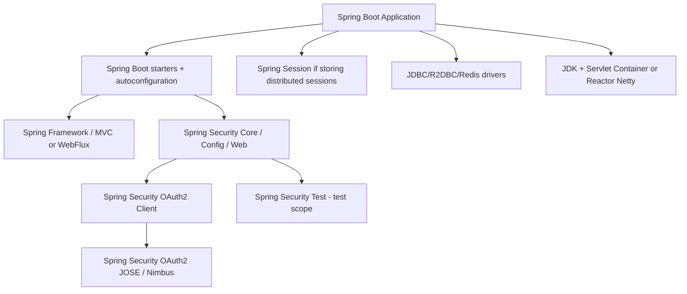
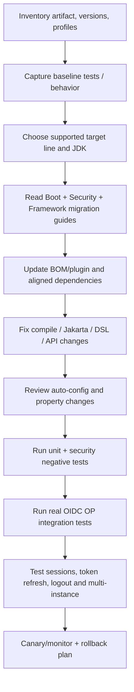
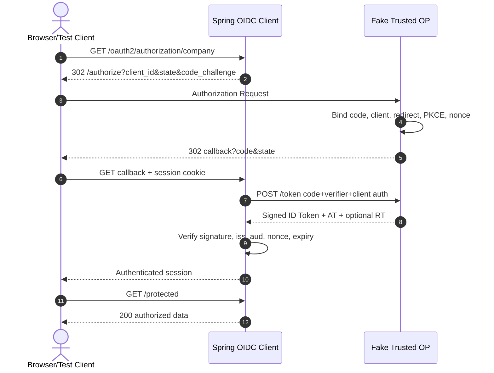

# 33.1. Cross-Referencing Documentation with Spring Boot and Spring Security Versions

**Spring Security OAuth 2.0 / OpenID Connect (OIDC) Client** has evolved across multiple generations of Spring Boot, Spring Framework, and Spring Security. An `oauth2Login()` or `OAuth2AuthorizedClientManager` configuration example written for one release may fail to compile, behave differently by default, or use an API that has been deprecated or removed in another release. This is especially likely to happen when reading an older blog post, copying a snippet from an online answer, or opening the "current" Spring Security documentation while the project is still on an older maintenance line.

Lesson **33.1. Cross-Referencing Documentation with Spring Boot and Spring Security Versions**, in chapter **33. Compatibility and Upgrades**, helps you build a repeatable verification methodology: **determine the exact artifacts actually running -> select the corresponding documentation -> check APIs/properties/default behavior -> prove with compilation and integration tests -> only then decide on an upgrade**.

This lesson uses primary examples with **Spring Boot 3.x / Spring Security 6.x, Java 17+**, while also explaining the boundaries when encountering **Spring Boot 2.x / Security 5.x** and **Spring Boot 4.x / Security 7.x**. These release line names are used to learn how to cross-reference, **not to assert the latest minor/patch release at the time of reading**. Always check release notes, the documentation for the **exact resolved version**, and support/security patch status before deploying.

> **Rule number one:** Do not decide on an API based on the name "Spring Boot 3" in documentation or the version number of a single dependency. Decide based on the **effective dependency graph of the exact application module, runtime classpath, and test classpath**, while cross-referencing documentation and Javadoc tied to the exact release line.

---

## 1. Learning Objectives

After this lesson, you will be able to:

1. Distinguish versions of **Spring Boot, Spring Framework, Spring Security, Spring Session, Spring Security Test, Reactor, and Nimbus JOSE/JWT**.
2. Explain the role of the **Spring Boot BOM**, starter dependencies, and dependency management in resolved versions.
3. Determine actual versions using Maven/Gradle instead of only looking at `pom.xml` or `build.gradle`.
4. Select **reference documentation, API Javadoc, migration guides, release notes, and source code** matching the artifacts in use.
5. Build a **cross-reference matrix** for each OAuth2 Client/OIDC feature: API, version available, behavior changes, and required tests.
6. Understand the major boundaries between Boot 2 / Security 5, Boot 3 / Security 6, and Boot 4 / Security 7 without overgeneralizing across every minor release.
7. Check `SecurityFilterChain`, `oauth2Login(...)`, `oauth2Client(...)`, `requestMatchers(...)`, `ClientRegistration`, and repository syntax by version.
8. Recognize the differences between **Servlet OAuth2 Client, Reactive OAuth2 Client, and Resource Server** to avoid applying the wrong example.
9. Distinguish **Boot auto-configuration** from **Security core APIs** and the property verification workflow.
10. Build an upgrade workflow with a baseline, dependency diff, compiler checks, negative/security tests, and rollback.
11. Detect subtle changes involving login callback, PKCE, nonce, issuer/audience validation, token refresh, and logout.
12. Write technical notes **with versions, sources, constraints, and evidence** so teammates can reproduce them.

## 2. Why Does "Right API Name" Not Guarantee "Right Version"?

Consider some commonly heard statements:

- "The docs say to use `HttpSecurity.oauth2Login()`."
- "The blog uses `WebSecurityConfigurerAdapter`, so I use it too."
- "Spring Security has the class `RestClientAuthorizationCodeTokenResponseClient`, why doesn't my IDE see it?"
- "I upgraded Spring Boot but kept `spring-security-oauth2-client` at the old version because it compiled before."
- "An example uses `ServerHttpSecurity`, while my application uses `HttpSecurity`."
- "The new docs use `jakarta.servlet`, while my code still imports `javax.servlet`."
- "I only changed the BOM, and OIDC callback or logout started failing."
- "Security Test has `oauth2Login()`, so why hasn't testing against the OP been verified yet?"

Each statement can relate to a **different kind of mismatch**:

| Type of difference | Example | Consequence |
| --- | --- | --- |
| **API removed/deprecated** | `WebSecurityConfigurerAdapter` from old examples | Fails to compile or warns that migration is needed |
| **API introduced in a newer minor** | A `RestClient`-based token client | Older classpath/IDE does not have the class |
| **Package namespace** | `javax.servlet.*` -> `jakarta.servlet.*` | Type mismatch/compile errors |
| **Configuration DSL** | Old chained/no-arg syntax vs. lambda DSL | Deprecated or incompatible in newer major versions |
| **Auto-config behavior** | Custom repository bean already declared | Boot may stop generating beans from properties as before |
| **Runtime default** | Session, CSRF, PKCE, or security matcher | App compiles but behavior changes |
| **Wrong technology stack** | `HttpSecurity` vs `ServerHttpSecurity` | Completely wrong configuration |
| **Wrong security role** | OAuth2 Client vs JWT Resource Server | Token validation/client manager has different responsibilities |
| **Documentation drift** | Reading "current" docs for a project on an older line | Config sample looks right but does not match the artifact |
| **Transitive dependency override** | Direct Security JAR version differs from BOM | `NoSuchMethodError`, `ClassNotFoundException`, test failures |

Therefore, the cross-referencing process must cover both **build-time API** and **runtime behavior**.

## 3. Version Ecosystem Map

In an OAuth2/OIDC Client project, there are multiple library layers:



A change in the Boot BOM can simultaneously change **many dependencies**. Conversely, if you upgrade only a single Security JAR, the other JARs may fall out of alignment.

### 3.1. Layers and Where to Read Documentation

| Layer | OAuth2/OIDC-related concerns | Primary documentation source |
| --- | --- | --- |
| **Spring Boot** | Starters, `spring.security.oauth2.client.*`, auto-config, dependency versions, runtime server | Boot Reference/Configuration Metadata/Dependency Versions |
| **Spring Security** | `oauth2Login`, authorization requests, client managers, test helpers, logout, token clients | Security Reference + exact-version Javadoc |
| **Spring Framework** | `RestClient`, `WebClient`, MVC/WebFlux, HTTP, converters | Framework Reference/Javadoc |
| **Spring Session** | Redis/JDBC session replication, serializers | Session Reference/Javadoc |
| **Nimbus JOSE/JWT** | JOSE/JWK/ID Token signature handling | Nimbus API + Security integration docs |
| **Servlet container** | Session cookies, reverse proxy, HTTPS, filter invocation | Boot/container docs |
| **OAuth2/OIDC specs** | `state`, PKCE, ID Token, discovery, logout | RFC/OpenID specs |
| **Your project** | Overrides, custom beans, security policy, tests | Effective dependency graph, code, release records |

**Specifications** describe the protocol; they do not guarantee that a **specific Java method** appears in every Spring Security release.

### 3.2. Three Major Generations — Orientation Table, Not a Lockfile

| Spring Boot Generation | Spring Framework/Security Line Associated with Generation | Servlet Namespace | Notable Transition Points |
| --- | --- | --- | --- |
| **Boot 2.x** (especially 2.7) | Framework 5.x / Security 5.x | `javax.servlet.*` | Many older examples, `WebSecurityConfigurerAdapter` was once common and then replaced |
| **Boot 3.x** | Framework 6.x / Security 6.x | `jakarta.servlet.*` | Java 17 baseline, `SecurityFilterChain` bean, new configuration DSL/Authorization API |
| **Boot 4.x** | Framework 7.x / Security 7.x | `jakarta.servlet.*` | Some APIs/configs deprecated in the 6 line may be removed; must read the 7.x migration guide and Boot 4 guide |

This table only classifies **major lines**. **Do not deduce** "Boot 3.A.B always ships with Security 6.X.Y" from this table. A Boot patch/minor release may manage a different Security version after a patch or maintenance upgrade; a project may also override versions.

**Java requirements** must also be read from the exact Boot version documentation; Boot 3.x requires Java 17 or higher, but specific supported JDK, Gradle, and Maven versions can vary by release. Do not assume "the latest JDK on my machine" is automatically compatible with every Boot/Gradle plugin in use.

## 4. Sources of Truth: Which Order to Follow?

When an example or API raises doubt, follow this order:

1. **Actual running application artifact/version**: JAR/container image, Git commit, build profile.
2. **Build dependency management**: Boot parent/BOM or Gradle plugin + BOM/platform.
3. **Resolved runtime classpath**: versions actually selected.
4. **Resolved test classpath**: `spring-security-test`, JUnit, mock libraries.
5. **Reference docs for the exact line** and Javadoc tied to the artifact/version.
6. **Release notes, migration guides** for each upgrade step.
7. **Corresponding source code/tag** if behavior is still unclear.
8. **Compilation and integration tests** to verify the feature in your project.
9. **Security advisories/support policy** to decide whether a line is still suitable for production.

Do not reverse this order into "find a snippet on the Internet -> manually add a dependency JAR to make the error go away -> deploy".

### 4.1. What Is Strong Evidence vs. Weak Evidence?

| Observation | Value |
| --- | --- |
| IDE auto-import succeeds | Suggests the API exists on the currently open classpath |
| Maven/Gradle dependencyInsight | Strong evidence of the resolved version for a specific configuration |
| Exact-artifact/version Javadoc | Evidence of signature/availability |
| Source at the exact release tag | Additional evidence of implementation/defaults |
| Release notes/migration guide | Official evidence of changes |
| Tests compile with the current compiler plugin | Evidence that the project build understands the API |
| OIDC integration test with an OP fixture | Evidence of behavior in the application configuration |
| Blog post without versions | Reference only, **insufficient** |
| "Current" docs of a newer line | Does not prove an older line has the API |
| A passing `MockMvc.oauth2Login()` test | Does not prove production Authorization Code/OIDC callback |

### 4.2. Don't Look Only at `pom.xml`

`pom.xml` might declare a Boot parent version, while the actual module is altered by:

- A different parent in a submodule.
- Another imported BOM or overridden properties.
- Direct dependency versions.
- Maven profiles.
- Transitive dependency mediation.
- Multi-module plugin/dependency management.
- Test-only dependencies differing from runtime.

You need the **effective POM and dependency tree** of the **exact module**.

## 5. Maven: Finding the Managed Spring Boot Version

Example project using the Boot parent:

```xml
<project xmlns="http://maven.apache.org/POM/4.0.0"
         xmlns:xsi="http://www.w3.org/2001/XMLSchema-instance"
         xsi:schemaLocation="http://maven.apache.org/POM/4.0.0
                             https://maven.apache.org/xsd/maven-4.0.0.xsd">
  <modelVersion>4.0.0</modelVersion>

  <parent>
    <groupId>org.springframework.boot</groupId>
    <artifactId>spring-boot-starter-parent</artifactId>
    <version>3.5.0</version>
    <relativePath/>
  </parent>

  <groupId>example</groupId>
  <artifactId>oidc-client-app</artifactId>
  <version>1.0.0-SNAPSHOT</version>

  <properties>
    <java.version>17</java.version>
  </properties>

  <dependencies>
    <dependency>
      <groupId>org.springframework.boot</groupId>
      <artifactId>spring-boot-starter-web</artifactId>
    </dependency>
    <dependency>
      <groupId>org.springframework.boot</groupId>
      <artifactId>spring-boot-starter-security</artifactId>
    </dependency>
    <dependency>
      <groupId>org.springframework.boot</groupId>
      <artifactId>spring-boot-starter-oauth2-client</artifactId>
    </dependency>
    <dependency>
      <groupId>org.springframework.security</groupId>
      <artifactId>spring-security-test</artifactId>
      <scope>test</scope>
    </dependency>
  </dependencies>
</project>
```

**`3.5.0` is only a concrete version used to illustrate POM structure**, not a recommendation to use this release in production or an assertion that it is the latest patch. In a real project, choose an appropriate maintenance/security-patched release according to official support/release notes.

### 5.1. Maven Commands

In the directory containing `pom.xml`:

```bash
./mvnw -version
./mvnw help:effective-pom -Doutput=target/effective-pom.xml
./mvnw dependency:tree -Dincludes=org.springframework.security
./mvnw dependency:tree -Dincludes=org.springframework.boot
./mvnw dependency:tree -Dincludes=org.springframework
```

On Windows PowerShell:

```powershell
.\mvnw.cmd -version
.\mvnw.cmd help:effective-pom -Doutput=target/effective-pom.xml
.\mvnw.cmd dependency:tree "-Dincludes=org.springframework.security"
```

These commands are **only instructions for learners to run in their own projects**, not tasks executed while authoring this lesson. In a multi-module build, run them in the exact module or use appropriate Maven reactor options (`-pl`, `-am` when needed).

### 5.2. Which Artifacts Should You Look For?

```text
org.springframework.boot:spring-boot
org.springframework.boot:spring-boot-autoconfigure
org.springframework.security:spring-security-core
org.springframework.security:spring-security-config
org.springframework.security:spring-security-web
org.springframework.security:spring-security-oauth2-core
org.springframework.security:spring-security-oauth2-client
org.springframework.security:spring-security-oauth2-jose
org.springframework.security:spring-security-test (test)
org.springframework:spring-web / spring-webmvc / spring-webflux
org.springframework.session:spring-session-core (if used)
```

Illustrative dependency graph example:

```text
spring-boot-starter-oauth2-client:3.5.0
  +-- spring-security-oauth2-client:6.x.y
  +-- spring-security-oauth2-jose:6.x.y
  +-- spring-security-config:6.x.y
  +-- spring-security-core:6.x.y
```

**`6.x.y` is a placeholder, not output to copy verbatim into a report**. Fill in the real versions from your dependency tree.

### 5.3. Distinguishing Version Management from Overrides

When a dependency declares:

```xml
<dependency>
  <groupId>org.springframework.security</groupId>
  <artifactId>spring-security-oauth2-client</artifactId>
</dependency>
```

Maven can choose the version via the Boot BOM/parent. But if you add:

```xml
<version>6.0.0</version>
```

you have requested a specific version, which may diverge from `spring-security-core` and `spring-security-config` managed by Boot.

**Do not upgrade a single Security artifact on its own to get a new API** without checking the same release train, compatibility, and dependency management.

## 6. Maven: Using the Boot BOM Without Inheriting the Parent

A company may have its own parent POM. In that case, it typically imports the Spring Boot BOM:

```xml
<dependencyManagement>
  <dependencies>
    <dependency>
      <groupId>org.springframework.boot</groupId>
      <artifactId>spring-boot-dependencies</artifactId>
      <version>3.5.0</version>
      <type>pom</type>
      <scope>import</scope>
    </dependency>
  </dependencies>
</dependencyManagement>
```

In this case:

- The BOM manages many dependency versions.
- You may have to configure the Java compiler plugin, Spring Boot Maven plugin, and build conventions yourself because **importing a BOM is not the same as inheriting `spring-boot-starter-parent`**.
- Version precedence across multiple BOMs can affect the result.
- The effective POM remains the final evidence of Maven resolution.

### 6.1. Multi-Module Projects Do Not Automatically Share One Version

```text
root
  +-- web-app         -> Spring Boot 3.x / Security 6.x
  +-- auth-library    -> only compiles against Security API X
  +-- integration-it  -> test harness Security Test version Y
```

A library might compile successfully, yet when `web-app` runs with a different version, it calls a method that no longer exists and causes a `NoSuchMethodError`.

Cross-reference the **classpath of the deployed artifact**, not just the library module.

## 7. Gradle: Determining Resolved Versions

A typical Groovy `build.gradle`:

```groovy
plugins {
    id 'java'
    id 'org.springframework.boot' version '3.5.0'
    id 'io.spring.dependency-management' version '1.1.7'
}

java {
    toolchain {
        languageVersion = JavaLanguageVersion.of(17)
    }
}

dependencies {
    implementation 'org.springframework.boot:spring-boot-starter-web'
    implementation 'org.springframework.boot:spring-boot-starter-security'
    implementation 'org.springframework.boot:spring-boot-starter-oauth2-client'
    testImplementation 'org.springframework.boot:spring-boot-starter-test'
    testImplementation 'org.springframework.security:spring-security-test'
}
```

The version numbers **are build examples**, not a mandatory baseline for every environment. If you use Gradle's native platform instead of `io.spring.dependency-management`, configuration differs; avoid applying both strategies simultaneously without understanding precedence.

### 7.1. Gradle Commands

```bash
./gradlew --version
./gradlew dependencies --configuration runtimeClasspath
./gradlew dependencyInsight --dependency spring-security-oauth2-client --configuration runtimeClasspath
./gradlew dependencyInsight --dependency spring-security-config --configuration runtimeClasspath
./gradlew dependencyInsight --dependency spring-security-test --configuration testRuntimeClasspath
./gradlew dependencyInsight --dependency spring-webflux --configuration runtimeClasspath
```

Windows PowerShell:

```powershell
.\gradlew.bat --version
.\gradlew.bat dependencyInsight --dependency spring-security-oauth2-client --configuration runtimeClasspath
.\gradlew.bat dependencyInsight --dependency spring-security-test --configuration testRuntimeClasspath
```

`dependencyInsight` is especially useful because it tells you **why** Gradle chose a version—for example, a constraint/BOM, a direct dependency, or conflict resolution.

### 7.2. Inspecting the Right Configuration

`compileClasspath`, `runtimeClasspath`, `testCompileClasspath`, and `testRuntimeClasspath` can differ. If the Javadoc for `spring-security-test` is newer than the actual test artifact, a builder method will be missing even if the runtime app was upgraded.

Do not only run `dependencies` on the root Gradle project while ignoring the subproject that actually runs the application.

### 7.3. Plugin Version Differs from Dependency Version

The `org.springframework.boot` Gradle plugin version is usually an important piece of data, but it is **not the sole proof** of Spring Security JAR versions. Platforms, constraints, and overrides in the dependency graph still determine the resolved classpath.

`./gradlew --version` shows Gradle/JVM versions; it **does not print all Spring dependency versions**.

## 8. From Build Artifacts to the Corresponding Official Documentation

After finding the actual versions, for example:

```text
Build under investigation:
  Spring Boot:          3.5.0
  Spring Security Core: 6.5.x (fill in exact resolved patch)
  Spring Security Web:  6.5.x
  OAuth2 Client:        6.5.x
  Spring Framework:     6.2.x (fill in exact patch)
  Spring Security Test: 6.5.x
  Java runtime:         17
  Web stack:            Servlet
```

**This is an example template**, not real machine output. Whether specific versions are compatible must be verified via the dependency tree of the chosen Boot version.

You can consult these sources:

- **Spring Boot Reference:** `https://docs.spring.io/spring-boot/reference/`.
- **Spring Security Reference:** `https://docs.spring.io/spring-security/reference/`.
- **Spring Security Javadoc:** API links in the documentation for the matching version.
- **Spring Framework Reference:** `https://docs.spring.io/spring-framework/reference/`.
- **Spring Session Reference:** `https://docs.spring.io/spring-session/reference/`.
- **GitHub release/tag** of the exact artifact.
- **Maven Central or repository metadata** to verify that the release exists.

### 8.1. Why Can a `/reference/` Page Mislead You?

A URL without a pinned version typically points to the **documentation of the current line**; content can change across releases. If the project runs an older line, you need to use the appropriate **version picker/archived docs**, or check the tag/release branch in the official repository.

When documenting a project, state clearly:

```text
Observed:
  Spring Security OAuth2 Client JAR: <exact version>

Documentation:
  Spring Security Reference: <matching release line>
  Javadoc: <matching class/version>
  Release notes: <from version> -> <to version>

Verified:
  Compiles: yes/no
  OIDC flow test: passed/failed/not run
```

### 8.2. Reference Docs and Javadoc Answer Two Different Questions

**Reference docs** answer: "How should this configuration/feature be used?"

**Javadoc** answers: "Which classes, constructors, methods, parameter types, annotations, and deprecations exist in which artifact/version?"

If reference docs show sample code but your IDE cannot find a method, **check the exact-version Javadoc** and then the dependency tree; do not rush to create a class with the same name in your project.

### 8.3. A Migration Guide Differs from a Tutorial

A tutorial typically describes the target state. A migration guide details:

- Changed/removed APIs.
- Default behavior changes.
- Package, DSL, and test utility changes.
- Dependency/JDK/container requirements.
- How to upgrade step by step.

When moving from Boot 2/Security 5 to Boot 3/Security 6, **you need the migration guide**, not just a new OAuth2 Login snippet.

## 9. A Reusable "Version -> Feature" Cross-Reference Table

To review multiple OAuth2/OIDC lessons, create a ledger:

| Component/feature | Artifact/API to verify | Current version | Exact-version source | Test evidence |
| --- | --- | --- | --- | --- |
| Browser OAuth2 Login | `HttpSecurity.oauth2Login(...)` | Fill in resolved version | Security Servlet Reference + Javadoc | /authorize + callback |
| OIDC ID Token | OIDC login decoder factory/validators | Fill in version | Security OIDC Reference/API | Wrong `iss`/`aud`/`nonce` |
| Client registration | `ClientRegistrationRepository` | Fill in version | Security Client API | Registration lookup |
| Servlet manager | `OAuth2AuthorizedClientManager` | Fill in version | Security Client API | refresh/client_credentials |
| Reactive manager | `ReactiveOAuth2AuthorizedClientManager` | Fill in version | Reactive Client API | Reactive refresh |
| Token response HTTP client | `OAuth2AccessTokenResponseClient` + implementation | Fill in version | API/Javadoc/release notes | Token Endpoint fixture |
| OAuth2 Login test | `SecurityMockMvcRequestPostProcessors.oauth2Login` | Fill in test version | Security Test docs | MockMvc |
| OIDC Login test | `oidcLogin()` / `mockOidcLogin()` | Fill in version | Servlet/Reactive test docs | Principal assertions |
| OIDC logout | Servlet/Reactive logout success handlers | Fill in version | OIDC Logout docs | OP `end_session_endpoint` |
| Shared sessions | Spring Session Redis/JDBC | Fill in version | Spring Session docs | A->B session |
| JWT/JWKS cache | decoder/Nimbus integration | Fill in version | Javadoc + tested behavior | K1->K2 rotation |
| Boot property keys | `spring.security.oauth2.client.*` | Fill in Boot version | Boot properties appendix | Config binding |
| Native/AOT | Boot/Framework/Security AOT support | Fill in versions | Boot Native/AOT docs | Native smoke test if used |

**Do not mark "supported" just because an API appears on the website**. Also record constructor/method signatures, deprecation notes, and test evidence.

### 9.1. A Markdown/YAML Recording Format in a Repository

```yaml
compatibility:
  observedBuild:
    gitCommit: "<commit>"
    springBoot: "<resolved>"
    springSecurityOAuth2Client: "<resolved>"
    springSecurityTest: "<resolved>"
    springFramework: "<resolved>"
    javaRuntime: "<version>"
    webStack: servlet
  feature:
    name: oidc-login
    documentationLine: "<matching Security line>"
    apiClass: "org.springframework.security.oauth2.client..."
    tested:
      compile: true
      loginCallback: true
      wrongIssuerRejected: true
    note: "Snapshot of verified dependencies, not a generic matrix"
```

This is an **optional project knowledge-management schema**, not a configuration file that Spring Boot parses automatically.

## 10. Distinguishing Spring Boot Auto-Configuration from Spring Security APIs

A common mistake when cross-referencing documentation is asking:

> "Why did I configure `spring.security.oauth2.client.registration.company`, yet there is no `ClientRegistrationRepository` bean as expected?"

There are at least two layers:

**Boot auto-configuration** reads properties, configures starters, and creates beans when conditions match.

**Security runtime/API** uses `ClientRegistrationRepository`, OAuth2 login filters, and managers. Spring Security core does not natively know about every `spring.security.oauth2.client.*` property when running outside Boot.

### 10.1. Responsibility Matrix

| Concern | Boot | Spring Security |
| --- | --- | --- |
| Parse `application.yml` | Configuration binding/auto-config | Not the primary property binding source |
| Create default `ClientRegistrationRepository` | Can auto-configure when conditions are met | Defines interface and implementations |
| Enable login endpoint | Auto-config can establish app defaults | `SecurityFilterChain`/`oauth2Login` directly |
| Customize authorization request | Not just a Boot property | `OAuth2AuthorizationRequestResolver`/DSL |
| Save authorized clients | Provides defaults depending on topology | Repository/service/manager contracts |
| Verify OIDC ID Token | Dependency/bean setup | OIDC login authentication/decoder |
| Resource Server JWT | Starter/properties | JwtDecoder/Resource Server filter |
| Test OAuth2 principal | Test deps version management | `spring-security-test` helpers |

### 10.2. When Custom Beans Exist, Auto-Config Can Back Off

For example, if the application declares:

```java
@Bean
ClientRegistrationRepository registrationRepository() {
    return new InMemoryClientRegistrationRepository(
            myCustomRegistrations());
}
```

then Boot may stop creating the default repository from YAML because an application-provided bean already exists. In that case:

- Registrations in properties might not be added automatically.
- A provider might disappear from the login page.
- `oauth2Login()` tests still pass because the principal is mocked.
- Only at runtime on `/oauth2/authorization/{registrationId}` do you discover the missing registration.

**Cross-reference Boot auto-config conditions and Security bean contracts**, rather than just editing YAML keys.

## 11. Common OAuth2/OIDC Client Configuration on Boot 3 / Security 6

A minimal example using two fictional providers:

```yaml
spring:
  security:
    oauth2:
      client:
        registration:
          company:
            provider: corporate-op
            client-id: ${COMPANY_OIDC_CLIENT_ID}
            client-secret: ${COMPANY_OIDC_CLIENT_SECRET}
            client-authentication-method: client_secret_basic
            authorization-grant-type: authorization_code
            redirect-uri: "{baseUrl}/login/oauth2/code/{registrationId}"
            scope:
              - openid
              - profile
              - email
          partner:
            provider: partner-op
            client-id: ${PARTNER_OIDC_CLIENT_ID}
            client-secret: ${PARTNER_OIDC_CLIENT_SECRET}
            client-authentication-method: client_secret_basic
            authorization-grant-type: authorization_code
            redirect-uri: "{baseUrl}/login/oauth2/code/{registrationId}"
            scope:
              - openid
              - profile
        provider:
          corporate-op:
            issuer-uri: https://sso.company.example/oidc
          partner-op:
            issuer-uri: https://login.partner.example/realms/partner
```

This syntax belongs to the property group supported by Spring Boot in typical Boot 3 lines. **Issuer URIs, client IDs, and secret placeholders are illustrative only**. Check property metadata/Boot version if moving to Boot 4 or configuring a provider without discovery.

### 11.1. Three Names Not to Confuse

```text
registrationId = company
provider alias = corporate-op
client_id      = <OP-assigned-client-id>
issuer-uri     = https://sso.company.example/oidc
```

The browser initiates login by `registrationId`:

```text
GET /oauth2/authorization/company
```

Do not open `/oauth2/authorization/corporate-op` if the actual registration ID is `company`.

### 11.2. Property Existence Does Not Guarantee Provider Contract

A property may bind successfully, yet the OP:

- Lacks valid discovery metadata.
- Disallows that redirect URI.
- Accepts only a different authentication method.
- Does not return a nonce or a compliant ID Token.
- Uses a signing algorithm outside the accepted policy.
- Does not issue a refresh token for that client/scope.

Boot docs confirm **property keys**, whereas behavior requires the Security Reference, OP documentation, and integration tests.

## 12. Servlet SecurityFilterChain Syntax: Foundational Example

On Spring Security 6, the typical lambda DSL pattern:

```java
import org.springframework.context.annotation.Bean;
import org.springframework.context.annotation.Configuration;
import org.springframework.security.config.Customizer;
import org.springframework.security.config.annotation.web.builders.HttpSecurity;
import org.springframework.security.web.SecurityFilterChain;

@Configuration
class WebSecurityConfig {

    @Bean
    SecurityFilterChain securityFilterChain(HttpSecurity http)
            throws Exception {

        return http
                .authorizeHttpRequests(auth -> auth
                        .requestMatchers(
                                "/", "/health", "/assets/**")
                            .permitAll()
                        .anyRequest()
                            .authenticated())
                .oauth2Login(Customizer.withDefaults())
                .oauth2Client(Customizer.withDefaults())
                .build();
    }
}
```

**`HttpSecurity` is a Servlet API.** This snippet uses `SecurityFilterChain`, matching modern Security 6 configuration style and serving as a starting point for migrating toward newer DSLs.

### 12.1. Why Both `oauth2Login` and `oauth2Client`?

- `oauth2Login(...)` handles user browser login via Authorization Code/OIDC.
- `oauth2Client(...)` provides integrations for OAuth2 client authorization/token usage.
- An application may use both; not every project needs to call both explicitly depending on goals and auto-config.
- `oauth2ResourceServer(...)` is for **accepting Bearer tokens** in an API, not a replacement for `oauth2Login`.

**Distinguish functionality**; do not blindly swap the DSL just because an API Resource Server tutorial looks similar.

### 12.2. Do Not Copy Examples with `WebSecurityConfigurerAdapter`

An older Security 5-era snippet:

```java
// LEGACY EXAMPLE, DO NOT USE DIRECTLY IN SECURITY 6/7.
public class OldSecurityConfig
        extends WebSecurityConfigurerAdapter {

    @Override
    protected void configure(HttpSecurity http) throws Exception {
        http.authorizeRequests()
                .anyRequest().authenticated()
                .and()
                .oauth2Login();
    }
}
```

`WebSecurityConfigurerAdapter` was removed in Security 6. When upgrading, switch to a `SecurityFilterChain` bean and the appropriate DSL, while verifying matcher/authorization semantics.

**It is not just a "class rename"**: filter chain ordering, matchers, request authorization, and auto-config can change behavior.

### 12.3. Lambda DSL and 6 -> 7 Upgrades

In Security 6 releases, several no-argument/chaining APIs were deprecated in favor of the **lambda DSL**. In Security 7, those older APIs may be gone. The pattern:

```java
http.oauth2Login(Customizer.withDefaults());
http.authorizeHttpRequests(auth -> auth
        .anyRequest().authenticated());
```

is clearer than the legacy `http.oauth2Login().and()...` style.

**Do not assume every builder method in 6.x remains present in 7.x.** For each method, check the migration guide and exact-version Javadoc.

## 13. Moving from `javax.*` to `jakarta.*` Across Spring Boot 3

A major boundary between Boot 2 and Boot 3 is the **Jakarta EE namespace migration**.

Old:

```java
import javax.servlet.http.HttpServletRequest;
import javax.servlet.http.HttpServletResponse;
```

New (Spring Framework 6 / Spring Security 6 Servlet):

```java
import jakarta.servlet.http.HttpServletRequest;
import jakarta.servlet.http.HttpServletResponse;
```

This affects custom OAuth2 request resolvers, success/failure handlers, filters, and session listeners.

### 13.1. Example of a Custom Resolver

```java
import jakarta.servlet.http.HttpServletRequest;
import org.springframework.security.oauth2.client.web
        .OAuth2AuthorizationRequestResolver;
import org.springframework.security.oauth2.core.endpoint
        .OAuth2AuthorizationRequest;

final class DelegatingAuthorizationRequestResolver
        implements OAuth2AuthorizationRequestResolver {

    private final OAuth2AuthorizationRequestResolver delegate;

    DelegatingAuthorizationRequestResolver(
            OAuth2AuthorizationRequestResolver delegate) {
        this.delegate = delegate;
    }

    @Override
    public OAuth2AuthorizationRequest resolve(
            HttpServletRequest request) {
        return delegate.resolve(request);
    }

    @Override
    public OAuth2AuthorizationRequest resolve(
            HttpServletRequest request,
            String registrationId) {
        return delegate.resolve(request, registrationId);
    }
}
```

This sample only **delegates** to an existing resolver to illustrate the package/imports. If you want to add `login_hint`, `prompt`, or custom request attributes, you must apply the proper API and preserve `state`/PKCE/nonce according to your Security version.

### 13.2. Do Not Migrate Namespaces with Blind Search-and-Replace

An older project may contain:

- `javax.servlet.*` -> `jakarta.servlet.*`.
- `javax.validation.*` -> `jakarta.validation.*`.
- `javax.persistence.*` -> `jakarta.persistence.*`.
- `javax.*` packages belonging to Java SE, which may still exist and **do not** change to Jakarta.

Cross-reference the migration guide, dependency versions, and compiler errors per API.

### 13.3. Runtime Errors Can Differ from Compile Errors

A custom library built against `javax` Servlet while the app uses `jakarta` can cause type mismatches, `ClassNotFoundException`, or `NoClassDefFoundError`. Upgrade the entire compatibility chain; do not add both servlet API JARs to runtime to "silence the error".

## 14. Servlet vs. Reactive: Do Not Pick Examples by Method Name Alone

Spring Security has two web stacks:

| Capability | Servlet/MVC | Reactive/WebFlux |
| --- | --- | --- |
| Web security | `HttpSecurity` | `ServerHttpSecurity` |
| Chain | `SecurityFilterChain` | `SecurityWebFilterChain` |
| Registration repository | `ClientRegistrationRepository` | `ReactiveClientRegistrationRepository` |
| Request | `HttpServletRequest` | `ServerWebExchange` |
| Session | `HttpSession` | `WebSession` |
| Authorized client manager | `OAuth2AuthorizedClientManager` | `ReactiveOAuth2AuthorizedClientManager` |
| Authorized client repository | `OAuth2AuthorizedClientRepository` | `ServerOAuth2AuthorizedClientRepository` |
| HTTP client | `RestClient` and servlet-compatible clients | `WebClient` |
| Controller test | `MockMvc` | `WebTestClient` |
| OAuth2 test login | `oauth2Login()` | `mockOAuth2Login()` |
| OIDC test login | `oidcLogin()` | `mockOidcLogin()` |
| OIDC logout handler | `OidcClientInitiatedLogoutSuccessHandler` | `OidcClientInitiatedServerLogoutSuccessHandler` |

**Do not apply Reactive code to Servlet just because a method shares the name `oauth2Login`.**

### 14.1. WebFlux Example

```java
import org.springframework.context.annotation.Bean;
import org.springframework.context.annotation.Configuration;
import org.springframework.security.config.Customizer;
import org.springframework.security.config.web.server.ServerHttpSecurity;
import org.springframework.security.web.server.SecurityWebFilterChain;

@Configuration
class ReactiveSecurityConfig {

    @Bean
    SecurityWebFilterChain reactiveChain(ServerHttpSecurity http) {
        return http
                .authorizeExchange(exchange -> exchange
                        .pathMatchers("/", "/public/**").permitAll()
                        .anyExchange().authenticated())
                .oauth2Login(Customizer.withDefaults())
                .oauth2Client(Customizer.withDefaults())
                .build();
    }
}
```

**This is an alternative configuration**, not declared alongside a Servlet chain unless the project has an explicitly designed and tested mixed web stack architecture.

### 14.2. Starter Dependencies Do Not Tell the Whole Story

If a project includes both `spring-boot-starter-web` and `spring-boot-starter-webflux` to use `WebClient` in an MVC app, the presence of the WebFlux dependency **does not prove the server is running Reactive**. Check the application type, auto-config conditions, and active security chain.

## 15. Cross-Referencing `OAuth2AuthorizedClientManager` and Providers

An important API in OAuth2 Client:

```java
OAuth2AuthorizedClientManager
```

Servlet user-request context example:

```java
import org.springframework.context.annotation.Bean;
import org.springframework.security.oauth2.client.DefaultOAuth2AuthorizedClientManager;
import org.springframework.security.oauth2.client.OAuth2AuthorizedClientManager;
import org.springframework.security.oauth2.client.OAuth2AuthorizedClientProviderBuilder;
import org.springframework.security.oauth2.client.registration
        .ClientRegistrationRepository;
import org.springframework.security.oauth2.client.web
        .OAuth2AuthorizedClientRepository;

@Bean
OAuth2AuthorizedClientManager requestClientManager(
        ClientRegistrationRepository registrations,
        OAuth2AuthorizedClientRepository repository) {

    var manager = new DefaultOAuth2AuthorizedClientManager(
            registrations, repository);

    manager.setAuthorizedClientProvider(
            OAuth2AuthorizedClientProviderBuilder.builder()
                    .authorizationCode()
                    .refreshToken()
                    .build());
    return manager;
}
```

In a browser request, the manager can use a repository tied to the Servlet request. In a scheduled/background context, **`AuthorizedClientServiceOAuth2AuthorizedClientManager`** is typically used with `OAuth2AuthorizedClientService`.

### 15.1. Why Must You Cross-Reference the Guide by Version?

Different versions can change:

- Builder methods, provider behavior, default clock skew.
- Token response clients and HTTP client customization.
- Caches/authorized client failure handlers.
- Built-in supported grants/profiles.
- Integration with `RestClient` or `WebClient`.
- Javadoc overloads or deprecated classes.

Do not claim "all Spring Security 6.x versions support the same converter constructor" without checking the exact minor release.

### 15.2. Check Scope When Reading Examples

A sample for `client_credentials` cannot replace user Authorization Code + refresh token handling. A sample for Servlet `DefaultOAuth2AuthorizedClientManager` does not apply verbatim inside a WebFlux event-loop. An example for Resource Server `JwtDecoder` is not the default configuration of the OIDC Client ID Token decoder.

**Match business scope first, then version**, and verify both.

## 16. Finding Classes/Methods Introduced in Newer Minors

Suppose a blog post uses:

```java
RestClientAuthorizationCodeTokenResponseClient
```

but the project fails to compile. Do not assume a missing `spring-boot-starter-web` dependency is the cause. Possible reasons include:

- The class appeared in a **newer Security minor**.
- The artifact version in use is older.
- The example is for the Servlet stack while your code is Reactive.
- The package/class name differs in the line you are using.
- The custom token response client API changed.
- The IDE index has not reloaded build metadata.

### 16.1. Resolution Workflow

1. Search for the class name in the **exact-version Javadoc** of `spring-security-oauth2-client`.
2. Use Maven/Gradle to verify the resolved JAR.
3. Confirm the import package.
4. Check `@Since` and deprecation annotations in Javadoc/source.
5. If the API is absent, find the supported implementation **in that exact version**.
6. If you genuinely need the newer version, plan a **compatible release train upgrade**, rather than pulling in random individual JARs.
7. Run compilation + Token Endpoint integration tests for the grant.

### 16.2. Do Not Assume "Default" Always Means Modern

Some integrations have gradually been replaced by implementations based on `RestClient` or `WebClient`. A `Default...` class may still exist while deprecated; a new class may only appear in a newer minor.

Read the exact-version Javadoc to learn:

- Is the class deprecated?
- What is the official replacement?
- What objects does the constructor accept?
- How are converters/HTTP clients configured?
- Does it support Authorization Code/Refresh Token/Client Credentials?
- Is there a Reactive equivalent?

Do not assume every HTTP token client supports every grant.

## 17. OIDC Login: How to Verify Upgrades Do Not Break Security Invariants

Regardless of version, an OIDC Client must uphold critical protocol constraints:

| Protection | Verification question during upgrade |
| --- | --- |
| `state` | Is the authorization response correlated with the exact stored request? |
| PKCE | Are `code_challenge` and `code_verifier` sent/verified per policy? |
| `nonce` | If used, does the ID Token nonce match the request? |
| `iss` | Does the ID Token issuer match the trusted provider? |
| `aud` | Is the Client ID in the audience as required by OIDC? |
| `azp` | Is the authorized party claim handled according to rules when applicable? |
| `exp`/`iat` | Are expiry/issue-time and clock skew enforced? |
| Signature/JWKS | Are keys fetched from the approved issuer/JWKS endpoint? |
| `redirect_uri` | Has the OP registered the public callback URI and is code binding correct? |
| `ClientRegistration` | Are registration ID/client ID/provider protected from swapping on callback? |
| CSRF/session | Are cookie/session/CSRF policies still appropriate for the environment? |
| Authority mapping | Are OP roles/claims mapped strictly per trust policy? |

**Never resolve an incompatibility by disabling signature, issuer/audience checks, state, or nonce.** That turns an upgrade error into a vulnerability.

### 17.1. PKCE Should Not Be Inferred from One Sentence in Docs

Different versions/types of OAuth2 clients have different defaults/conditions for PKCE. Therefore:

- Read the **exact-version** documentation.
- Check `ClientRegistration`, authorization request resolver, and client type.
- Test actual requests to confirm `code_challenge` is present when required by profile.
- The fake OP must reject an invalid `code_verifier`.
- Do not assert "PKCE is always enabled automatically" just by glancing at a code sample.

### 17.2. Nonce Is an OIDC Concern, Not Every OAuth2 Login

The OIDC `openid` scope introduces ID Token/nonce semantics. An OAuth2 Login with a non-OIDC provider may only fetch UserInfo. Do not copy ID Token validators to a non-OIDC provider; conversely, do not drop nonce when the app is an OIDC Client that requires binding.

### 17.3. Every OP Has Its Own Contract

Having the right Security version is not enough if the OP:

- Does not support standard Discovery.
- Requires a different auth method.
- Changes allowed redirect URIs.
- Rotates client secret/JWKS.
- Changes ID Token signature algorithms.
- Requires PAR/JAR or an elevated security profile.
- Has proprietary `prompt`/`login_hint`/`domain_hint` behavior.

You need version alignment + provider contract + integration tests.

## 18. OIDC Discovery and Metadata: Avoid Misunderstanding "Caching"

Boot's `issuer-uri` typically populates provider details via OIDC discovery. Depending on version/configuration, discovery may occur **when initializing `ClientRegistration`**, rather than refreshing on every login.

### 18.1. What to Cross-Reference

- Can the registration-from-issuer API perform HTTP I/O?
- Does Boot bind `issuer-uri` or manual endpoints?
- Is metadata `issuer` checked against the expected issuer?
- Which provider does `jwks_uri` come from?
- Which ID Token decoder factory is in use?
- Which integration/library governs JWKS cache TTL/refetch policy?
- Do multi-tenant dynamic registrations have a custom repository/cache?
- Is WebFlux discovery blocking the event-loop?

**Do not assume Resource Server `NimbusJwtDecoder` configuration applies to the OIDC Client decoder.** These are two distinct authentication flows even though both use JWT/JWKS.

### 18.2. Key Rotation Does Not Automatically Mean Upgrading Spring Security

If the OP publishes JWK K2 while keeping the issuer/client ID, the issue may be cache refresh policy rather than the class API. Upgrading Spring Security is not the first reaction if the root cause is proxy/JWKS availability. Classify errors at the right layer.

## 19. Boot Properties: Verifying Key Names via Configuration Metadata

For Boot, the reference documentation provides an **application properties appendix** and auto-configuration metadata. When checking properties:

```yaml
spring:
  security:
    oauth2:
      client:
        registration:
          company:
            client-id: ${OIDC_CLIENT_ID}
            client-secret: ${OIDC_CLIENT_SECRET}
            authorization-grant-type: authorization_code
            redirect-uri: "{baseUrl}/login/oauth2/code/{registrationId}"
        provider:
          company:
            issuer-uri: https://id.example.test/issuer
```

verify:

1. Boot version in the build.
2. Property keys published in the **exact-version Boot Reference**.
3. Field type/default binding.
4. Active profiles/environment overrides.
5. Auto-config conditions and custom beans.
6. Runtime resolved `ClientRegistration` (without logging the client secret).
7. Integration flow with an OP fixture.

### 19.1. Renamed Properties Can Fail Silently

A wrong or unbound key in a complex configuration can cause the application to:

- Use a different default.
- Fail to create the registration.
- Reference the wrong provider alias.
- Read an unintended environment override.
- Initialize a different security filter chain.

**Do not rely on the YAML parser reporting no errors** to conclude a property is supported.

### 19.2. Do Not Log the Entire `ClientRegistration`

It may contain the client secret and sensitive endpoint details. During runtime inspection, log only:

```text
registrationId=company
providerAlias=company-op
issuerAlias=company
grantType=authorization_code
authMethod=client_secret_basic
configRevision=42
```

Do not print `clientSecret`, access/refresh tokens, authorization codes, or raw ID Tokens.

## 20. Configuration DSL Changes: Check Both Behavior and Matchers

Suppose migrating from:

```java
// Historical example, do not use for new projects.
http.authorizeRequests()
        .antMatchers("/public/**").permitAll()
        .anyRequest().authenticated();
```

to:

```java
http.authorizeHttpRequests(auth -> auth
        .requestMatchers("/public/**").permitAll()
        .anyRequest().authenticated());
```

**Do not compare only Java compilation.** Matcher behavior also depends on:

- Servlet path/context path.
- MVC vs. non-MVC matchers.
- Trailing slashes, path normalization, URL encoding.
- Multiple filter chains and `securityMatcher`.
- Dispatcher types, forwards/errors.
- Whether method security is enabled.
- Rule order and `anyRequest` fallback.
- GET authorization entry point vs. POST CSRF handling.

A major upgrade can alter matcher implementations/recommendations. Read the migration guide and **test negative cases** to avoid accidentally exposing protected endpoints.

### 20.1. Two Security Filter Chains Can Shadow Each Other

```java
@Bean
@Order(1)
SecurityFilterChain apiChain(HttpSecurity http) ...;

@Bean
@Order(2)
SecurityFilterChain webChain(HttpSecurity http) ...;
```

After an upgrade, an overly broad matcher on the first chain can prevent the `oauth2Login` chain from running for callbacks. Tests must verify **which URL matches which chain**, not merely that an OAuth2 Login bean exists.

## 21. OIDC Logout: Choose Docs by Stack and Version

Spring Security has different APIs for Servlet and Reactive.

Servlet:

```java
OidcClientInitiatedLogoutSuccessHandler
```

Reactive:

```java
OidcClientInitiatedServerLogoutSuccessHandler
```

A Servlet example (Boot 3 / Security 6 style):

```java
import org.springframework.security.oauth2.client.oidc.web.logout
        .OidcClientInitiatedLogoutSuccessHandler;
import org.springframework.security.oauth2.client.registration
        .ClientRegistrationRepository;

OidcClientInitiatedLogoutSuccessHandler logoutSuccess =
        new OidcClientInitiatedLogoutSuccessHandler(registrations);

logoutSuccess.setPostLogoutRedirectUri("{baseUrl}/signed-out");
```

`registrations` is the configured `ClientRegistrationRepository`, not a variable Spring auto-generates in a standalone snippet.

### 21.1. Similar-Sounding APIs Are Not Equivalent

- Security filter chain `logout()`: local logout/session handling.
- RP-Initiated Logout success handler: redirects browser to OP `end_session_endpoint`.
- Back-Channel Logout: OP sends a Logout Token to the RP to invalidate sessions.
- OAuth2 revocation: revokes access/refresh tokens when supported.
- Front-Channel Logout: a different profile, depending on OP/app support.

**Read the exact-version reference for the right Servlet/Reactive stack and exact logout type**. A logout success handler does not automatically revoke all tokens, all sessions, or OP SSO cookies.

### 21.2. Post-Upgrade Tests

- POST `/logout` requires CSRF per session policy.
- Local session is invalidated.
- RP-Initiated redirect uses the trusted OP end-session URI.
- `post_logout_redirect_uri` is a registered public URI.
- `id_token_hint` is used per profile and never leaked in logs.
- Back-channel Logout Token (if supported) verifies issuer/audience/signature/events.
- Nodes sharing a session observe the logout.
- Reaching `/signed-out` does not cause a login loop.

## 22. Spring Security Test: A Separate Dependency Version to Pin

Servlet MockMvc example:

```java
import static org.springframework.security.test.web.servlet.request
        .SecurityMockMvcRequestPostProcessors.oauth2Login;
import static org.springframework.security.test.web.servlet.request
        .SecurityMockMvcRequestPostProcessors.oidcLogin;
import static org.springframework.security.test.web.servlet.request
        .SecurityMockMvcRequestPostProcessors.csrf;
```

Usage:

```java
mvc.perform(get("/api/me")
        .with(oauth2Login()))
        .andExpect(status().isOk());

mvc.perform(post("/api/preferences")
        .with(oidcLogin())
        .with(csrf()))
        .andExpect(status().isNoContent());
```

These tests assume matching handlers and security configuration. `oauth2Login()` and `oidcLogin()` only create a **mock Authentication**; they do not execute a real Authorization Code Flow.

### 22.1. Cross-Referencing `spring-security-test` with Runtime

When a test calls a missing method, check:

- `spring-security-test` resolved version in `testRuntimeClasspath`.
- `spring-security-config`/`web` runtime versions.
- Whether static imports are Servlet or Reactive namespace.
- Exact-version Javadoc of `SecurityMockMvcRequestPostProcessors`.
- Mockito/JUnit/Spring Test compatibility.
- Whether the test context includes the real Spring Security filter chain.

Do not add `spring-security-test` 7.x into a Security 6.x application just because a newer helper has a convenient feature.

### 22.2. Reactive Tests Differ

In WebFlux:

```java
import static org.springframework.security.test.web.reactive.server
        .SecurityMockServerConfigurers.mockOidcLogin;

webTestClient
        .mutateWith(mockOidcLogin())
        .get()
        .uri("/api/me")
        .exchange()
        .expectStatus().isOk();
```

`MockMvc` post-processors are not the WebFlux security context. Read the **Reactive Test** documentation if the project uses `SecurityWebFilterChain`.

## 23. Version-Change Testing Must Not Rely Only on Mock Login

Spring Security Test's `oauth2Login()`/`oidcLogin()` typically bypass:

- Authorization endpoint redirect.
- `state` correlation.
- PKCE challenge/verifier.
- OIDC nonce.
- Token Endpoint client authentication.
- Authorization code exchange.
- JWT ID Token signature/issuer/audience validation.
- UserInfo HTTP client.
- OP session/consent/logout.

Consequently, an upgrade can show "100% MockMvc tests passing" while production login fails.

### 23.1. Integration Tests Require an OP Fixture

A fake OIDC Provider can:

1. Publish Discovery metadata for the trusted issuer.
2. Publish JWKS with a test public key.
3. Receive Authorization Code requests, binding `client_id`, `redirect_uri`, PKCE, and nonce.
4. Issue one-time authorization codes.
5. Exchange codes at the Token Endpoint with the right client auth method.
6. Return a signed ID Token with `iss`, `aud`, `sub`, `nonce`, and `exp`.
7. Issue/rotate refresh tokens according to provider contract.
8. Send OIDC logout redirects/back-channel requests where applicable.
9. Return controlled errors for negative cases.

Tests should not use a fake string token `"signed-token"` for signature verification. Use a test keypair fixture and real signed JWTs in the test environment, never production private keys.

## 24. Distinguishing "Class Exists" from "Default Behavior Exists"

An API existing in a JAR **does not mean** the feature is enabled automatically.

Examples:

- `OAuth2AuthorizedClientManager` exists, yet the app has not declared/wired an appropriate manager.
- `OidcClientInitiatedLogoutSuccessHandler` exists, yet the logout chain still uses the local default handler.
- `PKCE` is supported, yet registration/resolver needs the proper policy.
- `OAuth2UserService` has an implementation, yet the app uses a custom service instead.
- `JwtDecoder` may be configured for Resource Server without automatically changing OIDC Client ID Token validation.
- `spring-session-data-redis` is present, yet the app may still use local sessions due to misconfiguration.
- `RestClient` exists in Spring Framework, yet an older Security line's token response client does not use it yet.
- `private_key_jwt` has an enum/client authentication method, yet signer/key support requires version-specific token client configuration.

Therefore, the ledger needs two separate columns:

```text
API_AVAILABLE = yes/no
FEATURE_ENABLED_AND_TESTED = yes/no
```

### 24.1. Do Not Use `@Since` as Complete Compatibility Proof

Javadoc `@Since` tells you when an API appeared; it does not mean it:

- Has unchanged semantics.
- Is not deprecated.
- Has no bugs in a specific patch.
- Is auto-configured by Boot.
- Works with every OP.
- Works on both Servlet and Reactive.

You need release notes + tests.

## 25. Controlled Upgrade Plan

An upgrade should be broken down into stages:



### 25.1. Phase A — Inventory

Record:

- Git commit, build artifact hash.
- Spring Boot version, Security Core/OAuth2 Client/Config/Test versions.
- Spring Framework version.
- Java runtime/toolchain, Maven/Gradle wrapper versions.
- Servlet/WebFlux selection and container/Netty.
- Dependency/BOM overrides.
- ClientRegistration properties and custom repositories.
- Token response clients, authorized client managers/stores.
- OIDC provider list, issuer, scopes, client auth method (without recording secrets).
- Session store, logout mode, deployment topology.
- Existing and missing tests.

### 25.2. Phase B — Baseline

Before upgrading, verify at least:

- Login via a real OP/registration in sandbox.
- Multi-provider login.
- Negative state/issuer/audience/nonce.
- Token refresh and expired token handling.
- Local logout and OP logout if used.
- Sessions across multiple nodes.
- Method/URL authorization.
- CSRF on POST.
- Forwarded host/HTTPS redirect URI.
- Existing client secret/key rotation compatibility.

A baseline distinguishes new bugs caused by the upgrade from pre-existing bugs.

### 25.3. Phase C — Choose Target

Do not simply pick "the latest" by highest number. Verify:

- Release line is supported/patched.
- JDK requirements.
- Spring Framework/Security versions managed by the Boot BOM.
- Servlet container, Gradle/Maven plugin compatibility.
- OP/client library customizations compatibility.
- Native/AOT/observability requirements if used.
- Applicable security advisories/CVEs.
- Test and rollback capacity.

### 25.4. Phase D — Build Upgrade

Change the **Boot parent/BOM/plugin** and let dependency management select compatible Security/Framework versions, unless there is explicit official guidance to override for a security patch.

Do not bump all libraries with independent versions just to have higher numbers.

### 25.5. Phase E — Verify

- Clean compile.
- Dependency graph diff.
- Test API imports/method signatures.
- Unit tests.
- MVC/WebFlux security integration tests.
- OIDC fake OP protocol tests.
- Database/session serialization compatibility.
- Multi-instance refresh/logout tests.
- Negative tests against security regression.
- Observability/canary rollout plan.

**Do not rely only on a green build**: successful compilation does not prove OIDC redirect/callback security.

## 26. Upgrading from Boot 2 / Security 5 to Boot 3 / Security 6

This is a **major migration**, not just a patch update.

### 26.1. Common Work Areas

| Area | What to check |
| --- | --- |
| Java | Java 17 baseline for Boot 3 |
| Jakarta | `javax.servlet` -> `jakarta.servlet` and related Jakarta APIs |
| Security config | `WebSecurityConfigurerAdapter` -> `SecurityFilterChain` |
| Authorization DSL | Legacy `authorizeRequests/antMatchers` -> `authorizeHttpRequests/requestMatchers` and behavior |
| Password/auth managers | Depending on custom configuration, see migration guide |
| OAuth2 Client | ClientRegistration, token clients, converters, custom filters |
| OAuth2 Test | `spring-security-test` version alignment |
| Dependencies | Servlet container, Jackson, Reactor, Nimbus JOSE, and Spring Session |
| Sessions | Serialization, CSRF/session fixation, reverse proxy |
| Provider | Redirect URI, issuer, PKCE/nonce, client auth profile |
| Actuator/observability | Config/metrics/tracing if used |

### 26.2. Do Not Jump Multiple Majors Without Reading Intermediate Migrations

If the project is on Boot 2.7 / Security 5.x and the target is Boot 4 / Security 7, examine:

```text
Boot 2 / Security 5
    |
    v
Boot 3 / Security 6 migration concerns
    |
    v
Boot 4 / Security 7 migration concerns
```

You do not necessarily need to deploy to production at every major, but you must **study the intermediate steps**, because APIs/defaults deprecated in 6 may be removed in 7.

### 26.3. Copying Code from 5.x to 6.x Requires Compile and Behavior Checks

A custom `OAuth2AuthorizationRequestResolver` using `javax.servlet.http.HttpServletRequest` must change its import; an older filter using removed DSL must be rewritten; tests using legacy `@EnableGlobalMethodSecurity` must consult the new method security docs.

For OAuth2 Login, focus on callback flows, repositories, and token endpoint customization—areas where custom API references are easily affected.

## 27. Upgrading from Boot 3 / Security 6 to Boot 4 / Security 7

Be especially vigilant here:

- Security 6 APIs that were deprecated may no longer exist.
- Spring Framework 7 changes API/runtime requirements.
- Boot 4 may reorganize some auto-configuration modules/starter details.
- Configuration metadata, dependency management, and test integrations must be re-checked.
- Third-party libraries for Servlet/WebFlux/Jakarta may not be compatible immediately.
- Token client/converter replacements may become officially recommended.

**Do not assign a fixed list of "breaking changes" for all 7.x versions** without specifying the exact target. Read the **Spring Security 7 Migration Guide** and **Spring Boot 4 Migration Guide** for the exact release being used.

### 27.1. 6 -> 7 Upgrade Checklist

- Replace deprecated no-arg/chaining DSLs with lambda DSL.
- Check method signatures and imports for client managers, token response clients, and logout handlers.
- Check request matcher behavior/security filter order.
- Check Boot starter/module/auto-configuration transitions.
- Check Servlet container/JDK/Gradle/Maven compatibility.
- Check `spring-security-test` helper versions.
- Check framework HTTP client integration.
- Re-run complete OIDC protocol tests and negative cases.
- Check multi-provider/tenant isolation.
- Check JWKS rotation/refresh/session/logout.
- Have a rollback plan grounded in data/session/token compatibility, not just reverting old JARs.

### 27.2. Why Do "Current" Upgrade Guides Still Require Version Selection?

A guide may cover upgrading from the immediately preceding release to current. If the project is moving from 6.0 -> 7.x, you still need to review **migration notes for 6.x minor releases** because deprecations introduced years earlier may be removed in 7.x.

## 28. Distinguishing Breaking Changes from Behavior Drift

### 28.1. Explicit Breaking Change

```text
cannot find symbol
package javax.servlet.http does not exist
method oauth2Login() cannot be applied
NoSuchMethodError
ClassNotFoundException
```

These errors typically indicate API/JAR incompatibility.

### 28.2. Silent Behavior Drift

The application compiles, yet:

- Unauthenticated API returns 302 instead of 401 (different entry point).
- POST fails with 403 due to CSRF.
- Logout redirects to the wrong OP or an unaccepted URL.
- OAuth2 Login callback loses session state across another node.
- Token refresh is no longer executed by the manager as before.
- Method security rules are no longer enforced due to config/proxy differences.
- A/B deployments use incompatible serializers.
- A provider's scope/issuer validation behaves differently.
- An authorization matcher exposes a previously protected route.

**Behavior drift is more dangerous than a compilation error because it can go undetected until production**. Tests must assert security outcomes, not just HTTP 200.

## 29. Mandatory Test Matrix for an OAuth2 Client Version Change

| ID | Test | What must be proven |
| --- | --- | --- |
| C01 | Compile production | No missing/removed APIs used |
| C02 | Compile tests | `spring-security-test` and Spring Test aligned |
| C03 | Dependency tree | No mixed Security major versions |
| C04 | Boot config binding | Registrations/providers are actually created |
| L01 | OAuth2 login start | Redirects to correct AS, client ID, scopes, redirect URI |
| L02 | Callback success | `state`/code exchange and session succeed |
| L03 | Callback wrong state | Rejected |
| L04 | PKCE wrong verifier | OP rejects grant |
| L05 | OIDC wrong nonce | RP rejects |
| L06 | OIDC wrong issuer | RP rejects |
| L07 | OIDC wrong audience | RP rejects |
| L08 | JWKS K1->K2 | Key rotation from trusted source works |
| L09 | Provider unavailable | Fails in a controlled manner |
| L10 | Multi-provider login | Does not mix issuer/registration |
| A01 | Authenticated controller | Correct OAuth2User/OidcUser |
| A02 | Scope/role negative | Cannot bypass authorization |
| A03 | CSRF POST | Succeeds with token, rejected without token |
| T01 | Access token expiry | Refreshes per grant and policy |
| T02 | Refresh token rotation | RT2 stored, RT1 not reused |
| T03 | Invalid client secret | `invalid_client` does not retry infinitely |
| T04 | Background client_credentials | Manager does not depend on Servlet request |
| O01 | Local logout | Session is invalidated |
| O02 | RP-Initiated logout | OP end-session redirect is correct |
| O03 | Back-channel if used | Logout Token verified, session cleaned up |
| O04 | Token revocation if used | Authorized clients/job lifecycle is accurate |
| D01 | Login A->B | Shared session/callback correlation |
| D02 | Concurrent refresh A/B | No lost update |
| D03 | Logout A->B | Old session is no longer accepted |
| S01 | SSRF/open redirect negative | Does not accept issuer/return URL from input |
| S02 | Sensitive logs | Does not leak ID/access/refresh tokens or secrets |

Not every project needs to run every test case if a feature is unused, but **N/A items must be classified with a reason**. A checklist simply marked "passed" without environment/version/test artifacts is not reproducible.

## 30. MockMvc Example and Evidence Limits

Example for **Servlet**:

```java
import static org.springframework.security.test.web.servlet.request
        .SecurityMockMvcRequestPostProcessors.oidcLogin;
import static org.springframework.test.web.servlet.request
        .MockMvcRequestBuilders.get;
import static org.springframework.test.web.servlet.result
        .MockMvcResultMatchers.status;

import org.junit.jupiter.api.Test;
import org.springframework.beans.factory.annotation.Autowired;
import org.springframework.boot.test.autoconfigure.web.servlet
        .AutoConfigureMockMvc;
import org.springframework.boot.test.context.SpringBootTest;
import org.springframework.test.web.servlet.MockMvc;

@SpringBootTest
@AutoConfigureMockMvc
class AuthenticatedControllerIT {

    @Autowired
    MockMvc mvc;

    @Test
    void oidcUserCanOpenProtectedPage() throws Exception {
        mvc.perform(get("/protected")
                .with(oidcLogin()))
                .andExpect(status().isOk());
    }
}
```

Assumes the application has a `GET /protected` handler. The test uses Spring Security Test `oidcLogin()` to inject a **mock OIDC principal**, without calling a real OP.

### 30.1. When Upgrading Test Dependencies

Check:

- `@AutoConfigureMockMvc` package/availability in the Boot line in use.
- Correct `oidcLogin()` static import.
- Test filter chain has active security setup.
- Mockito/JUnit versions managed by the Boot BOM.
- Test properties do not perform external issuer discovery outside tests.
- Meaningful assertions (protected resources properly guarded, negative cases).

The test above does not prove OIDC signature/nonce/PKCE/issuer validation.

## 31. Example Integration Test with OP Fixture: Minimum Requirements

A trustworthy test for an upgrade:



Negative cases should alter one factor at a time:

- Wrong `state`.
- Wrong `code_verifier`.
- Wrong ID Token nonce.
- Wrong issuer.
- Wrong audience.
- Expired token.
- Non-existent Key ID.
- Code replay.
- Redirect URI mismatch.
- Wrong client secret.
- Authorized client refresh denied.

A fake OP test suite must use a **real test signing key to sign JWTs** and stateful behavior, rather than stubbing the Token Endpoint with HTTP 200 and JSON containing `id_token="fake"`.

## 32. Method Security and Upgrades

If the project uses `@PreAuthorize`, determine:

- Is `@EnableMethodSecurity` enabled in the right context?
- Is the bean actually managed by a Spring proxy?
- Do SpEL expressions still match the authorities format?
- Are `OAuth2AuthenticationToken` or `OidcUser` processed by the mapper as expected?
- Is tenant membership checked in the service or only in principal claims?
- Do controller/service tests include **negative cases**?

Example:

```java
import org.springframework.security.access.prepost.PreAuthorize;
import org.springframework.stereotype.Service;

@Service
public class InvoiceService {

    @PreAuthorize("hasAuthority('SCOPE_invoice.read')")
    public String read() {
        return "invoice";
    }
}
```

A `@WithMockUser(roles="ADMIN")` test does not prove OAuth2 authorities mapping. Choose `oauth2Login()`/`oidcLogin()` when the principal type is part of the contract; test the mapper separately to verify real logic.

### 32.1. Do Not Derive Roles from Registration Name

`registrationId=employee` does not by itself prove the user is an employee. After OIDC login, use the verified issuer/subject and internal authorization policy. An upgrade must not accidentally turn a routing hint into a role.

## 33. Multi-Instance and Cross-Deployment Compatibility

During a rolling deployment:

```text
Node A: Old Boot/Security version
Node B: New Boot/Security version
Shared Redis session
Shared authorized client DB
Browser -> A login start -> B callback
```

Issues that can arise:

- Incompatible session serializer.
- `SecurityContext` classes/version mismatch.
- OAuth2 authorization request state fails to deserialize.
- `ClientRegistration` has different client ID/redirect URI.
- Authorized client token record schema differs.
- A and B have different default CSRF/entry point behavior.
- Different JWKS cache/clock skew behaviors.
- Logout from B does not invalidate session on A.

### 33.1. Upgrades Should Test A->B in Both Directions

```text
Old A / New B:
  authorization start on old
  callback on new
  protected page on old

New B / Old A:
  authorization start on new
  callback on old
  protected page on new
```

If session/authorization request formats are incompatible, you may need to:

- Use a deployment strategy that prevents two versions from serving the same session during transition.
- Migrate the session serializer/data format with testing.
- Invalidate sessions with notice if policy permits.
- Keep registrations versioned for in-flight callbacks.
- Have dedicated canary endpoints/tenants.
- Never disable session security validation.

**An upgrade may require a "controlled re-login"** instead of forcing old/new formats to run concurrently.

### 33.2. Access/Refresh Tokens Also Have Version-Dependent Lifecycles

Tokens issued under an old client ID/issuer do not automatically transfer to a new registration just by deploying a new Boot version. Client registration versioning and authorized client persistence must be evaluated separately.

## 34. Security Advisories and Support Policy

A newer Security version may contain security fixes; an older version may have vulnerabilities even though the API still compiles. Cross-referencing documentation must include **support status and advisories**.

Sources to monitor:

- Spring Projects/Spring Security release notes and advisories.
- Spring Boot release/support policy.
- NVD/CVE and vendor advisories when dependencies are involved.
- SBOM of the actual deployed artifact.
- Maven/Gradle dependency scanning.
- OP security advisories and OAuth2/OIDC standard updates.

### 34.1. Do Not Infer Vulnerability Only from Major Version

Not every CVE affects every deployment. Verify:

```text
Affected artifact/version range
    +
Feature/configuration/preconditions
    +
Your actual runtime deployment
    +
Available fixed versions
```

If you need to override a Spring Security patch version to apply a security fix before the Boot BOM updates, follow **official guidance and verify the entire dependency set**. Do not "bump an arbitrary JAR" and declare it safe.

### 34.2. "Latest" Is Not a Fixed Number in Course Materials

An article outlives many patch releases. State instead:

> "At deployment time, choose a supported maintenance release with appropriate security patches, verified against official docs/release notes and the project's dependency graph."

Avoid writing "The latest Spring Security version is always X.Y.Z" without continuous updates and a specific verification date.

## 35. Troubleshooting When Docs and Code Mismatch

| Symptom | Common cause | How to verify |
| --- | --- | --- |
| `cannot find symbol: WebSecurityConfigurerAdapter` | Using Security 5 snippet with Security 6+ | Migration guide, switch to `SecurityFilterChain` |
| `javax.servlet` not found | Project already uses Boot 3/Jakarta | Update imports and libs to Jakarta |
| `RestClientAuthorizationCodeTokenResponseClient` not found | Older Security line or wrong artifact/import | Exact Javadoc + dependency tree |
| `NoSuchMethodError` | Mixed Security/Framework JARs at runtime | Resolve dependency conflicts/BOM |
| `ClassNotFoundException` for Security/OAuth2 class | Missing/excluded artifact | Dependency tree/runtime packaging |
| `oauth2Login()` test helper not found | Missing/mismatched `spring-security-test` | `testRuntimeClasspath` and imports |
| Spring Boot does not create ClientRegistrationRepository | Custom bean/back-off or wrong property | Auto-config report + binding |
| `/oauth2/authorization/company` 404 | Registration missing or wrong filter chain | Repository + Security matcher |
| OP reports invalid redirect URI | Public URL/proxy host/config mismatch | Redirect-uri + trusted forwarded headers |
| Callback `invalid_state` | Lost session/correlation, multi-node, browser cookie | Session repo + Redis + state flow |
| ID Token issuer mismatch | Wrong provider alias/config | Validate exact issuer, do not disable check |
| `invalid_client` after upgrade | Client auth/secret/token client config changed | Token Endpoint client auth |
| `invalid_grant` after refresh | RT rotation, expiry, or callback code reuse | OP logs/grant semantics |
| OIDC login passes MockMvc but fails sandbox | Mock bypasses protocol | Fake OP integration tests |
| POST 403 after upgrade | CSRF or authorities changed | Security filter chain/CSRF tests |
| GET API returns 302 instead of 401 | Browser login entry point | Entry point config, API vs web chain |
| Logout redirect does not reach OP | Handler not configured/different version | OIDC logout docs |
| WebFlux method signature mismatch | Copied Servlet example | Reactive Reference |
| JWKS key rotation fails | Cache/decoder/trust policy | Exact integration/Javadoc test |
| Redis session deserialize failure | Mixed versions/serializer | Rolling upgrade compatibility test |
| Security default changed silently | Behavior drift | Compare baseline/negative tests |
| IDE recognizes class but CI build does not | Different IDE/Gradle/Maven profile/classpath | Clean build + dependency graph |
| Security patch not applied | BOM/overrides lock old version | SBOM/advisory + effective classpath |

### 35.1. Investigating Without Introducing Vulnerabilities

1. Record exact Boot/Security/Test artifacts and JDK versions.
2. Identify Servlet/Reactive stack and OAuth2 Client/Resource Server role.
3. Open docs/Javadoc for the same version.
4. Determine whether the error is compile, configuration binding, token endpoint, or protocol validation.
5. Check custom beans/overrides.
6. Use a fake OP to separate network/credentials/claims issues.
7. Run negative tests.
8. Never disable CSRF, state, PKCE, nonce, signature, issuer/audience, or TLS.
9. Record the resolution and version mapping.
10. Perform a controlled rollout after sufficient evidence.

## 36. A 10-Minute "Example Cross-Reference" Workflow

When encountering a new code snippet to adopt, use a sequential checklist:

**Step 1 — State the exact requirement:**

```text
I need to customize the Authorization Code Token Endpoint client
in a Servlet application, not WebFlux or Resource Server.
```

**Step 2 — Extract resolved versions:**

```bash
./gradlew dependencyInsight --dependency spring-security-oauth2-client --configuration runtimeClasspath
./gradlew dependencyInsight --dependency spring-security-config --configuration runtimeClasspath
```

**Step 3 — Open the right documentation:**

```text
Spring Security Reference
  -> matching release line
  -> Servlet
  -> OAuth2 Client / Authorization Code

Javadoc
  -> exact version of spring-security-oauth2-client
  -> class / method / constructor
```

**Step 4 — Mark the differences:**

```text
Blog sample uses:
  API: RestClient...TokenResponseClient
  Introduced/available: must verify exact version
  My runtime: <resolved Security version>
  Migration guide: <exact version link>
```

**Step 5 — Test compilation on a test branch:** do not arbitrarily delete existing libraries.

**Step 6 — Run a Token Endpoint integration test** with a fake OP, the right client auth method, and authorization code/refresh grant if needed.

**Step 7 — Run negative tests:** wrong client secret, wrong redirect URI, state mismatch.

**Step 8 — Document the rationale in the PR**: versions, API source, test results, and rollback.

## 37. Upgrade Review Template

A significant PR should describe:

```markdown
# Upgrade assessment — OAuth2/OIDC Client

## Baseline
- Application artifact / Git commit:
- Spring Boot:
- Spring Security (core/config/web/oauth2-client/jose):
- Spring Framework:
- Spring Security Test:
- Java runtime/toolchain:
- Servlet or Reactive:
- Session/authorized client storage:

## Target
- Target Boot line/patch:
- Resolved Security/Framework artifacts:
- Dependency overrides removed/retained:
- Official release/migration references:
- CVE/support rationale:

## API impact
- SecurityFilterChain / request matchers:
- OAuth2 Login and authorization resolver:
- ClientRegistration and authorized client manager:
- Token response client/refresh:
- OIDC logout:
- Tests (MockMvc/WebTestClient):
- Session serializer / multi-instance:

## Behavior evidence
- Compilation:
- Positive login callback:
- State/PKCE/nonce/issuer/audience negative tests:
- Token refresh:
- Logout:
- Multi-provider/tenant isolation:
- Cross-node session:
- Observability/no-secret-logs:

## Rollout
- Canary/staging plan:
- Session/token compatibility:
- Rollback limits:
- Sign-off owner:
```

This template lets reviewers see **version-specific evidence**, not just a claim that "dependencies were upgraded successfully".

## 38. Practice: Self-Check Scenarios

**Exercise 1 — Current docs.** Project runs Boot 3.x; a blog uses Security 7.x. Can you copy the API directly?

> No. Check the resolved Security version, exact-release Javadoc, and migration notes. Security 7 APIs do not automatically exist on a Security 6 classpath.

**Exercise 2 — BOM.** In Maven, a project uses the Boot parent but declares `spring-security-oauth2-client` with its own version. What is the risk?

> It can drift from the Security core/config/web/JOSE versions managed by Boot. Check the effective dependency tree; use a coordinated upgrade.

**Exercise 3 — Gradle.** Is `plugins { id 'org.springframework.boot' version '...' }` enough to prove the Security Test version?

> Not yet. Inspect `testRuntimeClasspath` and `dependencyInsight` for `spring-security-test`.

**Exercise 4 — Jakarta.** Legacy code imports `javax.servlet.http.HttpServletRequest` after moving to Boot 3.

> Switch to `jakarta.servlet.http.HttpServletRequest` and update corresponding custom libraries.

**Exercise 5 — Legacy DSL.** A snippet uses `WebSecurityConfigurerAdapter` in a Security 6 app.

> Use a `SecurityFilterChain` bean and the corresponding syntax; test matcher/authorization behavior.

**Exercise 6 — New class.** IDE does not find `RestClientAuthorizationCodeTokenResponseClient`.

> Check exact Javadoc/version and the dependency graph; the class may belong to a newer minor. Do not bump a single JAR alone to fix it.

**Exercise 7 — Auto-config.** YAML has a `company` registration, yet `/oauth2/authorization/company` does not work in the browser.

> Check custom `ClientRegistrationRepository` beans, Boot binding, active profiles, and `SecurityFilterChain`.

**Exercise 8 — WebFlux.** An example configuring `HttpSecurity` is used in a `SecurityWebFilterChain`.

> Wrong stack. Use `ServerHttpSecurity` and reactive repositories/managers.

**Exercise 9 — Resource Server.** Project has a `NimbusJwtDecoder` config and assumes it applies directly to OIDC ID Token validation.

> Not by default. OAuth2 Login ID Token decoder factory and Resource Server JWT decoder are separate integrations.

**Exercise 10 — PKCE.** New docs say a helper adds PKCE automatically, yet the application runs an older version.

> Verify the actual authorization request with a fake OP and check config/client type; do not skip testing based on "current" descriptions.

**Exercise 11 — Mock OIDC Login.** An `oidcLogin()` test passes in MockMvc; does that prove issuer/signature/nonce are correct?

> No. It injects a mock principal. You need an OP integration test receiving a signed ID Token.

**Exercise 12 — Breaking vs. drift.** Project compiles after an upgrade, yet the API returns 302 instead of 401.

> This is behavior drift caused by entry point/security chain configuration. Compare against baseline and API/web chain setup.

**Exercise 13 — Logout.** A snippet with `OidcClientInitiatedServerLogoutSuccessHandler` fails to compile in a Servlet app.

> That is the reactive handler. Servlet uses `OidcClientInitiatedLogoutSuccessHandler` per exact-version docs.

**Exercise 14 — Multiple instances.** Node A runs Security 6.x, Node B runs Security 7.x sharing a Redis session. Can you assume A->B callbacks work?

> No. Check session serialization, registration/callback correlation, config drift, and rolling upgrade plan.

**Exercise 15 — CVE.** A security fix exists in a new patch version; the team upgrades only one Security dependency JAR.

> Verify the advisory scope and align the release train/BOM; check the runtime dependency graph and run security regression tests.

**Exercise 16 — Session.** Changing the `spring-security-test` version makes tests compile, yet production still fails cross-node.

> Test dependencies do not verify distributed sessions. Run real HTTP integration tests with multiple nodes/shared storage.

**Exercise 17 — Custom token client.** A token response client API is deprecated. Should you swap it immediately without running tests?

> No. Read the exact-version replacement and verify token endpoint auth/code/refresh/failure semantics with an OP fixture.

**Exercise 18 — App on a different release line.** Vendor SDK docs mention Boot 3.4, while the application is on Boot 3.5.

> Do not assume compatibility just from sharing a major version. Verify APIs, dependency constraints, supported matrix, and integration tests.

**Exercise 19 — Java.** CI runs JDK 17 while local runs a newer JDK. Tests behave differently.

> Check toolchain, compiler release, Gradle/Maven plugins, and runtime requirements for the exact Boot line; reproduce the environment.

**Exercise 20 — Upgrading 2->4.** Can you skip Security 6 migration notes because the target is 7?

> No. You must study each intermediate stage with deprecations/removals and test cross-version compatibility.

## 39. Verification Checklist Before Adopting Documentation into a Project

- [ ] Identified **Boot/Security/Framework exact resolved versions**, not relying on examples.
- [ ] Checked **runtimeClasspath** and **testRuntimeClasspath** of the exact module.
- [ ] No mixed Security core/config/web/oauth2-client/test major versions.
- [ ] Selected **matching-release reference/Javadoc**; not assuming `/reference/` matches an older line.
- [ ] Read migration guides for every significant major/minor transition.
- [ ] Clearly distinguished **Boot auto-configuration** from **Spring Security runtime APIs**.
- [ ] Checked property names/conditions in exact-version Boot metadata.
- [ ] Identified **Servlet vs. Reactive**, avoiding wrong `HttpSecurity`/`ServerHttpSecurity` usage.
- [ ] Identified role: **OAuth2 Client, OIDC Login, or Resource Server**.
- [ ] API classes/method signatures actually exist in Javadoc/classpath.
- [ ] Examples do not use `WebSecurityConfigurerAdapter` in Security 6/7.
- [ ] Jakarta imports/dependencies match the Boot/Framework generation.
- [ ] Tests do not rely solely on mock login, covering OP protocol integration where needed.
- [ ] Negative checks exist for `state`, PKCE, nonce, issuer/audience/signature.
- [ ] Checks exist for CSRF, URL/method security, session, authorized client, token refresh.
- [ ] Logout tests match the local/RP-Initiated/back-channel/revocation mode used.
- [ ] Multi-provider/tenant isolation tests exist.
- [ ] Multi-instance/rolling deployment compatibility tests exist if production runs a cluster.
- [ ] CVE/support status recorded for the target release.
- [ ] Client secrets, authorization codes, access/refresh/ID tokens, PKCE verifiers, and session cookies are not logged.
- [ ] Rollback/canary plan accounts for existing sessions, tokens, and data.
- [ ] Technical docs accurately record **versions, source paths, verification date, and test evidence**.

## 40. Summary

```text
     You find a Spring OAuth2/OIDC Client example
                         |
                         v
          Which stack does it apply to?
       Servlet / Reactive / Resource Server
                         |
                         v
       Which version does the app actually run?
       Maven effective POM / Gradle dependencies
                         |
                         v
       Boot BOM + Security/Framework/JDK versions
                         |
                         v
        Reference + Javadoc for exact release line
                         |
             +-----------+------------+
             |                        |
        API present              API absent
             |                        |
             v                        v
      Verify signature,       Find replacement API
      properties/defaults     in that exact version
             |                        |
             +-----------+------------+
                         |
                         v
          Compile + unit/security tests
                         |
                         v
      Real OIDC OP integration (state/PKCE/nonce,
      signature, issuer, audience, callback, tokens)
                         |
                         v
        Multi-provider/session/refresh/logout
                         |
                         v
      CVE/support review + canary + rollback
                         |
                         v
       Document/PR with version evidence
```

**Twelve key takeaways:**

1. **Start from the resolved classpath**, not from a snippet or marketing version.
2. **Spring Boot manages a dependency ecosystem**, not just the Boot JAR; inspect BOM/effective versions.
3. **"Current" Spring Security reference docs do not automatically match your project**. Use the version picker/archived documentation and exact-version Javadoc.
4. **Reference, Javadoc, migration guides, and release notes serve different purposes**; read them together.
5. **Boot 2/Security 5, Boot 3/Security 6, and Boot 4/Security 7** are distinct generations; minor/patch compatibility must be verified individually.
6. **Boot 3 brings the Jakarta and SecurityFilterChain transition**; do not copy `WebSecurityConfigurerAdapter`/`javax.servlet` from old guides.
7. **Servlet, Reactive, and Resource Server are different integration paths** even when all mention "OAuth2".
8. **API availability does not prove a feature is enabled**; Boot auto-config, custom beans, and the OP contract determine behavior.
9. **A mock `oidcLogin()` test does not prove Authorization Code Flow**. You need a fake OP issuing signed ID Tokens and verifying state/PKCE/nonce/issuer/audience.
10. **Version upgrades must check for behavior drift**, such as matchers, entry points, CSRF, token refresh, and logout.
11. **Version alignment is an operational and security concern**: dependency scanning, advisories, cluster/session compatibility, and rollback.
12. **Quality documentation must be reproducible**: record exact dependency versions, Javadoc sources, config/profiles, verification dates, and test results.

### Official References

- [Spring Boot Reference Documentation](https://docs.spring.io/spring-boot/reference/).
- [Spring Boot — Dependency Versions](https://docs.spring.io/spring-boot/appendix/dependency-versions/coordinates.html).
- [Spring Boot — Application Properties](https://docs.spring.io/spring-boot/appendix/application-properties/index.html).
- [Spring Boot — Build Systems](https://docs.spring.io/spring-boot/reference/using/build-systems.html).
- [Spring Boot — Migration Guides](https://github.com/spring-projects/spring-boot/wiki).
- [Spring Security Reference Documentation](https://docs.spring.io/spring-security/reference/).
- [Spring Security — Preparing for Spring Security 7](https://docs.spring.io/spring-security/reference/migration-7/index.html).
- [Spring Security — OAuth2 Login, Servlet](https://docs.spring.io/spring-security/reference/servlet/oauth2/login/index.html).
- [Spring Security — OAuth2 Client, Servlet](https://docs.spring.io/spring-security/reference/servlet/oauth2/client/index.html).
- [Spring Security — OAuth2 Login, Reactive](https://docs.spring.io/spring-security/reference/reactive/oauth2/login/index.html).
- [Spring Security — OAuth2 Client, Reactive](https://docs.spring.io/spring-security/reference/reactive/oauth2/client/index.html).
- [Spring Security — OIDC Logout, Servlet](https://docs.spring.io/spring-security/reference/servlet/oauth2/login/logout.html).
- [Spring Security — Testing OAuth2 with MockMvc](https://docs.spring.io/spring-security/reference/servlet/test/mockmvc/oauth2.html).
- [Spring Security — Testing Reactive OAuth2](https://docs.spring.io/spring-security/reference/reactive/test/web/oauth2.html).
- [Spring Security — API Javadoc](https://docs.spring.io/spring-security/reference/api/java/).
- [Spring Framework Reference](https://docs.spring.io/spring-framework/reference/).
- [Spring Session Reference](https://docs.spring.io/spring-session/reference/).
- [Spring Security GitHub releases/tags](https://github.com/spring-projects/spring-security/releases).
- [Spring Boot GitHub releases/tags](https://github.com/spring-projects/spring-boot/releases).
- [Maven Dependency Plugin — dependency:tree](https://maven.apache.org/plugins/maven-dependency-plugin/tree-mojo.html).
- [Gradle — Dependency Insight](https://docs.gradle.org/current/userguide/viewing_debugging_dependencies.html).
- [OpenID Connect Core 1.0](https://openid.net/specs/openid-connect-core-1_0.html).
- [OpenID Connect Discovery 1.0](https://openid.net/specs/openid-connect-discovery-1_0.html).
- [RFC 6749 — OAuth 2.0 Authorization Framework](https://www.rfc-editor.org/rfc/rfc6749).
- [RFC 7636 — Proof Key for Code Exchange](https://www.rfc-editor.org/rfc/rfc7636).
- [RFC 9700 — OAuth 2.0 Security Best Current Practice](https://www.rfc-editor.org/rfc/rfc9700).
- [OWASP OAuth2 Cheat Sheet](https://cheatsheetseries.owasp.org/cheatsheets/OAuth2_Cheat_Sheet.html).

**Final note:** Unpinned-patch links in the list above are **starting points for finding documentation**. When cross-referencing a specific project, you must select the **exact version** matching your resolved version and save the corresponding URL/tag/release notes in the project's documentation.
