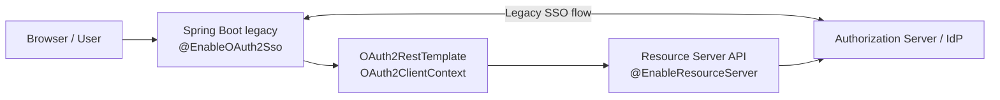
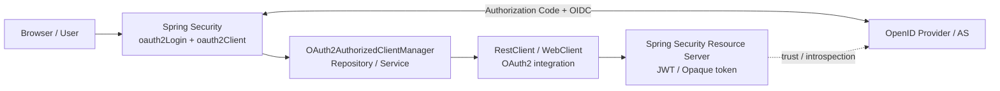

# 33.2. Migrating from Legacy Spring Security OAuth to Modern OAuth2 Client

## Lesson Objectives

Many long-running Spring Boot applications still use the legacy **Spring Security OAuth** library with components such as `@EnableOAuth2Sso`, `@EnableOAuth2Client`, `OAuth2RestTemplate`, `OAuth2ClientContext`, `@EnableResourceServer`, or `@EnableAuthorizationServer`. When moving to the modern Spring Security OAuth2 Client model, swapping a dependency or changing a few methods on `HttpSecurity` is not enough: you must update the **login model**, **OAuth2 client registration**, **token storage**, **outbound API calls**, **API protection**, and **integration testing**.

After this lesson, you will be able to:

- Identify **Spring Security OAuth legacy** APIs and distinguish them from the **`spring-security-oauth2-client`** module in modern Spring Security.
- Separate **OAuth2 Client**, **OIDC Login**, **Resource Server**, and **Authorization Server** instead of treating them as a single feature.
- Map `@EnableOAuth2Sso` to `SecurityFilterChain` and `.oauth2Login(...)` on Servlet; understand the Reactive counterpart using `SecurityWebFilterChain`.
- Replace legacy `security.oauth2.client.*`/`security.oauth2.resource.*` with the corresponding configuration under the `spring.security.oauth2.*` namespace, checking grants, issuer, redirect URI, and scopes.
- Use `ClientRegistrationRepository`, `ClientRegistration`, `OAuth2AuthorizedClient`, `OAuth2AuthorizedClientRepository/Service`, and `OAuth2AuthorizedClientManager` instead of legacy context/token management.
- Migrate `OAuth2RestTemplate` to `RestClient` with `OAuth2ClientHttpRequestInterceptor`, or `WebClient` with the appropriate OAuth2 filter.
- Understand areas requiring redesign: `OAuth2User`/`OidcUser`, authorities, callback endpoints, sessions, `state`, `nonce`, PKCE, refresh tokens, and logout.
- Recognize what **does not belong to OAuth2 Client**: `@EnableResourceServer` must move to `oauth2ResourceServer(...)`; legacy Authorization Server usually needs a separate design with Spring Authorization Server or an external IdP.
- Plan upgrades from older Spring Boot to Spring Boot 3.x/Spring Security 6.x, including Java, Jakarta Servlet, filter chains, and security API changes.
- Build a regression test suite to prove login, token exchange, HTTP API calls, 401/403 handling, proxy/cookies, and authorization remain accurate after migration.
- Execute a rollback-ready rollout, monitor errors, and manage tokens/credentials without weakening security checks.

> **Version scope:** Examples in this lesson use **Spring Boot 3.x / Spring Security 6.x** and Spring Framework 6.x as reference baselines. `RestClient` has been available since Spring Framework 6.1, and `OAuth2ClientHttpRequestInterceptor` was added in the Spring Security 6.4 line. APIs, dependencies, starters, and configurations may change in future versions; always cross-reference documentation for the exact version deployed in your project.

---

## 1. Why Migrate Away from Legacy Spring Security OAuth?

Before Spring Security integrated OAuth2/OIDC directly, many applications used the legacy library:

```text
org.springframework.security.oauth:spring-security-oauth2
```

along with older integrations such as:

```text
spring-security-oauth2-autoconfigure
spring-security-jwt (legacy integrations)
Spring Boot security.oauth2.* properties
```

These APIs once helped implement SSO, OAuth2 Client, Resource Server, and Authorization Server. However, **legacy Spring Security OAuth has reached end of life**, and the modern ecosystem clearly separates responsibilities:

```text
spring-security-oauth2-client
spring-security-oauth2-jose
spring-security-oauth2-resource-server
Spring Authorization Server (separate product/project)
```

### 1.1. The Problem Is More Than Just "Deprecated"

Keeping the legacy stack too long exposes systems to:

- The library no longer receiving current-lifecycle security fixes or bugfixes.
- Missing modern OAuth2/OIDC best practices such as Authorization Code + PKCE, issuer/audience validation, and modern client authentication methods.
- Java/Jakarta Servlet namespace friction when upgrading to Spring Boot 3.
- Incompatibility with `SecurityFilterChain` configuration, Spring Security Test, and modern Spring Framework.
- Technical debt from `OAuth2RestTemplate`, `OAuth2ClientContext`, and legacy token services.
- Difficulty distinguishing API authorization tokens (`Access Token`) from OIDC authentication tokens (`ID Token`).

Migration should be treated as a **security architecture change**, not merely fixing compilation errors.

### 1.2. Do Not Treat Every App Using OAuth2 as the Same Problem

First inventory whether the application is:

```text
A. Web app with Login with Provider (OAuth2 Login/OIDC)
B. Service calling APIs with an Access Token (OAuth2 Client)
C. API verifying Bearer tokens (Resource Server)
D. System issuing tokens to clients (Authorization Server)
```

A single application can play roles A, B, and C simultaneously, but each role has a distinct migration mechanism.

## 2. Legacy vs. Modern Architecture

### 2.1. Legacy Architecture Example



### 2.2. Modern Architecture



Key separation:

- `oauth2Login()` handles **browser login**.
- `oauth2Client()` and the authorized-client manager handle **managing OAuth2 authorized clients/tokens for outbound access**.
- `oauth2ResourceServer()` handles **API verification of incoming Bearer Access Tokens**.
- The Authorization Server issues codes/tokens and is **not created automatically** by enabling OAuth2 Client.

## 3. Legacy-to-Modern API Mapping Table

| Legacy component | Migration direction | Notes |
| --- | --- | --- |
| `@EnableOAuth2Sso` | `SecurityFilterChain` + `http.oauth2Login(...)` | Requires ClientRegistration and session config |
| `@EnableOAuth2Client` | `http.oauth2Client(...)`, authorized-client manager/repository | No more legacy client context |
| `OAuth2RestTemplate` | `RestClient` + `OAuth2ClientHttpRequestInterceptor` or `WebClient` OAuth2 filter | Must select the right registration/principal |
| `OAuth2ClientContext` | `OAuth2AuthorizedClient` + repository/service/manager | Not a one-to-one replacement |
| `OAuth2ProtectedResourceDetails` | `ClientRegistration` | Configured per provider and grant |
| `ClientCredentialsResourceDetails` | Registration with `client_credentials` | Use service manager for background jobs |
| `AuthorizationCodeResourceDetails` | Registration with `authorization_code` | Uses browser redirect, state, PKCE |
| `ResourceOwnerPasswordResourceDetails` | **Redesign flow** | ROPC/password grant should not be carried into the new stack |
| Legacy `AccessTokenRequest` | `OAuth2AuthorizeRequest` and provider/client integration | Different contextual model |
| Legacy `OAuth2Authentication` | `OAuth2AuthenticationToken`/`OidcUser`, or `JwtAuthenticationToken` for RS | Distinguish login from API auth |
| `@EnableResourceServer` | `http.oauth2ResourceServer(...)` | Resource Server role, not OAuth2 Client |
| `RemoteTokenServices` | Opaque token introspection in Resource Server | Configure introspection URI/credentials |
| `JwtAccessTokenConverter` | JWT decoder/JWS validators on RS, custom token on AS | Not replaced directly by a single class |
| `@EnableAuthorizationServer` | Spring Authorization Server or external IdP | Separate project/architecture |
| `WebSecurityConfigurerAdapter` | `SecurityFilterChain` bean | Adapter removed in Spring Security 6 |
| `authorizeRequests().antMatchers(...)` | `authorizeHttpRequests().requestMatchers(...)` | Verify matcher semantics and order |
| `@EnableGlobalMethodSecurity` | `@EnableMethodSecurity` | Retest authorities and pre/post annotations |
| `security.oauth2.client.*` | `spring.security.oauth2.client.registration.*` + `.provider.*` | Do not mechanically rename prefix |
| Legacy token store/context | `OAuth2AuthorizedClientService/Repository` | Redesign persistence/rotation |

**Note:** These are **migration directions**, not drop-in API equivalents for every behavior. Many legacy classes combined responsibilities that the modern stack separates.

## 4. Inventory Before Touching Code

A migration should start by mapping dependencies and security flows.

### 4.1. Dependency Inventory

Look in `pom.xml` or `build.gradle` for:

```text
spring-security-oauth2
spring-security-oauth2-autoconfigure
spring-security-jwt
spring-cloud-security legacy modules
```

If you see `spring-security-oauth2-client`, check the **group ID**: the modern artifact is under `org.springframework.security`, unlike legacy `org.springframework.security.oauth`.

### 4.2. Annotation Inventory

Locate components such as:

```java
@EnableOAuth2Sso
@EnableOAuth2Client
@EnableResourceServer
@EnableAuthorizationServer
@EnableGlobalMethodSecurity
```

Check **which endpoints** each annotation protects, with **which grants**, and whether there are custom filters or a custom `AuthenticationEntryPoint`.

### 4.3. Token Flow Inventory

Questions to answer:

1. Do users log in via browser or is it service-to-service only?
2. Is the provider OIDC or plain OAuth2?
3. Are the `openid` scope and ID Token used?
4. Does the provider support OIDC Discovery and JWKS?
5. Where does the application store Access Tokens/Refresh Tokens?
6. Does it call APIs on behalf of the user?
7. Are there `client_credentials` scheduled jobs?
8. Are Resource Owner Password Credentials Grant or Implicit Grant used?
9. Does the application issue tokens itself or only consume tokens?
10. Are there custom claims/roles, UserInfo mapping, or tenant routing?
11. Is there proxy/TLS termination or a special callback hostname?
12. How many live browser sessions/token records exist during cutover?

### 4.4. Lock Acceptance Criteria Before Changing Dependencies

For example:

```text
Browser OIDC login:
    Login redirects correctly
    state/nonce/PKCE validation intact
    Session survives OP callback

User API call:
    Correct registration and user principal
    Correct access token audience/scope
    API tenant permissions preserved

M2M job:
    Correct client_credentials registration
    No browser session required
    No user token leaked

Operations:
    No raw code/token/secret in logs
    Rollback plan and alerting ready
```

These are the behaviors that must be preserved—not necessarily the old classes themselves.

## 5. Dependencies of the Modern OAuth2 Client

A Maven Spring Boot application:

```xml
<dependencies>
    <dependency>
        <groupId>org.springframework.boot</groupId>
        <artifactId>spring-boot-starter-web</artifactId>
    </dependency>

    <dependency>
        <groupId>org.springframework.boot</groupId>
        <artifactId>spring-boot-starter-security</artifactId>
    </dependency>

    <dependency>
        <groupId>org.springframework.boot</groupId>
        <artifactId>spring-boot-starter-oauth2-client</artifactId>
    </dependency>
</dependencies>
```

If using Gradle:

```groovy
dependencies {
    implementation 'org.springframework.boot:spring-boot-starter-web'
    implementation 'org.springframework.boot:spring-boot-starter-security'
    implementation 'org.springframework.boot:spring-boot-starter-oauth2-client'
}
```

### 5.1. Do Not Pull Legacy Artifacts Back via Transitive Dependencies

If the dependency tree still contains legacy Spring Security OAuth, old classes and auto-configurations can collide. Eliminate the source pulling in the legacy dependency rather than just adding the new starter and letting both stacks coexist uncontrolled.

### 5.2. Choose Starters by Role

```text
OAuth2 Login / outbound OAuth2 Client:
    spring-boot-starter-oauth2-client

Incoming API Bearer token validation:
    spring-boot-starter-oauth2-resource-server

Authorization Server:
    Spring Authorization Server integration or dedicated IdP
```

Do not add the Resource Server starter expecting login to work automatically, or add the OAuth2 Client starter expecting `/oauth2/token` to issue tokens to other apps.

### 5.3. Spring Boot Manages Versions

For apps using the Boot BOM/parent, let Boot manage compatible Spring Security/Framework versions. Do not arbitrarily pin a newer version of `spring-security-oauth2-client` on an older Boot baseline without testing compatibility.

## 6. Spring Boot and Jakarta Upgrade Path

There are two separate tasks:

```text
Migration A:
    Legacy OAuth2 API -> built-in Spring Security OAuth2 Client

Migration B:
    Spring Boot 2.x -> 3.x / Spring Security 5.x -> 6.x
```

You may need both, but separating the changes makes each easier to observe.

### 6.1. Spring Boot 3 Moves to Jakarta EE

For Servlet:

```java
import javax.servlet.http.HttpServletRequest;
```

becomes:

```java
import jakarta.servlet.http.HttpServletRequest;
```

Servlet filters, session extensions, tests, and security handlers must also be compatible with the Jakarta namespace.

### 6.2. Java Runtime

Spring Boot 3/Spring Framework 6 require Java 17 as a baseline. Projects on Java 8/11 need a plan for JDK, compiler flags, and runtime images before attempting to upgrade everything.

### 6.3. `WebSecurityConfigurerAdapter` Was Removed

Configuration like:

```java
class SecurityConfig
        extends WebSecurityConfigurerAdapter {
    // configure(HttpSecurity http)
}
```

must be migrated to a `SecurityFilterChain` bean. This is a general Spring Security change, but it directly affects OAuth2 Login filter ordering.

### 6.4. A Lower-Risk Roadmap

You can proceed in waves:

```text
1. Establish legacy flow baseline with tests
2. Isolate auth/token interfaces in the application layer
3. Switch to built-in OAuth2 Client on a supported intermediate version
4. Verify login/API/roles/token persistence
5. Upgrade Java, Boot, Jakarta, and SecurityFilterChain
6. Run full integration/browser regressions
```

Not every project must use this exact sequence; the key is to **avoid changing too many security variables without tests**.

## 7. Legacy OAuth2 SSO Configuration Example

An older Boot configuration might look like:

```yaml
security:
  oauth2:
    client:
      client-id: old-portal-client
      client-secret: ${OLD_CLIENT_SECRET}
      access-token-uri: https://idp.example.org/oauth/token
      user-authorization-uri: https://idp.example.org/oauth/authorize
      scope:
        - read
    resource:
      user-info-uri: https://idp.example.org/userinfo
```

Or in code:

```java
@EnableOAuth2Sso
@Configuration
class LegacySsoConfiguration
        extends WebSecurityConfigurerAdapter {
    // Legacy security config
}
```

These examples only illustrate the **legacy API form**. Do not use them as targets for modern applications.

### 7.1. `security.oauth2.*` Is No Longer the Primary Namespace for Modern Clients

In the current stack, configuration moves to:

```text
spring.security.oauth2.client.registration.*
spring.security.oauth2.client.provider.*
```

### 7.2. Do Not Copy `user-info-uri` into `issuer-uri`

`user-info-uri` is the profile endpoint; `issuer-uri` is the **issuer identifier** used for OIDC discovery/validation. The two URIs serve different purposes.

### 7.3. Do Not Assume the Old `client-id` Is `registrationId`

`clientId` is the identifier issued by the OP; `registrationId` is the key chosen by the app to select a configuration, such as `campus`.

## 8. Modern OIDC Login Configuration with `ClientRegistration`

Spring Boot example:

```yaml
spring:
  security:
    oauth2:
      client:
        registration:
          campus:
            provider: campus-op
            client-id: ${OIDC_CLIENT_ID}
            client-secret: ${OIDC_CLIENT_SECRET}
            client-authentication-method: client_secret_basic
            authorization-grant-type: authorization_code
            redirect-uri: "{baseUrl}/login/oauth2/code/{registrationId}"
            scope:
              - openid
              - profile
              - email

        provider:
          campus-op:
            issuer-uri: https://login.example.org/realms/campus
```

A registration contains:

```text
registrationId         = campus
clientId               = provider-issued client ID
clientAuthentication   = client_secret_basic
grantType              = authorization_code
redirectUri template   = {baseUrl}/login/oauth2/code/{registrationId}
scopes                 = openid, profile, email
issuerUri              = OP issuer
```

### 8.1. Why Use `issuer-uri`?

When the OP supports OpenID Connect Discovery, Spring Security can use metadata to locate authorization/token/JWKS/UserInfo endpoints and validate the issuer throughout the flow.

If the provider is plain OAuth2 without OIDC Discovery, declare the appropriate endpoints per the provider contract—do not add `openid` and assume OIDC works automatically.

### 8.2. The `openid` Scope Has Specific Semantics

`openid` triggers an OIDC request. `profile`/`email` request profile information per OP policy. They **do not** grant tenant admin privileges or permission to call arbitrary APIs.

### 8.3. Registering the Callback with the OP

The default is typically:

```text
https://portal.example.org/login/oauth2/code/campus
```

This URI must match the redirect URI policy registered at the OP, including scheme, host, port, and path.

### 8.4. Token Audience Cannot Be Inferred from `registrationId`

`registrationId=campus` does not prove the Access Token is intended for the Course API. Audience/resource restrictions must follow AS configuration and the Resource Server contract.

## 9. `SecurityFilterChain` Replacing `@EnableOAuth2Sso`

With Spring Security Servlet:

```java
@Configuration
@EnableWebSecurity
class ModernSecurityConfiguration {

    @Bean
    SecurityFilterChain securityFilterChain(
            HttpSecurity http) throws Exception {

        http
            .authorizeHttpRequests(authorize -> authorize
                .requestMatchers(
                    "/", "/assets/**", "/public/**"
                ).permitAll()
                .anyRequest().authenticated()
            )
            .oauth2Login(Customizer.withDefaults())
            .oauth2Client(Customizer.withDefaults());

        return http.build();
    }
}
```

Key imports:

```java
import org.springframework.context.annotation.Bean;
import org.springframework.context.annotation.Configuration;
import org.springframework.security.config.Customizer;
import org.springframework.security.config.annotation.web.builders.HttpSecurity;
import org.springframework.security.config.annotation.web.configuration.EnableWebSecurity;
import org.springframework.security.web.SecurityFilterChain;
```

### 9.1. `.oauth2Login(...)` Is the Login Flow

Spring Security uses `ClientRegistrationRepository` to redirect the browser to the OP and handle the Authorization Code Flow callback.

A default login initiation URL:

```text
GET /oauth2/authorization/campus
```

Default callback:

```text
GET /login/oauth2/code/campus
```

### 9.2. `.oauth2Client(...)` Handles OAuth2 Client Management

It supports OAuth2 authorized client infrastructure within the security flow; it does not mean every outbound HTTP call automatically gets a token attached. You still need a manager/interceptor/filter or explicit authorized client selection in API-calling code.

### 9.3. Do Not Disable CSRF Across the Entire App Just for Migration

A web app using cookie sessions and form POSTs still needs CSRF protection. `OAuth2 state` does not replace CSRF across business endpoints.

If the project also has stateless Bearer APIs, configure CSRF policy cleanly by separating `SecurityFilterChain`s and authentication mechanisms, rather than copying a blanket `csrf.disable()`.

### 9.4. The Default Login Page May Change

Spring Security can generate a login page listing OAuth2 registrations. If the legacy app had a custom login UI, re-test:

```text
/login
/oauth2/authorization/{registrationId}
AuthenticationEntryPoint
Login success/failure redirects
SavedRequest behavior
```

Do not assume the UX/URLs of `@EnableOAuth2Sso` remain identical.

## 10. Changing Filter Chain Semantics and Matcher Ordering

Legacy configuration:

```java
@Override
protected void configure(HttpSecurity http)
        throws Exception {

    http.authorizeRequests()
        .antMatchers("/public/**").permitAll()
        .anyRequest().authenticated();
}
```

Modern direction:

```java
@Bean
SecurityFilterChain webSecurity(
        HttpSecurity http) throws Exception {

    http
        .authorizeHttpRequests(auth -> auth
            .requestMatchers("/public/**").permitAll()
            .anyRequest().authenticated()
        )
        .oauth2Login(Customizer.withDefaults());

    return http.build();
}
```

### 10.1. Ordering Matters When Multiple Chains Exist

An application with both session UI and stateless APIs may need:

```text
Chain 1: /api/** -> Bearer/JWT Resource Server
Chain 2: remaining URLs -> OIDC Login/session
```

If Chain 1's matcher is too broad, OAuth2 callbacks may be caught by the wrong chain and return 401. If Chain 2's `permitAll` is too broad, APIs may be exposed unintentionally.

### 10.2. Re-Test Special URLs

```text
/oauth2/authorization/{registrationId}
/login/oauth2/code/{registrationId}
/login
/login?error
/logout
/api/**
/actuator/**
```

Do not leave all of `/oauth2/**` public by default if the app exposes custom endpoints under that path.

### 10.3. `requestMatchers` May Use Different Matcher Implementations

In modern Spring Security, matcher selection can depend on the Spring MVC/Servlet/reactive classpath. Legacy `antMatchers` expressions, trailing slashes, and path variables should be tested against real routes instead of assuming 100% identical matching.

## 11. In Reactive, How Do You Replace `@EnableOAuth2Sso`?

A WebFlux application uses:

```java
@Configuration
@EnableWebFluxSecurity
class ReactiveSecurityConfiguration {

    @Bean
    SecurityWebFilterChain securityWebFilterChain(
            ServerHttpSecurity http) {

        return http
            .authorizeExchange(exchange -> exchange
                .pathMatchers(
                    "/", "/assets/**", "/public/**"
                ).permitAll()
                .anyExchange().authenticated()
            )
            .oauth2Login(Customizer.withDefaults())
            .oauth2Client(Customizer.withDefaults())
            .build();
    }
}
```

Core classes:

```text
ServerHttpSecurity
SecurityWebFilterChain
ReactiveClientRegistrationRepository
ServerOAuth2AuthorizedClientRepository
ReactiveOAuth2AuthorizedClientManager
ReactiveSecurityContextHolder
```

Do not bring `HttpSecurity`, `HttpServletRequest`, or `HttpSession` into a pure WebFlux project and expect OAuth2 callbacks to work.

### 11.1. Servlet vs. Reactive

| Servlet/MVC | Reactive/WebFlux |
| --- | --- |
| `SecurityFilterChain` | `SecurityWebFilterChain` |
| `HttpSecurity` | `ServerHttpSecurity` |
| `ClientRegistrationRepository` | `ReactiveClientRegistrationRepository` |
| `OAuth2AuthorizedClientRepository` | `ServerOAuth2AuthorizedClientRepository` |
| `OAuth2AuthorizedClientManager` | `ReactiveOAuth2AuthorizedClientManager` |
| `HttpSession` | `WebSession` |
| `RestClient` | `WebClient` commonly used |
| `SecurityContextHolder` in Servlet flow | `ReactiveSecurityContextHolder`/Reactor Context |

Do not just prepend `Reactive` to class names while keeping thread-local state management.

## 12. `ClientRegistrationRepository` Replaces Resource Details

Legacy code may declare:

```java
OAuth2ProtectedResourceDetails
ClientCredentialsResourceDetails
AuthorizationCodeResourceDetails
```

The modern stack describes clients with:

```java
ClientRegistration
```

and looks them up via:

```java
ClientRegistrationRepository
```

### 12.1. Configuration via Properties

Example:

```yaml
spring:
  security:
    oauth2:
      client:
        registration:
          course-api:
            provider: campus-op
            client-id: ${COURSE_CLIENT_ID}
            client-secret: ${COURSE_CLIENT_SECRET}
            authorization-grant-type: client_credentials
            scope:
              - courses.read

        provider:
          campus-op:
            token-uri: https://login.example.org/oauth2/token
```

When not using OIDC discovery for M2M, the token endpoint can be declared directly per the provider contract.

### 12.2. Configuration via Java

```java
ClientRegistration registration =
    ClientRegistration.withRegistrationId("course-api")
        .clientId("course-service-client")
        .clientSecret("test-only-secret")
        .clientAuthenticationMethod(
            ClientAuthenticationMethod.CLIENT_SECRET_BASIC
        )
        .authorizationGrantType(
            AuthorizationGrantType.CLIENT_CREDENTIALS
        )
        .tokenUri(
            "https://login.example.org/oauth2/token"
        )
        .scope("courses.read")
        .build();
```

This snippet only illustrates the API; hard-coding secrets in production Java code is discouraged.

### 12.3. Registration ID Must Not Be Taken Arbitrarily from the Browser

An application may have registrations:

```text
course-api-tenant-a
course-api-tenant-b
admin-api
```

Do not accept:

```http
?registrationId=admin-api
```

directly from the browser and issue an administrative service-account token. Choose the registration via backend mapping based on business logic and verified tenant permissions.

## 13. `OAuth2AuthorizedClient` Is Not `OAuth2ClientContext`

Legacy code often accesses:

```java
OAuth2ClientContext
OAuth2AccessToken
OAuth2RestTemplate
```

The modern stack provides:

```java
OAuth2AuthorizedClient
```

which contains:

```text
ClientRegistration
principalName
OAuth2AccessToken
optional OAuth2RefreshToken
```

An authorized client represents the result of a client/subject having been granted authorization under a specific grant.

### 13.1. The Modern Mental Model

```text
ClientRegistration:
    Which OAuth Client, which grant, which provider

AuthorizedClient:
    ClientRegistration + principal + tokens

AuthorizedClientManager:
    Acquire/renew tokens according to lifecycle

AuthorizedClientRepository/Service:
    Save/load authorized client state
```

### 13.2. Do Not Migrate the Old Token Store Simply by Renaming Classes

Token persistence models, encryption, principal naming, refresh-token rotation, and security boundaries may differ. Legacy records are not necessarily directly serializable/deserializable into `OAuth2AuthorizedClient`.

### 13.3. Migration May Require Users to Log In Again

If existing token/authorization state cannot be migrated safely, a rollout can proactively require reauthentication and a fresh grant. That is cleaner than importing raw legacy Refresh Tokens into the new store without controls.

## 14. Choosing `OAuth2AuthorizedClientManager` by Context

In Servlet, there are two common manager types:

| Context | Typical manager | Store |
| --- | --- | --- |
| User HTTP request | `DefaultOAuth2AuthorizedClientManager` | `OAuth2AuthorizedClientRepository` |
| Background job/service without request | `AuthorizedClientServiceOAuth2AuthorizedClientManager` | `OAuth2AuthorizedClientService` |

In Reactive:

| Context | Manager | Store |
| --- | --- | --- |
| WebFlux server request | `DefaultReactiveOAuth2AuthorizedClientManager` | `ServerOAuth2AuthorizedClientRepository` |
| Scheduled/reactive background job | `AuthorizedClientServiceReactiveOAuth2AuthorizedClientManager` | `ReactiveOAuth2AuthorizedClientService` |

### 14.1. Why Does This Choice Matter?

A scheduled job has no `HttpServletRequest`/`ServerWebExchange` or browser principal. Using a request-dependent manager without an appropriate context can prevent the app from finding an authorized client.

### 14.2. Client Credentials Differ from User-Delegated Grants

- `authorization_code` typically binds a user and browser login.
- `client_credentials` represents the client/service identity itself.
- `refresh_token` refreshes an already-issued token per grant/policy, which may involve user-delegated authorization.

Do not use a service token to impersonate a user by passing an `X-User-Id` header.

## 15. Servlet: Manager for Browser-Based Authorized Clients

Illustrative bean:

```java
@Configuration
class UserOAuth2ClientConfiguration {

    @Bean
    OAuth2AuthorizedClientManager userAuthorizedClientManager(
            ClientRegistrationRepository registrations,
            OAuth2AuthorizedClientRepository authorizedClients) {

        OAuth2AuthorizedClientProvider provider =
            OAuth2AuthorizedClientProviderBuilder.builder()
                .authorizationCode()
                .refreshToken()
                .build();

        DefaultOAuth2AuthorizedClientManager manager =
            new DefaultOAuth2AuthorizedClientManager(
                registrations,
                authorizedClients
            );

        manager.setAuthorizedClientProvider(provider);

        return manager;
    }
}
```

The corresponding types are in `org.springframework.security.oauth2.client.*`.

### 15.1. Distinguish Authenticated Principal from OAuth Client

An OIDC-logged-in user has:

```text
Authenticated OIDC user:
    (iss, sub)

AuthorizedClient:
    registrationId=campus
    principalName=user identity in app
    access/refresh tokens
```

Do not treat `sub` as globally unique across issuers because two issuers can issue the same `sub`; identity linking must use `(iss, sub)` per policy.

### 15.2. Request-Scoped Repository

`DefaultOAuth2AuthorizedClientManager` typically uses `OAuth2AuthorizedClientRepository` to load/save tokens in the HTTP request/response context. If the session/cookie is lost during the browser callback, authorized-client persistence is affected too.

### 15.3. Fail Closed

If the user is not authorized to use a registration for the current tenant, do not fall back to a broader-privilege OAuth Client.

## 16. Servlet: Manager for Background `client_credentials`

A manager used in a service/scheduled job:

```java
@Configuration
class MachineOAuth2ClientConfiguration {

    @Bean
    OAuth2AuthorizedClientManager machineAuthorizedClientManager(
            ClientRegistrationRepository registrations,
            OAuth2AuthorizedClientService authorizedClients) {

        OAuth2AuthorizedClientProvider provider =
            OAuth2AuthorizedClientProviderBuilder.builder()
                .clientCredentials()
                .build();

        AuthorizedClientServiceOAuth2AuthorizedClientManager manager =
            new AuthorizedClientServiceOAuth2AuthorizedClientManager(
                registrations,
                authorizedClients
            );

        manager.setAuthorizedClientProvider(provider);

        return manager;
    }
}
```

Request authorization:

```java
OAuth2AuthorizeRequest authorizeRequest =
    OAuth2AuthorizeRequest
        .withClientRegistrationId("course-api")
        .principal("course-sync-prod")
        .build();

OAuth2AuthorizedClient client =
    machineAuthorizedClientManager.authorize(
        authorizeRequest
    );

if (client == null) {
    throw new IllegalStateException(
        "No authorized client for course-api"
    );
}
```

### 16.1. Service Principal Is a Technical Key

The string `"course-sync-prod"` identifies the authorized-client persistence context; it does not mean the OP authenticated an End-User with that name.

### 16.2. Use Separate Registrations per Workload

Do not use one `platform-admin` registration for every job. Separate scopes, audiences, and credentials by task.

### 16.3. Do Not Copy `AccessToken` into a Static Field

Tokens must be managed by the authorized-client manager/service with expiration and concurrency policies. A `static String currentToken` can mix up principals, tenants, or registrations.

## 17. Migrating `OAuth2RestTemplate` to `RestClient`

Legacy pattern:

```java
OAuth2RestTemplate restTemplate =
    new OAuth2RestTemplate(
        resourceDetails,
        oauth2ClientContext
    );

String body = restTemplate.getForObject(
    "https://api.example.org/reports",
    String.class
);
```

Modern approach with Spring Framework 6.1+ and Spring Security 6.4+:

```java
@Bean
RestClient reportingRestClient(
        OAuth2AuthorizedClientManager machineAuthorizedClientManager) {

    OAuth2ClientHttpRequestInterceptor oauth2 =
        new OAuth2ClientHttpRequestInterceptor(
            machineAuthorizedClientManager
        );

    return RestClient.builder()
        .baseUrl("https://reporting.example.org")
        .requestInterceptor(oauth2)
        .build();
}
```

A call:

```java
String result = reportingRestClient.get()
    .uri("/api/reports")
    .attributes(
        RequestAttributeClientRegistrationIdResolver
            .clientRegistrationId("report-reader")
    )
    .attributes(
        RequestAttributePrincipalResolver
            .principal("report-reader-prod")
    )
    .retrieve()
    .body(String.class);
```

These helpers belong to the OAuth2 Client HTTP interceptor package/namespace in Spring Security 6.4+; import according to your exact version.

### 17.1. `RestClient` Does Not Automatically Acquire Tokens Just by Existing

You must add `OAuth2ClientHttpRequestInterceptor`, select the registration/principal, and wire the appropriate manager/store.

### 17.2. One RestClient per API

A fixed `baseUrl` reduces the risk of sending a Bearer Token to a user-specified host. Never allow clients to supply arbitrary URLs and attach tokens unconditionally.

### 17.3. Audience and Scope Must Still Match

The interceptor attaches an issued Access Token; it **does not** verify that the Resource Server accepts that token. The target API must still validate issuer, audience, expiry, and permissions.

### 17.4. Authorization Failure Handler

In some cases, the stale authorized client must be removed when the API returns `invalid_token`. With the interceptor, configure failure handling according to your repository/service and Spring Security version; do not assume HTTP 401 automatically refreshes and retries the request or that every 403 evicts the token.

### 17.5. If Your Project Is Not Yet on Spring Security 6.4+

You can use `WebClient` with an OAuth2 filter or the mechanism supported by your current version. Do not copy `OAuth2ClientHttpRequestInterceptor` into a project lacking that class and conclude the migration failed.

## 18. Servlet `WebClient`: Another Replacement for OAuth2RestTemplate

Spring Security supports:

```java
ServletOAuth2AuthorizedClientExchangeFilterFunction
```

for `WebClient` in Servlet contexts.

Configuration example:

```java
@Bean
WebClient courseWebClient(
        OAuth2AuthorizedClientManager userAuthorizedClientManager) {

    ServletOAuth2AuthorizedClientExchangeFilterFunction oauth2 =
        new ServletOAuth2AuthorizedClientExchangeFilterFunction(
            userAuthorizedClientManager
        );

    return WebClient.builder()
        .baseUrl("https://course.example.org")
        .apply(oauth2.oauth2Configuration())
        .build();
}
```

A request in the appropriate context can select:

```java
courseWebClient.get()
    .uri("/api/courses")
    .attributes(
        ServletOAuth2AuthorizedClientExchangeFilterFunction
            .clientRegistrationId("campus")
    )
    .retrieve()
    .bodyToMono(String.class);
```

### 18.1. Servlet Applications Can Use WebClient

`WebClient` is not only for WebFlux servers. However, when calling from Spring MVC, decide how to bridge async/reactive execution with the Servlet lifecycle and avoid uncontrolled blocking.

### 18.2. Do Not Blindly Enable `setDefaultOAuth2AuthorizedClient(true)` Everywhere

If a `WebClient` talks to multiple hosts, defaulting to the current user's token can send it to APIs that shouldn't receive it or untrusted domains. Explicit registration/authorized-client selection is easier to audit.

### 18.3. Migrating from `OAuth2RestTemplate` Does Not Preserve Timeouts/Retries Automatically

HTTP connection pools, timeouts, redirect handling, and error mapping differ among `RestTemplate`, `RestClient`, and `WebClient`. Test against the business API contract.

## 19. WebFlux `WebClient` and the OAuth2 Filter

For Reactive:

```java
@Bean
WebClient reactiveCourseWebClient(
        ReactiveOAuth2AuthorizedClientManager manager) {

    ServerOAuth2AuthorizedClientExchangeFilterFunction oauth2 =
        new ServerOAuth2AuthorizedClientExchangeFilterFunction(
            manager
        );

    return WebClient.builder()
        .baseUrl("https://course.example.org")
        .filter(oauth2)
        .build();
}
```

Request:

```java
Mono<String> result = reactiveCourseWebClient.get()
    .uri("/api/courses")
    .attributes(
        ServerOAuth2AuthorizedClientExchangeFilterFunction
            .clientRegistrationId("course-reader")
    )
    .retrieve()
    .bodyToMono(String.class);
```

### 19.1. Do Not Call `.block()` Inside a WebFlux Request Handler

Reactor pipelines should be composed and return `Mono`/`Flux`; blocking the event-loop with `.block()` can cause starvation and performance issues.

### 19.2. Reactive SecurityContext

`ReactiveSecurityContextHolder` uses Reactor Context rather than Servlet thread-locals. Test identity propagation and concurrent requests so user A's token is never used for user B.

### 19.3. Use the Service Manager for Background Reactive Jobs

`AuthorizedClientServiceReactiveOAuth2AuthorizedClientManager` suits jobs without a `ServerWebExchange`; do not use a web-exchange-dependent manager just because a mock WebExchange is handy in tests.

## 20. Replacing How Controllers Access Tokens

Legacy code might read tokens from the old context or Principal. In modern Servlet, you can inject:

```java
@RegisteredOAuth2AuthorizedClient("campus")
OAuth2AuthorizedClient client
```

Example:

```java
@RestController
class ProfileController {

    @GetMapping("/api/me/token-info")
    Map<String, Object> tokenInfo(
            @RegisteredOAuth2AuthorizedClient("campus")
            OAuth2AuthorizedClient client) {

        return Map.of(
            "registrationId",
            client.getClientRegistration()
                .getRegistrationId(),
            "expiresAt",
            client.getAccessToken()
                .getExpiresAt().toString()
        );
    }
}
```

This is an educational example; **do not return raw token values**, refresh tokens, or sensitive details to a browser API.

### 20.1. `@RegisteredOAuth2AuthorizedClient` Is Not UserInfo

The annotation provides the authorized-client context, not the full OIDC profile. To access the authenticated OIDC principal, use:

```java
@AuthenticationPrincipal OidcUser user
```

### 20.2. Avoid Exposing Access Tokens to the Frontend Unnecessarily

A Backend-for-Frontend should keep tokens server-side whenever architecture allows. Do not move tokens from the legacy `OAuth2ClientContext` into JSON responses for the browser merely to simplify migration.

## 21. Migrating User Info and Principal Retrieval

Legacy code may use:

```java
Principal principal
OAuth2Authentication authentication
Map<String, Object> userInfo
```

In modern OAuth2 Login:

```java
OAuth2AuthenticationToken
OAuth2User
OidcUser
OidcIdToken
OidcUserInfo
```

### 21.1. OIDC Principal

Example:

```java
@RestController
class MeController {

    @GetMapping("/api/me")
    Map<String, String> me(
            @AuthenticationPrincipal OidcUser user,
            OAuth2AuthenticationToken authentication) {

        return Map.of(
            "issuer",
            user.getIdToken().getIssuer().toString(),
            "subject",
            user.getSubject(),
            "registrationId",
            authentication
                .getAuthorizedClientRegistrationId()
        );
    }
}
```

In production, evaluate whether issuer/sub need to be returned to the frontend and apply your privacy policy.

### 21.2. OIDC Differs from Plain OAuth2 UserInfo

- **OIDC Login** has an ID Token with `iss`, `sub`, `aud`, expiry, and nonce validation per the flow.
- **Non-OIDC OAuth2 Login** typically fetches user info via the configured user-info endpoint/attributes.

Do not assume every OAuth2 provider issues an ID Token.

### 21.3. `(iss, sub)` Is the External Identity Key

Two OPs can issue the same `sub`. Never use `sub` alone as a globally unique ID when supporting multiple issuers, and never auto-merge users by email without verified account linking.

## 22. Migrating Roles/Authorities to the Modern Model

A legacy user-info mapper may build authorities from:

```text
roles
groups
authorities
```

or custom claims.

In the modern stack, common extension points are:

```text
GrantedAuthoritiesMapper
OAuth2UserService<OAuth2UserRequest, OAuth2User>
OAuth2UserService<OidcUserRequest, OidcUser>
OidcUserService
```

### 22.1. `GrantedAuthoritiesMapper`

Illustrative role-mapping example:

```java
@Bean
GrantedAuthoritiesMapper authoritiesMapper() {

    return authorities -> {
        Set<GrantedAuthority> result =
            new HashSet<>(authorities);

        // Add roles only after verifying the provider
        // and the application's authorization mapping.
        return result;
    };
}
```

Real applications must map verified claims/groups and tenant membership per policy, never granting `ROLE_ADMIN` to every OIDC user.

### 22.2. Do Not Copy Role Mapping Mechanically

If legacy had:

```text
Provider group "teachers" -> ROLE_ADMIN
```

check whether that group applies across all tenants or only one tenant. Migration is the right time to separate:

```text
authenticated identity
application user
tenant membership
tenant-specific permission
```

### 22.3. API Scopes Differ from Application Roles

An Access Token with `scope=courses.read` does not prove the user has the `TEACHER` role or can read every course.

### 22.4. Method Security

If previously using:

```java
@EnableGlobalMethodSecurity(prePostEnabled = true)
```

Spring Security 6 typically uses:

```java
@EnableMethodSecurity
```

Re-test `@PreAuthorize`, authority prefixes, and business permission beans, especially when the Principal type changes.

## 23. Separating Resource Server Migration from OAuth2 Client

Legacy:

```java
@EnableResourceServer
```

must not be replaced with:

```java
http.oauth2Login(...)
```

because they serve different roles.

An API receiving:

```http
Authorization: Bearer <access-token>
```

needs a **Resource Server** to verify the token.

### 23.1. New Dependency

```groovy
dependencies {
    implementation 'org.springframework.boot:spring-boot-starter-oauth2-resource-server'
}
```

### 23.2. JWT Resource Server

Configuration:

```yaml
spring:
  security:
    oauth2:
      resourceserver:
        jwt:
          issuer-uri: https://login.example.org/realms/campus
```

Filter chain:

```java
@Bean
SecurityFilterChain apiSecurity(
        HttpSecurity http) throws Exception {

    return http
        .securityMatcher("/api/**")
        .authorizeHttpRequests(auth -> auth
            .requestMatchers(
                HttpMethod.GET, "/api/public/**"
            ).permitAll()
            .anyRequest().authenticated()
        )
        .oauth2ResourceServer(oauth2 -> oauth2
            .jwt(Customizer.withDefaults())
        )
        .build();
}
```

### 23.3. Audience Validation Is Essential

`issuer-uri` does not replace the full audience policy. An API must verify that the Access Token `aud` is intended for it, alongside scopes/authorities and resource ownership.

A token with `aud=reporting-api` must not be accepted by the Course API just because it shares the same issuer and a valid signature.

### 23.4. Opaque Access Tokens

If the AS issues opaque tokens, configure introspection per contract instead of trying to parse them as JWTs:

```yaml
spring:
  security:
    oauth2:
      resourceserver:
        opaquetoken:
          introspection-uri: https://login.example.org/oauth2/introspect
          client-id: ${INTROSPECTION_CLIENT_ID}
          client-secret: ${INTROSPECTION_CLIENT_SECRET}
```

Never expose introspection credentials in logs.

### 23.5. An App That Is Both OAuth2 Client and Resource Server

You may have:

```text
Browser pages -> oauth2Login/session
/api/**       -> oauth2ResourceServer/bearer
Outbound API  -> oauth2Client/authorized manager
```

Configure `SecurityFilterChain`s and session/CSRF boundaries intentionally, rather than mixing all authorization decisions into a single legacy `@EnableOAuth2Sso` equivalent.

## 24. If the Legacy App Was an Authorization Server

Legacy:

```java
@EnableAuthorizationServer
```

previously provided the Token Endpoint and grant/client/token-store configurations under the old stack.

**There is no one-to-one replacement in `spring-security-oauth2-client`.**

### 24.1. Options

- Move to **Spring Authorization Server** if you want to self-host an OAuth2/OIDC AS on the Spring stack.
- Use a managed **external identity provider** such as Keycloak, Entra ID, Okta, or a suitable vendor.
- If the system no longer needs to issue tokens, consider removing the Authorization Server role entirely.

### 24.2. Decisions to Revisit

```text
Client registrations
Supported grants
Redirect URIs
Token signing keys / JWKS
Refresh token policy
Scopes / audiences
Consent
User sessions / authentication methods
Token persistence
Revocation / introspection
OIDC discovery / UserInfo if needed
```

Do not turn `DefaultTokenServices`, `TokenStore`, and `JwtAccessTokenConverter` into OAuth2 Client beans and assume the new AS is equivalent.

### 24.3. Password/Implicit Grants Require Redesign

Legacy systems may use:

```text
grant_type=password
response_type=token
```

These flows should not be kept as default paths in modern apps. Adopt Authorization Code + PKCE for interactive apps, Client Credentials for machine identities, and other grants only when the threat model and provider support them.

### 24.4. Spring Authorization Server Is a Distinct Product

It has its own domain objects and persistence/migration requirements. When the problem is solely **user login and calling APIs**, you do not need to build your own AS.

## 25. Authorization Code + PKCE Considerations

Legacy frontends sometimes used Implicit Grant or custom password login flows. When upgrading:

```text
Browser interactive user
    -> Authorization Code Flow
    -> PKCE per client type and policy
    -> state + nonce for OIDC
```

### 25.1. `state`

Binds the authorization response to the authorization request, protecting against CSRF and mix-up attacks.

### 25.2. `nonce`

Binds the ID Token to the OIDC authentication request and helps prevent replay per the OIDC contract.

### 25.3. PKCE

`code_challenge` is sent in the authorization request; `code_verifier` is used when exchanging the authorization code at the Token Endpoint.

Never log raw `state`, nonce, authorization code, or `code_verifier`.

### 25.4. Confidential vs. Public Clients

A server-side confidential client can authenticate with a client secret, private key, or mTLS. SPA/mobile/public clients should not hold a client secret as a long-lived secret in the frontend. Verify the client model and flow before changing dependencies.

## 26. Refresh Tokens: Lifecycle and Persistence Changes

Legacy `OAuth2RestTemplate` could acquire/refresh tokens via the old context. The modern stack uses the authorized-client manager/provider.

Provider example:

```java
OAuth2AuthorizedClientProvider provider =
    OAuth2AuthorizedClientProviderBuilder.builder()
        .authorizationCode()
        .refreshToken()
        .clientCredentials()
        .build();
```

This does not mean every registration uses all three grants; the provider handles whichever grant and authorized-client context apply.

### 26.1. Refresh Token Rotation

The AS may issue a new Refresh Token and revoke the old one. If the store does not update atomically, concurrent requests can collide:

```text
Request A: RT1 -> AT2, RT2
Request B: RT1 -> invalid_grant
```

Migration requires testing race conditions, persistence, and failure handlers.

### 26.2. Client Credentials Usually Have No Refresh Token

Per OAuth2 core, refresh tokens are typically not issued for the Client Credentials Grant. When the Access Token expires, the client requests a new token using Client Credentials.

### 26.3. `invalid_grant` Does Not Mean All User Tokens Are Broken

The error may stem from an expired code, PKCE mismatch, rotated/revoked refresh token, or redirect URI mismatch. Log the grant type/registration and a safe error category—never raw tokens.

### 26.4. Never Send Refresh Tokens to a Resource Server

Refresh Tokens are for the AS Token Endpoint; downstream APIs require an Access Token with the proper audience and scope.

## 27. Client Credentials and Service Accounts

When a legacy app uses:

```java
ClientCredentialsResourceDetails
```

it can migrate to:

```yaml
spring:
  security:
    oauth2:
      client:
        registration:
          reports-reader:
            provider: campus-op
            client-id: ${REPORTS_CLIENT_ID}
            client-secret: ${REPORTS_CLIENT_SECRET}
            authorization-grant-type: client_credentials
            scope:
              - reports.read
        provider:
          campus-op:
            token-uri: https://login.example.org/oauth2/token
```

### 27.1. Least Privilege

A read-only report service does not need:

```text
users.admin
tenants.manage
reports.delete
```

Reviewing scopes, audiences, and service-account permissions is a mandatory part of migration.

### 27.2. Do Not Accept Client Credentials from Inbound Requests

Never let browsers choose arbitrary `clientId`, `clientSecret`, issuer, or token URI. All registrations must be backend-managed.

### 27.3. Service Tokens Do Not Carry End-User Identity

If an API must act on behalf of a user, do not use a service token + `X-User-Id` header. Use a delegated user grant/Token Exchange per AS contract, or a dedicated API with explicit business authorization.

## 28. Migrating JWT, Issuer, and Audience

Legacy systems may use a custom `JwtAccessTokenConverter` or shared symmetric secrets. The modern stack typically uses JWT decoders/JWKS/introspection tied to an issuer.

### 28.1. ID Token vs. Access Token

```text
ID Token:
    OIDC End-User authentication
    aud is typically the RP's client ID

Access Token:
    authorization to call a Resource Server
    aud is typically the target API/resource per contract
```

Never use an ID Token as an API Bearer Token just because both are JWTs.

### 28.2. Issuer Validation

A validly signed token from issuer A is not automatically accepted by an application trusting issuer B. When supporting multiple IdPs/tenants, map registrations/issuers per trust policy.

### 28.3. Audience Validation

The Resource Server must require tokens containing its own `aud`. A matching scope name is not enough if the audience is wrong.

### 28.4. Signing Algorithm/Key Rotation

When the OP rotates signing keys, the decoder must trust the JWKS of the configured issuer. Never look up signing keys solely by `kid` without binding the issuer, and never disable signature checks when encountering a new key.

### 28.5. Legacy JWT Shapes May Differ

An older AS might issue JWTs with claims like:

```text
authorities
user_name
client_id
scope
aud
```

A newer AS may use different claim conventions. The API must adapt `JwtAuthenticationConverter`/role mapping per contract rather than assuming `user_name` always exists.

## 29. Migrating Custom Authentication Success/Failure Handlers

An app using `@EnableOAuth2Sso` may have:

```text
Custom login success redirect
AuthenticationFailureHandler
SavedRequestAwareAuthenticationSuccessHandler
Custom OAuth2UserService
SessionAuthenticationStrategy
```

When moving to `.oauth2Login(...)`, preserve the required business behavior without dropping security state persistence.

### 29.1. Custom Success URL Example

```java
http.oauth2Login(oauth2 -> oauth2
    .defaultSuccessUrl("/dashboard", false)
);
```

The `false` argument allows configured saved-request logic instead of always forcing `/dashboard`, though exact behavior should be tested on your current Spring Security version.

### 29.2. Custom Failure Handler

A custom handler can redirect to a safe error page and log a safe error category. Do not print raw `state`, authorization code, ID Token, or Token Endpoint request bodies.

### 29.3. Do Not Replace Default Handlers Just to Add Logging

If a custom success handler forgets to save the SecurityContext/redirect or drops authorized-client persistence, login may return 302 while the next request is anonymous.

### 29.4. Session Fixation Protection

After authentication, the session ID may be rotated per security policy. Test session/cookie behavior, especially if the legacy app relied on a fixed session ID in URLs or a custom store.

## 30. Migrating URLs, Logout, and Reverse Proxies

A legacy app might use a callback such as:

```text
/login
```

whereas the modern default is:

```text
/login/oauth2/code/{registrationId}
```

During migration:

1. Confirm the OP has registered the new callback.
2. Configure `redirect-uri` and the redirection endpoint consistently.
3. Verify HTTPS, host, port, and path prefix behind proxies.
4. Test the browser session cookie after cross-site redirects.
5. Test OIDC logout/local session invalidation if used.

### 30.1. TLS Termination

```text
Browser HTTPS -> Reverse Proxy -> Spring Boot HTTP
```

If the RP uses internal `http` scheme to construct the redirect URI, the OP may reject it or redirect the browser to the wrong callback.

With a trusted proxy, configure forwarding per your Spring Boot version:

```yaml
server:
  forward-headers-strategy: framework
```

However, the proxy must normalize/strip forged `Forwarded`/`X-Forwarded-*` headers. This property **does not** make headers coming from the Internet trustworthy.

### 30.2. Cookie SameSite

For top-level GET cross-site OIDC callbacks, `SameSite=Lax` is usually appropriate. `Strict` can drop the RP session; cross-site `form_post` has different requirements and needs browser testing.

Session cookies should have:

```text
Secure
HttpOnly
Proper Path/Domain
Appropriate SameSite policy
```

Never disable `state` validation to work around session cookie issues.

### 30.3. Logout Differs from Login

RP-Initiated Logout may use the OP end-session endpoint and `id_token_hint`, while local logout clears the session. Never send an ID Token to the wrong provider, and never log the full logout `Location` header.

## 31. Configuring Multiple `ClientRegistration`s

An application may configure:

```yaml
spring:
  security:
    oauth2:
      client:
        registration:
          campus:
            provider: campus-op
            client-id: ${CAMPUS_CLIENT_ID}
            client-secret: ${CAMPUS_CLIENT_SECRET}
            authorization-grant-type: authorization_code
            redirect-uri: "{baseUrl}/login/oauth2/code/{registrationId}"
            scope: openid,profile

          partner:
            provider: partner-op
            client-id: ${PARTNER_CLIENT_ID}
            client-secret: ${PARTNER_CLIENT_SECRET}
            authorization-grant-type: authorization_code
            redirect-uri: "{baseUrl}/login/oauth2/code/{registrationId}"
            scope: openid,profile

        provider:
          campus-op:
            issuer-uri: https://login.example.org/realms/campus
          partner-op:
            issuer-uri: https://login.partner.example/oidc
```

### 31.1. Do Not Collapse Distinct Providers into One Issuer

Two issuers can both issue `sub=123`. They represent two distinct external identities unless verified linking exists.

### 31.2. `registrationId` Is Not the App Tenant ID

One registration may serve multiple application tenants, and one tenant may allow multiple identity providers. Use server-side mapping to control login routing and membership.

### 31.3. Login Intent and State

If the browser selects Tenant A before redirecting to the OP, the callback must be bound to that chosen tenant **via trusted transaction/state**, never by trusting an unverified `tenant=A` query parameter on callback.

### 31.4. Multiple Tabs

Two concurrent login attempts must maintain independent state. If the legacy app stored a single `session.currentTenant` or `lastRegistration`, fix that during migration so callback A cannot be attributed to B.

## 32. Session and Token Store Issues During Cutover

A legacy app may store:

```text
HTTP session
OAuth2ClientContext
Legacy OAuth2AccessToken/RefreshToken
Redis/JDBC token records
```

The modern model has:

```text
HttpSession/WebSession
OAuth2AuthorizedClientRepository
OAuth2AuthorizedClientService
Reactive OAuth2AuthorizedClientService
```

### 32.1. Do Not Expect the Old Token Store to Be Compatible Automatically

Record structures, encryption, serialization, and keys can differ. Design a data migration or allow users to log in again per policy.

### 32.2. Session Continuity During Rolling Deployment

If old and new releases run side by side:

```text
Request 1 -> old app instance
Request 2 -> new app instance
```

they may not be able to read each other's session/security context. Use traffic isolation, session-sticky routing, parallel deployment with intentional cutover, or a verified compatibility strategy.

### 32.3. Refresh-Token Migration

Do not copy Refresh Tokens across instances/stores without handling encryption, ownership, consent, rotation, and token binding. A double-refresh bug can revoke the user's grant.

### 32.4. Database Schema

If using a custom JDBC token store, do not simply rename tables and expect `JdbcOAuth2AuthorizedClientService` to understand legacy data. Design and test the schema separately.

## 33. Regression Testing for OAuth2 Login

Split tests into layers:

```text
Unit:
    Registration mapping
    Authorities mapping
    Tenant membership

MockMvc:
    Controller/filter authorization

OIDC integration:
    Authorization Request
    State/nonce/PKCE
    Token Endpoint
    ID Token validation
    Session persistence

Browser E2E:
    Redirect + cookies + HTTPS proxy + MFA-style delay
```

### 33.1. MockMvc OIDC Principal

Spring Security Test:

```java
mockMvc.perform(
        get("/api/me")
            .with(oidcLogin())
    )
    .andExpect(
        status().isOk()
    );
```

This tests authorization with a simulated principal. It **does not** test the real OP, `redirect_uri`, token signing, state/nonce/PKCE, or session cookies across redirects.

### 33.2. Fake OP for Integration Tests

A test OP should support:

```text
/.well-known/openid-configuration
/authorize
/token
/jwks
/userinfo (if needed by flow)
```

The ID Token must be signed with a valid test key and carry appropriate `iss`, `aud`, `sub`, `exp`, and nonce. Never disable signature/issuer validation just to make tests pass.

### 33.3. Browser Login Tests

Verify:

1. GET `/oauth2/authorization/campus`.
2. RP returns 302 to OP.
3. `redirect_uri` uses the exact public HTTPS URL.
4. Browser receives the RP session cookie.
5. OP returns `code/state`.
6. Browser sends the RP cookie on callback.
7. RP matches state and exchanges the code.
8. ID Token is valid and Authentication is created.
9. Protected dashboard has an authenticated session.
10. Logout cleans up per policy.

### 33.4. Failure Tests

- State mismatch.
- Nonce mismatch.
- Invalid issuer.
- Invalid audience.
- Expired ID Token.
- Token Endpoint `invalid_grant`.
- Client authentication `invalid_client`.
- OP unavailable/timeout.
- Cookie missing/session expired.
- Multi-tab callback.
- Redirect URI mismatch.

## 34. Regression Testing for Outbound OAuth2 Client

After migration, a client calling the Course API must prove:

```text
Registration selected correctly
Authorized client belongs to correct user/service
Access Token attached to intended request
Scope/audience correct
API 401/403 handling unchanged or improved
Token refresh correctly persisted
No token sent to attacker host
```

### 34.1. Testing the `RestClient` Interceptor

Use a fake `OAuth2AuthorizedClientManager` and a fake HTTP exchange/backend. Assert:

```text
registrationId == expected
principalName == expected
Authorization == Bearer <test-token>
```

If using `RequestAttributeClientRegistrationIdResolver`, assert the exact request attributes/registration chosen, not just HTTP 200.

### 34.2. Testing the `WebClient` Filter

For Reactive:

```text
Mocked ReactiveOAuth2AuthorizedClientManager
Fake ExchangeFunction
StepVerifier
```

Assert that the manager receives an `OAuth2AuthorizeRequest` with the exact registration and that the outbound request carries the right Bearer token.

### 34.3. Testing the Token Endpoint

Have a fake AS return an Access Token for Client Credentials Grant; verify:

```text
grant_type=client_credentials
client authentication method
requested scope
token issued for correct resource/audience
```

If the AS uses opaque tokens, verify against the corresponding contract/introspection.

### 34.4. Testing Unauthorized Responses

API returns:

```http
401 Unauthorized
WWW-Authenticate: Bearer error="invalid_token"
```

Verify authorized-client failure handling/eviction per configuration. Do not assume every 401 automatically retries and succeeds.

### 34.5. A 403 Does Not Always Call for a Refresh

`403 insufficient_scope` or a business 403 may stem from missing permissions; infinitely retrying token refresh will not fix it.

## 35. Testing SecurityFilterChain and Method Authorization

After removing `WebSecurityConfigurerAdapter`, verify:

| Endpoint | Authentication | Expected |
| --- | --- | --- |
| `/public/info` | Anonymous | 200 |
| `/dashboard` | Anonymous | Login redirect / response per policy |
| `/dashboard` | OIDC authenticated | 200 |
| `/api/courses` | Missing Bearer | 401 or appropriate policy |
| `/api/courses` | Valid token, wrong audience | Reject |
| `/api/courses` | Valid scope, wrong tenant | Reject |
| `/admin/users` | Regular user role | 403 |
| `/oauth2/authorization/campus` | Anonymous | Authorization redirect permitted |
| `/login/oauth2/code/campus` | Valid OAuth2 callback | Authentication flow |
| `/login/oauth2/code/campus` | Forged state | Reject |

### 35.1. Testing JWT Authority Mapping

A legacy API may read an `authorities` claim, whereas default JWT Resource Server converts `scope`/`scp` into `SCOPE_...`. Test all method security rules instead of assuming roles remain identical.

### 35.2. Testing Per-Tenant Roles

`ROLE_ADMIN` in Tenant A does not grant admin privileges in Tenant B. Migration must not turn an old role mapper into a broader global authority.

### 35.3. Testing Multiple Filter Chains

Verify `/api/**` is protected by the Bearer API chain while browser login callbacks are handled by the appropriate chain. A wrong `securityMatcher` can break authentication flows or expose APIs.

## 36. Testing Edge Cases with Production-Like Data

Some bugs only surface with:

```text
User with multiple OAuth2 registrations
Nearly expired Refresh Token
Multiple login tabs in the same browser
Multiple tenants sharing an issuer
App behind an HTTPS reverse proxy
Token audience different from clientId
Multiple service instances and session store
```

### 36.1. Use Synthetic/Anonymized Data

Never copy raw production Access Tokens, Refresh Tokens, client secrets, or session cookies into CI test fixtures.

### 36.2. Do Not Mix Test Providers with Production Issuers

Test OPs should use independent issuers and JWKS. Never give test client credentials production permissions.

### 36.3. Account Linking

If a user shares an email across two OPs, do not auto-merge accounts during migration simply because a legacy principal map used email as the key. Require verified linking.

## 37. Upgrading Resource Server and Token Authority Mapping

A legacy Resource Server may rely on:

```java
OAuth2Authentication
OAuth2Request
ResourceServerTokenServices
```

For JWT:

```java
JwtAuthenticationToken
Jwt
JwtGrantedAuthoritiesConverter
JwtAuthenticationConverter
```

For opaque tokens:

```java
BearerTokenAuthentication
OpaqueTokenIntrospector
```

Specific types may vary by Spring Security version and custom auth converters.

### 37.1. Never Use Unvalidated Raw JWT Claims

A Base64URL-decodable JWT does not imply a valid signature, issuer, or audience. The Resource Server must validate before mapping roles or user identity.

### 37.2. Differences Among `scope`, `scp`, and `authorities`

The AS may change claim names. Mapping must match the vendor contract and policy; never treat every string in a `roles` claim as a global `ROLE_ADMIN`.

### 37.3. Multiple Issuers

A Resource Server accepting multiple issuers requires a managed multi-issuer trust resolver/validator, never dynamically fetching JWKS from an attacker-supplied URL inside the token.

## 38. Common Migration Errors

| Symptom | Possible cause | Resolution |
| --- | --- | --- |
| `ClassNotFoundException: OAuth2RestTemplate` | Legacy lib removed before code migrated | Use manager + RestClient/WebClient |
| `@EnableOAuth2Sso` gone | Legacy API absent in modern stack | `.oauth2Login(...)` |
| `WebSecurityConfigurerAdapter` missing | Removed in Spring Security 6 | `SecurityFilterChain` |
| `javax.servlet` not found | Boot 3/Jakarta migration | Update imports/dependencies compatibly |
| Login redirect 404 | New URL flow differs from legacy | Test `/oauth2/authorization/{id}` |
| OP reports invalid redirect URI | Callback host/path/scheme differs | Update OP + proxy config |
| OIDC Login succeeds but user profile missing | Claims/UserInfo mapping differs | Custom `OAuth2UserService`/`OidcUserService` |
| Logout does not end OP session | Local vs. RP-Initiated Logout | Design logout explicitly |
| API 401 after migration | Wrong Access Token/audience/issuer | Check RS validation and outbound registration |
| API 403 after migration | Scope/role mapping differs | Inspect `SCOPE_...`, tenant permissions |
| Refresh `invalid_grant` | Rotation/session store/token migration | Check token persistence/races |
| M2M scheduled job fails missing request | Using request-based manager for background job | Service authorized-client manager |
| ID Token used as API Bearer | Wrong token purpose | Use Access Token |
| One token used for two APIs with different `aud` | Cross-resource token | Resource-specific tokens |
| Browser callback `invalid_state` | Cookie/session/state repository | Check SameSite, Secure, proxy, shared store |
| Multi-tab login wrong tenant | Storing only `lastTenant` | State-bound login intent |
| Trace/log leaks code/token | Overly broad HTTP debug logging | Redact Authorization/Location/query |
| Legacy auth server endpoints vanished | OAuth2 Client does not issue tokens | Separate Authorization Server migration |
| `spring.security.oauth2.client.*` binds incorrectly | Missing property keys/provider | Configure standard registration/provider |
| JWT claim `user_name` missing | AS token format changed | Custom converter per contract |
| Mock OIDC test passes but real login fails | Mock principal skips OP flow | Fake OP integration/browser E2E |

## 39. Step-by-Step Migration Roadmap

### Step 1 — Inventory

List:

```text
Legacy dependencies
Login flows
Resource Server endpoints
Authorization Server role if any
Outbound API integrations
Tokens/refresh storage
Custom handlers and authorities
Sessions/proxies
```

### Step 2 — Map Behavioral Equivalence

For each legacy component, record:

```text
Current behavior
Security boundary
Replacement component
Data migration impact
Test coverage
Rollback path
```

Example:

```text
OAuth2RestTemplate course client
    -> RestClient + OAuth2 interceptor
    -> explicit course registration
    -> same API audience/scope contract
```

### Step 3 — Build Regression Tests First

Do not assert only HTTP 200; assert login state/nonce, right registration, token audience/scope, user roles, API authorization, and session lifecycle.

### Step 4 — Update Dependencies

Add the proper OAuth2 Client/Resource Server starters and address legacy dependencies and Java/Jakarta compatibility per plan.

### Step 5 — Migrate `ClientRegistration` Configuration

Separate:

```text
registrationId
provider/issuer
clientId
grant
redirectUri
scopes
token/userinfo/jwks endpoints
client authentication method
```

Never copy hard-coded secrets.

### Step 6 — Migrate `SecurityFilterChain`

Configure `.oauth2Login(...)`, `.oauth2Client(...)`, and `.oauth2ResourceServer(...)` strictly for the roles the app actually uses, separating browser and API chains.

### Step 7 — Migrate Outbound Clients

Replace `OAuth2RestTemplate` and legacy context/token services with a manager + `RestClient`/`WebClient` filter, selecting registrations and principals transparently.

### Step 8 — Migrate User Mapping/Roles

Review `OidcUser`/`OAuth2User`, issuer+subject keys, memberships, and custom authorities.

### Step 9 — Migrate Token Persistence

Decide on reauthentication/token migration, refresh-token rotation, encryption, session compatibility, and failure handling.

### Step 10 — Test in a Realistic Deployment

Reproduce OP redirects through an HTTPS reverse proxy, cookies, SameSite, multiple instances, and downstream Resource Servers.

### Step 11 — Canary Rollout

Run with a small group of clients/tenants and compare:

```text
Login success/failure ratio
Invalid state errors
Token Endpoint errors
Refresh failures
API 401/403 changes
Redirect loops
Session persistence
Latency
```

### Step 12 — Decommission Legacy Artifacts

Remove legacy code, dependencies, secrets, and endpoints only after confirming zero remaining traffic/consumers and a safe rollback plan.

## 40. Migration Cannot Rely Only on Replace-All

Mechanical replacements such as:

```text
@EnableOAuth2Sso -> oauth2Login
OAuth2RestTemplate -> RestClient
security.oauth2 -> spring.security.oauth2
```

may compile while introducing design flaws.

### 40.1. Why?

Because the old and new stacks differ in:

- Default login URLs.
- Token storage/session ownership.
- Principal/authentication types.
- UserInfo mapping.
- Refresh Token lifecycle.
- Audience/issuer validation.
- CSRF and browser session policies.
- Auth Server vs. Client responsibilities.
- Failure handling.
- Async/reactive behavior.
- Multi-provider registration selection.

### 40.2. Separate Contracts from Implementations

An application interface:

```java
public interface CourseApiGateway {
    Mono<CourseDto> getCourse(String courseId);
}
```

or synchronous Servlet:

```java
public interface CourseApiGateway {
    CourseDto getCourse(String courseId);
}
```

lets you replace legacy `OAuth2RestTemplate` inside the adapter with `RestClient`/`WebClient` while keeping the domain/service layer decoupled from Spring OAuth2 internals.

### 40.3. Do Not Arbitrarily Mix Synchronous and Reactive Signatures

Migrating from `RestTemplate` to `WebClient` can change an API from `T` to `Mono<T>`. If the whole application is synchronous Servlet, `RestClient` may require fewer changes; if already using WebFlux, preserving the reactive pipeline is more natural.

## 41. Rollback and Version Compatibility

A safe rollout needs to verify:

```text
Old client registrations still active?
Old redirect URIs still registered?
Old sessions/token records still readable?
Old and new versions sharing session cookie?
Can new app revert without breaking grants?
```

### 41.1. Old and New Releases Do Not Share Sessions by Default

Spring Security `SecurityContext` serialization can differ. A rolling deploy where a load balancer alternates requests between old and new instances can cause logouts or `invalid_state` if sessions are incompatible.

### 41.2. Keeping Both Redirect URIs During Transition?

If the OP permits and security policy allows, you may temporarily register both old and new callbacks during the migration window. However, remove the legacy callback once cutover completes; never open broad wildcards for convenience.

### 41.3. Rollback May Drop Current Tokens

If the new token store writes records unreadable by the old release, rolling back cannot guarantee preserved sessions. Your plan may accept reauthentication; communicate it and control the blast radius.

### 41.4. Do Not Keep Legacy Credentials Indefinitely

Once migration stabilizes, rotate/disable unused client secrets and client registrations per approval policy; track active tokens until expiry or revocation.

## 42. Observability During Migration

Log safe structured events:

```text
oauth2.login.started
oauth2.login.succeeded
oauth2.login.failed
oauth2.token_exchange.failed
oauth2.authorized_client.refresh.failed
oauth2.resource_call.denied
```

Fields:

```text
registrationId
providerAlias
grantType
errorCategory
HTTP status
traceId/requestId
version old/new
```

Never log:

```text
raw Authorization header
access_token
refresh_token
id_token
authorization_code
state
nonce
code_verifier
client_secret
full login callback Location
```

### 42.1. `invalid_state` May Spike After Upgrade

If a user's login starts on the old release and returns on the new release, the authorization request store/schema/cookie policy may be incompatible. Canary traffic must account for in-flight login flows.

### 42.2. Categorize 401/403 by Layer

```text
Token Endpoint 400 invalid_client
Resource Server 401 invalid_token
Business permission 403
Browser callback invalid_state
```

Do not lump them all into one `login_error` metric, as each requires different investigation.

### 42.3. Correlation Across Redirects

A browser redirect to the OP does not preserve the same trace ID. Use a non-secret login-flow correlation ID bound server-side to the authorization state rather than logging raw `state` as a correlation key.

## 43. Pre-Release Test Matrix

| # | Scenario | Expected |
| --- | --- | --- |
| 1 | Anonymous accesses protected page | Valid login redirect |
| 2 | Start `/oauth2/authorization/campus` | Correct OP authorization URI |
| 3 | Callback `redirect_uri` | Public HTTPS host/path |
| 4 | Valid state/nonce | OIDC login succeeds |
| 5 | Invalid state | Fails closed |
| 6 | Invalid nonce | ID Token rejected |
| 7 | Wrong issuer | Rejected |
| 8 | Wrong ID Token audience | Rejected |
| 9 | OP Token Endpoint `invalid_client` | Safe failure, no token leak |
| 10 | OP Token Endpoint unavailable | Controlled failure |
| 11 | Missing session cookie | No state bypass |
| 12 | SameSite Lax top-level GET callback | Cookie/session continuity |
| 13 | Two concurrent login tabs | No cross-flow identity mix-up |
| 14 | Callback on different pod | Shared state/store works or fails closed |
| 15 | Login user role mapping | Correct authorities |
| 16 | App tenant without membership | Denied |
| 17 | Authorized client token persistence | Saved/reloaded properly |
| 18 | Refresh Token rotation | Store updated properly |
| 19 | Client Credentials scheduled job | No browser context required |
| 20 | RestClient right registration | Correct Bearer token |
| 21 | WebClient right registration | Correct Bearer token |
| 22 | API token wrong audience | Resource Server rejects |
| 23 | API missing scope | 403 per contract |
| 24 | Resource Server wrong issuer | Rejected |
| 25 | Opaque token introspection | Correct result |
| 26 | Unknown registration | No admin fallback |
| 27 | User A token called by User B | Denied/isolated |
| 28 | Client A token called for Tenant B | Denied/isolated |
| 29 | Logout local session | Cookie/session invalidated |
| 30 | RP-initiated OP logout | Correct provider/return URI |
| 31 | Reverse proxy forged headers | Edge rejects/normalizes |
| 32 | Public HTTPS with backend HTTP | No internal URLs in redirects |
| 33 | Old/new instances during rollout | Session/flow behavior defined |
| 34 | SecurityFilterChain order | API and UI protected properly |
| 35 | No secrets in logs | Redaction verified |
| 36 | Rollback | Controlled reauthentication if necessary |
| 37 | Legacy Authorization Server consumers | Migration path explicit |
| 38 | Legacy password/implicit flows | Deprecated flows removed/redesigned |

## 44. Real-World Scenarios

### Scenario A — `@EnableOAuth2Sso` Does Not Compile

**Cause:** Removed legacy dependency while keeping legacy-stack annotation.

**Resolution:** Switch to Spring Security `SecurityFilterChain` + `.oauth2Login(...)`, configure `ClientRegistration`; test login redirect and session.

### Scenario B — Starter Added, but Login Shows No Provider

**Possible cause:** Missing `spring.security.oauth2.client.registration.*`, missing scope/issuer, registration unconfigured, or different security matcher/login entry point.

**Resolution:** Check registration repository, default login page, and `/oauth2/authorization/{registrationId}`.

### Scenario C — `OAuth2RestTemplate` Is Gone

**Resolution:** Use authorized-client manager + `RestClient` interceptor or `WebClient` filter. Test registration, token attachment, errors, and timeouts.

### Scenario D — Scheduled Job Fails Missing HTTP Request Context

**Cause:** Using a request-based manager for a service job.

**Resolution:** Use `AuthorizedClientServiceOAuth2AuthorizedClientManager` or the reactive service manager with a stable principal.

### Scenario E — Login Succeeds, API Returns 401

**Possible cause:** ID Token mistakenly sent to API; Access Token has wrong audience; legacy RS config not migrated; token expired.

**Resolution:** Check Resource Server JWT/introspection policy, `aud`, scopes, and right token type.

### Scenario F — User Loses Admin Role After Upgrade

**Possible cause:** Claim role mapping changed, or migration rightly stopped granting an overly broad global role.

**Resolution:** Review approved policy, `OidcUserService`, `GrantedAuthoritiesMapper`, membership, and method security; never auto-grant admin to all users.

### Scenario G — Callback `invalid_state` After Rolling Deployment

**Possible cause:** Old instance created the authorization request; new instance cannot read old state/session or cookie policy changed.

**Resolution:** Traffic isolation, compatible shared store, or controlled cutover/re-login; never disable state validation.

### Scenario H — Legacy App Previously Issued Tokens

**Cause:** Project was both an OAuth2 Client and a legacy Authorization Server.

**Resolution:** Separate out the AS role, choose Spring Authorization Server/IdP, and plan token/client migration independently.

## 45. Practice Exercises

### Exercise 1 — Role Classification

**Prompt:** An application logs users in with Campus Identity, calls the Course API, and exposes `/api/export` accepting Bearer JWTs.

**Answer:** The application is simultaneously an OAuth2/OIDC Client and a Resource Server. It needs `.oauth2Login`, an OAuth2 outbound client manager, and `.oauth2ResourceServer` across appropriate filter chains and route policies.

### Exercise 2 — `OAuth2RestTemplate`

**Prompt:** A service uses `OAuth2RestTemplate` with `ClientCredentialsResourceDetails`.

**Answer:** Use a `ClientRegistration` with grant `client_credentials` + service authorized-client manager + RestClient/WebClient, with explicit principal and registration.

### Exercise 3 — Legacy Configuration

**Prompt:** Legacy configuration has:

```yaml
security:
  oauth2:
    client:
      client-id: old-client
```

**Answer:** Declare `spring.security.oauth2.client.registration.<id>.client-id` along with appropriate provider, grant, redirect, and scopes; do not just swap the prefix and ignore context.

### Exercise 4 — Boot 3 Jakarta

**Prompt:** `javax.servlet.http.HttpServletRequest` fails to compile.

**Answer:** Update dependencies/code to `jakarta.servlet...`, and review filters and tests.

### Exercise 5 — Provider Without OIDC Discovery

**Prompt:** App configures `issuer-uri` but the OP only provides plain OAuth2 endpoints.

**Answer:** Verify the provider contract; use OAuth2 Login with appropriately configured endpoints/user-info or select an OIDC provider—do not assume an ID Token exists.

### Exercise 6 — API Token vs. ID Token

**Prompt:** Developer sends `OidcUser.getIdToken().getTokenValue()` to the Course API.

**Answer:** Wrong token purpose/audience. You need an Access Token from an authorized client carrying the Course API's audience/scope.

### Exercise 7 — Resource Server

**Prompt:** Legacy API uses `@EnableResourceServer`.

**Answer:** Use `spring-boot-starter-oauth2-resource-server` and `.oauth2ResourceServer(jwt/opaqueToken)`, validating issuer/audience/scopes and business authorization.

### Exercise 8 — Authorization Server

**Prompt:** Legacy project uses `@EnableAuthorizationServer` to issue JWTs to partners.

**Answer:** Do not migrate using the OAuth2 Client starter. Design Spring Authorization Server or a dedicated IdP, migrating registrations/tokens/keys/endpoints.

### Exercise 9 — Unknown Registration

**Prompt:** User submits `registrationId=platform-admin`.

**Answer:** Backend must never trust arbitrary input; use server-side mapping/allowlisting verified against tenant/workload permissions.

### Exercise 10 — Token Persistence

**Prompt:** Redis holds serialized legacy `OAuth2ClientContext` objects.

**Answer:** Do not assume direct deserialization into `OAuth2AuthorizedClient`; build a controlled migrator or require reauthentication.

### Exercise 11 — SameSite

**Prompt:** Cross-site OIDC GET callback lacks the session cookie due to `SameSite=Strict`.

**Answer:** Choose an appropriate cookie policy such as `Lax` for top-level GET, test in browsers, and keep state/nonce validation.

### Exercise 12 — Refresh Rotation

**Prompt:** Two concurrent requests refresh RT1 and one receives `invalid_grant`.

**Answer:** Inspect rotation, concurrency, and the authorized-client store; avoid infinite retries or accidentally deleting the newly saved RT2.

### Exercise 13 — `@EnableGlobalMethodSecurity`

**Prompt:** `@PreAuthorize` on a method no longer enforces as before.

**Answer:** Migrate to `@EnableMethodSecurity`, check `GrantedAuthoritiesMapper`, JWT authorities, and security test cases.

### Exercise 14 — Rollback

**Prompt:** After cutting over to the new release, rolling back to the old release forces users to log in again.

**Answer:** Likely caused by incompatible session serialization/token store; the rollout plan must account for controlled reauthentication.

### Exercise 15 — Real Verification

**Prompt:** `MockMvc.with(oidcLogin())` passes, yet browser login still fails.

**Answer:** Mock principal skips Authorization Code Flow, OP signatures, redirect URI, state/nonce, and session cookies. Integration/browser E2E tests are required.

## 46. Review Questions

**1. Are legacy Spring Security OAuth and modern `spring-security-oauth2-client` the same library?**

> No. They belong to different API/dependency generations; modern OAuth2 Client is built directly into Spring Security.

**2. What does `@EnableOAuth2Sso` typically migrate to?**

> `SecurityFilterChain` + `.oauth2Login(...)` and `ClientRegistration`.

**3. What role does `@EnableOAuth2Client` suggest?**

> An OAuth2 Client managing authorized clients/tokens for outbound access, not an Authorization Server.

**4. What should replace `OAuth2RestTemplate`?**

> `RestClient` + OAuth2 interceptor or `WebClient` OAuth2 filter together with an authorized-client manager.

**5. Is `OAuth2ClientContext` replaced by a single equivalent class?**

> Not directly. Use the authorized-client manager, client, and repository/service according to responsibility.

**6. What does `ClientRegistration` contain?**

> Registration ID, clientId, grant, scopes, redirect URI, provider endpoints, and client authentication settings.

**7. Is `ClientRegistration.registrationId` the OAuth2 clientId?**

> No. Registration ID is set by the application; `clientId` is issued by the AS.

**8. What does `OAuth2AuthorizedClient` contain?**

> `ClientRegistration`, `principalName`, Access Token, and optional Refresh Token.

**9. Which manager suits Servlet scheduled jobs?**

> `AuthorizedClientServiceOAuth2AuthorizedClientManager`.

**10. Which manager suits HTTP Servlet user requests?**

> `DefaultOAuth2AuthorizedClientManager`.

**11. Can `@EnableResourceServer` be replaced with `.oauth2Login()`?**

> No. It requires `.oauth2ResourceServer(...)` and the Resource Server dependency.

**12. Can `@EnableAuthorizationServer` be replaced with the OAuth2 Client starter?**

> No. It requires a separate migration to Spring Authorization Server or an external IdP.

**13. How does Spring Boot 3 change the Servlet namespace?**

> From `javax.servlet` to `jakarta.servlet`, with a Java 17 baseline.

**14. Is `WebSecurityConfigurerAdapter` still used in Spring Security 6?**

> No. Use a `SecurityFilterChain` bean.

**15. How does an OIDC User principal differ from an Access Token?**

> OIDC User/ID Token authenticates the End-User; Access Token serves Resource Server authorization.

**16. Can you use an ID Token to call an API?**

> You should not; an ID Token is not a credential intended for an API audience.

**17. Why is `issuer-uri` different from `user-info-uri`?**

> Issuer is the OP/trust identifier; UserInfo URI is the profile-retrieval endpoint.

**18. Can `state` and PKCE be disabled to get login working through a proxy?**

> No. Fix the proxy/cookie/session configuration while keeping security checks intact.

**19. Can the legacy token store always be kept untouched?**

> Only when migration/compatibility is explicitly designed and tested; never assume it by default.

**20. Is having the right scope enough to call any API?**

> No. Audience, issuer, permissions, and resource ownership are also required.

**21. Can an `admin` registration serve as a fallback when no client is found?**

> No; fail closed per policy.

**22. Why must multiple `SecurityFilterChain`s be tested?**

> To ensure UI login, callbacks, and stateless Bearer APIs are neither mismatched nor inadvertently left unprotected.

**23. Why is MockMvc `oidcLogin()` insufficient?**

> It does not run real OP authorization/token exchange or validation.

**24. When should users be asked to log in again?**

> When token/session migration is unsafe or legacy grants are incompatible, following an explicit rollout policy.

**25. How is migration success measured?**

> Preserving security contracts: login, token issuance/refresh, right client/issuer/audience, roles, API authorization, cookies, logging, and rollback-capable operations.

---

## Key Takeaways

**Migrating from legacy Spring Security OAuth to modern OAuth2 Client** is an **architectural** migration, not a global search-and-replace. Classify the application into **OIDC/OAuth2 Login**, **outbound OAuth2 Client**, **Resource Server**, and **Authorization Server**. Replace `@EnableOAuth2Sso` with `SecurityFilterChain`/`.oauth2Login(...)`, replace legacy resource details with `ClientRegistration`, and replace `OAuth2ClientContext`/`OAuth2RestTemplate` with `OAuth2AuthorizedClient`/manager/repository/service paired with `RestClient` or `WebClient`. Resource Servers need `.oauth2ResourceServer(...)`; Authorization Servers need a dedicated migration to Spring Authorization Server or an IdP.

When upgrading to Spring Boot 3/Spring Security 6, watch **Java 17, Jakarta Servlet, SecurityFilterChain, method security, OAuth2 login URLs, issuer/audience, state/nonce/PKCE, session/Refresh Token persistence, and HTTPS/SameSite proxies**. Build regression tests before changing dependencies, test real Token Endpoints and Resource Servers with a test harness, enforce per-tenant authorization, and verify zero token leakage. Finally, execute an intentional canary/rollback rollout and retire legacy credentials once complete.

## References

- [Spring Security — OAuth2 Login (Servlet)](https://docs.spring.io/spring-security/reference/servlet/oauth2/login/index.html): OAuth2/OIDC Login and `ClientRegistration`.
- [Spring Security — OAuth2 Client (Servlet)](https://docs.spring.io/spring-security/reference/servlet/oauth2/client/index.html): authorized client manager and outbound token management.
- [Spring Security — Reactive OAuth2 Client](https://docs.spring.io/spring-security/reference/reactive/oauth2/client/index.html): reactive manager and WebClient filter.
- [Spring Security — OAuth2 Resource Server JWT](https://docs.spring.io/spring-security/reference/servlet/oauth2/resource-server/jwt.html): JWT verification, issuer, and authorities.
- [Spring Security — OAuth2 Resource Server Opaque Tokens](https://docs.spring.io/spring-security/reference/servlet/oauth2/resource-server/opaque-token.html): introspection.
- [Spring Security — Migrate to Spring Security 6](https://docs.spring.io/spring-security/reference/migration/index.html): security config and migration concerns.
- [Spring Boot — Migration Guide 3.0](https://github.com/spring-projects/spring-boot/wiki/Spring-Boot-3.0-Migration-Guide): Java/Jakarta and Boot 3 changes.
- [Spring Authorization Server — Reference](https://docs.spring.io/spring-authorization-server/reference/): modernizing the Authorization Server role.
- [Spring Framework — RestClient](https://docs.spring.io/spring-framework/reference/integration/rest-clients.html): synchronous HTTP client.
- [Spring Framework — WebClient](https://docs.spring.io/spring-framework/reference/web/webflux-webclient.html): reactive HTTP client.
- [OpenID Connect Core 1.0](https://openid.net/specs/openid-connect-core-1_0.html): ID Token, nonce, and issuer validation.
- [RFC 6749 — OAuth 2.0](https://www.rfc-editor.org/rfc/rfc6749): OAuth2 grants and client roles.
- [RFC 7636 — PKCE](https://www.rfc-editor.org/rfc/rfc7636): code challenge/verifier.
- [RFC 9700 — OAuth 2.0 Security Best Current Practice](https://www.rfc-editor.org/rfc/rfc9700): least privilege and security practices.
- [OWASP — Authorization Cheat Sheet](https://cheatsheetseries.owasp.org/cheatsheets/Authorization_Cheat_Sheet.html): permission boundaries and deny by default.
- [OWASP — Session Management Cheat Sheet](https://cheatsheetseries.owasp.org/cheatsheets/Session_Management_Cheat_Sheet.html): session, cookie, and lifecycle.
