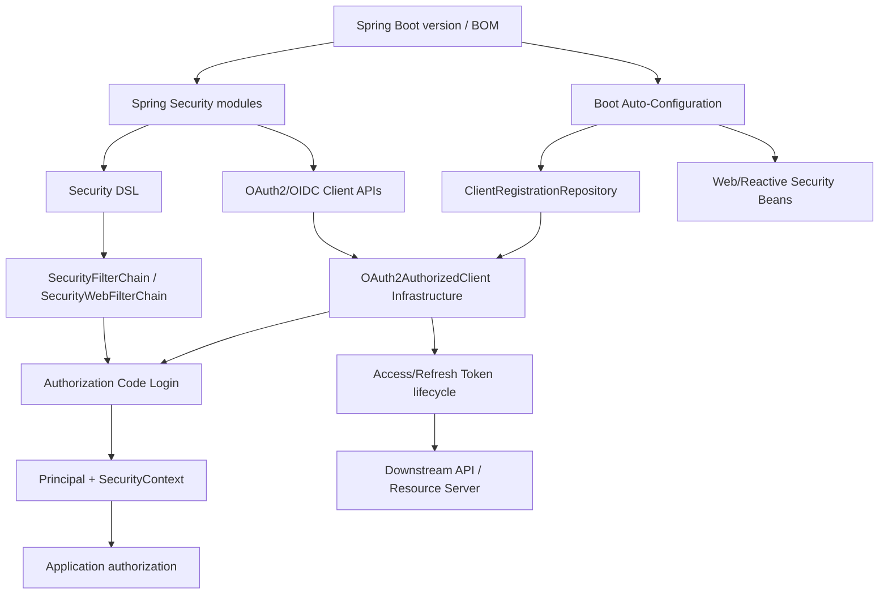
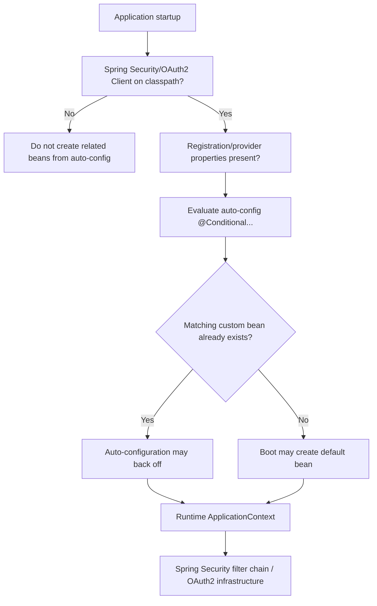
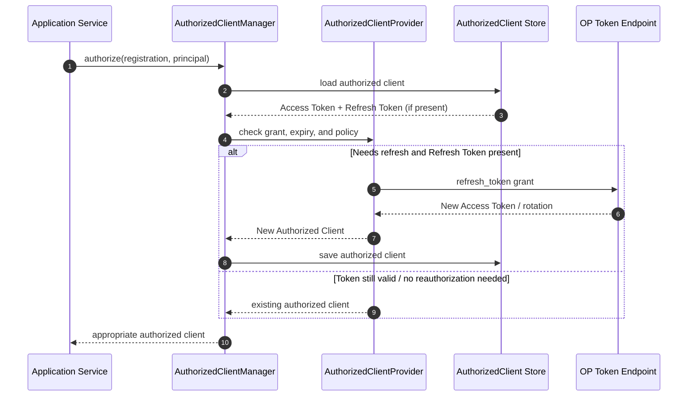
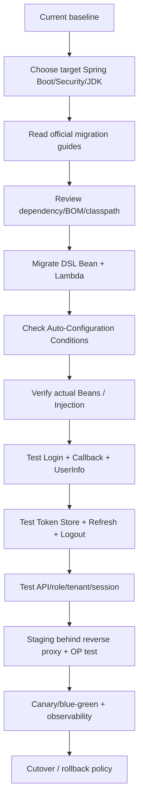

# 33.4. Reviewing DSL, Auto-Configuration, and Default Bean Changes

When upgrading a **Spring Security OAuth 2.0 / OpenID Connect (OIDC) Client** application, the hardest-to-spot bugs do not come only from removed APIs or Java code that no longer compiles. An upgrade can **compile cleanly, start normally, and even allow login**, while silently altering:

- Which `SecurityFilterChain` handles a request.
- `requestMatchers` rules and authorization evaluation order.
- How `oauth2Login()`, `oauth2Client()`, and related DSLs are configured.
- Which `ClientRegistrationRepository` bean is created from properties.
- Where `OAuth2AuthorizedClient`, Access Tokens, and Refresh Tokens are stored.
- Which `OAuth2AuthorizedClientManager` is selected for Servlet requests vs. background jobs.
- How `OidcUser` is obtained, authorities are mapped, or UserInfo is loaded.
- CSRF, CORS, session, logout, and public redirect URI policies.
- The conditions under which Spring Boot auto-creates security beans, as well as when auto-configuration **backs off** because the application defines a matching bean.

For example, suppose an application relies on Spring Boot's default `SecurityFilterChain`. When the team adds a custom `SecurityFilterChain` bean to expose an endpoint, Boot may stop creating the default security chain as before. If the new chain omits `oauth2Login()` or uses an overly broad matcher, the OIDC flow can break or some endpoints can lose proper protection.

This lesson establishes a **layered method for reviewing DSL, auto-configuration, and default bean changes** for both **Servlet/MVC** and **Reactive/WebFlux**. The goal is controlled Spring Boot/Spring Security upgrades: knowing which configurations you own, which the framework generates, how to detect behavior drift, and how to design regression tests.

> **Key principle:** "Zero compile errors" does not mean "zero security changes". Every upgrade must compare the **before and after security contract**: which routes are permitted, which users are authenticated, which registration/provider is used, where tokens are stored/sent, and which defaults changed.

## 1. Why Is This Lesson Important for OAuth2/OIDC Clients?

An OAuth2/OIDC Client has many interdependent parts:



If one edge in this diagram changes, many other capabilities can be affected. For instance:

- `ClientRegistrationRepository` has no Bean -> login start cannot find `registrationId`.
- A hand-written `SecurityFilterChain` does not enable `oauth2Login()` -> callbacks are not handled.
- A new manager lacks a `refreshToken()` provider -> expired tokens do not refresh as expected.
- Authorized client store switches from session to another service -> the app cannot find tokens after restart or across replicas.
- Request matchers change -> API endpoints redirect to the OP instead of returning 401, or admin pages become public.
- Custom `OidcUserService` is left unwired after refactoring -> users can log in but lack business authorities.

Therefore, you must review **runtime behavior** alongside **syntax and bean wiring**.

### 1.1. Common Upgrade Scopes

In practice, teams may upgrade:

1. Spring Boot version or Spring Security version.
2. JDK and Jakarta Servlet platform.
3. Spring MVC or WebFlux dependencies.
4. Spring Session, Redis/JDBC session stores.
5. OAuth2 Client module, HTTP client, Jackson, or Reactor.
6. IdP/OIDC provider configuration.
7. Deployment proxy/ingress and public base URL.
8. Test dependencies such as `spring-security-test`.

Not every change is a "Spring Security DSL migration". This lesson focuses on **configuration, auto-configuration, and bean defaults**, while pointing out related protocol/deployment boundaries.

### 1.2. Distinguishing Stable Concepts from Version-Specific Behavior

Modern Java examples in this lesson follow the **bean-based + lambda DSL** style common since Spring Security 6. Details of default beans, DSL methods, classpaths, and deprecations continue to evolve across Spring Security 6.x/7.x and Spring Boot 3.x/4.x.

When applying to a specific release, consult the **reference documentation, API Javadocs, and migration guides for that exact version**. Never assume a default from version A stays identical in version B, or that a Servlet class exists with the same API in WebFlux.

## 2. Three Layers to Review

| Layer | Core question | Example |
|---|---|---|
| **DSL / API surface** | Which APIs does the Java config use? Are old APIs deprecated/removed? | `WebSecurityConfigurerAdapter` -> `SecurityFilterChain`; `antMatchers` -> `requestMatchers`. |
| **Auto-configuration** | Which beans does Spring Boot create when classpath/properties/conditions match? | Creating `ClientRegistrationRepository` from `spring.security.oauth2.client.registration.*`. |
| **Default beans and resolution** | When multiple beans or custom beans exist, which component does the framework select? | In-memory vs. persistent authorized client service; custom manager; multiple filter chains. |

### 2.1. DSL Migration Alone Does Not Solve Auto-Configuration

Changing:

```java
http.authorizeRequests()
    .antMatchers("/admin/**").hasRole("ADMIN");
```

to:

```java
http.authorizeHttpRequests(auth -> auth
    .requestMatchers("/admin/**").hasRole("ADMIN")
);
```

only addresses **part of the syntax**. You still must check matcher semantics, chain ordering, authorization defaults, and login/callback filters.

### 2.2. Auto-Configuration Does Not Always Mean Default Security

Spring Boot's auto-configuration classes use conditions such as `@ConditionalOnClass`, `@ConditionalOnBean`, `@ConditionalOnMissingBean`, and property conditions. Adding one custom bean can alter condition outcomes.

Thus, with the exact same `application.yml`, adding a new `@Configuration` class can change runtime behavior.

### 2.3. Bean Resolution Determines Behavior

An app can have multiple `OAuth2AuthorizedClientManager` beans, yet a controller/service injects only one. Changing `@Primary`, `@Qualifier`, or bean names during an upgrade can wire a service to a manager with inappropriate grant providers or storage.

Your review must not stop at "the Bean exists"—it must ask **which Bean is injected, by whom, and in what scope?**

## 3. Prepare a Baseline Map Before Upgrading

Before changing dependencies or DSLs, record the behavior currently accepted in production.

Example:

```text
Application:
  spring-boot = current-version
  spring-security = BOM-managed
  server-stack = Servlet MVC
  session = Spring Session Redis
  entrypoint = /oauth2/authorization/company
  callback = /login/oauth2/code/company

Browser security:
  /public/**    -> anonymous allowed
  /account/**   -> authenticated
  /admin/**     -> ROLE_ADMIN
  /api/**       -> Bearer Resource Server (if separate chain)

OIDC:
  registrationId = company
  issuer = https://id.example.test
  scopes = openid, profile, email
  callback public = https://app.example.org/login/oauth2/code/company

Authorized client:
  storage = documented repository/service
  refresh grant = enabled when supported
  principal key = documented policy

Session:
  cookie = host-only, Secure, HttpOnly, SameSite policy
  logout = local + OP logout policy
```

This is an example **security contract**, not a Spring Boot configuration to paste verbatim.

### 3.1. Details to Cross-Reference

- Dependency tree/BOM and JDK baseline.
- Exact `SecurityFilterChain`/`SecurityWebFilterChain` definitions.
- Matchers, `@Order`, authorization rules, and entry points.
- OAuth2 registrations/providers, redirect templates, issuer trust.
- SecurityContext persistence, session mode, and CSRF repository.
- `OAuth2AuthorizedClientRepository` / `OAuth2AuthorizedClientService`.
- OAuth2 Authorized Client Manager/grant providers.
- UserInfo/OIDC user service and authority mapping.
- `WebClient`/`RestClient` outbound token selection.
- Logout handlers and token cleanup.
- Existing security test suite and known gaps.

### 3.2. The Baseline Must Reflect Actual Runtime

Do not just read source code:

```text
Java Configuration != full application behavior
```

A Bean may be overridden, conditional auto-configuration may not match, a `@Profile` may be inactive, or requests may match a different chain.

The baseline should combine source/config, runtime context/condition reports, endpoint tests, and controlled observation in staging.

## 4. Legacy DSL: `WebSecurityConfigurerAdapter`

In older Spring Security versions, many examples used:

```java
// Legacy DSL example, only for identification during migration.
// Do not use as new code in modern Spring Security.
@EnableWebSecurity
class LegacySecurityConfiguration
        extends WebSecurityConfigurerAdapter {

    @Override
    protected void configure(HttpSecurity http) throws Exception {
        http
            .authorizeRequests()
                .antMatchers("/public/**").permitAll()
                .anyRequest().authenticated()
            .and()
            .oauth2Login();
    }
}
```

Characteristics:

- Extending an adapter class and overriding `configure(HttpSecurity)`.
- Chained DSL with `.and()`.
- Using `authorizeRequests()`/`antMatchers()`.
- Security configured via inheritance and framework callbacks.

`WebSecurityConfigurerAdapter` was removed in modern Spring Security lines; the new pattern declares beans and configures via lambda DSL.

### 4.1. Do Not Just Rename the Class

Incorrect fix:

```java
// Insufficient: changing the adapter class without defining complete
// SecurityFilterChain beans for each request scope.
class SecurityConfiguration {
    // copied old logic that is no longer invoked by the framework
}
```

The right approach is creating **`@Bean SecurityFilterChain`** and ensuring the chain is picked up by Spring Security.

### 4.2. Check Other Overrides

Legacy adapters could override:

- `configure(HttpSecurity)`.
- `configure(AuthenticationManagerBuilder)`.
- `configure(WebSecurity)`.

When migrating to bean configuration, re-evaluate every responsibility; moving HTTP rules alone is not enough if the app also has custom user authentication, password encoders, or static-path ignores in `WebSecurity`.

## 5. Modern DSL: `SecurityFilterChain` Bean

A modern Servlet/MVC configuration:

```java
package com.example.security;

import org.springframework.context.annotation.Bean;
import org.springframework.context.annotation.Configuration;
import org.springframework.security.config.Customizer;
import org.springframework.security.config.annotation.web.builders.HttpSecurity;
import org.springframework.security.web.SecurityFilterChain;

@Configuration(proxyBeanMethods = false)
public class SecurityConfiguration {

    @Bean
    SecurityFilterChain browserSecurityFilterChain(
            HttpSecurity http) throws Exception {

        http
            .authorizeHttpRequests(auth -> auth
                .requestMatchers(
                    "/", "/public/**", "/assets/**"
                ).permitAll()
                .anyRequest().authenticated()
            )
            .oauth2Login(Customizer.withDefaults())
            .oauth2Client(Customizer.withDefaults());

        return http.build();
    }
}
```

In this example:

- Spring manages `SecurityFilterChain` as a bean.
- `authorizeHttpRequests(...)` expresses authorization rules.
- `oauth2Login(Customizer.withDefaults())` enables the browser OAuth2 Login flow with version-appropriate defaults.
- `oauth2Client(Customizer.withDefaults())` enables authorized-client integration in the security chain.
- `http.build()` builds the filter chain.

### 5.1. What Does `Customizer.withDefaults()` Mean?

`Customizer.withDefaults()` tells the DSL to use the defaults of that configurer; **it does not mean default behavior is immutable across versions**.

For example, if `oauth2Login` defaults to a particular login page and authorization request repository, a framework upgrade can change implementation or configuration details. Whenever fixed behavior is needed, configure it explicitly and test it.

### 5.2. Lambda DSL Is Easier to Read, Not Automatically Safer

The Lambda DSL clarifies boundaries between configurers and reduces `.and()` chaining pitfalls. However:

```java
.authorizeHttpRequests(auth ->
    auth.anyRequest().permitAll()
)
```

still opens every request despite valid syntax.

**Security is determined by rules, matchers, and component wiring**, not merely DSL syntax.

### 5.3. Do Not Rely on an Unclear Default Fallback

If you define a custom `SecurityFilterChain` and forget:

```java
.anyRequest().authenticated()
```

the resulting behavior may differ from the default chain Boot previously created. Decide explicit endpoint policies and test anonymous/authorized behavior.

## 6. Before-and-After DSL Comparison

| Topic | Legacy style | Modern style |
|---|---|---|
| HTTP extension point | `extends WebSecurityConfigurerAdapter` | `@Bean SecurityFilterChain` |
| HTTP authorization | `authorizeRequests()` | `authorizeHttpRequests(...)` |
| Request patterns | `antMatchers(...)`/`mvcMatchers(...)` | `requestMatchers(...)` with appropriate matcher |
| Chain scope selection | Adapter/configurer semantics | `http.securityMatcher(...)` |
| OAuth2 Login | `http.oauth2Login()` in old fluent chain | `http.oauth2Login(customizer)` |
| OAuth2 Client | `http.oauth2Client()` in old fluent chain | `http.oauth2Client(customizer)` |
| CSRF | `http.csrf().disable()` | `http.csrf(csrf -> csrf.disable())` |
| Logout | `http.logout().logoutUrl(...)` | `http.logout(logout -> logout.logoutUrl(...))` |
| Method security | `@EnableGlobalMethodSecurity` (legacy) | `@EnableMethodSecurity` in modern lines |
| WebSecurity ignores | Override `configure(WebSecurity)` | `@Bean WebSecurityCustomizer` when needed |

**Note:** some methods go through a deprecation phase before removal; exact timelines and signatures depend on version. Check the target version's migration guide rather than guessing from examples.

## 7. `authorizeHttpRequests` and `requestMatchers` Are Not Simple Find-and-Replace

A typical migration changes:

```java
// Legacy:
http.authorizeRequests()
    .antMatchers("/admin/**").hasRole("ADMIN")
    .anyRequest().authenticated();
```

into:

```java
// Modern:
http.authorizeHttpRequests(auth -> auth
    .requestMatchers("/admin/**").hasRole("ADMIN")
    .anyRequest().authenticated()
);
```

However, the **matcher implementation** can differ depending on whether Spring MVC is on the classpath, how Servlet paths are configured, the Security version, and the matcher factory.

### 7.1. Pattern Semantics to Verify

Easily confused URLs:

```text
/admin
/admin/
/admin/report
/admin/report/
/admin/report.csv
/ADMIN/report
/admin;param=value
/portal/admin/report
```

Do not assume Ant-style, MVC path patterns, and custom matchers behave 100% identically in every case.

### 7.2. HTTP Methods Are Part of the Policy Too

Example:

```java
import org.springframework.http.HttpMethod;

http.authorizeHttpRequests(auth -> auth
    .requestMatchers(
        HttpMethod.GET, "/reports/**"
    ).hasAuthority("report:read")
    .requestMatchers(
        HttpMethod.POST, "/reports/**"
    ).hasAuthority("report:write")
    .anyRequest().authenticated()
);
```

If legacy config protected all HTTP methods while migration only protects GET, POST/PUT/DELETE might fall through to a different rule and create a vulnerability.

### 7.3. Order of Matchers Matters

Unsafe example:

```java
http.authorizeHttpRequests(auth -> auth
    .requestMatchers("/**").permitAll()
    .requestMatchers("/admin/**").hasRole("ADMIN")
);
```

A broad rule before a specific rule can make `/admin/**` public or prevent the config from behaving as intended. Place specific matchers first, followed by an appropriate catch-all.

### 7.4. Context Path and Servlet Path

When running behind a proxy under `/portal` or with a custom Servlet path mapping, `requestMatchers("/api/**")` matches against the request path seen by the framework, not the original public URL.

Upgrading path-matching frameworks can affect route security. Test through the actual proxy or a test setup replicating the real Servlet/context path.

### 7.5. Explicit RequestMatcher When Needed

For special policies, define an explicit `RequestMatcher` rather than passing only strings:

```java
RequestMatcher adminMatcher = request ->
    request.getRequestURI().startsWith("/admin/");
```

Note that the example above **only illustrates the interface** and is not recommended directly because `getRequestURI()` has different context-path, encoding, and matching semantics. A production custom matcher must safely handle context paths, normalization, and HTTP methods.

Use the proper matcher API for your exact Spring Security/Spring MVC version, then test both positive and negative paths.

## 8. `securityMatcher(...)` Differs from `requestMatchers(...)`

This is one of the most important upgrade traps.

- `http.securityMatcher(...)`: determines **which requests belong to this entire `SecurityFilterChain`**.
- `authorizeHttpRequests(...).requestMatchers(...)`: determines **an authorization rule inside the already-selected chain**.

Example:

```java
@Bean
@Order(1)
SecurityFilterChain apiChain(HttpSecurity http) throws Exception {
    http
        .securityMatcher("/api/**")
        .authorizeHttpRequests(auth -> auth
            .anyRequest().authenticated()
        );
    return http.build();
}
```

This chain applies only to `/api/**`. If no other chain matches `/orders`, that request may not go through the rules the developer assumed were protecting it.

### 8.1. Multiple Chains Need Clear Coverage

A Servlet design:

```text
Chain 1: /api/**      -> Resource Server Bearer (if present)
Chain 2: /**          -> Browser OAuth2 Login
```

Verify:

- `/api/orders` enters Chain 1.
- `/account` enters Chain 2.
- `/oauth2/authorization/company` enters Chain 2.
- `/login/oauth2/code/company` enters Chain 2.
- `/logout` enters Chain 2 for browser logout.
- Error/actuator endpoints match policy.

### 8.2. Do Not Put `oauth2Login` on a Chain That Does Not Match Callbacks

If you enable `oauth2Login()` only on:

```java
.securityMatcher("/account/**")
```

the default callback `/login/oauth2/code/company` will not match that chain. As a result, login initiation/callback will not be processed by the expected filter.

### 8.3. Explicit `@Order` with Multiple Chains

```java
import org.springframework.core.annotation.Order;

@Bean
@Order(1)
SecurityFilterChain apiChain(HttpSecurity http) throws Exception {
    // ...
}

@Bean
@Order(2)
SecurityFilterChain browserChain(HttpSecurity http) throws Exception {
    // ...
}
```

Choose explicit ordering and a proper fallback chain. Do not rely on arbitrary bean creation order.

### 8.4. Example Separating API and Browser

If the application **has both OAuth2 Client and OAuth2 Resource Server**, you can use:

```java
import org.springframework.context.annotation.Bean;
import org.springframework.core.annotation.Order;
import org.springframework.http.HttpMethod;
import org.springframework.security.config.Customizer;
import org.springframework.security.config.annotation.web.builders.HttpSecurity;
import org.springframework.security.config.http.SessionCreationPolicy;
import org.springframework.security.web.SecurityFilterChain;

@Bean
@Order(1)
SecurityFilterChain apiChain(HttpSecurity http) throws Exception {
    http
        .securityMatcher("/api/**")
        .authorizeHttpRequests(auth -> auth
            .requestMatchers(
                HttpMethod.GET, "/api/public/**"
            ).permitAll()
            .anyRequest().authenticated()
        )
        .sessionManagement(session -> session
            .sessionCreationPolicy(SessionCreationPolicy.STATELESS)
        )
        .csrf(csrf -> csrf.disable())
        .oauth2ResourceServer(oauth2 ->
            oauth2.jwt(Customizer.withDefaults())
        );

    return http.build();
}

@Bean
@Order(2)
SecurityFilterChain browserChain(HttpSecurity http) throws Exception {
    http
        .authorizeHttpRequests(auth -> auth
            .requestMatchers("/", "/public/**").permitAll()
            .anyRequest().authenticated()
        )
        .oauth2Login(Customizer.withDefaults())
        .oauth2Client(Customizer.withDefaults());

    return http.build();
}
```

**Example scope:** The API chain assumes `spring-boot-starter-oauth2-resource-server` and JWT decoder configuration. Disabling CSRF on `/api/**` is appropriate only if this chain authenticates strictly via stateless bearer tokens **and never relies on browser cookies for unsafe requests**.

Never copy `csrf.disable()` for an entire browser OIDC Client application.

## 9. `WebSecurityCustomizer` and Bypassing Filters

In legacy configurations, teams often overrode `configure(WebSecurity)` to ignore static resources.

Bean-based style:

```java
import org.springframework.context.annotation.Bean;
import org.springframework.security.config.annotation.web.builders.WebSecurity;
import org.springframework.security.config.annotation.web.configuration.WebSecurityCustomizer;

@Bean
WebSecurityCustomizer webSecurityCustomizer() {
    return (WebSecurity web) ->
        web.ignoring().requestMatchers("/assets/**");
}
```

However, `web.ignoring()` **skips the entire Spring Security filter chain** for those matchers, not merely authorization checks.

### 9.1. `permitAll()` vs. `ignoring()`

| Approach | Result |
|---|---|
| `requestMatchers("/assets/**").permitAll()` | Requests still pass through security filters, and authorization permits them. |
| `web.ignoring().requestMatchers("/assets/**")` | Requests skip the corresponding Spring Security filter chain. |

Most applications should prefer `permitAll()` for public resources so security headers, context, and filters remain active. Use `ignoring()` only with clear justification and impact review.

### 9.2. Re-Check All Ignore Patterns When Upgrading

A wildcard like `"/**"` in `WebSecurityCustomizer` disables security for the whole app. Test protected endpoints through the actual filter chain, not just controllers.

## 10. Method Security: From Legacy Annotations to Modern Config

Some apps use the legacy annotation:

```java
@EnableGlobalMethodSecurity(prePostEnabled = true)
```

In modern Spring Security, the usual pattern is:

```java
import org.springframework.context.annotation.Configuration;
import org.springframework.security.config.annotation.method.configuration
    .EnableMethodSecurity;

@Configuration
@EnableMethodSecurity
class MethodSecurityConfiguration {
}
```

and:

```java
@PreAuthorize("hasAuthority('orders:write')")
public void updateOrder(...) {
    // ...
}
```

### 10.1. Method Security Is Not Automatically Enabled Everywhere

Having `spring-boot-starter-security` does not mean every `@PreAuthorize` executes unless method security is enabled in the configuration.

When upgrading from the legacy annotation, verify:

- Right method security mode.
- Proxies are actually applied to the Bean.
- Methods are invoked via the Spring proxy, not self-invocation.
- Authority strings and SpEL behavior.
- Reactive method security configured separately if using WebFlux.

### 10.2. Do Not Confuse Roles with Scopes

`hasRole("ADMIN")` typically checks `ROLE_ADMIN`.

`hasAuthority("SCOPE_orders.read")` checks that exact authority string if mapping generates it.

An OIDC `roles` claim does not turn into an authority automatically. If the user service/mapper changed during an upgrade, `@PreAuthorize` can allow or deny incorrectly even though the annotation itself stayed identical.

### 10.3. Test Real Logic, Not Mocked Protected Methods

If an integration test mocks the entire service bearing `@PreAuthorize`, calls can bypass the proxy/method interceptor. Use a real test context or a method-security-focused test for the code under verification.

## 11. Servlet and WebFlux Are Two Different DSLs

### Servlet/MVC

```java
@Bean
SecurityFilterChain securityFilterChain(HttpSecurity http)
        throws Exception {
    return http
        .authorizeHttpRequests(auth -> auth
            .anyRequest().authenticated()
        )
        .oauth2Login(Customizer.withDefaults())
        .build();
}
```

### Reactive/WebFlux

```java
@Bean
SecurityWebFilterChain securityWebFilterChain(
        ServerHttpSecurity http) {

    return http
        .authorizeExchange(exchanges -> exchanges
            .anyExchange().authenticated()
        )
        .oauth2Login(Customizer.withDefaults())
        .build();
}
```

Concepts align, but types are not interchangeable:

| Servlet | WebFlux |
|---|---|
| `HttpSecurity` | `ServerHttpSecurity` |
| `SecurityFilterChain` | `SecurityWebFilterChain` |
| `authorizeHttpRequests` | `authorizeExchange` |
| `HttpSession` | `WebSession` |
| `ClientRegistrationRepository` | `ReactiveClientRegistrationRepository` |
| `OAuth2AuthorizedClientRepository` | `ServerOAuth2AuthorizedClientRepository` |
| `OAuth2AuthorizedClientManager` | `ReactiveOAuth2AuthorizedClientManager` |
| `OidcUserService` | `OidcReactiveOAuth2UserService` (when using matching implementation) |
| `MockMvc` | `WebTestClient` |

### 11.1. Dependencies Can Change the Application Type Unexpectedly

If a project adds `spring-boot-starter-web` to a WebFlux app or vice versa, Spring Boot may choose the web application type based on classpath and configuration.

A migration that seemed like "just adding one dependency" can alter which Servlet/Reactive security Beans are chosen. Check the actual application type and test context.

### 11.2. Reactive Security Context Differs from ThreadLocal

WebFlux uses Reactor Context for authentication. Custom OIDC mappers/services should not rely on ThreadLocal `SecurityContextHolder` as a sole source inside reactive operators.

Never port Servlet authentication handlers to WebFlux merely by changing class names.

## 12. How Does Spring Boot Auto-Configuration Work?

Spring Boot creates/registers beans based on **classpath + properties + conditions**.

A high-level model:



This diagram is **conceptual**, not a one-to-one implementation of every auto-configuration. Conditions vary by Boot version and stack.

### 12.1. `@ConditionalOnClass`

An auto-configuration may activate only when a specific class/module is on the classpath.

If after an upgrade a starter transitively stops bringing in the OAuth2 Client dependency, registration/service beans can vanish.

### 12.2. `@ConditionalOnMissingBean`

When the application creates a custom Bean of the same type/contract, Boot may stop creating its default bean.

This is a major source of surprises when a team adds:

```java
@Bean
ClientRegistrationRepository clientRegistrationRepository() {
    return new InMemoryClientRegistrationRepository(...);
}
```

Once this Bean exists, registrations in `application.yml` may **no longer be used** because auto-configuration backed off.

### 12.3. `@ConditionalOnProperty` and Activation

Some auto-configurations require specific properties or flags. Renaming, removing, or misbinding a property can prevent the feature from being created.

### 12.4. Auto-Configured Beans Are Not a Permanent API Contract

Never write business code assuming:

```text
The bean will always be named "x", created by class AutoConfigY,
regardless of framework version or custom beans.
```

Rely on public interfaces, explicit dependency injection, and real application context tests. When overriding, document why and test the customized behavior.

## 13. Distinguishing Spring Security from Spring Boot Defaults

Spring Security provides the security framework and DSL; Spring Boot provides auto-configuration and integration.

For example:

- Spring Security defines `SecurityFilterChain` and OAuth2 Login support.
- Spring Boot can build `ClientRegistrationRepository` from application properties.
- Spring Security provides `DefaultOAuth2AuthorizedClientManager` and providers.
- Boot or framework wiring can create/register default components when conditions are met.
- The application can replace specific beans, customizers, or security chains.

When upgrading, read both the **Spring Boot migration guide** and the **Spring Security migration guide**; reading only one side is rarely sufficient.

### 13.1. "Default" Does Not Mean Only One Bean Type Exists

There may be:

- Application-defined beans.
- Auto-configured beans.
- Framework components that are not public Spring Beans.
- Objects constructed inside a filter or DSL configurer.
- Beans contributed by third-party libraries.

Seeing a class in docs does not prove the application exposes a Bean of that type for autowiring.

### 13.2. Seeing a Bean Exist Does Not Tell You Who Uses It

For example, the app may have its own `OAuth2AuthorizedClientManager` bean while `WebClient` constructed `ServletOAuth2AuthorizedClientExchangeFilterFunction` using a different manager. Migration must inspect the **injection graph**, not just the bean list.

## 14. Boot OAuth2 Client Properties to Review

A typical configuration:

```yaml
spring:
  security:
    oauth2:
      client:
        registration:
          company:
            provider: company-oidc
            client-id: ${OIDC_CLIENT_ID}
            client-secret: ${OIDC_CLIENT_SECRET}
            client-authentication-method: client_secret_basic
            authorization-grant-type: authorization_code
            redirect-uri: "{baseUrl}/login/oauth2/code/{registrationId}"
            scope:
              - openid
              - profile
              - email
          partner:
            provider: partner-oidc
            client-id: ${PARTNER_CLIENT_ID}
            client-secret: ${PARTNER_CLIENT_SECRET}
            authorization-grant-type: authorization_code
            redirect-uri: "{baseUrl}/login/oauth2/code/{registrationId}"
            scope: [openid, profile]
        provider:
          company-oidc:
            issuer-uri: https://login.company.example/realms/main
          partner-oidc:
            issuer-uri: https://accounts.partner.example/tenant/main
```

URLs, names, and secrets are illustrative examples. No real server or secret exists here.

### 14.1. `registration` Differs from `provider`

`registration.company` holds:

- `client-id`.
- `client-secret` or another client authentication method.
- `authorization-grant-type`.
- `redirect-uri`.
- `scope`.
- `provider` key referencing provider metadata.

`provider.company-oidc` holds OP information such as `issuer-uri` or explicit endpoints.

Do not confuse:

- `registrationId` = `company`.
- Provider key = `company-oidc`.
- OIDC issuer = full URI of the OP.
- OAuth2 `client_id` = value registered with the OP.

If migration renames `registrationId`, login URLs, callbacks, and authorized-client storage keys can all be impacted.

### 14.2. Adding or Removing `issuer-uri` Can Introduce Network Behavior

When a provider is configured via `issuer-uri`, Spring/Boot may perform **metadata discovery** to build the registration, depending on API/stack/version.

Consequences:

- Startup or bean creation may depend on the OP being reachable.
- Unit/integration tests may accidentally hit the network.
- Metadata URLs/JWKS endpoints change when the OP changes.
- Proxy/TLS/egress policies can prevent the app from starting.

A migration must never "fix" errors by dropping issuer validation or accepting metadata from arbitrary URLs.

### 14.3. Explicit Endpoint Configuration

Explicit provider endpoints can be used instead of discovery when tighter control is needed:

```yaml
spring:
  security:
    oauth2:
      client:
        provider:
          company-oidc:
            authorization-uri: https://login.company.example/authorize
            token-uri: https://login.company.example/token
            jwk-set-uri: https://login.company.example/jwks
            user-info-uri: https://login.company.example/userinfo
            user-name-attribute: sub
```

These are **illustrative paths**, not a template for every OP. Omitting the `issuer-uri` discovery property **does not permit skipping OIDC issuer validation**. If building `ClientRegistration` manually, ensure issuer/trust metadata is configured and validated properly.

### 14.4. Property Binding Requires Checking Effective Values

- Is the `application-prod.yml` profile actually active?
- Are environment variables overriding the exact right keys?
- Is a config server returning stale properties?
- Are there typos in `redirect-uri` / `issuer-uri`?
- Are there YAML quoting differences around `{baseUrl}`?
- Do custom beans read properties or ignore them?
- Are duplicate registration names defined across profiles?

Upgrading dependencies does not fix configuration-merging bugs.

## 15. `ClientRegistrationRepository` Is a Key Boundary

On Servlet, Spring Security OAuth2 Client uses `ClientRegistrationRepository` to look up registrations by ID:

```java
ClientRegistration registration =
    registrations.findByRegistrationId("company");
```

Common implementations:

- `InMemoryClientRegistrationRepository`.
- Custom repository backed by a database/registry.
- Repository wrapper with tenant-aware routing or caching.

### 15.1. When Adding a Custom Bean

Example:

```java
@Bean
ClientRegistrationRepository registrations() {
    ClientRegistration company =
        ClientRegistration.withRegistrationId("company")
            .clientId("test-company-client")
            .clientSecret("synthetic-secret")
            .clientAuthenticationMethod(
                ClientAuthenticationMethod.CLIENT_SECRET_BASIC
            )
            .authorizationGrantType(
                AuthorizationGrantType.AUTHORIZATION_CODE
            )
            .redirectUri(
                "{baseUrl}/login/oauth2/code/{registrationId}"
            )
            .authorizationUri(
                "https://id.example.test/authorize"
            )
            .tokenUri(
                "https://id.example.test/token"
            )
            .jwkSetUri(
                "https://id.example.test/jwks"
            )
            .issuerUri(
                "https://id.example.test"
            )
            .scope("openid", "profile")
            .build();

    return new InMemoryClientRegistrationRepository(company);
}
```

**Illustrative Bean fixture only:** if the app defines the same Bean type in production, Boot's auto-configured repository from properties may back off. Never define this Bean in production just to test one registration and lose the real registrations.

### 15.2. Upgrades Must Cross-Check Repository Data

Test:

- `company` exists.
- `partner` exists.
- Issuer URIs match each registration.
- Redirect URIs and scopes did not change unexpectedly.
- `clientAuthenticationMethod` matches the provider contract.
- No dynamic registrations come from unapproved tenant input.
- Client IDs are not mixed across environments.

### 15.3. Reactive Repository Is a Different Interface

WebFlux uses `ReactiveClientRegistrationRepository`, not Servlet `ClientRegistrationRepository`.

An upgrade that changes the web stack or auto-config can break wiring for a repository Bean that previously had the right type.

## 16. Authorized Client: Distinct from `ClientRegistration`

`ClientRegistration` describes the **client/app registration** with the OP.

`OAuth2AuthorizedClient` describes **an authorized client in the context of a principal**, containing:

- `ClientRegistration`.
- Principal name.
- Access Token.
- Refresh Token if issued and stored.

```text
ClientRegistration:
  company
  issuer = https://id.example.test
  client_id = web-client

OAuth2AuthorizedClient:
  registration = company
  principal = user-A
  access_token = ...
  refresh_token = ... (optional)
```

An upgrade may preserve registrations while still losing tokens if persistence or the manager changed.

### 16.1. `OAuth2AuthorizedClientRepository` on Servlet

The repository is typically used in an **HTTP request/response** context and may delegate to a session or service.

Examples of abstractions:

- `OAuth2AuthorizedClientRepository`.
- `AuthenticatedPrincipalOAuth2AuthorizedClientRepository`.
- `HttpSessionOAuth2AuthorizedClientRepository`.

Identify which implementation the real application uses and the policy for storing tokens across authenticated vs. anonymous requests.

### 16.2. `OAuth2AuthorizedClientService`

The service saves/loads/removes authorized clients by principal/registration:

```java
OAuth2AuthorizedClient client =
    authorizedClientService.loadAuthorizedClient(
        "company",
        principalName
    );
```

A common implementation for development/tests is `InMemoryOAuth2AuthorizedClientService`. Production requires persistent/distributed storage if token lifecycles and scaling policies demand it.

### 16.3. Storage Keys Usually Matter

A common key:

```text
(clientRegistrationId, principalName)
```

If an upgrade changes the principal name from `sub` to email, or renames the registration ID, old token stores may fail to load records. Worse, overly broad keys can collide across providers/tenants.

Never use `email` or arbitrary browser input as the principal key when OIDC identity isolation is required. Use `(issuer, subject)` and tenant context per application policy.

### 16.4. Do Not Change Default Persistence Without a Plan

If tokens previously lived in the session and migrate to a database service, evaluate:

- Do tokens survive logout?
- Are they shared across instances?
- What is the encryption/at-rest access model?
- How do Refresh Token Rotation and concurrency work?
- How does cleanup work when a user is disabled/revoked?
- Does migrating old token data require reauthorization?

## 17. `OAuth2AuthorizedClientManager`: Crucial Bean, Easy to Misconfigure

`OAuth2AuthorizedClientManager` coordinates authorization/re-authorization for OAuth2 Clients, using `OAuth2AuthorizedClientProvider`s tailored to grant types.

Two distinct use cases:

1. **Request-scoped/browser**: operates with `HttpServletRequest`/`HttpServletResponse`, user principal, and the appropriate repository.
2. **Background/service**: scheduled job or machine-to-machine flow without a browser request, typically using a service-backed manager.

### 17.1. Request-Scoped Servlet Manager

A common manager:

```java
DefaultOAuth2AuthorizedClientManager manager =
    new DefaultOAuth2AuthorizedClientManager(
        clientRegistrationRepository,
        authorizedClientRepository
    );
```

It is designed for HTTP request contexts. If the app starts calling it from a scheduled job with no Servlet request, reconsider the manager type.

### 17.2. Service-Backed Manager

A manager suited for background logic:

```java
import org.springframework.context.annotation.Bean;
import org.springframework.security.oauth2.client.OAuth2AuthorizedClientManager;
import org.springframework.security.oauth2.client.AuthorizedClientServiceOAuth2AuthorizedClientManager;
import org.springframework.security.oauth2.client.OAuth2AuthorizedClientService;
import org.springframework.security.oauth2.client.OAuth2AuthorizedClientProviderBuilder;
import org.springframework.security.oauth2.client.registration.ClientRegistrationRepository;

@Bean
OAuth2AuthorizedClientManager backgroundAuthorizedClientManager(
        ClientRegistrationRepository registrations,
        OAuth2AuthorizedClientService service) {

    var manager =
        new AuthorizedClientServiceOAuth2AuthorizedClientManager(
            registrations,
            service
        );

    manager.setAuthorizedClientProvider(
        OAuth2AuthorizedClientProviderBuilder.builder()
            .clientCredentials()
            .refreshToken()
            .build()
    );

    return manager;
}
```

This is an **explicit example configuration**. Provider grants must match actual registration requirements; do not add a grant type just because the builder has that method.

### 17.3. Why Explicit Injection Matters

If an application has both a browser manager and a background manager, use explicit bean names/qualifiers:

```java
import org.springframework.beans.factory.annotation.Qualifier;

public BillingTokenService(
    @Qualifier("backgroundAuthorizedClientManager")
    OAuth2AuthorizedClientManager manager
) {
    this.manager = manager;
}
```

Do not arbitrarily mark a Bean `@Primary` and make every `WebClient` share it when security contexts or storage semantics differ.

### 17.4. Do Not Assume Boot Creates the Exact Same Manager Across Versions

Spring Boot/Spring Security versions and auto-configurations differ in which manager Bean they provide, how registrations/repositories/services are combined, and which extension points exist for default providers.

**Every upgrade must inspect the actual `ApplicationContext`**: which Beans exist, which Bean is injected into each `WebClient`/service, and which provider chain is configured.

## 18. `OAuth2AuthorizedClientProvider`: Keeping the Grant List Accurate

Grant-related components can include:

- Authorization Code.
- Refresh Token.
- Client Credentials.
- Other extension grants when needed and supported.

Example:

```java
var provider =
    OAuth2AuthorizedClientProviderBuilder.builder()
        .authorizationCode()
        .refreshToken()
        .clientCredentials()
        .build();
```

**Do not treat this pattern as a mandatory default for every manager.** A background service manager cannot complete an Authorization Code browser redirect just by adding `authorizationCode()`, and `clientCredentials()` cannot substitute for a user token when an API requires delegated access.

### 18.1. Refresh Tokens During Upgrade

Verify:

- `ClientRegistration` grant is valid.
- The OP actually issues a Refresh Token.
- The provider includes `refreshToken()`.
- The manager is invoked when a fresh token is needed.
- Clock skew/expiration detection did not change.
- Refresh Token rotation updates storage atomically.
- `invalid_grant` errors trigger cleanup/re-authentication per policy.

### 18.2. Do Not Retry Refreshes Infinitely

An upgrade may alter exception handling in the manager or `WebClient`; retrying every 401/`invalid_grant` continuously can cause a DoS or token-request loop.

Test token refresh failures and ensure proper circuit breaking/cleanup.

### 18.3. Password Grant Is Not a Default Migration Path

Some legacy apps use the Resource Owner Password Credentials grant. Never retain or recreate this grant just to avoid refactoring; it conflicts with modern OAuth2 security guidance and may not be supported by newer APIs/versions.

Evaluate moving to Authorization Code + PKCE or Client Credentials per use case, coordinated with product and OP migration plans.

## 19. WebClient Paths When OAuth2 Client Changes

A Spring MVC BFF may use `WebClient` to call a Resource Server with an issued Access Token.

An explicit configuration:

```java
import org.springframework.context.annotation.Bean;
import org.springframework.security.oauth2.client.OAuth2AuthorizedClientManager;
import org.springframework.security.oauth2.client.web.reactive.function.client
    .ServletOAuth2AuthorizedClientExchangeFilterFunction;
import org.springframework.web.reactive.function.client.WebClient;

@Bean
WebClient ordersApiWebClient(
        OAuth2AuthorizedClientManager manager) {

    var oauth2 =
        new ServletOAuth2AuthorizedClientExchangeFilterFunction(
            manager
        );

    return WebClient.builder()
        .baseUrl("https://api.example.test")
        .filter(oauth2)
        .build();
}
```

### 19.1. Selection of Authorized Client

When sending a request, registration selection can be explicit:

```java
import static org.springframework.security.oauth2.client.web.reactive
    .function.client.ServletOAuth2AuthorizedClientExchangeFilterFunction
    .clientRegistrationId;

webClient.get()
    .uri("/orders")
    .attributes(clientRegistrationId("company"))
    .retrieve()
    .bodyToMono(String.class);
```

**Note:** this works when the `company` registration and OAuth2 manager can authorize/load tokens for the active principal context. Tests must never send real credentials to `example.test`.

### 19.2. Do Not Enable Default Tokens for Unchecked URLs

Some `WebClient` patterns allow using a default authorized client. If `WebClient` can send requests to user-supplied URLs, tokens may leak to the wrong destination.

After upgrading, check:

- Which `WebClient` instances carry an OAuth2 filter?
- Is a default authorized client enabled?
- Which principal, registration, or request attribute selects the token?
- Are absolute URIs outside `baseUrl` accepted?
- Can redirect policies forward the `Authorization` header to another host?
- Do multiple users/tenants share the same `WebClient`?

### 19.3. Differences When Changing HTTP Clients

Upgrading `WebClient`/`RestClient` or changing the OAuth2 filter can alter:

- Token auto-attachment.
- Failure handler eviction behavior.
- 401/403 retry logic.
- Context propagation.
- Manager invocation timing.
- Request-level attributes.
- Timeout/connection settings.

Test outbound HTTP against a stub server to confirm requests hit the right API host and carry only the intended token.

## 20. Servlet vs. Background Token Manager

A common pitfall:

```text
HTTP request -> manager A -> session-aware repository
Scheduled job -> manager A -> no HttpServletRequest
```

An upgrade can expose bugs in code that previously relied implicitly on a thread-bound Servlet request.

### 20.1. Machine-to-Machine Use Case

Example:

```java
OAuth2AuthorizeRequest request =
    OAuth2AuthorizeRequest
        .withClientRegistrationId("billing-service")
        .principal("service:billing-job")
        .build();

OAuth2AuthorizedClient authorized =
    backgroundAuthorizedClientManager.authorize(request);

if (authorized == null) {
    throw new IllegalStateException(
        "Unable to authorize billing client"
    );
}
```

The principal here is a stable technical key for client credentials—not an OIDC-authenticated user.

### 20.2. Never Attach Machine Tokens to User APIs

If an API requires a delegated user token, switching to `client_credentials` simply because a background manager is easy to configure breaks the authorization model.

### 20.3. Data-Store Migration Must Match Manager Migration

If the new manager looks up tokens by a different principal name, even an intact token DB can trigger unnecessary authorization flows or improper refreshes.

## 21. OAuth2 Login Defaults Must Be Reviewed Separately

When using:

```java
.oauth2Login(Customizer.withDefaults())
```

check these related default behaviors:

- Authorization start endpoint.
- Redirection/callback processing endpoint.
- Login page/entry point.
- `AuthorizationRequestRepository`.
- `OAuth2UserService` / `OidcUserService`.
- Authentication success/failure handlers.
- SecurityContext persistence.
- SavedRequest success redirect.
- Session fixation handling.
- Logout integration.
- Authorized client repository/service.

### 21.1. Start Endpoint

Servlet default path is usually:

```text
/oauth2/authorization/{registrationId}
```

The browser can initiate login via:

```text
GET /oauth2/authorization/company
```

### 21.2. Callback Endpoint

Servlet callback default is usually:

```text
/login/oauth2/code/{registrationId}
```

Registration redirect template:

```yaml
redirect-uri: "{baseUrl}/login/oauth2/code/{registrationId}"
```

If migration changes `redirectionEndpoint` or base URI, synchronize:

1. Security DSL filter matcher.
2. `ClientRegistration.redirectUri`.
3. OP-registered redirect URI.
4. Reverse proxy path rewriting.
5. Session cookie scope.

### 21.3. Do Not Let a Custom Filter Chain Drop Callbacks

If a chain only matches `/app/**` while the callback is at `/login/oauth2/code/**`, the Spring Security OAuth2 Login filter will not handle the callback.

This is a configuration behavior bug, not necessarily an OIDC provider issue.

### 21.4. `state`, PKCE, and Nonce Must Never Be Dropped

If a migration causes callback tests to fail, never fix them by disabling `state`/PKCE/nonce validation. Fix the actual request correlation, session, or registration boundary.

## 22. `OidcUserService` and Custom Authority Mapping

A Servlet app may customize the user service:

```java
OidcUserService customOidcUserService = new OidcUserService();
```

or wrap it using `GrantedAuthoritiesMapper`. Upgrades must verify whether **custom code is still wired into the exact OIDC DSL/userInfo endpoint**.

Example Servlet configuration in common modern API style:

```java
.oauth2Login(oauth2 -> oauth2
    .userInfoEndpoint(userInfo -> userInfo
        .oidcUserService(customOidcUserService)
    )
)
```

Note that this is a fragment requiring the enclosing Bean/class/context. Method names and extension points should be verified against your **actual Spring Security version** when upgrading.

### 22.1. `OAuth2User` and `OidcUser` Are Two Separate Paths

- Non-OIDC OAuth2 Login typically uses `OAuth2UserService<OAuth2UserRequest, OAuth2User>`.
- OIDC Login uses `OAuth2UserService<OidcUserRequest, OidcUser>` or a matching implementation.

If refactoring only customizes `userService` while the OP uses scope `openid`, the OIDC branch takes a different service and skips your business mapping.

### 22.2. Claims Do Not Automatically Become Roles

If the OP returns:

```json
{
  "sub": "subject-42",
  "groups": ["admin"]
}
```

Spring Security does not automatically grant `ROLE_ADMIN`. Mapping requires a trust policy, issuer/tenant binding, and tests.

### 22.3. Rebuilding Principals Must Preserve Identity and Authorities

If a custom mapper constructs a new `DefaultOidcUser`, ensure:

- Issuer/subject are preserved accurately.
- ID Token is preserved.
- UserInfo is preserved per policy.
- Original OIDC authorities/scopes are not unintentionally lost.
- Application roles come only from trusted sources.
- Principal name does not change unexpectedly, avoiding breaking the token store.

### 22.4. Never Trust Email as an Identity Key

Two issuers can issue the same email for two different identities. After upgrading a provider or mapping library, do not auto-link accounts based on matching email. Use an identity key such as `(issuer, sub)` with a dedicated linking flow.

## 23. Reactive OAuth2/OIDC User Service Differs from Servlet

In WebFlux, the user service has a reactive signature:

```java
ReactiveOAuth2UserService<OidcUserRequest, OidcUser>
```

A common implementation for OIDC flows is `OidcReactiveOAuth2UserService` in matching Spring Security versions.

### 23.1. Test Mapping Independently

```java
StepVerifier.create(customService.loadUser(request))
    .assertNext(user -> {
        assertThat(user.getSubject())
            .isEqualTo("subject-42");

        assertThat(user.getAuthorities())
            .extracting(GrantedAuthority::getAuthority)
            .contains("ROLE_REPORT_VIEWER");
    })
    .verifyComplete();
```

This is a unit test fragment for the exact injected OIDC service.

### 23.2. `mockOidcLogin()` Does Not Test the User Service

The WebFlux test:

```java
webTestClient.mutateWith(mockOidcLogin())
    .get().uri("/account/me")
    .exchange()
    .expectStatus().isOk();
```

only mocks an already-authenticated principal. It does not prove the custom `ReactiveOAuth2UserService` runs during callbacks.

When upgrading, keep both **unit tests for mapping** and **wiring integration tests** with an OP stub.

### 23.3. Do Not Introduce Blocking DB Calls into Reactive Login

A manager/user-service refactor can turn a reactive flow blocking if it calls synchronous JDBC/HTTP APIs on the Reactor event loop. Test non-blocking behavior and inspect code paths, not just outputs.

## 24. Default Session and SecurityContext

During browser OIDC Login, the session typically stores:

- Pending authorization request and `state`.
- `SecurityContext` after authentication.
- Saved request.
- Potentially the authorized client/tokens depending on the repository.

An upgrade changing Web/Reactive security context infrastructure or cookie config can allow login to succeed while subsequent requests appear anonymous.

### 24.1. Session Fixation Protection

Spring Security Servlet provides `SessionAuthenticationStrategy` implementations such as `changeSessionId()` in appropriate environments. When migrating from an adapter to a filter chain, confirm the strategy still executes after successful authentication.

Explicit example:

```java
.sessionManagement(session -> session
    .sessionFixation(fixation -> fixation.changeSessionId())
)
```

This is a Servlet-stack protection option; WebFlux uses a different lifecycle.

### 24.2. `SessionCreationPolicy.STATELESS` Does Not Fit Every OIDC Login

A project with both a Resource Server API and browser OAuth2 Login may accidentally apply stateless policy to all chains after migration, breaking session-backed authorization request/state correlation.

The fix is separating the API chain and browser chain with explicit policies rather than enabling stateless globally just because an API is RESTful.

### 24.3. CSRF Is Still Required for Browser Sessions

When a user logs in via OIDC and the browser sends session cookies automatically, unsafe methods typically require CSRF protection.

Changing DSL to:

```java
.csrf(csrf -> csrf.disable())
```

must not be done just to make POST tests pass. If a stateless Bearer API needs a different CSRF policy, separate its chain.

### 24.4. Cookie Attributes

Review:

- `Secure`.
- `HttpOnly`.
- `SameSite` for GET vs. `form_post` callbacks.
- `Domain` and `Path`.
- Reverse proxy forwarded HTTPS.
- Session timeout/absolute session lifetime policy.
- Spring Session Redis/JDBC configuration.

Changing the web stack or Boot container can alter where `Set-Cookie` is emitted even when the OAuth2 DSL is unchanged.

## 25. CORS, CSRF, AuthenticationEntryPoint, and Logout Defaults

An upgrade can change request status codes:

```text
Anonymous browser GET -> 302 redirect to login
Anonymous API GET     -> 401
Authenticated no role -> 403
POST without CSRF     -> 403
```

Distinguish whether the cause is authorization, entry point, CSRF, or authentication.

### 25.1. CORS Does Not Replace CSRF

CORS controls whether browser JavaScript can read cross-origin responses per policy. It is not a full CSRF defense. When using browser session cookies, you still need a CSRF strategy.

### 25.2. Default Entry Point Varies by Chain

A chain with `oauth2Login()` can redirect unauthenticated users to a login page/OP. A Resource Server chain can return a 401 Bearer challenge.

If migration alters matchers/chains, behavior can shift in ways developers misread as "security broke".

### 25.3. Logout Semantics

Review:

- Logout URL and HTTP method.
- CSRF token for logout where required.
- Local session invalidation.
- Cookie cleanup.
- OIDC RP-Initiated Logout redirect.
- `post_logout_redirect_uri` registered with the OP.
- Access/Refresh Token revocation and authorized-client cleanup policy.

Changing the logout handler during an upgrade does not automatically revoke all tokens or end the OP SSO session.

### 25.4. Response Headers

Spring Security security header defaults can be configured under `headers(...)`. A custom chain altering defaults must test Content-Security-Policy, frame, and HTTPS policies per requirements.

Do not turn off all security headers just to accommodate an iframe or legacy frontend.

## 26. Default Authentication User in Spring Boot Does Not Replace OIDC

When only the Spring Security starter is added without authentication configuration, Boot may provide a default development user/password under certain conditions.

However, an app that enables OAuth2 Client/OIDC or defines `SecurityFilterChain`/user/authentication beans may behave differently.

### 26.1. Never Rely on Generated Passwords in Production

A generated password/logged development user is not a production auth strategy. An OIDC app must enforce registration/issuer/token validation without unintentionally leaving a default in-memory user active.

### 26.2. A Custom Bean Can Alter Auto-Authentication

Adding a `UserDetailsService` or `AuthenticationProvider` can cause default-user auto-configuration to back off. If form/basic login runs alongside OIDC, test both paths.

### 26.3. Multiple Authentication Mechanisms Need Clear Boundaries

An application supporting:

- Browser OIDC Login.
- Machine API Basic or mTLS.
- Resource Server Bearer.
- Development-only form login.

must define which chain/entry point handles each mechanism, preventing fallback default logins from granting access outside policy.

## 27. Inspecting the Actual `ApplicationContext`

During an upgrade, one of the strongest verification techniques is **confirming which beans are created**.

Types to inspect on Servlet:

```text
SecurityFilterChain (possibly multiple)
ClientRegistrationRepository
OAuth2AuthorizedClientRepository
OAuth2AuthorizedClientService
OAuth2AuthorizedClientManager
OAuth2UserService / OidcUserService (when customized)
PasswordEncoder / UserDetailsService (if used)
Session/CSRF repositories (if customized)
WebClient / RestClient beans with OAuth2 filter
```

On Reactive:

```text
SecurityWebFilterChain
ReactiveClientRegistrationRepository
ServerOAuth2AuthorizedClientRepository
ReactiveOAuth2AuthorizedClientService
ReactiveOAuth2AuthorizedClientManager
ReactiveOAuth2UserService / OIDC variant
ReactiveSecurityContextRepository
WebSessionManager / CookieWebSessionIdResolver
```

### 27.1. Not Every Component Is Always a Bean

This list is a set of **objects to trace**, not a promise that Spring Boot exposes a dedicated Bean for every type.

An object may be constructed inside a configurer, filter, or function. If you do not see a Bean, trace where it is constructed and wired rather than creating a duplicate Bean.

### 27.2. Condition Evaluation Report

Spring Boot supports diagnosing auto-configuration conditions via debug logs or Actuator depending on configuration.

For example, starting staging/dev with debug enabled:

```bash
java -jar app.jar --debug
```

The condition report explains **why an auto-configuration matched or did not match**.

### 27.3. Actuator `conditions` and `beans`

If the application includes Spring Boot Actuator, endpoints such as:

```text
/actuator/conditions
/actuator/beans
/actuator/configprops
/actuator/mappings
```

can be valuable in a secured administrative environment.

**Never expose these endpoints publicly to the Internet**: bean names, configurations, and mappings can reveal internal details. Never surface client secrets or token values in diagnostic output.

### 27.4. Profile and Property Precedence

Investigate not merely "is the property in YAML", but the **effective property value after profile/env/config-server resolution** and the Bean created from that value.

Never log raw `client-secret` values during verification.

## 28. Verifying Beans with an `ApplicationContext` Test

A Spring Boot test can inject beans by type:

```java
import static org.assertj.core.api.Assertions.assertThat;

import org.junit.jupiter.api.Test;
import org.springframework.beans.factory.annotation.Autowired;
import org.springframework.boot.test.context.SpringBootTest;
import org.springframework.security.oauth2.client.registration
    .ClientRegistrationRepository;

@SpringBootTest
class OAuth2RegistrationWiringTest {

    @Autowired
    ClientRegistrationRepository registrations;

    @Test
    void companyRegistrationExists() {
        var registration =
            registrations.findByRegistrationId("company");

        assertThat(registration).isNotNull();

        assertThat(registration.getClientId())
            .isEqualTo("synthetic-test-client");
    }
}
```

This example expects the test profile to create a `company` registration with a fixture client ID. Never use production client secrets in tests.

### 28.1. Do Not Mix Test Properties with Production Issuers

If `issuer-uri` triggers OP discovery at startup, the test context can become network-dependent. Use dedicated fixture provider metadata/test registrations to keep tests deterministic.

### 28.2. Test Multiple Registrations

```java
assertThat(
    registrations.findByRegistrationId("company")
).isNotNull();

assertThat(
    registrations.findByRegistrationId("partner")
).isNotNull();
```

A custom repository returning only `company` while dropping `partner` is a clear post-migration regression.

### 28.3. Verify Bean Types/Qualifiers

If production defines multiple authorized client managers:

```text
browserAuthorizedClientManager
backgroundAuthorizedClientManager
```

test wiring by Bean name/qualifier to confirm each service receives the right manager. Do not assert only `getBeansOfType(...).size() > 0`.

## 29. Unit/Slice Tests for DSL Migration

Some tests do not require a real OP.

### 29.1. Testing Anonymous Access to a Protected Endpoint

```java
mockMvc.perform(get("/account/me"))
    .andExpect(status().is3xxRedirection());
```

A 3xx assertion applies only if the test's **real browser OAuth2 login chain** redirects anonymous users to login. For API/HTTP Basic/Bearer chains, 401 may be expected.

### 29.2. Testing an Authenticated OIDC Principal

```java
mockMvc.perform(get("/account/me")
        .with(oidcLogin().idToken(token ->
            token.claim("sub", "subject-42")
        )))
    .andExpect(status().isOk());
```

This test mocks a logged-in user, verifying endpoint/access rules, but **does not execute the authorization code callback, user service, or real token validation**.

### 29.3. Testing Authorization Negative Cases

```java
mockMvc.perform(get("/admin/dashboard")
        .with(oidcLogin()))
    .andExpect(status().isForbidden());
```

If the fixture principal lacks the admin role and chain/method security is configured properly, access should be denied.

### 29.4. Testing POST with CSRF

```java
mockMvc.perform(post("/account/preferences")
        .with(oidcLogin())
        .contentType(MediaType.APPLICATION_JSON)
        .content("{\"theme\":\"dark\"}"))
    .andExpect(status().isForbidden());
```

The matching request with `csrf()` should pass the CSRF layer if policy requires it:

```java
mockMvc.perform(post("/account/preferences")
        .with(oidcLogin())
        .with(csrf())
        .contentType(MediaType.APPLICATION_JSON)
        .content("{\"theme\":\"dark\"}"))
    .andExpect(status().is2xxSuccessful());
```

These are fragments: the controller, security chain, request DTO, and test imports must exist.

### 29.5. Never Disable Filters in Integration Tests

`@AutoConfigureMockMvc(addFilters = false)` can make security tests pass falsely. When testing DSL migration, actual filters must remain enabled.

## 30. Testing Authorization Redirect and Callback Registration

A test:

```java
mockMvc.perform(get("/oauth2/authorization/company"))
    .andExpect(status().is3xxRedirection())
    .andExpect(header().exists("Location"));
```

Can parse `Location` to verify:

- Exact OP authorization origin.
- `response_type=code`.
- Exact `client_id`.
- Exact public callback `redirect_uri`.
- Exact `scope`.
- Non-empty `state`.
- `code_challenge` when PKCE is required.
- `nonce` when required by OIDC flow/config.

### 30.1. Upgrades Can Alter Base URL Generation

If a reverse proxy terminates TLS, Spring may see `http://backend:8080` unless forwarded headers are handled properly.

Check:

```yaml
server:
  forward-headers-strategy: framework
```

or native strategy / approved fixed URI, depending on architecture.

### 30.2. Public Callback Must Match OP Allowlist

Example:

```text
https://app.example.org/login/oauth2/code/company
```

Never open broad wildcard redirect URIs just to make migration "work".

### 30.3. Mock Login Does Not Prove Callbacks

`spring-security-test`'s `oidcLogin()` skips code exchange, JWKS, signature, and state lifecycles. To test the real flow, use a test OP/stub server, session/state request correlation, and token/JWKS fixtures.

## 31. Testing Token Refresh and Authorized Client Persistence

An upgrade may allow user login to succeed while API calls fail once the Access Token expires.

### 31.1. Path to Observe



### 31.2. Test Cases

- Valid unexpired token is not refreshed unnecessarily.
- Expired token triggers refresh and OP returns new token.
- Refresh Token rotation updates the store.
- `invalid_grant` triggers cleanup/re-authentication per policy.
- OP timeout does not cause infinite retries.
- Concurrent requests do not overwrite a new Refresh Token with an older one.
- Principal/registration key is accurate.
- Client secret/Refresh Token is never sent outside permitted endpoints.

### 31.3. Do Not Hardcode Token Expiry Against Wall-Clock Time

Use a fixed `Instant`/`Clock` where components support it. When testing the real manager, use a stub token endpoint and deterministic time to avoid expiration flakiness.

### 31.4. Upgrades Can Change Failure Handlers

If default behavior on 401/403 or `invalid_grant` changes, a stale authorized client may remain in the store and cause every subsequent request to fail.

Verify removal/retry handlers for your exact version and `WebClient` configuration.

## 32. Testing Multi-Provider and Multi-Tenant Setups After Migration

An application may have:

```text
Tenant alpha -> registration alpha-oidc -> issuer A
Tenant beta  -> registration beta-oidc  -> issuer B
```

When upgrading:

- Do not collapse all tenants into one fixed registration ID.
- Do not take the issuer from browser-supplied Host/URLs.
- Do not share a principal key across two OIDC issuers where collisions are possible.
- Do not auto-link two identities just for sharing an email.
- Do not send alpha's Access Token to beta's API.
- Do not load Refresh Tokens under the wrong principal/registration.
- Verify login and callback paths belong to the right filter chains.

### 32.1. Default Beans Can Break Tenant-Aware Repositories

If an app had a custom per-tenant `ClientRegistrationRepository` and migration accidentally lets Boot create an in-memory repository from static config, dynamic tenant mappings can vanish.

Conversely, adding a new custom repository Bean can stop property-based registrations from loading.

### 32.2. Testing Tenant Isolation

| Scenario | Expected |
|---|---|
| Alpha user logs in with issuer A | Recognized under alpha identity. |
| Beta user logs in with issuer B | Cannot use alpha's authorized client. |
| Same `sub` between A and B | Not treated as the same user. |
| Same email between A and B | Accounts are not auto-linked. |
| Wrong `registrationId` | No fallback to another token. |
| Tenant A tries API B | Authorization rejected. |
| Issuer changes after onboarding | Revalidation/migration, no unconditional token reuse. |

### 32.3. Changing Default Principal Name Is a Data Migration

If identity mapping changes, records keyed by `principalName` in `OAuth2AuthorizedClientService` may require migration or re-authorization. Never alter the principal name merely to "recover tokens" without proper identity binding.

## 33. Sessions and Cookies When Upgrading the Web Stack

If a Spring Boot upgrade brings a new servlet container, WebFlux engine, or Spring Session version, watch:

- Cookie name and flags.
- Session timeout.
- `SameSite` behavior.
- Cookie `Path`/`Domain` behind reverse proxies.
- Session ID rotation.
- `SecurityContext` storage.
- Shared session store serialization.
- Logout invalidation.
- `SavedRequest`/`AuthorizationRequest` persistence.
- Cluster compatibility during rolling deploys.

### 33.1. Session Serialization

Spring Session Redis/JDBC may store serialized security context/principal classes. When upgrading the framework, changed class structures or serializers can make old sessions unreadable.

Prepare a rollout/migration strategy: versioned serialization, graceful re-login, or schema/cache transitions per policy; never assume session objects are binary-compatible across major upgrades.

### 33.2. Never Use an Unchecked JWT/Session Fallback

If the app cannot read old sessions, falling back to "trust an ID Token in any cookie" is not a valid fix. Use a verified authentication flow and proper session renewal.

### 33.3. Cookie `Secure` Flag When a Proxy Terminates TLS

Mismatches between public HTTPS and internal HTTP can break cookies and redirect URLs. Configure trusted Forwarded headers properly, and never let browsers spoof headers over public interfaces.

## 34. Jakarta Migration and Classpath Conflicts

Major upgrades from Java EE to Jakarta EE affect Servlet-related imports:

```java
// Legacy Java EE:
javax.servlet.http.HttpServletRequest
```

becomes:

```java
// Jakarta Servlet:
jakarta.servlet.http.HttpServletRequest
```

on Jakarta-based stacks. This is not only an import change: third-party libraries, filters, custom OAuth2 handlers, and tests may still depend on `javax.servlet`.

### 34.1. Do Not Arbitrarily Mix Jakarta and `javax`

If a custom `AuthenticationSuccessHandler` or Servlet filter uses the old API while the app/server uses Jakarta, upgrade the library/implementation to a compatible version.

### 34.2. JDK Baseline

Ensure the JDK matches the Spring Boot/Spring Security target version. Tests passing on a different JDK than production can mask TLS or provider dependency issues.

### 34.3. BOM Alignment

Avoid mixing:

```text
spring-security-core version A
spring-security-oauth2-client version B
spring-security-test version C
```

across incompatible release lines. Prefer Spring Boot's verified dependency management/BOM, overriding only with justification and full graph evaluation.

### 34.4. Do Not Treat Successful Compilation as Sufficient

A class may exist at compile time while binary signatures or auto-config conditions differ at runtime. Run context startup/integration tests and review logs carefully.

## 35. Gradle/Maven Dependency Management During Upgrades

Gradle Kotlin DSL:

```kotlin
dependencies {
    implementation("org.springframework.boot:spring-boot-starter-security")
    implementation("org.springframework.boot:spring-boot-starter-oauth2-client")
    implementation("org.springframework.boot:spring-boot-starter-web")

    testImplementation("org.springframework.boot:spring-boot-starter-test")
    testImplementation("org.springframework.security:spring-security-test")
}
```

This is a fragment for a Servlet app with an appropriate Boot BOM.

A Reactive stack swaps the Web starter:

```kotlin
implementation("org.springframework.boot:spring-boot-starter-webflux")
```

Do not include both Web and WebFlux starters just to use `WebClient` without verifying the resulting web application type.

### 35.1. If the App Is Also a Resource Server

Add the corresponding dependency:

```kotlin
implementation(
    "org.springframework.boot:spring-boot-starter-oauth2-resource-server"
)
```

OAuth2 Client and Resource Server have distinct responsibilities. Do not assume adding the Client starter suffices for `oauth2ResourceServer().jwt(...)`.

### 35.2. Spring Security Test on the Same Release Line

`spring-security-test` must match the framework runtime. Helpers like `oidcLogin()`, `oauth2Client()`, and `mockOidcLogin()` can have different APIs across versions.

### 35.3. Do Not Upgrade Individual Modules Unmanaged

When addressing CVEs, check advisories, the BOM, and dependency constraints. Do not pin one module to a higher version arbitrarily while leaving other modules on an older major line.

## 36. Step-by-Step Upgrade Model



You can upgrade in smaller increments rather than jumping many major versions at once if your organization has the testing capacity.

### 36.1. Step 1: Select the Target Compatibility Matrix

Record:

- Spring Boot target.
- Spring Security target.
- Spring Framework target.
- JDK target.
- Embedded servlet container/Netty target.
- Spring Session/Redis/JDBC target.
- HTTP client and Jackson/Reactor versions.
- OP/IdP constraints.
- Build plugins and test infrastructure.

### 36.2. Step 2: Read Version-Specific Migration Guides

Do not rely on an old Internet tutorial if your code targets a different major version. Prioritize official documentation for the target version and release notes of related projects.

### 36.3. Step 3: Inventory Custom Configurations

Look in the codebase for keywords such as:

```text
WebSecurityConfigurerAdapter
authorizeRequests
antMatchers
mvcMatchers
web.ignoring
oauth2Login
oauth2Client
@EnableGlobalMethodSecurity
SecurityFilterChain
ClientRegistrationRepository
OAuth2AuthorizedClientManager
OAuth2AuthorizedClientService
OidcUserService
SecurityWebFilterChain
ReactiveOAuth2AuthorizedClientManager
OidcReactiveOAuth2UserService
```

These are **suggested keywords for reviewing your own codebase**, not an instruction for authoring this Markdown lesson to run searches or Gradle on a live project.

### 36.4. Step 4: Update DSL Behavior by Behavior

After each group of changes, verify:

- Authentication entry points.
- Positive and negative authorization cases.
- Login start/callback routing.
- CSRF.
- Logout.
- Session persistence.
- API Resource Server if present.

Do not rewrite every filter and security method at once and lose track of where a regression came from.

## 37. Default Bean Review Table

| Component | What to verify after upgrade | What fails if wrong |
|---|---|---|
| `SecurityFilterChain` | Chain count, order, matchers, security DSL. | Routes unprotected / callback 404. |
| `SecurityWebFilterChain` | Exact reactive chain. | WebFlux auth fails or wrong route matched. |
| `ClientRegistrationRepository` | Exact registrations and issuer data. | Cannot log in or logs into wrong OP. |
| `ReactiveClientRegistrationRepository` | Exact reactive registration source. | Reactive OAuth2 login fails to resolve client. |
| `OAuth2AuthorizedClientRepository` | Proper HTTP session/service behavior. | Tokens lost after callback, cross-user mixing. |
| `ServerOAuth2AuthorizedClientRepository` | Reactive exchange-scoped storage. | Authorized client lost after request. |
| `OAuth2AuthorizedClientService` | Persistence/keys/encryption. | No refresh, tokens not shared across nodes. |
| `ReactiveOAuth2AuthorizedClientService` | Reactive storage contracts. | Token load/save failures in WebFlux. |
| `OAuth2AuthorizedClientManager` | Type, grants, failure handling, injection. | Tokens not attached or refreshed. |
| `ReactiveOAuth2AuthorizedClientManager` | Reactive provider chain, context. | `WebClient` missing token or blocking. |
| `OidcUserService` | Custom claim/role mapping still invoked. | Wrong permissions or profile. |
| `OidcReactiveOAuth2UserService` | Reactive UserInfo behavior and wrapper. | Incorrect OIDC principal. |
| `SecurityContextRepository` | Context persistence/session. | Login succeeds but next request is anonymous. |
| `AuthorizationRequestRepository` | State/PKCE request save/load. | `authorization_request_not_found`. |
| `CsrfTokenRepository` | Proper token lifecycle. | POST 403 or CSRF bypassed. |
| `SessionAuthenticationStrategy` | Fixation/rotation. | Session fixation risk. |
| `WebClient` OAuth2 filter | Selects right registration/principal/destination. | Wrong token sent or missing token. |
| Logout handler | Local/OP logout semantics. | Session/tokens not cleaned up. |
| Cookie/session infrastructure | Secure, SameSite, TTL, distributed. | Session loss or hijacking risk. |

This table lists **abstractions to trace**, without implying all are always auto-configured Spring beans in every version.

## 38. Reviewing Auto-Configuration Conditions When Adding Custom Beans

A real-world scenario:

**Before:**

```text
application.yml
  -> Boot creates InMemoryClientRegistrationRepository
  -> Spring Security OAuth2 login uses registration company
```

**After adding a custom Bean:**

```text
@Bean ClientRegistrationRepository customRepository
  -> Boot repository auto-config may back off
  -> Application now uses customRepository
```

If the custom repository only serves dynamic tenants without `company`, default company login initiation can break.

### 38.1. Similar Situation with `SecurityFilterChain`

**Before:**

```text
Boot default web security
  -> authenticated requests / login defaults according to setup
```

**After:**

```text
@Bean SecurityFilterChain customChain
  -> auto default web chain may back off
  -> only rules declared by app's chain(s) remain
```

Never add a Bean just to tweak one URL without considering full filter chain coverage.

### 38.2. Situation with Manager/Repository

If a custom `OAuth2AuthorizedClientManager` bean replaces the default selection in a service, `client_credentials` might work while user authorization-code refresh stops working. Separate managers by use case and test injection.

### 38.3. Situation with Method Security

If you migrate `@EnableMethodSecurity` while the method security proxy is inactive in a test context, `@PreAuthorize` on services may not execute. Test full wiring.

## 39. Common Errors During Upgrades

| Symptom | Possible cause | Investigation path |
|---|---|---|
| `WebSecurityConfigurerAdapter` not found | Legacy API removed. | Migrate to `SecurityFilterChain`. |
| `antMatchers` absent | DSL migration. | Use `requestMatchers` and test semantics. |
| Spring Boot starts, yet routes are unexpectedly public | Custom chain/matcher lacks catch-all. | Inspect chains, `@Order`, negative tests. |
| Browser login does not start | `oauth2Login` not enabled on the right chain. | Check login-start endpoint/filter. |
| Callback `/login/oauth2/code/...` returns 404 | Wrong security matcher/ingress path. | Callback path, filter chain, proxy. |
| `registrationId` not found | Custom repository overrode Boot properties. | Condition report, repository Bean. |
| Startup calls OP and times out | `issuer-uri` discovery/network. | Test profile, TLS/egress/IdP availability. |
| Login works but roles are missing | Custom OIDC user service not wired. | Mapper/authorities and integration test. |
| 401 instead of 302 | Request hits API entry point/different chain. | Chain order, entry point policy. |
| 302 instead of 401 | API matched by browser OAuth2 login chain. | API matcher/resource-server config. |
| POST returns 403 | Missing CSRF or authorization. | Verify CSRF policy; do not disable blindly. |
| Token does not refresh | Manager/provider chain missing refresh. | Manager injection, authorized client. |
| Refresh Token sent incorrectly | Registration/token endpoint key mismatch. | Tenant/provider isolation. |
| `WebClient` does not attach Bearer | OAuth2 filter/manager/request attrs changed. | Stub downstream HTTP test. |
| API receives another user's Bearer | Default authorized client used wrong principal. | Explicit selection, repository key. |
| Logout does not remove token | Local session and token store are separate. | Cleanup/revocation policy. |
| Session lost after upgrade | Cookie/store/serialization changed. | Session infrastructure/migration. |
| OIDC redirect generates `http://backend` | Forwarded headers not processed. | Reverse proxy/base URL. |
| Tests pass but prod fails | MockMvc filters disabled/OP over-mocked. | Layered integration/browser tests. |
| Multiple bean ambiguity | Multiple managers/repositories of same type. | `@Qualifier`/`@Primary` and wiring tests. |
| Servlet Bean fails to inject in WebFlux | Wrong stack abstraction. | Application type/dependencies. |
| `javax.servlet` compile error | Jakarta migration. | Library/source compatibility. |
| Numerous deprecation warnings remain | Incomplete Lambda DSL/changed target. | Target-version migration guide. |

### 39.1. Do Not Fix Errors by Loosening Security Rules

When encountering 403/401/redirect mismatches during an upgrade, dangerous "fixes":

```java
.anyRequest().permitAll()
```

or:

```java
.csrf(csrf -> csrf.disable())
```

across the entire app can mask the root cause. Identify the exact layer: matcher, authentication, CSRF, OIDC session, manager, or proxy.

## 40. Regression Test Matrix

| Group | Scenario | Outcome to verify |
|---|---|---|
| Public | Anonymous GET `/public/info` | Permitted. |
| Protected | Anonymous GET `/account/me` | Authentication required at right entry point. |
| Admin | User lacking `ROLE_ADMIN` on `/admin` | 403. |
| Admin | User with `ROLE_ADMIN` on `/admin` | Succeeds when business layer permits. |
| API | Anonymous Bearer API request | 401, no browser redirect if API chain. |
| API | Valid JWT and proper permissions | Resource Server authorizes properly. |
| CSRF | POST without CSRF on browser chain | Rejected when policy requires. |
| CSRF | POST with CSRF | Passes CSRF and enters business policy. |
| OIDC Start | `/oauth2/authorization/company` | Redirects to exact OP + right `redirect_uri`. |
| OIDC Callback | Valid code + state with OP stub | Authentication succeeds. |
| OIDC Invalid State | State mismatch | Rejected. |
| OIDC Issuer | Wrong ID Token issuer | Rejected. |
| OIDC Audience | Wrong ID Token audience | Rejected. |
| OIDC Nonce | Wrong nonce when required by flow | Rejected. |
| OIDC UserInfo | `sub` mismatch | Rejected. |
| OIDC Mapping | Custom groups/tenant roles | Authorities match trust policy. |
| Client Repository | `company`/`partner` registrations | Complete, right issuers. |
| Authorized Client | save/load per principal/registration | No token mixing. |
| Refresh | Token nearing expiry | Refreshes at right provider and saves. |
| Refresh Error | `invalid_grant` | Cleanup/re-authentication behaves properly. |
| Client Credentials | Technical principal | Proper service token, no user token used. |
| WebClient | Approved API host | Bearer matches registration. |
| WebClient | Arbitrary host | Never sends user Access Token. |
| Logout | RP local logout | Session loses privileges. |
| OIDC Logout | Post-logout redirect | Approved public URI. |
| Multi-tenant | Same email, different issuer | Not auto-linked. |
| Session | Cross-node callback | State/session recovered. |
| Proxy | HTTPS forwarded scheme | Never generates `http://backend` callback. |
| Bean wiring | Custom manager/service | Expected Bean injected. |
| Upgrade | Old session data | Handled/re-logged-in per migration policy. |

Do not cram every scenario into one test class. Split unit, slice, context, OP-stub, HTTP, and browser E2E tests to reduce flakiness.

## 41. How Should Unit/Slice/Integration Tests Be Divided?

### 41.1. Unit Tests

Verify:

- Authority mapping from trusted claims.
- Tenant/issuer identity normalization.
- `ClientRegistration` selection policy.
- Custom principal name policy.
- Token cache key/expiration logic.
- Failure-handling branches.

Pure logic requires neither a Spring context nor a real OP.

### 41.2. Servlet MockMvc Tests

Use:

```java
@SpringBootTest
@AutoConfigureMockMvc
class SecurityWebIntegrationTest {
    @Autowired MockMvc mockMvc;
}
```

and `spring-security-test` helpers `oidcLogin()`/`oauth2Client()`/`csrf()` when verifying controller/filter rules.

### 41.3. Reactive WebTestClient Tests

Use `mockOidcLogin()` to test controller authorization, and `StepVerifier` to test reactive mappers/managers.

### 41.4. Test OP/Stub Integration

Use a local mock provider HTTP server to verify Authorization Code callbacks, token exchanges, JWKS, and UserInfo when testing the real flow.

Never hit a production OP in CI builds.

### 41.5. Browser E2E

Needed to verify `SameSite` cookies, cross-site callbacks, reverse proxy schemes/prefixes, history redirects, or OP logout behavior. MockMvc is not a full browser.

## 42. Controlled Rollout and Rollback

A major security upgrade needs a rollout plan because regressions may appear only when tokens expire or callbacks land on a different replica.

### 42.1. Canary / Staged Rollout

- Test in dev/staging with a synthetic OP.
- Route a valid group of internal traffic/users.
- Compare login-start/callback success metrics.
- Watch for 401/403/redirect loops.
- Watch for refresh grant failures.
- Monitor session/state loss.
- Verify token store and logout behavior.
- Gradually ramp traffic per policy if stable.

### 42.2. Long-Term Data Plan

If serialization, session stores, or token schemas change, rolling back to the old app may fail to read new state. Design dual-read/migration or reauthorization strategies per policy.

### 42.3. Token Rotation and Concurrency

Rolling upgrades may run old and new instances concurrently. If the two versions handle Refresh Token Rotation differently, overwrites or replay errors can occur.

Coordinate locking, optimistic updates, and token store compatibility—do not test only individual instances in isolation.

### 42.4. Review Secrets and Client Authentication

Upgrading is never a reason to copy client secrets into repository YAML. Keep secret manager/env injection and verify the client authentication method against the OP contract.

## 43. Post-Upgrade Observability

Metrics/logs should answer:

- Login attempt/callback success rate per registration.
- `invalid_redirect_uri` or callback mismatches.
- `authorization_request_not_found` / state errors.
- ID Token issuer/audience/nonce validation failures.
- UserInfo errors/claim mapping failures.
- Authorized client not found.
- Refresh Token failures, especially `invalid_grant`.
- Unexpected API 401/403s.
- CSRF denials per route.
- Session expiration/logout success.
- Tenant/provider token selection errors.
- Boot auto-configuration / bean wiring changes recorded in deployment metadata.

### 43.1. Never Write Credentials to Logs

Never log:

```text
client_secret
authorization_code
access_token
refresh_token
id_token
Authorization: Bearer ...
Cookie: SESSION=...
state=<raw>
```

Log only safe metadata, such as registration alias, issuer alias, error code, endpoint family, and correlation ID.

### 43.2. Security Log Categories

Spring Security debug logs can help trace filter matching and authorization. However, never leave verbose debug logging enabled indefinitely in production without redaction, retention, and access controls.

### 43.3. Valuable Bean Diff

If you can export a controlled list of bean types/names in staging, compare **before and after** the upgrade:

```text
SecurityFilterChain:
  before: 1
  after: 2

ClientRegistrationRepository:
  before: boot in-memory from properties
  after: custom tenant repository

AuthorizedClientManager:
  before: request-scoped manager
  after: background service manager
```

This example shows wiring changes; do not automatically conclude every change is wrong. Verify **intent and consequences**.

## 44. Upgrade Anti-Patterns

### 44.1. Fixing Only Deprecated APIs to Compile

Code may route through a different chain, store tokens differently, or lose authorization rules. Behavioral tests are required.

### 44.2. Adding a `SecurityFilterChain` While Forgetting Default Coverage

A custom bean can cause Boot's default chain to back off. Protect all routes with proper chain ordering.

### 44.3. Using `permitAll()` Temporarily for All Requests

Masks matcher/login bugs and exposes sensitive endpoints.

### 44.4. Disabling CSRF Across the Entire Browser App

Just because POST tests fail after migration does not mean CSRF should be disabled.

### 44.5. Switching Browser Chain to `securityMatcher("/api/**")`

Start login and callbacks fall outside the chain, breaking the OIDC flow.

### 44.6. Using One OAuth2 Manager for Both Browser and Background

May lack request context or pick wrong grants/storage.

### 44.7. Letting a Custom `ClientRegistrationRepository` Accidentally Override All Boot Registrations

Afterward, login cannot find the existing providers.

### 44.8. Confusing `OAuth2AuthorizedClientService` with `ClientRegistrationRepository`

One holds client metadata; the other holds user/machine token authorization state.

### 44.9. Assuming Successful OIDC Login Means Authorities Mapping Still Works

If the custom `OidcUserService` is unwired, users may authenticate with missing or excessive business permissions.

### 44.10. Mixing Up Servlet and Reactive DSLs

`HttpSecurity` and `ServerHttpSecurity` belong to different stacks; never swap class names arbitrarily.

### 44.11. Using `@WithMockUser` to Claim OIDC Claims Are Safe

Mock users do not test issuer, `sub`, signature, or OIDC UserInfo.

### 44.12. Using `oidcLogin()` and Claiming Authorization Code Flow Was Tested

The post-processor simulates post-login state without calling the OP or JWKS.

### 44.13. Failing to Test the Refresh Token Lifecycle

Initial login works, yet failures appear only after the Access Token expires.

### 44.14. Switching the Principal Key to Email

Can mix authorized clients across providers or lose existing tokens.

### 44.15. Using Default `WebClient` OAuth2 Tokens for Arbitrary URLs

Can send an Access Token to an unapproved host.

### 44.16. Changing Issuer URI to Fix Public Callbacks

RP `{baseUrl}` and OP `issuer-uri` are two separate boundaries.

### 44.17. Opening Wildcard Callbacks to Fix Mismatches

Weakens redirect URI policy instead of fixing the proxy or registration.

### 44.18. Letting Old/New Instances Share an Incompatible Token Store Schema

Rolling deploys can trigger failures or token overwrites. Plan data compatibility.

### 44.19. Exposing Actuator `beans`/`conditions` Publicly

Can leak internal configuration. Lock down admin diagnostics.

### 44.20. Leaving Dependencies on Mismatched Major Versions

Pinning only one newer Security module does not guarantee compatibility across other modules.

## 45. Phased Practical Migration Plan

### Phase A — Discovery

1. Lock Spring Boot/Security/JDK targets.
2. Read exact-version migration guides.
3. List legacy DSLs/deprecated methods.
4. Record the current security contract.
5. Capture the current Bean graph and condition report.
6. List custom registrations, user services, and managers.
7. Identify session, token store, and OP dependencies.
8. Build the regression test matrix.

### Phase B — Configuration Migration

1. Convert adapter to `SecurityFilterChain` bean(s).
2. Convert `authorizeRequests` to `authorizeHttpRequests`.
3. Update matcher APIs with verified pattern semantics.
4. Update method security annotations.
5. Review `oauth2Login`/`oauth2Client` lambda configurations.
6. Review CSRF/session/logout/CORS.
7. Separate chains if the app serves both browser OIDC and Resource Server.
8. Keep explicit authorization defaults.
9. Remove unused legacy code/Beans.

### Phase C — Auto-Configuration Verification

1. Compare condition reports.
2. Confirm Servlet vs. WebFlux application type.
3. Confirm registrations are created from the intended source.
4. Confirm whether custom Beans cause auto-config to back off.
5. Confirm manager/service/repository injection targets.
6. Confirm user service/authority mapper wiring.
7. Confirm startup tests do not unexpectedly call a production OP.
8. Verify profiles and secret bindings.

### Phase D — OAuth2/OIDC Verification

1. Login initiation.
2. Callback + state/PKCE/nonce.
3. ID Token signature/issuer/audience.
4. UserInfo/authorities.
5. Session persistence.
6. Authorized client save/load.
7. Refresh Token lifecycle.
8. Downstream API token selection.
9. Logout/post-logout.
10. Multi-provider/tenant isolation.

### Phase E — Release

1. Stage behind public proxy.
2. Canary.
3. Metrics/security event monitoring.
4. Rollback plan accounting for token/session data.
5. Post-release review.
6. Remove temporary compatibility code and unneeded deprecated configurations.

## 46. Self-Check Knowledge Questions

1. Why can migrating `WebSecurityConfigurerAdapter` to `SecurityFilterChain` break login even when code compiles?
2. At what layer do `securityMatcher` and `requestMatchers` differ?
3. Why can a custom `ClientRegistrationRepository` Bean stop Boot from using registrations in YAML?
4. How do `ClientRegistration` and `OAuth2AuthorizedClient` differ in content and lifecycle?
5. When do you use `DefaultOAuth2AuthorizedClientManager` vs. `AuthorizedClientServiceOAuth2AuthorizedClientManager`?
6. Does `oauth2Login(Customizer.withDefaults())` mean defaults never change across versions?
7. Why does a MockMvc `oidcLogin()` test not prove a custom `OidcUserService` is invoked?
8. Why does browser OAuth2 Login normally require session/`state` on callback?
9. How should an app with two filter chains test `@Order` and fallback routes?
10. If token refresh stops working after an upgrade, should you check the manager, provider chain, or token store first?
11. Why can using email alone as a principal key fail with multiple OIDC issuers?
12. When should you inspect Boot's condition evaluation report?
13. Why does `server.forward-headers-strategy` relate to OAuth2 `redirect_uri`?
14. Why should you not disable CSRF just because POST tests get 403?
15. How do you ensure `WebClient` never sends an Access Token to the wrong API/host?
16. When upgrading Spring Session serialization, what must you watch during rolling deployments?
17. What distinguishes Servlet from Reactive OAuth2 client beans?
18. Why must upgrading the BOM also keep `spring-security-test` aligned?
19. Why is a passing login test insufficient to catch Refresh Token regressions?
20. What information should security logs record without exposing tokens or session IDs?

## 47. References

- [Spring Security Reference — Configuration (Servlet)](https://docs.spring.io/spring-security/reference/servlet/configuration/java.html)
- [Spring Security Reference — Authorization HTTP Requests](https://docs.spring.io/spring-security/reference/servlet/authorization/authorize-http-requests.html)
- [Spring Security Reference — Multiple HttpSecurity Instances](https://docs.spring.io/spring-security/reference/servlet/configuration/java.html#_multiple_httpsecurity_instances)
- [Spring Security Reference — Method Security](https://docs.spring.io/spring-security/reference/servlet/authorization/method-security.html)
- [Spring Security Reference — OAuth2 Login (Servlet)](https://docs.spring.io/spring-security/reference/servlet/oauth2/login/index.html)
- [Spring Security Reference — OAuth2 Client (Servlet)](https://docs.spring.io/spring-security/reference/servlet/oauth2/client/index.html)
- [Spring Security Reference — OAuth2 Client (Reactive)](https://docs.spring.io/spring-security/reference/reactive/oauth2/client/index.html)
- [Spring Security Reference — OAuth2 Login (Reactive)](https://docs.spring.io/spring-security/reference/reactive/oauth2/login/index.html)
- [Spring Security Reference — Migrations](https://docs.spring.io/spring-security/reference/migration/index.html)
- [Spring Security API — OAuth2AuthorizedClientManager](https://docs.spring.io/spring-security/reference/api/java/org/springframework/security/oauth2/client/OAuth2AuthorizedClientManager.html)
- [Spring Security API — DefaultOAuth2AuthorizedClientManager](https://docs.spring.io/spring-security/reference/api/java/org/springframework/security/oauth2/client/web/DefaultOAuth2AuthorizedClientManager.html)
- [Spring Security API — AuthorizedClientServiceOAuth2AuthorizedClientManager](https://docs.spring.io/spring-security/reference/api/java/org/springframework/security/oauth2/client/AuthorizedClientServiceOAuth2AuthorizedClientManager.html)
- [Spring Security API — ClientRegistrationRepository](https://docs.spring.io/spring-security/reference/api/java/org/springframework/security/oauth2/client/registration/ClientRegistrationRepository.html)
- [Spring Security API — OAuth2AuthorizedClientService](https://docs.spring.io/spring-security/reference/api/java/org/springframework/security/oauth2/client/OAuth2AuthorizedClientService.html)
- [Spring Security API — SecurityFilterChain](https://docs.spring.io/spring-security/reference/api/java/org/springframework/security/web/SecurityFilterChain.html)
- [Spring Boot Reference — Security](https://docs.spring.io/spring-boot/reference/web/spring-security.html)
- [Spring Boot Reference — OAuth2](https://docs.spring.io/spring-boot/reference/web/spring-security.html#web.security.oauth2)
- [Spring Boot Reference — Auto-configuration](https://docs.spring.io/spring-boot/reference/using/auto-configuration.html)
- [Spring Boot Reference — Actuator Conditions Endpoint](https://docs.spring.io/spring-boot/reference/actuator/endpoints.html)
- [Spring Boot Reference — Testing Spring Boot Applications](https://docs.spring.io/spring-boot/reference/testing/spring-boot-applications.html)
- [Spring Framework Reference — Testing Web MVC](https://docs.spring.io/spring-framework/reference/testing/spring-mvc-test-framework.html)
- [Project Reactor — Testing](https://projectreactor.io/docs/core/release/reference/testing.html)
- [OpenID Connect Core 1.0](https://openid.net/specs/openid-connect-core-1_0.html)
- [OpenID Connect Discovery 1.0](https://openid.net/specs/openid-connect-discovery-1_0.html)
- [OAuth 2.0 Security Best Current Practice — RFC 9700](https://www.rfc-editor.org/rfc/rfc9700)

**Conclusion:** safely upgrading a Spring Security OAuth2/OIDC Client requires **cross-referencing DSL syntax, auto-configuration conditions, and the actual Beans in use**, not just making Java code compile. Moving to **bean-based `SecurityFilterChain`/`SecurityWebFilterChain` and lambda DSL** must be paired with checking `securityMatcher`, authorization rules, login/callback paths, CSRF, sessions, and logout. With Spring Boot, any custom `ClientRegistrationRepository`, `OAuth2AuthorizedClientService`, `OAuth2AuthorizedClientManager`, or custom user service Bean can alter how the framework auto-configures and injects components; therefore, inspect **condition reports, effective beans, qualifiers, provider chains, token storage, and OIDC authority mapping**. Finally, use **multi-layered regression tests**—unit, MockMvc/WebTestClient, OP stub, token refresh, and browser/proxy E2E—along with a rollout/rollback plan to ensure that after upgrading, users log into the right OP, receive the right permissions, Access/Refresh Tokens are never misused, and no endpoint becomes unintentionally public.
