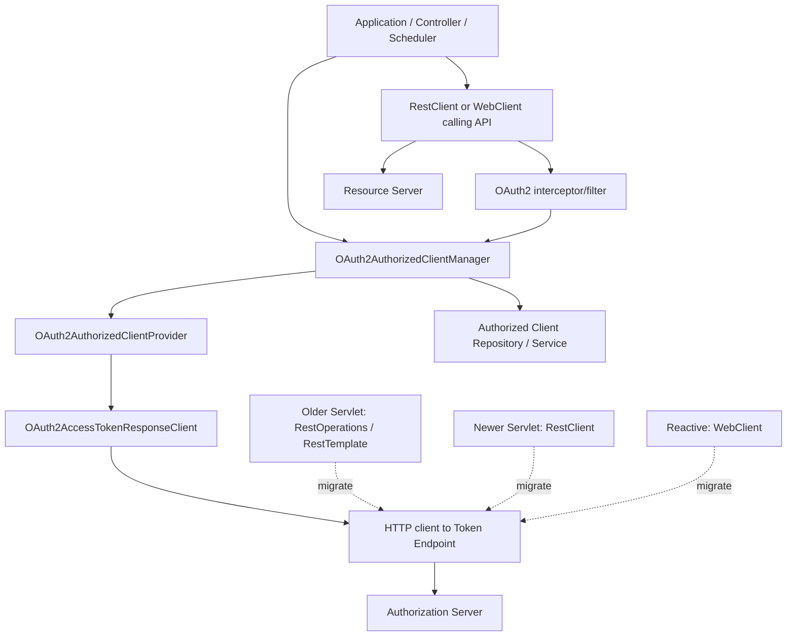

# 33.5. Cross-Referencing Token Response Client and HTTP Client APIs Across Versions

> **Module:** Spring Security OAuth 2.0 OIDC Client  
> **Chapter:** 33. Compatibility and Upgrades  
> **Scope:** API migration path for OAuth 2.0/OpenID Connect Client integrations across Spring Security 5.x, 6.x, and 7.x; specifically `OAuth2AccessTokenResponseClient`, `ReactiveOAuth2AccessTokenResponseClient`, `RestOperations`/`RestTemplate`, `RestClient`, and `WebClient` implementations.

When upgrading Spring Security, it is common to see code compile cleanly while Token Endpoint behavior changes. An older configuration using `DefaultAuthorizationCodeTokenResponseClient`, `setRequestEntityConverter(...)`, and `setRestOperations(...)` may no longer be recommended; a newer configuration using `RestClientAuthorizationCodeTokenResponseClient`, `addParametersConverter(...)`, and `setRestClient(...)` has different semantics. In particular, when constructing a custom `RestClient` and forgetting the HTTP form converter or OAuth2 error handler, login may fail with 415/400 or fail to parse `invalid_grant` even though Client ID, secret, and redirect URI are all correct.

In WebFlux, access continues to rely on `WebClient` and the reactive interface `ReactiveOAuth2AccessTokenResponseClient`. However, the hooks for inserting, overriding, or removing token request parameters have been refined across newer Spring Security releases. At the same time, Spring Security 7.x APIs continue removing legacy deprecated mechanisms, especially the password grant.

This lesson guides you through **cross-referencing by version and by responsibility**, avoiding mechanical class find-and-replace. Key milestones are grounded in Spring Security 6.4, 6.5, and 7.0 documentation; in real deployments, always check the docs/Javadoc for the **exact patch version in your dependency tree** because availability, deprecations, and auto-configuration can vary.

---

## 1. Learning Objectives

After this lesson, you will be able to:

1. Distinguish an HTTP client calling the **Token Endpoint** from an HTTP client calling a **Resource Server API**.
2. Understand `OAuth2AccessTokenResponseClient<T>` as the synchronous abstraction for exchanging an OAuth2 grant for a token response.
3. Understand `ReactiveOAuth2AccessTokenResponseClient<T>` as the nonblocking abstraction returning `Mono<OAuth2AccessTokenResponse>`.
4. Cross-reference the `Default*TokenResponseClient` family using `RestOperations` with the `RestClient*TokenResponseClient` family in newer releases.
5. Know why Spring Security 6.4 is a major milestone for migrating from `RestTemplate` to `RestClient` on the Servlet stack.
6. Distinguish synchronous `RestClient` from reactive `WebClient`, avoiding mixing classes across the two stacks.
7. Understand `addHeadersConverter`, `setHeadersConverter`, `addParametersConverter`, `setParametersConverter`, and `setParametersCustomizer`.
8. Distinguish **adding** request parameters, **overriding** defaults, and **removing** default parameters.
9. Explain why swapping only the implementation class is insufficient when headers, bodies, response converters, or error handlers are customized.
10. Use `OAuth2AccessTokenResponseHttpMessageConverter` and `OAuth2ErrorResponseErrorHandler` inside a custom `RestClient`.
11. Understand `setBodyExtractor` and `setWebClient` on reactive token response clients.
12. Understand generic-grant-type bean auto-wiring starting in Spring Security 6.2+ and what to test so a bean is not "created yet unused".
13. Know how to wire token response clients into `oauth2Login`, `oauth2Client`, and authorized-client providers/managers.
14. Cross-reference `authorization_code`, `refresh_token`, `client_credentials`, JWT bearer, and token exchange grants.
15. Understand that the password grant has no `RestClient*` replacement and was removed in Spring Security 7.0.
16. Separate client authentication customization (`client_secret_basic`, `client_secret_post`, `private_key_jwt`) from token response parsing.
17. Avoid dropping `code_verifier`, `redirect_uri`, or `grant_type` when customizing token requests.
18. Design regression tests with a fake Authorization Server for both token success and OAuth2 Error cases.
19. Build a step-by-step migration strategy via Spring Boot dependency management.
20. Protect secrets/tokens from HTTP wiretaps, header/body logs, and proxies while debugging upgrades.

## 2. First: Two Often-Confused HTTP Client Roles

An OAuth2 Client makes two important kinds of HTTP requests.

**A. Token request:** The Client calls the Authorization Server's Token Endpoint:

```http
POST /oauth2/token HTTP/1.1
Host: login.example.test
Content-Type: application/x-www-form-urlencoded
Authorization: Basic <redacted-client-authentication>

grant_type=authorization_code&code=<redacted>&redirect_uri=...&code_verifier=<redacted>
```

Response:

```json
{
  "access_token": "<redacted>",
  "token_type": "Bearer",
  "expires_in": 300,
  "refresh_token": "<redacted>",
  "scope": "reports.read"
}
```

The HTTP client here lives **inside the token response client** and is used to acquire or refresh access tokens.

**B. Protected resource request:** The application calls a business API:

```http
GET /api/reports HTTP/1.1
Host: api.example.test
Authorization: Bearer <redacted-access-token>
```

The HTTP client here may be a `RestClient`/`WebClient` configured with an OAuth2 interceptor/filter to select an authorized client and attach the Bearer token.

**Important:** `RestClientAuthorizationCodeTokenResponseClient` is **not** a `RestClient` used directly to call `/api/reports`. Conversely, `OAuth2ClientHttpRequestInterceptor` supports protected resource requests, not Token Endpoint response parsing.

## 3. Architecture Diagram and Version-Specific Change Points



In the Servlet stack:

- `OAuth2AccessTokenResponseClient<T>` is a synchronous callback/strategy.
- A grant-specific provider invokes it to obtain an `OAuth2AccessTokenResponse`.
- Older implementations used `RestOperations`; newer implementations use `RestClient`.
- App code calling APIs may use `RestTemplate`, `RestClient`, or `WebClient` depending on code/version, but that is a **different HTTP flow**.

In WebFlux:

- `ReactiveOAuth2AccessTokenResponseClient<T>` uses a reactive contract.
- The `WebClientReactive*TokenResponseClient` family sends requests via `WebClient`.
- A `WebClient` calling APIs can integrate with a reactive authorized-client manager, but does not replace the token response client.

## 4. Version Milestone Comparison Table

| Milestone | Token response client on Servlet | HTTP transport | Migration notes |
|---|---|---|---|
| Spring Security 5.x | Typically `DefaultAuthorizationCodeTokenResponseClient` and corresponding `Default*` classes | `RestOperations`/`RestTemplate` | Custom `RequestEntity`, RestTemplate converters/error handler |
| Spring Security 6.0–6.3 | `Default*` implementations remain the standard path | Mainly RestTemplate for token requests | 6.2+ improves auto-configuration via generic token response client beans |
| Spring Security 6.4 | Adds `RestClient*TokenResponseClient` family; `Default*` family deprecated for migration | New synchronous `RestClient` | Migrate extension hooks, converters, error handler; cleaner parameter override/removal |
| Spring Security 6.5 | `RestClient*` family is the documented direction; legacy APIs on removal path | `RestClient` | Clean up deprecations before major upgrade |
| Spring Security 7.0 | Legacy deprecated APIs removed per migration; password grant removed | `RestClient` on Servlet, `WebClient` on reactive | Do not assume deprecated 6.x code compiles; check release notes/Javadoc |

**Context note:** Spring Framework 6.1 introduced `RestClient`. Spring Security 6.4 added the `RestClient`-based token response clients; they do not appear merely by upgrading Spring Framework on its own. Official 6.4 docs note the new implementations were introduced as a migration option; therefore **do not equate "having the `RestClient` class" with "the default token response implementation already changed" across all patches/versions**.

## 5. Actual Versions Come from the Dependency Tree

In a Spring Boot project, the Spring Security version is typically managed by the Boot BOM. Changing a single standalone dependency can create conflicts with Spring Framework, Jackson, or Netty.

Example:

```kotlin
plugins {
    id("org.springframework.boot") version "<compatible-boot-version>"
    id("io.spring.dependency-management") version "<compatible-version>"
    java
}

dependencies {
    implementation("org.springframework.boot:spring-boot-starter-security")
    implementation("org.springframework.boot:spring-boot-starter-oauth2-client")
}
```

This is an **illustrative skeleton**, not a BOM recommended for all versions.

When upgrading, determine:

- Spring Boot version.
- Actual Spring Security version.
- Spring Framework version.
- Java baseline.
- Servlet vs. WebFlux.
- Which dependency pulls in `spring-webflux`/Reactor Netty.
- Whether multiple versions of `spring-security-oauth2-client` exist on the runtime classpath.
- Whether custom code uses deprecated APIs.

Do not hardcode "latest" versions in long-lived deployment docs; inspect the dependency tree and release notes for the **exact version being built**.

## 6. Interface `OAuth2AccessTokenResponseClient<T>`

Synchronous contract:

```java
import org.springframework.security.oauth2.client.endpoint.OAuth2AccessTokenResponseClient;
import org.springframework.security.oauth2.core.endpoint.OAuth2AccessTokenResponse;

// T is the specific OAuth2 grant request type.
public interface OAuth2AccessTokenResponseClient<T> {
    OAuth2AccessTokenResponse getTokenResponse(T authorizationGrantRequest);
}
```

This is a **conceptual signature sketch**, not a substitute for exact-version Javadoc/generic bounds; in practice, the type parameter is bounded by `AbstractOAuth2AuthorizationGrantRequest`.

Responsibilities:

1. Accept a grant request containing `ClientRegistration` and grant-specific data.
2. Build the Token Endpoint HTTP request.
3. Execute Client authentication/HTTP transport.
4. Parse OAuth2 token success/error responses.
5. Return `OAuth2AccessTokenResponse` or raise an error per contract.

### 6.1. It Does Not Perform All of OIDC Login

The token response client does not by itself:

- Create/verify authorization request `state`.
- Redirect the browser to the Authorization Endpoint.
- Validate ID Token claims/nonce across the entire pipeline.
- Persist the HTTP session.
- Save the authorized client to a database.
- Call protected resource APIs.
- Revoke remote tokens.

Those steps live in other components. When swapping token response clients during migration, never drop security controls in upper layers.

## 7. Interface `ReactiveOAuth2AccessTokenResponseClient<T>`

The reactive path uses:

```java
import reactor.core.publisher.Mono;
import org.springframework.security.oauth2.client.endpoint.ReactiveOAuth2AccessTokenResponseClient;
import org.springframework.security.oauth2.core.endpoint.OAuth2AccessTokenResponse;

public interface ReactiveOAuth2AccessTokenResponseClient<T> {
    Mono<OAuth2AccessTokenResponse> getTokenResponse(T authorizationGrantRequest);
}
```

This too is a contract illustration; check exact generic type bounds per version.

Key differences:

- Never make blocking HTTP calls inside the event loop.
- Errors are emitted via reactive error signals.
- Timeout/retry/context propagation follow Reactor and the HTTP connector.
- No response is emitted until the pipeline is subscribed in the proper context.
- Custom response extractors must translate OAuth2 Errors into reactive errors rather than "returning a fake token" on HTTP 400.

### 7.1. Do Not Force `RestClient` into a Reactive Chain Arbitrarily

`RestClient` is synchronous. Calling it directly inside `Mono.map(...)` on the event loop blocks threads and hurts scalability. If a WebFlux project has an unavoidable blocking dependency, isolate/offload it properly—but prefer `WebClientReactive*TokenResponseClient`.

## 8. Implementation Mapping by Grant Type

| Grant | Legacy Servlet API (`RestOperations`) | Modern Servlet API (`RestClient`) | Reactive (`WebClient`) |
|---|---|---|---|
| Authorization Code | `DefaultAuthorizationCodeTokenResponseClient` | `RestClientAuthorizationCodeTokenResponseClient` | `WebClientReactiveAuthorizationCodeTokenResponseClient` |
| Refresh Token | `DefaultRefreshTokenTokenResponseClient` | `RestClientRefreshTokenTokenResponseClient` | `WebClientReactiveRefreshTokenTokenResponseClient` |
| Client Credentials | `DefaultClientCredentialsTokenResponseClient` | `RestClientClientCredentialsTokenResponseClient` | `WebClientReactiveClientCredentialsTokenResponseClient` |
| JWT Bearer grant | `DefaultJwtBearerTokenResponseClient` (in supported versions) | `RestClientJwtBearerTokenResponseClient` | `WebClientReactiveJwtBearerTokenResponseClient` |
| Token Exchange | `DefaultTokenExchangeTokenResponseClient` (in supported versions) | `RestClientTokenExchangeTokenResponseClient` | `WebClientReactiveTokenExchangeTokenResponseClient` |
| Resource Owner Password | `DefaultPasswordTokenResponseClient` in older versions | **No replacement**; drop grant | Legacy support in older versions; 7.x does not support password grant |

Not every class in this table exists in **every** Spring Security 5.x/6.x patch; JWT Bearer and Token Exchange in particular were added over time. Check exact-version Javadoc before copying imports.

### 8.1. Password Grant Differs from Client Credentials

The password grant passes the resource owner's username/password to the Client and is no longer recommended by OAuth2 Security Best Current Practice. Spring Security 7.0 removed password grant support. Do not "migrate" it to Client Credentials because Client Credentials represents the **Client itself**, not a user; redesign the flow using Authorization Code + PKCE, Device Authorization, or an appropriate mechanism for the actor.

## 9. Cross-Referencing Authorization Code Token Response Clients

**Legacy API (Spring Security 5.x/6.x before migration):**

```java
import org.springframework.security.oauth2.client.endpoint
    .DefaultAuthorizationCodeTokenResponseClient;

DefaultAuthorizationCodeTokenResponseClient client =
    new DefaultAuthorizationCodeTokenResponseClient();

client.setRequestEntityConverter(customRequestEntityConverter);
client.setRestOperations(customRestOperations);
```

`customRequestEntityConverter` and `customRestOperations` are **application-created objects**. The snippet highlights the shape of the old extension points.

**New API (from 6.4):**

```java
import org.springframework.security.oauth2.client.endpoint
    .RestClientAuthorizationCodeTokenResponseClient;

RestClientAuthorizationCodeTokenResponseClient client =
    new RestClientAuthorizationCodeTokenResponseClient();

client.addParametersConverter(grantRequest -> {
    LinkedMultiValueMap<String, String> extra =
        new LinkedMultiValueMap<>();
    extra.set("audience", "https://reports-api.example.test");
    return extra;
});

// Only when custom transport is genuinely needed:
client.setRestClient(customRestClient);
```

`customRestClient` must be configured to send form bodies, parse token responses, and handle OAuth2 errors properly. The new API is **not a direct swap** from `setRestOperations` to `setRestClient` while keeping a `RestTemplate` object unchanged; types/interfaces and message conversion differ.

## 10. Differences Among `RestTemplate`, `RestOperations`, and `RestClient`

| Characteristic | `RestOperations`/`RestTemplate` | `RestClient` | `WebClient` |
|---|---|---|---|
| Execution model | Synchronous/blocking | Synchronous/blocking | Reactive/nonblocking contract |
| API style | `exchange`/`postForEntity` | Fluent request builder | Fluent reactive builder |
| Token response client history | `Default*` family | `RestClient*` family from 6.4 | `WebClientReactive*` family |
| Request form serialization | `HttpMessageConverters` | `HttpMessageConverters` | WebFlux codecs |
| Response parsing | `HttpMessageConverters` | `HttpMessageConverters` | `BodyExtractors`/codecs |
| Error handling | `ResponseErrorHandler` | `RestClient` status handler | `WebClient` response/error handling |
| Runtime | Servlet/synchronous flows | Servlet/synchronous flows | Reactive WebFlux, sometimes used from Servlet with proper coordination |
| Business API client | Supported | Supported | Supported in matching execution model |

Spring Framework's `RestClient` is more than just "a renamed `RestTemplate`", though it offers a migration path: `RestClient.create(restTemplate)` can reuse some `RestTemplate` settings. You must still verify converters, error handlers, interceptors, and semantics when targeting the Token Endpoint.

## 11. Why Is `RestClient` Preferred in the Modern API?

`RestClient` provides a cleaner separation for:

- Default/extra headers.
- Request content type.
- Request body/form.
- `ClientHttpRequestFactory` for HTTP transport, proxy, TLS, and timeouts.
- HTTP message converters.
- Status handlers.
- Request interceptors.

Spring Security 6.4 aimed to align Servlet and Reactive extension hooks rather than having two starkly different customization models.

### 11.1. No Need to "Convert the Whole App to Reactive"

Replacing `DefaultAuthorizationCodeTokenResponseClient` with `RestClientAuthorizationCodeTokenResponseClient` **does not** turn a Servlet app into WebFlux. Both `RestTemplate` and `RestClient` are synchronous here; migration is primarily an API/configuration change.

## 12. Customizing Authorization Code Headers with the New API

Use `addHeadersConverter` when only **adding** headers without rebuilding the entire header set:

```java
import org.springframework.http.HttpHeaders;
import org.springframework.security.oauth2.client.endpoint.RestClientAuthorizationCodeTokenResponseClient;

RestClientAuthorizationCodeTokenResponseClient client =
    new RestClientAuthorizationCodeTokenResponseClient();

client.addHeadersConverter(grantRequest -> {
    HttpHeaders headers = new HttpHeaders();
    if ("corporate".equals(
            grantRequest.getClientRegistration().getRegistrationId())) {
        headers.set(HttpHeaders.USER_AGENT, "report-portal/1.0");
    }
    return headers;
});
```

This illustrates an app-specific header containing no secrets.

**Do not** replace all headers just to add a `User-Agent`: doing so can drop `Content-Type`, `Accept`, or Client authentication.

### 12.1. `setHeadersConverter` Overrides Header Creation

When the converter must be replaced completely:

```java
DefaultOAuth2TokenRequestHeadersConverter<OAuth2AuthorizationCodeGrantRequest>
    headersConverter = new DefaultOAuth2TokenRequestHeadersConverter<>();

headersConverter.setEncodeClientCredentials(false);

RestClientAuthorizationCodeTokenResponseClient client =
    new RestClientAuthorizationCodeTokenResponseClient();

client.setHeadersConverter(headersConverter);
```

This example addresses a specific OP compatibility requirement; it is **not** a recommended default. Changing client credential encoding can affect `client_secret_basic` compliance/interoperability. Only do this if the provider contract requires it and you verify the actual HTTP request bytes.

## 13. Adding Token Request Parameters with `addParametersConverter`

An OP may require an extra `audience` or `resource` parameter during code exchange:

```java
import org.springframework.security.oauth2.client.endpoint.RestClientAuthorizationCodeTokenResponseClient;
import org.springframework.util.LinkedMultiValueMap;
import org.springframework.util.MultiValueMap;

RestClientAuthorizationCodeTokenResponseClient client =
    new RestClientAuthorizationCodeTokenResponseClient();

client.addParametersConverter(grantRequest -> {
    MultiValueMap<String, String> params =
        new LinkedMultiValueMap<>();

    if ("reports".equals(
            grantRequest.getClientRegistration().getRegistrationId())) {
        params.set("audience", "https://reports-api.example.test");
    }
    return params;
});
```

When adding parameters, defaults for `grant_type=authorization_code`, `code`, `redirect_uri`, and `code_verifier` (when PKCE applies) must still be handled by the framework. Never manually concatenate authorization codes into query strings.

### 13.1. Add Parameters Only on the Right Grant

`audience` at the Authorization Endpoint may differ from `audience` at the Token Endpoint. If a provider requires parameters at both steps, customize both the **authorization request resolver** and the **token response client**; do not assume one hook affects both.

### 13.2. Resource Indicators (RFC 8707)

When an OP supports `resource`, a token request can include a resource indicator. Names, semantics, and support depend on the provider; never pass arbitrary user-supplied URLs into this parameter. Pick resources from an allowlist tied to the registration and API audience.

## 14. `setParametersConverter` Is Not `addParametersConverter`

The new hooks have distinct roles:

| Hook | Purpose | Notes |
|---|---|---|
| `addParametersConverter(...)` | Appends parameters after defaults | Used for typical `audience`/custom params |
| `setParametersConverter(...)` | Converter that can override default/existing values | Does not remove all defaults |
| `setParametersCustomizer(...)` | Operates on the final parameter map, including removing defaults | Use with great caution |
| `addHeadersConverter(...)` | Adds headers | Preserves default Client authentication headers |
| `setHeadersConverter(...)` | Builds headers itself | Must preserve required headers/auth method |

Per the 6.4 documentation, `setParametersConverter` only lets you override keys, whereas **removing** a default parameter requires `setParametersCustomizer`. These methods may share similar names across Servlet/Reactive clients, so check the Javadoc for each implementation/version.

## 15. Example: Overriding a Request Parameter

Suppose a provider has a compatibility exception requiring a different `client_id` than the registration value (a rare case needing careful review):

```java
RestClientRefreshTokenTokenResponseClient client =
    new RestClientRefreshTokenTokenResponseClient();

client.setParametersConverter(grantRequest -> {
    LinkedMultiValueMap<String, String> params =
        new LinkedMultiValueMap<>();

    if ("legacy".equals(
            grantRequest.getClientRegistration().getRegistrationId())) {
        params.set("client_id", "legacy-client-id");
    }
    return params;
});
```

This **illustrates override semantics**, not a pattern to apply mechanically: Client authentication and grant binding can break if `client_id` diverges from the AS. In real scenarios, fix `ClientRegistration` or the provider integration contract before overriding core fields.

### 15.1. Do Not Use `setParametersConverter` to "Delete" Defaults

Returning `new LinkedMultiValueMap<>()` still allows the framework to populate default parameters. Never treat an empty map as a way to suppress `client_id` or `grant_type`.

## 16. Removing a Parameter After Creation with `setParametersCustomizer`

In some JWT Client authentication flows, an AS forbids sending both `client_assertion` and a separate `client_id` in the form body.

Depending on the provider contract, you can write:

```java
import org.springframework.security.oauth2.core.OAuth2ParameterNames;
import org.springframework.security.oauth2.client.endpoint.RestClientClientCredentialsTokenResponseClient;

RestClientClientCredentialsTokenResponseClient client =
    new RestClientClientCredentialsTokenResponseClient();

client.setParametersCustomizer(parameters -> {
    if (parameters.containsKey(OAuth2ParameterNames.CLIENT_ASSERTION)) {
        parameters.remove(OAuth2ParameterNames.CLIENT_ID);
    }
});
```

**This is not a universal rule for `private_key_jwt`.** Whether `client_id` may be omitted depends on the grant, client authentication method, and AS policy. You must also verify `client_assertion_type`, signatures, assertion `aud`/`iss`/`sub`, and key rotation.

### 16.1. Never Arbitrarily Remove `grant_type`, `code`, or `verifier`

Fields such as `grant_type`, `code`, `redirect_uri`, and `code_verifier` (for PKCE) are protocol bindings. Removing them to "stop the server from complaining" usually indicates misconfiguration and weakens security. Write negative tests to catch customizations that accidentally drop required fields.

## 17. Which Converters Does the Default Token Endpoint `RestClient` Need?

A configuration matching the defaults described in modern Spring Security docs typically looks like:

```java
import org.springframework.http.converter.FormHttpMessageConverter;
import org.springframework.security.oauth2.core.http.converter.OAuth2AccessTokenResponseHttpMessageConverter;
import org.springframework.security.oauth2.client.http.OAuth2ErrorResponseErrorHandler;
import org.springframework.web.client.RestClient;

RestClient tokenRestClient = RestClient.builder()
    .messageConverters(converters -> {
        converters.clear();
        converters.add(new FormHttpMessageConverter());
        converters.add(new OAuth2AccessTokenResponseHttpMessageConverter());
    })
    .defaultStatusHandler(new OAuth2ErrorResponseErrorHandler())
    .build();
```

This illustrates the reference setup: a form converter to send the Token Request, a token response converter, and an OAuth2 Error handler.

**Do not** switch to a generic JSON converter expecting `OAuth2Error`/`TokenResponse` semantics to remain intact.

### 17.1. Why Is `FormHttpMessageConverter` Needed?

OAuth2 Token Requests for common grants use an `application/x-www-form-urlencoded` POST body. A custom `RestClient` configured with only a JSON converter cannot serialize `MultiValueMap<String,String>`.

### 17.2. Why Is `OAuth2AccessTokenResponseHttpMessageConverter` Needed?

It converts token response parameters into `OAuth2AccessTokenResponse`, interpreting token type, expiry, scopes, and additional parameters per the framework contract. A generic JSON-to-Map converter does not know these token semantics.

### 17.3. The Error Handler Matters Just as Much as the Happy Path

The AS may return:

```http
HTTP/1.1 400 Bad Request
Content-Type: application/json

{"error":"invalid_grant","error_description":"Authorization code is invalid"}
```

If a custom `RestClient` throws only a generic HTTP exception, upper layers may fail to receive an OAuth2 Error per the contract, causing wrong retries or broken diagnostics. Test HTTP 400/401/429/5xx cases.

## 18. Replacing `setRestOperations` with `setRestClient` Properly

Legacy configuration:

```java
RestTemplate restTemplate = new RestTemplate(
    Arrays.asList(
        new FormHttpMessageConverter(),
        new OAuth2AccessTokenResponseHttpMessageConverter()
    )
);
restTemplate.setErrorHandler(new OAuth2ErrorResponseErrorHandler());

DefaultAuthorizationCodeTokenResponseClient client =
    new DefaultAuthorizationCodeTokenResponseClient();
client.setRestOperations(restTemplate);
```

Modern configuration:

```java
RestClient restClient = RestClient.builder()
    .messageConverters(converters -> {
        converters.clear();
        converters.add(new FormHttpMessageConverter());
        converters.add(new OAuth2AccessTokenResponseHttpMessageConverter());
    })
    .defaultStatusHandler(new OAuth2ErrorResponseErrorHandler())
    .build();

RestClientAuthorizationCodeTokenResponseClient client =
    new RestClientAuthorizationCodeTokenResponseClient();
client.setRestClient(restClient);
```

This is a conceptual comparison. Real projects may retain custom request factories, proxies, TLS, and timeouts—whose exact migration must be verified against your Spring Framework version's APIs.

### 18.1. Is `RestClient.create(restTemplate)` a One-Line Solution?

Spring Framework supports creating a `RestClient` from a `RestTemplate` as a migration aid. However, inspect the result for:

- Interceptors.
- Message converters.
- Error handling.
- Default headers.
- `ClientHttpRequestFactory`.
- Proxy/TLS/timeouts.
- Interaction between old and new configurations.

Never treat `RestClient.create(restTemplate)` as proof that Token Endpoint semantics are preserved without regression tests.

## 19. Custom Response Converters: Non-Standard AS Cases

An AS might return `expires_in` as a string, add a `custom_claim`, or use a legacy format outside the spec.

In the new Servlet API, you can customize `OAuth2AccessTokenResponseHttpMessageConverter`:

```java
OAuth2AccessTokenResponseHttpMessageConverter converter =
    new OAuth2AccessTokenResponseHttpMessageConverter();

converter.setAccessTokenResponseConverter(parameters -> {
    // Convert parameters per provider contract.
    // Must produce a valid OAuth2AccessTokenResponse.
    // Do not drop refresh_token or additionalParameters arbitrarily.
    return convertLegacyResponse(parameters);
});

RestClient restClient = RestClient.builder()
    .messageConverters(converters -> {
        converters.clear();
        converters.add(new FormHttpMessageConverter());
        converters.add(converter);
    })
    .defaultStatusHandler(new OAuth2ErrorResponseErrorHandler())
    .build();
```

`convertLegacyResponse` is an **application-defined function**, not a Spring Security API. Check the converter Javadoc signature and parsing logic for your exact version.

### 19.1. Fields That Must Be Preserved Accurately

- Non-empty `access_token`.
- Supported `token_type` (usually `Bearer`).
- Properly scaled and bounded `expires_in`.
- `scope`/scope set.
- `refresh_token` if returned, including during refresh token rotation.
- `id_token` and other OIDC additional parameters used for login validation.
- Custom parameters only as needed and never leaked to logs.

**Warning:** A hand-written converter that copies only the access token and drops `id_token` will cause OIDC Login to fail even when the OAuth2 Token Response is HTTP 200.

## 20. OAuth2 Error Response Converter

A legacy AS might return non-standard error fields. Depending on the project, customize:

```java
OAuth2ErrorHttpMessageConverter errorConverter =
    new OAuth2ErrorHttpMessageConverter();

errorConverter.setErrorConverter(parameters -> {
    String code = String.valueOf(
        parameters.getOrDefault("error", "oauth2_error")
    );
    return new OAuth2Error(code);
});

OAuth2ErrorResponseErrorHandler handler =
    new OAuth2ErrorResponseErrorHandler();
handler.setErrorConverter(errorConverter);
```

This snippet is illustrative. In production, use an allowlist of error codes, verify converter API types for your version, and never dump raw provider `error_description` payloads into logs or tickets.

### 20.1. Do Not "Make Every Error Retryable"

`invalid_client`, `invalid_grant`, and `invalid_scope` mean something very different from 503/timeout. The migrated converter/error handler must preserve classification so the authorized-client manager or login failure handler reacts properly.

## 21. Reactive: `WebClientReactiveAuthorizationCodeTokenResponseClient`

In WebFlux, the primary implementation remains:

```java
import org.springframework.security.oauth2.client.endpoint.WebClientReactiveAuthorizationCodeTokenResponseClient;
import org.springframework.security.oauth2.client.endpoint.ReactiveOAuth2AccessTokenResponseClient;
import org.springframework.security.oauth2.client.endpoint.OAuth2AuthorizationCodeGrantRequest;

@Bean
ReactiveOAuth2AccessTokenResponseClient<OAuth2AuthorizationCodeGrantRequest>
authorizationCodeTokenResponseClient() {
    WebClientReactiveAuthorizationCodeTokenResponseClient client =
        new WebClientReactiveAuthorizationCodeTokenResponseClient();

    client.addParametersConverter(grantRequest -> {
        LinkedMultiValueMap<String, String> parameters =
            new LinkedMultiValueMap<>();
        parameters.set("audience", "https://reports-api.example.test");
        return parameters;
    });

    return client;
}
```

Imports for `LinkedMultiValueMap` and `Bean` shown in earlier examples must be included in a complete Java file.

### 21.1. `WebClient` Does Not Mean Calling the Token Endpoint Before Every API Request

The reactive authorized-client manager/service decides whether to reuse or refresh tokens based on validity. The token response client sends a Token Request only when the provider/manager needs a token. Do not invoke it directly in every controller request without a clear protocol reason.

### 21.2. Avoid `.block()`

Never call `tokenResponseClient.getTokenResponse(...).block()` inside the WebFlux event loop. That blocks threads, risking runtime errors or throughput collapse. Compose `Mono` and let the framework subscribe in the right context.

## 22. Reactive `addHeadersConverter` and `setHeadersConverter`

Newer APIs align closely with the Servlet pattern:

```java
WebClientReactiveAuthorizationCodeTokenResponseClient client =
    new WebClientReactiveAuthorizationCodeTokenResponseClient();

client.addHeadersConverter(grantRequest -> {
    HttpHeaders headers = new HttpHeaders();
    headers.set(HttpHeaders.USER_AGENT, "report-portal/1.0");
    return headers;
});
```

When replacing the headers converter:

```java
DefaultOAuth2TokenRequestHeadersConverter<OAuth2AuthorizationCodeGrantRequest>
    converter = new DefaultOAuth2TokenRequestHeadersConverter<>();

// Illustrative only when OP requires compatibility:
converter.setEncodeClientCredentials(false);
client.setHeadersConverter(converter);
```

Check the actual Client authentication method (basic/post/private_key_jwt/none), because replacing the whole converter can disable required headers in ways mock principal tests will not catch.

## 23. Reactive `setParametersConverter` and `setParametersCustomizer`

With 6.4 improvements, reactive clients can override and omit default parameters via matching hooks.

Adding a custom parameter:

```java
WebClientReactiveRefreshTokenTokenResponseClient client =
    new WebClientReactiveRefreshTokenTokenResponseClient();

client.addParametersConverter(grantRequest -> {
    LinkedMultiValueMap<String, String> params =
        new LinkedMultiValueMap<>();
    params.set("resource", "https://reports-api.example.test");
    return params;
});
```

Conditionally removing a parameter per provider contract:

```java
client.setParametersCustomizer(params -> {
    if (params.containsKey(OAuth2ParameterNames.CLIENT_ASSERTION)) {
        params.remove(OAuth2ParameterNames.CLIENT_ID);
    }
});
```

Do not assume `setParametersCustomizer` has the exact same overload in **every** 6.x version: check the API/Javadoc of your build dependency; Spring Security 6.3 and earlier had customization limitations on the reactive stack.

## 24. Reactive Response Conversion: `BodyExtractor`

When customizing the Token Response `BodyExtractor`:

```java
WebClientReactiveAuthorizationCodeTokenResponseClient client =
    new WebClientReactiveAuthorizationCodeTokenResponseClient();

client.setBodyExtractor((input, context) -> {
    // Reactive body extractor hook.
    // Must parse success responses and emit OAuth2 errors per contract.
    return customOAuth2TokenExtractor(input, context);
});
```

`customOAuth2TokenExtractor` is an illustrative function you implement with the exact `BodyExtractor<Mono<OAuth2AccessTokenResponse>, ReactiveHttpInputMessage>` signature for your version. Do not simply call `BodyExtractors.toMono(Map.class)` and return `Mono.empty()` on errors, or the authorized-client manager will misbehave.

### 24.1. Additional Responsibilities of a Custom `BodyExtractor`

- Parse JSON/body according to `Content-Type`.
- Extract access token, token type, expiry, and scopes.
- Preserve refresh token, ID Token, and additional parameters.
- Signal error responses with `Mono.error(...)` per the OAuth2 error contract.
- Never print response bodies containing credentials.
- Bound payload size and timeouts via `WebClient` configuration.

If you only need to adjust a custom field, prefer the smallest hook supported by your version instead of replacing the entire extractor.

## 25. Reactive `setWebClient` and How It Differs from `setRestClient`

Example:

```java
WebClient webClient = WebClient.builder()
    // Configure connector, timeouts, proxy, codecs as needed.
    .build();

WebClientReactiveAuthorizationCodeTokenResponseClient client =
    new WebClientReactiveAuthorizationCodeTokenResponseClient();

client.setWebClient(webClient);
```

When replacing `WebClient`, consider:

- OAuth2 form body encoding.
- Token response codecs.
- HTTP error mapping.
- Timeouts/retries.
- TLS trust/proxy.
- Request/response filters and header propagation.
- Reactor Context.
- Wiretap/log redaction.

Never take a Business API `WebClient` that carries a Bearer interceptor and pass it to the Token Endpoint client: it can attach the **wrong access token** to the AS or cause authorization recursion.

## 26. Separate the Token Endpoint `WebClient` from the API `WebClient`

A project can maintain:

```text
tokenWebClient:
  base target: OP token endpoint
  client authentication
  form requests / OAuth2 Error parsing
  no default Bearer user token filter

resourceWebClient:
  base target: reports-api
  OAuth2 authorized client filter
  Authorization: Bearer ...
  API-specific retries/decoders
```

Separate the two clients so tokens or Client secrets are never sent to the wrong destination. If they share proxy/TLS settings, reuse only the reviewed transport setup—never reuse all security filters blindly.

## 27. Generic Bean Type Injection Starting in Spring Security 6.2+

A major API/configuration improvement is publishing beans typed by generic grant:

```java
@Bean
OAuth2AccessTokenResponseClient<OAuth2AuthorizationCodeGrantRequest>
authorizationCodeTokenResponseClient() {
    RestClientAuthorizationCodeTokenResponseClient client =
        new RestClientAuthorizationCodeTokenResponseClient();

    client.addParametersConverter(grantRequest -> {
        LinkedMultiValueMap<String, String> params =
            new LinkedMultiValueMap<>();
        params.set("audience", "https://reports-api.example.test");
        return params;
    });

    return client;
}
```

6.2+ documentation describes how Spring Security can match the generic grant type to select the right bean and configure default OAuth2 Client components.

### 27.1. What to Verify

- Is the type parameter actually `OAuth2AuthorizationCodeGrantRequest`?
- Was the bean declared as raw `OAuth2AccessTokenResponseClient` without generics?
- Are there two beans with the same generic type causing ambiguity?
- Does the application publish its own `OAuth2AuthorizedClientManager` with a custom provider chain, bypassing auto-configuration?
- Do both the login filter and authorized-client manager use the intended client?
- Is the project on 6.1/6.0 and therefore lacking the 6.2+ auto-wiring behavior?

**Test that the bean is actually invoked**, not merely that it exists in the context.

## 28. Explicit Wiring into `oauth2Login()` `tokenEndpoint()`

For Servlet Login, instead of relying solely on bean publishing, you can wire explicitly:

```java
@Bean
SecurityFilterChain securityFilterChain(
        HttpSecurity http,
        OAuth2AccessTokenResponseClient<OAuth2AuthorizationCodeGrantRequest>
            authorizationCodeClient) throws Exception {

    return http
        .authorizeHttpRequests(auth -> auth
            .anyRequest().authenticated()
        )
        .oauth2Login(login -> login
            .tokenEndpoint(token ->
                token.accessTokenResponseClient(authorizationCodeClient)
            )
        )
        .build();
}
```

This example targets the Spring Security Servlet DSL methods available in 6.x/7.x. When also using `oauth2Client` authorization code grant outside browser login, check the second configuration path as well.

### 28.1. `oauth2Login` and `oauth2Client` Are Not Configured in One Single Place

- `oauth2Login` manages browser login/callbacks.
- `oauth2Client`/authorized-client manager handles authorization outside login and token reuse/refresh when calling APIs.
- A custom token response client may be wired in one place while left unconfigured in the other.

If the provider requires `audience` during login code exchange, yet background refresh/token calls omit it, the flows will diverge. Write regression tests for each grant.

## 29. Explicit Wiring for `OAuth2AuthorizedClientProvider`

One approach is a custom provider builder:

```java
OAuth2AuthorizedClientProvider provider =
    OAuth2AuthorizedClientProviderBuilder.builder()
        .clientCredentials(config -> config
            .accessTokenResponseClient(
                clientCredentialsTokenResponseClient
            )
        )
        .refreshToken(config -> config
            .accessTokenResponseClient(
                refreshTokenResponseClient
            )
        )
        .build();
```

This is a modern Servlet API pattern; the two token response client variables are created/configured elsewhere with exact generic types. Some builders/overloads change across versions, so check your project version's Javadoc.

### 29.1. Do Not Equate the Authorization Provider with the Response Client

`OAuth2AuthorizedClientProvider` decides when a client needs authorization/refresh; `OAuth2AccessTokenResponseClient` performs the Token Endpoint HTTP call. Replacing the response client does not automatically alter refresh policy, clock skew, token persistence, or failure handlers.

## 30. `RestClient` for Calling Resource Servers: 6.4+ Use Case

Spring Security 6.4 introduced an integration allowing `RestClient` to send Bearer tokens from `OAuth2AuthorizedClientManager` via an interceptor:

```java
import org.springframework.context.annotation.Bean;
import org.springframework.security.oauth2.client.OAuth2AuthorizedClientManager;
import org.springframework.security.oauth2.client.web.client.OAuth2ClientHttpRequestInterceptor;
import org.springframework.web.client.RestClient;

@Bean
RestClient reportsRestClient(
        RestClient.Builder builder,
        OAuth2AuthorizedClientManager manager) {

    OAuth2ClientHttpRequestInterceptor interceptor =
        new OAuth2ClientHttpRequestInterceptor(manager);

    return builder
        .requestInterceptor(interceptor)
        .build();
}
```

When calling an API, the app must choose the authorized client/registration per policy and never send tokens to arbitrary URLs.

### 30.1. Selecting Registration via Request Attributes

Illustrative example:

```java
import static org.springframework.security.oauth2.client.web.client
    .RequestAttributeClientRegistrationIdResolver.clientRegistrationId;

Report report = reportsRestClient.get()
    .uri("https://api.example.test/reports/current")
    .attributes(clientRegistrationId("reports-client"))
    .retrieve()
    .body(Report.class);
```

Assumes an application-defined `Report` class. This API is an **outbound protected resource request**, not a token response client.

### 30.2. HTTP Transport Customization May Be Needed in Both Places

Proxy settings, mTLS, and trust stores can differ between the OP Token Endpoint and the Resource Server. If the Token Endpoint goes through a corporate proxy while the API uses a service mesh, configure two separate `RestClient`s. Never share Client secrets or auth headers across both destinations.

## 31. `WebClient` for Calling Resource Servers

In Servlet apps, `WebClient` has long integrated via an authorized-client filter. In WebFlux, `ServerOAuth2AuthorizedClientExchangeFilterFunction` integrates the reactive authorized-client manager.

Conceptual example:

```java
ServerOAuth2AuthorizedClientExchangeFilterFunction oauth2 =
    new ServerOAuth2AuthorizedClientExchangeFilterFunction(
        reactiveAuthorizedClientManager
    );

WebClient apiClient = WebClient.builder()
    .filter(oauth2)
    .build();
```

`reactiveAuthorizedClientManager` must be an appropriate `ReactiveOAuth2AuthorizedClientManager`. On each call, select the right authorized client/registration or context. Do not expect the filter to deduce every API audience from `uri()` alone.

### 31.1. Do Not Attach the `RestClient` Interceptor to `WebClient`

`OAuth2ClientHttpRequestInterceptor` belongs to `RestClient` integration, not `WebClient` `ExchangeFilterFunction`. Switching between Servlet and WebFlux requires changing both the execution model and integration point, not just renaming classes.

## 32. Client Credentials: Migration Must Check the Provider Chain

For machine-to-machine calls:

```text
OAuth2AuthorizedClientManager
    -> ClientCredentialsOAuth2AuthorizedClientProvider
    -> OAuth2AccessTokenResponseClient<OAuth2ClientCredentialsGrantRequest>
    -> Token Endpoint
```

Legacy API:

```java
DefaultClientCredentialsTokenResponseClient client =
    new DefaultClientCredentialsTokenResponseClient();

client.setRestOperations(customRestOperations);
```

New API:

```java
RestClientClientCredentialsTokenResponseClient client =
    new RestClientClientCredentialsTokenResponseClient();

client.addParametersConverter(grantRequest -> {
    LinkedMultiValueMap<String, String> extra =
        new LinkedMultiValueMap<>();
    extra.set("audience", "https://reports-api.example.test");
    return extra;
});
```

### 32.1. Do Not Unintentionally Use a Browser Principal for M2M

Client Credentials represents the application, not a logged-in user. The authorized-client manager/service key must be stable and decoupled from user sessions by design. During migration, if the manager uses a random per-request principal, it will re-issue tokens repeatedly and cause cache misses.

### 32.2. When Does a Provider Require a Resource Parameter?

Some AS implementations use `audience`, `resource`, or scoped resource registrations. Configure strictly per the verified provider contract; never populate parameter values from unvalidated user query input.

## 33. Refresh Token: Migration Must Verify Rotation

Legacy API:

```java
DefaultRefreshTokenTokenResponseClient client =
    new DefaultRefreshTokenTokenResponseClient();
client.setRestOperations(customRestOperations);
```

New API:

```java
RestClientRefreshTokenTokenResponseClient client =
    new RestClientRefreshTokenTokenResponseClient();
client.setRestClient(tokenRestClient);
```

Beyond verifying the request succeeds and parses an access token, check:

- Is the new refresh token saved?
- If the response omits a refresh token, does policy keep the old token per semantics?
- Are expiry and scopes parsed properly?
- Is `invalid_grant` translated into the appropriate authorization failure?
- When two pods refresh concurrently, is the new token ever overwritten or mistakenly deleted?
- Is Client authentication sent using the right method?
- Are raw refresh tokens ever logged in requests/responses?

### 33.1. Do Not Expect the Token Response Client to Solve Distributed Rotation

The token response client only executes the HTTP grant. Race control, CAS, locking, and durable authorized-client storage belong to another layer. Migrating `DefaultRefresh*` -> `RestClientRefresh*` does not automatically make a cluster safe when the AS rotates refresh tokens.

## 34. JWT Bearer and Token Exchange

Modern Spring Security supports additional grant types/extensions such as JWT Bearer and Token Exchange via dedicated response clients.

| Type | What to preserve |
|---|---|
| JWT Bearer grant | Assertion construction, Client auth, audience, signature, grant type, token response parsing |
| Token Exchange | Subject token, actor token if any, token type fields, resource/audience/scopes, policy |
| Client Credentials | Client identity, scopes, cache key, target resource |
| Authorization Code | Code, redirect URI, PKCE, state/nonce at login layer |
| Refresh | Refresh token, rotation, storage, `invalid_grant` handling |

Do not use `RestClientClientCredentialsTokenResponseClient` to emulate Token Exchange because required request parameters and trust semantics differ. Upgrade only to a version supporting the matching class and thoroughly test the grant-specific response client.

### 34.1. Client Assertion Differs from JWT Bearer Authorization Grant

`private_key_jwt` is a **Client authentication method**, whereas JWT Bearer grant is an **authorization grant type**. Both use JWTs, yet they are distinct. Tests must confirm `client_assertion` is never confused with `assertion` for the other grant.

## 35. Password Grant Was Removed in 7.x

Per Spring Security 7.0 "What's New", support for the Resource Owner Password Credentials grant was removed. 6.4 already provided no `RestClientPasswordTokenResponseClient` replacement.

Do not attempt to use private deprecated classes or fork them to keep sending usernames/passwords to the Token Endpoint.

Replacement paths by actor:

- Browser/web app: Authorization Code + PKCE or confidential Client per threat model.
- Native/public Client: Authorization Code + PKCE.
- Browser-constrained devices: Device Authorization Grant if supported by AS.
- M2M: Client Credentials when genuinely representing the Client.
- Delegation/impersonation: Token Exchange or a dedicated reviewed flow.

Migrating off the password grant is an **architecture and security protocol change**, not just swapping HTTP client implementations.

## 36. Watch Deprecations When Upgrading to 7.x

A 6.5 project that still compiles with deprecated APIs can fail on the major upgrade. Scan for:

```text
DefaultAuthorizationCodeTokenResponseClient
DefaultRefreshTokenTokenResponseClient
DefaultClientCredentialsTokenResponseClient
DefaultJwtBearerTokenResponseClient
DefaultTokenExchangeTokenResponseClient
DefaultPasswordTokenResponseClient
setRestOperations(...)
setRequestEntityConverter(...)
old password grant providers/managers
```

Do not assume all of these names exist in **every pre-7 version**; scan against actual dependencies. For each usage:

1. Identify the grant type.
2. Identify token request customizations.
3. Identify response/error customizations.
4. Identify HTTP transport/proxy/TLS.
5. Select the replacement class.
6. Write a regression test.
7. Wire it accurately.
8. Remove deprecated code/APIs before the major upgrade.

## 37. Separate "API Change" from "Behavior Change"

There are two kinds of migration:

**Source/API migration:** new imports, renamed classes, method signatures, bean wiring. The compiler and Javadoc catch much of this.

**Behavior migration:** form requests, encoding, response content types, error mapping, redirects/proxies, retries, socket timeouts. The compiler **cannot** guarantee this part.

For example:

```java
client.setRestClient(RestClient.create());
```

may compile cleanly without proving that `RestClient` has the converters and handlers configured for an OAuth2 Token Endpoint.

### 37.1. Diff at the HTTP Boundary

Against a fake AS, compare allowable properties:

- HTTP method POST.
- Token Endpoint URL.
- Form `Content-Type`.
- Grant type.
- Client authentication method.
- Presence of required grant parameters.
- Custom provider params.
- Response/error parsing.
- Retry/timeout behavior.

Never diff raw authorization codes or refresh tokens by printing them into CI logs.

## 38. HTTP Timeout, TLS, and Proxy Settings

Token requests can be affected when changing transport:

- Connection timeout.
- Read/response timeout.
- Connection pool.
- Proxy authentication.
- mTLS trust/key material.
- DNS resolution.
- Redirect following.
- TLS hostname verification.
- HTTP/2 negotiation.
- Retry strategy.

Configuration APIs live on `ClientHttpRequestFactory`/`RestClient` builder or `WebClient` connector/Reactor Netty, not necessarily on `TokenResponseClient`.

### 38.1. Never Disable TLS to Bypass a Regression

If migration triggers a certificate error, fix the truststore, mTLS, proxy, or issuer URL. Never enable "trust all certificates" or disable hostname verification in production, because token requests carry credentials.

### 38.2. Never Follow Arbitrary Redirects with Credentials

The Token Endpoint is normally a fixed endpoint. An HTTP client following redirects to another hostname can leak Client authentication headers/bodies. Verify redirect policies and allowlisted destinations.

## 39. Error Handling: 400 Differs from 401, 429, and 503

| Response | Typical meaning | What to test |
|---|---|---|
| 200 JSON token | Grant succeeded | Access token, expiry, refresh, ID Token |
| 400 `invalid_grant` | Code/refresh token invalid/expired/reused | Mapped to OAuth2 authorization failure |
| 400 `invalid_scope` | Scope disallowed | No blind retry |
| 401 `invalid_client` | Wrong Client authentication | Client secret never logged, right error classification |
| 429 rate limit | AS throttling | Policy-driven retry/backoff, no storm |
| 500/503 | AS error or unavailable | Bounded timeout/retry |
| 200 malformed JSON | Invalid protocol response | Never create a "partial" token |
| 200 non-Bearer `token_type` | Provider/token-type support | Validate, do not assume Bearer |
| 200 missing `access_token` | Invalid response | Fail closed |
| Slow response | Network/OP timeout | Latency budget |
| Wrong content type | Non-compliant OP | Explicit contract/compatibility policy |

In particular, `invalid_grant` after refresh rotation can signal a stale refresh token on another pod; the token response client must emit the error cleanly while the durable store handles concurrency.

## 40. Testing: Do Not Only Mock the OAuth2Authenticated Principal

A test using `oidcLogin()` or `mockOidcLogin()` injects a mock Authentication without making a Token Endpoint HTTP request. It cannot detect a broken converter after a `RestClient` migration.

You need a fake AS/OP:

```text
App / Spring Security
   |
   v
RestClient*TokenResponseClient or WebClientReactive*
   |
   v
Fake Token Endpoint
   |-- verify form + Client authentication
   |-- return 200 token response
   |-- return 400 invalid_grant
   |-- return 401 invalid_client
   |-- return malformed JSON
   +-- simulate timeout/503
```

Mock OIDC principals are valuable for authorization policy tests, but **do not replace** Token Endpoint integration tests.

## 41. Specific Tests for Authorization Code + OIDC Login

A full login integration test should verify:

1. RP creates the Authorization Request.
2. `state` and PKCE/nonce context are stored properly.
3. Fake OP issues an authorization code bound to Client/redirect/challenge.
4. RP receives the callback and validates `state`.
5. Token response client sends a POST form with `code`, `redirect_uri`, and `code_verifier` where applicable.
6. Fake OP enforces the right Client authentication.
7. Fake OP returns a signed ID Token/refresh token.
8. RP parses the Token Response without losing the `id_token` additional parameter.
9. OIDC layer validates issuer/audience/signature/nonce.
10. Authenticated session and authorized client are saved properly.
11. User calls a protected URL successfully.
12. Error paths never create an authenticated session.

Testing `getTokenResponse(...)` alone still requires additional tests to prove `oauth2Login` wiring actually uses the new client.

## 42. Specific Tests for Client Credentials

A fake AS Client Credentials test:

- Uses non-production client credentials.
- Client sends `grant_type=client_credentials`.
- Confirms Basic/post/`private_key_jwt` per configured method.
- Confirms scopes/resource/audience are sent per provider contract.
- Returns 200 access token with `expires_in`.
- Authorized-client manager reuses the token on the next request.
- When expired, the manager calls the Token Endpoint again.
- `invalid_client` is classified and does not retry infinitely.
- Creates no browser session and assumes no user principal.
- Never sends the access token to an API with the wrong audience.

## 43. Specific Tests for Refresh Token

Scenario:

1. Fake OP issues access token A1 and refresh token R1.
2. Save authorized client.
3. Advance test clock/force near-expiry state per test harness.
4. Manager invokes Refresh Grant with R1.
5. Fake AS returns A2 and optionally R2.
6. Verify the token store persists the new tokens.
7. A subsequent request uses A2.
8. Fake AS returns `invalid_grant` for old R1.
9. Error handler does not mistakenly delete the new R2 during a race.
10. Never log raw R1/R2.

Do not infer from refresh grant success that OIDC Authentication or the RP session was "re-logged in"; the two lifecycles are distinct.

## 44. Comparing Legacy and Modern Extension Points

| Need | Pre-6.4 Servlet | 6.4+ Servlet | WebFlux/Reactive |
|---|---|---|---|
| Exchange Authorization Code | `DefaultAuthorizationCodeTokenResponseClient` | `RestClientAuthorizationCodeTokenResponseClient` | `WebClientReactiveAuthorizationCodeTokenResponseClient` |
| Customize request | `setRequestEntityConverter` | `add/setParametersConverter`, headers converter/customizer | Similar reactive hooks by version |
| Swap transport | `setRestOperations(RestOperations)` | `setRestClient(RestClient)` | `setWebClient(WebClient)` |
| Parse success | `OAuth2AccessTokenResponseHttpMessageConverter` | Similar converter wired into `RestClient` | `BodyExtractor`/WebFlux codecs |
| Parse OAuth2 Error | `OAuth2ErrorResponseErrorHandler` | `RestClient.defaultStatusHandler` with OAuth2 error handler | Reactive error mapping/body extractor |
| Client calling protected API | `RestTemplate`/`WebClient` integration | `RestClient` + OAuth2 interceptor or `WebClient` | `WebClient` + reactive OAuth2 filter |
| Custom request headers | `RequestEntity` converter or `RestOperations` interceptors | `addHeadersConverter`/`setHeadersConverter` | Reactive headers converter |
| Override default parameters | Workaround/custom `RequestEntity` | `setParametersConverter` | Improved API in 6.4 |
| Omit default parameters | Custom request entity logic | `setParametersCustomizer` | Reactive `setParametersCustomizer` in 6.4+ |
| Error response parsing | `RestTemplate` error handler | `RestClient` status handler | `Mono.error`/OAuth2 error handling |

### 44.1. Do Not Pick Methods Just by Similar Names

`setParametersConverter` and `setRequestEntityConverter` do not take the same input/output types, nor do they share the same default-merge semantics. When porting code, refactor around the business intent (adding audience? changing client auth? parsing a legacy response?) rather than wrapping old lambdas verbatim.

## 45. Low-Risk Step-by-Step Migration

A practical plan:

**Step 1 — Inventory.** Find every `Default*TokenResponseClient`, `RestOperations`, `RestTemplate`, custom converter, error handler, manager, filter, and token cache.

**Step 2 — Pin baseline.** Record versions/JDK/Boot BOM and run tests with the old dependencies; capture a **redacted** expected Token Endpoint wire contract.

**Step 3 — Split by grant.** Authorization Code, Refresh, Client Credentials, JWT Bearer, Token Exchange; do not lump them into one converter.

**Step 4 — Choose modern APIs.** Use the `RestClient*TokenResponseClient` family in Servlet and `WebClient` reactive in WebFlux.

**Step 5 — Port customizations.** Headers, parameters, customizers, transport, and error parsing per the new version's contract.

**Step 6 — Wire accurately.** `oauth2Login`, `oauth2Client`, and manager/provider beans must use the new client; avoid duplicate config or ambiguous generics.

**Step 7 — Fake AS tests.** Success, error, malformed, timeout, PKCE, and refresh; inspect HTTP request diffs.

**Step 8 — Sandbox provider.** Run login/token exchange with a test Client at the vendor OP, checking metadata and Client authentication.

**Step 9 — Canary.** Monitor login success, `invalid_client`, `invalid_grant`, token refresh, latency, and API 401/403s.

**Step 10 — Cleanup.** Remove deprecated classes, duplicate beans, and legacy password grants; update runbooks and rollback docs.

Never upgrade a major version and "fix" HTTP 400 logs by downgrading TLS, dropping state, or bypassing validation.

## 46. Sequential Upgrade Scenario: 5.x -> 6.x -> 7.x

**5.x -> 6.0:** brings Java baseline/Jakarta namespace shifts and many DSL API changes outside token response clients. Prepare compile compatibility, servlet container, and security configuration. Do not blame every compile error on token response migration.

**6.0/6.1 -> 6.2/6.3:** leverage generic-grant-type bean auto-configuration where appropriate, while testing that managers and login filters actually invoke the bean.

**6.3 -> 6.4/6.5:** migrate from `Default*` to `RestClient*`, adopt the new hooks for headers/parameters/customization, and verify HTTP error parsing.

**6.5 -> 7.x:** clear deprecated APIs, remove password grants, review DSL removals and release notes, and rerun all grant tests. Never assume "only one version line changed" preserves Token Endpoint semantics.

### 46.1. Prefer Upgrading via the Spring Boot BOM

Spring Boot manages compatible Spring Security/Framework versions. Use supported Boot/Security combinations; do not force 7.x onto an incompatible Boot/Framework baseline just to get `RestClient*`.

## 47. Rolling Deployment with Two Versions

In a cluster running old and new pods:

```text
Pod A: old token response client, old response parser
Pod B: new token response client, new response parser
Shared authorized client store
Same provider registration
```

Risks:

- One pod parses refresh token responses differently.
- Presence/absence of custom `audience` differs between versions.
- Client authentication headers encode differently.
- Different default error handlers trigger wrong cleanup behavior.
- Token store serializer/DB schema changed.
- Refresh token rotation races between old and new pods.

### 47.1. Reducing Rollout Risk

- Both versions must share compatible storage/keying.
- Ensure the HTTP Token Request contract does not diverge unintentionally.
- Run canary tests with synthetic clients first.
- Avoid mixed rollouts if token schema/encryption changed incompatibly.
- Tag metrics by version/build.
- Prepare rollback without losing refresh tokens written by the new version.

## 48. Custom HTTP Clients and Secret Leakage

Switching to `RestClient`/`WebClient` often involves adding debug interceptors/filters. Avoid:

```java
// ANTI-EXAMPLE:
log.info("token request headers={}, body={}", headers, body);
log.info("token response={}", response);
```

Token Endpoint traffic can contain:

- Authorization codes.
- PKCE `code_verifier`.
- Client secrets or `client_assertion`.
- Refresh tokens.
- Access tokens / ID Tokens.
- Scopes and identity claims.

Use safe logging:

```text
event=oauth_token_exchange
registrationId=corporate
grantType=authorization_code
httpStatus=400
oauthError=invalid_grant
durationMs=180
traceId=opaque-42
```

Do not log raw `error_description` if the AS may embed sensitive data.

## 49. HTTP Status Handlers and Retry Policies

When customizing `RestClient`:

- Do not treat every 4xx/5xx as retryable.
- Distinguish `invalid_grant`, `invalid_client`, and `invalid_scope`.
- Bound retries for network/5xx/429 per policy.
- Never blindly retry a one-time authorization code.
- With refresh token rotation, retrying an old R1 can be treated by the OP as token reuse.
- Never send Client secrets into logs or across redirect domains.
- Configure timeouts so Token Endpoint calls never hang indefinitely.

Moving from `RestTemplate` to `RestClient` does not mean the framework automatically redesigns retry/timeout/security policies for custom transports.

## 50. Checking REST Content-Type and JSON Responses

The Token Endpoint uses:

```http
Content-Type: application/x-www-form-urlencoded
Accept: application/json
```

or headers matching the provider/spec. Responses are typically JSON.

Migration pitfalls:

- Omitting `FormHttpMessageConverter`.
- Replacing the `RequestEntity` converter so the body becomes JSON instead of form-encoded.
- Wrong form encoding for `client_secret_post`.
- Different HTTP Basic client credential encoding.
- A custom interceptor consuming the response body stream.
- Wrong `Content-Length` after mutating the body.
- OAuth2 token response parser dropping `additionalParameters`.
- JSON converter misparsing `expires_in`.
- Error handler intercepting 400 before a custom converter runs.

Build fixtures for success and error responses; inspect the actual transmitted HTTP request bytes in a fake AS if compatibility issues arise.

## 51. Contract Tests for `OAuth2AccessTokenResponse`

A successful response should contain at least the fields required by grant/spec:

```json
{
  "access_token": "synthetic-access-token",
  "token_type": "Bearer",
  "expires_in": 300,
  "scope": "reports.read",
  "refresh_token": "synthetic-refresh-token"
}
```

Notes:

- Client Credentials grant typically **does not issue a refresh token** per semantics/provider policy.
- OIDC Authorization Code Flow typically includes `id_token` in additional parameters.
- `scope` may be omitted when unchanged from the request per OAuth2 contract.
- Refresh token rotation may or may not issue a new refresh token depending on the AS.
- Never coerce another token type into `Bearer`.
- Additional parameters must be preserved when OIDC login needs the ID Token.

### 51.1. What Should Contract Tests Assert?

- Non-empty token value.
- Valid token type and scopes.
- Issued/expires timestamps aligned with the test clock.
- Refresh token value when issued by the AS.
- ID Token preserved in additional parameters when issued by the OP.
- Unsupported/malformed responses rejected.
- Invalid OAuth2 Errors emitted as the proper exception family.
- Synthetic token markers never written to app/proxy logs outside controlled test captures.

## 52. Lab A — Comparing `RestTemplate` and `RestClient` Token Requests

**Goal:** observe transport changes while preserving the protocol contract.

1. Stand up a fake AS Token Endpoint capable of capturing headers/form bodies.
2. Use `DefaultAuthorizationCodeTokenResponseClient` on a 6.3/baseline test environment.
3. Capture the request using a synthetic code/verifier.
4. Switch to `RestClientAuthorizationCodeTokenResponseClient` on 6.4+.
5. Capture the equivalent request.
6. Compare method, URI, `Content-Type`, `grant_type`, `code`, `redirect_uri`, `code_verifier`, and Client auth method.
7. Never log raw credentials outside controlled test memory.
8. Test both AS 200 and 400 `invalid_grant`.

**Expected outcome:** HTTP protocol is preserved; differences are explicitly verified.

## 53. Lab B — `add` vs. `set` Parameters

**Goal:** avoid accidentally stripping required parameters.

1. Create `RestClientAuthorizationCodeTokenResponseClient`.
2. Use `addParametersConverter` to add `audience`.
3. Confirm in the fake AS that defaults remain present.
4. Use `setParametersConverter` to override a test custom field.
5. Verify merge/override semantics for your version.
6. Use `setParametersCustomizer` to remove an optional field in a test scenario.
7. Intentionally remove `code_verifier` in a negative test; the fake AS must reject PKCE.
8. Restore the valid configuration.
9. Never use production tokens.

**Expected outcome:** know which hook adds, overrides, and removes parameters.

## 54. Lab C — Custom `RestClient` Converters and Error Handler

**Goal:** avoid breaking OAuth2 Token Response parsing.

1. Stand up a fake AS returning 200 token JSON.
2. Build a `RestClient` with `FormHttpMessageConverter`.
3. Attach `OAuth2AccessTokenResponseHttpMessageConverter`.
4. Attach `OAuth2ErrorResponseErrorHandler`.
5. Test `authorization_code` success.
6. Test 400 `invalid_grant`.
7. Test malformed JSON/missing `access_token`.
8. Temporarily remove one converter in tests to observe the failure mode.
9. Restore the safe configuration and keep the regression test.

**Expected outcome:** custom transport still honors OAuth2 success/error semantics.

## 55. Lab D — WebFlux `WebClient` Token Response Client

**Goal:** verify reactive migration hooks.

1. Use `WebClientReactiveAuthorizationCodeTokenResponseClient`.
2. Attach `addHeadersConverter` with a test `User-Agent`.
3. Attach `addParametersConverter` for `audience`.
4. Attach `setWebClient` with appropriate timeouts/connector.
5. Verify form and headers on the fake AS.
6. Use `StepVerifier` to assert `Mono<OAuth2AccessTokenResponse>` succeeds.
7. Have the fake AS return 400; verify the error signal.
8. Never call `block()` inside the reactive event loop.
9. Verify tokens do not appear in wiretap logs.

**Expected outcome:** protocol behavior matches Servlet while preserving nonblocking execution.

## 56. Lab E — Bean Wiring vs. Direct DSL

**Goal:** detect a newly created client that is never actually invoked.

1. Publish an `OAuth2AccessTokenResponseClient<OAuth2AuthorizationCodeGrantRequest>` bean.
2. Have the fake AS count requests arriving from the custom client/test transport.
3. Run OIDC login through a real callback.
4. Verify the custom bean was invoked per config/version.
5. Define a separate custom `OAuth2AuthorizedClientManager` and inspect provider wiring.
6. If needed, configure `oauth2Login().tokenEndpoint()` and `oauth2Client()` explicitly.
7. Re-run Login, Client Credentials, and Refresh flows.
8. Never infer from bean existence alone that token exchange uses that bean.

**Expected outcome:** integration wiring is tested instead of relying on the compiler alone.

## 57. Lab F — Refresh Token Rotation Across Two Pods

**Goal:** separate transport bugs from concurrency bugs.

1. Fake AS issues R1/A1.
2. Shared authorized-client store holds record version 1.
3. Two pods concurrently need to refresh R1.
4. Observe duplicate refreshes/`invalid_grant` without coordination.
5. Enable single-flight/CAS at the token store layer.
6. Switch the response client from `DefaultRefreshToken*` to `RestClientRefreshToken*`.
7. Ensure R2 is persisted accurately.
8. Ensure the pod receiving `invalid_grant` on stale R1 does not delete R2.
9. Never log raw refresh tokens.

**Expected outcome:** transport migration does not break distributed refresh lifecycles.

## 58. Lab G — Separating API `RestClient` Interceptor from Token Endpoint `RestClient`

**Goal:** avoid mixing the two HTTP client roles.

1. Create a token `RestClient` calling only the AS Token Endpoint.
2. Create a resource `RestClient` with `OAuth2ClientHttpRequestInterceptor`.
3. Select the `reports-client` registration from request context.
4. Fake AS issues a synthetic access token.
5. Resource `RestClient` sends the Bearer token to fake `reports-api`.
6. Verify Token Endpoint requests do not carry the API Bearer token.
7. Verify `reports-api` never receives the Client secret.
8. Attempt a redirect to a host outside the allowlist; verify the token is not forwarded.
9. Test token expiry/refresh per authorized-client manager policy.

**Expected outcome:** Token Endpoint transport and Resource API transport maintain separate security boundaries.

## 59. Lab H — Upgrading 6.5 to 7.x and Removing Password Grant

**Goal:** prevent deprecated APIs from blocking upgrades.

1. Scan code for `Default*TokenResponseClient`/password grant.
2. Build an inventory by grant/client provider.
3. Migrate Authorization Code, Refresh, and Client Credentials to `RestClient*`.
4. Remove password grant, replacing it with a product-appropriate flow.
5. Check generic-bean auto-configuration and DSLs.
6. Build on a supported Boot/Security/JDK combination.
7. Run fake AS tests for success, error, PKCE, and client auth.
8. Run sandbox OP contract tests with a test Client.
9. Compare login/token refresh metrics before and after.

**Expected outcome:** deprecated APIs and unsafe protocols are cleaned up ahead of the major upgrade.

## 60. Regression Test Matrix

| Item | Old version | New version | Expected |
|---|---|---|---|
| Authorization Code form | `RestTemplate` | `RestClient` | Equivalent required params |
| Authorization Code + PKCE | Custom `RequestEntity` | Parameters converter/customizer | Verifier preserved |
| Client auth basic | `RestOperations` headers | Headers converter | Proper Client credentials encoding |
| Client auth post | Form body | `RestClient` body | Client secret in proper field |
| Private Key JWT | Custom assertion | Parameters converter | Signature/`aud`/`iss` and `client_assertion` intact |
| Custom audience | Custom `RequestEntity` | `addParametersConverter` | Audience present, defaults preserved |
| Omit `client_id` | Legacy converter | `setParametersCustomizer` | Omitted only when provider permits |
| Token response ID Token | Legacy response converter | OAuth2 converter | Additional `id_token` preserved |
| Error `invalid_grant` | `RestTemplate` handler | `RestClient` status handler | Proper OAuth2 error semantics |
| Error `invalid_client` | `RestTemplate` handler | `RestClient` status handler | No blind retry |
| Timeout | `RequestFactory` | `RequestFactory`/connector | Within latency budget |
| Proxy/TLS | Legacy transport | `RestClient`/`WebClient` transport | Proper cert/host validation |
| Client Credentials | `DefaultClientCredentials*` | `RestClientClientCredentials*` | Proper cache/grant behavior |
| Refresh | `DefaultRefreshToken*` | `RestClientRefreshToken*` | New refresh token persisted |
| Refresh rotation race | Shared store | Shared store | R2 not overwritten |
| JWT Bearer/Token Exchange | Version-dependent | Matching `RestClient*` | Required grant fields intact |
| WebFlux reactive | `WebClientReactive*` | `WebClientReactive*` | Proper `Mono`/error signals |
| Bean auto-wiring | Older config | 6.2+ generic beans | Expected bean invoked |
| Protected API | `RestTemplate`/`WebClient` | `RestClient` interceptor | Bearer sent to right audience |
| Password grant | Legacy available | Removed in 7.x | Valid migrated flow |
| Logs | Potential query/body exposure | Redacted | No credentials leaked |
| Sandbox provider | Baseline login/grant | New version login/grant | Contract unchanged unexpectedly |

## 61. Common Migration Error Table

| Symptom | Possible cause | Resolution |
|---|---|---|
| `RestClientAuthorizationCodeTokenResponseClient` not found | Spring Security pre-6.4 | Check dependency tree/version |
| `Default*` code emits compile deprecation warnings | Legacy API on 6.4/6.5 | Migrate to `RestClient*` |
| Code fails to compile on 7.x | Legacy classes/password grant removed | Read migration guide and update APIs |
| Token Endpoint 415 | Missing form converter | Add `FormHttpMessageConverter` |
| Token 200 but parser fails | Missing `OAuth2AccessTokenResponseHttpMessageConverter` | Use the right converter |
| `invalid_grant` becomes generic HTTP exception | Wrong `RestClient` error handler | Use `OAuth2ErrorResponseErrorHandler` |
| OIDC Login fails due to missing ID Token | Custom response parser drops additional parameters | Preserve `id_token` |
| PKCE mismatch | Custom request body drops `code_verifier` | Check converter/parameters |
| `invalid_client` after upgrade | Basic credentials/header/body encoding changed | Check `ClientAuthenticationMethod` and wire contract |
| Audience missing | Hook miswired or wrong grant | Check generic bean/DSL/Token Request |
| Empty map fails to remove `client_id` | Misunderstanding `setParametersConverter` | Use `setParametersCustomizer` per policy |
| Token client bean never called | Custom manager/provider chain bypasses auto-config | Wire explicitly and test invocation |
| WebFlux blocked | Calling `RestClient` in event loop | Use reactive response client/`WebClient` |
| API calls Token Endpoint erroneously | Sharing wrong `RestClient` filters | Separate token and resource clients |
| Token logged | HTTP wiretap/interceptor dump | Redact headers/body and investigate |
| Refresh token lost after a few requests | Rotation race/old error handler | Lock/CAS/re-read store |
| Logout keeps API connection alive | Authorized-client lifecycle differs from session | Handle revoke/removal separately |
| `oidcLogin` test green but real login fails | Mock skips Token Endpoint/JWT parsing | Fake OP end-to-end test |
| Token request times out after migration | HTTP transport/proxy settings changed | Restore verified timeouts/TLS |
| Rollout 50% success rate | Mixed pod configs/token client versions | Canary/config consistency |

## 62. Misconceptions to Avoid

| Misconception | Reality |
|---|---|
| "`RestClientTokenResponseClient` is the `RestClient` for business APIs." | It calls the Token Endpoint; protected API HTTP clients are a separate role. |
| "`RestClient` is only for WebFlux." | `RestClient` is synchronous; `WebClient` is reactive. |
| "Having Spring Framework `RestClient` means Spring Security already uses `RestClient`." | The `RestClient` token client family starts in Spring Security 6.4. |
| "Swapping `setRestOperations` to `setRestClient` is all you need." | You also need converters, status handler, proxy/TLS, and request semantics. |
| "`setParametersConverter` returning an empty map means zero defaults." | Default parameters remain; removal requires `setParametersCustomizer`. |
| "`addHeadersConverter` replaces all headers." | It appends; `setHeadersConverter` replaces header generation. |
| "A custom JSON mapper cannot drop `id_token`." | It can strip additional parameters, breaking OIDC Login. |
| "If a bean is created, the framework definitely uses it." | Generic type, manager customization, and DSL wiring decide. |
| "`oidcLogin()` proves the Token Endpoint works." | Mock authentication skips token exchange. |
| "Password grant has a `RestClient` replacement in 7.x." | No; 7.0 removed the password grant. |
| "Client Credentials can replace the password grant." | The two grants have different principals and semantics. |
| "The reactive client is identical to Servlet, just returning `Mono`." | `BodyExtractor`, codecs, context, and nonblocking behavior differ. |
| "Token Endpoint and protected API can share a Bearer interceptor." | Can send credentials to the wrong target or cause recursion. |
| "400 `invalid_grant` should always be retried." | The code or refresh token may already be used or revoked. |
| "Switching HTTP libraries solves refresh races." | Concurrency lives in manager/storage/coordination. |
| "`RestClient.create(RestTemplate)` always preserves every behavior." | Still verify converters, handlers, and interceptors. |
| "A patch version automatically preserves the OAuth2 protocol contract." | Verify with tests and release notes. |
| "Enabling DEBUG body logs makes upgrading safer." | Can expose access/refresh tokens, `code_verifier`, and secrets. |

## 63. Self-Check Questions

**1.** Do `OAuth2AccessTokenResponseClient` and `RestClient` have the same responsibility?

*Hint:* one is a strategy to exchange a grant for tokens; the other is an HTTP transport.

**2.** Why does a client calling a Resource Server need different configuration than a client calling the Token Endpoint?

*Hint:* Bearer API requests differ from form-based Client authentication and token response parsing.

**3.** What major Servlet Token Endpoint change did Spring Security 6.4 introduce?

*Hint:* the `RestClient*TokenResponseClient` family.

**4.** Which interface fits WebFlux token requests?

*Hint:* `ReactiveOAuth2AccessTokenResponseClient` and `WebClientReactive*`.

**5.** Does `setRestClient(RestClient.create())` guarantee OAuth2 Errors are parsed properly?

*Hint:* no; proper converters and status handlers are needed.

**6.** How does `addParametersConverter` differ from `setParametersCustomizer`?

*Hint:* appending parameters vs. mutating/optionally removing entries on the assembled parameter map.

**7.** If an OP requires removing `client_id` when `client_assertion` is present, which hook should you use in 6.4+?

*Hint:* `setParametersCustomizer` after verifying the provider contract.

**8.** When customizing a response converter, why must `id_token` be preserved?

*Hint:* OIDC Login needs it to validate authentication.

**9.** If the parser fails to recognize `invalid_grant`, where might the bug be?

*Hint:* OAuth2 error status handler/converter.

**10.** Why can't `oidcLogin()` test a `RestClient` Token Endpoint?

*Hint:* it constructs a mock Authentication and skips code exchange.

**11.** Can a generic `OAuth2AccessTokenResponseClient<OAuth2RefreshTokenGrantRequest>` bean be used for Authorization Code?

*Hint:* not automatically; the generic grant type differs.

**12.** When you have a custom `OAuth2AuthorizedClientManager`, is publishing a bean sufficient?

*Hint:* check whether the manager/provider chain actually wires that response client.

**13.** Why must the password grant be redesigned when upgrading to Spring Security 7?

*Hint:* the grant was removed, with no `RestClient*` replacement.

**14.** Are `private_key_jwt` and the JWT Bearer grant the same thing?

*Hint:* one is Client authentication; the other is an authorization grant.

**15.** At which layer does a refresh token rotation race occur?

*Hint:* cross-pod manager/storage/AS lifecycle, not just HTTP transport.

**16.** Which tests detect form-encoding differences between `RestTemplate` and `RestClient`?

*Hint:* a fake AS capturing actual form bodies, headers, and error responses.

**17.** When customizing a Token Endpoint `WebClient`, should you attach an API OAuth2 Bearer filter?

*Hint:* no, to avoid sending tokens to the AS erroneously.

**18.** Why must you know which Spring Security patch the Spring Boot BOM selects?

*Hint:* feature availability, deprecations, and matching Spring Framework APIs.

## 64. Pre-Upgrade Checklist

1. **Versions:** Have you identified Spring Boot, Spring Security, Spring Framework, and Java baselines from the dependency tree?
2. **Stack:** Is it Servlet or WebFlux? Are any blocking Token Endpoint clients mixed into a reactive stack?
3. **Inventory:** Have you located all `Default*TokenResponseClient`, `RestOperations`, converters, managers, and `WebClient` filters?
4. **Grant list:** Are Authorization Code, Refresh, Client Credentials, JWT Bearer, and Token Exchange separated?
5. **Password grant:** Removed or planned for protocol replacement before upgrading to 7.x?
6. **Replacement:** On Servlet 6.4+, using the matching `RestClient*` classes when migrating?
7. **Headers:** Are Client auth, `Content-Type`, and `Accept` still accurate?
8. **Parameters:** Are `grant_type`, `code`, `redirect_uri`, `code_verifier`, and `audience`/`resource` intact?
9. **Customizer:** Distinguished `add`/`set`/`customizer` without dropping default required params?
10. **Transport:** Checked `RestClient`/`RestTemplate`/`WebClient` proxy, TLS, and timeouts?
11. **Response success:** Parsed access token, expiry, refresh, scopes, and ID Token/additional params?
12. **Response error:** Do `OAuth2ErrorResponseErrorHandler`/`BodyExtractor` handle 400/401 properly?
13. **Bean wiring:** Are generic response client beans actually used by the framework or bypassed by a custom manager?
14. **Login vs. Client:** Do `oauth2Login`, `oauth2Client`, and managers/providers use the right response client?
15. **Resource API:** Do Bearer interceptors/filters select the right registration and destination?
16. **Storage:** Authorized-client service/repository semantics preserved without data loss?
17. **Refresh:** Tested token rotation, concurrency, and `invalid_grant` cleanup?
18. **Security:** No Client secrets, codes, verifiers, or refresh/access/ID tokens exposed in logs or telemetry?
19. **Tests:** Ran fake AS success/error/malformed/timeout tests and fake OP end-to-end login?
20. **Sandbox:** Does the real (non-prod) provider accept headers/parameters after migration?
21. **Rollout:** Do canary/rollback plans cover pod versions, token stores, secrets, and metrics?
22. **Docs:** Checked release notes/Javadoc for the deployed version on every overridden API?

## 65. References

- [Spring Security — Authorization Grant Support (Servlet)](https://docs.spring.io/spring-security/reference/servlet/oauth2/client/authorization-grants.html): `RestClient` token response clients and hooks.
- [Spring Security — Authorization Grant Support (Reactive)](https://docs.spring.io/spring-security/reference/reactive/oauth2/client/authorization-grants.html): `WebClientReactive` token response clients.
- [Spring Security — OAuth2 Client Configuration (Servlet)](https://docs.spring.io/spring-security/reference/servlet/oauth2/): generic bean auto-configuration and `RestClient` customization.
- [Spring Security — OAuth2 Client Authentication (Servlet)](https://docs.spring.io/spring-security/reference/servlet/oauth2/client/client-authentication.html): Basic, Post, `private_key_jwt`.
- [Spring Security — OAuth2 Client Authentication (Reactive)](https://docs.spring.io/spring-security/reference/reactive/oauth2/client/client-authentication.html): `WebClient` client auth customization.
- [Spring Blog, 28-10-2024 — RestClient Support for OAuth2 in Spring Security 6.4](https://spring.io/blog/2024/10/28/restclient-support-for-oauth2-in-spring-security-6-4/): new API milestone, Servlet/Reactive migration direction.
- [Spring Security 6.5 API — DefaultAuthorizationCodeTokenResponseClient](https://docs.spring.io/spring-security/reference/6.5/api/java/org/springframework/security/oauth2/client/endpoint/DefaultAuthorizationCodeTokenResponseClient.html): deprecation since 6.4.
- [Spring Security API — RestClientAuthorizationCodeTokenResponseClient](https://docs.spring.io/spring-security/reference/api/java/org/springframework/security/oauth2/client/endpoint/RestClientAuthorizationCodeTokenResponseClient.html): implementation since 6.4.
- [Spring Security API — OAuth2AccessTokenResponseClient](https://docs.spring.io/spring-security/reference/api/java/org/springframework/security/oauth2/client/endpoint/OAuth2AccessTokenResponseClient.html): token response contract.
- [Spring Security API — ReactiveOAuth2AccessTokenResponseClient](https://docs.spring.io/spring-security/reference/api/java/org/springframework/security/oauth2/client/endpoint/ReactiveOAuth2AccessTokenResponseClient.html): reactive contract.
- [Spring Security 7.0 — What's New](https://docs.spring.io/spring-security/reference/7.0/whats-new.html): removed password grant and breaking changes.
- [Spring Security 7.0 — OAuth2 Client](https://docs.spring.io/spring-security/reference/7.0/servlet/oauth2/client/index.html): guidance on using `RestClient`/`WebClient`.
- [Spring Framework — REST Clients](https://docs.spring.io/spring-framework/reference/integration/rest-clients.html): `RestClient`, `RestTemplate`, and `WebClient`.
- [Spring Boot — Dependency Versions](https://docs.spring.io/spring-boot/reference/using/build-systems.html): dependency management/compatible versions.
- [RFC 6749 — OAuth 2.0 Authorization Framework](https://www.rfc-editor.org/rfc/rfc6749): Token Endpoint, grant types, errors.
- [RFC 6750 — Bearer Token Usage](https://www.rfc-editor.org/rfc/rfc6750): `Authorization` header for protected APIs.
- [RFC 7636 — PKCE](https://www.rfc-editor.org/rfc/rfc7636): code verifier/challenge.
- [RFC 8707 — Resource Indicators](https://www.rfc-editor.org/rfc/rfc8707): `resource` parameter semantics.
- [RFC 7523 — JWT Bearer Profiles](https://www.rfc-editor.org/rfc/rfc7523): JWT assertions for grants/Client authentication.
- [RFC 8693 — Token Exchange](https://www.rfc-editor.org/rfc/rfc8693): subject token/actor token and token exchange.
- [RFC 9700 — OAuth2 Security Best Current Practice](https://www.rfc-editor.org/rfc/rfc9700): protections and password grant restrictions.

**Conclusion:** When cross-referencing APIs across Spring Security OAuth2/OIDC Client versions, maintain a clear boundary between the **token response client** (exchanging grants for tokens at the Token Endpoint), the **HTTP transport** (`RestTemplate`/`RestOperations`, `RestClient`, or `WebClient`), and the **API HTTP client** (attaching Bearer tokens for Resource Servers). Spring Security 6.4 introduced the `RestClient*TokenResponseClient` family and hooks more consistent with the reactive stack, yet migrating from `Default*` is more than renaming classes: you must accurately preserve Client authentication, form parameters, PKCE, OAuth2 Error mapping, refresh tokens, and OIDC `id_token`. Spring Security 7.0 removed the password grant, requiring flow redesign. A trustworthy upgrade is one where **dependency versions, the token request/response wire contract, bean wiring, and both success and error paths** are verified with a fake AS/OP and confirmed against a sandbox provider before rollout.
