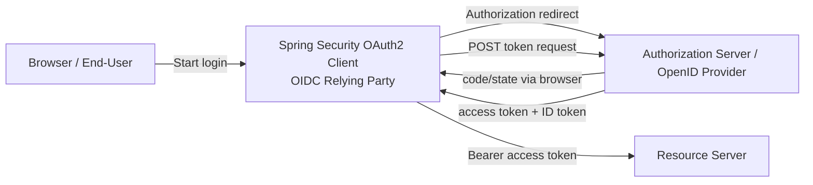
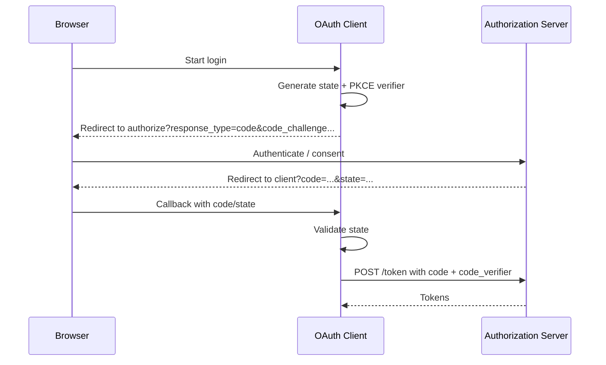
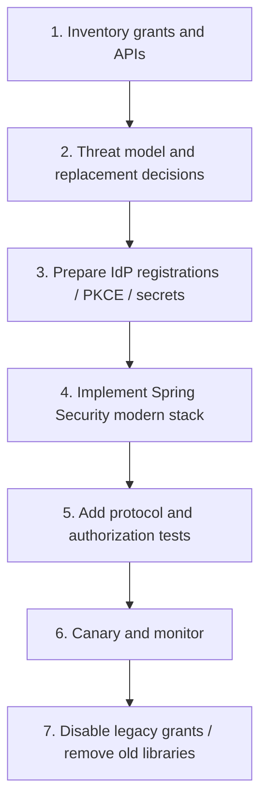

# 33.6. Reviewing Deprecated Grants or APIs and Replacement Options

When upgrading a **Spring Security OAuth 2.0/OIDC Client**, at least three kinds of changes are easily conflated: OAuth grants no longer recommended by security best practices, Java APIs marked `@Deprecated` or removed, and APIs that remain valid while their legacy usage pattern is no longer safe.

For example, **Resource Owner Password Credentials (ROPC/password grant)** and **Implicit Grant** must be re-evaluated for protocol and security reasons. By contrast, **Authorization Code**, **Client Credentials**, and **Refresh Token** remain valid for their intended roles; do not remove them merely because a new framework version exists. At the Spring layer, `OAuth2RestTemplate` and `@EnableOAuth2Sso` belong to the legacy Spring Security OAuth ecosystem; modern applications use `ClientRegistration`, `OAuth2AuthorizedClientManager`, `SecurityFilterChain`, and `oauth2Login()`.

A successful upgrade must answer completely: which grants are still enabled at the Authorization Server (AS), which Java APIs the client uses, which user flows must move, which token/session data must survive, and which security controls must be re-verified after migration.

---

## 1. Learning Outcomes

After this lesson, the reader will be able to:

1. Distinguish **deprecated**, **removed**, **discouraged**, **prohibited**, and **still supported**.
2. Inventory grants actually used vs. grants still enabled at the AS.
3. Replace Implicit/ROPC with appropriate modern flows.
4. Keep Client Credentials/Refresh Token for valid use cases and protect them properly.
5. Identify APIs belonging to legacy Spring Security OAuth.
6. Migrate configurations from `WebSecurityConfigurerAdapter` to `SecurityFilterChain`.
7. Migrate legacy matchers/DSLs to `authorizeHttpRequests` and the lambda DSL.
8. Replace `OAuth2RestTemplate` with authorized-client management and HTTP client integrations.
9. Avoid confusing Client, Resource Server, Authorization Server, and OIDC RP.
10. Understand extension points for token exchange, OIDC Login, and WebFlux.
11. Perform dependency/source inventories, compatibility checks, and migration rollouts.
12. Establish regression tests for PKCE, state, nonce, issuer, token storage, scopes, and tenant isolation.

## 2. Three Layers That Must Be Reviewed Independently

| Layer | Example issue | Verification source | Action required |
|---|---|---|---|
| OAuth/OIDC protocol | `grant_type=password`, `response_type=token` | RFCs, OAuth Security BCP, OP profile | Redesign authorization flow |
| Spring Java API | `WebSecurityConfigurerAdapter`, `antMatchers` | Versioned Javadoc, migration guide | Migrate to compatible APIs |
| Runtime/security architecture | Tokens in browser, secrets in Git, refresh races | Threat model, deployment policy | Change storage/validation/operations |

A Java class bearing `@Deprecated` does not make the `client_credentials` grant prohibited. Conversely, a server still accepting `grant_type=password` does not make it safe under current security guidance.

### 2.1. Deprecated

A Java class/method may be marked `@Deprecated` to steer developers toward a newer API. Check `since`, `forRemoval`, Javadoc, and your exact release.

### 2.2. Removed

An API has been deleted in the target version; compilation or runtime linkage fails. Replace imports, configuration, and behavior—do not merely suppress compiler warnings.

### 2.3. Discouraged or Prohibited

An OAuth flow described in a historical RFC that no longer satisfies security best practices. RFC 9700 provides security guidance regardless of whether a library still exposes a matching method.

### 2.4. Behavior Changed Without Deprecation

A framework upgrade can change defaults, matcher semantics, token client implementations, or session handling. Test behavior, not only compilation.

## 3. OAuth2/OIDC Role Boundaries



| Role | Responsibility | Modern Spring direction |
|---|---|---|
| OAuth2 Client | Acquire, store, and use access tokens | `spring-security-oauth2-client` |
| OIDC Relying Party | Authenticate users via OP and ID Token | `oauth2Login()`, `OidcUser` |
| Resource Server | Verify inbound Bearer tokens | `oauth2ResourceServer(...)` |
| Authorization Server | Authenticate clients, issue codes/tokens, consent, keys | Spring Authorization Server or managed IdP |

**There is no 1:1 replacement** between `@EnableAuthorizationServer` and `oauth2Login()`. An API that issues tokens and an API that accepts logins do completely different jobs.

## 4. Decision Table for OAuth Grant Types

| Grant or flow | Assessment | Suitable option |
|---|---|---|
| Authorization Code | **Still valid** | Prefer Code + PKCE for user-facing clients |
| Authorization Code + PKCE | **Recommended** | Browser, native, mobile, confidential web per profile |
| Implicit (`response_type=token`) | No longer recommended | Code + PKCE or BFF pattern |
| Resource Owner Password Credentials | RFC 9700: clients **MUST NOT** use | Code + PKCE and hosted authentication |
| Client Credentials | **Still valid** | Machine-to-machine, service identities |
| Refresh Token | **Still valid** with replay controls | Rotation/sender constraints and safe storage |
| Device Authorization Grant | Valid per RFC 8628 | Input-limited/CLI devices if AS supports |
| JWT Bearer Grant | Extension/profile per RFC 7523 | When AS/client contract supports |
| Token Exchange | Extension per RFC 8693 | AS-controlled delegation and token transformation |
| OIDC Implicit/Hybrid | Evaluate response type and threat model | Usually prefer OIDC Code + PKCE for web login |
| Custom extension grant | Only when necessary | Keep protocol, policy, and interoperability explicit |

### 4.1. OAuth 2.1 Is Not a Substitute for an Inventory

OAuth 2.1 consolidates many security updates. When reporting compliance, verify the actual publication status/revision at migration time. Cite RFC 9700 and finalized RFCs for guidance rather than asserting the latest status of a draft.

### 4.2. Do Not Drop Client Credentials or Refresh Token Mechanically

Risks typically stem from usage mistakes—such as leaked client secrets or mishandled refresh token rotation—not from the existence of these two grants.

## 5. Implicit Grant: Why Migrate Away

An old browser client might request:

```text
GET /authorize?
  response_type=token
  &client_id=browser-old
  &redirect_uri=https://app.example.org/callback
```

The AS redirects back to the browser with the access token over the front channel:

```text
https://app.example.org/callback#access_token=...&token_type=Bearer
```

### 5.1. Core Issues

- Tokens are issued directly in the browser authorization response.
- Hard to use authorization-code binding and PKCE.
- Access tokens risk exposure to JavaScript/XSS or unsafe storage.
- Token substitution/replay must be mitigated by other mechanisms.
- Several legacy assumptions no longer fit modern browsers.

While URL fragments are not sent to an HTTP server on normal requests, that does not protect tokens from malicious JavaScript.

### 5.2. Replacement Path



For SPAs, use Code + PKCE for public clients per AS policies. For BFF/confidential web apps, the backend can keep tokens server-side and use HTTP-only session cookies.

### 5.3. Migration Is More Than Changing `response_type`

Update:

1. Client registration at the AS.
2. Exact redirect URI matching.
3. `state` storage and callback validation.
4. PKCE verifier/challenge generation.
5. Token Endpoint exchange.
6. Browser/backend token storage boundaries.
7. API callers and Bearer token handling.
8. Session/CSRF/cookie policies.
9. Logout/re-authentication flows.
10. Negative integration tests.

## 6. Password/ROPC Grant: Stop Collecting End-User Passwords at the OAuth Client

Legacy request:

```http
POST /token HTTP/1.1
Content-Type: application/x-www-form-urlencoded

grant_type=password&
username=employee@example.org&
password=<user-password>&
client_id=old-portal
```

ROPC exposes the user's password to the client instead of letting the OP/AS handle interactive authentication.

### 6.1. Why Is It No Longer Suitable?

- Difficult to support SSO, federation, or passkeys/MFA.
- Client handles raw user passwords.
- Increases credential phishing/leakage surface.
- No true hosted consent/authentication interaction.
- Hard to enforce OP-side authentication policies.

RFC 9700 states that OAuth clients **MUST NOT** use the Resource Owner Password Credentials grant.

### 6.2. Option for Browser Users

Use **OIDC Authorization Code + PKCE** and authenticate at a trusted OP.

```java
@Bean
SecurityFilterChain webSecurity(HttpSecurity http) throws Exception {
    http
        .authorizeHttpRequests(auth -> auth
            .requestMatchers("/", "/error").permitAll()
            .anyRequest().authenticated())
        .oauth2Login(Customizer.withDefaults());

    return http.build();
}
```

### 6.3. Do Not Replace ROPC with Client Credentials

`client_credentials` represents a workload/client—it **does not** prove a user logged in. Swapping ROPC for a service token and passing a fake `currentUser` breaks auditing and domain authorization.

### 6.4. Do Not Build a Password Form to Call the Token Endpoint

A new UI whose backend still sends `grant_type=password` is not a migration away from ROPC.

### 6.5. User Transition Plan

- Configure login at the OP.
- Design account linking by trusted `(issuer, subject)`.
- Delete/revoke any improperly stored passwords.
- Review permissions and session mapping.
- Test MFA/SSO/recovery flows.
- Provide UX guiding users through the transition.

## 7. Authorization Code + PKCE Is the Login Baseline

A Spring Boot confidential Servlet client:

```yaml
spring:
  security:
    oauth2:
      client:
        registration:
          company:
            provider: company
            client-id: ${OIDC_CLIENT_ID}
            client-secret: ${OIDC_CLIENT_SECRET}
            client-authentication-method: client_secret_basic
            authorization-grant-type: authorization_code
            redirect-uri: "{baseUrl}/login/oauth2/code/{registrationId}"
            scope:
              - openid
              - profile
              - email
        provider:
          company:
            issuer-uri: "https://login.example.org"
```

### 7.1. PKCE

```text
code_verifier = high-entropy random
code_challenge = BASE64URL(SHA256(code_verifier))
code_challenge_method = S256
```

The challenge travels in the authorization request; the verifier travels in the token request.

### 7.2. PKCE Does Not Replace `state`

- `state` binds the callback to the original request.
- `code_verifier` proves the client possesses the PKCE transaction secret.
- Exact `redirect_uri` restricts where the AS sends codes.
- `nonce` serves its own role in OIDC ID Token validation.
- Trusted issuer binding prevents Authorization Server mix-up.

### 7.3. Customizing PKCE by Version

Some Spring Security versions support:

```java
DefaultOAuth2AuthorizationRequestResolver resolver =
    new DefaultOAuth2AuthorizationRequestResolver(
        clientRegistrations,
        "/oauth2/authorization"
    );

resolver.setAuthorizationRequestCustomizer(
    OAuth2AuthorizationRequestCustomizers.withPkce());
```

Then wire the resolver:

```java
http.oauth2Login(oauth2 -> oauth2
    .authorizationEndpoint(endpoint ->
        endpoint.authorizationRequestResolver(resolver)));
```

`clientRegistrations` is a `ClientRegistrationRepository`. This is an extension option when needed; PKCE defaults can depend on Spring Security version and client type. Inspect actual requests instead of assuming.

### 7.4. Public vs. Confidential

Public browser/native clients cannot protect a static client secret embedded in a bundle. Confidential server-side clients use appropriate client authentication and should still use PKCE per security policy.

## 8. Client Credentials Remains Valid

Machine-to-machine grant:

```http
POST /token HTTP/1.1
Authorization: Basic <client-credentials>
Content-Type: application/x-www-form-urlencoded

grant_type=client_credentials&
scope=orders.read
```

Appropriate for scheduled jobs, service-to-service calls, and workload identities.

### 8.1. Do Not Equate Service Identity with a User

A Client Credentials token is not a user-delegated token. Resource Servers should not infer that an end-user was authenticated from a service token alone.

### 8.2. Use an Authorized Client Manager

```java
OAuth2AuthorizedClientProvider provider =
    OAuth2AuthorizedClientProviderBuilder.builder()
        .clientCredentials()
        .build();
```

For jobs without a Servlet request, `AuthorizedClientServiceOAuth2AuthorizedClientManager` is usually more suitable than a request-bound manager.

### 8.3. Secrets Management

Client secrets, `private_key_jwt` private keys, or mTLS client private keys must come from a trusted secret manager or workload identity, never committed in YAML.

### 8.4. Scope and Audience

A service token with `orders.read` does not automatically authorize access to every tenant or order. Resource Servers need audience checks, token validation, and domain permission checks.

## 9. Refresh Token Remains Valid but Must Be Protected

```http
POST /token HTTP/1.1
Authorization: Basic <client-credentials>
Content-Type: application/x-www-form-urlencoded

grant_type=refresh_token&
refresh_token=<refresh-token>
```

### 9.1. Rotation

```text
RT-1 -> Token Endpoint -> AT-2 + RT-2
RT-1 reused -> invalid_grant / replay policy
```

### 9.2. Concurrency

Two requests reading RT-1 and refreshing concurrently can cause one to succeed and the other to receive `invalid_grant`. If a failure handler deletes records by registration/principal without version checks, the newly stored RT-2 may be wiped out too.

### 9.3. Mitigation

- Per-key single-flight/coordination when AS rotation is strict.
- Versioned/conditional updates in the token store.
- Never retry an old refresh token after `invalid_grant`.
- Reload the current authorized client after concurrent modification.
- Reauthorize the user if policy requires.
- Never log token values.

### 9.4. A Refresh Token Is Not a Client Secret

A refresh token belongs to an authorization context/principal; a client secret authenticates the confidential OAuth client. They need distinct storage and rotation policies.

## 10. Device, JWT Bearer, and Token Exchange

### 10.1. Device Authorization Grant

RFC 8628 targets browser/input-constrained devices:

```text
Device -> AS device_authorization
AS -> device_code, user_code, verification_uri
User -> opens verification_uri on another device
Device -> polls Token Endpoint under policy
```

It is not a default replacement for a standard browser web login.

### 10.2. JWT Bearer Grant

RFC 7523 defines JWT assertion profiles. Distinguish:

```text
JWT bearer authorization grant
  grant_type=urn:ietf:params:oauth:grant-type:jwt-bearer

private_key_jwt client authentication
  client_assertion_type=urn:ietf:params:oauth:client-assertion-type:jwt-bearer
```

Both use JWTs, yet they fulfill two distinct responsibilities.

### 10.3. Token Exchange

RFC 8693 lets an AS issue a new token under subject/actor/audience/resource policies. Never modify JWT claims yourself or bypass audience validation to emulate token exchange.

### 10.4. Other Extensions

PAR, JAR, DPoP, or CIBA may be valuable in certain OP ecosystems. Verify real client/AS version support; do not assume every Spring Security release includes every extension out of the box.

## 11. OIDC Implicit/Hybrid Requires Inspecting Response Types

OIDC defines several response types:

```text
code
id_token
id_token token
code id_token
code token
code id_token token
```

Do not equate OIDC Hybrid with OAuth ROPC. When migrating:

- Analyze which tokens traverse the front channel.
- Check corresponding `nonce`, `c_hash`, and `at_hash` requirements.
- Redesign callback/session logic for OIDC Code Flow.
- Preserve issuer/audience/signature validation.

For ordinary web login, Authorization Code + PKCE is easier to secure and test.

## 12. Legacy Spring Security OAuth vs. Modern Modules

Legacy artifacts that may appear:

```text
org.springframework.security.oauth:spring-security-oauth2
org.springframework.security.oauth.boot:spring-security-oauth2-autoconfigure
```

Modern Spring Security modules whose names also contain `oauth2`:

```text
org.springframework.security:spring-security-oauth2-client
org.springframework.security:spring-security-oauth2-core
org.springframework.security:spring-security-oauth2-jose
org.springframework.security:spring-security-oauth2-resource-server
org.springframework.boot:spring-boot-starter-oauth2-client
org.springframework.boot:spring-boot-starter-oauth2-resource-server
```

**Do not delete every dependency containing the string `oauth2`.** Distinguish group ID, role, and version.

### 12.1. Legacy Imports to Search For

```text
OAuth2RestTemplate
OAuth2ClientContext
@EnableOAuth2Sso
@EnableOAuth2Client
@EnableResourceServer
@EnableAuthorizationServer
OAuth2Authentication
JwtAccessTokenConverter
TokenStore
ResourceOwnerPasswordAccessTokenProvider
UserInfoTokenServices
```

This list is for **detecting legacy code**; do not use these legacy APIs in new production examples.

### 12.2. Not Every Class Has a One-to-One Mapping

Legacy `OAuth2RestTemplate` combined token acquisition with an HTTP client. The modern framework separates token management from the REST client.

Legacy `@EnableAuthorizationServer` was an Authorization Server; migrate it to Spring Authorization Server or a managed OP, not `oauth2Login()`.

## 13. Common API Migration Table

| Legacy API/config | Responsibility | Replacement direction |
|---|---|---|
| `OAuth2RestTemplate` | HTTP + OAuth token | `OAuth2AuthorizedClientManager` + `RestClient`/`WebClient` |
| `OAuth2ClientContext` | Legacy token/request context | `OAuth2AuthorizedClient` + repository/service |
| `@EnableOAuth2Sso` | SSO app auto-config | `SecurityFilterChain` + `oauth2Login` |
| Legacy `@EnableOAuth2Client` | Enable old client | Modern OAuth2 Client beans/Boot autoconfig |
| `@EnableResourceServer` | Legacy API token validation | `oauth2ResourceServer` |
| `@EnableAuthorizationServer` | Legacy token issuer | Spring Authorization Server or managed OP |
| `JwtAccessTokenConverter` | Legacy JWT converter | Resource Server `JwtDecoder` or AS signing APIs per role |
| `TokenStore` | Legacy AS token storage | Authorization Server persistence model |
| `ResourceOwnerPasswordAccessTokenProvider` | Password grant | Switch flow to Code + PKCE |
| Legacy `UserInfoTokenServices` | Legacy user mapping | `OidcUserService`/`OAuth2UserService` |
| `WebSecurityConfigurerAdapter` | Inheritance security config | `SecurityFilterChain` bean |
| `authorizeRequests` | Legacy authorization DSL | `authorizeHttpRequests` |
| `antMatchers`/`mvcMatchers` | Legacy request matching | `requestMatchers` + appropriate matcher |
| Chained `.and()` style | Configurer chaining | Lambda DSL |
| General HTTP `RestTemplate` | Synchronous HTTP | Still an HTTP API; OAuth integration is a separate concern |

This table does not imply every item shares the same deprecation annotation, `since`, or `forRemoval`. Verify against exact target-version Javadoc.

## 14. `WebSecurityConfigurerAdapter` -> `SecurityFilterChain`

Legacy:

```java
// LEGACY ONLY
@EnableWebSecurity
public class OldSecurityConfig extends WebSecurityConfigurerAdapter {

    @Override
    protected void configure(HttpSecurity http) throws Exception {
        http.authorizeRequests()
            .anyRequest().authenticated()
            .and()
            .oauth2Login();
    }
}
```

Modern Servlet:

```java
import org.springframework.context.annotation.Bean;
import org.springframework.context.annotation.Configuration;
import org.springframework.security.config.annotation.web.builders.HttpSecurity;
import org.springframework.security.config.Customizer;
import org.springframework.security.web.SecurityFilterChain;

@Configuration
public class SecurityConfiguration {

    @Bean
    SecurityFilterChain webSecurity(HttpSecurity http) throws Exception {
        http
            .authorizeHttpRequests(auth -> auth
                .requestMatchers("/", "/error", "/assets/**").permitAll()
                .anyRequest().authenticated())
            .oauth2Login(Customizer.withDefaults());

        return http.build();
    }
}
```

### 14.1. More Than Just Syntax Changes

Preserve:

- URL protection rules.
- CSRF/session policies.
- OAuth2 authorization start and callbacks.
- Login failure/success handlers.
- Custom OAuth2/OIDC user services.
- Token/client repositories.
- Exception handling and CORS policies.
- Multiple filter chain ordering.

### 14.2. Do Not Disable CSRF to Silence Errors

Browser sessions remain exposed to CSRF threats. Moving to bean config does not justify disabling CSRF app-wide.

## 15. `authorizeRequests`/`antMatchers` -> `authorizeHttpRequests`/`requestMatchers`

Old:

```java
// LEGACY CONFIG
http.authorizeRequests()
    .antMatchers("/public/**").permitAll()
    .antMatchers("/admin/**").hasRole("ADMIN")
    .anyRequest().authenticated();
```

New:

```java
http.authorizeHttpRequests(auth -> auth
    .requestMatchers("/public/**").permitAll()
    .requestMatchers("/admin/**").hasRole("ADMIN")
    .anyRequest().authenticated());
```

### 15.1. Matcher Semantics Must Be Tested

- Servlet path.
- Context path.
- Spring MVC mappings.
- Multiple servlets.
- `PathPattern`/Ant-style differences.
- Encoded paths.
- Dispatcher types.
- Default routes.

### 15.2. `securityMatcher` Is Not `requestMatchers`

```java
http.securityMatcher("/api/**");
```

limits which requests this **`SecurityFilterChain`** processes.

```java
http.authorizeHttpRequests(auth ->
    auth.requestMatchers("/api/**").authenticated());
```

sets an authorization rule inside a chain.

If the matcher is wrong, requests may hit a different chain or lack the intended protection.

### 15.3. Do Not Add `permitAll` to Make Tests Pass

Keep the default deny/authenticated policy after migration—never push `anyRequest().permitAll()` into production.

## 16. Lambda DSL Replaces Chaining Style

Old:

```java
http
    .authorizeRequests()
    .anyRequest().authenticated()
    .and()
    .oauth2Login();
```

Modern:

```java
http
    .authorizeHttpRequests(auth ->
        auth.anyRequest().authenticated())
    .oauth2Login(oauth2 -> {
        // OAuth2 Login customizations.
    });
```

Or:

```java
http.oauth2Login(Customizer.withDefaults());
```

### 16.1. Version Determines Which APIs Are Removed

Some releases deprecate no-arg overloads or chaining patterns, and later versions may remove them. Do not infer from a deprecation warning in one release that an API is already removed in every other release.

### 16.2. Custom Callback Path

```java
http.oauth2Login(oauth2 -> oauth2
    .redirectionEndpoint(endpoint ->
        endpoint.baseUri("/auth/callback/*")));
```

If you change the matcher, synchronize:

```yaml
redirect-uri: "{baseUrl}/auth/callback/{registrationId}"
```

and the OP-registered callback. Never update only one side.

## 17. `OAuth2RestTemplate` -> Manager + HTTP Client

Legacy:

```java
// LEGACY — OAuth2RestTemplate is not a modern choice.
String result = oauth2RestTemplate.getForObject(
    "https://orders-api.example.org/orders",
    String.class);
```

Modern architecture:

```text
ClientRegistration
  -> OAuth2AuthorizedClientManager
  -> OAuth2AuthorizedClient/access token
  -> HTTP client interceptor/filter
  -> Resource Server
```

### 17.1. Why Separate Them?

- Manager handles selecting the authorized client/provider.
- Repository/service manages token persistence.
- HTTP client handles target URLs, headers, and timeouts.
- Tests can isolate token acquisition from outbound integration.
- Avoids tying browser requests to background token acquisition.
- Easier enforcement of principal/tenant isolation.

### 17.2. `RestTemplate` Itself Is Not Necessarily Deprecated

General `RestTemplate` is not a legacy OAuth class. The issue is **`OAuth2RestTemplate`** from the legacy library. When using `RestClient`, do not assume `RestClient` performs OAuth token acquisition on its own.

## 18. `OAuth2AuthorizedClientManager` Is the Modern API

Common abstractions:

| Abstraction | Scope |
|---|---|
| `ClientRegistration` | OAuth client metadata |
| `ClientRegistrationRepository` | Supplies registrations |
| `OAuth2AuthorizedClient` | Registration + principal + tokens |
| `OAuth2AuthorizedClientRepository` | Servlet request/session |
| `OAuth2AuthorizedClientService` | Service-based persistent store |
| `OAuth2AuthorizedClientManager` | Authorize/reauthorize |
| `OAuth2AuthorizedClientProvider` | Grant-specific authorization strategy |
| `ReactiveOAuth2AuthorizedClientManager` | Reactive authorization |

### 18.1. Default Managers Serve Different Use Cases

- `DefaultOAuth2AuthorizedClientManager`: request-aware Servlet flows.
- `AuthorizedClientServiceOAuth2AuthorizedClientManager`: jobs/services outside a Servlet request.
- `DefaultReactiveOAuth2AuthorizedClientManager`: WebFlux requests.
- `AuthorizedClientServiceReactiveOAuth2AuthorizedClientManager`: reactive service use cases.

Do not assume they are deprecated just because they contain `OAuth2` or have existed across multiple releases.

### 18.2. Principal Binding

`principalName` must come from a trusted authenticated context or stable workload identity. Never take a user-supplied principal name to look up arbitrary authorized clients.

### 18.3. Registration Binding

Never fall back to registration B's authorized client for registration A if the manager fails to acquire a token.

## 19. Client Credentials Example with Service Manager

Properties:

```yaml
spring:
  security:
    oauth2:
      client:
        registration:
          reports:
            provider: reports
            client-id: ${REPORTS_CLIENT_ID}
            client-secret: ${REPORTS_CLIENT_SECRET}
            client-authentication-method: client_secret_basic
            authorization-grant-type: client_credentials
            scope: reports.read
        provider:
          reports:
            token-uri: "https://login.example.org/token"
```

Java:

```java
import org.springframework.context.annotation.Bean;
import org.springframework.context.annotation.Configuration;
import org.springframework.security.oauth2.client.AuthorizedClientServiceOAuth2AuthorizedClientManager;
import org.springframework.security.oauth2.client.OAuth2AuthorizedClientManager;
import org.springframework.security.oauth2.client.OAuth2AuthorizedClientProvider;
import org.springframework.security.oauth2.client.OAuth2AuthorizedClientProviderBuilder;
import org.springframework.security.oauth2.client.OAuth2AuthorizedClientService;
import org.springframework.security.oauth2.client.registration.ClientRegistrationRepository;

@Configuration
class ReportsClientConfig {

    @Bean
    OAuth2AuthorizedClientManager reportsManager(
            ClientRegistrationRepository registrations,
            OAuth2AuthorizedClientService clients) {

        OAuth2AuthorizedClientProvider provider =
            OAuth2AuthorizedClientProviderBuilder.builder()
                .clientCredentials()
                .build();

        var manager =
            new AuthorizedClientServiceOAuth2AuthorizedClientManager(
                registrations,
                clients
            );

        manager.setAuthorizedClientProvider(provider);
        return manager;
    }
}
```

Call:

```java
OAuth2AuthorizeRequest request =
    OAuth2AuthorizeRequest
        .withClientRegistrationId("reports")
        .principal("scheduled-report-job")
        .build();

OAuth2AuthorizedClient client =
    reportsManager.authorize(request);

if (client == null) {
    throw new IllegalStateException("No authorized reports client");
}

OAuth2AccessToken token = client.getAccessToken();
```

### 19.1. Do Not Hand-Assemble Grant Requests Unnecessarily

Spring providers/managers handle token acquisition, expiration, and persistence. Do not re-implement form encoding or client authentication when supported integrations already solve it.

### 19.2. A Service Principal Is Not an End-User

`scheduled-report-job` is a client storage key/workload identity; API authorization must still distinguish service tokens from user-delegated tokens.

## 20. `RestClient` Integration

In supported Spring Security versions, you can use `OAuth2ClientHttpRequestInterceptor`:

```java
import org.springframework.web.client.RestClient;
import org.springframework.security.oauth2.client.OAuth2AuthorizedClientManager;
import org.springframework.security.oauth2.client.web.client.OAuth2ClientHttpRequestInterceptor;

@Bean
RestClient reportsClient(
        RestClient.Builder builder,
        OAuth2AuthorizedClientManager manager) {

    var oauth =
        new OAuth2ClientHttpRequestInterceptor(manager);

    return builder
        .baseUrl("https://reports-api.example.org")
        .requestInterceptor(oauth)
        .build();
}
```

This snippet illustrates **wiring**, not a complete call: each HTTP request must select the right `clientRegistrationId` or authorized-client context per the supported resolver/request attributes of your version.

### 20.1. Version-Aware

`OAuth2ClientHttpRequestInterceptor` is not present in all Spring Security releases. Read versioned Javadoc instead of copying examples from a newer release into an older project and assuming OAuth2 Client is broken.

### 20.2. Token Leakage

Attach Bearer tokens only when the target host/resource is approved by trusted configuration. Never allow the browser to pick an arbitrary URL where `RestClient` attaches credentials automatically.

### 20.3. Failure Handling

Downstream API 401 `invalid_token` differs from Token Endpoint 400 `invalid_grant`. Retry and authorized-client eviction must happen at the right layer.

## 21. `WebClient` Integration in Servlet

A Servlet app can still use `WebClient` to call downstream APIs:

```java
import org.springframework.security.oauth2.client.OAuth2AuthorizedClientManager;
import org.springframework.security.oauth2.client.web.reactive.function.client.ServletOAuth2AuthorizedClientExchangeFilterFunction;
import org.springframework.web.reactive.function.client.WebClient;

ServletOAuth2AuthorizedClientExchangeFilterFunction oauth =
    new ServletOAuth2AuthorizedClientExchangeFilterFunction(manager);

WebClient client = WebClient.builder()
    .baseUrl("https://orders-api.example.org")
    .apply(oauth.oauth2Configuration())
    .build();
```

`manager` is a Servlet authorized-client manager. Explicit registration selection/client context must follow the API contract.

### 21.1. Reactive `WebClient` Does Not Turn the Web App into WebFlux

MVC controllers and Servlet filters still run on the Servlet stack; only the outbound HTTP client uses a reactive API.

### 21.2. Async Context Propagation

If a `WebClient` call runs outside the Servlet request thread, do not assume `SecurityContext` or request-bound authorized clients propagate automatically. Test the exact execution context.

### 21.3. Do Not Send Default Tokens to Every Endpoint

A default client can accidentally attach Bearer tokens to the wrong origin. Restrict targets and registrations.

## 22. Legacy SSO -> `oauth2Login`

Old:

```java
// LEGACY ONLY
@EnableOAuth2Sso
public class OldSsoConfig {
}
```

Modern:

```java
@Bean
SecurityFilterChain portalSecurity(HttpSecurity http) throws Exception {
    http
        .authorizeHttpRequests(auth -> auth
            .requestMatchers("/", "/login", "/error").permitAll()
            .anyRequest().authenticated())
        .oauth2Login(oauth2 -> oauth2
            .defaultSuccessUrl("/app", true));

    return http.build();
}
```

### 22.1. Start/Callback URLs

Typically:

```text
/oauth2/authorization/company
/login/oauth2/code/company
```

Keep routing, sessions, and redirect URIs aligned. The first URL initiates authorization; the second receives the callback code/state.

### 22.2. OIDC Principal

Modern `OidcUser`/`OidcUserService` holds claims and authorities. When replacing legacy `OAuth2Authentication`, test the mapper and identity keying by `(iss, sub)`.

### 22.3. Local App Authorization

Successful SSO does not automatically grant `ROLE_ADMIN` or tenant membership. Keep domain authorization policies independent of OAuth login.

## 23. Legacy Resource Server -> Modern Resource Server

Old:

```java
// LEGACY ONLY
@EnableResourceServer
public class OldResourceServerConfig {
}
```

Modern:

```java
@Bean
SecurityFilterChain apiSecurity(HttpSecurity http) throws Exception {
    http
        .securityMatcher("/api/**")
        .authorizeHttpRequests(auth ->
            auth.anyRequest().authenticated())
        .oauth2ResourceServer(oauth2 ->
            oauth2.jwt(Customizer.withDefaults()));

    return http.build();
}
```

Properties:

```yaml
spring:
  security:
    oauth2:
      resourceserver:
        jwt:
          issuer-uri: "https://login.example.org"
```

### 23.1. Decoder Must Validate

JWT Base64 decoding is not signature validation. Preserve `iss`, `exp`, algorithm, key selection, and audience policies.

### 23.2. ID Token Is Not an API Access Token

Do not use an ID Token from OIDC Login to call APIs. A Resource Server must verify tokens intended for it.

### 23.3. API 401/403

`401 invalid_token` and `403 insufficient_scope` are Bearer token API concerns; do not conflate them with OAuth Authorization Endpoint `access_denied`.

## 24. Legacy Authorization Server Migration

Old:

```java
// LEGACY ONLY
@EnableAuthorizationServer
public class OldAuthServerConfig {
}
```

Migrate to a supported Authorization Server implementation, such as Spring Authorization Server or a managed OP.

Plan separately for:

- Registered clients and redirect URI lists.
- Grant allowlists.
- Signing keys/JWKS rotation.
- Authorization/consent persistence.
- Token issuance, revocation, and introspection.
- Scope/audience contracts.
- OIDC discovery/UserInfo/logout where applicable.
- Legacy tokens and refresh token state.
- Multi-tenant/issuer distinctions.

No single annotation swap preserves all database schemas and security semantics automatically.

### 24.1. Match the Right Role

`oauth2Login()` does not issue tokens; it is a Client/Relying Party.

`oauth2ResourceServer()` does not issue tokens; it verifies inbound tokens.

### 24.2. Data Migration Can Be the Hardest Part

Legacy token stores, consent records, and client credentials may need controlled migration. Never deserialize old classes into new formats without an explicit compatibility contract.

## 25. WebFlux Has Different APIs from Servlet

| Servlet | Reactive WebFlux |
|---|---|
| `HttpSecurity` | `ServerHttpSecurity` |
| `SecurityFilterChain` | `SecurityWebFilterChain` |
| `ClientRegistrationRepository` | `ReactiveClientRegistrationRepository` |
| `OAuth2AuthorizedClientManager` | `ReactiveOAuth2AuthorizedClientManager` |
| `HttpServletRequest` | `ServerWebExchange` |
| `MockMvc` | `WebTestClient` |

Reactive security:

```java
@Bean
SecurityWebFilterChain webSecurity(ServerHttpSecurity http) {
    return http
        .authorizeExchange(ex -> ex
            .pathMatchers("/", "/error").permitAll()
            .anyExchange().authenticated())
        .oauth2Login(Customizer.withDefaults())
        .build();
}
```

### 25.1. Do Not Copy Servlet Beans

Reactive apps use reactive authorized-client repositories/services, managers, and Reactor Context.

### 25.2. Do Not Block the Event-Loop

Never use `Mono.block()` inside reactive request handling to emulate legacy OAuth2 Client APIs. Use non-blocking providers/client integrations or offload blocking work under an explicit scheduling policy.

### 25.3. Reactive Managers Remain Valid

`DefaultReactiveOAuth2AuthorizedClientManager` and service-based reactive managers are not automatically deprecated just because a new version arrived.

## 26. Token Persistence Migration

Modern abstractions:

```text
OAuth2AuthorizedClientRepository
  -> Servlet request/session persistence

OAuth2AuthorizedClientService
  -> principal + registration storage

OAuth2AuthorizedClientManager
  -> authorization and reauthorization
```

### 26.1. Do Not Reuse Incompatible Session Serialization

When upgrading Spring Boot majors, previously serialized session objects may fail to deserialize. Version data or require planned re-login.

### 26.2. Do Not Use a Global Token Cache Keyed Only by Registration

A delegated access token belongs to a specific principal/tenant. A `Map<registrationId, token>` can cause user A to use user B's token.

### 26.3. Encryption and Retention

Refresh tokens require encryption at rest, least privilege, redaction, and revoke/delete policies.

### 26.4. Rotation Races

A failed refresh request must never delete a newer token just saved by another request. Use conditional deletes and coordination per threat model.

## 27. Deprecated APIs Do Not Mean Every Similarly Named Class Is Legacy

Modern APIs to keep when still supported in your target version:

- `ClientRegistration`.
- `ClientRegistrationRepository`.
- `OAuth2AuthorizedClient`.
- `OAuth2AuthorizedClientService`.
- `OAuth2AuthorizedClientRepository`.
- `OAuth2AuthorizedClientManager`.
- `OAuth2AuthorizedClientProvider`.
- `OidcUser`.
- `OidcUserService`.
- `OAuth2AuthorizationException`.
- `OAuth2AuthenticationException`.

### 27.1. Check Fully Qualified Names

Legacy `OAuth2Authentication` and modern `OAuth2AuthenticationToken` are not the same class. Sharing the substring `OAuth2` does not guarantee API equivalence.

### 27.2. Check Target-Version Javadoc

If a method is deprecated, Javadoc may point to a lambda overload. Do not redesign an entire grant when a warning only concerns DSL style.

## 28. Inventorying Gradle Dependencies

The following commands are **instructional examples**, not steps executed while writing this lesson.

```bash
./gradlew dependencies --configuration runtimeClasspath
```

Trace the source of a transitive dependency:

```bash
./gradlew dependencyInsight \
  --dependency spring-security-oauth2 \
  --configuration runtimeClasspath
```

On Windows PowerShell use `.\gradlew.bat` as appropriate for your environment.

### 28.1. Check Internal Libraries Too

A shared internal module can pull in legacy Spring Security OAuth JARs even when application sources no longer import old classes.

### 28.2. BOM Version Alignment

Do not override `spring-security-oauth2-client` alone to a different version from the rest of the modules without verifying Spring Boot managed dependencies and compatibility.

### 28.3. Do Not Exclude Arbitrarily

Excluding a legacy JAR while a dependency still calls old APIs causes `NoClassDefFoundError` or linkage failures. Upgrade the owning module first.

## 29. Finding Source Patterns with Static Search

Strings to scan for:

```text
OAuth2RestTemplate
OAuth2ClientContext
EnableOAuth2Sso
EnableOAuth2Client
EnableResourceServer
EnableAuthorizationServer
WebSecurityConfigurerAdapter
authorizeRequests(
antMatchers(
mvcMatchers(
ResourceOwnerPassword
grant_type=password
response_type=token
JwtAccessTokenConverter
TokenStore
UserInfoTokenServices
```

Examples using ripgrep:

```bash
rg -n "OAuth2RestTemplate|OAuth2ClientContext|EnableOAuth2Sso|WebSecurityConfigurerAdapter" src
```

```bash
rg -n "grant_type=password|response_type=token|authorization-grant-type: password" src
```

```bash
rg -n "authorizeRequests\(|antMatchers\(|mvcMatchers\(" src/main
```

### 29.1. Text Search Is Not a Conclusion

A match might appear inside a test named `rejectPasswordGrant`, documentation, or disabled code. Verify actual production call sites, config, and AS registrations.

### 29.2. Do Not Ignore Provider Client Settings

Even when the app stops calling the password grant, leaving it enabled at the OP remains an unwanted attack surface. After migration, disable legacy grants per policy.

## 30. Suggested Inventory Table

| Field | Example |
|---|---|
| Application | `portal-web` |
| Role | OAuth2 Client/OIDC RP |
| Current Version | Spring Boot/Security in use |
| Target Version | Upgrade version |
| Current Grant | `password` |
| Replacement | `authorization_code` + PKCE |
| Client Type | Confidential web |
| IdP/Issuer | Corporate OP |
| Registration ID | `company` |
| Client ID | `portal-prod` |
| Redirect URI | Registered callback |
| Token Storage | Session/JDBC |
| API Calls | `OAuth2RestTemplate` |
| Risk | High |
| Owner | Identity/app team |
| Tests | Pending/implemented |
| Rollback | Canary/feature flag |

### 30.1. Why Record Both Current and Target Versions?

You cannot conclude an API is removed based on "modern Spring Security" in general. A method may be deprecated in one release yet still functional in another.

### 30.2. Why Record Client Type?

Public browser clients and confidential backends have different authentication and storage constraints.

### 30.3. Why Record Token Storage?

Migration can lose refresh tokens or break cross-user session isolation if database schemas change improperly.

## 31. Upgrade Roadmap



### 31.1. Baseline Phase

Record active grants, flows, AS client registrations, token/client storage, user identities, protected endpoints, and current metrics.

### 31.2. Selection Phase

- User login: OIDC Code + PKCE.
- Machine-to-machine: Client Credentials.
- Input-constrained devices: RFC 8628.
- Delegation requiring audience changes: Token Exchange per policy.
- Refresh: retain and harden rotation.

### 31.3. IdP Phase

Configure exact redirect URIs, client authentication, scopes, grant allowlists, PKCE policy, secret rotation, and test registrations.

### 31.4. Code Phase

Replace legacy configs/libs while preserving security rules and test handlers. Avoid changing AS, RP, and Resource Server in one single change if they can be separated.

### 31.5. Test Phase

Include both controller mock tests and protocol integration tests—not just compilation/build success.

### 31.6. Rollout Phase

Canary, compare against baseline, monitor login success/errors, refresh failures, and API 401/403s. Retire old grants only when no client still needs them.

## 32. Spring Boot 2.x -> 3.x Compatibility

A typical migration includes:

```text
Spring Boot 2.x -> 3.x
Spring Security 5 -> 6
Spring Framework 5 -> 6
Java runtime -> Java 17+
javax.servlet.* -> jakarta.servlet.*
```

### 32.1. Servlet Namespace

`javax.servlet` -> `jakarta.servlet` is a Jakarta migration, not an OAuth grant deprecation.

### 32.2. Security DSL

Migrate `WebSecurityConfigurerAdapter` and matchers. Test chain order, callback endpoints, and CSRF.

### 32.3. Third-Party Libraries

Token integrations, session serialization libraries, and older provider adapters may not yet support Jakarta/Spring 6.

### 32.4. TLS/JDK Changes

JDK upgrades can affect trust stores, cipher suites, mTLS, and `private_key_jwt` signing. Test against OP staging.

## 33. Newer Spring Security Major Upgrades

For newer major versions:

1. Read migration guides for each major/intermediate release.
2. Check Javadocs for the target version.
3. Distinguish `@Deprecated`, `forRemoval`, and removed.
4. Check Spring Boot compatibility.
5. Check `SecurityFilterChain` matchers/DSLs.
6. Check OAuth2 Client token HTTP integrations.
7. Check OIDC logout/UserInfo/ID Token behavior.
8. Test authorized-client persistence compatibility.
9. Test on the target JDK.
10. Run a canary before full rollout.

**Never assert a specific API was removed in a Spring Security release without checking that release's notes/Javadoc.**

## 34. Provider Compatibility Checks

A legacy OP may lack support for:

- PKCE S256.
- Exact redirect URI matching.
- Trusted OIDC Discovery issuer.
- Valid JWKS/JWS algorithms.
- `client_secret_basic` or required client auth methods.
- Refresh token rotation/revocation.
- Matching `sub` in UserInfo.
- Appropriate scopes/audiences.
- Device/Token Exchange extension grants.
- OIDC logout.

### 34.1. Never Disable Checks for Compatibility

If issuer/nonce/JWKS validation fails, fix the provider/config or build a safe provider-specific integration. Never drop cryptographic validation.

### 34.2. Do Not Register Wildcard Callbacks

`https://*.example.org/*` opens code-leakage and open-redirect paths. Use exact callbacks or separate client registrations.

### 34.3. Classify Errors by Phase

`invalid_client` at the Token Endpoint differs from `access_denied` when a user/OP denies authorization; `invalid_grant` on a code differs from `invalid_grant` on refresh rotation.

## 35. Security Properties to Preserve

### 35.1. Exact Redirect URI Matching

The AS sends authorization responses only to registered callbacks matching the client and policy.

### 35.2. State

The RP restores the authorization transaction from trusted storage and verifies `state`.

### 35.3. PKCE

The code verifier used during token exchange must match the challenge.

### 35.4. Issuer

With multiple OPs, verify trusted issuer/registration binding and prevent mix-up. RFC 9207 provides guidance when the AS supports issuer identification.

### 35.5. OIDC ID Token

Verify signature, `iss`, `aud`, timestamps, `nonce` when applicable, and `azp` where required.

### 35.6. UserInfo Subject

When UserInfo is used, `sub` must match the ID Token `sub`.

### 35.7. API Access Token

The Resource Server verifies signature/introspection, issuer, audience, scopes/authorities, and object/tenant permissions.

### 35.8. Refresh Token Storage

Enforce encryption, principal isolation, rotation, and conditional updates/deletes.

## 36. Custom Authorization Request Resolver

Legacy code hand-concatenating OAuth authorize URLs is error-prone:

```java
String url = issuer + "/authorize?client_id=" + clientId
    + "&redirect_uri=" + redirectUri;
```

Replace with `DefaultOAuth2AuthorizationRequestResolver` and a customizer when provider-specific parameters are needed:

```java
DefaultOAuth2AuthorizationRequestResolver resolver =
    new DefaultOAuth2AuthorizationRequestResolver(
        registrations,
        "/oauth2/authorization"
    );

resolver.setAuthorizationRequestCustomizer(builder -> {
    // Provider-specific allowed values only.
});
```

### 36.1. Never Take `redirect_uri` from Untrusted Input

`redirect_uri` is the OAuth callback, not a post-login destination. Use a static/trusted `ClientRegistration.redirectUri`.

### 36.2. Multi-Tenant

Tenant hints must resolve through a trusted registry—never use user-provided issuer URLs or forwarded hosts to fetch arbitrary discovery metadata.

### 36.3. State/Session

If writing a custom resolver, never lose `state`/PKCE/nonce/callback correlations.

## 37. Token Endpoint Extension Points

Key types to know:

```text
OAuth2AuthorizationCodeGrantRequest
OAuth2RefreshTokenGrantRequest
OAuth2ClientCredentialsGrantRequest
OAuth2AccessTokenResponseClient
OAuth2Error
OAuth2AuthorizationException
```

### 37.1. API Implementations Can Evolve

Some Spring Security releases use `RestTemplate`-based token response clients, while later ones add `RestClient`-based implementations. Check versioned Javadoc rather than assuming all `RestTemplate`-based classes were removed.

### 37.2. Do Not Break Client Auth Yourself

Custom HTTP token clients must preserve `client_secret_basic`, `private_key_jwt`, mTLS, proper form encoding, and the PKCE verifier.

### 37.3. Preserve OAuth Error Handling

Never swallow `invalid_grant` and fabricate a fake token so the app keeps running.

## 38. Claims and Authorities Migration

A legacy app might read roles from:

```text
legacy OAuth2Authentication
access token roles
UserInfo groups
custom provider attributes
```

After OIDC migration, the principal is `OidcUser` with OIDC claims and potentially different authority mapping.

### 38.1. Do Not Use Email as the Sole Identity

External user identity is safer under `(iss, sub)` and trusted domain linking.

### 38.2. Scope Is Not an Application Role

`SCOPE_profile` is not equivalent to `ROLE_ADMIN`.

### 38.3. Migrate Authorization Rules Independently

Test permissions with users/tenants A and B plus negative cases. Successful login does not grant permission to read every resource.

## 39. Session and Callback Compatibility

Suppose a user starts login under deployment A:

```text
start -> state/nonce stored in session
browser redirected to OP
deploy B
callback -> new app version
```

If B cannot read the pending authorization request/session, login can fail.

### 39.1. Never Disable `state` to Fix It

Fix session-store compatibility, cookie/proxy settings, or ask the user to restart the flow.

### 39.2. `SameSite`/`Secure`/Cookie Domain

Browser callbacks may fail to send cookies if public URL, context path, or proxy settings changed. Run browser E2E tests.

### 39.3. Session Serialization

Spring Session/JDBC/Redis may hold old objects that no longer deserialize. Plan a migration or re-login strategy.

## 40. OIDC Logout After Upgrade

Distinguish:

- Local session logout.
- OP RP-Initiated Logout.
- Front-channel logout.
- Back-channel logout.
- Authorized client token cleanup.
- Token revocation.

A working `oauth2Login()` does not automatically implement every Single Logout mechanism.

`post_logout_redirect_uri` is not the OAuth Authorization Code callback; the two follow different registration policies. Check version-specific logout support and OP endpoints.

## 41. Required Test Suite

| Layer | What to verify | Tools |
|---|---|---|
| Unit | Authority/role/tenant mapping | JUnit, Mockito |
| MVC | OIDC principal/controller authorized client | MockMvc `oidcLogin()`, `oauth2Client()` |
| Resource Server | Inbound JWT/opaque token authorization | MockMvc `jwt()`/`opaqueToken()` |
| Protocol | Discovery/JWKS/Token/UserInfo/callback | WireMock/test OP |
| Grant | PKCE/code/client credentials/refresh | Mock Token Endpoint/test AS |
| Storage | Authorized client persistence/isolation | Test DB/session |
| Browser | Login cookies/redirect/consent/logout | E2E browser + test IdP |
| Deployment | Secrets/proxy/rotation | Staging rollout |

### 41.1. Mock OIDC Principal Differs from Real Login

MockMvc `oidcLogin()` does not call the OP or verify real ID Token signatures.

### 41.2. `oauth2Client()` Does Not Prove the Token Endpoint

It simulates an authorized client that already has a token. Grant acquisition must be tested separately.

## 42. Minimum Negative Security Tests

1. Callback `state` mismatch.
2. Reused authorization code.
3. Wrong PKCE verifier.
4. Redirect URI outside trusted registration.
5. Wrong ID Token `iss`.
6. Wrong ID Token `aud`.
7. Wrong nonce.
8. Invalid signature or unknown `kid`.
9. Expired ID Token.
10. UserInfo `sub` mismatch.
11. Token Endpoint `invalid_client`.
12. Token Endpoint `invalid_grant`.
13. Token Endpoint `invalid_scope`.
14. Authorization Endpoint `access_denied`.
15. API Bearer `invalid_token`.
16. API `insufficient_scope`.
17. Cross-tenant/principal token reuse.
18. Refresh token race/reuse.
19. Forged `Host`/`Forwarded` headers cannot alter callback.
20. Open redirect targets outside allowlist blocked.

Do not assert only HTTP 302; a 302 can be either a success redirect or a login failure redirect. Inspect the session and protected endpoint outcome.

## 43. Measuring Authorization Code + PKCE After Migration

The authorization redirect must contain:

```text
response_type=code
client_id=...
redirect_uri=<registered-callback>
state=...
code_challenge=...
code_challenge_method=S256
```

The token request must contain:

```text
grant_type=authorization_code
code=<one-time-code>
code_verifier=<original-verifier>
redirect_uri=<matching-uri>
client authentication when applicable
```

### 43.1. Do Not Hard-Code `state`/`nonce`

Tests should extract them from the authorization request generated by Spring and pass them back in the same session/callback.

### 43.2. Mock AS May Not Validate PKCE

A static WireMock stub may return success for any verifier. Verify the client sends the right value, and test against a stateful AS separately to confirm server enforcement.

### 43.3. Testing the ID Token

In OIDC, the token response includes a signed ID Token; mock JWKS must expose the matching public key—never disable signature validation.

## 44. Canary and Rollout Operations

### 44.1. Canary

Enable for test tenants/users first. Monitor:

- Login success rate.
- Authorization callback errors.
- Token Endpoint `invalid_client`/`invalid_grant`.
- API 401/403s.
- Refresh failures/rotation.
- Session loops.
- OIDC validation failures.
- Downstream HTTP client errors.
- Secret/config version skew.

### 44.2. Token/Session Compatibility

Old sessions or refresh tokens may be incompatible with new registration/issuer/client IDs. Prepare user reauthentication UX and a cleanup policy.

### 44.3. Rollback

Rolling back binaries does not automatically revert AS registrations, grants, token families, or data serialization. Know whether the old flow is still accepted by the AS.

### 44.4. Disable Legacy Grants After Cutover

Once no clients use password or implicit grants, disable them at the OP. Do not leave them in the allowlist indefinitely out of rollback fear.

## 45. Client Secrets and Key Migration

When moving from a legacy token client to a modern manager, you still need proper client authentication:

- `client_secret_basic`.
- `client_secret_post`.
- `private_key_jwt`.
- `client_secret_jwt`.
- mTLS client authentication.
- `none` for public clients.

### 45.1. Do Not Hard-Code

```yaml
client-secret: ${OIDC_COMPANY_CLIENT_SECRET}
```

Secrets are supplied by a trusted deployment secret manager.

### 45.2. Rotation

Synchronize OP credential versions, the secret manager, and running replicas. If the OP does not support overlapping secrets, plan a cutover/maintenance window.

### 45.3. Never Log Client Assertions

Client assertions, Basic auth headers, refresh tokens, and authorization codes are all credential-like data that must be redacted.

## 46. Observability Without Leaking Secrets

Structured log:

```json
{
  "event": "oauth2_client_migration_failure",
  "phase": "TOKEN_REFRESH",
  "registrationId": "company",
  "grantType": "refresh_token",
  "oauthErrorCode": "invalid_grant",
  "configVersion": "v12",
  "correlationId": "request-123"
}
```

Never log:

```text
authorization_code
code_verifier
state
nonce
client_secret
client_assertion
access_token
refresh_token
id_token
Authorization: Basic
Authorization: Bearer
```

### 46.1. Low-Cardinality Metrics

Use labels such as registration alias, phase, grant type, error code, and environment. Never use user emails or tokens as metric labels.

### 46.2. Triaging by Phase

- `access_denied`: user/AS authorization decision.
- `invalid_client`: OAuth client auth at Token Endpoint.
- `invalid_grant`: code/refresh token validity.
- `invalid_scope`: requested scope policy.
- `invalid_token`: API bearer token failure.
- Spring `AccessDeniedException`: local authorization.

## 47. Migration Risk Matrix

| Risk | Example | Priority |
|---|---|---|
| Password grant active | Client receives raw user password | Very High |
| Implicit token front-channel | Access token in browser fragment | High |
| Custom JWT parsing | Signature/audience validation skipped | Very High |
| Wrong issuer/registration | Cross-client token confusion | Very High |
| PKCE/state disabled | Weakened Authorization Code flow | Very High |
| Incorrect `SecurityFilterChain` | Routes protected improperly | High |
| `OAuth2RestTemplate` replacement error | Token missing or sent to wrong host | High |
| Refresh concurrency | Stale delete/rotation reuse | High |
| Session serialization mismatch | Login loop during rollout | Medium-High |
| DSL syntax migration | Behavior preserved after tests | Medium |
| Secrets rollout skew | `invalid_client` on some pods | High |

## 48. Anti-Patterns to Avoid

### 48.1. Calling Every OAuth2 API Deprecated

Modern `ClientRegistration`/`OAuth2AuthorizedClientManager` remain valid and appropriate.

### 48.2. Replacing Password Grant with Client Credentials for Users

Loses user authentication and audit semantics.

### 48.3. Changing `response_type` Without PKCE/State

A half-done migration can be weaker than the properly configured new flow.

### 48.4. Replacing `OAuth2RestTemplate` with a Bare `RestClient`

Lacks authorized-client selection and token injection.

### 48.5. Disabling CSRF to Bypass Config Errors

Browser sessions still require CSRF protection.

### 48.6. Replacing `antMatchers` with `requestMatchers` Without Testing Semantics

Can unintentionally permit protected routes.

### 48.7. Using an ID Token as an API Access Token

Wrong audience and purpose.

### 48.8. Sharing One Token Cache Across All Tenants

Cross-tenant credential leakage.

### 48.9. Trusting Claims from an Unverified JWT

Authentication bypass risk.

### 48.10. Dropping OIDC Nonce/Issuer Checks Because an Old OP Fails

Fix the provider or integration instead.

### 48.11. Registering Wildcard Redirect URIs

Creates an open-redirect and authorization-code exposure surface.

### 48.12. Running Only Unit Tests

Does not verify Token Endpoint, JWKS, PKCE, or state.

### 48.13. Asserting Only HTTP 302

Both login success and login failure can redirect.

### 48.14. Using Dependency Excludes Instead of Upgrading the Owning Library

Can cause runtime missing-class failures.

### 48.15. Committing Client Secrets in Config

Secret managers and rotation must be designed explicitly.

### 48.16. Retrying an Old Refresh Token After `invalid_grant`

Can trigger reuse detection and token revocation.

### 48.17. Using Email as the Sole User Identity

`(iss, sub)` and local account mapping are far more reliable.

### 48.18. Assuming New APIs Prevent Token Leaks by Default

Outbound HTTP target selection and redirect handling still require explicit policies.

## 49. Checklist Before Marking Migration Complete

1. Are exact current/target Spring Boot and Security versions recorded?
2. Have runtime grants been inventoried at the AS?
3. Is there a retirement plan for Password/ROPC?
4. Have Implicit/front-channel access tokens moved to Code + PKCE?
5. Does Authorization Code enforce state/PKCE/exact callbacks?
6. Are OIDC ID Token signature/issuer/audience/nonce verified?
7. Does Client Credentials preserve proper service identity?
8. Are refresh token rotation and replay policies clear?
9. Are extension grants supported by both OP and framework version?
10. Have legacy `spring-security-oauth2` artifacts been audited?
11. Are any `OAuth2RestTemplate`/`OAuth2ClientContext` usages left?
12. Are any `@EnableOAuth2Sso`/`@EnableResourceServer`/`@EnableAuthorizationServer` usages left?
13. Has `WebSecurityConfigurerAdapter` been replaced?
14. Are `authorizeHttpRequests`/`requestMatchers` tested?
15. Are multiple filter chains in the right order?
16. Do Servlet vs. Reactive managers match the stack?
17. Does the authorized-client store use proper principal/registration/tenant keys?
18. Do outbound `RestClient`/`WebClient` instances attach tokens only to trusted APIs?
19. Does the Resource Server check issuer/audience/authorities?
20. Does user identity mapping use trusted `(iss, sub)`?
21. Are client secrets/private keys managed via secret manager/rotation?
22. Is there a migration policy for old sessions and refresh tokens?
23. Are negative tests in place for state/PKCE/nonce/signature?
24. Are there tests for `invalid_client`/`invalid_grant`/`invalid_scope`/`access_denied`?
25. Are API 401/403 responses tested?
26. Is UserInfo `sub` mismatch tested?
27. Is multi-tenant isolation tested?
28. Are refresh races and stale deletes tested?
29. Are staging canary and rollback plans ready?
30. Have versioned Javadocs/migration notes been checked before assuming removal?
31. Have legacy grants been disabled at the AS after cutover?
32. Do logs and metrics redact tokens and secrets?

## 50. Decision Guide by Current System State

| If currently... | Direction | Mandatory verification |
|---|---|---|
| User login uses `grant_type=password` | OIDC Code + PKCE | Hosted login/MFA/account linking |
| SPA uses `response_type=token` | Code + PKCE or BFF | Browser token/session boundary |
| Backend uses `OAuth2RestTemplate` | Manager + `RestClient`/`WebClient` | HTTP target, authorized-client lookup |
| App uses `@EnableOAuth2Sso` | `oauth2Login` + `SecurityFilterChain` | Callback/session/claims |
| API uses `@EnableResourceServer` | `oauth2ResourceServer` | JWT/opaque validations |
| Server uses `@EnableAuthorizationServer` | Modern AS/managed OP | Clients/keys/tokens/persistence |
| Web config uses `WebSecurityConfigurerAdapter` | `SecurityFilterChain` | Matchers/authorization/CSRF |
| Authorization rules use `antMatchers` | `requestMatchers` | Path matching semantics |
| Workload uses `client_credentials` | Keep | Secret, scope, audience |
| App uses refresh tokens | Keep | Rotation/concurrency/storage |
| OIDC Code Flow already used | Keep/harden | PKCE, nonce, issuer, UserInfo `sub` |
| JWT client assertion | Keep if needed | Key rotation, `aud`, `kid` |
| Input-constrained device | RFC 8628 | Verification URI/polling AS support |

## 51. Conclusion

**Reviewing grants and deprecated APIs** in a Spring Security OAuth2/OIDC Client requires three clear decisions:

1. **Protocol:** eliminate ROPC/password and avoid Implicit; prefer Authorization Code + PKCE, and keep Client Credentials/Refresh Token where valid.
2. **Framework:** replace legacy Spring Security OAuth, `OAuth2RestTemplate`, and inheritance-based configs with modern `ClientRegistration`/`AuthorizedClientManager`, `SecurityFilterChain`/lambda DSL, and appropriate HTTP client integrations.
3. **Security & operations:** never drop state/PKCE/nonce; keep signature/issuer/audience validation, token isolation, refresh rotation, secrets management, error handling, and rollout tests.

A sound roadmap is:

```text
Inventory -> classify -> choose replacement -> implement
          -> security/protocol tests -> canary -> retire legacy
```

**Do not delete an API just because its name looks old; and do not keep an insecure grant just because it still works.** Identify each component's responsibility, verify against target-version documentation, and ensure the replacement preserves the security boundary.

## 52. References

### OAuth2/OIDC specifications

- [RFC 6749 — OAuth 2.0 Authorization Framework](https://www.rfc-editor.org/rfc/rfc6749): grants and token endpoint.
- [RFC 9700 — Best Current Practice for OAuth 2.0 Security](https://www.rfc-editor.org/rfc/rfc9700): ROPC, Implicit, redirects, mix-up, and token security guidance.
- [RFC 7636 — PKCE](https://www.rfc-editor.org/rfc/rfc7636): challenge/verifier.
- [RFC 8252 — OAuth 2.0 for Native Apps](https://www.rfc-editor.org/rfc/rfc8252): native/public clients.
- [RFC 8628 — Device Authorization Grant](https://www.rfc-editor.org/rfc/rfc8628): device flow.
- [RFC 8693 — Token Exchange](https://www.rfc-editor.org/rfc/rfc8693): token exchange.
- [RFC 7523 — JWT Profile for Client Authentication and Grants](https://www.rfc-editor.org/rfc/rfc7523): JWT client assertions.
- [RFC 9207 — AS Issuer Identification](https://www.rfc-editor.org/rfc/rfc9207): mix-up mitigation.
- [OpenID Connect Core 1.0](https://openid.net/specs/openid-connect-core-1_0.html): OIDC Code/Implicit/Hybrid flows and ID Token.

### Spring Security

- [Spring Security — Migration](https://docs.spring.io/spring-security/reference/migration/index.html): versioned migration guidance.
- [Spring Security — Servlet OAuth2 Client](https://docs.spring.io/spring-security/reference/servlet/oauth2/client/index.html): registration, manager, authorized clients.
- [Spring Security — Servlet OAuth2 Login](https://docs.spring.io/spring-security/reference/servlet/oauth2/login/index.html): browser/OIDC login.
- [Spring Security — Servlet Resource Server](https://docs.spring.io/spring-security/reference/servlet/oauth2/resource-server/index.html): Bearer JWT/opaque validation.
- [Spring Security — Servlet Configuration](https://docs.spring.io/spring-security/reference/servlet/configuration/java.html): `SecurityFilterChain`.
- [Spring Security — Reactive OAuth2 Client](https://docs.spring.io/spring-security/reference/reactive/oauth2/client/index.html): WebFlux authorized clients.
- [Spring Security — Reactive OAuth2 Login](https://docs.spring.io/spring-security/reference/reactive/oauth2/login/index.html): reactive login.
- [Spring Security — OAuth2 Client Test](https://docs.spring.io/spring-security/reference/servlet/test/mockmvc/oauth2.html): MockMvc `oauth2Login`/`oidcLogin`/`oauth2Client`.
- [Spring Security — OAuth2AuthorizedClientManager API](https://docs.spring.io/spring-security/site/docs/current/api/org/springframework/security/oauth2/client/OAuth2AuthorizedClientManager.html): manager abstraction.
- [Spring Boot — Documentation](https://docs.spring.io/spring-boot/index.html): compatibility/migration.
- [Spring Authorization Server](https://docs.spring.io/spring-authorization-server/reference/): modern AS role.

### Security operations

- [OWASP — OAuth 2.0 Cheat Sheet](https://cheatsheetseries.owasp.org/cheatsheets/OAuth2_Cheat_Sheet.html): OAuth security integration.
- [OWASP — Secrets Management](https://cheatsheetseries.owasp.org/cheatsheets/Secrets_Management_Cheat_Sheet.html): client secrets/keys.
- [OWASP — Logging](https://cheatsheetseries.owasp.org/cheatsheets/Logging_Cheat_Sheet.html): credential redaction.
