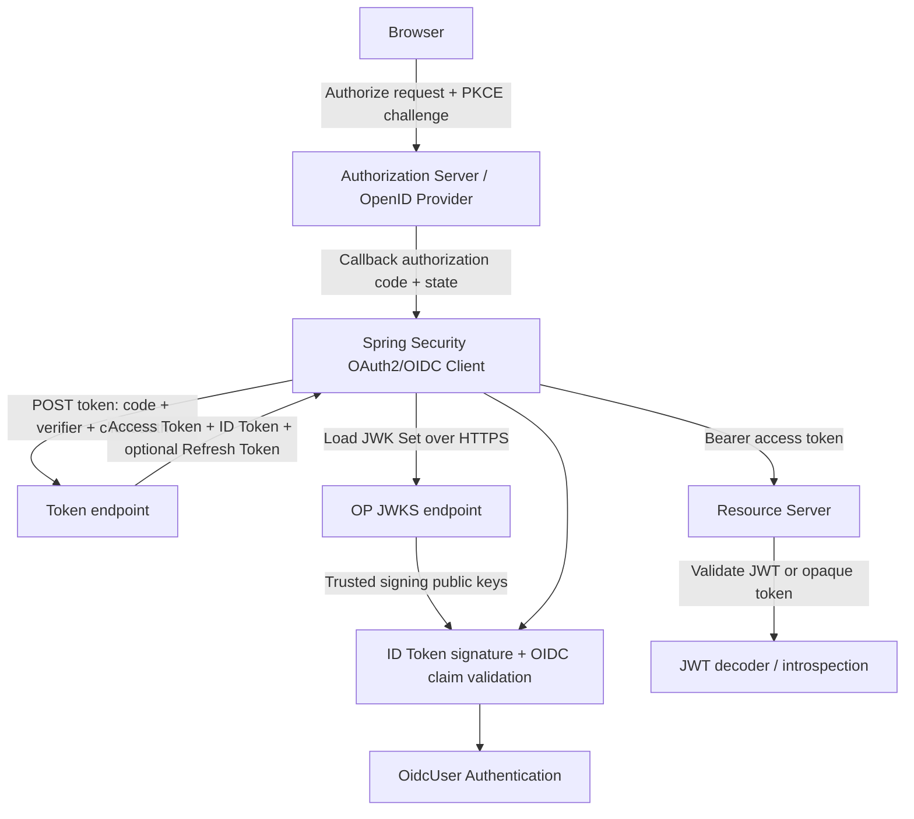
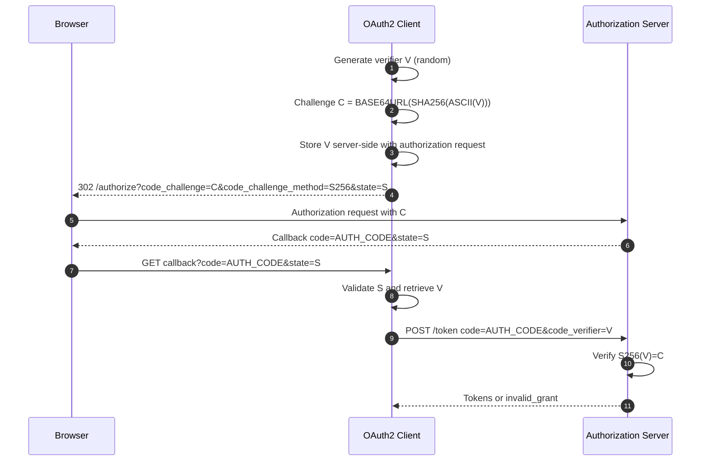
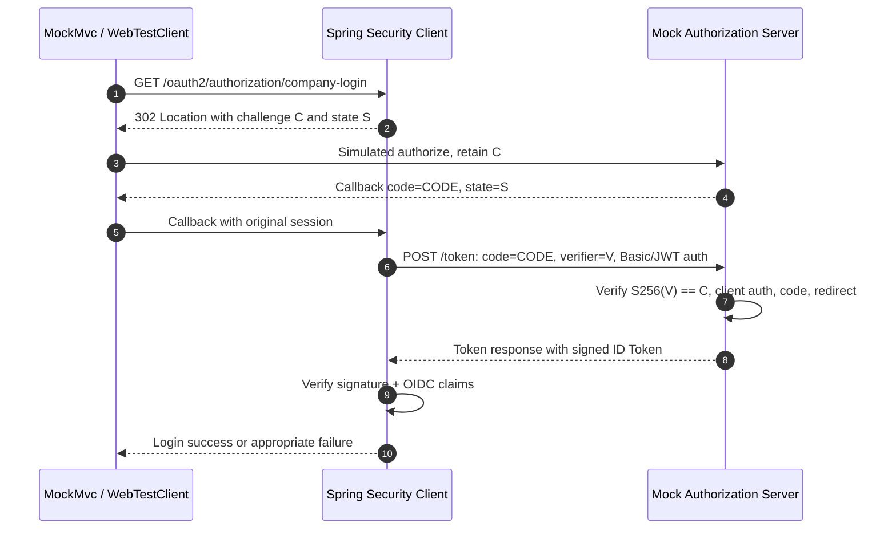
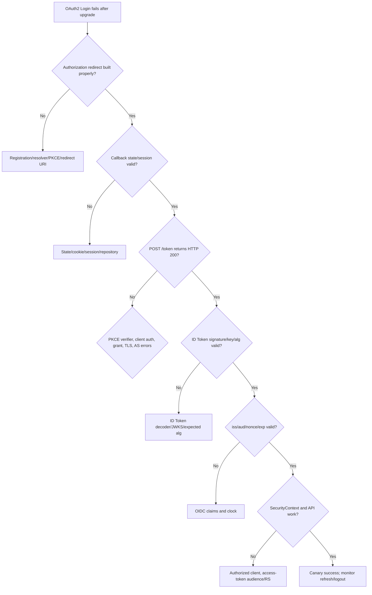

# 33.7. Checking Default Changes for PKCE, Algorithms, and Token Verification

When upgrading **Spring Boot, Spring Security, Nimbus JOSE + JWT, Reactor Netty, or the JDK**, a **Spring Security OAuth 2.0 / OpenID Connect (OIDC) Client** application may continue building cleanly yet fail during login, authorization code exchange, or token refresh. Even when the token endpoint returns HTTP 200, the OIDC ID Token may be rejected because the signing algorithm, issuer, audience, or nonce no longer matches. Some changes come from framework defaults; others stem from the provider or custom configurations that previously went unnoticed.

Lesson **"33.7. Checking Default Changes for PKCE, Algorithms, and Token Verification"** in chapter **33. Compatibility and Upgrades** guides you through establishing a **version-pinned baseline**, distinguishing security mechanisms, verifying **PKCE for public/confidential clients**, **JWS/JWK/ID Token verification**, **token endpoint client authentication**, and **Resource Server JWT/opaque token validation**, and then building safe regression tests, canaries, monitoring, and rollbacks.

> **Principle:** Never fix a failed migration by disabling PKCE, accepting any JWT algorithm, dropping issuer/audience/nonce checks, or turning off TLS certificate verification. Determine **which exact default changed, in which component, and for which registration and provider**, then adjust according to an evidence-backed contract.

## 1. Learning Objectives

After this lesson, you will be able to:

1. Distinguish the roles of OAuth2 Client/OIDC Login, Resource Server, and Authorization Server.
2. Identify public vs. confidential clients and the conditions under which PKCE is enabled automatically or required explicitly.
3. Verify `code_challenge_method=S256`, `code_challenge`, and `code_verifier` across authorize/callback/token exchange.
4. Distinguish `state`, OIDC `nonce`, PKCE, and token endpoint client authentication.
5. Check expected ID Token JWS algorithms per `ClientRegistration`.
6. Distinguish the OAuth2 Login ID Token decoder from the Resource Server `JwtDecoder`/`ReactiveJwtDecoder`.
7. Verify key selection from JWKS, signing key rotation, issuer, audience, and security claims.
8. Verify `client_secret_basic`, `client_secret_post`, `private_key_jwt`, `client_secret_jwt`, and mTLS methods.
9. Write a positive/negative test matrix with WireMock, MockMvc, WebTestClient, and synthetic tokens/JWKs.
10. Build an upgrade workflow with a baseline, staging contract tests, canary, alerting, and rollback.

## 2. Boundaries Not to Confuse



| Step | Token/credential | Typical Spring Security component | What to check during upgrade |
|---|---|---|---|
| Authorization redirect | `state`, `code_challenge`, `nonce` | `OAuth2AuthorizationRequestResolver` / Reactive resolver | PKCE/state/nonce, redirect URI |
| Token exchange | Authorization code, `code_verifier`, client auth | `OAuth2AccessTokenResponseClient` | Body/headers, grant, client authentication |
| OIDC Login | ID Token JWT | `OidcIdTokenDecoderFactory`, authentication provider | Expected alg, issuer/audience/nonce, key |
| Authorized client | Access/refresh tokens | `OAuth2AuthorizedClientManager`, service/repository | Token lifecycle, refresh, persistence |
| Outbound API | Bearer access token | OAuth2-enabled `WebClient`/`RestClient` | Right token/registration/audience selected |
| Inbound API | JWT or opaque access token | `JwtDecoder`/`OpaqueTokenIntrospector` | Signature/introspection, issuer/audience/scopes |
| HTTPS/mTLS | X.509 certificate, client private key | HTTP/TLS stack | Chain, SAN, client identity, policy |

**Token endpoint client authentication** is the RP proving it is the OAuth2 client to the AS. **ID Token signature verification** is the RP verifying a JWT issued by the OP. **Access token validation** typically belongs to the Resource Server. All three may be loosely called "token authentication," yet **they do not share a single set of defaults**.

## 3. Method: Record a Versioned Baseline, Never Guess

Instead of making a blanket claim like "new Spring Security turns on all X defaults," build a **compatibility baseline** on the running release and compare it with the candidate release:

| Property | Old baseline | New candidate | Evidence |
|---|---|---|---|
| Boot/Security/Nimbus/JDK | Exact resolved versions | Exact resolved versions | Dependency tree/SBOM |
| Public client PKCE | Enabled? `S256`? | Enabled? `S256`? | Captured `Location` |
| Confidential client PKCE | Required? | Required? | Resolved registration, redirect |
| Code verifier at token endpoint | Present and matches challenge? | Present and matches? | HTTP stub |
| Token endpoint client auth | Basic/Post/JWT/mTLS/none | Compare | HTTP request/mock server |
| Expected ID Token JWS alg | Per issuer/client | Compare | Signed JWT positive/negative tests |
| JWT Resource Server allowed algs | Per decoder | Compare | Decoder tests |
| OIDC claims validation | `iss/aud/nonce/exp`... | Compare | Tampered fixtures |
| JWK cache/rotation | Refreshes keys when needed | Compare | Mock JWKS rotation |
| HTTPS/trust | TLS/CA/SNI | Compare | Network integration tests |

Modern Spring Security docs note that **public clients using method `none` and no client secret automatically use PKCE**; `ClientRegistration.clientSettings.requireProofKey` can require PKCE; `OidcIdTokenDecoderFactory` commonly defaults to `RS256`; and Resource Server JWT decoders have their own algorithm allowlist. However, **custom resolvers, factories, HTTP clients, or application auto-configuration** can cause runtime behavior to differ from defaults.

### 3.1. Inventory Before Upgrading

For **each** registration, record:

- `registrationId`, issuer URI, authorization URI, token URI, JWKS URI, and trusted hosts.
- `authorizationGrantType` and `clientAuthenticationMethod`.
- Whether a client secret exists (record only presence, **never log the secret**).
- Public vs. confidential; whether PKCE policy is mandatory, optional, or a legacy exception.
- Redirect URI and authorization request repository/session handling.
- Expected ID Token JWS algorithm, issuer, audience, and key source.
- Client assertion signer if using JWT client authentication.
- Token refresh/revocation/introspection endpoints and TLS/mTLS configuration.
- Whether the same app also hosts a Resource Server, using JWT or opaque introspection.

Do not read only YAML: environment variables, custom `ClientRegistrationRepository` beans, dynamic tenants, custom beans, and HTTP client overrides can alter the **effective runtime configuration**.

## 4. PKCE per RFC 7636

**Proof Key for Code Exchange (PKCE)** binds an authorization code to the client that initiated the request. The client generates a random secret `code_verifier` and computes a `code_challenge` sent in the browser redirect. When exchanging the code, the client must present the matching verifier.



With method `S256`:

\[
\mathrm{code\_challenge} = \mathrm{BASE64URL\_NO\_PADDING}\left(\mathrm{SHA256}(\mathrm{ASCII}(\mathrm{code\_verifier}))\right)
\]

Per RFC 7636, `code_verifier` has length 43–128 characters from the unreserved set and must be generated with sufficient randomness. Never derive a verifier from timestamps, emails, user IDs, or counters.

### 4.1. The Browser Sees Only the Challenge

```http
HTTP/1.1 302 Found
Location: https://idp.example.org/authorize?response_type=code&client_id=portal-test&state=OPAQUE_STATE&code_challenge=CHALLENGE&code_challenge_method=S256
```

**Never** place `code_verifier` in the authorization redirect, callback query, HTML, or client-side storage. The verifier stays in the authorization request context and is sent only in the **POST token endpoint** request.

### 4.2. Token Request

```http
POST /token HTTP/1.1
Content-Type: application/x-www-form-urlencoded
Authorization: Basic <TEST_CREDENTIALS_ONLY>

grant_type=authorization_code&code=AUTH_CODE&redirect_uri=https%3A%2F%2Fportal.example.org%2Flogin%2Foauth2%2Fcode%2Fcompany-login&code_verifier=VERIFIER
```

Confidential clients can send **both client authentication and the PKCE verifier**. An AS requiring PKCE must reject a missing or wrong verifier, usually with `invalid_grant`.

### 4.3. PKCE, `state`, `nonce`, and Client Authentication Are Independent Mechanisms

| Mechanism | Purpose |
|---|---|
| `state` | Authorization response correlation, protecting browser flows from CSRF/mix-up |
| `code_verifier`/`code_challenge` | Binds the code to the initiating client |
| OIDC `nonce` | Binds the ID Token to the authentication request, preventing replay |
| Client secret/JWT assertion/mTLS | Client authentication at the token endpoint |
| Exact `redirect_uri` match | Prevents codes from being sent to unregistered callbacks |
| TLS | Protects transport and verifies hostname/certificate |

PKCE **does not replace** `nonce`, `state`, TLS, or confidential client authentication.

## 5. Public vs. Confidential Clients During Upgrades

A public OAuth2 Client cannot securely store a client secret. Illustrative configuration:

```yaml
spring:
  security:
    oauth2:
      client:
        registration:
          browser-public:
            client-id: browser-test
            client-authentication-method: none
            authorization-grant-type: authorization_code
            redirect-uri: "{baseUrl}/login/oauth2/code/{registrationId}"
            scope: [openid, profile]
        provider:
          browser-public:
            issuer-uri: https://idp.example.org
```

Per modern Spring Security documentation, when client authentication method is `none` and the secret is blank/absent, PKCE is enabled automatically. PKCE can also be required via `ClientRegistration.clientSettings.requireProofKey` for the Authorization Code flow.

### 5.1. Confidential Client

```yaml
spring:
  security:
    oauth2:
      client:
        registration:
          company-login:
            client-id: reports-portal
            client-secret: "${COMPANY_CLIENT_SECRET}"
            client-authentication-method: client_secret_basic
            authorization-grant-type: authorization_code
            scope: [openid, profile]
        provider:
          company-login:
            issuer-uri: https://idp.example.org
```

A backend confidential client can—and usually should—enable PKCE per provider and security policy, **while retaining Basic/JWT/mTLS client authentication**. Never assume every confidential registration enables PKCE automatically across all Spring Security versions without verifying `requireProofKey` or the resolver.

### 5.2. Upgrade Cases Table

| Registration | Method | Secret | PKCE policy | Expected |
|---|---|---|---|---|
| Browser public | `none` | No | Framework public-client behavior | S256 challenge and verifier |
| Backend confidential | `client_secret_basic` | Yes | Explicit `requireProofKey`/approved policy | S256 + Basic auth |
| Legacy confidential | Basic/JWT | Yes | Provider lacks PKCE support | Per-provider exception without affecting public clients |
| Service `client_credentials` | Basic/JWT/mTLS | Per method | Not applicable | No browser PKCE |
| Refresh token grant | Client's method | Per method | PKCE does not apply to refresh | RT and client auth |

Disabling PKCE globally for one legacy confidential provider can weaken public registrations. If an exception is needed, scope it to that registration and set a migration deadline.

### 5.3. Custom Resolvers Can Drop PKCE

In Servlet, `DefaultOAuth2AuthorizationRequestResolver` typically handles `/oauth2/authorization/{registrationId}`; in WebFlux, `DefaultServerOAuth2AuthorizationRequestResolver` handles it. Custom resolvers adding `prompt`, `login_hint`, `max_age`, or tenant routing sometimes construct `OAuth2AuthorizationRequest` manually and drop PKCE attributes.

Symptom:

```text
GET /oauth2/authorization/company-login -> 302 (possibly challenge missing)
Callback state valid -> code exchange
POST /token -> missing code_verifier
AS -> 400 invalid_grant
```

Prefer the **default resolver + builder customizer** for your version. In versions supporting `OAuth2AuthorizationRequestCustomizers.withPkce()`, you can apply:

```java
import org.springframework.security.oauth2.client.registration
        .ClientRegistrationRepository;
import org.springframework.security.oauth2.client.web
        .DefaultOAuth2AuthorizationRequestResolver;
import org.springframework.security.oauth2.client.web
        .OAuth2AuthorizationRequestCustomizers;

DefaultOAuth2AuthorizationRequestResolver resolver =
        new DefaultOAuth2AuthorizationRequestResolver(
                registrations, "/oauth2/authorization");
resolver.setAuthorizationRequestCustomizer(
        OAuth2AuthorizationRequestCustomizers.withPkce());
```

`registrations` is an application-provided `ClientRegistrationRepository`. If you already have another customizer, **compose** them to preserve PKCE rather than arbitrarily overwriting builder attributes and additional parameters. Verify exact APIs for your version.

### 5.4. WebFlux Session and Reactor Context

In WebFlux, the authorization request and verifier may be stored via `WebSession`/repository. A callback landing on an instance without shared sessions, wrong `SameSite` cookies, or code blocking the Reactor event loop can break correlation. Never use a static global map holding verifiers for all users; test multiple tabs and multiple registrations.

## 6. Regression Tests for PKCE

### 6.1. Authorization Redirect Contains S256 Challenge

Servlet MockMvc example:

```java
mockMvc.perform(get("/oauth2/authorization/browser-public"))
        .andExpect(status().is3xxRedirection())
        .andExpect(header().string(
                "Location",
                org.hamcrest.Matchers.allOf(
                    org.hamcrest.Matchers.containsString(
                            "code_challenge="),
                    org.hamcrest.Matchers.containsString(
                            "code_challenge_method=S256"))));
```

In real tests, parse the URL with a URI/query parser so assertions do not depend on query parameter ordering or encoding.

### 6.2. Testing the Challenge–Verifier Relationship

```java
import java.nio.charset.StandardCharsets;
import java.security.MessageDigest;
import java.util.Base64;

static String s256Challenge(String verifier) throws Exception {
    byte[] hash = MessageDigest.getInstance("SHA-256")
            .digest(verifier.getBytes(StandardCharsets.US_ASCII));
    return Base64.getUrlEncoder().withoutPadding()
            .encodeToString(hash);
}
```

In a protocol integration test:

1. Capture `code_challenge` from the authorization redirect.
2. Preserve session/browser correlation when sending the callback with `code` and `state`.
3. Have the mock token endpoint capture `code_verifier` from the POST body.
4. Assert verifier length, allowed characters, and randomness per policy.
5. Assert `s256Challenge(verifier)` equals the captured challenge.
6. Assert the authorization URL/callback **never contains the raw verifier**.
7. Verify the fake AS rejects a wrong or missing verifier with `invalid_grant`.

Never compare the verifier against a fixed literal; verifiers must vary randomly across login attempts.

### 6.3. Public vs. Confidential

| Case | Authorize | Token exchange |
|---|---|---|
| Public with PKCE | S256 challenge | Verifier, **no** client secret |
| Confidential with PKCE | S256 challenge | Verifier **and** Basic/JWT/mTLS auth |
| Confidential legacy exception | Per approved contract | Client auth, PKCE per provider |
| Wrong verifier | Challenge C | Fake AS rejects |
| No verifier | Challenge C | Fake AS rejects |

Checking only that `Location` contains a challenge is **insufficient**. A custom token client can forget to send the verifier even when the redirect looks right.

### 6.4. `state`, `nonce`, and Tab Isolation

```text
Tab A: state=SA, verifier=VA, challenge=CA
Tab B: state=SB, verifier=VB, challenge=CB

Callback A -> verifier VA
Callback B -> verifier VB
No shared global lastVerifier
```

Test `state` mismatch, OIDC `nonce` mismatch, and cross-registration issuer mix-up. Never put verifiers into metric labels or debug logs.

## 7. Algorithms: Know Which Layer Is Under Discussion

| Algorithm family | Examples | Layer |
|---|---|---|
| PKCE code challenge method | `S256`, `plain` | Code binding at authorization/token endpoints |
| ID Token JWS | `RS256`, `ES256`, `PS256`, `HS256` | Signed by OP, verified by RP |
| Client assertion JWS | `RS256`, `PS256`, `ES256`, `HS256` | Signed by RP, verified by AS |
| JWT access token JWS | `RS256`/`ES256`... | Verified by Resource Server |
| JWE | Key/content encryption algorithms | Encrypted token profiles |
| TLS | TLS 1.2/1.3 + cipher suites | HTTPS/mTLS transport |
| JWK `kty` | `RSA`, `EC`, `oct` | Key material type |

If a provider announces "switching from RS256 to ES256," ask: **ID Token? JWT access token? JWT client assertion?** Do not replace one global `JwtDecoder` and hope everything lines up.

### 7.1. JWT Headers Must Not Dictate Trust Policy

Example header:

```json
{"alg":"RS256","kid":"provider-key-K2","typ":"JWT"}
```

`alg` and `kid` are **untrusted input before verification**. The application must enforce expected algorithms and key sources from `ClientRegistration`/issuer policy. Never accept `alg=none`, never use an asymmetric RSA public key as an HMAC secret (algorithm confusion), and never fetch arbitrary `jku`/`x5u` URLs from a token header.

### 7.2. JWK Sets and Signing Key Rotation

```text
Before: JWKS = [K1], ID Tokens signed K1
Overlap: JWKS = [K1,K2], new tokens signed K2
After: JWKS = [K2], K1 retired
```

JWK signing-key rotation is **distinct** from TLS certificate renewal. If the JWKS client caches K1 too long, signature verification fails even though the token endpoint returns 200; if the TLS CA changes and the JVM does not trust it, key fetching fails even though the JWK signing algorithm is unchanged.

### 7.3. `kid` Is Not a Trust Anchor

Key IDs only select a key **within the JWK Set bound to a trusted issuer**. Two issuers sharing the same `kid` must never share keys across issuers. Never fetch public keys from arbitrary URLs in JWT headers; always bind issuer, audience, expected `alg`, and JWK source.

## 8. OIDC ID Token Validation and Signing Algorithms

`OidcIdTokenDecoderFactory` is a central component when Spring Security OAuth2 Login processes ID Tokens. Per modern Spring Security documentation, the default expected algorithm is typically `RS256` and can be customized per `ClientRegistration` via `setJwsAlgorithmResolver(...)`.

### 8.1. ID Token Claims to Verify

| Claim | Meaning | Migration regression |
|---|---|---|
| `iss` | Identity provider/issuer | Exact trusted issuer URI |
| `sub` | End-user identity within issuer | Never use email as a trusted identity key |
| `aud` | Intended client audience | Includes the RP's `clientId` |
| `exp` | Expiry | Reject expired tokens |
| `iat` | Issued at | Reasonable timestamp per policy |
| `nonce` | Authorization request correlation | Reject mismatch per OIDC flow |
| `azp` | Authorized party | Check per OIDC rules when applicable |
| `auth_time` | Authentication time | Check if `max_age`/contract requires |
| `at_hash` | Access-token hash binding | Check per profile/flow requirements |
| `acr`/`amr` | Authentication context/method | Use in business auth only per policy |

An ID Token with a valid signature whose `aud` belongs to another application must be rejected. Never drop claim validators when customizing the JWT decoder factory.

### 8.2. Per-Registration Algorithm Policy

Configuration example on supported versions:

```java
import org.springframework.context.annotation.Bean;
import org.springframework.security.oauth2.client.oidc.authentication
        .OidcIdTokenDecoderFactory;
import org.springframework.security.oauth2.client.registration.ClientRegistration;
import org.springframework.security.oauth2.jose.jws.SignatureAlgorithm;
import org.springframework.security.oauth2.jose.jws.MacAlgorithm;
import org.springframework.security.oauth2.jwt.JwtDecoderFactory;

@Bean
JwtDecoderFactory<ClientRegistration> idTokenDecoderFactory() {
    OidcIdTokenDecoderFactory factory =
            new OidcIdTokenDecoderFactory();
    factory.setJwsAlgorithmResolver(registration -> {
        if ("partner-hmac".equals(registration.getRegistrationId())) {
            return MacAlgorithm.HS256;
        }
        return SignatureAlgorithm.RS256;
    });
    return factory;
}
```

`HS256` here **only illustrates a case where an OP/client registration explicitly agreed on HMAC**, not a global default to enable. With HMAC-based ID Token algorithms, the client secret serves as the symmetric verification key and must be protected as a credential. If you only use RS256, keep the framework default and test against the contract.

### 8.3. Never Replace the Default Decoder Carelessly

If you provide a custom `JwtDecoderFactory<ClientRegistration>` to customize TLS/JWKS/algorithms, preserve:

- Signature verification with expected algorithm/key.
- Issuer/audience/timestamp validation.
- OIDC-specific validators (`nonce`, `azp`/`auth_time` when applicable).
- Proper claim type conversion.
- Per-registration caching to avoid rebuilding decoders on every request.

A `NimbusJwtDecoder` built solely with a JWK Set URI while omitting OIDC validators **weakens security**, even if signature tests pass.

### 8.4. ID Token Decoder Differs from Resource Server `JwtDecoder`

An app defining:

```java
@Bean
JwtDecoder resourceServerDecoder() {
    // Config for inbound JWT Bearer on /api/**
}
```

does not imply `oauth2Login()` uses this bean to verify ID Tokens. OIDC Login uses its own `JwtDecoderFactory<ClientRegistration>`; test **both paths** if the app acts as both OAuth2 Client and Resource Server.

## 9. Resource Server JWT/Opaque Token Validation

A Resource Server receives inbound requests:

```http
GET /api/reports
Authorization: Bearer ACCESS_TOKEN
```

For JWTs, `JwtDecoder` or `ReactiveJwtDecoder` verifies signatures and claims. For opaque tokens, use introspection or provider-specific opaque validation—never guess a token format and parse it as a JWT.

### 9.1. Spring Boot Resource Server Config

```yaml
spring:
  security:
    oauth2:
      resourceserver:
        jwt:
          issuer-uri: https://idp.example.org
          jws-algorithms:
            - RS256
```

Per Spring Security documentation, Nimbus Resource Server JWT decoders default to `RS256` as the trusted baseline algorithm and can be customized. A custom `JwtDecoder` bean can override Boot properties, so test the **effective decoder**, not just YAML.

### 9.2. Decoder Builder Example

```java
import org.springframework.context.annotation.Bean;
import org.springframework.security.oauth2.jose.jws.SignatureAlgorithm;
import org.springframework.security.oauth2.jwt.JwtDecoder;
import org.springframework.security.oauth2.jwt.JwtValidators;
import org.springframework.security.oauth2.jwt.NimbusJwtDecoder;

@Bean
JwtDecoder reportsApiJwtDecoder() {
    NimbusJwtDecoder decoder = NimbusJwtDecoder
            .withIssuerLocation("https://idp.example.org")
            .jwsAlgorithm(SignatureAlgorithm.RS256)
            .build();
    decoder.setJwtValidator(
            JwtValidators.createDefaultWithIssuer(
                    "https://idp.example.org"));
    return decoder;
}
```

This illustrates issuer/signature/timestamp validation; **the Reports API audience must be validated separately** if required by the app. `JwtValidators.createDefaultWithIssuer` does not know your API audience automatically.

### 9.3. Audience Validator and Composition

```java
import org.springframework.security.oauth2.core.OAuth2Error;
import org.springframework.security.oauth2.core.OAuth2TokenValidator;
import org.springframework.security.oauth2.core.OAuth2TokenValidatorResult;
import org.springframework.security.oauth2.jwt.Jwt;

OAuth2TokenValidator<Jwt> reportsAudience =
        jwt -> jwt.getAudience().contains("reports-api")
            ? OAuth2TokenValidatorResult.success()
            : OAuth2TokenValidatorResult.failure(
                new OAuth2Error("invalid_token",
                        "Wrong audience", null));
```

When adding a validator, compose with `DelegatingOAuth2TokenValidator` so **issuer and timestamp validators remain intact** rather than replacing everything with audience-only validation.

### 9.4. OAuth2 Clients Do Not Verify Access Tokens by Default

The access token an RP receives may be an opaque string; an OAuth2 Client typically stores it and attaches it as a Bearer token on outbound API calls. It **does not need to verify the access token signature itself** when the Resource Server evaluates the token. Never send an ID Token as a Bearer token in place of an access token, even though both are JWTs.

## 10. OAuth2 Client Authentication at the Token Endpoint

A major shift during upgrades can be **how the application authenticates itself as an OAuth2 client to the AS**. `ClientRegistration.clientAuthenticationMethod` affects not only HTTP headers, but also provider security policies and how the framework selects token response clients.

| Method | Mechanism | Mandatory checks |
|---|---|---|
| `client_secret_basic` | HTTP Basic with client ID/secret | Accurate Basic header, proper encoding |
| `client_secret_post` | Form fields `client_id`/`client_secret` | Accurate POST body; use only if provider approves |
| `private_key_jwt` | Client signs JWT assertion with private key | `alg/kid`, key, `iss/sub/aud/iat/exp/jti` |
| `client_secret_jwt` | Client signs assertion with HMAC client secret | Right secret/algorithm, do not confuse with ID Token |
| `tls_client_auth` | mTLS X.509 client certificate | Registered cert/key and identity |
| `self_signed_tls_client_auth` | mTLS registered certificate public key | Proof-of-possession and matching registration |
| `none` | Public client, no secret | PKCE + exact redirect URI + provider policy |

**`none` client authentication does not mean `alg=none` JWTs are accepted.** A public client can use `none` at the token endpoint while still verifying a properly signed ID Token.

### 10.1. Basic vs. POST Differ

For a confidential Code client:

```yaml
spring:
  security:
    oauth2:
      client:
        registration:
          company-login:
            client-id: portal-web
            client-secret: "${OIDC_CLIENT_SECRET}"
            client-authentication-method: client_secret_basic
            authorization-grant-type: authorization_code
            scope: [openid, profile]
```

Basic token request:

```http
POST /token HTTP/1.1
Authorization: Basic <TEST_BASIC_CREDENTIALS>
Content-Type: application/x-www-form-urlencoded

grant_type=authorization_code&code=TEST_CODE&code_verifier=TEST_VERIFIER
```

POST method token request:

```http
POST /token HTTP/1.1
Content-Type: application/x-www-form-urlencoded

grant_type=authorization_code&code=TEST_CODE&client_id=portal-web&client_secret=FAKE_SECRET&code_verifier=TEST_VERIFIER
```

Abbreviated example; real code-exchange requests also carry `redirect_uri` per contract. Do not switch from Basic to POST just because a provider temporarily accepts it, and **never log** header/body credentials. PKCE can be sent **alongside client authentication**; they are not mutually exclusive.

### 10.2. Client Secrets with Special Characters

Client secrets containing `+`, `:`, `%`, `/`, or Unicode can expose custom encoding bugs when swapping HTTP clients. Under `client_secret_basic`, OAuth2 defines specific credential-encoding rules before building the Basic header. Use Spring Security's token request converters rather than concatenating headers manually; regression-test with **synthetic secrets containing special characters** parsed by a mock server.

### 10.3. `private_key_jwt`

When a provider uses `private_key_jwt`, the token request carries:

```text
client_assertion_type=urn:ietf:params:oauth:client-assertion-type:jwt-bearer
client_assertion=<signed-JWT>
grant_type=authorization_code or client_credentials
```

The JWT assertion may contain:

```json
{
  "iss": "partner-service",
  "sub": "partner-service",
  "aud": "https://partner-idp.example.org/token",
  "jti": "unique-id-for-this-assertion",
  "iat": 1900000000,
  "exp": 1900000300
}
```

These timestamps illustrate structure. Real tests must set `iat/exp` relative to the test clock; never hardcode a far-future timestamp and expect an AS running on production time to accept it. Providers may require `aud` to be the token endpoint or issuer identifier per registered contract.

`NimbusJwtClientAuthenticationParametersConverter` is Spring Security's extension point for JWT Bearer client authentication. Declaring `client-authentication-method: private_key_jwt` **does not supply a private signing key automatically**. You need a properly wired JWK resolver/key supplier, token response client, and converter.

### 10.4. `private_key_jwt` Differs from ID Token

```text
private_key_jwt client assertion:
  signed by Client private key
  verified by Authorization Server
  audience = token endpoint/provider agreed identifier

OIDC ID Token:
  signed by OpenID Provider key
  verified by Client
  audience = Client ID
```

Never use the OP's public JWKS signing key as the RP's private key, and do not modify `OidcIdTokenDecoderFactory` when the real error is in the client assertion signer.

### 10.5. `client_secret_jwt`

A client may sign assertions with an HMAC secret if supported by the provider. During upgrades, check the algorithm, secret length, and signer version. Do not assume `HS256` is permitted for ID Tokens just because token endpoint client authentication uses `client_secret_jwt` with `HS256`; they are **two separate cryptographic contracts**.

### 10.6. mTLS and Sender-Constrained Tokens

OAuth2 RFC 8705 specifies mTLS client authentication and certificate-bound access tokens. Verify:

1. The HTTP token client uses the right truststore for the OP server.
2. The client keystore contains the RP's exact private key and certificate.
3. `tls_client_auth`/`self_signed_tls_client_auth` is properly registered at the AS.
4. The mTLS-specific token endpoint alias is used when required by the provider.
5. For certificate-bound access tokens, the API `WebClient` also presents the matching certificate when calling the Resource Server.
6. Cert rotation does not cause old tokens to be sent with a different cert outside contract.

Never "fix" `SSLHandshakeException` by trusting all certificates or disabling hostname verification. TLS failures can surface earlier than OAuth2 `invalid_client`.

## 11. Token Response Clients and Grant-Specific Regressions

Spring Security OAuth2 Client supports distinct grants, typically via separate response clients:

```text
authorization_code -> OAuth2AuthorizationCodeGrantRequest
refresh_token       -> OAuth2RefreshTokenGrantRequest
client_credentials  -> OAuth2ClientCredentialsGrantRequest
token_exchange      -> extension grant (if supported by project/provider)
```

Upgrading the HTTP transport or a custom converter may fix the Code flow while breaking refresh or client credentials because only one grant was wired through the migrated path.

| Grant | Request fields to check | Risk |
|---|---|---|
| Authorization Code | code, redirect URI, code verifier if PKCE, client auth | `invalid_grant`, `invalid_client` |
| Refresh Token | refresh token + client auth | Rotation, missing secret/JWT assertion |
| Client Credentials | `grant_type`, scopes, client auth | Wrong signer/certificate |
| Token Exchange | Subject/actor token, audience, client auth | Provider chain changed |

### 11.1. PKCE Does Not Apply Arbitrarily to Every Grant

`code_verifier` belongs to **authorization code exchange**. A standard `grant_type=refresh_token` request does not need a `code_verifier`. If an upgrade accidentally injects a verifier into every token request, the provider may reject the extra parameter. Inspect request bodies per grant.

### 11.2. Client Authentication Can Still Fail After Login

Example:

```text
First Login:
  authorization_code -> token endpoint Basic auth OK
  ID Token validation OK

Later:
  refresh_token -> new HTTP client lacks Basic/client assertion
  AS returns invalid_client
```

Initial token acquisition succeeding is **not enough** to conclude refresh works. Test each path used inside `OAuth2AuthorizedClientManager`.

### 11.3. Automatic HTTP Redirects Can Cross Trust Boundaries

A token request carrying a client secret or assertion must never auto-follow 302/307 redirects to arbitrary hosts. If HTTP client defaults change, a redirect can leak credentials depending on transport behavior. Test a server returning `Location` to another host and confirm the client never forwards token requests, bodies, or headers outside the allowlist.

### 11.4. Timeouts and Retries

An Authorization Code is single-use; a refresh token may rotate. A timeout after POST **does not guarantee** the AS did not process the request. Generic retries after timeouts can trigger `invalid_grant` or refresh token reuse detection. When upgrading the token HTTP client:

- Check which layers enable or disable retries.
- Track logical grant calls separately from physical HTTP attempts.
- Never blindly retry authorization code or refresh token POSTs.
- Use bounded timeouts, pools, and backoff per provider contract.
- Distinguish code/PKCE `invalid_grant` from RT-rotation `invalid_grant` by `grant`.

## 12. JWT Signing Keys and TLS Certificates Have Distinct Lifecycles

During an upgrade, a signature verification failure may stem from a stale cache rather than a default algorithm change:

```text
JWK Set:
  K1 -> K1+K2 -> K2
JWT:
  signed K1 -> signed K2
```

A TLS error may stem from the OP renewing a certificate or intermediate CA. The two lifecycles are independent:

| Material | Used to | Typically obtained from |
|---|---|---|
| TLS server certificate | Verify HTTPS endpoint | TLS handshake/server chain |
| OIDC signing JWK | Verify ID Token JWT | Trusted issuer JWKS |
| Resource Server JWT key | Verify access token JWT | Trusted issuer/JWK for API |
| Client assertion private key | Sign `private_key_jwt` | Client keystore/KMS |
| mTLS client certificate/private key | Client identity/proof | Client TLS keystore |

Never import a leaf TLS certificate as a JWK signing key or pin `kid` indefinitely. For JWKS, fetch only from approved issuer/metadata endpoints—never fetch an arbitrary `jku` supplied in a token header.

### 12.1. TLS Trust Remains Mandatory

If the token endpoint or JWKS URI uses a corporate private CA, a framework/JDK upgrade may point to a different truststore. Never fix `PKIX path building failed` or SAN mismatches by disabling certificate validation or switching HTTPS to HTTP. Inspect truststores, root/intermediate certs, DNS/SNI, proxy inspection, and certificate validity.

## 13. Negative Test Matrix for ID Token/JWT

Test with signed JWT fixtures from test keypairs—never production private keys or provider credentials.

| Token | Expected outcome |
|---|---|
| Valid ID Token, approved alg/key/issuer/audience/nonce | OIDC authentication succeeds |
| ID Token `alg=none` or unsigned | Rejected per signed-token profile |
| ID Token `HS256`, client only approves `RS256` | Rejected |
| ID Token `RS256`, tampered signature | Rejected |
| ID Token signed by issuer B key for issuer A | Rejected |
| ID Token valid signature but wrong `iss` | Rejected |
| ID Token valid signature but `aud` lacks client ID | Rejected |
| ID Token wrong `nonce` | Rejected per OIDC flow |
| ID Token `exp` in the past | Rejected |
| Multi-audience token with invalid `azp` | Rejected when profile requires |
| ID Token signed with key K2 after valid rotation | Accepted after JWKS update |
| ID Token claims unknown `kid` | Bounded re-fetch or rejected |
| JWT access token valid signature but wrong API audience | Resource Server rejects |
| Opaque token passed to JWT decoder | Rejected, not guessed |
| JWT with `jku` pointing to arbitrary host | Never fetches arbitrary URL |

### 13.1. Why Decoding the Payload Alone Is Insufficient

```text
BASE64URL-decode JWT payload -> JSON claims
```

is **parsing**, not authentication. Tests must invoke the real `OidcIdTokenDecoderFactory`, `JwtDecoder`, or Authentication provider and assert success or failure.

### 13.2. Generating Keypairs in Tests

A mock OP can generate test RSA/EC keypairs, publish the public JWK Set over an HTTPS/loopback test stub, and sign JWTs with the test private key. For key rotation:

1. Initial JWKS contains K1.
2. K1 token succeeds.
3. Add K2/JWKS overlap.
4. K2 token succeeds once the decoder refreshes keys.
5. Wrong `alg`/issuer is still rejected even when signed with valid K2.

A JSON JWK containing only `kid`/`alg` without key parameters (`n/e` for RSA or `crv/x/y` for EC) is **insufficient** for real verification.

## 14. PKCE Integration Tests with a Mock Authorization Server

A protocol-level test should span **two HTTP boundaries**:



**Important:** A WireMock stub returning `POST /token -> 200` for every request will not catch a missing verifier, wrong client auth, or code reuse. To truly test PKCE, the mock AS must verify challenge–verifier correlation and return `invalid_grant` on mismatch.

### 14.1. Minimal WireMock Structural Stub

```java
import static com.github.tomakehurst.wiremock.client.WireMock.*;

tokenServer.stubFor(
    post(urlEqualTo("/oauth2/token"))
        .withRequestBody(containing(
                "grant_type=authorization_code"))
        .withRequestBody(containing("code_verifier="))
        .willReturn(okJson("""
            {
              "access_token": "AT_TEST",
              "token_type": "Bearer",
              "expires_in": 3600
            }
            """)));
```

This snippet **only tests request shape**; it does not prove PKCE or OIDC Login succeeded (OIDC Login requires a valid ID Token). To test end-to-end, use a custom dispatcher or stateful mock OP, verify S256 pairing, mint a signed ID Token with accurate claims, and then assert Authentication.

### 14.2. Preserve Browser/Session Correlation

When testing callbacks:

- Send the exact cookie/session that stored the authorization request.
- Do not fabricate a new `state` unrelated to the redirect.
- Do not mix verifiers from another tab or registration.
- If using a load balancer/multi-instance setup, test the matching session repository.
- Never echo raw `state`/`verifier` or authorization codes in test reports.

### 14.3. Separate Positive and Negative Cases

```text
Positive:
  correct code + state + verifier + client auth
  valid signed ID Token -> login success

Negative PKCE:
  same code + wrong verifier -> invalid_grant

Negative OIDC:
  correct code exchange + wrong ID Token nonce -> login failure

Negative client auth:
  correct verifier + wrong client_secret/jwt assertion -> invalid_client
```

Separating cases helps pinpoint which default changed instead of lumping every failure into "OAuth2 login failed".

## 15. Verifying an RSA -> EC Signing Algorithm Migration

Suppose a Partner OP announces migrating **ID Tokens** from `RS256` to `ES256`:

1. Confirm this is the ID Token `alg`, not client assertion or access token `alg`.
2. Obtain the provider contract: effective date, key types, JWKS, and overlap window.
3. Verify Spring Security/Nimbus/JDK support for `ES256`/EC P-256.
4. Configure the expected algorithm **specifically for the Partner registration**.
5. Test an `ES256`-signed ID Token + EC public JWK + valid OIDC claims.
6. Test that `RS256` tokens are rejected after the policy switch once no longer approved.
7. Test that wrong EC keys or wrong `iss`/`aud` are rejected.
8. Canary the Partner registration before full rollout.
9. Monitor JWT validation failures and JWK cache refreshes.
10. Roll back if the contract provides a compatibility window; never enable all algorithms globally.

### 15.1. Distinguish Algorithm Switches from Key Rotation

```text
RSA K1 -> RSA K2:
  algorithm RS256 remains
  key ID/public key changes

RSA RS256 -> EC ES256:
  algorithm changes AND key type changes
```

The two scenarios require different negative tests. A "key rotation" notice does not imply an algorithm change, and vice versa.

## 16. Checking Public PKCE After Config Migration

A configuration may inadvertently change:

```yaml
client-authentication-method: client_secret_basic
```

into:

```yaml
client-authentication-method: none
```

due to property binding, refactoring, or overrides. Consequences:

- Redirects may start including PKCE due to the public-client rule.
- The token endpoint stops receiving Basic client auth.
- The AS rejects with `invalid_client` because the client is registered as confidential.
- If a misconfigured AS accepts public requests, the trust model is silently downgraded.

**Do not fix this by disabling PKCE.** The bug is the client registration method; tests must check both the authorization redirect **and** token request authentication.

### 16.1. Resolved Registration Sanity Checks

You can add an application startup sanity check (without logging secrets):

```text
For each approved registration:
  issuer/tokenUri in trusted allowlist
  grant_type matches client contract
  clientAuthenticationMethod matches AS registration
  PKCE requirement is explicit/verified
  redirect URI is exact and trusted
  expected ID Token alg is approved
  confidential secret/private key exists where required
```

This check does not replace network integration tests; it catches property-binding mistakes before production logins fail.

## 17. Servlet and WebFlux Have Different Wiring Points

Servlet:

```text
DefaultOAuth2AuthorizationRequestResolver
OAuth2AuthorizationRequestRedirectFilter
OAuth2AccessTokenResponseClient
HttpSecurity.oauth2Login()
OidcIdTokenDecoderFactory
```

Reactive:

```text
DefaultServerOAuth2AuthorizationRequestResolver
OAuth2AuthorizationRequestRedirectWebFilter
ReactiveOAuth2AccessTokenResponseClient
ServerHttpSecurity.oauth2Login()
Reactive authentication/JWT infrastructure
```

When migrating a project to WebFlux or updating a Reactive stack, never copy Servlet resolvers into a Reactive chain. Session/authorization request storage, token HTTP clients, and subscription lifecycles differ.

### 17.1. Illustrative WebFlux Configuration

```java
import org.springframework.context.annotation.Bean;
import org.springframework.security.config.web.server.ServerHttpSecurity;
import org.springframework.security.web.server.SecurityWebFilterChain;

@Bean
SecurityWebFilterChain webFluxSecurity(ServerHttpSecurity http) {
    return http
        .authorizeExchange(exchanges -> exchanges
                .pathMatchers("/login", "/error").permitAll()
                .anyExchange().authenticated())
        .oauth2Login(oauth2 -> {})
        .build();
}
```

This bean only indicates OAuth2 Login is enabled; PKCE policy, registration, token response client, ID Token algorithm, and HTTP transport must be verified separately.

### 17.2. Testing WebTestClient Redirects

```java
webTestClient.get()
        .uri("/oauth2/authorization/browser-public")
        .exchange()
        .expectStatus().is3xxRedirection()
        .expectHeader().valueMatches(
                "Location", ".*code_challenge_method=S256.*");
```

In real tests, parse the `Location` URL and assert query keys/values since parameter order is not guaranteed. A redirect regex alone does not test the verifier or token exchange.

### 17.3. Reactive Security Context

Never call `block()` inside a production `WebFilter` or handler to load discovery, JWKS, or sessions. Reactive tests should use `StepVerifier` and a real `SecurityWebFilterChain`/`ServerWebExchange` context. An unsubscribed `Publisher` executes no HTTP calls.

## 18. Common Failures and Boundaries to Check

| Symptom | Possible cause | Investigation step |
|---|---|---|
| Redirect missing challenge after upgrade | Client settings/PKCE customizer dropped | Resolved registration, resolver |
| Redirect has challenge, token POST missing verifier | Session/repository lost, custom token client | Stored authorization request, POST body |
| `invalid_grant` during code exchange | Wrong/missing verifier, code replay/expiry, redirect mismatch | Grant + code/verifier correlation |
| `invalid_grant` during refresh | Rotated/revoked RT, concurrency | Token storage/RT lifecycle |
| `invalid_client` | Wrong client auth method/secret/JWT assertion/mTLS | Client registration + token HTTP request |
| Token POST 200 but OIDC Login fails | ID Token signature/issuer/audience/nonce | OIDC decoder/claims, JWKS |
| `SignatureException` after key rotation | Stale cache/new `kid`/alg mismatch | Trusted JWKS, expected alg, cache |
| `JWT alg not allowed` | Provider changed algorithm | Per-registration contract, allowlist |
| Resource Server 401 while login works | Wrong access token issuer/aud/alg | RS `JwtDecoder`/opaque validator |
| `PKIX path building failed` | JDK truststore/CA changed | TLS chain, truststore, SNI |
| `No subject alternative name` | Hostname/SAN mismatch | URL, cert SAN, proxy |
| Code exchange OK, later refresh fails | Separate token response client misconfigured | Refresh client method/TLS |
| JWT client assertion fails | Wrong `aud/alg/kid/exp/jti`/key | Signed assertion, AS contract |
| WebFlux test does not send token HTTP | `Mono` not subscribed | `StepVerifier`/test binding |
| Multi-provider callback uses wrong issuer | Registration/state mix-up | Issuer binding, session correlation |

### 18.1. Layered Diagnostic Flow



Never "fix" a failure at one layer by weakening another: `invalid_client` must not be solved by dropping JWT signature verification; `invalid_state` must not be solved by disabling PKCE; a wrong JWT audience must not be solved by trusting all TLS certs.

## 19. Migration Test Suite: Full Positive and Negative Coverage

| ID | Case | Expected |
|---|---|---|
| P01 | Public Code client, method `none`, no secret | PKCE `S256` |
| P02 | Confidential Code client requiring PKCE | PKCE + client auth |
| P03 | Custom resolver adding `prompt`/`login_hint` | Preserves `state`/`nonce`/PKCE |
| P04 | Wrong verifier | AS rejects with `invalid_grant` |
| P05 | Missing verifier when challenge was sent | Rejected |
| P06 | Cross-tab/cross-registration state mix-up | Rejected |
| P07 | Code replay | Rejected |
| A01 | ID Token valid alg/key/claims | Accepted |
| A02 | ID Token `alg=none` | Rejected |
| A03 | ID Token signed with wrong algorithm | Rejected |
| A04 | Tampered signature | Rejected |
| A05 | Wrong `iss` | Rejected |
| A06 | Wrong `aud` | Rejected |
| A07 | Wrong nonce/expired | Rejected |
| A08 | JWK rotation K1->K2 | Accepted when JWKS updates properly |
| A09 | Arbitrary `jku`/`kid` | Never fetches untrusted keys |
| C01 | Basic auth | Accurate header for test client |
| C02 | Post auth | Accurate form body |
| C03 | `private_key_jwt` | Signed assertion + accurate claims |
| C04 | `client_secret_jwt` | Right HMAC signer/key |
| C05 | mTLS | Valid client cert passes, wrong cert rejected |
| C06 | Public client | Sends no secret |
| T01 | Authorization Code grant | Accurate code/verifier/redirect |
| T02 | Refresh Token grant | Accurate RT + client auth |
| T03 | Client Credentials | No browser PKCE |
| T04 | Token endpoint returns external 302 | Never forwards secrets |
| R01 | RS JWT accepted alg | Only expected algorithms allowed |
| R02 | Wrong access token audience/issuer | Rejected |
| R03 | Opaque token to JWT-only decoder | Rejected |
| O01 | Provider metadata/JWKS HTTPS | Right TLS trust and issuer |
| O02 | OP outage | Never silently downgrades security |

Run the **same matrix** on both the baseline and candidate builds. A failing test is not always a regression: the newer version may be enforcing stricter rules and exposing a weak old policy. When that happens, make a **formal security decision** on expected behavior instead of loosening the test.

## 20. Practical Upgrade Workflow

### 20.1. Baseline Phase

1. Record exact versions of Spring Boot, Spring Security, Framework, Nimbus, Reactor Netty, and JDK.
2. Inventory registrations, issuers, client auth methods, PKCE settings, and ID Token algorithms.
3. Capture non-secret fields from the authorization redirect (challenge method, presence, redirect URI host).
4. Capture token HTTP request **structure** (grant, fields, auth header method) via a mock AS.
5. Create signed JWT fixtures and test signatures + claims per issuer/client.
6. Test Resource Server JWT/opaque validation separately if present.
7. Test JWK rotation and TLS trust.
8. Test refresh token and client credentials grants.
9. Record login and token acquisition SLO/metrics as the baseline.

### 20.2. Candidate Phase

1. Upgrade via Spring Boot's compatible dependency matrix/BOM.
2. Run compile, unit, and integration suites.
3. Compare actual authorization request PKCE and token client auth.
4. Compare allowed/rejected JWS algorithms, JWT claims, and JWK fetching.
5. Verify custom resolvers, factories, and managers are still autowired/wired in the DSL properly.
6. Test against a provider-specific staging realm covering Code, Refresh, and ClientCredentials.
7. Canary per provider/registration and deployment version.
8. Monitor `invalid_grant`, `invalid_client`, JWT validation, and TLS by grant and phase.
9. Make an evidence-based, time-bounded rollout or rollback decision.

### 20.3. Never Upgrade Dependencies Out of Alignment with the BOM

Spring Boot manages Spring Framework, Security, Reactor, Netty, Nimbus, and related modules together. Overriding an individual security library can cause binary/runtime incompatibilities or unexpectedly alter HTTP defaults. Inspect the dependency tree and release notes—check transitive versions rather than only starter versions.

### 20.4. Compare Runtime-Resolved Registrations

Do not diff only `application.yml`. Spring environment variables, tenant-specific repositories, custom `ClientRegistration` builders, secret managers, and profile overrides can produce differences. Inspect **secret-free** resolved properties:

```text
registrationId
issuerUri / trusted tokenUri / jwkSetUri
authorizationGrantType
clientAuthenticationMethod
clientSettings.requireProofKey
redirectUri
expected IdToken alg
```

If a method unexpectedly resolves to `none` when the baseline was `client_secret_basic`, fix it before rollout.

## 21. Canary, Metrics, and Alerting

Define a clear metric contract, for example:

```text
oauth2.login.completed{registration, outcome}
oauth2.token.request{registration, grant, outcome, reason}
oidc.id_token.validation{registration, outcome, reason}
oauth2.provider.tls.failure{provider, reason}
resource_server.jwt.validation{issuer_category, outcome}
```

These are **illustrative custom metrics**, not emitted automatically by Spring Security upon adding Actuator. Tags must have bounded cardinality; never put raw tokens, user emails, nonces, states, verifiers, authorization codes, or client secrets in logs or metrics.

### 21.1. Count `invalid_grant` by Grant

```text
grant=authorization_code + invalid_grant:
  PKCE verifier, code replay/expiry, redirect URI, client config

grant=refresh_token + invalid_grant:
  refresh rotation/revocation, concurrent refresh, stale store
```

Lumping all `invalid_grant` errors together can confuse a PKCE bug on a new registration with a refresh token race for active users.

### 21.2. Distinguish Token Endpoint from ID Token Verification

```text
HTTP /token = 200
OIDC validation = failure
```

typically points to ID Token `alg`/key/issuer/audience/nonce checks rather than Basic/JWT client assertions. Phased metrics prevent modifying the wrong configuration.

### 21.3. Meaningful Canary Observation

During a canary, measure:

- Successful authorization redirects per registration.
- Code exchange success/failure and token endpoint p95 latency.
- ID Token signature/claims failure rates.
- Refresh token success and `invalid_grant` after access tokens expire.
- Resource Server 401/403s by audience/issuer.
- JWKS fetch/cache errors and TLS trust failures.

Do not declare an upgrade safe simply because the login page loaded and one user signed in once.

## 22. Rollback and Compatibility Windows

Rolling back the application version does not always restore login if the OP already changed PKCE requirements or signing algorithms:

1. Keep the previous deployable artifact and configuration ready.
2. Verify whether session/authorized-client serialization is backward compatible.
3. Confirm the OP still supports the legacy algorithm, client auth, or PKCE behavior.
4. If the provider uses refresh token rotation, never restore old RTs from backups and auto-retry them.
5. For dual-algorithm transitions, allowlist by **registration + deadline**, never across all issuers.
6. Verify rollback still enforces `iss`/`aud`/`nonce`, TLS hostname checks, and trusted keys.
7. After rollback, run smoke tests for Authorization Code + PKCE + ID Token + Refresh + API.

### 22.1. Never Shift Trust Boundaries for a "Quick Rollback"

Dangerous changes:

```text
allow all JWT algs
accept alg=none
skip ID Token signature verification
disable state or nonce
turn off PKCE everywhere
trust any TLS certificate
allow dynamic arbitrary issuer/JWKS URLs
```

These are not safe rollbacks—they are security downgrades. If a compatibility exception is unavoidable, keep it narrow with a named owner, expiration date, and negative tests.

## 23. Anti-Patterns to Avoid

1. Disabling PKCE upon seeing `invalid_grant` before checking the verifier/session.
2. Accepting `plain` code challenges when policy requires `S256`.
3. Generating verifiers from timestamps or user IDs.
4. Treating `state` as `nonce` or `verifier`; all three serve distinct roles.
5. Allowing raw verifiers in browser redirects or logs.
6. Treating a confidential client secret as an excuse to drop PKCE.
7. Switching a confidential registration to `none` when property binding breaks.
8. Letting the token header `alg` dictate allowed algorithms.
9. Accepting `alg=none` in a signed ID Token profile.
10. Using an RSA public key as an HMAC secret in a custom JWT decoder.
11. Fetching JWKs from arbitrary `jku`/`x5u` URLs.
12. Using a key `kid` from another issuer because the name matches.
13. Replacing the OIDC decoder factory and dropping issuer/audience/nonce validators.
14. Confusing the Resource Server JWT decoder with the OAuth2 Login ID Token decoder.
15. Sending an ID Token as an API Bearer token instead of an access token.
16. Accepting an access token with a valid signature but the wrong audience.
17. Confusing the `private_key_jwt` client signing key with the OP ID Token signing key.
18. Switching `client_secret_basic` to `client_secret_post` without contract alignment.
19. Enabling mTLS token-bound tokens while calling APIs from an HTTP client lacking the cert.
20. Disabling HTTPS/TLS certificate verification when JWKS fetching fails.
21. Using a mock token endpoint returning 200 without verifying PKCE/client auth.
22. Testing only `mockOidcLogin()` and assuming ID Token cryptography is verified.
23. Testing only the authorization redirect without verifying the token POST verifier.
24. Writing only positive RSA token tests without testing wrong alg/issuer/audience.
25. Using production signing keys or client secrets in CI.
26. Enabling allow-all algorithms system-wide when one provider rotates keys.
27. Mixing refresh `invalid_grant` with code-exchange `invalid_grant`.
28. Rolling back the framework without checking whether the OP closed the compatibility window.
29. Skipping runtime resolved registration checks after property/env refactoring.
30. Lacking canary metrics broken down by registration, grant, and validation phase.

## 24. Pre-Production Checklist

| Question | Required result |
|---|---|
| Boot/Security/Nimbus/JDK versions pinned? | Recorded in dependency tree/SBOM |
| All client registrations inventoried? | Issuer/grant/method/scopes/redirect clear |
| Public Code clients enforce PKCE `S256`? | Yes per policy |
| Confidential Code PKCE policy clear? | Yes, without dropping client auth |
| Custom resolvers preserve `state`/`nonce`/PKCE? | Yes |
| Authorization URL never leaks verifier? | Verified |
| `code_verifier` matches challenge in token POST? | Tested `S256` equality |
| Wrong/missing verifier rejected by mock AS? | Yes |
| ID Token accepted algorithms defined per registration? | Approved |
| Invalid alg/signature/issuer/audience/nonce rejected? | Yes |
| JWKS key rotation test passes? | Yes |
| Token client methods match AS registration? | Basic/Post/JWT/mTLS/`none` accurate |
| JWT assertion key/claims/audience accurate? | Positive and negative tests |
| RS JWT alg/issuer/audience policy separate? | Yes |
| Opaque token validation strategy appropriate? | Not guessed as JWT |
| TLS trust for OP/JWKS intact? | No trust-all |
| Refresh/client credentials still work? | Regression tests passing |
| Logs/metrics never expose token/state/verifier? | Redaction tested |
| Staging provider contract tests pass? | Yes |
| Canary/rollback plan ready? | Yes, with zero security downgrade |

## 25. Practice Exercises

### Exercise 1: Public PKCE

Create a public Code client with `client-authentication-method=none`. Call `/oauth2/authorization/browser-public` with MockMvc/WebTestClient. Assert the `S256` challenge is present and no verifier appears in `Location`.

### Exercise 2: Challenge/Verifier Match

Capture the redirect challenge and token POST verifier. Compute `BASE64URL(SHA256(verifier))` and assert it equals the challenge. Send a wrong verifier and assert the mock AS returns `invalid_grant`.

### Exercise 3: Confidential + PKCE

Keep `client_secret_basic` alongside PKCE. Test that the token request contains both the Basic header and the verifier. Do not downgrade the registration to public.

### Exercise 4: ID Token Algorithm Switch

Generate test RSA/EC keypairs. Have the mock OP sign with `RS256`/`ES256` per registration policy. Verify approved algorithms are accepted while wrong algorithms, signatures, issuers, and audiences are rejected.

### Exercise 5: `private_key_jwt`

Create a client assertion signed with a test private key. Have the mock token endpoint verify `alg`/`kid`/`aud`/`exp`/`iss`/`sub`/`jti`. Wrong key or wrong audience must be rejected with `invalid_client`.

### Exercise 6: Resource Server Audience

Create a signed JWT from the right issuer whose `aud` lacks `reports-api`. Confirm the Resource Server returns 401; do not modify the ID Token decoder because the issue is in inbound access-token validation.

### Exercise 7: Upgrade Decision Record

Build a before/after table for each registration: resolved config, expected PKCE, ID Token JWS `alg`, token client auth, JWKS cache, negative tests, canary metrics, and rollback constraints. Use protocol test evidence rather than assuming "defaults didn't change."

## 26. Review Questions

1. Why can a Spring Security upgrade break login even when YAML is unchanged?
2. How does PKCE bind an authorization code to the client?
3. At which endpoints are `code_challenge` and `code_verifier` sent?
4. Why does `S256` require high-entropy verifiers and unpadded Base64URL?
5. Does PKCE replace `state`, `nonce`, client secrets, or TLS?
6. Under what condition does a public client using method `none` enable PKCE automatically in modern Spring Security?
7. Can a confidential client use PKCE alongside Basic, JWT, or mTLS?
8. At what step can a custom resolver drop the verifier?
9. Why is asserting only that the authorization redirect contains a challenge insufficient?
10. How do you verify `S256(verifier) == challenge` without hardcoding the verifier?
11. How does the ID Token decoder differ from the Resource Server `JwtDecoder`?
12. How do `RS256`, `ES256`, and `HS256` differ in key type and verification?
13. Why should JWT header `alg`/`kid` never dictate trust policy?
14. Is `alg=none` related to `client-authentication-method=none`?
15. What is the risk of HS/RS algorithm confusion?
16. Why must `iss`/`aud`/`nonce` still be checked even when the signature is valid?
17. When must OIDC `azp`/`auth_time` be checked per contract?
18. How does JWK rotation differ from TLS certificate renewal?
19. How does token endpoint `client_secret_basic` differ from `client_secret_post`?
20. Which signing key does a `private_key_jwt` client assertion use?
21. Is a JWT assertion's `aud` the same as an ID Token's `aud`?
22. What does an mTLS certificate-bound access token require when calling an API?
23. How many token decoder paths must an app verify if it is both an OAuth2 Client and a Resource Server?
24. Should an opaque access token be decoded as a JWT?
25. When receiving `invalid_client`, what should you check before modifying PKCE?
26. Why can `invalid_grant` on `authorization_code` vs. `refresh_token` have different root causes?
27. Why is automatic HTTP redirect following dangerous at the token endpoint?
28. Why is a mock AS returning 200 without checking the request body a weak test?
29. Which metrics should be watched when canarying a provider?
30. Why might rolling back the framework fail to help if the OP already changed its signing algorithm or PKCE policy?

## References

- [Spring Security Reference — OAuth2 Client Authorization Grants (Servlet)](https://docs.spring.io/spring-security/reference/servlet/oauth2/client/authorization-grants.html)
- [Spring Security Reference — OAuth2 Client Authorization Grants (Reactive)](https://docs.spring.io/spring-security/reference/reactive/oauth2/client/authorization-grants.html)
- [Spring Security Reference — OAuth2 Login Advanced Configuration](https://docs.spring.io/spring-security/reference/servlet/oauth2/login/advanced.html)
- [Spring Security Reference — Reactive OAuth2 Login Advanced Configuration](https://docs.spring.io/spring-security/reference/reactive/oauth2/login/advanced.html)
- [Spring Security Reference — Client Authentication Support (Servlet)](https://docs.spring.io/spring-security/reference/servlet/oauth2/client/client-authentication.html)
- [Spring Security Reference — Client Authentication Support (Reactive)](https://docs.spring.io/spring-security/reference/reactive/oauth2/client/client-authentication.html)
- [Spring Security Reference — Resource Server JWT (Servlet)](https://docs.spring.io/spring-security/reference/servlet/oauth2/resource-server/jwt.html)
- [Spring Security Reference — Resource Server JWT (Reactive)](https://docs.spring.io/spring-security/reference/reactive/oauth2/resource-server/jwt.html)
- [Spring Security API — OidcIdTokenDecoderFactory](https://docs.spring.io/spring-security/reference/api/java/org/springframework/security/oauth2/client/oidc/authentication/OidcIdTokenDecoderFactory.html)
- [Spring Security API — DefaultOAuth2AuthorizationRequestResolver](https://docs.spring.io/spring-security/reference/api/java/org/springframework/security/oauth2/client/web/DefaultOAuth2AuthorizationRequestResolver.html)
- [Spring Boot Reference — Spring Security](https://docs.spring.io/spring-boot/reference/web/spring-security.html)
- [RFC 7636 — Proof Key for Code Exchange](https://www.rfc-editor.org/rfc/rfc7636.html)
- [RFC 6749 — OAuth 2.0 Authorization Framework](https://www.rfc-editor.org/rfc/rfc6749.html)
- [RFC 9700 — OAuth 2.0 Security Best Current Practice](https://www.rfc-editor.org/rfc/rfc9700.html)
- [RFC 7523 — JWT Client Authentication](https://www.rfc-editor.org/rfc/rfc7523.html)
- [RFC 8705 — OAuth 2.0 Mutual-TLS Client Authentication](https://www.rfc-editor.org/rfc/rfc8705.html)
- [RFC 7515 — JSON Web Signature](https://www.rfc-editor.org/rfc/rfc7515.html)
- [RFC 7517 — JSON Web Key](https://www.rfc-editor.org/rfc/rfc7517.html)
- [RFC 8725 — JSON Web Token Best Current Practices](https://www.rfc-editor.org/rfc/rfc8725.html)
- [OpenID Connect Core 1.0](https://openid.net/specs/openid-connect-core-1_0.html)
- [OpenID Connect Discovery 1.0](https://openid.net/specs/openid-connect-discovery-1_0.html)
