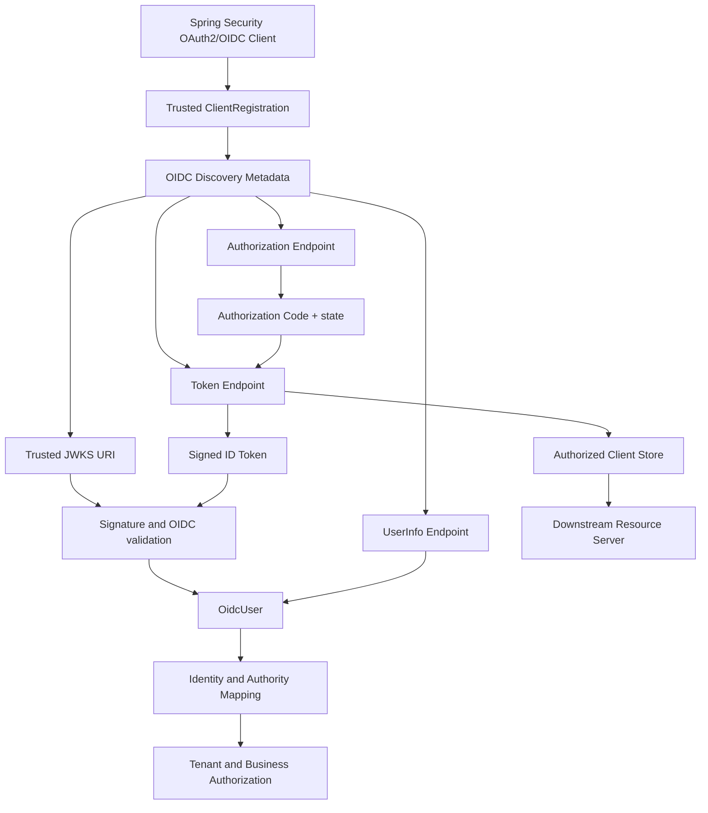

# 33.8. Assessing Provider Compatibility When Upgrading Discovery or Claims

## 1. Context: The Provider Still Lets You Log In, Yet the Contract Changed

A Spring Security application acting as an **OAuth 2.0 Client / OpenID Connect (OIDC) Relying Party (RP)** depends on what the provider publishes in **discovery metadata** and the identity data delivered in the **ID Token** or **UserInfo**. When an identity provider (OpenID Provider, OP) upgrades its version, changes realms/issuers, adds endpoints, alters how claims are emitted, or shifts security profiles, the application can fail even without backend code changes.

Hypothetical example:

- Before upgrade: OP returns `preferred_username` in the ID Token, `groups` as a string array, and `email` in UserInfo.
- After upgrade: OP returns `preferred_username` only in UserInfo, omits `groups` by default, changes `email_verified` or its presence, and updates `token_endpoint_auth_methods_supported` in metadata.
- Spring Security still completes some login sessions, yet account provisioning, role mapping, and tenant checks break.

Conversely, a provider can update discovery metadata **without breaking the protocol flow the application uses**. Therefore, never assume every change in JSON metadata is a breaking change; determine **which parts belong to the real contract of `ClientRegistration`, OIDC verification, and business logic**.

> **Compatibility assessment goal:** Prove that after the upgrade, the application still selects the right provider and OAuth client, obtains valid tokens, verifies identity against the right issuer/audience, maps claims/authorities per policy, maintains the token lifecycle, and **never relaxes security boundaries** just to keep logins succeeding.

This lesson belongs to chapter **33. Compatibility and Upgrades** of the **Spring Security OAuth 2.0 OIDC Client** module, focusing on Java 17+, Spring Boot 3.x, Spring Security 6.x, and both Servlet and WebFlux. Hostnames, issuers, client IDs, tokens, and identity data are illustrative only. Specific properties and APIs must be verified against the exact dependency and provider versions deployed.

### Learning Objectives

After this lesson, you will be able to:

1. Explain the role of OIDC discovery and distinguish provider metadata from claims data in the ID Token/UserInfo.
2. Identify metadata fields that can break OAuth2 Login, Token Endpoint authentication, JWKS validation, refresh tokens, and logout.
3. Evaluate changes to `issuer`, discovery location, `jwks_uri`, signing algorithms, endpoints, response types, scopes, client authentication methods, and PKCE support.
4. Distinguish OIDC-required claims from optional/provider-specific claims, as well as changes in claim **name, type, source, and semantics**.
5. Preserve `(iss, sub)` identity and prevent account takeover when `sub`/`email`/`preferred_username` changes.
6. Build a pre-upgrade baseline and compare contracts via a diff table classifying breaking, security, and operational changes.
7. Test the Spring Security OAuth2/OIDC Client using a fake OP, mocked discovery/JWKS/Token Endpoint/UserInfo, and negative tests.
8. Analyze Servlet and WebFlux behaviors, custom mappers, authorized-client persistence, and multi-provider/multi-tenant setups.
9. Execute canary rollouts, feature flags, rollbacks, and monitoring without exposing tokens or personal data.
10. Establish a runbook for diagnosing post-upgrade provider incidents without disabling issuer/signature/audience validation.

---

## 2. Three Contract Layers That Must Be Evaluated Independently

### 2.1. Layer 1 — Discovery/Provider Metadata

Discovery provides **machine-readable configuration** about the OP:

```json
{
  "issuer": "https://login.example.test/realms/employees",
  "authorization_endpoint": "https://login.example.test/realms/employees/oauth2/authorize",
  "token_endpoint": "https://login.example.test/realms/employees/oauth2/token",
  "jwks_uri": "https://login.example.test/realms/employees/keys",
  "userinfo_endpoint": "https://login.example.test/realms/employees/userinfo",
  "response_types_supported": ["code"],
  "subject_types_supported": ["public", "pairwise"],
  "id_token_signing_alg_values_supported": ["RS256"],
  "token_endpoint_auth_methods_supported": [
    "client_secret_basic",
    "private_key_jwt"
  ]
}
```

These values are neither access tokens nor user profiles. They define **provider capabilities and endpoint locations**.

### 2.2. Layer 2 — Protocol Tokens and Identity

Example verified ID Token payload:

```json
{
  "iss": "https://login.example.test/realms/employees",
  "sub": "identity-4821",
  "aud": "employee-portal",
  "iat": 1790000000,
  "exp": 1790003600,
  "auth_time": 1789999900,
  "nonce": "opaque-nonce-bound-to-request",
  "email": "employee@example.test",
  "email_verified": true
}
```

In practice, tokens travel as JWTs (typically signed JWS), not raw JSON. The RP must verify signatures and OIDC claims per client registration. Requirements on `nonce`, `auth_time`, and other claims depend on the request, flow, and profile.

A provider changing claims may leave metadata untouched; changing metadata may leave token claims untouched.

### 2.3. Layer 3 — Business Mapping and Authorization

Once Spring Security builds `OidcUser`, the application may:

- Link `(issuer, subject)` to an internal account.
- Display `name`, `picture`, and `locale`.
- Use `email_verified` when deciding whether to trust `email`.
- Map `groups`/`roles` into `GrantedAuthority`.
- Select a tenant/org from verified claims or a membership store.
- Verify which registration was used to log in.
- Store `OAuth2AuthorizedClient` to call downstream APIs.

A change like `groups=["hr-admin"]` -> `groups=["/departments/hr/admin"]` may **never throw an exception from OIDC Login**, yet cause users to lose permissions—or worse, receive wrong permissions if a mapper uses unsafe matching.

### 2.4. Dependency Diagram



A provider upgrade must be evaluated across the entire dependency chain, not just by confirming the discovery URL returns HTTP 200.

---

## 3. What Does "Compatible" Mean?

### 3.1. Configuration, Protocol, Data, and Security Compatibility

| Layer | Potentially acceptable change | Likely breaking change |
| --- | --- | --- |
| Discovery | Adding an unused metadata field | Changing `issuer`, `token_endpoint`, or `jwks_uri` unexpectedly |
| Authorization | Adding a response mode while retaining `code` | Dropping `authorization_code`/current redirect pattern |
| Client authentication | Adding `private_key_jwt` alongside `client_secret_basic` | Removing `client_secret_basic` while app still relies on it |
| ID Token | Adding an optional `locale` claim | Changing `sub`/`iss` or claim types a mapper depends on |
| Signing keys | Publishing new key with overlap before rotation | Signing with a new `kid` before JWKS publishes it |
| UserInfo | Adding `department` while keeping `sub` | Dropping a required app field; returning a `sub` differing from ID Token |
| Scopes | Adding a new scope while retaining existing ones | Dropping a scope, causing missing claims/permissions |
| API Access Token | Keeping audience and grant semantics | Changing audience/scope/issuer so Resource Server rejects |
| Logout | Adding end-session metadata | Removing endpoint/configured logout capability |
| Tenant | Adding an optional tenant claim | Changing org ID semantics, attaching users to wrong tenant |

### 3.2. "Login Didn't Crash" Is Not Enough

A smoke test checking only that the home page returns 200 can miss:

- Browsers holding pre-upgrade sessions that perform no new token exchange.
- UserInfo Endpoint omitting a field the home page does not read.
- Refresh tokens untested because access tokens have not expired yet.
- Group mapping dropping privileges when the test only logs in a non-privileged user.
- Endpoints that only call the Resource Server hours later.
- Client ID/issuer changes rendering stored authorized-client records unusable.
- Broken logout/back-channel/logout redirects that never trigger during login.
- Multi-tenant users routed into the wrong organization due to claim type changes.
- Nonce/issuer/audience validation disabled by custom code to "stay compatible".

Success requires **positive and negative assertions** across all critical layers.

### 3.3. Classifying Change Severity

Use four categories to guide decisions:

1. **Additive/non-breaking (conditional):** new metadata or optional claims the app does not depend on; still verify parsers tolerate them.
2. **Behavioral:** claim values, formats, presence frequency, order, or source change while remaining protocol-valid; inspect business logic.
3. **Breaking:** endpoints, issuer/client authentication, required claims, or data types needed by the app change.
4. **Security-sensitive:** trust boundaries, signing algorithms, key sources, `sub`, audiences, tenant claims, client auth methods, or token destinations change; mandatory security review.

A single change can span multiple categories. Moving `sub` from public to pairwise is **behavioral + breaking + security-sensitive** if the app uses `sub` as a primary key without a migration plan.

---

## 4. Establishing a Pre-Upgrade Baseline

### 4.1. Record Trusted Configuration Sources

Before upgrading Spring Boot/Security or the OP, build a **secret-free inventory**:

```text
environment: staging
tenant_alias: employees
registrationId: employees-oidc
client_id_alias: portal-web
issuer: https://login.example.test/realms/employees
grant_type: authorization_code
client_auth_method: client_secret_basic
redirect_uri_template: {baseUrl}/login/oauth2/code/{registrationId}
scopes: openid profile email groups
token_endpoint_alias: employees-token
jwks_endpoint_alias: employees-jwks
userinfo_enabled: true
id_token_alg_policy: RS256
principal_mapping: issuer+subject
authority_mapping_version: v3
metadata_snapshot_version: before-upgrade
```

If the system has multiple registrations, issuers, or tenants, repeat the baseline per trust domain. Never use tenant A's configuration to extrapolate about tenant B's tokens.

### 4.2. Record What the Application Actually Reads

Classify claims:

| Claim/source | Required by protocol or business? | How is it used? |
| --- | --- | --- |
| ID Token `iss` | Protocol-critical | Exact expected OP issuer |
| ID Token `sub` | Protocol-critical | Verified identity key |
| ID Token `aud` | Protocol-critical | Current OAuth client ID |
| ID Token `iat`/`exp` | Protocol-critical | Token-time validation |
| ID Token `nonce` | Per request/flow | Correlation/replay defense |
| ID Token `auth_time` | Per request/profile | Max age/reauthentication |
| `name` | Usually optional | Display name |
| `preferred_username` | Usually optional | Display/login hint, not global identity |
| `email` | Optional per scope/consent | Contact; never sole identity |
| `email_verified` | Optional per profile | Email trust flag if app relies on it |
| `picture`/`locale` | Optional | UI/display |
| UserInfo `sub` | OIDC UserInfo identity binding | Must match ID Token subject when used |
| `groups`/`roles` | Provider-specific | Authority/organization mapping when defined |
| `tenant_id`/`org_id` | Provider-specific | Tenant policy, requiring issuer trust + membership |
| Access token `scope`/`aud` | API contract | Resource Server permission/destination |

Marking a field **optional** in OIDC does not make it optional for your application. If business logic requires `department` to grant access, ensure fail-safe behavior if the provider stops emitting it.

### 4.3. Select Representative Test Identities

Maintain synthetic or controlled test accounts:

- Basic user with minimal profile only.
- User with scopes/consent yielding `email` and `groups`.
- User lacking `email` or having `email_verified=false`.
- User with multiple groups/roles.
- User belonging to one tenant.
- User belonging to multiple tenants if supported.
- User with pairwise subjects across multiple OAuth clients.
- User with Unicode in `name`/`locale`.
- User whose group names contain hyphens, slashes, and mixed case.
- Account whose UserInfo differs from ID Token on optional display claims.
- Account disabled or with revoked membership if provider policy supports it.

Never save full production ID Tokens in baselines or tickets. Create a **versioned schema template/redacted fixture** containing no PII, tokens, or secrets.

---

## 5. Discovery Metadata: Fields to Evaluate

### 5.1. `issuer` and Well-Known Discovery Location

Example issuer with a path:

```text
https://login.example.test/realms/employees
```

Do not assume `/.well-known/openid-configuration` appends identically for every provider/profile when the issuer contains a path. Follow the **OpenID Connect Discovery** endpoint rule and provider contract. Some systems also use **OAuth 2.0 Authorization Server Metadata** (RFC 8414), which places the well-known path differently per its rules.

Metadata `issuer` must match the exact expected issuer of the registration. Never compare only hostnames or allow similar-prefix URIs.

When the issuer changes:

```text
old: https://login.example.test/realms/employees
new: https://identity.example.test/oidc/employees
```

treat it as a **trust boundary change** even when both hosts belong to the same organization. Review account identity `(iss, sub)`, JWT verifier, client registration, Resource Server, token store, and migration.

### 5.2. `authorization_endpoint`

Changing the Authorization Endpoint can affect:

- Browser redirect URL.
- Provider session/cookies/domain.
- Redirect allowlist/approval.
- `state`, PKCE, nonce/response mode.
- `prompt`, `max_age`, `login_hint`, and extension parameters.
- Custom `OAuth2AuthorizationRequestResolver`.
- Proxy/WAF/network egress policies.

Do not hardcode an obsolete authorization URI in a custom resolver if provider discovery moved the endpoint. Equally, **never take endpoints from browser-supplied HTTP queries**.

### 5.3. `token_endpoint`

Changing the Token Endpoint directly affects:

- Authorization Code exchange.
- Refresh Token grant.
- Client Credentials grant.
- Client authentication methods.
- Proxy, TLS truststore, mTLS, and `private_key_jwt` `aud`.
- Firewall/egress allowlists.
- Metrics, tracing, and retry policies.
- Token revocation/introspection if endpoints move with the profile.

A provider moving `token_endpoint` while keeping `client_secret_basic` valid might work smoothly. Conversely, moving the endpoint while requiring `private_key_jwt` can make the Spring Security client fail with `invalid_client` even when browser authorization succeeds.

### 5.4. `jwks_uri` and Signing Algorithms

`jwks_uri` supplies public verification keys for the OP's tokens. When the provider changes it:

- Is the JWKS host/path trusted and reachable over HTTPS?
- Do `issuer` and discovery metadata match?
- Does the token header `kid` have a matching key in JWKS?
- Is the algorithm still on the OIDC Client's allowlist?
- Are RSA/EC key types compatible?
- Was the new public key published before the OP signed tokens with it?
- Is there an overlap window for tokens signed by the old key until expiry?
- Do caches/CDNs and your Spring/Nimbus version refresh keys in time?

**Never** work around errors by disabling signature verification, enabling `alg=none`, trying every tenant's JWKS, or trusting `jku`/`x5u` from an untrusted JWT header.

### 5.5. `userinfo_endpoint`

Metadata may add, change, or remove the UserInfo Endpoint. Impact depends on your OIDC user-loading strategy:

- Is the UserInfo Endpoint called?
- Does the access token have valid scopes/permissions to read UserInfo?
- Does the ID Token carry enough claims if UserInfo is unavailable?
- Does `sub` in UserInfo match the ID Token?
- Is there a custom `OidcUserService` or `OidcReactiveOAuth2UserService`?
- Does the provider return JSON or a signed/encrypted UserInfo response?
- Does the UserInfo Endpoint enforce new rate limits or timeouts?

An upgrade can allow logins to **keep succeeding** while `groups`/`email` vanish if the app fails to check where claims come from or has no safe fallback.

### 5.6. Other Capability Fields

| Metadata field | What to evaluate |
| --- | --- |
| `response_types_supported` | Is `code` still supported? Do not assume implicit/hybrid remain enabled |
| `response_modes_supported` | `query`, `form_post`, `jwt` per provider/profile; callback/CSRF/cookie compatibility |
| `grant_types_supported` | `authorization_code`, `refresh_token`, `client_credentials` per client contract |
| `scopes_supported` | `openid` and requested app scopes; does not guarantee every user gets all of them |
| `claims_supported` | Claims the OP can emit; does not guarantee presence in every token/UserInfo |
| `subject_types_supported` | `public`/`pairwise` and identity migration impact |
| `id_token_signing_alg_values_supported` | Signing alg capabilities; client must still enforce policy |
| `token_endpoint_auth_methods_supported` | Permitted `client_secret_basic`/`private_key_jwt`/mTLS profiles |
| `token_endpoint_auth_signing_alg_values_supported` | Supported JWT client assertion signing algorithms |
| `code_challenge_methods_supported` | PKCE `S256`, behavior/custom resolver changes |
| `request_parameter_supported` | Request object/request parameter capabilities if app depends on them |
| `request_uri_parameter_supported` | `request_uri` support; security/endpoint policies |
| `end_session_endpoint` | Provider-specific/discovery RP-Initiated Logout capability |
| `frontchannel_logout_supported` | Browser-based front-channel logout status |
| `backchannel_logout_supported` | Back-channel logout support per metadata/profile |
| `authorization_response_iss_parameter_supported` | Whether `iss` is emitted in authorization responses per RFC 9207 |

Do not assume **a missing metadata field always means the feature is absent**. Many fields have spec defaults or optional rules. Combine the specification, registration policy, vendor docs, and testing against the exact provider version.

### 5.7. Is Newly Added Metadata Always Harmless?

Suppose a provider adds:

```json
{
  "pushed_authorization_request_endpoint": "https://login.example.test/par",
  "require_pushed_authorization_requests": true
}
```

A new field can impose **a new behavioral requirement**, not just extra metadata. If the provider mandates PAR and the current Spring Security client does not send PAR requests, authorization flows will fail even though discovery parsed cleanly.

Likewise, moving to FAPI or a stricter profile can require JARM, mTLS/DPoP, stronger client authentication, or signed request objects. Never treat "new field ignored by parser" as proof of functional compatibility.

---

## 6. Claims: Compatibility Is More Than Field Names

### 6.1. Four Dimensions of a Claim

When a provider says "we didn't change the `groups` claim," ask:

1. **Name:** is the key still `groups`, or did it move to `roles`, `memberOf`, or a URI claim?
2. **Type:** string array, CSV string, array of objects, boolean, or number?
3. **Source:** ID Token, UserInfo, Access Token, or a custom endpoint?
4. **Semantics:** is the group value a global group ID, an org path, a display name, or an executable role?

For example, three responses that are **not equivalent** if code simply calls `getClaimAsStringList("groups")`:

```json
{"groups": ["hr-admin", "auditor"]}
```

```json
{"groups": "hr-admin,auditor"}
```

```json
{
  "groups": [
    {"id": "g-481", "name": "hr-admin", "tenant": "north"},
    {"id": "g-927", "name": "auditor", "tenant": "north"}
  ]
}
```

What a provider calls a "format improvement" can be a **breaking contract change** for the application.

### 6.2. ID Token and UserInfo Are Two Distinct Sources

The ID Token authenticates the user to the OIDC Client and holds core OIDC claims. The UserInfo Endpoint can supply additional profile attributes based on scopes, consent, and provider policy.

For example, before upgrade, the ID Token contains:

```json
{
  "sub": "identity-4821",
  "preferred_username": "lan",
  "email": "lan@example.test",
  "groups": ["staff", "approver"]
}
```

After upgrade, the ID Token may contain only:

```json
{
  "sub": "identity-4821",
  "email": "lan@example.test"
}
```

while UserInfo contains:

```json
{
  "sub": "identity-4821",
  "preferred_username": "lan",
  "groups": ["staff", "approver"]
}
```

If code calls `user.getIdToken().getClaimAsStringList("groups")`, it will now receive `null`. If the business contract needs `groups`, decide whether reading it from **OP-verified UserInfo bound to the matching `sub`** is approved. Never pick up privileges from unverified tokens/endpoints just because the claim name matches.

### 6.3. Core Claims vs. Optional Claims

Especially critical OIDC ID Token claims:

- `iss`: exact OP issuer.
- `sub`: subject identifier within the issuer.
- `aud`: audience, which must contain the RP's client ID.
- `exp`: expiration time.
- `iat`: issued-at time.

Other claims depend on flow/request/profile: `nonce`, `auth_time`, `azp`, `at_hash`, `c_hash`, and profile claims. Never downgrade security-critical claims to optional by removing validators when a provider upgrades.

For UserInfo, `sub` must match the ID Token subject if the response is used. Claims such as `name`, `email`, `picture`, and `locale` are typically optional based on scopes/consent/policy and must not be assumed always present.

### 6.4. `sub` Must Be Interpreted in the Context of `iss`

An OIDC identity key should start from:

```text
(verified issuer, verified subject)
```

Never use `sub` alone as a global account key across multiple issuers; never use `email`, `preferred_username`, or display name as a durable identifier instead of `sub`.

Example:

```text
Before:
  iss = https://id.example.test/realm-a
  sub = 18372

After:
  iss = https://id.example.test/realm-b
  sub = 18372
```

Even though `sub` matches, these may be two separate identity namespaces. Migration requires proof of identity equivalence—never just "rewrite the issuer string" in the database and assume it is the same user.

### 6.5. Public Subject to Pairwise Subject

A provider may change subject types or sector identifiers; different OAuth clients can receive different `sub` values for the same person.

```text
Before migration:
  iss=OP-A, sub=stable-public-4821

After policy change:
  iss=OP-A, sub=pairwise-for-client-portal-X
```

Determine whether semantics changed; rely on OP-guaranteed identity mappings, ownership-verified account linking, auditing, and rollback. Never auto-link by email when the new subject does not match.

### 6.6. `email` and `email_verified`

Before:

```json
{"email": "employee@example.test", "email_verified": true}
```

After:

```json
{"email": "employee@example.test"}
```

If the app requires an OP-verified email, missing `email_verified` must never be treated as `true` by default. Changing from a boolean to the string `"true"` can also break typed mappers.

Never grant access or merge accounts based on an unverified email. Display fields can fall back gracefully; security decisions must fail safe.

### 6.7. `groups`/`roles`: Profile Data Is Not Automatically a `GrantedAuthority`

Provider upgrade:

```text
Old: groups = ["payroll-approver"]
New: groups = ["/north/finance/payroll-approver"]
```

If a mapper uses `endsWith("payroll-approver")`, a identically suffixed group in another tenant could mistakenly receive privileges. Use **known group identifiers + exact issuer/tenant context**.

Never treat `email`, `department`, or `preferred_username` as roles; if permissions cannot be determined, deny sensitive operations rather than defaulting to admin.

### 6.8. Type, Source, and Format Changes

| Change | Risk |
| --- | --- |
| `"groups":["a"]` -> `"groups":"a"` | `ClassCastException` or silently dropped mapping |
| `"employee_id":123` -> `"employee_id":"123"` | Type-mismatch comparison, lost leading zeros |
| `"email_verified":true` -> `"email_verified":"true"` | Broken boolean parsing/authorization |
| `"tenant_id":"north"` -> object | Broken matcher/serializer |
| `"department":"Finance"` -> `null` | NPE or fallback granting wrong privileges |
| `"roles":["a","b"]` -> `[]` | Lost permissions or altered policy |
| `"name":"Lan"` -> missing | UI fallback |
| `"exp"`/`"iat"` malformed | Protocol validation must reject |

For identifiers that may carry leading zeros, never coerce them to numbers. For URI-namespaced claims, such as `tenant_id` -> `https://claims.example.test/tenant_id`, use a versioned mapper and test what happens when both old and new fields appear and conflict. A claim key shaped like a URL does not mean you should make an HTTP GET request to that URL.

### 6.9. Unicode, Locale, and Profile Rendering

Changes to `name`, `locale`, `picture`, and `preferred_username` can affect UI without breaking OIDC core. Test Unicode names, empty strings, long values, `vi_VN` vs. `vi-VN`, image/CDN URLs, and missing profile fields. Never use display names as security keys.

---

## 7. Claims Depend on Scopes, Consent, and User Accounts

### 7.1. `claims_supported` Does Not Guarantee Every User Receives a Claim

Metadata:

```json
{
  "claims_supported": [
    "sub",
    "name",
    "preferred_username",
    "email",
    "email_verified",
    "groups"
  ]
}
```

only describes OP capabilities. Actual emitted claims depend on requested/granted scopes, client entitlements, user consent, user attributes, organization membership, privacy settings, and claim-release rules.

### 7.2. Scope Changes Can Alter Claim Sources

Before:

```yaml
scope:
  - openid
  - profile
  - email
  - groups
```

After upgrade, the `groups` scope might be renamed or require admin approval. The app still requests the old scope, yet the AS may reject it or grant only a subset.

Verify which scopes are sent, which are actually granted, whether UserInfo/ID Token still carry business claims, and how the app handles missing permissions. Never request broader scopes just to "recover" a field without security and consent review.

### 7.3. Same Provider, Different Users

An admin account receiving all group claims does not prove ordinary users will. Your baseline should include:

- Minimal profile without email.
- `email_verified=false`.
- Many groups; zero groups.
- Single tenant; multiple tenants.
- External directory user.
- User with Unicode names/locale.
- User with pairwise `sub` across two OAuth clients.

Never declare a whole provider compatible based on one happy-path account.

### 7.4. UserInfo `sub` Mismatch

If the ID Token states `user-4821` while UserInfo returns:

```json
{"sub": "user-9274", "groups": ["admin"]}
```

never attach `groups=["admin"]` to `user-4821`. Per OIDC, UserInfo `sub` must match the ID Token subject. If a provider upgrade causes a mismatch, reject or fail per validator/policy—never disable the check.

---

## 8. Client Authentication, PKCE, and Grant Compatibility

### 8.1. `token_endpoint_auth_methods_supported`

If the Spring Client uses:

```yaml
client-authentication-method: client_secret_basic
```

while provider v2 only accepts `private_key_jwt` or mTLS, code exchange/refresh will return `invalid_client`. Updating metadata does not automatically turn a Spring client into a private-key JWT signer; you need the matching key and HTTP token response client integration for your version.

Never randomly switch to `none` or `client_secret_post` when the AS contract forbids it.

### 8.2. PKCE and Code Challenge

A provider may begin requiring PKCE `S256` for a client where it was previously optional. Check:

- Does the authorization request carry the right `code_challenge`/`code_challenge_method`?
- Does the token request carry the matching `code_verifier`?
- Does any custom authorization request resolver drop PKCE params?
- Do redirects/sessions preserve the request for correlation?
- Did the provider drop `plain` support or mandate `S256`?

PKCE does not replace `state`, issuer, or signature validation.

### 8.3. Response Mode and RFC 9207

A provider switching from query callbacks to `form_post`/JARM may require callback/cookie/CSRF adjustments. Never build a custom controller exchanging codes while bypassing the authorization request repository.

Some providers include authorization response `iss` per RFC 9207:

```text
callback:
  code=...
  state=...
  iss=https://login.example.test/realms/employees
```

This `iss` helps detect AS mix-up **before token exchange** when supported by your Spring Security version and provider. ID Token `iss` is verified **after token exchange**. Never use an untrusted query `iss` to select a different Token Endpoint.

### 8.4. Refresh Tokens

A provider may enable refresh-token rotation, alter `offline_access` consent, change the Token Endpoint URL, change client auth methods, or revoke old grants. Testing fresh logins does not prove pre-upgrade authorized clients can still refresh.

Distinguish:

- `invalid_client`: client authentication failed.
- `invalid_grant`: code, refresh token, or grant invalid or mismatched to client.
- HTTP 503/timeout: AS availability.
- 401/403 from downstream API: Access Token/resource authorization.

### 8.5. Access Tokens Have an Independent Contract

Changing JWT/opaque format, `aud`, scope, and issuer on Access Tokens can make a Resource Server return 401/403 even when OIDC login succeeds. The ID Token is for the RP; never send it as an API Bearer token to work around incompatibility.

---

## 9. Spring Boot: Mapping Provider Metadata to `ClientRegistration`

### 9.1. Discovery-Driven Configuration

```yaml
spring:
  security:
    oauth2:
      client:
        registration:
          employees:
            provider: employees-op
            client-id: ${OIDC_EMPLOYEES_CLIENT_ID}
            client-secret: ${OIDC_EMPLOYEES_CLIENT_SECRET}
            client-authentication-method: client_secret_basic
            authorization-grant-type: authorization_code
            redirect-uri: "{baseUrl}/login/oauth2/code/{registrationId}"
            scope:
              - openid
              - profile
              - email
        provider:
          employees-op:
            issuer-uri: https://login.example.test/realms/employees
```

`issuer-uri` typically tells Boot/Security to discover provider metadata to build `ClientRegistration`. Startup discovery and caching depend on framework version and config. If metadata `issuer` mismatches the expected issuer, never redirect to another host to "fix" it.

### 9.2. Explicit Endpoint Configuration

```yaml
spring:
  security:
    oauth2:
      client:
        provider:
          employees-op:
            issuer-uri: https://login.example.test/realms/employees
            authorization-uri: https://login.example.test/realms/employees/oauth2/authorize
            token-uri: https://login.example.test/realms/employees/oauth2/token
            jwk-set-uri: https://login.example.test/realms/employees/keys
            user-info-uri: https://login.example.test/realms/employees/userinfo
            user-name-attribute: sub
```

This is a **provider fragment**. Explicit endpoints may suit an OP contract, yet never skip expected issuer/ID Token validation, never pull JWKS from a different issuer, and never accept arbitrary URLs from the browser.

### 9.3. Versioned Registrations When Trust Identity Changes

If the issuer or client ID changes, consider:

```text
employees-oidc-v1
employees-oidc-v2
```

so old tokens/grants are not looked up under the new registration, while enabling canary/rollback. Not every metadata update requires renaming the registration ID; partition whenever **issuer/client identity or token lifecycle boundaries** change.

### 9.4. Inspecting the Running Registration

```java
import org.springframework.security.oauth2.client.registration.ClientRegistration;
import org.springframework.security.oauth2.client.registration.ClientRegistrationRepository;

public void inspectConfiguredProvider(
        ClientRegistrationRepository registrations) {

    ClientRegistration registration =
            registrations.findByRegistrationId("employees");

    if (registration == null) {
        throw new IllegalStateException(
                "Missing OIDC ClientRegistration");
    }

    var provider = registration.getProviderDetails();

    String issuer = provider.getIssuerUri();
    String authorizationUri = provider.getAuthorizationUri();
    String tokenUri = provider.getTokenUri();
    String jwksUri = provider.getJwkSetUri();

    // Compare these with trusted expected configuration.
    // Do not log clientSecret or raw tokens.
}
```

This is a **fragment meant to be called by a test/checker**, not self-executing. Never log the entire `ClientRegistration` object indiscriminately because it may expose the secret.

### 9.5. Startup Metadata Outage Differs from Login-Time Outage

| Phase | Symptom |
| --- | --- |
| Startup/discovery | Registration/bean creation fails due to metadata/network |
| Authorization initiation | Redirects to stale authorization URI |
| Callback/token exchange | `invalid_client`/`invalid_grant` |
| ID Token validation | JWKS/signature/issuer/audience error |
| UserInfo loading | Endpoint/claim format/`sub` mismatch |
| API usage | New access token audience/scope/issuer -> 401/403 |
| Logout | Incompatible end-session/back-channel metadata |

Do not treat successful startup as proof of full login compatibility; conversely, a DNS failure at startup does not prove the JSON metadata is wrong.

---

## 10. Spring Security: Checking Claim Reading and Authority Mapping

### 10.1. How Are the OIDC Principal and Claims Used?

In Servlet Spring Security, OIDC Login creates an `OidcUser` once token and protocol validation pass. Common accessors:

```java
import org.springframework.security.oauth2.core.oidc.user.OidcUser;

public final class PrincipalView {

    public static String subject(OidcUser user) {
        return user.getIdToken().getSubject();
    }

    public static String issuer(OidcUser user) {
        return user.getIdToken().getClaimAsString("iss");
    }

    public static String preferredUsername(OidcUser user) {
        return user.getClaimAsString("preferred_username");
    }
}
```

`preferred_username` may come from merged OIDC claims in the user service depending on config, whereas `getIdToken().getSubject()` always specifies the ID Token source. When a provider shifts where a claim is emitted, code calling `getIdToken()`, `getUserInfo()`, and `getClaims()` may see different results.

Never use `getClaimAsString("email")` as a primary authentication key or auto-link accounts when the email is unverified.

### 10.2. `OidcUserService` Is an Extension Point, Not a Place to Skip Validation

A basic Servlet configuration:

```java
package com.example.portal.security;

import org.springframework.context.annotation.Bean;
import org.springframework.context.annotation.Configuration;
import org.springframework.security.config.annotation.web.builders.HttpSecurity;
import org.springframework.security.oauth2.client.oidc.userinfo.OidcUserService;
import org.springframework.security.web.SecurityFilterChain;

@Configuration
public class OidcLoginConfiguration {

    @Bean
    OidcUserService oidcUserService() {
        return new OidcUserService();
    }

    @Bean
    SecurityFilterChain securityFilterChain(
            HttpSecurity http,
            OidcUserService userService) throws Exception {

        return http
                .authorizeHttpRequests(requests -> requests
                        .requestMatchers("/", "/login").permitAll()
                        .anyRequest().authenticated())
                .oauth2Login(login -> login
                        .userInfoEndpoint(userInfo ->
                                userInfo.oidcUserService(userService)))
                .build();
    }
}
```

This is a **default** configuration example with no custom mapping yet. If the project overrides `OidcUserService` or UserInfo claim parsing, check after upgrading:

- Is UserInfo still called per scopes/provider behavior?
- Is `sub` matching still enforced?
- Does custom claim precedence still match the new OP version?
- Is `OidcUser` principal name still stable?
- Are granted authorities ever assigned from unverified input?
- Does custom code handle null, missing, or changed types safely?

**Never construct an `OidcUser` from raw JWT parsing** to bypass signature, `iss`, or `aud` errors.

### 10.3. Mapping Role Groups via Known Identifiers

Extract policy into an easily unit-tested component. Spring Security example for a single OP:

```java
package com.example.portal.security;

import java.util.HashSet;
import java.util.List;
import java.util.Set;

import org.springframework.security.core.GrantedAuthority;
import org.springframework.security.core.authority.SimpleGrantedAuthority;
import org.springframework.stereotype.Component;

@Component
public final class TrustedGroupAuthorityMapper {

    public Set<GrantedAuthority> mapGroups(
            String verifiedIssuer,
            Object rawGroups) {

        if (!"https://login.example.test/realms/employees"
                .equals(verifiedIssuer)) {
            return Set.of();
        }

        if (!(rawGroups instanceof List<?> groups)) {
            return Set.of();
        }

        Set<GrantedAuthority> mapped = new HashSet<>();

        for (Object entry : groups) {
            if (!(entry instanceof String groupId)) {
                continue;
            }

            if ("grp-finance-approver-001".equals(groupId)) {
                mapped.add(new SimpleGrantedAuthority(
                        "invoice:approve"));
            }
            if ("grp-employee-reader-002".equals(groupId)) {
                mapped.add(new SimpleGrantedAuthority(
                        "employee:read"));
            }
        }

        return Set.copyOf(mapped);
    }
}
```

Key points:

- Check exact **verified issuer**.
- Never match groups with `contains("admin")` or `endsWith(...)`.
- Never accept a CSV string when the contract expects a JSON array.
- Never grant privileges when claims are missing or wrong-typed.
- Never let users submit `groups` via query/body to influence Authentication.
- When the provider changes group IDs, update mapping per an approved contract and run negative tests.

### 10.4. A `GrantedAuthoritiesMapper` for OIDC Login

Spring Security provides `GrantedAuthoritiesMapper`. Example mapping `groups` from `OidcUserAuthority` built after OIDC authentication:

```java
package com.example.portal.security;

import java.util.HashSet;
import java.util.Set;

import org.springframework.context.annotation.Bean;
import org.springframework.context.annotation.Configuration;
import org.springframework.security.core.GrantedAuthority;
import org.springframework.security.core.authority.mapping.GrantedAuthoritiesMapper;
import org.springframework.security.oauth2.core.oidc.user.OidcUserAuthority;

@Configuration
class OidcAuthorityConfiguration {

    @Bean
    GrantedAuthoritiesMapper oidcGrantedAuthoritiesMapper(
            TrustedGroupAuthorityMapper mapper) {

        return authorities -> {
            Set<GrantedAuthority> result =
                    new HashSet<>(authorities);

            for (GrantedAuthority authority : authorities) {
                if (!(authority instanceof OidcUserAuthority oidc)) {
                    continue;
                }

                String issuer = oidc.getIdToken()
                        .getClaimAsString("iss");

                // This example deliberately trusts a single claim source.
                // Revisit only after a provider contract review.
                Object groups = oidc.getUserInfo() == null
                        ? null
                        : oidc.getUserInfo().getClaim("groups");

                result.addAll(
                        mapper.mapGroups(issuer, groups));
            }

            return result;
        };
    }
}
```

This mapper **illustrates a contract where UserInfo is the sole trusted source for groups**. Without `groups` in UserInfo, no group-based authorities are granted. If a valid OP update moves `groups` from ID Token to UserInfo or vice versa, update mapping to the new trusted source and test thoroughly—never fall back arbitrarily to unverified sources.

Explicit wiring in the Servlet DSL:

```java
@Bean
SecurityFilterChain securityFilterChain(
        HttpSecurity http,
        GrantedAuthoritiesMapper mapper) throws Exception {

    return http
            .authorizeHttpRequests(requests -> requests
                    .requestMatchers("/", "/login").permitAll()
                    .anyRequest().authenticated())
            .oauth2Login(login -> login
                    .userInfoEndpoint(info ->
                            info.userAuthoritiesMapper(mapper)))
            .build();
}
```

This is an **alternative configuration** to the `SecurityFilterChain` in section 10.2; do not declare both global filter chains with overlapping matchers in the same application. If a custom OIDC user service also builds authorities, verify exact mapping/combining order for your Spring Security version.

### 10.5. Unit Testing the Claim Mapper

```java
package com.example.portal.security;

import static org.junit.jupiter.api.Assertions.assertEquals;
import static org.junit.jupiter.api.Assertions.assertTrue;

import java.util.List;
import java.util.Set;
import java.util.stream.Collectors;

import org.junit.jupiter.api.Test;

class TrustedGroupAuthorityMapperTest {

    private final TrustedGroupAuthorityMapper mapper =
            new TrustedGroupAuthorityMapper();

    @Test
    void mapsWhitelistedGroup() {
        var mapped = mapper.mapGroups(
                "https://login.example.test/realms/employees",
                List.of("grp-finance-approver-001"));

        Set<String> names = mapped.stream()
                .map(a -> a.getAuthority())
                .collect(Collectors.toSet());

        assertEquals(Set.of("invoice:approve"), names);
    }

    @Test
    void rejectsUnexpectedStringInsteadOfArray() {
        assertTrue(mapper.mapGroups(
                "https://login.example.test/realms/employees",
                "grp-finance-approver-001").isEmpty());
    }

    @Test
    void rejectsWrongIssuer() {
        assertTrue(mapper.mapGroups(
                "https://other.example.test/oidc",
                List.of("grp-finance-approver-001")).isEmpty());
    }
}
```

This tests only the mapper; it **does not test** ID Token issuer/signature verification, UserInfo HTTP calls, or production wiring. Pair it with OIDC integration tests in the later section.

### 10.6. `OidcUser.getName()` and Principal Keys

If an app changes the user-name attribute from `sub` to `email` or `preferred_username`, `Authentication.getName()` and the key in `OAuth2AuthorizedClientService` change too.

Consequences:

- Authorized client load misses.
- Principal collisions across tenants.
- Broken account linking when emails change or recycle.
- Token refresh looking up a different key than when saved.
- Logout/disconnect deleting the wrong token record.

Identity should rely on verified `(issuer, subject)` or a safely linked internal account ID. Never change principal naming during a provider upgrade without a migration plan.

### 10.7. Where Does Reactive/WebFlux Differ from Servlet?

Corresponding APIs:

| Servlet | Reactive |
| --- | --- |
| `ClientRegistrationRepository` | `ReactiveClientRegistrationRepository` |
| `HttpSecurity.oauth2Login()` | `ServerHttpSecurity.oauth2Login()` |
| `SecurityFilterChain` | `SecurityWebFilterChain` |
| `OidcUserService` | `OidcReactiveOAuth2UserService` |
| `OAuth2AuthorizedClientRepository` | `ServerOAuth2AuthorizedClientRepository` |
| `OAuth2AuthorizedClientService` | `ReactiveOAuth2AuthorizedClientService` |
| `SecurityContextHolder` | `ReactiveSecurityContextHolder` |

Contract principles stay identical: issuer, client registration, claims, authorities, and token store must remain consistent. In WebFlux, however, error propagation, UserInfo HTTP calls, and `SecurityContext` run on Reactor without blocking the event loop. `mockOidcLogin()` helps test post-login behavior, not real OIDC discovery, Token Endpoint, or JWKS verification.

---

## 11. `OAuth2AuthorizedClient` and Token Lifecycle After Provider Upgrades

### 11.1. Authorized Clients Hold Tokens, Not Just Profiles

`OAuth2AuthorizedClient` typically holds `ClientRegistration`, an access token, and an optional refresh token. Services/repositories normally load/remove records by:

```text
(registrationId, principalName)
```

A provider change can affect:

- Token Endpoint URL and client authentication method.
- Issuer and client ID binding.
- Access token scopes and audience.
- Principal name after claims mapping changes.
- Refresh token rotation and expiration.
- Revocation and logout endpoints.
- Persisted token record compatibility when the Spring framework version changes.

### 11.2. Changing Issuer/Client ID Requires Explicit Migration

If an old grant belongs to:

```text
issuer = https://login.example.test/realms/employees
client_id = portal-A
registrationId = employees-v1
principalName = user-4821
```

never send that refresh token to the Token Endpoint of a new issuer or client `portal-B` during upgrade. Doing so causes `invalid_grant` and **credential exfiltration** if the endpoint does not belong to the original AS.

Use versioned registrations, reauthorization/account-linking policies, and token cleanup/revocation per the provider contract—never reuse keys blindly.

### 11.3. Profile Claim Changes Do Not Always Require Revoking Tokens

If the OP merely moves `name` from ID Token to UserInfo, existing refresh tokens may keep working. Do not wipe the entire authorized-client store to "fix" a mapping bug.

Conversely, if the issuer or client ID changes or the AS revokes grants during the upgrade, old tokens become unusable. Distinguish **claim schema changes** from **OAuth client identity changes**.

### 11.4. Rolling Deployments and Token Caches

```text
Node A/v1:
  principalName = preferred_username
  registration = employees-v1

Node B/v2:
  principalName = sub
  registration = employees-v2
```

If nodes share a DB, load misses, duplicate records, or inconsistent token contexts can occur. Verify database key/schema compatibility before rolling out.

If the provider enables refresh token rotation, two nodes refreshing the same grant concurrently can hit `invalid_grant`; coordinate refreshes/optimistic versioning independently of discovery metadata changes.

### 11.5. Downstream APIs Differ from OIDC Login

A new access token with a different issuer, audience, or scope can cause a Resource Server to return 401/403 even though RP login worked. Never send an ID Token as an API Bearer token or disable API audience validation to dodge errors.

```text
OIDC ID Token validation:
  issuer + client_id audience + signature + time + nonce...

Resource Server access token validation:
  issuer + API audience + scope + tenant/resource authorization...
```

Test both paths whenever a provider upgrades its token profile.

---

## 12. Building a Pragmatic "Compatibility Contract"

### 12.1. Secret-Free Metadata Snapshot

A baseline artifact can store normalized fields:

```yaml
providerAlias: employees-op
registrationId: employees
expectedIssuer: https://login.example.test/realms/employees

required:
  responseTypes:
    - code
  grantTypes:
    - authorization_code
  tokenEndpointAuthMethod: client_secret_basic
  oidcSigningAlgorithms:
    - RS256
  scopes:
    - openid
    - profile
    - email
  claims:
    idToken:
      required:
        - iss
        - sub
        - aud
        - iat
        - exp
    userInfo:
      requiredByApplication:
        - sub
        - groups

routing:
  authorizationEndpointAlias: employees-auth
  tokenEndpointAlias: employees-token
  jwksEndpointAlias: employees-jwks

identity:
  internalKey: verified-issuer-and-subject
  authorityMappingVersion: v3
```

This is an **application-defined schema**, not standard Spring Boot/OIDC YAML. Keep aliases instead of raw secrets, using system-managed hashes/IDs. Never put token values, client secrets, JWT assertions, auth codes, or real emails into artifacts.

### 12.2. Diff by Semantics Rather Than Raw JSON

Two metadata JSON files may differ in key ordering or non-semantic array ordering while remaining compatible. Conversely, one changed URI or boolean can have major impact.

Compare purposefully:

| Field category | How to compare |
| --- | --- |
| `issuer` | Exact semantic string |
| Endpoints | Scheme + canonical exact host/path/port against trust registry |
| `id_token_signing_alg_values_supported` | Supported algorithm set + client's actual allowlist |
| `token_endpoint_auth_methods_supported` | Supported methods, verifying current method remains accepted |
| `scopes_supported` | Scope set and actual granted behavior, not just presence |
| `claims_supported` | Advertised capabilities + actual release on test users |
| `subject_types_supported` | Public/pairwise identity impact |
| `jwks_uri` | Trusted origin and key rotation/test decoding |
| `response_modes_supported` | Callback/parser/CSRF behavior |
| `code_challenge_methods_supported` | Actual PKCE algorithm behavior |

Do not mark array reordering as breaking without reason. Do not ignore a "new metadata field" if it enforces a behavioral change (e.g., PAR required).

### 12.3. Sample Risk Assessment Table

| Change | Affected layer | Risk level | Mandatory testing |
| --- | --- | --- | --- |
| Add optional `locale` | Profile/UI | Low | UI fallback, Unicode |
| Remove `email` from ID Token | User mapping | Medium/High | UserInfo source, missing email |
| `groups` array -> object | Authorization | High | Mapper negative tests, deny-by-default |
| `sub` public -> pairwise | Identity | Very High | Account linking/migration |
| Change `issuer` | Trust boundary | Very High | Issuer/callback/JWKS/token store |
| Change `jwks_uri` | Crypto/network | High | Signature/key rotation/multi-tenant |
| RS256 -> ES256 | Crypto | High | Algorithm allowlist/key type |
| Basic -> `private_key_jwt` | Client auth | High | All Token Endpoint grants |
| PKCE `S256` required | Authorization | High | Auth code flow, state, verifier |
| UserInfo `sub` mismatch | Identity security | Release blocker | Protocol negative test |
| Refresh rotation enabled | Token lifecycle | Medium/High | Concurrent refresh/token reuse |
| Access token audience changed | Resource Server | High | API 401/403, token destination |
| Add unused metadata field | Discovery parser | Usually Low | Parsing/regression smoke |
| PAR becomes mandatory | OAuth flow | High | PAR support/client behavior |

Final risk depends on architecture: an app not calling UserInfo has little exposure to UserInfo endpoint changes, yet high exposure if issuer/JWKS bindings change.

### 12.4. Document Explicit "Assumptions"

Example:

```text
Assumption A1:
  OIDC issuer will remain identical.

Assumption A2:
  Each user subject will remain stable for registration employees.

Assumption A3:
  Client auth method client_secret_basic remains accepted.

Assumption A4:
  Groups claim remains string-array in trusted UserInfo.

Assumption A5:
  Refresh tokens issued before upgrade remain valid.

Assumption A6:
  Resource Server audience and scopes remain unchanged.
```

Every assumption needs evidence: provider changelog, contract test, controlled staging, or official confirmation. Without evidence, mark it **unknown** and add gating tests/rollback rather than assuming it is true.

---

## 13. Contract Tests: Testing Against a Fake OpenID Provider

### 13.1. Three Distinct Testing Layers

1. **Metadata parser/contract tests:** validate discovery JSON, URIs, capabilities, required fields, and Spring registration.
2. **OIDC protocol integration tests:** fake OP executing authorization code, Token Endpoint, signed ID Token, JWKS, UserInfo, and refresh/callback.
3. **Business authorization tests:** mock authenticated `OidcUser` to test claims mappers, tenant membership, roles, UI, and API policies.

Never substitute (3) for (2). `mockOidcLogin()`/`oidcLogin()` simulate an already-established Authentication; they **do not test** real ID Token JWS/JWKS verification.

### 13.2. What Does a Fake OP Need?

A test OP can use WireMock, MockWebServer, an embedded HTTP(S) server, or a dedicated identity-provider test container. To simulate the full flow, provide at minimum:

```text
/.well-known/openid-configuration
/.well-known/jwks.json  (or configured jwks_uri)
/oauth2/authorize
/oauth2/token
/userinfo
```

Generate a **test RSA/EC key pair** to sign ID Tokens (never a production private key), publish the public key via JWKS, and match `iss`/`aud`/`sub`/`nonce` claims to the authorization request. If simulating `form_post`/PAR/PKCE, the fake OP must support those interactions too.

### 13.3. Positive Protocol Test

```text
Input:
  registrationId=employees
  expected issuer=https://fake-op.test/employees
  client_id=employee-portal-test
  grant=authorization_code
  state matches stored authorization request
  PKCE verifier correct
  ID Token signed with test key K1
  iss matches expected
  aud contains client_id
  sub=employee-4821
  valid exp/iat and nonce when required
  UserInfo sub=employee-4821
  groups=["grp-employee-reader-002"]

Expected:
  OIDC Authentication established.
  Mapping assigns employee:read.
  Authorized client associated with correct registration/principal.
```

### 13.4. Negative Protocol Test Matrix

| Test | Fake provider behavior | Expected |
| --- | --- | --- |
| Wrong discovery issuer | Metadata `issuer` differs from configured issuer | Reject/discovery failure |
| Wrong JWKS host | Trusted registry disallows URL | Reject/onboarding or config fail |
| Wrong ID Token issuer | Valid signature but wrong `iss` | Reject Authentication |
| Wrong ID Token audience | `aud` lacks current client ID | Reject |
| Wrong/unsupported algorithm | `alg` outside allowlist | Reject |
| Missing matching `kid` | JWKS lacks signer public key | Reject |
| Tampered ID Token | Payload altered after signing | Reject |
| Expired ID Token | `exp` in the past | Reject |
| Invalid nonce | Mismatches authorization request | Reject |
| Callback state mismatch | Wrong/missing `state` | Reject before login |
| UserInfo subject mismatch | UserInfo `sub` differs from ID Token `sub` | Reject/handle per OIDC protocol |
| Unknown authorization response issuer | `iss` mismatch (RFC 9207 when supported) | Reject before unsafe exchange |
| Token Endpoint auth method change | AS rejects Basic | `invalid_client`/fail |
| PKCE now required | Request lacks S256/verifier | Reject token/auth flow |
| Refresh token revoked | Existing grant no longer valid | Graceful reauthorization, no fallback token |
| `groups` wrong type | Array -> String | No privileged authority |
| `email_verified` missing | Email present, verification unknown | No verified-email-only access |
| Unknown tenant claim | `tenant_id` outside trusted registry | Deny tenant access |
| Old access token wrong API audience | API validates audience | 401/deny |
| UserInfo 503 | Endpoint unavailable | Defined failure/fallback policy; no unsafe role grant |

### 13.5. Testing Both Versions Side by Side

Maintain two fixture sets:

```text
fixtures/provider-v1/metadata.json
fixtures/provider-v1/id-token-claims.json
fixtures/provider-v1/userinfo.json

fixtures/provider-v2/metadata.json
fixtures/provider-v2/id-token-claims.json
fixtures/provider-v2/userinfo.json
```

These are **illustrative fixture paths**, not an instruction to create files here. Data must be synthetic/redacted and kept in an appropriate test repository. Goals:

- v1 continues working during the rollback window.
- v2 works under the approved contract.
- Breaking changes are surfaced explicitly by tests instead of silently normalized.
- Negative security tests still reject invalid tokens and claims.
- Once v1 is retired, old tests can move to archival reference rather than being silently deleted.

### 13.6. Testing Claim Source Changes

A mapper test can simulate:

```text
Fixture A:
  ID Token: sub, iss, groups
  UserInfo: sub, name

Fixture B:
  ID Token: sub, iss
  UserInfo: sub, name, groups

Fixture C:
  ID Token: sub, iss
  UserInfo: sub, name
```

Expected behavior must follow policy:

- If groups are approved only from UserInfo -> B maps them, A may not.
- If C lacks groups -> grant no privileged authorities.
- If both ID Token and UserInfo have conflicting groups -> do not union them to grant the broadest access.
- If UserInfo `sub` mismatches -> discard UserInfo claims.

### 13.7. Testing Pre/Post-Upgrade Persistence

An integration environment can persist a valid v1 `OAuth2AuthorizedClient`, upgrade app/provider, and then test:

- Loading the exact registration/principal.
- Refreshing the token with current AS/client credentials.
- Checking Access Token audience for downstream APIs.
- Logout/disconnect/revocation at the exact AS.
- Concurrent refresh races.
- Never sending old refresh tokens to a new issuer/token endpoint.
- Never using another user's/tenant's token when principal keys change.

If migration requires users to reauthorize, test that outcome explicitly instead of trying to "keep old tokens" via bypasses.

---

## 14. Phased Provider Upgrade Rollout

### 14.1. Do Not Upgrade OP and Spring Security Simultaneously Unless Necessary

When upgrading **Spring Boot/Security** and the **OIDC Provider** together, an error could stem from:

- New provider metadata/claims.
- Changed framework defaults.
- Nimbus JOSE/JWT decoder version.
- HTTP client, TLS, or cache settings.
- Authorized client repository serialization.
- Deprecated custom mappers/configs or altered wiring.
- Token Endpoint authentication support.

To isolate root causes, separate at least two axes in staging:

| Spring/OAuth Client | Provider | Goal |
| --- | --- | --- |
| Current version | Current provider | Baseline |
| Current version | New provider | Provider compatibility |
| New version | Current provider | Framework compatibility |
| New version | New provider | Full target matrix |

If infrastructure cannot run all four cells, document unverified assumptions and tighten canary/rollback gates. Never label a provider "incompatible" when the new framework build simply regressed a custom mapper.

### 14.2. Preflight Checklist

Before making changes:

1. Lock scope of issuers, tenants, client IDs, grants, and scopes.
2. Save a secret-free metadata baseline.
3. Record claims schemas and sources across representative test user classes.
4. Confirm provider release notes and migration guides.
5. Check OAuth/OIDC specs and Spring version support.
6. Cross-check AS client authentication, redirect URIs, and PKCE.
7. Review JWKS/public signing-key rotation plans.
8. Evaluate `sub`/issuer/client ID changes.
9. Evaluate authorized-client persistence/refresh compatibility.
10. Check Resource Server audiences and logout endpoints.
11. Ensure contract tests and negative tests exist.
12. Define rollback limits, windows, and owners.

### 14.3. Phase A — Stage with Fake OP and Provider Sandbox

Start with fixtures/fake OP to force edge cases. Then run real staging/sandbox tests verifying:

- Discovery response from the new provider version.
- New authorization code flow, PKCE, state, and nonce.
- Client authentication and Token Endpoint.
- Signed ID Token issuer, audience, and `alg`.
- UserInfo scopes, claims, and `sub`.
- Role, tenant, and account mapping.
- Refresh token behavior.
- Logout and revocation.
- API token audiences and permissions.

When sandbox differs from production (different issuer policy, private claims, or group mapping), list **coverage gaps**. Never pull production secrets to "fill in" missing sandbox data.

### 14.4. Phase B — Canary One Registration or Small Traffic Cohort

If the provider supports parallel v1/v2:

```text
Normal users:
  registration employees-oidc-v1 -> OP v1

Canary group:
  registration employees-oidc-v2 -> OP v2
```

Route canary traffic via a **trusted feature flag/tenant registry**. Never let callers choose arbitrary issuer or token endpoints. Verify:

- Fresh logins hit the intended registration.
- User subject mapping and memberships.
- No spike in 401/403s.
- Accurate scopes and claims.
- New refresh tokens work.
- Existing sessions are not confused with canary sessions.
- Logout and re-login target the right provider version.

Never treat a session authenticated before the canary as proof that the new callback and token exchange work.

### 14.5. Phase C — Expand by Cohort/Tenant/Region

Illustrative rollout plan:

```text
T0: Contract tests pass
T1: Internal canary 1%
T2: Controlled staff cohort
T3: Single low-risk tenant / region
T4: 10% -> 25% -> 50%
T5: General traffic
T6: Old registration/grants retirement after policy window
```

These are **illustrative rollout stages**, not mandatory percentages. Real schedules depend on criticality, OP availability, and parallel-run capability. At each stage, define:

- New-login success expectations.
- Acceptable error rate and latency thresholds.
- Identity/authority mismatch thresholds.
- Mandatory negative security tests.
- Token refresh success rates.
- Resource Server/API outcomes.
- Canary logout checks.
- Clear rollback owner and triggers.

### 14.6. Phase D — Long-Horizon Verification Before Retiring v1

Some impacts appear only over time:

- Access token refresh and refresh token expiration.
- Nightly batch jobs using `client_credentials`.
- Users who never logged in during the canary.
- Third-party linked account consent.
- Cold certificate/JWKS caches in a region.
- Logout, back-channel logout, or session expiration.
- Event-driven API calls requiring specific scopes.

Observe for a full business cycle before deleting v1 configuration. Do not leave two issuers active indefinitely if that creates unnecessary attack surface; set a retirement deadline and owner.

### 14.7. Rollback Must Respect Trust Boundaries

Rolling back from v2 to v1 is non-trivial if:

- The provider stopped issuing v1 tokens or revoked old keys.
- `sub`/issuer changed and account mappings migrated.
- Client IDs/secrets changed.
- v2 refresh token families do not work on v1.
- New M2M API audiences/scopes are incompatible.
- New groups/roles schemas were written to the application DB.
- Users linked accounts under v2 identities.

Recommendations:

1. Version configurations, mappers, and registrations.
2. Maintain migration logs and idempotency.
3. Avoid destructive schema migrations before canary passes.
4. Define when rollback is safe vs. when only roll-forward is viable.
5. Never lose identity mappings/audits needed for account recovery.
6. Never send tokens/refresh tokens from issuer v2 to issuer v1.
7. Revoke stale grants at the proper AS when reverting.

### 14.8. If the Provider Cannot Run Side by Side

Some OPs upgrade in place on the same issuer/endpoints:

- Use a staging snapshot or provider replica if supported by the vendor.
- Run contract tests right before and immediately after the change window.
- Monitor login failures and authority mismatches minute by minute.
- Prepare a vendor-guided rollback package/provider restore.
- Plan for brief disruption if breaking auth methods or claims occur.
- Evaluate freezing new user onboarding or batch jobs during cutover.
- Watch old sessions and refresh tokens after cutover.
- Fail closed instead of "accept-any-token" if the OP deploys a wrong signing key or issuer.

---

## 15. Managing Schema Evolution and Backward Compatibility

### 15.1. When the Provider Temporarily Emits Both Old and New Claims

Example during a migration window:

```json
{
  "sub": "identity-4821",
  "groups": ["grp-finance-approver-001"],
  "https://claims.example.test/groups_v2": [
    {
      "id": "grp-finance-approver-001",
      "tenant": "north"
    }
  ]
}
```

The application must decide:

- Which field is trusted?
- If the two fields disagree, deny or alert?
- When to stop accepting the old field?
- Which authorization policy governs multi-tenant claims?
- Should raw claims be stored in the DB?
- Is a migration audit required before granting access?

A safe pattern: **treat the new claim as authoritative once fully verified**, falling back to the old claim only inside a controlled window with full validation. Never union roles from both fields to grant maximum permissions.

### 15.2. Versioned Claims Adapter

Illustrative application interface:

```java
package com.example.portal.identity;

import java.util.Set;
import java.util.Map;

public interface ProviderClaimsAdapter {

    String providerContractVersion();

    ProviderIdentity parseVerifiedClaims(
            String verifiedIssuer,
            String verifiedSubject,
            Map<String, Object> idTokenClaims,
            Map<String, Object> userInfoClaims);

    record ProviderIdentity(
            String issuer,
            String subject,
            String displayName,
            Set<String> approvedGroupIds) {
    }
}
```

This is an **application abstraction**, not a Spring Security API. Invoke the adapter only after OIDC Login has verified the ID Token/UserInfo and `sub` match. The adapter should:

- Read claims with strict expected types.
- Distinguish missing from empty.
- Apply issuer/tenant-specific mapping.
- Never inject a default privileged group.
- Return a structured identity with verified issuer and subject.
- Maintain test fixtures for every provider contract version.

### 15.3. Preserve Claim Provenance

A field like `groups` could come from the ID Token, UserInfo, or an application membership store. When merging:

```text
group = "finance-approver"
source = "verified OIDC UserInfo"
issuer = "employees-op"
contractVersion = "v2"
```

Never store a flat group list while discarding its source and issuer if security decisions depend on it. Provenance helps isolate errors when a provider moves where claims are emitted.

### 15.4. Raw Claims Storage and Privacy

If the application stores claims:

- Never store raw ID Tokens or Access Tokens in the database just to "debug upgrades".
- Store only business-needed fields with retention and privacy controls.
- Avoid keeping unneeded emails, birthdates, or phone numbers.
- Separate profile caches from authentication identities.
- Keep migration scripts idempotent and audit-protected.
- Never compute authorities from stale cached claims when policy requires real-time membership.

When caching groups, enforce TTLs/invalidation and evaluate the impact of **revoked memberships remaining usable** after a provider upgrade.

---

## 16. Multi-Provider, Multi-Tenant, and Account Linking

### 16.1. One Provider Upgrade Must Not Break Tenant Isolation

Example:

```text
Tenant North:
  registrationId = north-oidc
  expectedIssuer = https://id.north.example.test

Tenant South:
  registrationId = south-oidc
  expectedIssuer = https://id.south.example.test
```

When North's provider upgrades metadata:

- Never alter South's JWKS URI.
- Never use North's `sub` to load South's authorized client.
- Never send North's client secret or refresh token to South's Token Endpoint.
- Never send North's token to South's Resource Server.
- Never attach a user to South simply because emails match.

`(verified issuer, sub)` and tenant membership remain independent boundaries.

### 16.2. One Shared Issuer Across Multiple Organizations

Some OPs use **one issuer** for multiple tenants while differentiating via an `org_id` claim or distinct registration/client IDs.

When the provider changes `org_id` semantics:

- Do not rely on issuer alone to prove membership.
- Check ID Token audience/client binding.
- Verify the tenant claim per provider contract.
- Cross-check the application membership store.
- Verify whether group IDs are tenant-namespaced.
- Never treat an `org_id` string from an HTTP request as a signed claim.

If group claims drop their tenant prefix, group IDs can collide across organizations; enforce policies preventing cross-tenant privilege leakage.

### 16.3. Dynamic BYO-IdP Discovery

With "Bring Your Own Identity Provider," tenant admins register issuers. Discovery URLs still require strict validation:

- Admin identity and tenant ownership.
- HTTPS, trusted issuer, exact metadata issuer match.
- SSRF-safe networking, blocking private IPs, link-local addresses, and unsafe redirects.
- TLS hostname and CA verification.
- Response size limits, timeouts, and rate limits.
- Allowlist/trust policy for Token Endpoint, JWKS, and UserInfo hosts.
- Versioning of provider registration configurations.
- Incident response when a tenant OP is compromised.

Never take an issuer or JWKS URI straight from a login request or unverified JWT header to construct a new `ClientRegistration`. Provider migration is a **trust-domain governance workflow**, not user-selectable input.

### 16.4. Account Linking After `sub` or Issuer Migration

If the provider publishes an identity mapping:

```text
(old verified issuer, old sub)
            -> trusted mapping proof
(new verified issuer, new sub)
```

verify the source of proof and administrative authority. Never use `email` alone as the linking key. You may require the user to authenticate both old and new identities, or rely on an enterprise directory mapping verified by an authorized admin.

Test cases:

- Two identities with different issuers sharing the same email.
- User changes email while `sub` remains unchanged.
- Pairwise subject changes across OAuth clients.
- An account merged erroneously that must be rolled back.
- User belonging to multiple tenants with distinct memberships.
- Old subject reused in a new source (never assume equivalence).

### 16.5. Shared `OAuth2AuthorizedClientService` Across Tenants

`OAuth2AuthorizedClientService` typically keys by `registrationId` and `principalName`. If an upgrade reuses a registration ID for a new issuer, stale tokens can be loaded or refreshed erroneously.

Maintain clear namespacing:

```text
(north-oidc-v1, principal-A)
(north-oidc-v2, principal-A)
(south-oidc, principal-A)
```

Matching principal strings do not prove the same user across issuers. Custom token stores require migration and exact ownership checks.

---

## 17. Post-Upgrade Observability: Accurate Signals Without Credential Leaks

### 17.1. Log by Phase

Classify login failures clearly:

```text
discovery_metadata_failed
registration_mismatch
authorization_request_failed
callback_state_mismatch
authorization_response_issuer_mismatch
token_exchange_invalid_client
token_exchange_invalid_grant
jwks_fetch_unavailable
id_token_invalid_signature
id_token_issuer_mismatch
id_token_audience_mismatch
id_token_nonce_mismatch
userinfo_unavailable
userinfo_subject_mismatch
claims_schema_mismatch
authority_mapping_failed
tenant_membership_denied
authorized_client_refresh_failed
downstream_resource_server_denied
logout_endpoint_failed
```

These names are **suggested error categories**, not guaranteed Spring Security exception identifiers. Classifiers should inspect root cause/error code + phase rather than brittle substring matching on one version's error messages.

### 17.2. Safe Logging Examples

```text
WARN event=oidc_provider_contract_mismatch
     provider_alias=employees-op
     registration_id=employees
     contract_expected=v1
     contract_observed=v2
     phase=userinfo_claim_mapping
     reason=groups_type_changed
     correlation_id=login-3b19

WARN event=oidc_login_failed
     provider_alias=employees-op
     phase=id_token_validation
     reason=issuer_mismatch
     rollout_cohort=canary
     correlation_id=login-3b19

INFO event=oidc_provider_compatibility_probe
     provider_alias=employees-op
     version=v2
     outcome=pass
     scope=authorization_code
```

Never log raw tokens, authorization codes, `state`, `nonce`, client secrets, refresh tokens, raw `Authorization` headers, UserInfo bodies containing PII, or full JWT claims. `contract_observed` should be a system-managed version label, not a free-form string from an untrusted response.

### 17.3. Suggested Metrics

| Metric | Purpose |
| --- | --- |
| `oidc.discovery.fetch.failure` | DNS/TLS/HTTP/parse problems |
| `oidc.discovery.contract_mismatch` | Metadata differs from expected contract |
| `oidc.login.attempt` / `failure` | Login success rate per provider cohort |
| `oidc.callback.state_mismatch` | Session/correlation failures |
| `oidc.id_token.signature_failure` | JWKS/key/alg issues |
| `oidc.id_token.claims_failure` | Issuer/audience/nonce/time errors |
| `oidc.userinfo.fetch.failure` | UserInfo availability |
| `oidc.claims.schema_mismatch` | Type/source/name divergence |
| `oidc.claims.required_missing` | Business-critical claim missing |
| `oidc.authority_mapping.denied` | Security mapper fail-safe |
| `oidc.tenant.membership_denied` | Tenant authorization |
| `oauth2.authorized_client.refresh_failure` | Token lifecycle incompatibility |
| `oauth2.resource_server.401` | API token validation failure |
| `oauth2.resource_server.403` | Scope/permission failure |
| `oidc.logout.failure` | Logout profile mismatch |

These are **sample metrics**, not built-in Spring Security defaults. Labels should use bounded-cardinality aliases: provider alias, registration alias, rollout cohort, reason category, and region. Never use `sub`, email, raw claims, or arbitrary issuer URIs as metric labels.

### 17.4. Never Look Only at Absolute Error Counts Without Rates

A canary with 2 logins and 1 failure is 50%, yet a tiny sample. A provider with 10,000 logins and 100 failures is 1%, which may still be a severe incident if SLOs require less. Track:

- Success/failure rates alongside traffic denominators.
- p95/p99 login latency.
- Regional/tenant cohort breakdowns.
- Fraction of UserInfo calls failing.
- Percentage of principal mappings missing required claims.
- Account-linking anomalies.
- Refresh token success over time.
- Resource Server 401/403 shifts.
- Security incident signals (issuer mix-up, invalid signatures).

### 17.5. Avoid Logging Sensitive Claims During Debugging

Claims may hold emails, phone numbers, addresses, birthdates, employee IDs, groups, locations, and PII. When diffing schemas:

- Record **field names and data types** using synthetic data.
- Use controlled test accounts.
- Log "expected type=array, observed type=string", never raw values.
- Enforce log retention and access controls.
- Mask authorization/refresh tokens and callback `code`/`state`.
- Never paste production ID Tokens into public JWT debuggers.
- When forensics require raw evidence, follow a dedicated security procedure.

---

## 18. Troubleshooting: What Fails After a Provider Upgrade?

| Symptom | Possible cause | Investigation path |
| --- | --- | --- |
| Spring Boot fails to start | Discovery DNS/TLS/issuer mismatch | Trusted issuer, metadata schema, network |
| Missing `ClientRegistration` | Bad Boot config/provider alias | Check binding and registration |
| Browser redirects to old auth URL | Custom resolver hardcoded/stale metadata | Compare runtime URI and discovery |
| Authorization Endpoint rejects immediately | PKCE/redirect URI/scope/PAR profile changed | Inspect authorization request and OP policy |
| Callback `state` mismatch | Session/cookie/callback mode | Authorization request repository |
| Authorization response `iss` mismatch | AS mix-up/issuer migration | Stored expected issuer, RFC 9207 |
| Token Endpoint `invalid_client` | Client auth method/secret/key/cert | Client ID and AS credential policy |
| Token Endpoint `invalid_grant` | Code/refresh/PKCE/client binding | Grant lifecycle |
| New JWKS `kid` lacks key | Key rotation/stale cache | JWKS publication |
| ID Token signature failed | Wrong key/alg/token bytes/issuer | Trusted JWKS and JWS validation |
| ID Token issuer mismatch | Realm/issuer URI changed | Exact issuer migration |
| ID Token audience mismatch | Client ID/intended recipient changed | Current registration `client_id` |
| ID Token expiry/time error | `exp`/`iat` or clock skew | NTP and token lifetime |
| UserInfo 404/503 | Endpoint moved or outage | Discovery and egress |
| UserInfo `sub` mismatch | OP subject bug/bad mapping | Reject claims, investigate |
| `groups` unreadable | Array became string/object or changed source | Contract schema diff |
| `email_verified` missing | Consent/claim-release policy | Do not blindly trust email |
| Login succeeds, manager loses access | Group IDs/source changed | Authority mapper tests |
| Login succeeds, excessive permissions | Bad mapper fallback/stale groups | Security incident, deny |
| Duplicate accounts created | `iss`/`sub`/principal attribute changed | Identity linking/migration |
| User lands in wrong tenant | Organization claim semantics changed | Membership/object authorization |
| Authorized client load miss | Registration/principal key changed | Token store key |
| Refresh fails hours later | Old grant incompatible/rotation | Test refresh token lifecycle |
| Downstream API 401 | Access token `aud`/`iss`/format changed | Resource Server contract |
| Downstream API 403 | Scope/tenant/role policy changed | Application authorization |
| Wrong logout redirect | End-session metadata changed | Logout profile |
| Only one region fails | DNS/CDN/JWKS cache/truststore | Region-specific rollout |
| Canary passes, prod fails | Staging accounts/claims differ | Coverage gaps |
| HTTP 429 spikes | Retry storm/rate limits | Bounded retries/provider quotas |
| Discovery HTTP 200 returns HTML | Proxy/WAF interception | `Content-Type`/JSON/schema |
| New issuer resolves to private IP | BYO-IdP SSRF risk | Reject/validate endpoints |
| Existing user still gets 200 | Old session, no fresh login | Fresh-login and refresh smoke tests |
| Source claims present, roles missing | Mapper unwired or source precedence | Spring Security configuration |

### 18.1. Phased Diagnostic Tree

```text
Provider upgraded and errors appear
       |
       v
Trusted ClientRegistration built?
       |
       +-- No -> Discovery/network/issuer/config
       |
       v
Authorization request uses right endpoint/PKCE/redirect?
       |
       +-- No -> Resolver, OP profile, scope
       |
       v
Callback has valid state and expected issuer binding?
       |
       +-- No -> Session/AS mix-up
       |
       v
Token Endpoint accepts auth method/grant?
       |
       +-- No -> invalid_client/invalid_grant
       |
       v
ID Token signature + iss/aud/time/nonce pass?
       |
       +-- No -> JWS/JWKS/OIDC claims validation
       |
       v
UserInfo sub matches ID Token and required claims present?
       |
       +-- No -> UserInfo/protocol/claim schema
       |
       v
Identity mapped to the right internal account?
       |
       +-- No -> iss+sub/account linking/name attribute
       |
       v
Roles and tenant memberships accurate?
       |
       +-- No -> Groups/organization/authorization policy
       |
       v
Authorized client refresh still works?
       |
       +-- No -> Token store/client auth/grant compatibility
       |
       v
Resource Server / Logout working?
       |
       +-- No -> API token audience/scope/logout metadata
       |
       v
Current cohort meets compatibility contract
```

### 18.2. Never Use Workarounds That Weaken Security

- **Wrong issuer/JWKS:** fix trusted registration/OP config; never drop signature/issuer checks.
- **Wrong audience:** fix client ID/authorization registration; never trust tokens issued for another client.
- **Missing group:** adjust approved claim source/mapping; never default to admin.
- **Wrong identity:** use verified `issuer+sub` and evidence-backed linking; never merge by email.
- **Refresh failure:** classify `invalid_client`/`invalid_grant`; never send refresh tokens to a different issuer.
- **Resource Server 401:** fix access token audience/scope; never substitute the ID Token.
- **Network/TLS:** fix DNS/truststore/proxy; never enable trust-all.
- **Lost session:** fix cookie/callback/state store; never disable `state`/`nonce`.

---

## 19. Practical Scenarios

The cases below describe **expected design outcomes**, not live executions run during authoring.

### 19.1. Case A — Discovery Adds an Optional Field

```text
Before:
  response_types_supported=["code"]

After:
  response_types_supported=["code"]
  optional unused metadata added

Expected:
  Parsing succeeds, existing flow still passes regression tests.
```

### 19.2. Case B — PAR Becomes Mandatory

```text
After:
  require_pushed_authorization_requests=true

Client:
  sends ordinary authorization request, no PAR

Expected:
  Breaking change; integrate PAR or coordinate OP policy.
  Do not simply ignore mandatory metadata.
```

### 19.3. Case C — Issuer Changes Realm/Path

```text
Old iss=https://id.example.test/realm-a
New iss=https://id.example.test/realm-b

Expected:
  Reject new ID Token under old registration.
  Plan identity/issuer/grant migration.
```

### 19.4. Case D — `jwks_uri` Changes, Issuer Remains Unchanged

```text
After:
  new trusted HTTPS JWKS URI

Expected:
  Verify exact issuer, TLS/network, key publication and JWS.
  Do not use another tenant's JWKS.
```

### 19.5. Case E — RSA Signing Key Rotation

```text
Old ID Token kid=A
New ID Token kid=B
JWKS publishes A+B during overlap

Expected:
  New signatures verify with B.
  Valid old signatures verify with A during intended lifetime.
```

### 19.6. Case F — `RS256` Switches to `ES256`

```text
Old: RS256/RSA public JWK
New: ES256/EC public JWK

Expected:
  Review allowed alg, key types, library compatibility.
  Reject unsupported algorithms and alg=none.
```

### 19.7. Case G — Client Auth Changes from Basic to `private_key_jwt`

```text
Before:
  token_endpoint_auth_method=client_secret_basic

After:
  token_endpoint_auth_method=private_key_jwt

Expected:
  Register public JWK, configure signing key and token client.
  Test authorization code and refresh token paths.
```

### 19.8. Case H — PKCE `S256` Mandatory

```text
New OP:
  S256 required

Expected:
  Authorization request carries challenge;
  Token request carries matching verifier;
  State/issuer/nonce rules unchanged.
```

### 19.9. Case I — Groups Move from ID Token to UserInfo

```text
Old:
  ID Token groups=["grp-finance-approver-001"]

New:
  UserInfo groups=["grp-finance-approver-001"]

Expected:
  Validate UserInfo sub, approve new source and test mapper.
  Do not use mismatched UserInfo or old untrusted cache.
```

### 19.10. Case J — Groups Array Becomes CSV

```text
Old: groups=["hr","auditor"]
New: groups="hr,auditor"

Expected:
  Schema mismatch; do not grant privileged authorities
  until new parser and security contract are tested.
```

### 19.11. Case K — Email Present, `email_verified` Missing

```text
New:
  email=employee@example.test
  email_verified missing

Expected:
  Treat verification as unknown, not true.
  Check any account linking/email policy.
```

### 19.12. Case L — Public Subject Becomes Pairwise Subject

```text
Old sub=employee-4821
New sub=pairwise-for-client

Expected:
  Trusted identity migration/account linking.
  Never silently merge based on same email.
```

### 19.13. Case M — UserInfo Wrong Subject

```text
ID Token sub=user-4821
UserInfo sub=user-9274

Expected:
  Reject association of UserInfo claims with authenticated user.
  Investigate OP bug/misrouting.
```

### 19.14. Case N — Organization Claim Namespace Changes

```text
Old: tenant_id=north
New: https://claims.example.test/org={"id":"north"}

Expected:
  Update typed adapter and membership policy.
  Never fallback to allowing all tenants.
```

### 19.15. Case O — Existing Refresh Tokens Revoked

```text
New login: success
Old refresh: invalid_grant

Expected:
  Graceful reauthorization/token cleanup.
  Never borrow another user's refresh token.
```

### 19.16. Case P — UserInfo 200 Yet Lacking `groups`

```text
UserInfo:
  valid sub, no groups

Expected:
  Profile may be valid; group-restricted operations denied.
  Investigate scopes/consent/claim-release policy.
```

### 19.17. Case Q — Access Token `aud` Changes

```text
Old aud=employee-api
New aud=account-api
Resource Server expects employee-api

Expected:
  API rejects token until correct audience/grant contract.
  Do not disable API audience validation.
```

### 19.18. Case R — Same `sub`, Different Issuer

```text
North iss=north, sub=12345
South iss=south, sub=12345

Expected:
  Separate identities and authorized clients.
```

### 19.19. Case S — Same Issuer, Two Tenants

```text
Shared issuer=corporate
User belongs to North
Request targets South

Expected:
  Validate tenant membership/resource ownership.
  Issuer match is not tenant authorization.
```

### 19.20. Case T — Canary Uses Only Pre-Existing Sessions

```text
Existing session GET /home -> 200
No new login or token exchange

Expected:
  Insufficient evidence; test fresh login, refresh and API.
```

### 19.21. Case U — Response Mode Switches to `form_post`

```text
Old: query callback
New: form_post callback

Expected:
  Verify framework callback/cookie/CSRF/state handling.
  Do not bypass OAuth2 authorization request repository.
```

### 19.22. Case V — One Region Fails Discovery

```text
Region A: discovery/JWKS reachable
Region B: DNS/TLS timeouts

Expected:
  Investigate regional network/truststore/cache.
  Do not label metadata schema incompatible without evidence.
```

### 19.23. Case W — Mapper Falls Back to Admin

```text
Provider omits roles.
App falls back to ROLE_ADMIN.

Expected:
  Severe authorization defect; fail closed,
  inspect accesses and fix mapping.
```

### 19.24. Case X — Issuer Rollback While v2 Refresh Tokens Exist

```text
Application reverted to v1 issuer.
Store contains refresh token from v2 issuer.

Expected:
  Do not send v2 token to v1 AS.
  Version, remove/migrate or reauthorize grants as appropriate.
```

---

## 20. Compatibility Approval Checklist

Before marking a new provider version compatible, deployment teams can use these gates:

| Gate | Passing criteria |
| --- | --- |
| **G1 — Trusted discovery** | Exact issuer, metadata schema, trusted endpoints, and transport verified |
| **G2 — OAuth authorization** | Redirect URI, response type/mode, `state`, PKCE, PAR/profile verified |
| **G3 — Client authentication** | Authorization Code/Refresh/Client Credentials use accurate auth methods |
| **G4 — ID Token cryptography** | Signed JWS, expected issuer/audience, allowed alg/JWKS/key rotation |
| **G5 — OIDC claims** | `iss`/`sub`/`aud`/`iat`/`exp` and flow-dependent `nonce`/`azp`/`auth_time` enforced |
| **G6 — UserInfo** | Endpoint, subject binding, claim source/types, and failure policy verified |
| **G7 — Identity mapping** | `(issuer, subject)`, pairwise subjects, and account linking prevent takeover/duplicates |
| **G8 — Authority mapping** | Known group IDs, role/permission policy, missing claims fail-safe |
| **G9 — Multi-tenant isolation** | Zero cross-issuer/client/JWKS/authorized-client/tenant leakage |
| **G10 — Token lifecycle** | Existing/new refresh grants, logout/revocation, and downstream APIs verified |
| **G11 — Regression tests** | Positive and negative contracts pass on target versions |
| **G12 — Rollout** | Canary metrics, cohort/region gating, rollback owner, and cutover window |
| **G13 — Security** | No signature/issuer/audience/nonce/tenant bypasses |
| **G14 — Observability** | Logs/metrics distinguish phases without leaking tokens, secrets, or PII |
| **G15 — Handover** | Runbook, provider contacts, version retirement plan, and sign-off |

Any gate lacking evidence is **unknown/not yet verified**—never mark it passed by assumption. When issuer, subject, or organization semantics change, require explicit security sign-off even if happy-path login passes.

### 20.1. Before/After Comparison Table Template

| Component | Before upgrade | After upgrade | Conclusion |
| --- | --- | --- | --- |
| Issuer | Old exact URL | New exact URL or unchanged | Same trust domain? |
| Client ID | `portal-A` | `portal-A`/`portal-B` | Grant compatibility? |
| Token Endpoint auth | `client_secret_basic` | `private_key_jwt`? | Need new client integration? |
| PKCE | Optional | `S256` required? | Authorization request compatible? |
| JWKS | RSA `kid=A` | RSA/EC `kid=B` | Decoder/cache/key rollover? |
| Subject type | `public` | `pairwise`? | Identity migration? |
| UserInfo | `groups` present | `groups` missing/moved | Business role mapping? |
| Email verified | Boolean true/false | Missing/string? | Identity policy? |
| Access token | `aud=employee-api` | New audience? | API authorization? |
| Refresh | Reuse allowed? | Rotation required? | Old-grant compatibility? |
| Logout | End-session available | Endpoint/profile changed? | Logout contract? |

Rather than writing only "compatible yes/no," decision records should document **evidence and limitations** for each contract.

---

## 21. Frequently Asked Questions

### 21.1. If the provider changes discovery metadata, must we rewrite the entire Spring Security config?

Not necessarily. Additive fields may not affect the app, whereas changes to issuer, endpoints, signing algorithms, client auth methods, or profile requirements can break flows. Evaluate based on the capabilities your client actually uses.

### 21.2. Is adding a field to metadata JSON always backward compatible?

No. A field like `require_pushed_authorization_requests=true` can impose a new requirement. A parser ignoring the field does not mean authorization requests will still be accepted.

### 21.3. What if the issuer hostname changes while staying within the same company?

Treat it as a trust-identity change until properly verified and migrated. ID Token `iss` must match the exact expected issuer; never match by hostname suffix or accept old tokens via an arbitrary JWKS.

### 21.4. Why is HTTP 200 from discovery insufficient?

HTTP 200 can return HTML, invalid JSON, a mismatched issuer, or unusable endpoints/JWKS. You must parse and validate metadata and run OAuth/OIDC integration tests.

### 21.5. Can we share one JWKS across all issuers to avoid rotation errors?

No. Key sources must bind to a trusted issuer/registration. "Trying every JWKS until a signature passes" opens the door to issuer mix-up.

### 21.6. Is a valid ID Token signature enough to log a user in?

No. You also need OIDC claims validation (issuer/audience/time/nonce/`azp` per flow), state correlation, and application identity/tenant policies.

### 21.7. Does `claims_supported` guarantee `groups` always appears?

No. Claim release depends on scopes, consent, user records, and OP policy; test across multiple user profiles.

### 21.8. If `groups` changes from array to string, can we convert it to preserve roles?

Only after verifying the new contract and mapper. For security-sensitive roles, never arbitrarily coerce strings or grant default privileged authorities when parsing fails.

### 21.9. If role groups move from ID Token to UserInfo, can we use them immediately?

Only when UserInfo is a trusted source per contract, `sub` matches the ID Token, and the mapper is tested. Never accept roles from a mismatched UserInfo subject or a user-supplied HTTP endpoint.

### 21.10. Email is the same yet `sub` changed—can we auto-merge accounts?

Not on email alone. You need trustworthy identity mapping or account linking proving ownership.

### 21.11. How does moving from public `sub` to pairwise `sub` affect us?

One person can receive different `sub` values per client/sector. If the app keys on `(iss, sub)`, you need an evidence-backed migration/linking plan. Never infer identity from `preferred_username` or `email`.

### 21.12. If `email_verified` is missing, can we default it to true?

No. If business logic requires a verified email, missing must be treated as unknown/unverified per policy.

### 21.13. A group claim says the user is admin and the issuer matches—is that enough for tenant access?

No. You also need tenant membership and resource-level authorization; one issuer can serve multiple organizations.

### 21.14. Is changing `user-name-attribute` from `sub` to `email` risky?

It changes `Authentication.getName()` and authorized-client storage keys, risking load misses, collisions, or broken account linking. You need a principal key strategy and migration plan.

### 21.15. Is switching from Basic to `private_key_jwt` just a YAML change?

No. You need a private signing key, public JWK registration at the AS, JWT assertion creation, and token request client integration across all grant paths.

### 21.16. Provider requires PKCE `S256`—can we disable PKCE/CSRF for compatibility?

No. Implement proper PKCE and preserve `state`/nonce/issuer validation.

### 21.17. Provider requires PAR—can we ignore the metadata?

No. Either the client must support the profile or the provider must maintain compatibility; otherwise the AS will reject requests.

### 21.18. During a UserInfo outage, should we assign a default admin role?

No. Missing claims must never elevate privileges. Controlled UI profile fallbacks are fine, yet security decisions must fail safe.

### 21.19. Does `mockOidcLogin()` check real ID Token signatures or issuers?

No. It mocks Authentication. To verify discovery, JWKS, Token Endpoint, and OIDC validation, use a fake OP with signed synthetic tokens or an integration environment.

### 21.20. Do we need to test refresh tokens if fresh logins succeed?

Yes. Existing grants may be incompatible with the new AS policy, client auth, or refresh-token rotation.

### 21.21. Does Resource Server 401 mean ID Token verification failed?

Not by default. APIs usually verify Access Tokens with separate audience, issuer, and scope policies; diagnose them separately.

### 21.22. Can we save full ID Token/UserInfo payloads to diff them?

You should not. Use schemas/types, aliases, and synthetic/redacted fixtures. Never put tokens or PII into logs, tickets, or public JWT debuggers.

### 21.23. Does Spring Security automatically understand provider-specific `groups`/`tenant_id`?

It does not replace your application's business mapping. You need a custom claims adapter/authority mapper and tests.

### 21.24. If one issuer serves multiple tenants, is an issuer check enough?

No. You need client registration binding, tenant/org claims per OP contract, membership checks, and object authorization.

### 21.25. Can metadata/`ClientRegistration` be hot-reloaded without restarting?

It depends on Spring Boot/Security version, bean lifecycles, repositories, token managers, and HTTP clients. Do not assume changing a `PropertySource` or JWKS URI updates every runtime object automatically. Controlled rollouts are far easier to verify.

### 21.26. Does provider key rotation force every user to log out?

Not normally. Routine rollovers keep old and new public keys during an overlap window. If a signing key is compromised or issuer identity changes, incident policy may require revocation/re-authentication.

### 21.27. What is the risk of upgrading Spring Security and the provider at the same time?

It becomes hard to distinguish client/framework regressions from provider regressions. Use the old/new client x old/new provider matrix and staged testing.

### 21.28. When should we create a v2 registration ID?

When issuer/client identity, token lifecycle boundaries, or parallel canary requirements change. An optional additive metadata field rarely requires a new ID.

### 21.29. Can a v1 provider rollback reuse a v2 refresh token?

Not by default. Tokens belong to a specific AS/client/grant; use a migration, revocation, or reauthorization policy rather than sending v2 credentials to the v1 Token Endpoint.

### 21.30. What is the exit criterion for a compatibility assessment?

Metadata, protocol, claims, identity, authorities, token lifecycle, and downstream API contracts pass; negative security tests continue rejecting properly; monitoring is healthy; and canary/rollback plans plus owner sign-off are complete.

---

## 22. Summary

**Assessing provider compatibility when upgrading discovery or claims** requires examining the **entire OAuth2/OIDC contract**, not just comparing two JSON metadata files or verifying one user can log in.

Key principles:

1. **Discovery metadata** defines trusted issuers, endpoints, and capabilities; compare by semantics and the security profile your client uses.
2. **ID Tokens** must retain JWS signature/JWKS, issuer, audience, subject, time, and flow-dependent validations. Never drop validators to "maintain compatibility".
3. **UserInfo** is a separate claim source; always enforce subject binding and check scope/consent/claim-release policies.
4. **Claims compatibility** spans name, type, source, and semantics; field presence does not equal authorization.
5. **Identity** rests on verified `(issuer, subject)`; changing issuers or subject types requires evidence-backed linking/migration, never merging by email.
6. **Authority mapping** grants only known permissions from trusted sources; missing or wrong-typed claims must fail safe.
7. **Client authentication** and grants can change alongside metadata; test PKCE, Basic/`private_key_jwt`/mTLS, refresh tokens, and API audiences.
8. **Spring Security test mutators** are great for post-login logic, yet never replace protocol/JWKS integration tests.
9. **Provider contract tests** require a fake OP, signed synthetic tokens, metadata, UserInfo, and negative cases.
10. **Rollout/rollback** must preserve trust domains, authorized-client keys, and old/new grants across cohorts.
11. **Observability** must categorize failures by phase without logging raw tokens, client secrets, or PII.
12. **Multi-tenancy** demands end-to-end issuer, client, JWKS, token store, and API isolation.

### Memorable Verification Chain

```text
Trusted provider / tenant registry
            |
            v
Discovery: issuer, endpoints, capabilities
            |
            v
Spring ClientRegistration + OAuth client auth
            |
            v
Authorization request: state, PKCE, nonce
            |
            v
Callback + Token Endpoint response
            |
            v
ID Token: JWS signature / iss / aud / time
            |
            v
UserInfo: matching subject + optional claims
            |
            v
Verified identity: (issuer, subject)
            |
            v
Claims adapter / authority and tenant policy
            |
            v
Authorized-client storage / refresh lifecycle
            |
            v
Resource Server audience / scope / object permissions
            |
            v
Canary, monitoring, rollback gate, retirement
```

**Conclusion:** A new provider version is truly compatible only when it **preserves the correctness of identity, access permissions, and token lifecycles**—not merely when an endpoint returns HTTP 200 or Spring Security creates an `OidcUser`. Maintain an explicit contract, positive/negative tests, environment-accurate verification, and controlled rollout.

### References

- [Spring Security — OAuth 2.0 Login (Servlet)](https://docs.spring.io/spring-security/reference/servlet/oauth2/login/index.html)
- [Spring Security — OAuth 2.0 Client Core Interfaces (Servlet)](https://docs.spring.io/spring-security/reference/servlet/oauth2/client/core.html)
- [Spring Security — OAuth 2.0 Client Authorization Grants (Servlet)](https://docs.spring.io/spring-security/reference/servlet/oauth2/client/authorization-grants.html)
- [Spring Security — Reactive OAuth 2.0 Login](https://docs.spring.io/spring-security/reference/reactive/oauth2/login/index.html)
- [Spring Security — Reactive OAuth 2.0 Client](https://docs.spring.io/spring-security/reference/reactive/oauth2/client/index.html)
- [Spring Security — Testing OAuth2 Login with MockMvc](https://docs.spring.io/spring-security/reference/servlet/test/mockmvc/oauth2.html)
- [Spring Security — Reactive OAuth2 Testing](https://docs.spring.io/spring-security/reference/reactive/test/web/oauth2.html)
- [Spring Boot — OAuth2 Client Configuration](https://docs.spring.io/spring-boot/reference/web/spring-security.html)
- [OpenID Connect Discovery 1.0](https://openid.net/specs/openid-connect-discovery-1_0.html)
- [OpenID Connect Core 1.0](https://openid.net/specs/openid-connect-core-1_0.html)
- [OpenID Connect RP-Initiated Logout 1.0](https://openid.net/specs/openid-connect-rpinitiated-1_0.html)
- [RFC 6749 — OAuth 2.0 Authorization Framework](https://www.rfc-editor.org/rfc/rfc6749)
- [RFC 8414 — OAuth 2.0 Authorization Server Metadata](https://www.rfc-editor.org/rfc/rfc8414)
- [RFC 9207 — OAuth 2.0 Authorization Server Issuer Identification](https://www.rfc-editor.org/rfc/rfc9207)
- [RFC 7636 — Proof Key for Code Exchange](https://www.rfc-editor.org/rfc/rfc7636)
- [RFC 9126 — OAuth 2.0 Pushed Authorization Requests](https://www.rfc-editor.org/rfc/rfc9126)
- [RFC 9700 — OAuth 2.0 Security Best Current Practice](https://www.rfc-editor.org/rfc/rfc9700)
- [RFC 7515 — JSON Web Signature](https://www.rfc-editor.org/rfc/rfc7515)
- [RFC 7517 — JSON Web Key](https://www.rfc-editor.org/rfc/rfc7517)
- [RFC 7523 — JWT Profile for OAuth 2.0 Client Authentication](https://www.rfc-editor.org/rfc/rfc7523)
- [RFC 8705 — OAuth 2.0 Mutual-TLS Client Authentication](https://www.rfc-editor.org/rfc/rfc8705)
- [OWASP — OAuth 2.0 Cheat Sheet](https://cheatsheetseries.owasp.org/cheatsheets/OAuth2_Cheat_Sheet.html)
- [OWASP — Server Side Request Forgery Prevention Cheat Sheet](https://cheatsheetseries.owasp.org/cheatsheets/Server_Side_Request_Forgery_Prevention_Cheat_Sheet.html)
