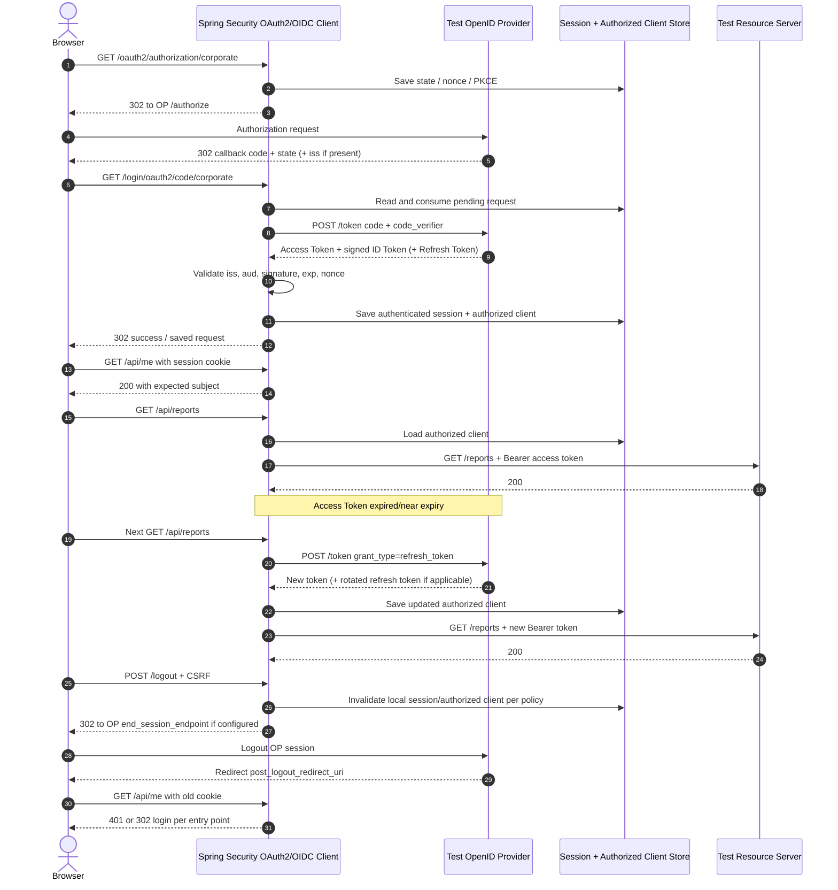
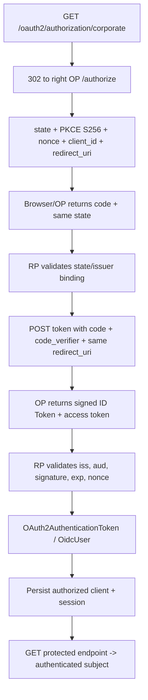
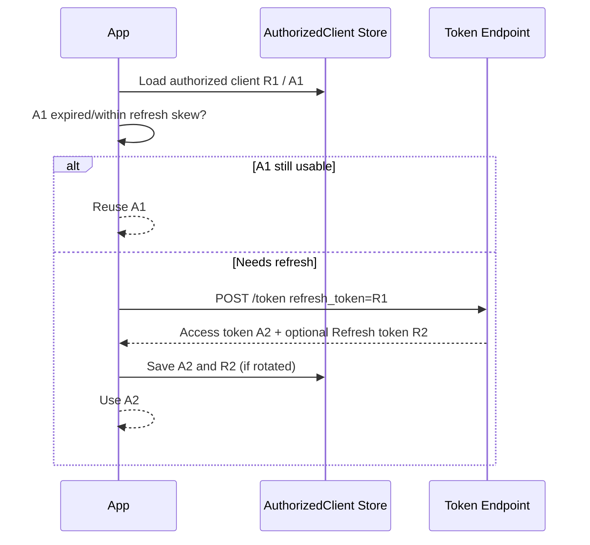
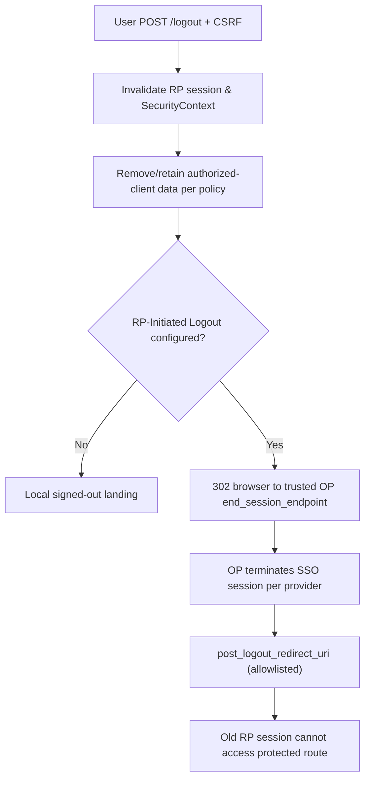

# 33.9. Regression Testing Login, Refresh, API Calls, and Logout

## 1. Why Does an OAuth2/OIDC Client Upgrade Need End-to-End Regression Testing?

When upgrading Spring Boot, Spring Security, Spring Framework, Java, HTTP clients, the OpenID Provider (OP) version, or session/token storage, an application may **start up normally and pass unit tests** while breaking in real user flows:

- Users are redirected to the OP, yet `redirect_uri` no longer matches.
- The callback arrives with a code, yet loses `state`, PKCE verifier, or OIDC nonce.
- The ID Token is validly signed by the OP, yet the app reads the wrong issuer, audience, or claim mapping.
- Login succeeds, yet the very next request loses `SecurityContext`.
- Valid access tokens work, yet expired tokens fail to refresh or refresh repeatedly.
- Refresh token rotation works on a single pod, yet breaks when two pods refresh concurrently.
- `WebClient`/`RestClient` sends the wrong token, the wrong registration, or sends tokens to an untrusted API.
- Downstream returns `401 invalid_token`, and error handling deletes the wrong authorized client or retries infinitely.
- Local logout destroys the session, yet the browser still appears authenticated; or RP-Initiated Logout redirects to the wrong OP.
- OP back-channel logout specifies one `sid`, yet the app mistakenly wipes every session for that user/tenant.
- Dependency upgrades alter cookies, CSRF, filter order, session serialization, or entry points.

**Regression testing is more than re-checking `/login`.** A complete security lifecycle covers:

```text
Start login
    -> authorization callback
    -> ID Token validation
    -> authenticated session
    -> OAuth2AuthorizedClient persistence
    -> API call with access token
    -> token expiry and refresh
    -> API call with new token
    -> local/OP logout
    -> verify session and tokens can no longer be misused
```

The goal of this lesson is designing a test suite that catches **unintended changes during upgrades** while verifying that trust boundaries remain intact. The suite must cover both **happy paths** and **fail-closed negative cases**, not merely a handful of HTTP `200` assertions.

> **Guiding principle:** compare **observable behavioral contracts** before and after upgrading; never hardcode random values such as `state`, `nonce`, PKCE verifier, ID Token strings, or internal implementation details.

### 1.1. Learning Objectives

After this lesson, you will be able to:

1. Define the regression scope for **login, refresh, API calls, and logout**.
2. Distinguish mocked controller tests from real OIDC protocol tests.
3. Capture a pre-upgrade baseline and build a compatibility matrix.
4. Stand up a test OP, fake Resource Server, and authorized-client/session stores.
5. Verify Authorization Code + PKCE `S256`, `state`, `nonce`, issuer, and ID Token audience.
6. Verify callbacks, session fixation, cookies, and saved-request redirects.
7. Verify `OidcUser` mapping, authorities, multi-provider, and multi-tenant identity.
8. Verify token expiration, refresh thresholds, rotating refresh tokens, and concurrency.
9. Verify access tokens are sent only to the intended API with the right audience and scopes.
10. Test downstream `401/403` responses, authorized-client invalidation, and zero token leaks.
11. Distinguish local logout, RP-Initiated Logout, revocation, and back-channel logout.
12. Test cookie, CSRF, and cross-pod behavior during rolling upgrades.
13. Use `MockMvc` or `WebTestClient` appropriately for Servlet vs. Reactive scopes.
14. Organize CI gates, test fixtures, fault injection, and rollout/rollback criteria.
15. Emit regression metrics/logs without exposing codes, tokens, or PII.

## 2. Four Pillars of the Regression Suite

| Pillar | Primary inputs | Good outcome | Bugs that must be caught |
| --- | --- | --- | --- |
| **Login** | Browser, authorization code, `state`, PKCE, ID Token | Authenticated `OidcUser`, right issuer/subject/authorities/session | Wrong state/nonce/issuer/aud/signature, wrong callback, lost session |
| **Refresh** | Authorized client with near-expiry access token and refresh token | New token stored under right principal/registration; reused per policy | Missing refresh, premature refresh, rotating RT reuse, race/lost token |
| **API call** | Authorized client access token and trusted downstream URL | Accurate Bearer token, API validates `iss`/`aud`/scope, clean error handling | ID Token instead of access token, wrong tenant/audience, token leak, 401 retry loop |
| **Logout** | Authenticated RP session, OP session/ID Token per flow | Local session terminated; if OP logout configured, accurate redirect/notification | Session still usable, wrong post-logout URI, cross-tenant logout, unverified back-channel |

These four areas are connected, yet **do not share an identical lifecycle**. For example:

- Local logout **does not prove** the access token was revoked at the OP.
- A refresh token can persist even when the user's RP browser session ends, depending on storage/policy.
- An API `403` due to missing scope **does not mean** login or refresh failed.
- OIDC Login produces an ID Token; a `client_credentials` workload uses an access token with **no end-user OIDC session**.
- Successful browser logout does not immediately cancel an in-flight API call that already validated a token.

Therefore, every test must state **the exact contract it proves**.

## 3. Lifecycle Map and Observation Points



This is an illustrative flow; after a successful login, the OP might not issue a refresh token, or API calls might use a separate `client_credentials` grant. Parameterize the regression suite **by grant, provider, and product**, rather than assuming every registration receives refresh tokens.

## 4. Before Upgrading: Capture a Behavioral Baseline

A lesson on **compatibility and upgrades** cannot start writing tests only after changing dependencies. Before upgrading, capture a baseline describing the currently working contract and the target contract.

### 4.1. Save a Configuration Inventory Without Secrets

Suggested baseline table:

| Field | Example | Why it is needed |
| --- | --- | --- |
| `appVersion` | `portal-4.x` | Ties test results to release |
| Java runtime | 21 | Affects HTTP/TLS/provider behavior |
| Spring Boot/Security version | Per active BOM | Identifies API/filter behavior |
| Web stack | Servlet or Reactive | Selects `MockMvc`/`WebTestClient` |
| `registrationId` | `corporate` | Callback/authorized-client key |
| `issuer` | `https://idp.example.test/realms/staff` | OIDC trust binding |
| Public `redirect_uri` | `https://portal.example.test/login/oauth2/code/corporate` | Proxy/registration contract |
| Grant type | `authorization_code` | Token lifecycle |
| PKCE policy | `S256` required | Prevents code injection |
| OIDC scope | `openid profile` | ID Token + claims |
| Authorized-client storage | JDBC/Redis/session/in-memory | Migration/persistence |
| Session cookie | `JSESSIONID` or `SESSION` | Callback/logout/cross-pod |
| Resource audience | `reports-api` | API token acceptance |
| Logout mechanism | Local / RP-Initiated / back-channel | Session semantics |
| OP client authentication | `client_secret_basic`, `private_key_jwt`, mTLS... | Token Endpoint compatibility |

Never snapshot `client_secret`, private keys, raw ID Tokens, access/refresh tokens, PKCE verifiers, session cookies, or authorization codes.

### 4.2. The Baseline Contains Invariants, Not Random Literals

**Right:**

```text
Authorization response state equals saved authorization request state.
code_challenge_method is S256.
S256(token_request.code_verifier) equals authorization_request.code_challenge.
ID Token nonce equals nonce sent to OP.
Access token sent to Reports API has approved audience.
After logout, old browser session cannot access protected endpoint.
```

**Wrong:**

```text
state must equal "ABCD1234"
OIDC nonce must equal "123456"
ID Token token value must equal a committed JWT string
Session ID must never change after login
```

Regression testing locks down **semantics**, not against improvements in randomness or session fixation protection.

## 5. Layering Tests to Avoid Misinterpreting Results

| Layer | Tools | What it tests | What it cannot prove alone |
| --- | --- | --- | --- |
| Controller slice | `@WebMvcTest` + `MockMvc`, `@WebFluxTest` + `WebTestClient` | Principal injection, JSON, authorization mapping | Authorization Code/PKCE/JWT cryptography |
| Spring Security integration | App context + real `SecurityFilterChain`/`WebFilterChain` | Filter order, session, callback, token lifecycle with fixtures | Browser/network proxies when exchange is mocked |
| Fake OP integration | WireMock/MockWebServer/test IdP | Code exchange, ID Token signature, refresh, UserInfo, logout URI | Production provider-specific behavior |
| Fake Resource Server | Stub API + signed token validator | Bearer forwarding, audience/scope, 401/403, retries | Real downstream systems |
| Browser E2E | Browser automation + OP sandbox | Cookies, redirects, `SameSite`, public URL, logout UX | All business rules if test data is sparse |
| Multi-instance/rolling deployment | 2 app versions + shared storage | Session/token serialization, races, schema migration | Every production failure mode |

### 5.1. `oidcLogin()` and `mockOidcLogin()` Do Not Test the Login Flow

Servlet:

```java
mockMvc.perform(
    get("/api/me").with(oidcLogin()));
```

Reactive:

```java
webTestClient
    .mutateWith(mockOidcLogin())
    .get().uri("/api/me").exchange();
```

Both helpers inject a pre-authenticated OIDC principal into the request. They are great for controller tests, yet **skip** the Authorization Request, Token Endpoint, JWKS/ID Token signature, nonce, PKCE, and OP redirects.

**Login protocol** regression tests must exercise the **real `SecurityFilterChain`** and a test/fake OP issuing real test codes/tokens. Likewise, `mockJwt()` does not prove the Resource Server verified JWT signatures, issuers, or audiences.

### 5.2. Risk-Based Test Allocation

You do not need to turn every test into a browser E2E test. A balanced distribution:

1. Many fast unit/controller tests for principals, mappings, and policies.
2. Integration tests for each critical security contract.
3. A focused set of browser tests covering login -> API -> refresh -> logout.
4. Targeted rolling-upgrade, concurrent-refresh, and chaos tests when releases alter storage or networking.

## 6. Designing a Test Environment Independent of Production IdPs

A self-contained setup:

```text
JUnit / Test Framework
    |
    +-- Spring Boot RP test instance
    |     +-- Real SecurityFilterChain / SecurityWebFilterChain
    |     +-- Test ClientRegistrationRepository
    |     +-- Test Session / Authorized Client Store
    |
    +-- Fake OpenID Provider
    |     +-- /.well-known/openid-configuration
    |     +-- /authorize (validate & issue one-time code)
    |     +-- /token (authorization_code & refresh_token)
    |     +-- /jwks (public test signing key)
    |     +-- /userinfo (optional)
    |     +-- /logout (RP-Initiated)
    |     +-- /revoke (optional)
    |
    +-- Fake Reports API
          +-- GET /reports
          +-- signed/opaque access-token validator
          +-- configurable 200 / 401 / 403 / 429 / 503
```

### 6.1. The Fake OP Must Be Stateful

A stub returning `200` and a valid token for every request cannot prove the flow.

The fake OP should track:

- Single-use authorization codes.
- Code expiration.
- Code binding to `client_id`, exact `redirect_uri`, and PKCE challenge.
- OIDC `nonce` from the Authorization Request.
- Signing keys/JWKS and `kid`.
- Current refresh token, rotation, expiration, and revocation.
- User/OP session and `sid` if testing logout.
- Provider errors: `invalid_grant`, `invalid_client`, `login_required`, `access_denied`, etc.
- Request counts **by grant and endpoint** to assert zero replay.

With WireMock/MockWebServer, much of this requires a custom dispatcher/test fixture—it **does not happen automatically** just by starting an HTTP stub.

### 6.2. Test Keys and Data

Use synthetic values:

```text
issuer = https://issuer.example.test
client_id = portal-regression
user subject = test-user-17
API audience = reports-api
email = alice@example.test (synthetic)
```

Generate RSA/EC private keys solely for tests and serve the public JWKS. Never call a production OP, never use real customer accounts, and never commit real client secrets or refresh tokens.

### 6.3. Issuer and Endpoint Alignment

Spring Security can build registrations via discovery (`issuer-uri`) or explicit endpoints. When the fake OP listens on a dynamic localhost port, tests must keep consistent:

- Expected issuer value.
- Discovery `issuer`.
- Authorization/Token/JWKS URLs.
- ID Token `iss`.
- Test environment TLS/network trust policy.

Never take `iss` from an unverified callback or token to switch Token Endpoints. Never configure fixtures to "skip issuer checks" for convenience.

### 6.4. Controllable Clock

Refresh tests depend on `issuedAt`, `expiresAt`, clock skew, and provider token lifetimes. Best practices:

- Inject `Clock` into application-authored components.
- Use sufficiently long test token lifetimes when not testing expiry boundaries.
- Use controllable time/clocks for custom policies.
- Avoid `Thread.sleep(60000)` to wait for token expiry.
- Account for Spring Security provider clock-skew behavior in your version.

## 7. Sample Servlet Configuration to Define the Contract

Illustrative OIDC Login + OAuth2 Client + logout config:

```java
@Configuration
@EnableWebSecurity
class PortalSecurityConfig {

    @Bean
    SecurityFilterChain portalSecurity(
            HttpSecurity http,
            ClientRegistrationRepository registrations)
            throws Exception {

        OidcClientInitiatedLogoutSuccessHandler logoutHandler =
            new OidcClientInitiatedLogoutSuccessHandler(
                registrations);

        logoutHandler.setPostLogoutRedirectUri(
            "{baseUrl}/signed-out");

        return http
            .authorizeHttpRequests(auth -> auth
                .requestMatchers("/", "/signed-out",
                    "/assets/**").permitAll()
                .anyRequest().authenticated())
            .oauth2Login(Customizer.withDefaults())
            .oauth2Client(Customizer.withDefaults())
            .logout(logout -> logout
                .logoutSuccessHandler(logoutHandler))
            .build();
    }
}
```

This is a **Servlet** example; the project needs matching Spring Security/Boot imports and `end_session_endpoint` in provider metadata if using RP-Initiated Logout. If the OP does not support that endpoint, use a different logout policy rather than guessing a URL.

With default callbacks:

```text
Start:    /oauth2/authorization/{registrationId}
Callback: /login/oauth2/code/{registrationId}
Logout:   POST /logout (when CSRF is enabled per config)
```

### 7.1. Illustrative Registration Config

```yaml
spring:
  security:
    oauth2:
      client:
        registration:
          corporate:
            provider: corporate-oidc
            client-id: ${OIDC_CLIENT_ID}
            client-secret: ${OIDC_CLIENT_SECRET}
            authorization-grant-type: authorization_code
            client-authentication-method: client_secret_basic
            scope:
              - openid
              - profile
            redirect-uri: "{baseUrl}/login/oauth2/code/{registrationId}"
        provider:
          corporate-oidc:
            issuer-uri: https://issuer.example.test
```

In integration tests, point test properties to the test OP; **never** use production secrets. If PKCE is needed for confidential clients, verify the resolver/client settings require `S256` in your active Spring Security version and **assert against the real Authorization Request**.

### 7.2. Reactive Equivalent

```java
@Configuration
@EnableWebFluxSecurity
class ReactivePortalSecurityConfig {

    @Bean
    SecurityWebFilterChain securityWebFilterChain(
            ServerHttpSecurity http) {

        return http
            .authorizeExchange(exchange -> exchange
                .pathMatchers("/", "/signed-out",
                    "/assets/**").permitAll()
                .anyExchange().authenticated())
            .oauth2Login(Customizer.withDefaults())
            .oauth2Client(Customizer.withDefaults())
            .build();
    }
}
```

For RP-Initiated Logout in WebFlux, use `OidcClientInitiatedServerLogoutSuccessHandler` with `ReactiveClientRegistrationRepository` wired into `ServerHttpSecurity.logout(...)` per your supported version. Never bring Servlet's `OidcClientInitiatedLogoutSuccessHandler` into Reactive.

## 8. Login Regression: Checkpoints to Verify

A thorough login integration suite verifies:



### 8.1. Assertions on the Authorization Request

Call:

```java
MvcResult started = mockMvc.perform(
        get("/oauth2/authorization/corporate")
            .secure(true)
            .scheme("https")
            .serverName("portal.example.test")
            .serverPort(443))
    .andExpect(status().is3xxRedirection())
    .andExpect(header().exists(HttpHeaders.LOCATION))
    .andReturn();

String location =
    started.getResponse().getHeader(HttpHeaders.LOCATION);
```

From `Location`, parse the query parameters **once**, and assert:

```text
Host/path = approved Authorization Endpoint
response_type = code
client_id = expected client ID
redirect_uri = registered public HTTPS callback
scope contains openid
state = present, opaque, non-empty
code_challenge = present
code_challenge_method = S256
nonce = present per OIDC policy
code_verifier = absent from front channel
```

Never snapshot the full `Location` into logs: it holds `state`, `nonce`, challenge, and potentially other sensitive parameters.

### 8.2. Assertions on Callback and Token Request

Retain the `MockHttpSession`/cookie from initiation. The fake OP issues a code bound to the challenge. Callback:

```java
MockHttpSession session =
    (MockHttpSession)
        started.getRequest().getSession(false);

mockMvc.perform(
    get("/login/oauth2/code/corporate")
        .session(session)
        .secure(true)
        .scheme("https")
        .serverName("portal.example.test")
        .serverPort(443)
        .param("code", oneTimeCodeFromFakeOp)
        .param("state", stateFromAuthorizationRequest))
    .andExpect(status().is3xxRedirection());
```

This is an **integration test excerpt** requiring the fake OP, fixture, and token response to be set up beforehand. There is no `oidcLogin()` here—Spring Security must actually execute the code exchange.

The fake Token Endpoint recorder checks:

```text
HTTP POST /token
grant_type = authorization_code
code = oneTimeCodeFromFakeOp
redirect_uri = exact same URI as authorization request
code_verifier = valid RFC7636 string
S256(code_verifier) = observed code_challenge
client authentication = matches registration
token request count = 1
```

Keep `code_verifier` out of logs. Tests can compute its hash in memory.

### 8.3. OIDC ID Token and Post-Login Session

The fake OP returns an ID Token **signed with the test private key** (matching the public key in JWKS), containing:

```json
{
  "iss": "https://issuer.example.test",
  "sub": "test-user-17",
  "aud": "portal-regression",
  "iat": 1780000000,
  "exp": 1780000300,
  "nonce": "NONCE_OBSERVED_BY_TEST_OP"
}
```

`iat`/`exp` above illustrate structure—**never use those fixed timestamps in live happy-path tests**. A real test OP should generate `iat`/`exp` aligned with the test clock and validity policy. `nonce` must equal the value **observed by the OP in the Authorization Request**; some Spring Security versions store the raw nonce internally while sending its hash to the OP.

After token validation:

- `SecurityContext` holds `OAuth2AuthenticationToken`.
- Principal is `OidcUser`.
- `OidcUser.getSubject()` equals the expected subject.
- Issuer was verified properly.
- Authorities and user attributes match provider policy.
- Authorized client is saved under the right registration ID and principal.
- Browser session exists per security config.
- Subsequent request to `/api/me` with the right session cookie -> `200`.
- Unauthenticated user or different session -> unauthorized/login redirect.

**Do not assert only that the callback returns `302`.** Both failure handlers and success handlers can redirect.

## 9. Negative Login Regression: Non-Negotiable

| ID | Scenario | Outcome that must hold after upgrade |
| --- | --- | --- |
| L01 | Missing callback `state` | Rejected before Token Request |
| L02 | `state` differs from pending request | Rejected; **0 token exchanges** |
| L03 | Callback from another browser without session | Rejected |
| L04 | Callback replay after login | Does not create a new authenticated session |
| L05 | Authorization code reuse | OP rejects second use of code |
| L06 | Wrong PKCE verifier | OP returns `invalid_grant`, login fails |
| L07 | `code_challenge_method` not `S256` | Fails if policy requires `S256` |
| L08 | Different `redirect_uri` in Token Request | OP rejects |
| L09 | Invalid ID Token signature | Login fails closed |
| L10 | Different ID Token issuer | Login fails closed |
| L11 | ID Token audience lacks client ID | Login fails closed |
| L12 | Missing/wrong ID Token `nonce` | Login fails when request required nonce |
| L13 | Expired ID Token | Login fails |
| L14 | ID Token algorithm outside allowlist | Login fails |
| L15 | Invalid `azp` with multiple audiences | Per OIDC policy, rejects wrong client |
| L16 | UserInfo `sub` differs from ID Token `sub` | Rejects UserInfo/OIDC mismatch |
| L17 | Wrong authorization response `iss` (RFC 9207) | Rejected before code exchange if enabled |
| L18 | OP Token Endpoint times out after receiving code | No blind code retry |
| L19 | Wrong OP metadata issuer | Registration/startup or login fails closed |
| L20 | Missing `JSESSIONID`/`SESSION` cookie | Cannot create a session from arbitrary callback |
| L21 | OP session expired/MFA took longer than state TTL | Controlled failure, user restarts flow |
| L22 | Provider `access_denied` | No auth/session created, no token request |
| L23 | Multi-provider callback targets wrong registration | Never exchanges code with wrong AS |
| L24 | Proxy alters public scheme/host | Test catches `redirect_uri` drift |
| L25 | Missing/wrong custom authorities | No out-of-policy privileges granted |

Specific errors may return `302 /login?error`, `400`, `401`, or exceptions depending on filter chain and failure handler. **Assert the security outcome and real request count**, without locking onto unstable provider-specific error messages.

## 10. Login Regression: User Identity, Claims, and Permissions

An ID Token containing:

```json
{
  "iss": "https://issuer.example.test/realms/acme",
  "sub": "user-123",
  "email": "alice@example.test",
  "email_verified": true
}
```

does not imply:

- `email` is an immutable user key.
- The user has admin privileges just because a claim exists.
- The user has access to another tenant in the same domain.
- Identical `sub` values across two issuers belong to the same identity.
- Claims from UserInfo always appear in the ID Token.

### 10.1. Invariants

- Identity key is typically `(issuer, subject)` or a controlled mapped internal ID.
- `OAuth2AuthenticationToken.getAuthorizedClientRegistrationId()` matches the chosen registration.
- `OidcUser.getSubject()` preserves `sub` after mapper upgrades.
- If `getName()` uses a custom name attribute, test its distinction from `sub`.
- Authorities are mapped per approved roles, scopes, and tenant policy.
- Missing optional claims are handled safely without granting default permissions.
- Cross-tenant requests are denied by domain authorization.

### 10.2. Mock Principal Tests Apply Only at the Controller Layer

When testing `@AuthenticationPrincipal OidcUser`, use:

```java
mvc.perform(get("/api/me")
        .with(oidcLogin()
            .idToken(t -> t
                .claim("sub", "user-123")
                .claim("iss", "https://issuer.example.test"))))
    .andExpect(status().isOk());
```

This is a **unit/slice regression test** for principal injection; it **does not prove** issuer validation during code exchange. Pair it with the happy and negative full-flow tests from sections 8–9.

## 11. Sessions and Cookies Are Part of Login Regression

When upgrading Spring Security/Boot, the Servlet container, Spring Session, or a reverse proxy, a flow can pass token exchange yet lose the session on the next request.

### 11.1. What to Check

- Cookie name (`JSESSIONID` or `SESSION`) matches the environment.
- `Secure` flag under HTTPS.
- `HttpOnly` on session cookies per policy.
- `SameSite` compatible with redirect vs. `form_post` callback modes.
- Accurate domain, path, and context path.
- Session fixation protection and session ID rotation per policy.
- No retained authentication in old sessions after logout.
- No session mixing across users/tenants.
- Multi-pod callbacks locate pending authorization requests.
- Session store TTL covers MFA/long logins and logout invalidation.
- Saved-request redirects cannot become open redirects.

### 11.2. Test with a Real Browser When Needed

`MockMvc` can track a `MockHttpSession`, yet cannot prove:

- Browsers actually send cookies after cross-site redirects.
- Reverse proxies rewrite `Set-Cookie` properly.
- TLS termination forwards accurate public scheme/host.
- Cookie path/`SameSite` behavior on modern browsers.

These regressions require browser E2E tests through a public test hostname/ingress or production-like environment.

### 11.3. Session Fixation Tests Should Not Snapshot Fixed IDs

If a successful login rotates the session ID, that is usually a desirable security control. Tests should assert:

```text
Prior session cannot be reused for unintended authentication.
Post-login session is associated with correct user.
Session fixation protection behavior matches configured policy.
```

Never force the post-upgrade session ID to match the pre-upgrade session ID.

## 12. Refresh Regression: Token Lifecycle Model

Spring OAuth2 Client typically manages access/refresh tokens via:

```text
ClientRegistration
    + principalName
    -> OAuth2AuthorizedClient
          accessToken (issuedAt, expiresAt, scopes)
          refreshToken (if issued by OP)
```

`OAuth2AuthorizedClientManager` or `ReactiveOAuth2AuthorizedClientManager` can reauthorize when tokens are expired or near expiry, depending on configured providers and clock skew.

A refresh flow:



**Not every OIDC Login receives a refresh token.** The OP may require `offline_access`, consent, or specific policy to issue one. Some client flows simply require re-login; `client_credentials` acquires fresh tokens without a refresh token.

### 12.1. Baseline Data for Refresh

| Field | Meaning |
| --- | --- |
| `registrationId` | Which OAuth2 client owns the token |
| `principalName` | User/workload owning the authorized client |
| `issuedAt`/`expiresAt` | Refresh threshold policy |
| Access token `scopes` | Granted permissions |
| Access token `aud` | Target resource allowed |
| Refresh token present? | Whether refresh grant is usable |
| Refresh rotation? | Whether OP rotates R1 -> R2 |
| Store implementation | JDBC/Redis/session/in-memory |
| Failure handler policy | Whether `invalid_grant` removes authorized client |
| Clock skew | How early before expiry to refresh |
| Concurrency coordination | Single-flight/CAS per token key |

Never snapshot real token values; use test-generated tokens and record **change categories**.

## 13. Refresh Tests: Do Not Refresh Too Early, Never Send Expired Tokens

Minimum test suite:

1. **Valid A1 outside refresh threshold:** call authorized-client manager -> reuses A1, **0 Token Endpoint requests**.
2. **A1 near expiry:** within configured clock skew -> triggers refresh if R1 is present.
3. **Expired A1:** never sends expired A1 to API.
4. **Refresh succeeds:** receives A2, persists accurate `issuedAt`, `expiresAt`, scopes, and principal.
5. **Refresh rotation:** if OP returns R2, store stops using R1.
6. **OP returns no new refresh token:** retains/handles refresh token per contract and Spring Security provider implementation without deleting it erroneously.
7. **Refresh `invalid_grant`:** no infinite retries; deletes/invalidates authorized client per failure handler policy and triggers reauthorization where needed.
8. **Network timeout after OP consumes R1:** no blind retry of R1 when outcome is unknown.
9. **Two users / two registrations:** refreshing one never overwrites the other.
10. **Concurrent requests:** never sends the same rotating refresh token twice concurrently if single-flight is required.
11. **Persistence test:** newly refreshed authorized client reloads accurately from database/Redis.
12. **Refresh after logout:** per policy, revoked or deleted state is never reused.

### 13.1. Do Not Test by Waiting for Real Expiration

Wrong:

```java
Thread.sleep(60_000);
```

Better:

- Construct a test `OAuth2AccessToken` with an appropriate `expiresAt`.
- Inject `Clock` into application-authored code.
- Have the fake Token Endpoint return controlled expiry values.
- Verify your framework version's default skew via integration tests.

A change in default skew or custom provider can trigger refresh earlier or later. Flag it as a regression only if it **violates your chosen contract**.

## 14. Testing Servlet `OAuth2AuthorizedClientManager` with Refresh

Skeleton for a service/background context:

```java
OAuth2AuthorizedClientProvider provider =
    OAuth2AuthorizedClientProviderBuilder.builder()
        .refreshToken()
        .build();

AuthorizedClientServiceOAuth2AuthorizedClientManager manager =
    new AuthorizedClientServiceOAuth2AuthorizedClientManager(
        registrations,
        authorizedClientService);

manager.setAuthorizedClientProvider(provider);

OAuth2AuthorizeRequest request =
    OAuth2AuthorizeRequest
        .withClientRegistrationId("corporate")
        .principal("user-17")
        .build();

OAuth2AuthorizedClient result = manager.authorize(request);
```

This is a **configuration/driver snippet**, not a complete test class. The test must supply `registrations`, stored authorized client A1/R1, a fake Token Endpoint, and post-call assertions.

**Distinguish managers:** `AuthorizedClientServiceOAuth2AuthorizedClientManager` fits outside Servlet requests; `DefaultOAuth2AuthorizedClientManager` uses the request-aware repository/context. Do not test the service manager and assume browser session authorization requests were tested.

### 14.1. Testing the Token Request

The fake OP recorder should observe:

```text
POST /token
grant_type=refresh_token
refresh_token=R1
client authentication matching registration
```

Then:

```text
Response:
    access_token=A2
    refresh_token=R2 (if rotated)
```

Assert:

```text
No authorization_code request.
Exactly one refresh grant for this logical refresh.
A2 stored for (corporate, user-17).
R2 stored when returned.
No A1 in subsequent downstream API Authorization header.
No R1 reused after rotation.
```

### 14.2. Refresh `invalid_grant`

Fake OP:

```http
HTTP/1.1 400 Bad Request
Content-Type: application/json

{"error":"invalid_grant"}
```

Expected behavior depends on manager/failure handler version:

- Refresh must not be treated as successful.
- No fabricated A2 emitted.
- Broken authorized client handled per approved invalidation/removal policy.
- User/workload requires reauthorization or an appropriate new acquisition path.
- Never retry R1 repeatedly "hoping it works".
- Emit error metrics without logging the refresh token.

Do not assume every version removes authorized clients identically when custom failure handlers exist; **measure the actual outcome of your active config**.

## 15. Rotating Refresh Tokens and Concurrency: High-Priority Regression Case

Typical race flow:

```text
A1 near expiry
  |
  +-- Pod A uses R1 -> OP issues A2/R2
  |
  +-- Pod B also uses R1 -> OP detects R1 reuse
```

The provider may return `invalid_grant`, revoke the token family, or apply a grace period. Test against the provider contract.

### 15.1. Concurrency Regression Test

Given:

```text
One authorized-client key:
    registrationId=corporate
    principalName=user-17
    accessToken=A1 expiring
    refreshToken=R1

N=20 concurrent API calls
```

When: 20 calls simultaneously need a fresh token.

Then, if single-flight is designed:

```text
Exactly one refresh request using R1.
All successful calls use A2.
Store has R2 (if rotation).
No lost updates.
No user/tenant token mixing.
```

If the project lacks single-flight yet, record it as a **gap to address**—never weaken the test by letting the fake OP accept unlimited R1 requests.

### 15.2. Single JVM vs. Multiple Pods

- `Mono.cache()` or an in-memory promise map can deduplicate requests **within one process**, needing keys, TTLs, and cleanup.
- Multi-pod setups may require optimistic locking, CAS, distributed coordination, or a provider-supported rotation model.
- In-memory `OAuth2AuthorizedClientService` is not a cross-pod persistence strategy.
- Rolling deployments must test both old and new versions **reading/writing the same store schema** when parallel versions are allowed.

### 15.3. Unknown Outcome: Response Dropped After OP Rotated

Test fake OP:

```text
Consume R1.
Generate A2/R2.
Drop connection before response reaches client.
```

Expected:

```text
No automatic blind replay R1.
No cross-user overwrite.
Controlled reauthorization/recovery.
Event categorized as refresh_unknown_outcome.
```

A generic retry filter on `WebClient` can trigger reuse detection and break sessions; verify exact filter/operator boundaries.

## 16. Persistence Regression and Schema Upgrades

A severe upgrade bug: authorized clients stored before the upgrade fail to deserialize or lose refresh tokens afterward.

### 16.1. Testing Data from the Previous Version

If the app stores `OAuth2AuthorizedClient` in JDBC, Redis, or sessions:

1. Create an authorized-client record using **version N** and test token R1.
2. Start **version N+1** against the rollout-compatible schema/serializer.
3. Load the record via the new repository/service.
4. Verify `registrationId`, principal name, access token expiry/scopes, and refresh token.
5. Trigger a refresh and save the updated record.
6. If rollback is in policy, verify N can read records written by N+1.
7. Confirm serialization and logs never expose tokens.

Never commit production binary sessions or tokens. Use fixtures generated by the prior test version or a controlled migration harness.

### 16.2. Upgrading Spring Session and Cookies

Versions may change:

- Serialization format.
- Session attribute types.
- TTL/prefix namespaces.
- Cookie name, path, or `SameSite`.
- Session fixation handling.
- OIDC session registry/back-channel logout correlation.

Multi-instance tests should cover:

```text
Login started on old pod -> callback on new pod.
Login on new pod -> protected request on old pod.
Refresh on old pod -> read authorized client on new pod.
Logout from new pod -> old pod no longer trusts old session.
```

Run cross-version scenarios only when **deployment topology and session formats support** them; some migrations require draining sessions or controlled rolling restarts.

## 17. API Call Regression: The Right Token Must Reach the Right Resource

An app that completed OIDC Login is not guaranteed to call APIs accurately. Outbound requests typically need an access token from the right `OAuth2AuthorizedClient`:

```text
OIDC ID Token:
    aud = portal-web
    used to authenticate identity at RP

Access Token:
    aud = reports-api
    used as Bearer when calling Reports API
```

**Never send an ID Token to a Resource Server** just because it is a JWT containing `sub`.

### 17.1. Outbound Contract

- Target URL is the fixed/trusted Reports API host.
- HTTP method, path, and body match the API version.
- `Authorization: Bearer ...` header carries the **access token**.
- Token belongs to the approved registration, client, and user.
- Issuer and audience match Reports API.
- Token is unexpired.
- Scopes/roles satisfy the endpoint.
- `Authorization` is never forwarded to another URL after redirects.
- Credentials are never sent over plain HTTP.
- API responses map cleanly to DTOs and error contracts.

### 17.2. Servlet `WebClient` with Authorized-Client Manager

Example:

```java
@Bean
WebClient reportsWebClient(
        OAuth2AuthorizedClientManager manager) {

    ServletOAuth2AuthorizedClientExchangeFilterFunction oauth2 =
        new ServletOAuth2AuthorizedClientExchangeFilterFunction(
            manager);

    return WebClient.builder()
        .baseUrl("https://reports-api.example.test")
        .apply(oauth2.oauth2Configuration())
        .build();
}
```

When calling the API, specify the authorized client:

```java
reportsWebClient.get()
    .uri("/reports/me")
    .attributes(
        ServletOAuth2AuthorizedClientExchangeFilterFunction
            .clientRegistrationId("reports-user"))
    .retrieve()
    .bodyToMono(ReportDto.class);
```

These snippets require appropriate imports, an authenticated context, and manager configuration. **`reports-user` must exist in the registration catalog**. Never enable `setDefaultOAuth2AuthorizedClient(true)` arbitrarily on a shared client, as it can attach tokens to unintended requests.

### 17.3. Reactive `WebClient`

WebFlux equivalent:

```java
@Bean
WebClient reportsWebClient(
        ReactiveOAuth2AuthorizedClientManager manager) {

    ServerOAuth2AuthorizedClientExchangeFilterFunction oauth2 =
        new ServerOAuth2AuthorizedClientExchangeFilterFunction(
            manager);

    return WebClient.builder()
        .baseUrl("https://reports-api.example.test")
        .filter(oauth2)
        .build();
}
```

Request:

```java
return reportsWebClient.get()
    .uri("/reports/me")
    .attributes(
        ServerOAuth2AuthorizedClientExchangeFilterFunction
            .clientRegistrationId("reports-user"))
    .retrieve()
    .bodyToMono(ReportDto.class);
```

Tests must use the right manager and reactive security context. `WebTestClient` is a test HTTP client hitting the WebFlux server; `WebClient` is the runtime HTTP client calling outbound APIs—do not swap the two roles.

## 18. Testing API Calls with a Fake Resource Server

An API stub can record:

```text
method = GET
path = /reports/me
Authorization header = Bearer A1
Host = reports-api.example.test
```

Never print raw A1 into CI logs. Assert token equality/identity in test memory or via safely handled token aliases/hashes.

### 18.1. Required Cases

| Case | Fake API | Expected |
| --- | --- | --- |
| A01 | Unexpired A1, right audience/scope | Single GET; `200` |
| A02 | Expired A1, R1 refreshes to A2 | API receives A2, never expired A1 |
| A03 | API receives ID Token instead of access token | Test fails, system must be fixed |
| A04 | Token `aud=billing-api`, calling Reports | Reports rejects |
| A05 | Untrusted token `iss` | Reports rejects |
| A06 | Right `aud`, missing scope | `403 insufficient_scope` |
| A07 | API returns `401 invalid_token` | No infinite retry; authorized-client failure policy runs |
| A08 | API returns `403 insufficient_scope` | No infinite refresh loop trying to "gain permissions" |
| A09 | GET gets transient 503 | Bounded retry only if API contract is safe |
| A10 | Side-effecting POST times out after commit | No replay without idempotency contract |
| A11 | Redirect to untrusted host | Bearer token not forwarded |
| A12 | Wrong client registration/tenant | API not called or rejects |
| A13 | Multiple downstream services | Each API receives token with matching audience |
| A14 | API 2xx with changed JSON contract | Adapter/controller test catches it |
| A15 | API call after logout | Invalidated authorized client/session not reused per policy |

### 18.2. `401 invalid_token` vs. `403 insufficient_scope`

The Resource Server may return:

```http
HTTP/1.1 401 Unauthorized
WWW-Authenticate: Bearer error="invalid_token"
```

or:

```http
HTTP/1.1 403 Forbidden
WWW-Authenticate: Bearer error="insufficient_scope"
```

These two errors are not equivalent:

- `401 invalid_token` indicates the token is no longer accepted; the authorized client may need removal/reauthorization **per policy and handler**.
- `403 insufficient_scope` indicates a valid token lacking sufficient permissions; refreshing with the same scopes rarely helps.
- Some APIs return custom error formats; tests must check the full API contract.

In Spring Security versions supporting `RemoveAuthorizedClientOAuth2AuthorizationFailureHandler`, outbound integrations can handle invalid-token responses by removing the authorized client from the store so the next call re-acquires a token. **Never assume every version or constructor configures the same default failure handler**; assert the exact chosen behavior.

### 18.3. Never Blindly Replay Every API Request After 401

A generic retry filter can cause:

```text
POST /payments -> 401
refresh/acquire new token
POST /payments again
```

If the first POST produced a downstream side effect while returning an error, replaying risks duplicate business actions. Recovery must consider **idempotency and response semantics**, not just expired tokens.

## 19. API Response Contracts Also Need Regression Testing

With `WebClient.retrieve()` or `RestClient.retrieve()`, upgrading libraries can change:

- Exception types on HTTP 4xx/5xx.
- Error body decoding.
- Client timeouts.
- Redirect behavior.
- JSON serialization of dates, enums, and nullable fields.
- Retry/failure-handler ordering.
- Filter attribute resolution.
- Proxy/TLS defaults.

Tests should assert:

```text
HTTP status preserved or mapped as documented.
Content-Type handled correctly.
Error body does not leak access token.
Upstream timeout propagates bounded failure.
No unbounded retries.
No stale token used after explicit invalidation.
```

Never snapshot entire stack traces or internal framework exception messages unless part of a public API contract.

## 20. Logout Regression: Three Layers to Distinguish

OIDC defines:

1. **Local logout** — ends the RP session and local authentication.
2. **RP-Initiated Logout** — RP redirects the browser to the OP's `end_session_endpoint`.
3. **OP-Initiated Back-Channel Logout** — OP sends a Logout Token to the RP to terminate matching sessions, if supported/configured.

In addition, there may be:

4. **OAuth2 Token Revocation** — calling `/revoke` to revoke access/refresh tokens per policy.

These four mechanisms can be combined, yet **they are not a single automatic operation**. In particular, local logout never proves the OP SSO session ended or tokens were revoked.

### 20.1. Visualizing the Logout Contract



**The phrase "per policy" matters:** `OAuth2AuthorizedClientService` may store tokens outside the session. HTTP logout does not automatically clear every record in the service unless the app wires a matching cleanup handler/repository rule. Tests must specify which data must be removed.

## 21. Local Logout: Minimum Assertions

For a Servlet app using browser sessions and CSRF:

```java
MvcResult loggedOut = mvc.perform(
        post("/logout")
            .session(authenticatedSession)
            .with(csrf()))
    .andExpect(status().is3xxRedirection())
    .andReturn();
```

If the app returns `204`/JSON or uses a custom handler, assert against that contract. `authenticatedSession` must genuinely come from login or an accurate test context.

Then:

```text
Request with old session cookie:
    /api/me -> 401 or 302 login.
SecurityContext no longer authenticated.
Local session invalidated.
Saved browser session references removed/rotated.
Authorized client state cleared according to application policy.
```

### 21.1. CSRF Regression

For browser-session-based login:

```text
POST /logout + CSRF token -> allowed.
POST /logout missing/invalid CSRF -> rejected.
```

If the app deliberately customized logout matchers/CSRF, test that exact behavior rather than assuming defaults. Never switch logout to `GET` just to make tests easier to pass; `GET` logout enables logout CSRF and unintended side effects.

### 21.2. Logout Does Not Immediately Invalidate API Access Tokens

An already-issued JWT access token can remain valid at a Resource Server until expiry unless revocation, denylists, introspection, or token binding are implemented. Thus:

```text
RP session invalidated != all previously issued JWTs invalidated
```

If the product requires **logout to invalidate tokens immediately**, implement and test that enforcement explicitly rather than asserting only that the RP session vanished.

## 22. RP-Initiated Logout: Testing URLs and OP Behavior

When configuring `OidcClientInitiatedLogoutSuccessHandler` in Servlet, the handler can read the OP's `end_session_endpoint` metadata and redirect the browser.

Handler example:

```java
OidcClientInitiatedLogoutSuccessHandler handler =
    new OidcClientInitiatedLogoutSuccessHandler(
        clientRegistrationRepository);

handler.setPostLogoutRedirectUri(
    "{baseUrl}/signed-out");
```

Verify the `Location` header after logout:

```text
scheme/host/path = approved OP end_session_endpoint
id_token_hint = ID Token matching pre-logout session (if used by flow/provider)
post_logout_redirect_uri = approved public RP URL
state = opaque, checked per implementation/provider contract if present
```

Never log the full URL because it may contain **the ID Token in `id_token_hint`**. `post_logout_redirect_uri` must be registered/allowlisted at the OP; never allow arbitrary user-supplied redirects.

### 22.1. Negative Cases

- OP metadata lacks `end_session_endpoint`.
- OP uses wrong issuer/tenant logout endpoint.
- Unregistered `post_logout_redirect_uri`.
- Public URL resolved as `http://internal-service` behind a reverse proxy.
- Missing ID Token/session when user already logged out locally.
- User from corporate registration redirected to partner OP.
- OP logout page fails while local session still terminates per policy.
- Invalid logout `state` if the app uses logout correlation.
- Returning from OP logout to RP never recreates the old authenticated session.

**Never use a local logout test to conclude the OP-side session was definitely cleared.** OP behavior requires a stateful fake OP or sandbox/browser integration test.

## 23. OIDC Back-Channel Logout: Session Correlation Regression

In Spring Security Servlet versions supporting OIDC back-channel logout, the OP can POST a **signed Logout Token** to the configured endpoint, commonly:

```text
POST /logout/connect/back-channel/{registrationId}
```

The application correlates the Logout Token to RP sessions via the provider `sid` or `sub`, as appropriate.

An OIDC Logout Token carries claims such as:

```json
{
  "iss": "https://issuer.example.test",
  "aud": "portal-regression",
  "iat": 1780000000,
  "jti": "unique-logout-event",
  "sid": "provider-session-42",
  "events": {
    "http://schemas.openid.net/event/backchannel-logout": {}
  }
}
```

This example only illustrates structure; valid tests must sign it and set `iat` against the test clock. Per OIDC Back-Channel Logout, never accept an arbitrary JWT as a Logout Token.

### 23.1. Security Checks

- Signature from trusted OP keys.
- `iss` matches expected issuer.
- `aud` contains the RP's client ID.
- `iat`/`jti`/events conform to specification.
- `sid` or `sub` present per contract.
- `nonce` must be absent from Logout Tokens per spec.
- Reject duplicate/replayed `jti` if implementation/policy requires replay protection.
- Never allow tenant A's Logout Token to terminate tenant B's session.
- Terminate only the session matching `sid`; when using `sub`, scope logout explicitly.
- Never wipe all sessions merely on a matching `sub` while ignoring issuer/client binding.

### 23.2. Spring Session Compatibility

With Spring Session, the cookie may be named `SESSION` instead of Servlet's `JSESSIONID`. Spring Security's back-channel logout implementation may require matching configuration on `OidcBackChannelLogoutHandler` and `OidcSessionRegistry`. This easily breaks when upgrading Spring Session or migrating from local sessions to Redis.

Test:

```text
Login S1 and S2 for same user but different OP sids.
OP back-channel logout sid=S1.
Then S1 is invalidated; S2 remains active.
```

If an OP Logout Token contains only `sub`, scope may differ. Check your exact implementation and the OIDC spec. If the project does not support back-channel logout, **do not** enable the endpoint casually and weaken CSRF/signature checks.

### 23.3. Reactive Does Not Automatically Have Identical DSL/Behavior

WebFlux has its own OIDC login and RP-Initiated Logout handlers, yet you must not assume Servlet back-channel logout classes or registries work verbatim in Reactive. Check feature parity for your **exact Spring Security version**, verify real configuration, and test against that stack.

## 24. Token Revocation and Logout: Separate Outcomes

If the app calls the OAuth2 Revocation Endpoint:

```http
POST /revoke
Content-Type: application/x-www-form-urlencoded

token=FAKE_REFRESH_TOKEN
token_type_hint=refresh_token
```

Verify:

- Exact trusted revocation URL.
- Appropriate client authentication.
- Token value belongs to the right authorized client and user.
- Local session/authorized-client cleanup does not hang on long remote revocation timeouts.
- Provider response/error handling complies with RFC 7009 and policy.
- Raw refresh token is never logged.
- Revoked token can no longer be used for new refreshes.

**Caution:** HTTP 200 from the Revocation Endpoint does not always prove the token was previously active—the spec permits returning success even for nonexistent tokens. Tests must inspect the **effect in the fake OP token store** to prove the token can no longer refresh.

Never claim "remote tokens revoked" when you only tested a local logout HTTP 302.

## 25. Servlet and Reactive: Same Contract, Different Test Infrastructure

| Topic | Servlet | WebFlux |
| --- | --- | --- |
| HTTP security | `HttpSecurity` | `ServerHttpSecurity` |
| Filter chain | `SecurityFilterChain` | `SecurityWebFilterChain` |
| HTTP test client | `MockMvc` | `WebTestClient` |
| Security context | `SecurityContextHolder` per Servlet integration | `ReactiveSecurityContextHolder` / Reactor Context |
| Session | `HttpSession` / Spring Session | `WebSession` / Spring Session |
| Client registration | `ClientRegistrationRepository` | `ReactiveClientRegistrationRepository` |
| Authorized client manager | `OAuth2AuthorizedClientManager` | `ReactiveOAuth2AuthorizedClientManager` |
| Authorized client repo | `OAuth2AuthorizedClientRepository` | `ServerOAuth2AuthorizedClientRepository` |
| Mock OIDC principal | `oidcLogin()` | `mockOidcLogin()` |
| Mock OAuth2 client | Servlet OAuth2 test postprocessors/repos | `mockOAuth2Client()` |
| JWT controller fixture | `jwt()` | `mockJwt()` |
| RP-Initiated Logout | `OidcClientInitiatedLogoutSuccessHandler` | `OidcClientInitiatedServerLogoutSuccessHandler` |

### 25.1. WebFlux Integration: Preserve Cookies and State

When constructing `WebTestClient` manually:

```java
WebTestClient client = WebTestClient
    .bindToApplicationContext(applicationContext)
    .apply(springSecurity())
    .configureClient()
    .baseUrl("https://portal.example.test")
    .build();
```

In a **real login integration test**, capture the Authorization Redirect, preserve the `SESSION`/cookie from initiation, and send it back on callback. Do not use:

```java
client.mutateWith(mockOidcLogin())
```

to simulate an already-logged-in user, because it skips the exact logic you are trying to verify.

In unit/controller tests, `mockOidcLogin()` **is the right tool**. Keep each test in its proper layer.

### 25.2. Never Call `.block()` in Reactive Production Code

When testing refresh/API calls, JUnit methods may use `StepVerifier` or `.block(Duration)` to collect results; that happens on the **test thread**. Never use that as justification to call `.block()` inside WebFlux handlers or event-loop processing.

### 25.3. Browser Cookie Behavior Is Not Fully Proven by Mock Exchanges

If users log in/out via real browsers, check `SameSite`, `Secure`, context path, forwarded headers, and OP cookies in server-bound/browser tests. Mock `WebTestClient` exchanges do not emulate every Chrome/Safari policy.

## 26. Comprehensive Regression Matrix: Login

| ID | Test | Passing condition |
| --- | --- | --- |
| LOGIN-01 | Start login | Redirects to exact OP |
| LOGIN-02 | Client registration | Client ID/issuer/redirect URI accurate |
| LOGIN-03 | PKCE | `S256`, challenge and verifier match |
| LOGIN-04 | CSRF `state` | Matches and single-transaction |
| LOGIN-05 | OIDC `nonce` | ID Token claim matches OP-observed nonce |
| LOGIN-06 | ID Token signature | Trusted JWKS key |
| LOGIN-07 | ID Token `iss` | Matches expected issuer |
| LOGIN-08 | ID Token `aud`/`azp` | Matches RP client ID / OIDC rules |
| LOGIN-09 | Expired/bad-sig ID Token | Fails closed |
| LOGIN-10 | UserInfo `sub` | Matches ID Token |
| LOGIN-11 | OIDC principal | Issuer/sub/authorities accurate |
| LOGIN-12 | Session persistence | Next protected request is authenticated |
| LOGIN-13 | Session fixation | Invalid prior session cannot be reused |
| LOGIN-14 | Saved request | Valid redirect, no open redirect |
| LOGIN-15 | Error/`access_denied` | No session created |
| LOGIN-16 | Wrong `state`/browser | Zero Token Requests |
| LOGIN-17 | Code replay | No new authentication |
| LOGIN-18 | Multi-AS issuer mix-up | Code never sent to wrong Token Endpoint |
| LOGIN-19 | Reverse proxy | Public redirect URI accurate |
| LOGIN-20 | Multi-pod | Callback locates `state`/nonce/PKCE |
| LOGIN-21 | Two issuers same `sub` | Identities not mixed |
| LOGIN-22 | Tenant membership | No privileges granted from unverified claims |
| LOGIN-23 | Metadata/JWKS rotation | Tokens signed by wrong key rejected |
| LOGIN-24 | Missing optional email | DTO/business logic behaves safely |

## 27. Comprehensive Regression Matrix: Refresh

| ID | Test | Passing condition |
| --- | --- | --- |
| REF-01 | Unexpired access token | Token Endpoint not called |
| REF-02 | Access token near expiry | Refreshes at right threshold/skew |
| REF-03 | Expired access token | Expired token never sent to API |
| REF-04 | Refresh request | Right grant and client authentication |
| REF-05 | Refresh succeeds | Stores A2 under right principal/registration |
| REF-06 | Rotation R1 -> R2 | R1 never reused |
| REF-07 | OP omits R2 | Handled per provider contract |
| REF-08 | `invalid_grant` | No blind retry; failure handler behaves properly |
| REF-09 | Timeout after R1 consumed | Unknown-outcome recovery |
| REF-10 | No refresh token | Controlled reauthorization |
| REF-11 | Concurrent refresh | No duplicate R1 when single-flight required |
| REF-12 | Two users same registration | No cross-user overwrite |
| REF-13 | Two registrations same user | No cross-registration overwrite |
| REF-14 | Multi-tenant issuer | Tokens never cross tenants |
| REF-15 | Store persistence | Tokens reload cleanly after restart |
| REF-16 | Cross-version schema | Old/new compatible per rollout plan |
| REF-17 | Failure after update | Atomic write/CAS policy |
| REF-18 | Refresh after logout | Stale unauthorized state never reused |
| REF-19 | Token quota/outage | Retry policy does not replay rotation |
| REF-20 | Metrics/logs | Never exposes R1/R2/access token |

## 28. Comprehensive Regression Matrix: API Call

| ID | Test | Passing condition |
| --- | --- | --- |
| API-01 | GET Reports valid A1 | Bearer access token, not ID Token |
| API-02 | Expired A1 -> refresh -> A2 | API receives A2 |
| API-03 | Wrong audience | API rejects |
| API-04 | Wrong issuer | API rejects |
| API-05 | Wrong signature/introspection | API rejects |
| API-06 | Missing scope | `403`/policy denial |
| API-07 | `401 invalid_token` | Authorized-client failure policy, bounded |
| API-08 | `403 insufficient_scope` | No refresh loop |
| API-09 | Transient 503/timeout GET | Bounded retries only if safe |
| API-10 | POST unknown outcome | No blind replay |
| API-11 | Redirect to external host | Bearer never leaked |
| API-12 | Missing authorized client | Controlled acquisition/reauth |
| API-13 | Wrong registration ID | Token never sent to API |
| API-14 | Reports/Billing sharing issuer | Audience isolated per resource |
| API-15 | Multi-tenant user | Tenant-bound authorized client |
| API-16 | Revoked access token | Not reused per policy |
| API-17 | Valid cached token | Token Endpoint not called on every GET |
| API-18 | API JSON schema changed | Adapter test catches it |
| API-19 | Error body/headers | Safe mapping, no leaked secrets |
| API-20 | API after RP logout | Invalidated session/authorized client not used against policy |

## 29. Comprehensive Regression Matrix: Logout

| ID | Test | Passing condition |
| --- | --- | --- |
| OUT-01 | POST logout with CSRF | Local session invalidated |
| OUT-02 | POST missing CSRF | Rejected when CSRF enabled |
| OUT-03 | Old session cookie | Cannot access protected endpoints |
| OUT-04 | Local-only logout | Does not assume OP SSO logout |
| OUT-05 | RP-Initiated Logout | Redirects to trusted OP `end_session` endpoint |
| OUT-06 | `id_token_hint` | Matches session/client if provider uses it |
| OUT-07 | `post_logout_redirect_uri` | Allowlisted public URI |
| OUT-08 | Wrong OP/issuer | Cannot log out another tenant |
| OUT-09 | OP unavailable | Local cleanup obeys policy |
| OUT-10 | OP logout succeeds | Browser returns to signed-out landing |
| OUT-11 | Remote revocation succeeds | Fake OP token becomes inactive/revoked |
| OUT-12 | Remote revocation errors | Never claims remote success |
| OUT-13 | Valid back-channel Logout Token | Terminates matching RP session |
| OUT-14 | Back-channel bad signature | Rejected |
| OUT-15 | Back-channel wrong issuer/audience | Rejected |
| OUT-16 | Back-channel wrong `sid` | Does not delete other sessions |
| OUT-17 | Back-channel replay | No unintended side effects or corrupt state |
| OUT-18 | Spring Session cookie rename | Session registry correlation holds |
| OUT-19 | Concurrent logout/refresh | No invalid token state left behind |
| OUT-20 | Multiple tabs | No tab can access protected resources with old session |

## 30. Compatibility Regressions Across Spring Security Versions

An upgrade can change framework behavior across many layers:

| Area | Potential impact | Contract to lock down |
| --- | --- | --- |
| Security DSL | `authorizeRequests` -> `authorizeHttpRequests`, method deprecations | Routes/permissions stay accurate |
| Filter ordering | OAuth2 login/callback/CSRF/logout filters | State/CSRF/callbacks handled properly |
| `ClientRegistration` | Defaults, `issuer-uri`, scopes, redirect URI | Accurate provider and endpoints |
| PKCE | Default behavior, custom resolver/client settings | `S256` challenge/verifier |
| OIDC validation | JWKS/claims/nonce algorithms | Fail closed on invalid tokens |
| OIDC principal | Attribute/name/authority mapping | Identity/roles unchanged unexpectedly |
| Authorized client | Repository/service APIs, failure handlers | Store/load/remove accurate |
| Refresh provider | Clock skew, token refresh policy | Refresh threshold/rotation |
| HTTP client | `RestClient`/`WebClient`, defaults, timeouts | Bearer token to right host and handler |
| Session | Cookies, serializers, Spring Session | Login persistence/logout |
| CSRF | Default matchers/handlers | Mutating requests stay protected |
| Logout | End Session handler/back-channel registry | Session/OP semantics |
| Servlet vs. Reactive | Types/beans/config | Never mix security stacks |
| Monitoring | Exception/metric names | Alerts/runbooks still recognize failures |

### 30.1. Upgrading from Older Servlet API Lines

When changing framework/Jakarta Servlet generations, projects may need to update `javax.servlet` -> `jakarta.servlet` imports, security config style, and dependencies. **Compile-time** changes are one issue; regressions in login, sessions, cookies, and tokens are a separate issue proven only through tests.

### 30.2. Spring Boot/Security Major Versions

Do not assume APIs such as test annotations, `OAuth2ClientHttpRequestInterceptor`, `OidcClientInitiatedLogoutSuccessHandler`, back-channel logout DSLs, or `ClientRegistration.ClientSettings` have identical signatures across **all** versions. Pick your exact version and check official API docs; when upgrading majors, test **observable behavior** instead of forcing an old extension point into a new version.

### 30.3. Upgrading the OP/IdP

An OP upgrade can change:

- Canonical issuer or realm path.
- Metadata/JWKS URIs.
- ID Token algorithms/key rotation.
- Refresh token rotation/grace periods.
- Client authentication requirements.
- Scopes/consent/claims.
- UserInfo behavior.
- Back-channel/End Session capabilities.
- Rate limits.

The regression suite needs OP-specific contract tests; do not trust app unit tests alone.

## 31. CI/CD: Running Tests in a Logical Order

Recommended pipeline:

```mermaid
flowchart LR
    CODE["Change / Dependency Upgrade"] --> UNIT["Unit + Controller Tests"]
    UNIT --> SEC["Security Contract Integration"]
    SEC --> FLOW["Fake OP + API Full-flow Tests"]
    FLOW --> BROWSER["Browser / Sandbox Smoke"]
    BROWSER --> MIGRATE["Session/Token Store Migration Tests"]
    MIGRATE --> CANARY["Canary + Observability"]
    CANARY --> RELEASE["Promote / Rollback decision"]
```



### 31.1. PR Gate

Run quickly:

- Controller/user mapping.
- URL authorization rules.
- Refresh expiry boundary unit tests.
- API outbound bearer forwarding.
- Logout CSRF/session invalidation.
- Selected fake OP login/refresh failure cases.

### 31.2. Merge/Nightly Gate

Add:

- Full fake OP signed ID Token/JWKS.
- Refresh rotation and concurrency.
- API `401/403` error handling.
- RP-Initiated Logout and back-channel tests where applicable.
- Session serialization compatibility.
- Cross-tenant and multi-provider matrix.
- Fault injection: 429, 503, timeouts.
- Browser sandbox happy path.

### 31.3. Release/Upgrade Gate

For major framework or IdP upgrades:

- Current version baseline vs. candidate version.
- Rolling upgrade A/B session/token persistence.
- Canary login success rate and callback failure categories.
- Refresh `invalid_grant`/token reuse metrics.
- API `401/403` rates and authorized-client removals.
- Local/OP logout completion rates.
- Rollback/feature-flag/restart strategy verified ready.

**Never** wait until production to discover Spring Session's serializer cannot read old records.

## 32. Gating on Security Invariants, Not Only HTTP Statuses

A `login -> 302` test can pass even when the flow hit a failure handler. A `logout -> 200` test can pass while the old cookie remains authorized. Multiple assertions are required.

### 32.1. Checkpoints in a Comprehensive Test

```text
1. Authorization initiation
   -> right OP, state, PKCE, nonce.

2. Callback and Token Exchange
   -> one-time code, right verifier, signed ID Token verified.

3. Authenticated Session
   -> OidcUser subject/issuer/registration accurate.

4. Initial API Call
   -> right bearer access token and audience.

5. Token Expiry / Refresh
   -> single refresh, save new access/refresh tokens.

6. API Call After Refresh
   -> uses new access token, does not reuse expired token.

7. Logout
   -> local session invalidated;
      remote logout/revocation separately verified if configured.

8. Post-Logout
   -> old session cannot call protected endpoint.
```

A strong regression suite also keeps **independent negative tests for each checkpoint** rather than one giant happy-path test, because when an early step fails, later steps do not run and root causes become harder to pinpoint.

## 33. Fixtures and Fault Injection Without Credential Leaks

Sensitive artifacts appearing in integration flows:

```text
authorization code
state
PKCE code_verifier
OIDC nonce
client secret
ID Token
access token
refresh token
session cookie
id_token_hint
```

Never print them in:

- HTTP wire logs.
- CI build artifacts.
- Exception response bodies.
- Public screenshots/browser HAR files.
- Metric labels.
- Source-controlled fixtures containing production data.

### 33.1. Suggested Telemetry

```text
event=oidc_regression_login
registrationId=corporate
stage=id_token_validation
outcome=passed

event=oauth2_regression_refresh
registrationId=corporate
grant=refresh_token
rotated=true
attempts=1

event=oauth2_regression_api_call
downstream=reports
tokenSource=authorized_client
httpStatus=200

event=oidc_regression_logout
mechanism=rp_initiated
localSessionInvalidated=true
remoteResult=confirmed_by_test_op
```

These are **illustrative event names**, not Spring Security defaults. Labels use **stable aliases**, avoiding raw tokens and arbitrary tenant IDs that cause high cardinality.

### 33.2. Purposeful Fault Injection

| Fault injected | What to verify |
| --- | --- |
| Drop Token Endpoint response after code consumed | Authorization code not replayed |
| Drop refresh response after R1 consumed | Rotating R1 not reused |
| JWKS returns wrong key | ID Token signature rejected |
| Wrong issuer metadata | Bad metadata not trusted |
| API `401 invalid_token` | Bounded recovery |
| API `403 insufficient_scope` | Does not request unauthorized permissions |
| UserInfo timeout | Fails closed or degrades per claim criticality |
| OP logout `503` | Local session cleanup still completes |
| Back-channel Logout Token invalid signature | Sessions untouched |
| Cross-tenant `sid` | Other tenant not logged out |
| Shared Redis session store unavailable | Fails closed, no fabricated state |
| Two pods refresh concurrently | No reuse or lost update |

## 34. Distinguishing True Regressions from Approved Security Improvements

After an upgrade, some changes are **correct** and warrant updating the contract/tests:

- Adding PKCE `S256` adds parameters to the Authorization Request.
- Tightening ID Token nonce/issuer checks.
- Enabling CSRF on logout `POST` where previously missing.
- Disallowing `GET` logout by default.
- Rejecting JWTs with the wrong audience.
- Rotating session IDs after login.
- Stopping automatic forwarding of bearer tokens to every URL.
- Updating failure handlers to safely remove invalid authorized clients.

If an old test expects **weaker security behavior**, never weaken production just to keep the test green. Instead:

1. Document the security change.
2. Agree on the new expected behavior.
3. Update the test contract with rationale.
4. Add negative tests proving fail-closed behavior.
5. Assess migration impact on existing sessions, tokens, and UX.

A regression suite **protects approved behavior**; it does not freeze historical bugs.

## 35. Runbook When the Suite Fails

### 35.1. Identify the Test Stage

```text
Authentication initiation?
Authorization callback?
Token exchange?
ID Token/JWKS validation?
Session/persistence?
Authorized client refresh?
Outbound API call?
Local logout?
OP logout?
Back-channel notification?
```

### 35.2. Common Causes

| Symptom | Where to check |
| --- | --- |
| Authorization `Location` wrong host | Proxy headers, `{baseUrl}`, `redirect-uri` |
| `invalid_grant` on code exchange | Code reuse/expiry, PKCE, redirect URI, client binding |
| Missing callback `state` | Session cookie, repository, cross-pod, TTL |
| ID Token issuer/audience mismatch | `ClientRegistration`, metadata, test OP claims |
| JWKS fails after key rotation | `kid`, trusted keys, decoder cache |
| Login passes but `/api/me` is anonymous | `SecurityContext` persistence, session cookie |
| User has wrong role after upgrade | `GrantedAuthorities` mapper, UserInfo, scopes |
| Refresh never triggers | Expiry/skew, configured provider, repository |
| Repeated back-to-back refreshes | Expiry calculation, token store update, concurrency |
| Rising refresh `invalid_grant` | Rotation/reuse, stale store, provider policy |
| Missing API bearer | `WebClient` filter/`RestClient` interceptor, selected registration |
| API 401 | Token issuer/audience/expiry/signature/revocation |
| API 403 | Scopes/roles/domain permissions |
| Wrong downstream host receives token | Shared client defaults, redirects, SSRF |
| Local logout does not clear session | Logout matcher, CSRF, session repo, handlers |
| Logout hits only local page, not OP | `end_session_endpoint`, logout success handler |
| Back-channel fails to end session | Logout Token validation, registry, cookie name |
| Old/new pods fail reading sessions | Serialization/schema migration |
| Browser E2E fails while MockMvc passes | Cookies, `SameSite`, TLS, proxy/real redirects |

### 35.3. Choosing Rollback vs. Fix Forward

Consider **halting rollout or rolling back** when:

- `state`, PKCE, `nonce`, issuer/audience, or signature validation is compromised.
- Sessions or logouts affect the wrong user/tenant.
- Access/refresh tokens leak or go to untrusted hosts.
- Refresh token rotation races cause widespread reuse/revocations.
- Authorized-client storage corrupts or loses data.
- API authorization grants access beyond policy.

For minor non-security UX glitches (e.g., missing avatar), fix-forward may be viable while security boundaries remain intact. Decisions depend on your incident and release policies.

## 36. Practice Exercises

### Exercise A — Login Regression from Redirect to Session

Use a fake OP with Authorization, Token, and JWKS endpoints plus RSA-signed ID Tokens. Verify:

```text
Correct redirect URI
State bound to session
PKCE S256 verifier matches challenge
OIDC nonce matches
ID Token signature/iss/aud/exp valid
Subsequent /api/me returns correct subject
```

Add wrong-state and wrong-nonce tests, asserting no authenticated session is created.

### Exercise B — Refresh Rotation

Seed an expired `OAuth2AuthorizedClient` A1/R1. Fake OP accepts R1 and returns A2/R2. Assert:

```text
One refresh POST.
New authorized-client record contains A2/R2.
Next API call sends A2.
Later refresh does not reuse R1.
```

Simulate a timeout after R1 is consumed and verify no blind retry occurs.

### Exercise C — API Calls by Audience

Set up a Reports API and a Billing API. RP calls Reports with a Reports-only token. Attempt sending a Billing token to Reports:

```text
Reports rejects token.
RP does not bypass audience validation.
Bearer token not logged.
```

### Exercise D — `401` and `403`

Have the API return `401 invalid_token` and `403 insufficient_scope` in turn. Assert failure handling matches your version/config, creates no refresh/retry loop, and grants no extra permissions just to pass tests.

### Exercise E — Local + RP-Initiated Logout

Complete login, then POST `/logout` with CSRF. Assert the old RP session is invalid, `Location` points to the OP's `end_session_endpoint` with an approved `post_logout_redirect_uri`, and the OP sandbox receives the logout. Never log `id_token_hint`.

### Exercise F — Back-Channel Logout

Create two sessions for the same user with different `sid`s. Send a signed Logout Token for the first `sid`. Assert only that session is invalidated; verify tokens with the wrong issuer, audience, or signature leave sessions intact.

### Exercise G — Rolling Upgrade

Initialize login/authorized client in version N, then read and refresh in N+1—and test the reverse if rollback is in policy. Verify session serialization and token store schemas with both versions running concurrently.

### Exercise H — Reactive

Execute login, API calls, refresh, and logout on WebFlux using `SecurityWebFilterChain`, `WebTestClient`, and a fake OP. Preserve the `WebSession` cookie properly. Never use `mockOidcLogin()` as proof of code exchange.

## 37. Review Questions

**1. Why must login regression tests go through the callback and Token Endpoint?**  
Because mocked controller OIDC principals skip `state`, PKCE, issuer, `nonce`, and real JWT validation.

**2. What must PKCE contract tests verify?**  
Authorization Request carries an `S256` challenge; Token Request carries the matching verifier; OP rejects wrong verifiers.

**3. What value must the OIDC `nonce` in the ID Token match?**  
The nonce value the OP received in the Authorization Request; the RP checks it against the stored transaction.

**4. How many Token Endpoint requests should a wrong-`state` callback trigger?**  
Zero, since the RP rejects before token exchange.

**5. Is an ID Token with a valid signature but another client's `aud` valid?**  
No. The OIDC RP must be an intended audience.

**6. Why is asserting `302` after callback insufficient?**  
Both success and failure handlers can redirect; you must verify the authenticated session and identity.

**7. Does a refresh token always exist after OIDC Login?**  
No. It depends on scope, provider policy, consent, and grant.

**8. When A1 is still valid, what should a refresh test expect?**  
Subject to skew, zero Token Endpoint calls while A1 remains usable.

**9. What must be verified for refresh rotation R1 -> R2?**  
The store persists R2 and never reuses R1.

**10. Why is a timeout during refresh dangerous?**  
The OP may have consumed R1 while the client missed the response; retrying R1 can trigger reuse detection.

**11. In multi-pod deployments, is in-memory single-flight enough?**  
Not necessarily. Cross-pod coordination or storage-level CAS may be needed by design.

**12. Does `OAuth2AuthorizedClientManager` guarantee refresh concurrency safety everywhere?**  
Not automatically across every storage backend or topology; test your exact version and implementation.

**13. Do downstream APIs receive an ID Token or an access token?**  
An access token meant for the API, never an ID Token meant for the RP.

**14. Are `401 invalid_token` and `403 insufficient_scope` the same?**  
No. One means the token is rejected; the other usually means insufficient permissions.

**15. Why not retry every API POST after 401?**  
It can duplicate side effects if the operation is not idempotent.

**16. What is the risk of enabling a default authorized client on all `WebClient` requests?**  
Tokens may be attached to unapproved hosts or resources.

**17. Does local logout guarantee tokens were revoked at the OP?**  
No. Revocation requires a dedicated workflow and policy.

**18. Does local logout guarantee the OP SSO cookie was cleared?**  
No. That requires RP-Initiated or OP logout behavior and verification.

**19. Is `post_logout_redirect_uri` the same as the OAuth login `redirect_uri`?**  
No. They serve two separate lifecycles.

**20. What should logout CSRF tests verify?**  
POST with valid CSRF succeeds; POST with missing/invalid CSRF is rejected when CSRF is enabled.

**21. What checks does a back-channel Logout Token require?**  
Signature, issuer, audience, issued time, event, `sid`/`sub`, and replay/session policies.

**22. Where is `sid` useful in back-channel logout?**  
It identifies a specific provider session so the matching RP session can end without wiping all user sessions.

**23. Why can Spring Session break back-channel logout?**  
Cookie names, session registries, and serialization can change; correlation must be tested.

**24. Why run old/new version tests before a rolling upgrade?**  
To catch session/authorized-client persistence incompatibilities and cross-pod races.

**25. Which tests catch broken `SameSite` cookies?**  
Browser E2E through real redirects, HTTPS, and proxies; mock exchanges are usually insufficient.

**26. Why never snapshot `state` or `nonce`?**  
They are random per transaction; assert their properties and bindings, not fixed literals.

**27. When is a mocked OIDC principal appropriate?**  
When testing controller and authorization mapping, not the full login protocol.

**28. Why verify tokens only go to the intended API host?**  
To prevent bearer token leakage, SSRF, and cross-resource misuse.

**29. If an old test expects weak security behavior, should you keep it?**  
No. Update the approved contract and add negative regression tests.

**30. What is the most important outcome of a regression suite?**  
Accurate login identity, sound refresh lifecycles, right API tokens, and proper logout—while **preserving trust boundaries even on error paths**.

## 38. Pre-Approval Upgrade Checklist

### 38.1. Login

- [ ] Authorization redirect targets exact OP, client, and redirect URI.
- [ ] `state` binds to session and resists replay.
- [ ] PKCE `S256` generated, verifier matches challenge.
- [ ] OIDC `nonce` verified against ID Token.
- [ ] ID Token signature, issuer, audience, expiry, and `azp` validated.
- [ ] JWKS rotation passes and unknown `kid` fails closed.
- [ ] `OidcUser`, authorities, and tenant mapping accurate.
- [ ] Sessions, saved requests, CSRF, and browser cookies work.
- [ ] Multi-provider and response issuer checks prevent AS mix-up.
- [ ] Failed logins never create sessions.

### 38.2. Refresh

- [ ] Unexpired tokens are not refreshed needlessly.
- [ ] Expiry and skew thresholds trigger accurately.
- [ ] Refresh requests use the right registration and principal.
- [ ] A2/R2 saved cleanly; R1 never reused after rotation.
- [ ] `invalid_grant` and unknown outcomes fail closed.
- [ ] Concurrent refreshes cause zero lost updates.
- [ ] Authorized-client persistence is rollout-compatible.
- [ ] Zero cross-user or cross-tenant token state leakage.

### 38.3. API

- [ ] Access tokens used instead of ID Tokens.
- [ ] Token issuer, audience, and scopes fit the API.
- [ ] Fixed trusted downstream hosts, zero Bearer leaks.
- [ ] `401` and `403` handled distinctly.
- [ ] Refresh never causes a retry loop.
- [ ] GET retries bounded; side-effecting POSTs never blindly replayed.
- [ ] API DTO and error contracts compatible.
- [ ] Zero expired tokens sent after refresh.

### 38.4. Logout and CI

- [ ] Local session invalidated.
- [ ] Logout CSRF policy enforced.
- [ ] RP-Initiated Logout URL, hint, and redirect URI accurate.
- [ ] Remote revocation verified separately where used.
- [ ] Back-channel logout validates Logout Tokens and targets `sid`/`sub` if enabled.
- [ ] Cookie/session registry survives Spring Session migration.
- [ ] Browser E2E tests public HTTPS redirects.
- [ ] Canary tracks login, refresh, API, and logout failures.
- [ ] Rollback strategy ready and test fixtures use synthetic data.
- [ ] Zero raw codes, tokens, verifiers, secrets, or session cookies in logs.

## 39. References

### OAuth2/OIDC Standards

- [RFC 6749 — OAuth 2.0 Authorization Framework](https://www.rfc-editor.org/rfc/rfc6749)
- [RFC 7636 — PKCE](https://www.rfc-editor.org/rfc/rfc7636)
- [RFC 9700 — OAuth 2.0 Security Best Current Practice](https://www.rfc-editor.org/rfc/rfc9700)
- [RFC 9207 — Authorization Server Issuer Identification](https://www.rfc-editor.org/rfc/rfc9207)
- [RFC 7009 — Token Revocation](https://www.rfc-editor.org/rfc/rfc7009)
- [RFC 6750 — Bearer Token Usage](https://www.rfc-editor.org/rfc/rfc6750)
- [RFC 7662 — Token Introspection](https://www.rfc-editor.org/rfc/rfc7662)
- [RFC 9068 — JWT Profile for Access Tokens](https://www.rfc-editor.org/rfc/rfc9068)
- [OpenID Connect Core 1.0](https://openid.net/specs/openid-connect-core-1_0.html)
- [OpenID Connect Discovery 1.0](https://openid.net/specs/openid-connect-discovery-1_0.html)
- [OpenID Connect RP-Initiated Logout 1.0](https://openid.net/specs/openid-connect-rpinitiated-1_0.html)
- [OpenID Connect Back-Channel Logout 1.0](https://openid.net/specs/openid-connect-backchannel-1_0.html)

### Spring Security/Spring Framework

- [Spring Security — Servlet OAuth2 Login](https://docs.spring.io/spring-security/reference/servlet/oauth2/login/index.html)
- [Spring Security — Servlet OIDC Logout](https://docs.spring.io/spring-security/reference/servlet/oauth2/login/logout.html)
- [Spring Security — Servlet OAuth2 Client](https://docs.spring.io/spring-security/reference/servlet/oauth2/client/index.html)
- [Spring Security — Servlet Authorized Client Features](https://docs.spring.io/spring-security/reference/servlet/oauth2/client/authorized-clients.html)
- [Spring Security — Servlet OAuth2 MockMvc Tests](https://docs.spring.io/spring-security/reference/servlet/test/mockmvc/oauth2.html)
- [Spring Security — Reactive OAuth2 Login](https://docs.spring.io/spring-security/reference/reactive/oauth2/login/index.html)
- [Spring Security — Reactive OAuth2 Client](https://docs.spring.io/spring-security/reference/reactive/oauth2/client/index.html)
- [Spring Security — Reactive Authorized Client Features](https://docs.spring.io/spring-security/reference/reactive/oauth2/client/authorized-clients.html)
- [Spring Security — Reactive OAuth2 WebTestClient Tests](https://docs.spring.io/spring-security/reference/reactive/test/web/oauth2.html)
- [Spring Security — API OidcClientInitiatedServerLogoutSuccessHandler](https://docs.spring.io/spring-security/reference/api/java/org/springframework/security/oauth2/client/oidc/web/server/logout/OidcClientInitiatedServerLogoutSuccessHandler.html)
- [Spring Framework — MockMvc](https://docs.spring.io/spring-framework/reference/testing/spring-mvc-test-framework.html)
- [Spring Framework — WebTestClient](https://docs.spring.io/spring-framework/reference/testing/webtestclient.html)
- [Spring Boot — Testing Applications](https://docs.spring.io/spring-boot/reference/testing/spring-boot-applications.html)
- [Spring Session Reference](https://docs.spring.io/spring-session/reference/index.html)

**Takeaway:** When upgrading Spring Boot, Spring Security, or an OP, never stop at checking whether the app boots and displays a login page. Your regression suite must prove that **login enforces `state`/PKCE/`nonce`, accurate signatures/issuers/audiences, and session creation**; **refresh executes the right grant, avoids reusing rotating tokens, and persists authorized clients per user**; **API calls send resource-scoped access tokens and handle 401/403 without retry loops or token leaks**; and **logout terminates local sessions while coordinating OP logout, revocation, or back-channel logout per real config**. Lock down observable contracts using a fake OP, fake API, Servlet/Reactive integration tests, browser E2E, and rolling-upgrade tests; mocked principals cover only the controller layer. Across every failure path, the system must **fail closed and preserve trust boundaries**.
