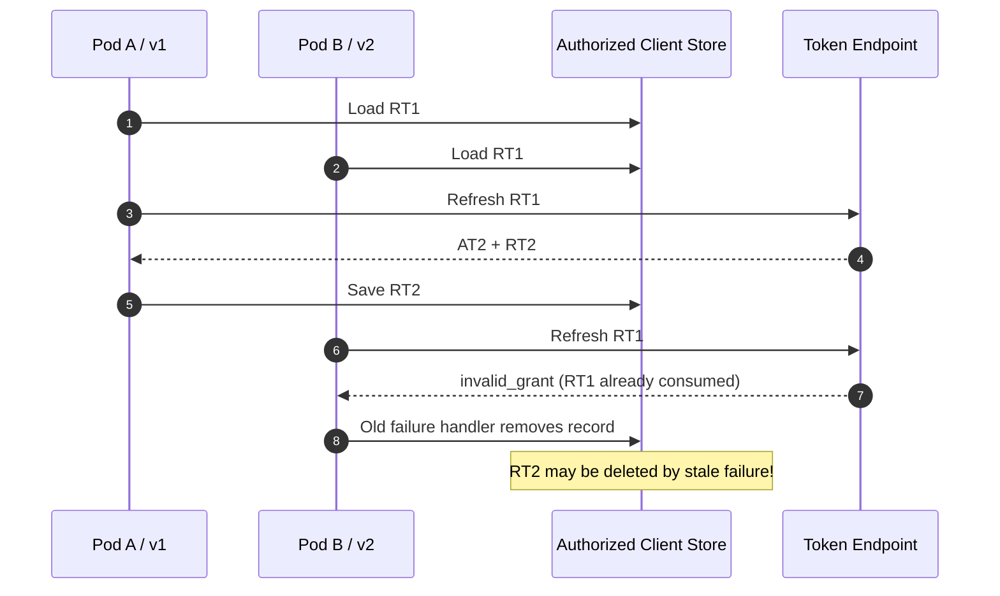
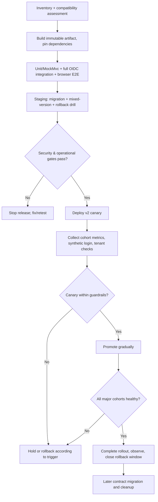

# 33.10. Rollout, Rollback, and Post-Upgrade Monitoring Plan

## 1. Upgrading an OAuth2/OIDC Client Changes the Login Path, Not Just a Dependency

In a Spring Boot application using **Spring Security OAuth 2.0/OIDC Client**, an upgrade can affect:

- How `ClientRegistration` is initialized and OIDC metadata is discovered.
- How the authorization request, redirect URI, `state`, PKCE, and `nonce` are constructed.
- How the callback, authorization code exchange, and ID Token validation are handled.
- How Spring Security persists `SecurityContext` in the session.
- How `OAuth2AuthorizedClient` and access/refresh tokens are stored and reused.
- Authentication authorities, custom `OAuth2UserService`/`OidcUserService`, and success/failure handlers.
- The HTTP client for the Token Endpoint, UserInfo/JWKS, and proxy/TLS settings.
- Method security, authorization request matchers, CSRF, and default policies.
- Login/logout UX, consent, account linking, and multi-tenancy.

An application passing tests after an upgrade **does not prove** that users can sign in end-to-end. Furthermore, during a rolling update deployment, **the old and new versions coexist**: an authorization request may start on a pod running version A while the callback is handled by pod B.

```text
Browser                  Load balancer                  Spring pods

GET /oauth2/authorization/corporate
      -----------------------------------------------> Pod A (old)
      <------------------ 302 authorize URL ----------
      ---> Identity Provider -------------------------
      <--- authorization code + state ----------------
GET /login/oauth2/code/corporate
      -----------------------------------------------> Pod B (new)
                                                       |
                                                       v
                        Session + state + PKCE + token
                        deserialization / callback logic
```

If Pod B cannot read Pod A's authorization request or session, users encounter `authorization_request_not_found`, `invalid_state`, or `invalid_grant`. If Pod B saves an authorized client in a format that Pod A cannot read, a subsequent rollback can also fail.

**Lesson topic:** designing a *rollout, rollback, and post-upgrade monitoring* plan for a Spring Security OAuth2/OIDC Client system, prioritizing recoverability, preserving security invariants, and minimizing user disruption.

### Learning Objectives

After this lesson, you will be able to:

1. Build an inventory and assess compatibility changes before upgrading Spring Boot/Spring Security.
2. Identify what to test across the authorization request, callback, OIDC validation, session, and authorized client store.
3. Design rolling/canary/blue-green rollouts and understand cross-version callback risks.
4. Apply **expand–migrate–contract** to database/config/token/session migrations.
5. Design a rollback that actually works, without assuming reverting the image alone is sufficient.
6. Define health/readiness separately from functional login monitoring.
7. Monitor login success rate, callback errors, refresh failures, ID Token validation, latency, and tenant segmentation.
8. Define criteria for promote, hold, rollback, and security stop-ship.
9. Write a runbook with owners, timeline, procedures, and recovery evidence.
10. Organize post-release observation, incident learning, and post-rollout compatibility cleanup.

The examples focus on Spring Security Servlet/MVC, though many principles apply to WebFlux. The configurations, numbers, and timeframes below are examples, **not mandatory thresholds from Spring Security or Kubernetes**.

---

## 2. Identify Exactly What Is Being Upgraded

You cannot build a rollback plan without knowing the scope of change.

| Item | Example | Potential impact |
|---|---|---|
| JDK | New JDK/runtime | TLS, truststore, serialization, crypto providers |
| Spring Boot | Framework baseline/dependency BOM | Auto-configuration, Actuator, MVC, session/cookies |
| Spring Security | Security filter chain, OAuth2 Client | Login/filter behavior, user service, token management |
| Nimbus JOSE/JWT | JWT decoder, JWK source | Allowed algorithms, JWKS cache, validation |
| Servlet container | Embedded Tomcat/Jetty | Cookies, session, HTTP headers |
| Spring Session | Redis/JDBC session schema | SecurityContext persistence/mixed-version compatibility |
| HTTP client | `RestClient`, Apache HttpClient, `WebClient` | Token/UserInfo/JWKS connectivity, timeouts, TLS |
| Data store | JDBC `OAuth2AuthorizedClientService` or custom | Token schema, encryption, concurrent refresh |
| IdP settings | Issuer, client secret, redirect URI | Authorization/token exchange/trust |
| Proxy/Ingress | Forwarded headers, TLS termination | Redirect URI/cookie/host validation |
| Frontend | SPA/BFF login initiation, CSRF | Login redirects and API 401/403 behavior |
| Tenant catalog | Dynamic ClientRegistrations | Tenant routing, issuer metadata, cached config |

### 2.1. Specify from → to Clearly

Example change record:

```yaml
changeId: SEC-2026-041
service: portal-bff
environment: production
runtime:
  javaFrom: 17
  javaTo: 21
framework:
  springBootFrom: "version-in-current-bom"
  springBootTo: "version-in-approved-bom"
  springSecurityFrom: "resolved-old-version"
  springSecurityTo: "resolved-new-version"
identity:
  providers: [corporate, partner, social]
  authFlows:
    - authorization_code
    - oidc_login
    - refresh_token
    - client_credentials
data:
  sessionStore: redis
  authorizedClientStore: jdbc
deployment:
  strategy: canary
  rollbackImage: "registry.example/portal-bff:previous-approved-tag"
```

These values are illustrative. In practice, you must **pin exact versions/digests** and retain the controlled dependency tree and release artifact.

### 2.2. Do Not Just Write “upgrade Spring Security”

You need to know:

- Is a major version changing?
- Are JDK/Jakarta Servlet APIs changing?
- Are the session repository and object serialization changing?
- Are bean customizations or the authorization request resolver changing?
- Are transitive JWT/JWK libraries changing?
- Are issuer/JWKS metadata or permitted signing algorithms changing?
- Is the post-login principal name changing?
- Are client ID/redirect URIs changing at the same time?
- Is a schema migration happening concurrently?

A release that bundles too many kinds of changes makes root-cause isolation difficult and rollback hard.

---

## 3. Core Operational Principles

**1. Never trade correct authentication for availability.** If `state`, PKCE, ID Token signature, `iss`, `aud`, or `nonce` is invalid, the callback must be rejected.

**2. Separate code rollback from data rollback.** An old image will not automatically read a new schema or session format.

**3. Do not treat HTTP 200 from readiness as login success.** You need to measure the end-to-end authentication journey.

**4. Deploy with observability first, then increase traffic.** Start with a small canary backed by metrics, logs, traces, and synthetic flows.

**5. Do not let one IdP outage take down the entire platform.** Isolate by provider/tenant and keep routes that do not depend on that IdP operating.

**6. Never fix production by disabling security filters.** Configuration issues must be resolved through controlled rollback, config fixes, or trust restoration.

**7. Protect secrets during rollback.** Never log access/refresh tokens, client secrets, authorization codes, PKCE verifiers, or session cookies.

**8. Every change must have an owner.** Who is authorized to deploy, verify the IdP, monitor the DB/session store, decide on rollback, and manage communication channels must be defined upfront.

---

## 4. Responsibility Model for a Rollout

A login-related release typically requires multiple roles.

| Role | Responsibility |
|---|---|
| Release owner | Coordinates milestones and decides promote/hold based on criteria |
| Identity/Security owner | Reviews issuer, redirects, token/nonce/PKCE, consent, and security invariants |
| Application owner | Owns Spring filters, endpoints, feature flags, and error handling |
| Platform/SRE | Handles deployment, ingress, pods, health probes, autoscaling, and rollback |
| Database/session owner | Manages migrations, shared session, authorized client store, and backups |
| IdP owner/partner | Manages provider registration, client auth methods, keys, and rate limits |
| QA/automation | Runs functional tests, negative auth flows, and browser E2E |
| Support/communications | Handles login incident messaging, escalation, and support references |

### 4.1. Rollback Authority Must Be Established Before Rollout

Avoid:

```text
Canary fails -> needs admin approval to roll back -> waiting on someone offline
```

On-call personnel must have authority to execute the approved playbook, or have a clear escalation path.

### 4.2. RACI Does Not Replace Technical Criteria

Having an owner does not mean tests passed. Decisions should be based on **evidence**: signed-in completion, token exchange, session continuation, refresh token behavior, error ratio, and security-negative tests.

---

## 5. Inventory of OAuth2/OIDC Paths

An application may have more than a single login button.

```text
Spring Security OAuth2/OIDC Client
|
+-- Interactive OIDC login (browser)
|   +-- Corporate provider
|   +-- Social provider
|   +-- Partner tenant providers
|
+-- Incremental consent for external APIs
|   +-- Calendar read
|   +-- Drive write
|
+-- Outbound authorized client
|   +-- Access token reuse
|   +-- Refresh token rotation
|
+-- Background client credentials
|   +-- Scheduled jobs
|   +-- Service-to-service calls
|
+-- Session/logout
|   +-- Local logout
|   +-- OIDC RP-Initiated Logout
|
+-- Multi-tenant ClientRegistrationRepository
    +-- Dynamic onboarding
    +-- Issuer config cache
```

### 5.1. Mandatory Flow Matrix

| Flow | Provider | Input | Verification outcome |
|---|---|---|---|
| Initial login | Corporate | Browser, code + state | Session authenticated |
| Login with another account | Corporate | Account chooser | Correct `(iss,sub)`, no account confusion |
| Refresh token | Corporate | Expired access token | New token saved atomically |
| Client credentials | Internal AS | Service principal | Token has expected scope/audience |
| Incremental scope consent | External provider | Explicit user intent | Granted scopes are accurate |
| OIDC logout | Corporate | Current session | Local session invalidated, OP behavior matches contract |
| Dynamic tenant login | Partner | Registration per tenant | Issuer/tenant isolation |
| Error callback | Corporate | `access_denied`/invalid_state | Safe public error, no session created |
| JWKS rotation | Corporate | New signed ID Token K2 | Signature validation and cache refresh work |
| Post-login API call | Orders API | Authorized client | Token has expected audience/scope |

### 5.2. Prioritization by Blast Radius

You can classify priorities as:

- **P0:** all user logins, session integrity, tenant isolation, unauthorized access.
- **P1:** refresh tokens, downstream APIs, corporate tenant login.
- **P2:** optional integration/consent, alternate provider.
- **P3:** purely cosmetic login page changes.

This is only an example. A SaaS product may treat an optional integration as P0 if it is a core customer capability.

---

## 6. Which Contracts Should Be Cross-Referenced When Upgrading Spring Security?

### 6.1. Public APIs and Configuration

Pay special attention to:

```java
SecurityFilterChain
HttpSecurity
OAuth2AuthorizationRequestResolver
OAuth2AccessTokenResponseClient
OAuth2AuthorizedClientManager
OAuth2AuthorizedClientRepository
OAuth2AuthorizedClientService
OAuth2UserService
OidcUserService
AuthenticationSuccessHandler
AuthenticationFailureHandler
```

APIs, fluent DSL methods, and supported customizers can change between major/minor versions. Cross-reference the **Spring Security migration guides and release notes for the exact target version**.

### 6.2. Default Behavior Is Not an Immutable Contract

A library upgrade can change:

- Authentication entry point for browser/API routes.
- CSRF request handling.
- SecurityContext persistence.
- OAuth2 Login authorization request repository interaction.
- Access token refresh timing/clock skew.
- Auto-configuration bean selection.
- Filter ordering/authorization matchers.
- Supported JWT algorithms/caching logic.

Do not assume “compiles cleanly => behavior unchanged”.

### 6.3. Boot 2.x → 3.x or Major Jumps

If the upgrade includes moving to Spring Boot 3.x, account for the **Java 17 baseline** and **Jakarta EE namespace (`jakarta.servlet.*`)** along with related framework changes. Detailed steps must follow the actual source/target versions; do not blindly apply major-migration warnings to patch/minor upgrades.

### 6.4. Pin Dependency Resolution

After upgrading, inspect the **actually resolved** versions of:

```text
spring-security-oauth2-client
spring-security-oauth2-core
spring-security-oauth2-jose
spring-security-web
spring-session
nimbus-jose-jwt
HTTP client dependencies
```

Do not inspect only the declared version of one dependency and assume all transitive dependencies match.

---

## 7. Pre-Rollout Baseline: Measure While Healthy

Without a baseline, it is difficult after release to distinguish new regressions from pre-existing errors.

A baseline snapshot can include:

```yaml
window: "previous-7-days-same-hour-traffic"
by:
  - provider
  - tenant_tier
  - region
  - app_version
indicators:
  - login_start_rate
  - login_completion_rate
  - login_callback_failure_rate
  - token_endpoint_error_rate
  - token_refresh_invalid_grant_rate
  - id_token_validation_failures
  - userinfo_error_rate
  - session_restore_failures
  - downstream_oauth_401_403_rate
  - p95_login_completion_latency
```

### 7.1. Define the Denominator

For example:

\[
\text{Login Completion Rate} =
\frac{\text{completed login attempts in cohort}}
{\text{eligible started login attempts in cohort}}
\]

With short time windows, an attempt started near the end of one window may complete in the next window. You need an **attempt ID/correlation** and a reasonable timeout window.

Do not make an invalid comparison such as:

```text
successful callbacks per minute
/
authorization starts per minute
```

and treat it as an exact conversion rate in all situations.

### 7.2. User Cancellation Is Different from System Error

A user declining consent (`access_denied`) may be expected behavior. Metrics should carry a clear `outcome`:

```text
success
user_cancel
provider_policy_denied
client_configuration_error
protocol_validation_failed
dependency_timeout
application_error
```

Do not lump everything into “service failed” if you want to evaluate a rollout fairly.

### 7.3. Segment by Provider, Tenant, and Version

Aggregate login success may stay high if corporate provider A breaks while social provider B carries most of the traffic.

At a minimum, include:

```text
source app version
provider alias
region
trusted tenant group / bounded reference
error stage/category
```

Avoid unbounded-cardinality metric labels such as raw user/tenant IDs.

---

## 8. Green Readiness Does Not Mean Green Login

Spring Boot Actuator can expose:

```text
/actuator/health/liveness
/actuator/health/readiness
```

Readiness asks whether the pod can accept traffic under local policy; it does not inherently run a real authorization code flow.

During an upgrade, two observability tracks are needed:

**Pod health:**

```text
application started
required local config loaded
DB/session store usable
main HTTP listener healthy
```

**Identity functional health:**

```text
OIDC authorize redirect works
callback state/PKCE recognized
token code exchange success
ID Token verifies issuer/aud/nonce/signature
SecurityContext persists
subsequent API authorized
```

### 8.1. Do Not Put IdP/JWKS in Liveness

An IdP outage should not cause every pod to restart continuously. During a rolling update, pod restarts wiping the JWKS cache make a cold-cache storm even more likely.

### 8.2. Use Appropriate Synthetic Logins

A synthetic test account in sandbox/staging can run through full OIDC Login. In production, if permitted by the IdP, a control account holding no real user data can perform controlled functional checks.

Do not run continuous synthetic logins using real users' production credentials, and never use synthetic login as a Kubernetes liveness probe.

---

## 9. Inventory Stateful Data That Must Survive a Release

Rollout/rollback planning requires knowing where the following state lives:

| State | Common storage location | Cross-version risk |
|---|---|---|
| OAuth2AuthorizationRequest | HttpSession/`AuthorizationRequestRepository` | State, PKCE verifier, nonce serialization |
| SecurityContext | HttpSession/Spring Session | Authentication object/authority/user principal format |
| OIDC user claims | SecurityContext/session, custom profile DB | Class/claim mapping changes |
| OAuth2AuthorizedClient | Repository/service/JDBC/Redis | Token serialization/encryption/schema |
| ClientRegistration | Static bean/dynamic catalog | Registration ID, issuer, endpoint, version |
| Refresh token | Authorized client secure store | Rotation race, destructive overwrite |
| Pending consent intent | Session/DB | Callback ownership, state binding |
| Session cookie | Browser + session store | Cookie name/Domain/Path/SameSite |
| IdP/tenant mapping | Local DB | Stable external identity `(iss,sub)` |
| JWKS cache | In-memory/shared decoder | Unknown kid/rotation, old/new keys |
| Login error telemetry | Logs/traces | New code/category comparability |

**Rule:** changing any of these formats or schemas can impact users even if the old application code can still be redeployed.

---

## 10. Mixed-Version Login Transactions: A Mandatory Drill

Consider a rolling deployment:

```text
10:00:00 Pod A (v1) receives /oauth2/authorization/corporate
10:00:01 A saves authorization request state=S1, PKCE verifier=V1 into session
10:00:05 Pod B (v2) is added to the Service
10:00:10 IdP redirects user to /login/oauth2/code/corporate?code=C1&state=S1
10:00:11 Load balancer routes callback to B
```

For the callback to succeed:

1. B retrieves A's exact authorization request.
2. B reads the session serialization and repository schema.
3. B extracts the exact `state`, `code_verifier`, `nonce`, and registration context.
4. B uses the matching issuer and client authentication.
5. B validates the ID Token and internal account mapping.
6. B stores Authentication/AuthorizedClient in a format that subsequent requests on either A or B can process.

### 10.1. If the State Repository Is Pod-Local In-Memory

If the authorization request lives in pod-local memory without guaranteed sticky affinity, callbacks routed to another pod can fail.

Options:

- A compatible Spring Session shared store.
- Sticky routing strong enough for the flow window (still risky when pods drain).
- Route login traffic to a **version-isolated pool** during the upgrade window.
- Design a dedicated authorization request repository with a stable DTO and state binding.

Never use unsigned or unprotected cookies containing raw PKCE verifiers or client secrets.

### 10.2. Sticky Sessions Do Not Fully Solve Rollback

Pod A may be terminated while the user is at the IdP. When the callback returns to B, Pod A no longer exists to stick to. Therefore, you need **a drain grace period or shared-state compatibility**, not affinity alone.

### 10.3. Never Bypass State When Request Is Not Found

If a callback fails because A/B cannot read the session, never do:

```text
state missing -> accept authorization code anyway
```

That creates a login CSRF / flow confusion vulnerability.

### 10.4. Testing the Happy Path Is Not Enough

Test all four paths:

```text
v1 start -> v1 callback
v1 start -> v2 callback
v2 start -> v1 callback
v2 start -> v2 callback
```

For rollbacks, `v2 start -> v1 callback` is the case most often overlooked.

---

## 11. Session Serialization Is a Major Upgrade Risk

`SecurityContext`, `OAuth2AuthenticationToken`, `OidcUser`, authorities, and authorization requests may be serialized through Spring Session Redis/JDBC or a custom session store.

### 11.1. Java Native Serialization Is Not a Stable Cross-Version Schema

If the session store contains Java-serialized objects from Spring Security/framework classes, a major upgrade can alter class hierarchies, serialVersionUIDs, package namespaces, or object graphs.

Never assume:

```text
v2 can read every v1 session
v1 can read every v2 session
```

Even when v2 login tests pass in a brand-new session, existing v1 sessions may still break.

### 11.2. Three Strategies

| Strategy | Advantage | Tradeoff |
|---|---|---|
| Cross-version compatible shared session format | Smooth rolling update and rollback | Requires stable DTO/serializer compatibility and tests |
| Session/version isolation | Prevents cross-version object decoding errors | Users may have to sign in again when switching pools |
| Controlled session invalidation | Simpler for breaking changes | User disruption, communication, traffic spike |

### 11.3. Do Not Ad-Hoc Convert `SecurityContext` to Arbitrary JSON

A custom session serializer must protect credentials and principal claims, enforce type allowlisting, and maintain object-mapping security. Never deserialize arbitrary class names from attacker-controlled session data.

### 11.4. Test Both “Read Up” and “Write Down”

- v1 creates session → v2 reads it.
- v2 creates session → v1 reads it (rollback path).
- v1 updates session → v2 reads it.
- v2 updates session → v1 reads it.
- Invalidate/logout on one version → the other version cannot reuse it.
- Session TTL, cookie security, and concurrent writes.

### 11.5. If Backward Compatibility Cannot Be Guaranteed

Establish an **explicit cutover plan**:

```text
Window: users with old sessions may be asked to sign in again.
Existing checkout/payment processes are protected against data loss.
Authentication state is invalidated safely, not force-migrated insecurely.
User-facing messaging/support staffed.
```

Do not hide the risk of user re-login and mislabel the release “zero downtime”.

---

## 12. OAuth2AuthorizedClient Store: A Token Is More Than One Field

Spring Security typically keys an authorized client by:

```text
clientRegistrationId
principalName
accessToken
refreshToken (if present)
```

This may involve:

```java
OAuth2AuthorizedClientService
OAuth2AuthorizedClientRepository
OAuth2AuthorizedClientManager
```

When upgrading, verify:

- Does `registrationId` change?
- Does `principalName` after OIDC Login change?
- Are stored access/refresh tokens deserialized properly?
- Is refresh token rotation handled atomically?
- Could concurrency between old/new versions lose a newly issued RT?
- Are token encryption keys/versions compatible?
- Does logout/disconnect delete the exact right record?
- Can tenant A ever read tenant B's token?
- Does database connection pooling impact latency?

### 12.1. The Danger of Changing the Principal Key

Old version:

```text
principalName = alice@example.com
```

New version:

```text
principalName = issuer|sub-12345
```

Both may represent the same external identity, yet the authorized client lookup:

```text
(registrationId,principalName)
```

differs. The new version may fail to locate existing tokens, forcing re-consent or creating duplicate records.

### 12.2. Switching to `(iss,sub)` Can Improve Security

However, migration requires an explicit mapping from old → new:

```text
legacy principal key
    -> verified linked identity key
    -> new stable principal key
```

Never auto-merge users based on unverified email addresses.

### 12.3. Token Stores Must Enforce Ownership

During a rolling deployment, v1 and v2 share the store. Neither version may save Bob's token under Alice's principal or tenant Alpha due to a user mapping mismatch.

---

## 13. Refresh Token Rotation Under Rolling Deployment

A classic race condition:



This bug may have existed before the upgrade, only to **surface when v1 and v2 differ in refresh timing/clockSkew or storage behavior**.

### 13.1. Do Not Fix This by Disabling Refresh Token Rotation

Rotation may be a security requirement enforced by the AS. Address local concurrency and token storage instead.

### 13.2. Protections

- Conditional updates / optimistic locking by row version.
- Per-authorization serialization / singleflight.
- Re-read the latest authorized client before removing a record after `invalid_grant`.
- Distinguish refresh success, stale failure, and revoked grant.
- Do not retry using an old RT indefinitely.
- Never synthesize or union OAuth2 tokens/scopes that the AS did not grant.
- Test concurrent background jobs and user requests.

### 13.3. Rollback Must Preserve RT2

After v2 rolls out and rotates RT1→RT2, rolling back to v1 requires v1 to read RT2. If v1 cannot understand the new schema or token encryption, users will be disconnected.

That is why schema/token-format migrations must be **backward-readable before cutover**, or paired with an explicit reauthorization plan.

---

## 14. Database Migrations: Expand → Migrate → Contract

A safe schema change during a rolling deployment typically proceeds in stages:

```text
Stage 1: EXPAND
    Add new columns/table/indexes without removing old contract.
    Old version continues operating.

Stage 2: COMPATIBLE CODE
    Deploy code that reads both old/new representations.
    If dual-write needed, ensure idempotence/conflict rules.

Stage 3: MIGRATE
    Backfill data in bounded batches with progress checkpoints.
    Verify row counts and identity/tenant associations.

Stage 4: CUTOVER
    New code uses new format after compatibility confirmed.
    Rollback to old code still possible in predefined window.

Stage 5: CONTRACT
    Remove old fields only after rollback window closes,
    no old instances remain, and migration evidence is retained.
```

### 14.1. Never Require the New Schema Immediately After a Destructive Migration

If a migration runs:

```sql
DROP COLUMN refresh_token;
```

then the old image may stop working. That is not a rollback-safe change.

### 14.2. Example Schema Expansion

```sql
ALTER TABLE oauth2_authorized_client
    ADD COLUMN format_version INTEGER;

ALTER TABLE oauth2_authorized_client
    ADD COLUMN record_revision BIGINT;
```

This syntax is **an example**; table/column names and SQL dialect depend on your actual schema. This is not a mandatory default schema from Spring Security.

### 14.3. Avoid Ad-Hoc Dual-Writing of Secret Tokens

Storing two copies of a refresh token can expand the risk surface. If dual-writing is required for compatibility:

- Encrypt at rest according to key policy.
- Do not duplicate indefinitely.
- Define clear revision/concurrency semantics.
- Ensure old and new versions do not race to delete the RT.
- Plan removal of the old representation after cutover.

### 14.4. Database Rollback Is Not Simply Running a `down migration`

Once data has been written under the new schema, `DROP TABLE` or `down.sql` can wipe out tokens, account bindings, and consent history.

Rollbacks usually favor **rolling back application code on the expanded compatible schema**, followed by controlled data migration rather than destructive reverse DDL.

---

## 15. IdP/Client Configuration Must Have Its Own Rollback Plan

A single release may simultaneously modify:

```text
client_id
client_secret
redirect_uri
token auth method
issuer-uri
jwks_uri
scope
provider tenant
```

These are changes to the **trust/authorization contract**, not just a config flag.

### 15.1. Redirect URI Commonly Breaks Rollbacks

v1 uses:

```text
https://portal.example/login/oauth2/code/corporate
```

v2 switches to:

```text
https://auth.portal.example/login/oauth2/code/corporate
```

If the IdP deletes the old redirect URI as soon as v2 deploys, callbacks for login attempts initiated on v1 can be rejected, and rolling back to v1 will fail.

### 15.2. Two-Phase IdP Change

When the provider allows it:

1. **Pre-register** the new redirect URI/client settings while keeping the old ones.
2. Deploy code compatible with both during the transition window.
3. Enable the new flow via controlled routing/flag.
4. Verify.
5. Delete the old settings only after the rollback window closes and active flows expire.

Not every IdP allows multiple simultaneous redirect URIs or client secrets. Where unsupported, use a staged cutover or an announced downtime/reauth plan.

### 15.3. Client Secret Rotation Must Account for Token Requests

If the old secret is revoked before the rollout finishes, v1 pods may get `invalid_client` on code exchange or refresh. Align with the IdP contract on credential overlap, deployment synchronization, and rollback credential availability.

**Never keep old client secrets indefinitely** purely for rollback convenience; retain them only within security-approved lifecycles and secret manager procedures.

### 15.4. Issuer URI Is Not an Arbitrary Alias

Changing the issuer means changing the trust domain; the same `sub` across two issuers does not automatically represent the same external identity. A rollback may need to preserve identity mappings for both issuers and audit migrations to prevent account takeover.

---

## 16. Concurrent JWKS Rotation and Upgrade

An upgrade may change Nimbus/Spring Security JWT decoders or JWKS caching behavior. If the IdP also rotates signing keys K1→K2 at the same time, pinpointing the source of failures becomes very hard.

### 16.1. Conditions to Verify

- Both old and new versions accept tokens signed with trusted keys.
- Allowed algorithms still match the provider contract.
- An unknown `kid` triggers JWKS refresh per the active implementation.
- JWKS URL/issuer trust has not shifted unexpectedly.
- Invalid signatures, wrong issuers, wrong audiences, or wrong nonces are still rejected.
- JWKS endpoint timeouts never cause a login bypass.
- Multi-tenant caches never mix `kid` entries across issuers.

### 16.2. Separate the Two Changes Whenever Possible

Unless forced to upgrade the client and rotate the OP signing key together, execute them as separate events with independent baselines and monitoring.

If they must occur together, expand canary/negative tests and assign explicit owners for both the provider change and the application release.

### 16.3. Cache State Persists Within Running Processes

v1 pods hold K1 in their JWKS cache while v2 pods start with a cold cache or K2. If only a subset of logins fail, segment by pod, app version, and cache state before blaming user sessions.

---

## 17. Rollout Strategies to Choose From

### 17.1. Rolling Update

Kubernetes gradually replaces old pods with new pods.

**Best when:** versions share compatible sessions, configs, and stores, and login flows can span both versions.

**Risks:** mixed-version callbacks, session deserialization, refresh concurrency, and state ownership.

### 17.2. Canary

A small fraction of traffic runs on v2:

```text
v1 = 95%
v2 = 5%
```

Traffic increases incrementally as positive evidence accumulates.

**Best when:** regressions must be caught within an SLO before expanding the blast radius.

**Risks:** random routing sends authorization starts to v1 and callbacks to v2; a 5% request canary **does not equal** 5% of login transactions. Route/cohort by session or attempt if measuring end-to-end journeys.

### 17.3. Blue-Green

Two separate environments/pools:

```text
Blue: v1
Green: v2
```

Traffic shifts in a controlled cutover. Reverting traffic is often faster, provided you ensure:

- Active session compatibility or isolated cookie namespaces.
- Shared DB/schema backward compatibility.
- Pending OAuth2 authorization requests and redirect URI routing.
- Secret/issuer settings valid for both Blue and Green.
- Background token refresh jobs do not run twice across both pools.

### 17.4. Feature-Flagged Rollout

A server-side flag selects the new provider registration strategy or mapping logic.

**Never use feature flags to disable** JWT signature validation, OAuth2 `state`, PKCE, nonce, CSRF, or tenant isolation.

### 17.5. Shadow Traffic

Never replay real authorization codes or refresh tokens into a second environment just to “shadow test”: they may be single-use and carry credentials. Shadow testing should use **sanitized metadata**, synthetic identities, or business requests stripped of secrets according to contract.

---

## 18. Should Canary Cohorts Target Users, Tenants, or Pods?

| Cohort | Advantage | Risk |
|---|---|---|
| Random 5% of requests | Easy to configure in ingress | Login journeys span multiple requests, causing cross-version splits |
| Sticky browser/session | Keeps multi-request journeys on one version | Pod drains/rollbacks cause session drift |
| Internal employee group | Limits customer impact | May not represent production IdPs/tenants |
| Single test tenant | Tests a specific config end-to-end | Does not cover diverse issuers |
| Region | Clear blast-radius rollback boundary | Traffic and IdP policies differ across regions |
| Explicit account cohort | Tracks functional outcomes cleanly | Requires trusted routing/consistent hashing |

### 18.1. Focus on Transaction Stickiness

A single login attempt spans:

```text
initiation -> external redirect -> callback -> session usage
```

Traffic splitting must be evaluated **per journey**, not per individual HTTP request.

### 18.2. Do Not Use OAuth2 `state` as a Public Routing Token

`state` is security-sensitive authorization flow data. Do not expose it in metric labels, new URLs, or logs just to pin routing. Instead, use a server-side opaque login-attempt reference bound to the session/transaction.

### 18.3. Choose a Canary With Real Test Coverage

A canary restricted to internal employees on corporate IdP A will not catch failures in tenant B, social providers, JWKS rotation, or WebFlux paths.

Cohort selection and synthetic tests should cover **high-risk paths**, not merely raw user volume.

---

## 19. Kubernetes Rolling Rollout Example

An illustrative manifest:

```yaml
apiVersion: apps/v1
kind: Deployment
metadata:
  name: portal-bff
spec:
  replicas: 6
  strategy:
    type: RollingUpdate
    rollingUpdate:
      maxSurge: 2
      maxUnavailable: 1
  selector:
    matchLabels:
      app: portal-bff
  template:
    metadata:
      labels:
        app: portal-bff
        app-version: v2
    spec:
      containers:
        - name: portal
          image: registry.example/portal-bff@sha256:REPLACE_WITH_REAL_DIGEST
          ports:
            - name: http
              containerPort: 8080
          startupProbe:
            httpGet:
              path: /actuator/health/liveness
              port: http
            periodSeconds: 5
            failureThreshold: 24
          livenessProbe:
            httpGet:
              path: /actuator/health/liveness
              port: http
            periodSeconds: 10
            failureThreshold: 3
          readinessProbe:
            httpGet:
              path: /actuator/health/readiness
              port: http
            periodSeconds: 5
            failureThreshold: 3
          terminationGracePeriodSeconds: 30
```

**Note:** `terminationGracePeriodSeconds` is a **Pod spec** field, not a field inside `containers[]`. In a real deployment, place it as:

```yaml
spec:
  template:
    spec:
      terminationGracePeriodSeconds: 30
      containers:
        - name: portal
          ...
```

The snippet above uses a placeholder digest and example probe settings; adjust it to match your actual schema, image tag/digest, and runtime characteristics. Never copy placeholders directly into production manifests.

### 19.1. Readiness Is Not a Functional OIDC Test

A v2 pod may report Ready while user callbacks fail. Combine readiness probes with synthetic and browser login metrics in rollout gates.

### 19.2. Graceful Shutdown

When a pod drains, in-flight requests need time to complete within the termination window. However, a user's browser may remain at the IdP for several minutes; a 30-second grace period **cannot cover** callbacks that already left the app.

To preserve in-flight login transactions, use shared-state compatibility or dedicated version-aware routing/windows.

### 19.3. Canaries Often Use Separate Deployments

With a service mesh or ingress supporting weighted routing, teams typically maintain separate v1 and v2 Deployments for cleaner percentage control and rollback. A basic `RollingUpdate` alone does not provide full canary/experiment analysis controls.

---

## 20. Staged Rollout Workflow

A reference workflow:



### 20.1. Phase 0 — Pre-Deployment Readiness

- Confirm approved release artifact/digest.
- Confirm rollback image exists and can start.
- Confirm DB/session migrations are backward compatible.
- Confirm IdP secret/redirect URI overlap policy.
- Confirm canary routing + log/metric version tags.
- Confirm baseline and thresholds.
- Confirm runbooks and on-call presence.
- Confirm live configuration and flags are versioned.
- Confirm backups/restore strategy where data migration is involved.
- Confirm no ongoing high-severity Identity Provider incident.

### 20.2. Phase 1 — Small Canary

For example, 1–5% of **eligible traffic** or a set of trusted internal/tenant cohorts. Exact numbers depend on traffic volume, risk, and monitoring signal-to-noise ratio.

Check:

```text
OIDC Login complete from test account.
Callback state/PKCE accepted.
Session persists across subsequent requests.
Authorized client record saved and reused.
Token refresh works.
No new unauthorized access.
```

### 20.3. Phase 2 — Controlled Promotion

Increase percentage gradually:

```text
5% -> 20% -> 50% -> 100%
```

These are examples, not strict standards. Each step needs an observation window with sufficient sample size and at least several login attempts completing the full lifecycle.

### 20.4. Phase 3 — Stabilize

After reaching 100%, continue monitoring:

- Sessions created by v1 currently served by v2.
- Tokens/authorized clients persisted by v1.
- Refresh token rotation across multiple cycles.
- Rare tenant/provider flows.
- IdP signing key/JWKS refreshes.
- User logout/re-login.
- Background jobs and long-lived sessions.

### 20.5. Phase 4 — Contract Cleanup

Only after the rollback window closes:

- Remove legacy DB columns/code.
- Remove temporary flags/dual-read logic.
- Delete obsolete redirect URIs/client secrets per security policy.
- Clean up stale sessions in a controlled manner.
- Update diagrams/runbooks and operational ownership.

Never contract the schema during the canary phase before rollback is no longer needed.

---

## 21. Defining Promotion Gates

Gates must rely on sufficiently stable evidence.

Illustrative example:

| Signal | Suggested hold/rollback |
|---|---|
| Unauthorized access regression | **Immediate stop**, security incident |
| OIDC issuer/audience/nonce/signature validation bypass | **Immediate stop**, block release |
| Login completion rate | Canary drops significantly compared to control cohort and baseline |
| Callback state/PKCE failures | New post-deploy spike |
| Token Endpoint `invalid_client` | Spike tied to registration/config version |
| Refresh Token `invalid_grant` | Spike correlated with deployment or concurrency |
| Session deserialization failures | Any cluster-wide or steadily rising errors |
| Authorized client storage errors | Increasing errors or lost refresh tokens |
| Login p95/p99 latency | Exceeds approved SLO/guardrail |
| JWKS fetch/unknown kid | Abnormal spike not explained by OP rotation |
| Unexpected CSRF/403 | Divergent rise in session flows |
| Support tickets | Spike in inability-to-login complaints |
| Error budget burn | Per agreed SRE policy |

### 21.1. Do Not Pick Arbitrary Threshold Numbers

A canary with only 10 login attempts cannot statistically prove 99.9% success. You need sufficient sample size, cohort matching, observation windows, and synthetic coverage for low-traffic paths.

### 21.2. Combine Metrics With Security Gates

A version whose login success rate goes up while allowing anonymous access to a protected API **must not be promoted**. Authentication correctness cannot be sacrificed for an SLO.

### 21.3. Hold vs. Rollback

- **Hold:** pause traffic increases and continue observing/investigating.
- **Rollback:** actively drain v2 and revert to the approved prior release.
- **Hotfix:** when rollback is unsafe due to data migration or a security-critical flaw, execute a dedicated incident plan.

The choice depends on **rollback feasibility**, not merely an “undo deploy” button.

---

## 22. Example Version-Tagged Observability Metrics

An application can emit custom metrics such as:

```text
oauth2_login_attempts_total{
    provider="corporate",
    app_version="v2",
    outcome="started"
}

oauth2_login_completions_total{
    provider="corporate",
    app_version="v2",
    outcome="success"
}

oauth2_callback_failures_total{
    provider="corporate",
    app_version="v2",
    reason="STATE_MISMATCH"
}

oauth2_token_requests_total{
    grant="refresh_token",
    app_version="v2",
    outcome="failure"
}

oidc_id_token_validation_total{
    app_version="v2",
    provider="corporate",
    reason="UNKNOWN_KID"
}
```

These names are **custom application metrics**. Spring Boot/Spring Security do not automatically emit these exact metric names and labels out of the box.

### 22.1. Keep Cardinality Low

Good labels:

```text
app_version
provider_alias
region
stage
outcome
error_category
```

Avoid using as metric labels:

```text
session_id
trace_id
correlation_id
email
raw_subject
access_token
refresh_token
client_secret
authorization_code
unbounded tenant_id
raw_kid from attacker JWT input
```

When investigating a specific tenant, use protected structured logs/audits with opaque tenant references and appropriate access controls.

### 22.2. Metrics Must Track the Login Attempt's Cohort

A login may start on v1 and finish its callback on v2. Tagging only `app_version=v2` at callback time miscounts “how many attempts v2 initiated and completed”.

Store a stable server-side login attempt reference (never log raw OAuth2 state), recording:

```text
initiatingVersion
callbackHandlingVersion
provider
tenant cohort
outcome
duration
```

### 22.3. Correlating Logs and Traces

An event:

```json
{
  "event": "oauth2.callback.failure",
  "stage": "STATE_VALIDATION",
  "initiatingVersion": "v1",
  "handlingVersion": "v2",
  "providerAlias": "corporate",
  "tenantRef": "t-opaque-42",
  "publicCode": "LOGIN_NOT_COMPLETED",
  "internalReason": "AUTHORIZATION_REQUEST_NOT_FOUND",
  "correlationId": "c-2b93e",
  "result": "failure"
}
```

Never log raw `state`, PKCE verifier, ID Token, or callback query strings.

---

## 23. Token Lifecycle Observability

Even when login success looks healthy during the canary, many defects only surface after access tokens expire.

### 23.1. Key Indicators

```text
authorized_client_load_success/failure
access_token_reuse_rate
refresh_token_request_success/failure
refresh_invalid_grant_by_provider
token_endpoint_latency
authorized_client_store_save_failures
principal_name_lookup_misses
refresh_token_rotation_conflicts
downstream_api_401_403
```

### 23.2. Classifying `invalid_grant`

Do not assume every `invalid_grant` means the user revoked consent. It can stem from:

- An already-used or expired authorization code.
- PKCE mismatch.
- An expired or revoked refresh token.
- Concurrent refresh rotation requests.
- Client/issuer mismatch.
- A stale authorized client store.

Record **grant type + stage** to tell them apart.

### 23.3. Observation Window Must Cover Refresh

If access token lifetime is 60 minutes, observing for 5 minutes post-rollout will miss refresh failures. Run synthetic refresh tests or monitor across the full token lifecycle per IdP policy.

Do not assume “every refresh token arrives after one hour”; providers may not issue an RT or may enforce different lifetimes.

---

## 24. Monitoring JWT/JWKS and OIDC Errors

Track these signals individually:

```text
ID Token signature_invalid
unknown_kid
issuer_mismatch
audience_mismatch
nonce_mismatch
expired_id_token
JWKS fetch timeout/HTTP error
OIDC discovery failure
UserInfo subject_mismatch
```

### 24.1. Do Not Group Them All Under “login failed”

A spike in `issuer_mismatch` carries a very different security profile from a Token Endpoint timeout. Their risks and rollback decisions differ.

### 24.2. Watch Out for Concurrent Key Rotation

If the IdP publishes K2 while the application changes Nimbus/JWK cache behavior, track:

```text
provider key rotation timeline
remote JWKS contents
cache fetch status/latency
app version
pod instance
unknown_kid errors
```

Never work around issues by accepting unsigned JWTs or fetching JWKs from an untrusted URL.

### 24.3. Existing Sessions May Keep Working

OIDC ID Tokens are typically verified at login; subsequent business requests rely on the stored `SecurityContext`. Thus a JWKS outage can break **new logins** while existing sessions continue functioning.

Post-upgrade dashboards should separate new-login health from existing-session API health.

---

## 25. Monitoring Spring Security Filter Behavior

Especially when updating DSL/matchers or major framework versions, verify:

- Is `GET /oauth2/authorization/{registrationId}` reachable?
- Is `/login/oauth2/code/{registrationId}` handled by the intended login filter?
- Do unauthenticated `/api/**` requests return 401 JSON or 302 HTML?
- Do browser logins still redirect to the expected provider?
- Is CSRF enforced properly on POST endpoints?
- Do `requestMatchers` prevent anonymous access to sensitive resources?
- Is `/actuator/**` protected from unintended exposure?
- Does logout avoid bypasses or retaining sessions after invalidation?
- Are multiple `SecurityFilterChain` beans and `@Order` priorities routing accurately?

### 25.1. A Config Migration Can Leave All Mocked Login Tests Green

For example, `.with(oidcLogin())` injects a mock Authentication directly into MockMvc, bypassing redirect/callback handling. Even if v2 uses the wrong redirect URI or client secret, controller tests still pass.

**You must run tests exercising the actual authorization flow** against a fake OP or IdP sandbox.

### 25.2. Negative Security Tests

Do not verify only the happy path:

```text
anonymous -> protected API must reject
wrong state -> reject
wrong PKCE verifier -> reject
wrong nonce/issuer/audience -> reject
wrong tenant registration -> reject
expired ID Token -> reject
invalid JWT signature -> reject
CSRF missing on state-changing browser POST -> reject
logout -> old session unusable
```

---

## 26. Pre-Promotion Test Matrix

| Test group | Question answered | Appropriate cadence |
|---|---|---|
| Unit tests | Are scope/claim/authority mappers accurate? | Every PR |
| MockMvc `oidcLogin()` | Do controllers work with an OIDC principal? | Every PR |
| OAuth2 redirect filter | Are `state`, PKCE, and redirect URI correct? | Every PR |
| Fake OP full code exchange | Are Token Endpoint and ID Token validation sound? | Every PR |
| Browser E2E | Do cookies, redirects, and session continuity work? | Staging/pre-release |
| Provider sandbox | Has the real IdP contract changed? | Pre-release/scheduled |
| Mixed-version | Are v1↔v2 sessions/callbacks mutually readable? | Before rolling deploy |
| Refresh rotation race | Does shared authorized client avoid losing RTs? | Before token-layer upgrades |
| JWKS K1→K2 | Do caching and crypto validation hold up after upgrade? | Before JOSE/Nimbus upgrades |
| Schema migration | Do expand/read/write/rollback work properly? | Before DB changes |
| Security negative | Are there zero authentication bypasses? | Every high-risk release |
| Canary synthetic | Does the user journey complete on v2? | Production canary |
| Rollback drill | Can v1 run on data written by v2? | Before production |

### 26.1. `MockMvc` and Browser E2E Complement Each Other; Neither Replaces the Other

`oidcLogin()` neither verifies ID Token signatures nor calls the Token Endpoint. Browser E2E validates redirects and cookies but struggles to inject arbitrary JWT tampering negative cases. Fake OP integration gives direct control over error responses and keys to verify fail-closed behavior.

### 26.2. Test With Real Keys in Test Environments

Use signed JWTs generated with **test RSA/EC keys**, never production private keys. The fake OP publishes matching public JWKs; token responses must echo the `nonce` from the authorization request so the real protocol flow is tested accurately.

---

## 27. Staging Must Mirror Production Friction Points

A valuable staging environment should simulate:

- Multiple v1/v2 pods.
- Identical ingress/proxy topology and forwarded headers.
- TLS, `Secure` cookies, and `SameSite`.
- Shared Spring Session store.
- An authorized client store/schema matching production structure.
- Dynamic tenant registrations by provider type.
- Redis/JDBC connection pooling and session TTL.
- Token Endpoint/JWKS/UserInfo timeouts and error handling.
- Real browser redirects.
- Background scheduled jobs.
- Secret/config versioning and deployment flags.

### 27.1. Avoid Copying Real User Data Unnecessarily

Use synthetic/test accounts and redacted test fixtures. There is no need to export production refresh tokens, user sessions, or client secrets for testing.

### 27.2. Staging May Not Catch Every IdP Behavior

A provider sandbox can differ from production in consent policies, MFA, refresh token issuance, and throttling. Document contract coverage explicitly and supplement with a lightweight production canary.

### 27.3. Test Against Identical Versions

Running fake OP integration for v2 with a different Nimbus version than production is insufficient. Build the test artifact from the exact dependency BOM and approved image/digest.

---

## 28. Rollback Plan: Define Before Deploying

A rollback plan is not a single line:

```text
kubectl rollout undo deployment/portal-bff
```

Rather, it is a contract:

```text
Which code version will run?
Can it read current session/token/schema data?
Are old IdP registration/redirect/secret settings still valid?
Will outstanding login callbacks succeed or safely restart?
Will background jobs double-run?
How do we observe recovery?
Who authorizes/executes rollback?
How do we communicate partial reauthentication?
```

### 28.1. Conditions for Rollback-Safety

- Immutable v1 artifact remains pullable.
- v1 configuration version can be validly restored.
- Database schema remains compatible with v1.
- Authorized client records created by v2 are readable by v1 or covered by a valid migration/cleanup path.
- Session/state format is backward compatible or paired with a controlled session reset.
- Old redirect URI/client auth remain valid at the IdP.
- Rollback does not leak credentials or disable security checks.
- Metrics distinguish v1 recovery from residual v2 traffic.

### 28.2. If Any Condition Fails

Do not claim a fast rollback is available. Establish a **forward-fix/cutover plan**, a backup restore path, or a planned user reauthentication window with accepted impact.

---

## 29. Two Distinct Types of Rollback

### 29.1. Traffic Rollback

In blue-green/canary:

```text
Route new traffic back to v1 pool.
Keep v2 available for existing transactions if needed.
```

Advantages: fast, minimal infrastructure churn.

Risks: sessions/authorized clients written by v2 still exist; callbacks for v2-initiated flows may land on v1; schemas may already have changed.

### 29.2. Code Rollback

Redeploying the v1 image:

```text
deployment image v2 -> v1
```

Risks:

- v1 pod startup depends again on discovery/IdP availability.
- v2 sessions may fail to deserialize.
- DB schema may be incompatible.
- New client secret/issuer settings may not be backward compatible.
- Rotated tokens and newly written records may be lost or unreadable.

### 29.3. Database Rollback Is Rarely the First Move

Reverting schemas/data can destroy recent logins, consents, and session updates. Favor code/traffic rollback over an expanded compatible schema whenever possible.

---

## 30. Practical Rollback Runbook Example

```text
INCIDENT: Login failures after Spring Security upgrade

Trigger:
    Canary shows state mismatch spike or login completion
    below approved guardrail.

Owner:
    Release On-call; Security co-sign for integrity anomalies.

Step 1 - Stop promotion:
    Freeze canary percentage and feature flags.
    Record deployment/config versions.

Step 2 - Protect user journeys:
    Stop routing new login initiations to suspect v2 cohort.
    Preserve pending authorization state if possible.
    Do not bypass state/nonce/PKCE.

Step 3 - Choose recovery:
    (A) Route to v1 if session/store backward compatible.
    (B) Keep version-isolated callback path temporarily.
    (C) Controlled re-login if incompatible, with UX notice.

Step 4 - Revert approved code/config:
    Use immutable v1 artifact/digest and compatible settings.
    Do not restore revoked client secrets insecurely.

Step 5 - Validate:
    Synthetic OAuth2 Login -> token exchange -> OIDC verify
    -> session persisted -> subsequent protected API.
    Refresh token flow, logout and tenant isolation.

Step 6 - Observe:
    Compare v1 baseline/login failure and session restore errors.
    Verify no more v2 pods/traffic where rollback intended.

Step 7 - Communicate and document:
    Notify support/security, record incident and follow-up.
```

### 30.1. With Kubernetes

Commands may include:

```powershell
kubectl rollout status deployment/portal-bff
kubectl rollout history deployment/portal-bff
```

and depending on deployment strategy:

```powershell
kubectl rollout undo deployment/portal-bff
```

**Execute only** when you know the previous revision is genuinely compatible with the current schema, configuration, and IdP state. In a mesh/ingress canary, update routing weights as well; `rollout undo` does not automatically revert external flags or provider settings.

### 30.2. Do Not Unexpectedly Break the Authorization Callback Path

If v2 generated authorization requests pointing to a v2 redirect URI, post-rollback v1 needs a policy for in-flight callbacks:

- Route callbacks to a preserved v2 flow until expiration.
- Or reject safely and prompt the user to start a new login.
- Never accept `state`/PKCE from another version blindly if unreadable.

---

## 31. Rollback and Session Reauthentication

Sometimes v1 simply cannot read a session created by v2.

### 31.1. Never Attempt Unsafe Fallback Deserialization of Arbitrary Object Graphs

Using unrestricted polymorphic deserialization or “ignore class mismatch” to preserve user sessions introduces security vulnerabilities and session corruption.

### 31.2. Controlled Reset

If a migration is incompatible and safe dual-read is unavailable:

```text
v2-created sessions -> invalidate
browser sees AUTH_REQUIRED or safe login page
user signs in again through v1
```

Assess user impact first:

- Could users lose unsaved UI state?
- Are business transactions pending?
- Was OAuth2 consent granted before the local connection record saved?
- Do background workflows require idempotency preservation?

### 31.3. Do Not Revoke Provider Authorizations Just Because Local Sessions Are Invalid

Invalidating a local BFF session does not mean revoking OAuth2 tokens. Token/consent cleanup follows its own policy; do not trigger mass revocation merely because you rolled back a Spring Boot image.

---

## 32. Rollback and Browser Cookies

When v2 alters:

```text
cookie name
Domain
Path
SameSite
Secure
session cookie serializer
```

v1 may fail to recognize session cookies still sent by the browser.

### 32.1. Test Cases

- v1 cookie → v2 request.
- v2 cookie → v1 request.
- Do cookies sharing the same name and path collide?
- Do cross-site OIDC GET/`form_post` callbacks include the cookie?
- Do ingress/redirect host/protocol align?
- Browser redirects to the IdP and returns after a version switch.
- Logout clears the exact cookie scope.

### 32.2. If Isolating v1/v2 by Cookie Name

Provide clear UI/UX for users switching pools and starting a new session. Never assume a user retains continuous authentication across two cookie namespaces.

### 32.3. Never Downgrade Cookie Security to Force a Rollback

Do not strip `Secure` over HTTPS, set `SameSite=None` without `Secure`, or disable CSRF globally just to “make callbacks work”.

---

## 33. Background Jobs and `client_credentials` During Rollback

A Spring OAuth2 Client may invoke downstream APIs from scheduled jobs via:

```java
OAuth2AuthorizedClientManager
```

using `client_credentials` or refresh tokens for user integrations.

### 33.1. Blue-Green Easily Runs Two Schedulers Concurrently

If both Blue and Green execute:

```text
sync jobs
token refresh jobs
scheduled payments
```

duplicate API calls and concurrent refresh races can occur.

### 33.2. Controls

- Leader election / single scheduler ownership.
- Distributed locks / idempotency keys.
- Separate worker deployment from the web canary if needed.
- Clearly assign which version performs token refreshes.
- Bounded retries and stale-write protection.
- Graceful drain before rollback.

### 33.3. Avoid Accidental Principal Key Sharing

For Client Credentials, the `principalName` used to key the authorized client often represents a service identity. If v1 and v2 change the principal name or scopes, token caching behavior shifts. Verify key stability and expected scope/audience.

---

## 34. `OAuth2AuthorizedClientManager` Compatibility

When upgrading, inspect:

```text
AuthorizedClientManager/provider chain
ClientCredentials provider
RefreshToken provider
AuthorizationCode provider (interactive)
Clock skew
Failure handler
Authorized client persistence
Token response error mapping
```

### 34.1. Do Not Confuse the OAuth2 Manager With a Browser Login Redirect

`OAuth2AuthorizedClientManager` can reuse/refresh tokens via configured providers, but it does not automatically open a browser consent screen when an API returns `insufficient_scope`.

An upgrade altering refresh behavior will not automatically handle incremental authorization.

### 34.2. Token Persistence Bugs Can Be Masked by Controller Tests

MockMvc `.with(oidcLogin())` skips the Token Endpoint, refresh grants, and repository migrations. Write integration tests reading/writing authorized clients through the production persistence implementation.

### 34.3. Account/Tenant Isolation

Tokens must always remain bound to the exact:

```text
registrationId
principalName / stable internal identity
tenant
issuer
target resource/scope/audience
```

If v2 modifies the key design, rollback must preserve the trust boundary. Never serve tenant B's token to tenant A because the older version interprets the key format differently.

---

## 35. Failure Injection to Validate Rollback Triggers

A staging drill can intentionally inject failures:

| Failure injection | Observation goal |
|---|---|
| Discovery endpoint 503 at pod startup | Startup dependency behavior |
| JWKS endpoint timeout after startup | Fail-closed OIDC validation and caching |
| Token Endpoint `invalid_client` | Secret/config mismatch handling |
| Authorization callback wrong state | Security rejection and UX |
| Wrong PKCE verifier | Token grant rejected |
| OIDC issuer mismatch | Invalid ID Token rejected |
| Redis session unavailable | Readiness/session error behavior |
| Old serialized session read by new pod | Cross-version session compatibility |
| New session read by old pod | Rollback compatibility |
| Concurrent RT rotation | Stale `invalid_grant` does not delete new RT |
| Wrong tenant registration | Tenant isolation, no cross-wiring |
| Spoofed proxy forwarded host | Redirect URI trust |
| Partial canary traffic | Routing/sticky session behavior |
| IdP outage during 50% canary | Pods do not enter restart loop |

### 35.1. Do Not Use Production User Credentials for Drills

Use a fake OP, test tenant, or trusted sandbox. For production incident drills, use only synthetic accounts within an approved scope.

### 35.2. Test Real Rollbacks

Checking:

```text
v1 image exists in registry
```

is not enough. You must **run v1 against schemas, sessions, and configs written by v2** to verify true rollback feasibility.

---

## 36. Java Helper for Post-Upgrade Error Normalization

An application layer can normalize error categories to compare v1 and v2 without leaking provider payloads.

```java
public enum LoginFailureCategory {
    USER_CANCEL,
    CALLBACK_STATE_MISMATCH,
    TOKEN_ENDPOINT_ERROR,
    ID_TOKEN_VALIDATION_ERROR,
    USERINFO_ERROR,
    SESSION_STORE_ERROR,
    ACCOUNT_POLICY_DENIED,
    UNKNOWN
}
```

Conceptual mapper example:

```java
public final class SafeLoginErrorMapper {

    public static String publicCode(LoginFailureCategory category) {
        return switch (category) {
            case USER_CANCEL -> "LOGIN_NOT_COMPLETED";
            case CALLBACK_STATE_MISMATCH -> "LOGIN_TRY_AGAIN";
            case TOKEN_ENDPOINT_ERROR,
                 ID_TOKEN_VALIDATION_ERROR,
                 USERINFO_ERROR,
                 SESSION_STORE_ERROR -> "LOGIN_SERVICE_UNAVAILABLE";
            case ACCOUNT_POLICY_DENIED -> "ACCESS_NOT_ALLOWED";
            case UNKNOWN -> "LOGIN_NOT_COMPLETED";
        };
    }
}
```

In production, classify using trusted exception types, error stages, and server-side flow intent—not raw `error_description` strings from the IdP.

### 36.1. Do Not Expose Internal Details

UI message:

```text
"Unable to complete sign-in right now.
If the problem persists, provide support code ..."
```

Instead of:

```text
"issuer validation failed for tenant alpha, secret v12..."
```

### 36.2. Cross-Version Correlation Between v1 and v2

Include:

```text
loginAttemptRef
initiatingAppVersion
handlingAppVersion
providerAlias
tenantRef
failureCategory
correlationId
```

`loginAttemptRef` is a random server-side reference, **never the raw OAuth2 state**. Each HTTP request has its own correlation ID; a login attempt needs correlation across multiple HTTP requests.

---

## 37. Testing When Two Versions Have Different Configs

A deployment might run:

```text
v1:
  registrationId=corporate
  issuer=https://idp-old.example
  clientId=old-client

v2:
  registrationId=corporate
  issuer=https://idp-new.example
  clientId=new-client
```

Despite sharing `registrationId`, these are **two distinct authorization contracts**.

### 37.1. Failure Mode

v1 creates an authorization request for issuer A; the callback lands on v2, which uses client B/Token Endpoint B to exchange the code. The AS rejects it with `invalid_grant` or validation fails.

### 37.2. Do Not Disable Issuer Validation

A dangerous “fix” is configuring v2 to accept both issuer A and B without clear account/tenant binding. If dual-issuer transition is required, define trusted issuers and an explicit migration policy.

### 37.3. Version-Qualified Registration Routing

Some architectures use:

```text
registrationId = corporate-v1
registrationId = corporate-v2
```

during the transition window, alongside explicit callback routing and authorized client keys. This creates extra registrations/token records, requiring cleanup and strict leak prevention.

### 37.4. Usually Simplest to Avoid Changing Everything in One Release

Whenever possible, separate framework upgrades from issuer/client migrations. That minimizes the mixed-version states you have to support.

---

## 38. `SecurityFilterChain` Changes and API Protection

A migration may convert authorization rules to the newer DSL.

Spring Security 6.x Servlet example:

```java
import org.springframework.context.annotation.Bean;
import org.springframework.security.config.Customizer;
import org.springframework.security.config.annotation.web.builders.HttpSecurity;
import org.springframework.security.web.SecurityFilterChain;

@Bean
SecurityFilterChain securityFilterChain(HttpSecurity http)
        throws Exception {

    http
        .authorizeHttpRequests(authorize -> authorize
            .requestMatchers(
                "/", "/login", "/assets/**"
            ).permitAll()
            .requestMatchers("/api/admin/**")
                .hasRole("ADMIN")
            .requestMatchers("/api/**")
                .authenticated()
            .anyRequest()
                .authenticated()
        )
        .oauth2Login(Customizer.withDefaults())
        .oauth2Client(Customizer.withDefaults());

    return http.build();
}
```

This is a minimal template and omits full project configuration. Migrate rules directly from your original policy and verify against your exact Spring Security version.

### 38.1. Do Not Auto-Convert and Trust Blindly

Verify:

- `requestMatchers` for `/api/**` and `/oauth2/**`.
- Ordering across multiple filter chains.
- Method authorization (`@PreAuthorize` and configuration).
- CSRF enabled/disabled for browser vs. machine APIs.
- CORS policy for SPAs.
- Session creation/management.
- Login failure entrypoints/handlers.
- Bearer Resource Server rules if the app also serves machine APIs.
- OAuth2 Client outbound token usage.

### 38.2. Negative Tests Are a Release Gate

An endpoint unintentionally exposed as public after a DSL migration is a **security blocker**, even if the login success rate rises.

---

## 39. Sample CI Gates

A pre-merge/pre-promote pipeline might check:

```text
1. Dependency compatibility check
2. Compile and unit tests
3. MockMvc authorization/role/CSRF tests
4. OAuth2 redirect request tests
5. Fake OP integration: code, state, PKCE, nonce
6. ID Token signed JWT/JWKS validation tests
7. Authorized client persistence and refresh rotation tests
8. Cross-version session/callback tests
9. Schema migration rollback compatibility test
10. Browser E2E through staging ingress
11. Provider contract sandbox smoke
12. Package immutable artifact + SBOM
13. Approval and production canary
```

### 39.1. `oidcLogin()` Does Not Prove Full Login

MockMvc:

```java
mockMvc.perform(
    get("/api/me").with(oidcLogin())
);
```

tests controllers with a mocked OIDC principal; it **does not** execute code exchange, ID Token signature verification, JWKS caching, callback state/PKCE, or real browser cookies.

### 39.2. A Fake OP Must Also Enforce the Contract

If `/token` always returns 200 with an unsigned ID Token, the integration test does not verify protocol security. The fake OP should use signed JWT test keys and validate code, redirect URI, PKCE, and client authentication.

### 39.3. Bind Test Results to the Artifact

Record the exact version/digest alongside test reports; never test build A and deploy build B with different dependencies while assuming equivalent results.

---

## 40. User-Journey Canary Monitoring Dashboard

A dashboard might group panels as:

```text
Top:
    v1 vs v2 login completion rate
    v1 vs v2 p95 login time
    canary active users and attempts
    failed browser callbacks by stage

Identity:
    Authorization initiation rate
    Token Endpoint errors by provider
    ID Token validation errors
    JWKS fetch status/latency
    UserInfo failures

Session:
    Session deserialize failures
    Login to next-request success
    API unauthorized rate after login
    Logout success

Authorized Clients:
    Access token reuse
    Refresh success/failure
    invalid_grant by grant type
    Concurrent refresh conflicts
    Authorized client store load/save failures

Platform:
    Pod Ready/Available
    Restart count
    JVM/HTTP error metrics
    Redis/JDBC latency
    Ingress 4xx/5xx
```

### 40.1. Compare v1 vs. v2 Fairly

A cohort showing lower login success simply because it uses a stricter provider is not necessarily a v2 regression. Compare by provider/tenant/region over matching time windows and traffic patterns with a control baseline.

### 40.2. Separate User Cancellations

Users may decline consent more often after a UI permission copy change. That is a UX metric, not a Token Endpoint outage.

### 40.3. Minimum Observation Time

No single 5-minute or 1-hour rule fits every system. Cover at least:

- Several completed login callbacks.
- One meaningful refresh token lifecycle (or synthetic equivalent).
- Traffic across critical providers/tenants.
- Low-traffic time windows/regions or targeted tests.
- Enough canary rollout/rollback traffic to detect regressions.

---

## 41. Post-Upgrade SLOs and Error Budgets

Example SLOs to keep distinct:

```text
New interactive OIDC login success
Existing authenticated session API availability
Token refresh successful for active authorized clients
Protected business API availability
Security validation correctness
```

### 41.1. Security Correctness Is Not a Percentage Target

Never set a target like:

```text
"99.9% of invalid JWT tokens rejected"
```

implicitly accepting a few forged tokens through authentication. Signature, issuer, and nonce validation are invariants requiring **zero bypasses**.

### 41.2. Error Budget Burn Helps Decide Hold

If the canary burns its error budget rapidly, hold or roll back. However, exclude user-initiated cancellations and known provider outages per your approved SLO definition to avoid false positives.

### 41.3. Support Tickets Remain an Important Signal

Callback failures on a small tenant may lack the volume to fire aggregate alerts. Support tickets containing redacted correlation IDs, providers, and tenant references help uncover long-tail issues.

---

## 42. Emergency Rollback Scenario: Issuer Mismatch

**Symptoms:**

```text
OIDC callback fails in v2
reason=ISSUER_MISMATCH
v1 still healthy
```

**Actions:**

1. Hold promotion.
2. Inspect source issuer vs. expected `ClientRegistration`.
3. Determine whether v2 altered metadata/issuer mapping or the provider has an incident.
4. Check whether callbacks from v1 initiations are landing on v2.
5. If rollback-safe, route new logins back to v1.
6. Never add an untrusted issuer to an allowlist for convenience.
7. If an issuer migration is intentional, execute a reviewed and tested dual-trust policy.
8. Monitor post-rollback to confirm sign-in failures cease.

**Do not:** disable issuer validation or map users solely by email to bypass the error.

---

## 43. Emergency Rollback Scenario: Callback Missing `state`

**Symptoms:**

```text
authorization_request_not_found
invalid_state
```

spiking only after deploying v2.

**Likely causes:**

- Incompatible Spring Session serialization.
- Changed `AuthorizationRequestRepository`.
- Cookie Domain/SameSite/Path changes.
- v1-initiated login whose v2 callback cannot read the session.
- Different session TTL or Redis key prefix.
- Proxy/load balancer routing changes.
- Callback handler routed through a different filter chain.

**Runbook:**

1. Check initiating and handling versions.
2. Compare session cookies and session store keys.
3. Test the same browser session across v1→v2 and v2→v1.
4. If needed, pin callback routing during the transition window.
5. If incompatible, roll back or perform a controlled re-login.
6. Never bypass state validation.
7. Monitor error drop and session restoration.

---

## 44. Post-Upgrade Scenario: Rising Refresh Token Failures

**Symptoms:**

```text
oauth2_token_requests_total{grant="refresh_token", outcome="failure"}
```

climbs 1–2 hours after deployment while initial logins remain normal.

**Likely causes:**

- v2 changed refresh timing or clock skew.
- Concurrent refreshes between v1 and v2.
- `OAuth2AuthorizedClientManager` missing or misusing a provider.
- `OAuth2AuthorizedClientService` looking up the wrong principal key.
- Incompatible refresh token encryption or schema.
- Secret rotation causing Token Endpoint client rejection.
- Provider revocation/rotation policy change.

**Actions:**

1. Classify `invalid_grant`, `invalid_client`, and network timeouts.
2. Compare old vs. new authorized client record versions.
3. Audit concurrent refresh sequences and conditional writes.
4. Verify whether a rollback can read newly rotated RTs.
5. If unsafe to roll back, pause affected features/background jobs per policy or forward-fix.
6. Never retry `invalid_grant` indefinitely.
7. Do not force all users to log out if only one integration needs reconnection.

---

## 45. Post-Upgrade Scenario: Cookie and CSRF Changes

**Symptoms:**

```text
Browser login success
POST /api/settings -> 403
```

or:

```text
Browser callback -> session not found
```

**Check:**

- Cookie names, paths, domains, and flags.
- Browser `SameSite`, `Secure`, and `HttpOnly`.
- CSRF token repository/header and frontend integration.
- OIDC callback response mode (`GET` vs. `form_post`).
- HTTPS termination and forwarded headers.
- Multiple `SecurityFilterChain` routing.

**Do not fix by:** disabling CSRF across all session-cookie routes or exposing access/refresh tokens to the frontend.

If the browser calls APIs with `fetch()` after login, unauthenticated 401 responses should return an appropriate JSON/error contract rather than an HTML IdP redirect that triggers confusing CORS/network failures.

---

## 46. Multi-Tenant, Multi-Provider, and Observability Coverage

One successful login on the Corporate IdP does not prove every provider is healthy.

| Cohort | Key scenarios |
|---|---|
| Corporate OIDC | Authorization Code, MFA, nonce, issuer |
| Social OIDC | Consent, UserInfo claims |
| OAuth2 non-OIDC | OAuth2User/user-name-attribute mapping |
| Custom-issuer tenant | Dynamic registration/discovery/JWKS |
| High-risk tenants | Strong assurance/ACR/reauth |
| Long-lived integrations | Refresh rotation and reconnect |
| Client credentials jobs | Service principal/scope/audience |
| Browser variants | Cookies, redirects, and CSRF |
| Multi-region | Egress, TLS, IdP routing, session store |

### 46.1. Canary Sampling Must Not Silently Skip Low-Traffic Tenants

Combine provider-specific synthetic flows and manual validation for representative tenants while production canaries apply traffic-weighted aggregate thresholds.

### 46.2. Privacy

Never put raw tenant IDs or subjects on public dashboards; use bounded aliases or access-controlled tenant references. Never log credentials or JWTs.

### 46.3. Account Linking Requires Dedicated Testing

An upgrade changing OIDC user mapping could accidentally merge external identities:

```text
issuer A, sub 123
issuer B, sub 123
```

These two identities **must never be treated as the same account automatically**. Doing so is a security blocker, not a minor login UX bug.

---

## 47. Blue-Green Rollback Can Trigger Job-Layer “Split Brain”

Suppose Blue and Green run concurrently:

```text
Blue v1:
  Scheduler refreshes user integrations

Green v2:
  Scheduler refreshes same integrations
```

When a provider uses rotating refresh tokens:

```text
Blue RT1 -> RT2
Green RT1 -> invalid_grant
```

If Green's stale failure handler deletes RT2, thousands of users must reconnect.

### 47.1. Operational Requirements

- Only one active worker leader.
- Web canaries can run in parallel, but background refresh job ownership transitions in a controlled step.
- Token records are versioned with appropriate CAS/locking.
- The rollback worker version has been tested against current records.
- Event processing/idempotency prevents duplicate business writes.

### 47.2. Decouple Web and Worker Rollouts

You can upgrade the web callback service first and background workers afterward, or vice versa according to the dependency graph—provided cross-version data contracts are tested for both.

---

## 48. Feature Flags: A Rollout Tool, Not a Security Kill Switch

Reasonable flags include:

```text
oauthClient.newUserInfoMapping.enabled
oauthClient.newAuthorizedClientStore.enabled
oauthClient.newRegistrationResolver.enabled
oauthClient.newHttpClient.enabled
```

Scope flags by:

```text
environment
tenant cohort
provider alias
trusted account cohort
app version
```

### 48.1. Flags Must Be Server-Side and Auditable

Never let the browser toggle behavior via:

```text
?useNewAuthMapper=true
```

if doing so alters trust policy or tenant routing without authorization.

### 48.2. Never Flag-Disable Security Invariants

Never create production rollout flags such as:

```text
disableOidcSignatureValidation
skipStateCheck
ignoreNonce
allowUnknownIssuer
allowAnyRedirectUri
disableCsrf
```

to ease a rollout.

### 48.3. Flag Cleanup

Once the rollout stabilizes and the rollback window closes, remove legacy code paths. Keeping dozens of security-sensitive flags long-term multiplies test combinations and increases configuration drift risk.

---

## 49. Protecting Information in Release and Incident Logs

**Never log:**

```text
access_token
refresh_token
id_token
authorization_code
code_verifier
client_secret
client_assertion
private keys
Authorization header
Cookie / Set-Cookie
raw session IDs
OIDC nonce / OAuth2 state
```

### 49.1. Log Sufficient Metadata

```json
{
  "event": "oauth2.login.failure",
  "stage": "TOKEN_ENDPOINT",
  "providerAlias": "corporate",
  "appVersion": "v2",
  "registrationConfigVersion": 19,
  "internalReason": "TOKEN_ENDPOINT_INVALID_CLIENT",
  "correlationId": "c-3a76e",
  "tenantRef": "t-opaque-73",
  "durationMs": 210
}
```

### 49.2. Reverse Proxy Logs

An OAuth2 callback looks like:

```text
/login/oauth2/code/corporate?code=...&state=...
```

Do not store full query strings in ingress logs or tracing spans. Use route templates/paths and sanitizers.

### 49.3. Correlation ID Is Not a Session ID

Issue a random opaque request reference for support; never expose token values, OAuth2 `state`, or Java session IDs as public references.

### 49.4. Log Access Control

Incident responders may need to query by tenant or registration alias; dashboards and log stores must enforce RBAC, audit queries, and follow retention policies.

---

## 50. Continue Monitoring After 100% Rollout

Delayed failures that can surface later:

- Access tokens expiring and triggering refreshes.
- Refresh token rotation races under peak traffic.
- OIDC signing-key/JWKS rotation.
- Long-idle sessions returning.
- A tenant whose users only sign in on weekends.
- A scheduled job running for the first time post-upgrade.
- Rare custom UserInfo claims.
- Old-format sessions that have not yet hit TTL.
- Consent refresh/reconnection for a specific provider.
- Logout/revocation occurring days later.

### 50.1. Do Not Close the Change Just Because Deployment Status Is Green

Kubernetes reporting desired replicas available does not prevent OAuth2 Client failures on unexercised flows.

### 50.2. Tiered Observation Windows

Define:

```text
short-term:
    login callbacks, immediate errors

medium-term:
    session continuation, access-token refresh

long-term:
    low-traffic tenants, scheduled jobs,
    signing-key rotation and session expiry
```

If JWKS rotation only happens monthly, you cannot wait a month to sign off on the release; cover rotation before deploy with fake OP tests, and rely on post-release monitoring to detect drift.

---

## 51. Post-Rollout: Conditional Cleanup

Once the new version is stable and the rollback window closes with approval:

1. Remove code reading the legacy authorized client format.
2. End dual-writing per the migration plan.
3. Drop deprecated DB columns after backup/verification.
4. Deactivate old IdP redirect URIs/client credentials once no clients use them.
5. Clean up config flags.
6. Close version-specific callback routing.
7. Update security design documentation and operational runbooks.
8. Review token/session retention.
9. Remove unneeded test credentials/secrets.
10. Archive release outcomes and postmortem/action items.

### 51.1. Do Not Delete the Rollback Version Too Early

Retain immutable artifacts and configs for the agreed rollback window. However, do not retain potentially exposed, revoked, or expired client secrets in violation of security policy merely “in case we need to roll back”.

### 51.2. Closure Criteria

A release is not complete merely because 100% of traffic shifted to v2:

```text
No material regression in auth security.
Critical login and refresh journeys healthy.
No unexplained session/token store errors.
Rollback window closed with owner approval.
Data schema cleanup plan approved.
Operational ownership transferred.
```

---

## 52. Post-Release Review: Questions to Answer

A retrospective should examine:

- Which Spring Security/Boot/Nimbus changes actually caused issues?
- Which tests caught regressions early, and which missed them?
- Did any v1→v2 or v2→v1 callbacks fail?
- Did token refresh failures rise after one full cycle?
- Did JWKS/cache behavior match expectations?
- Did the production IdP contract differ from the sandbox?
- Did canary cohorts adequately represent critical tenants/providers?
- Did gate thresholds produce false positives or false negatives?
- Could rollback actually operate against current data/schemas?
- Do schema compatibility or session isolation need improvement?
- Did UX clearly communicate temporary login issues without leaking secrets?
- Did logs/traces/metrics classify stages cleanly without containing PII?

The best outcome is not just “upgrade successful”, but concrete improvements to dependency inventories, test suites, and playbooks before the next upgrade.

---

## 53. Anti-Patterns to Avoid

### Anti-Pattern 1 — Deploy to 100% Before Checking Metrics

**Consequence:** massive blast radius before callback/refresh regressions are caught.

### Anti-Pattern 2 — Treating Green `oidcLogin()` MockMvc Tests as Real Login Proof

**Consequence:** misses redirects, Token Endpoint, state, PKCE, nonce, JWKS, and browser cookie behavior.

### Anti-Pattern 3 — Assuming Rollback Is Just `kubectl rollout undo`

**Consequence:** schemas, sessions, tokens, or IdP configs are already incompatible.

### Anti-Pattern 4 — Bundling Breaking Schema Migrations Into the Same Deploy

**Consequence:** the old version cannot read data after cutover.

### Anti-Pattern 5 — Letting v1 and v2 Refresh the Same Rotating RT Concurrently

**Consequence:** `invalid_grant` errors and stale failure handlers deleting new token records.

### Anti-Pattern 6 — Skipping Cross-Version Authorization Callback Tests

**Consequence:** widespread `authorization_request_not_found` errors during rolling updates.

### Anti-Pattern 7 — Changing Issuer and Upgrading Spring Security Together Unnecessarily

**Consequence:** obscures root causes and compounds trust/security risks.

### Anti-Pattern 8 — Wiring IdP/JWKS Checks Into Liveness Probes

**Consequence:** remote outages trigger pod restart storms.

### Anti-Pattern 9 — Masking a Single Tenant's Failure Behind Aggregate Login Success

**Consequence:** an important provider fails while the overall dashboard stays green.

### Anti-Pattern 10 — Logging OAuth2 State or Tokens to Debug a Rollout

**Consequence:** credential and PII leakage.

### Anti-Pattern 11 — Disabling Issuer/Nonce/Signature Validation When Canary Fails

**Consequence:** authentication bypass, worse than an outage.

### Anti-Pattern 12 — Measuring Canaries Only by Individual HTTP Requests

**Consequence:** a single login journey spans multiple versions, skewing measurements.

### Anti-Pattern 13 — Failing to Observe Full Token Refresh Lifecycles

**Consequence:** failures only surface after reaching 100% promotion.

### Anti-Pattern 14 — Changing `principalName` Without Migrating Authorized Clients

**Consequence:** broken token lookups, forced re-consent, or cross-account errors.

### Anti-Pattern 15 — Running Scheduled Jobs in Both Blue and Green

**Consequence:** duplicate work and refresh rotation races.

### Anti-Pattern 16 — Disabling CSRF When Frontend Requests Fail After Upgrade

**Consequence:** exposes the session-cookie BFF to cross-site request forgery.

### Anti-Pattern 17 — Treating Successful Discovery as Full Login Success

**Consequence:** Token Endpoint, JWKS, and UserInfo can still fail.

### Anti-Pattern 18 — Dropping the Old IdP Redirect URI Before the Rollback Window Ends

**Consequence:** old-version callbacks and rollbacks break.

### Anti-Pattern 19 — Falling Back to a Revoked Client Secret on Rollback

**Consequence:** `invalid_client` across all token requests.

### Anti-Pattern 20 — Cleaning Up Legacy Code/Columns as Soon as Canary Turns Green

**Consequence:** eliminates the rollback path.

---

## 54. Practical Application Scenarios

### Scenario A — 5% Canary, Callbacks Failing on v2

Inspect initiating/handling versions, session/state repository, cookies, and filter chains. Hold; if rollback-safe, route new login starts back to v1. Never disable state validation.

### Scenario B — Browser Login Succeeds, `/api/orders` Returns 403

Distinguish OAuth2 scopes/audience from local authorization. Inspect authorized client token ownership/refresh and the downstream Resource Server; do not request broader scopes to bypass a business authorization deny.

### Scenario C — All v2 Pods Ready, Yet Corporate IdP Login Fails

Readiness does not measure functional login. Inspect the Token Endpoint, issuer/JWKS, and custom OIDC user service; expand synthetic canary coverage.

### Scenario D — Migrating `principalName` From Email to `(iss,sub)`

Build trusted identity mapping, dual-read migration, and a rollback plan for authorized clients. Never merge accounts by unverified email.

### Scenario E — v2 Creates Sessions Unreadable by v1

Without stable serialization, rollback may require a controlled re-login or version-isolated pools; never resort to unsafe deserialization.

### Scenario F — v2 JWKS Cache Picks Up K2 While v1 Only Has K1

Measure unknown-kid refreshes and issuer trust. When the IdP rotates keys, ensure both versions handle rotation cleanly or decouple key rotation from code releases.

### Scenario G — IdP Rotates Client Secret During Deployment

Coordinate secret overlap under the provider contract; verify pods run compatible config versions and never roll back to a revoked secret.

### Scenario H — Token Refresh Fails After 50 Minutes

The canary observation window was too short; add synthetic refresh tests and metrics for `invalid_grant`/authorized client updates.

### Scenario I — Social Login Breaks for One Tenant While Corporate Login Works

Segment metrics by registration, provider, and tenant group; do not wait for aggregate failure rates to cross thresholds.

### Scenario J — Rolling Back to v1 Image After DB Already Executed `DROP COLUMN`

Do not rush a destructive down migration; evaluate point-in-time restore vs. forward-fix, data retention, and security implications first.

### Scenario K — New Token Store Encryption Is Not Backward-Readable

v1 rollback cannot read rotated refresh tokens. Implement dual-read/versioned envelopes or planned reauthorization; never work around it by disabling encryption.

### Scenario L — Callback Initiated on v2 Lands on v1 After Traffic Rollback

If pending state is incompatible, reject safely and let the user restart login. If flow preservation is required, keep version-aware callback routing active for the TTL window.

### Scenario M — FilterChain Migration Accidentally Sets `permitAll` on `/api/admin/**`

Trigger an immediate security stop-ship even if every synthetic login passes.

### Scenario N — Browser Hits CSRF 403 After Update

Check the token repository/header, cookie policy, and frontend behavior; never disable CSRF globally.

### Scenario O — Readiness Probe Depends on IdP, Causing Mass Unready Pods

Decouple external IdP health from pod readiness/liveness if the application can still serve meaningful traffic.

### Scenario P — Blue and Green Both Run Scheduled Refresh Jobs

Enforce leader election/worker isolation, idempotency, and conditional token saves; prevent double refreshes.

### Scenario Q — ID Token Signature Valid, Issuer Different

Reject it. Never loosen OIDC issuer validation for rollback convenience.

### Scenario R — End of Canary Window Reached Without Enough Callback Samples

Hold the canary and collect more samples; do not promote based on 100% success across tiny traffic.

### Scenario S — Post-Deploy Support Tickets Report a Login Loop

Trace using the correlation/login attempt reference, provider, `handlingVersion`, session cookie/redirect chain, and HTTP statuses. Never ask users to send authorization codes or tokens.

### Scenario T — Deployment Succeeds, Yet Admin Consent Workflow Remains Untested

Add test scenarios for incremental authorization, admin policy, and tenant-specific permissions before closing the rollback window.

---

## 55. Self-Check Questions

**1. Why must OAuth2 Client upgrades test mixed versions?**  
Because authorization starts, callbacks, sessions, and authorized client records can be handled or read by both old and new pods during rolling/canary deploys.

**2. Is `kubectl rollout undo` enough for a rollback?**  
No. You must also account for schema, session format, token store, IdP registration/secrets, and in-flight callbacks.

**3. Does Readiness `UP` prove login works?**  
No. You need functional login observability and synthetic tests.

**4. Does a 5% request canary mean 5% of complete login journeys?**  
No. One journey involves multiple HTTP requests and may span versions.

**5. Why avoid logging OAuth2 `state` as an attempt ID?**  
Because `state` protects the authorization transaction; use a separate random server-side reference.

**6. Why is `oidcLogin()` insufficient to test an upgrade?**  
It injects a mock principal without running redirects, code exchange, or ID Token signature validation.

**7. What problem does expand–migrate–contract solve?**  
It keeps the schema compatible throughout the rolling and rollback windows before removing legacy contracts.

**8. Why can changing `principalName` lose authorized clients?**  
Repositories typically look up records by registration ID and `principalName`; the new key does not match existing rows.

**9. What is a refresh token rotation race?**  
Two pods use the same old RT concurrently; one saves the new RT while the other's stale failure handler deletes the newly saved record.

**10. Should scheduled refresh jobs run in both Blue and Green?**  
No, unless guarded by coordination, idempotency, and single-leader ownership.

**11. Can you roll back to a revoked client secret?**  
No. A provider-approved credential overlap plan is required.

**12. Why avoid changing the issuer alongside a framework upgrade unnecessarily?**  
Because the issuer defines a trust boundary; changing both simultaneously increases risk and hinders troubleshooting.

**13. Can a JWT with a valid signature but wrong audience be accepted?**  
No. Full OIDC claims validation is mandatory.

**14. Why must post-release observation outlast the first few canary minutes?**  
Refresh tokens, low-traffic tenants, long-lived sessions, and scheduled jobs often expose regressions later.

**15. How does hold differ from rollback?**  
Hold stops increasing traffic; rollback actively reverts traffic or code to the prior approved release per the playbook.

**16. Should an IdP outage mark liveness `DOWN`?**  
No. Restarting pods cannot fix a remote dependency outage.

**17. If callback `state` is missing, can you skip the state check?**  
No; fix session/state persistence or use a safe restart flow.

**18. Can the old image always run after a schema-breaking migration?**  
Not reliably; you need tested backward compatibility, backup/restore, or a forward-fix plan.

**19. Why are security-negative tests critical?**  
They act as a stop-ship gate; login success has no value if authorization is bypassed.

**20. What should canary cohorts cover?**  
Key providers, tenants, session stores, browser variants, and token lifecycles.

**21. What should a public error message contain?**  
A safe error code, next user action, and a non-sensitive correlation ID.

**22. Should raw user IDs be used as metric labels?**  
No; they create high-cardinality and privacy risks.

**23. Can legacy columns be dropped immediately once 100% of traffic hits v2?**  
Only after the rollback window closes, data migration is verified, and owners approve.

**24. Does `invalid_grant` always mean the user revoked consent?**  
No; it can result from expired/replayed codes, PKCE mismatches, or rotating refresh token races.

**25. What defines true rollout success?**  
Zero security regressions, healthy core login/token/session flows, intact data safety, a verified rollback path, and clean post-deployment monitoring.

---

## 56. Quick Reference Table

| Term | Meaning in an OAuth2/OIDC Client Upgrade |
|---|---|
| Compatibility matrix | Supported combinations of versions, configs, and data formats |
| Baseline | Healthy pre-change system metrics |
| Rollout | Controlled expansion of traffic to the new version |
| Canary | Small cohort used to detect regressions before promotion |
| Blue-green | Two isolated pools/versions with a traffic switch |
| Rolling update | Gradual pod-by-pod replacement |
| Mixed-version callback | v1 initiation followed by v2 callback, or vice versa |
| AuthorizationRequestRepository | Stores state/PKCE/nonce and request context |
| SecurityContext persistence | Maintains Authentication across requests |
| Authorized client store | Stores access/refresh tokens by principal and registration |
| `principalName` | Lookup key affecting migration |
| Refresh token rotation | RT1→RT2, requiring concurrency protection |
| Expand–migrate–contract | Keeping schemas compatible prior to cleanup |
| Rollback-safe schema | Readable/writable by old code under the allowed contract |
| Immutable artifact | Image/digest uniquely identifying the exact deployment |
| Feature flag | Auditable rollout behavior control |
| Functional login health | End-to-end auth journey health, distinct from readiness |
| Startup/readiness/liveness | Application/pod lifecycle health states |
| Synthetic OIDC login | Automated transaction test using a test account/provider |
| JWKS cache | Public key set used to verify signed ID Tokens |
| Unknown `kid` | Token signed with a key not yet cached by the client |
| Trust boundary | Issuer/client/tenant constraints that must never be relaxed |
| Guardrail | Approved stop/hold/rollback thresholds |
| Error budget | Allowable error margin under an SLO |
| Correlation ID | Safe reference for logs and support |
| Login attempt ref | Server-side journey correlation across requests |
| Post-release observation | Monitoring after 100% traffic shift |
| Contract cleanup | Removing old paths after the rollback window closes |
| Security stop-ship | Blocking promotion whenever validation/authorization is bypassed |

### Conclusion

A solid **rollout and rollback plan for a Spring Security OAuth 2.0/OIDC Client** must answer questions far beyond “does v2 compile and start up?”:

1. **While v1 and v2 coexist**, do authorization requests, callbacks, state/PKCE, OIDC nonce, sessions, and token stores stay accurate, secure, and mutually compatible?
2. **If v2 fails**, can the old image still read the current schema, sessions, authorized client records, refresh tokens, and IdP settings?
3. **When the canary opens**, do metrics and synthetic tests prove login, token handling, and authorization work without confusing readiness with functional login health?
4. **Once the upgrade finishes**, does monitoring continue long enough to catch token refreshes, JWKS rotation, long-lived sessions, and low-traffic tenants?
5. **If a security incident occurs**, does the team halt the release and fail closed rather than disabling validation to preserve availability?

The reliable strategy is **inventory → baseline → compatibility tests → expanded migration → small canary → monitored promotion → rollback-ready operation → post-release observation → delayed cleanup**.

**Do not equate a green deployment with a finished authentication upgrade. True completion means the new version protects identity just as strictly as before, withstands transition and rollback, preserves authorization state and tokens intact, and shows clean post-deployment user-journey metrics.**

## Official References

- [Spring Security — Migration](https://docs.spring.io/spring-security/reference/migration/index.html) — migration guides for Spring Security versions.
- [Spring Boot — Upgrading Spring Boot](https://docs.spring.io/spring-boot/how-to/upgrading.html) — checking release notes, migrations, and configuration changes.
- [Spring Security — OAuth2 Login](https://docs.spring.io/spring-security/reference/servlet/oauth2/login/index.html) — OAuth2/OIDC login filters and flows.
- [Spring Security — Advanced OAuth2 Login Configuration](https://docs.spring.io/spring-security/reference/servlet/oauth2/login/advanced.html) — request resolvers, handlers, and UserInfo/OIDC customizations.
- [Spring Security — OAuth2 Client Authorized Clients](https://docs.spring.io/spring-security/reference/servlet/oauth2/client/authorized-clients.html) — authorized client lifecycle and token management.
- [Spring Security — Servlet Architecture](https://docs.spring.io/spring-security/reference/servlet/architecture.html) — filter chain ordering and security routing.
- [Spring Security — MockMvc OAuth2 Testing](https://docs.spring.io/spring-security/reference/servlet/test/mockmvc/oauth2.html) — mock principals vs. full protocol flows.
- [Spring Boot — Kubernetes Probes](https://docs.spring.io/spring-boot/reference/actuator/endpoints.html#actuator.endpoints.kubernetes-probes) — readiness/liveness and Actuator.
- [Spring Boot — Observability](https://docs.spring.io/spring-boot/reference/actuator/observability.html) — Micrometer observation, metrics, and tracing.
- [Spring Session Documentation](https://docs.spring.io/spring-session/reference/index.html) — session persistence, Redis/JDBC, and web sessions.
- [OpenID Connect Core 1.0](https://openid.net/specs/openid-connect-core-1_0.html) — OIDC issuer, audience, nonce, and claims.
- [OpenID Connect Discovery 1.0](https://openid.net/specs/openid-connect-discovery-1_0.html) — issuer metadata and JWKS URIs.
- [RFC 6749 — OAuth 2.0 Authorization Framework](https://www.rfc-editor.org/rfc/rfc6749) — authorization code, token exchange, and refresh grants.
- [RFC 7636 — Proof Key for Code Exchange](https://www.rfc-editor.org/rfc/rfc7636) — PKCE.
- [RFC 7517 — JSON Web Key](https://www.rfc-editor.org/rfc/rfc7517) — JWK/JWKS format.
- [RFC 9700 — OAuth 2.0 Security Best Current Practice](https://www.rfc-editor.org/rfc/rfc9700) — OAuth2 security.
- [Kubernetes — Deployments](https://kubernetes.io/docs/concepts/workloads/controllers/deployment/) — rolling updates and rollout behavior.
- [Kubernetes — Configure Liveness, Readiness and Startup Probes](https://kubernetes.io/docs/tasks/configure-pod-container/configure-liveness-readiness-startup-probes/) — probe semantics.
- [OWASP — Authentication Cheat Sheet](https://cheatsheetseries.owasp.org/cheatsheets/Authentication_Cheat_Sheet.html) — authentication security considerations.
