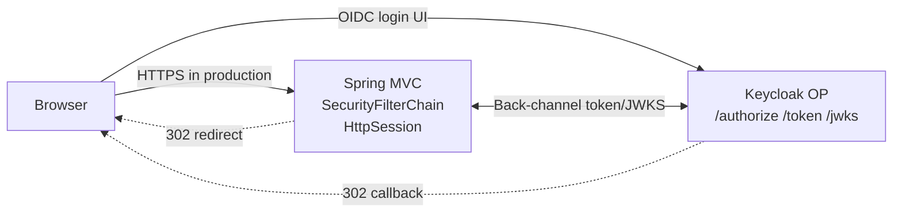
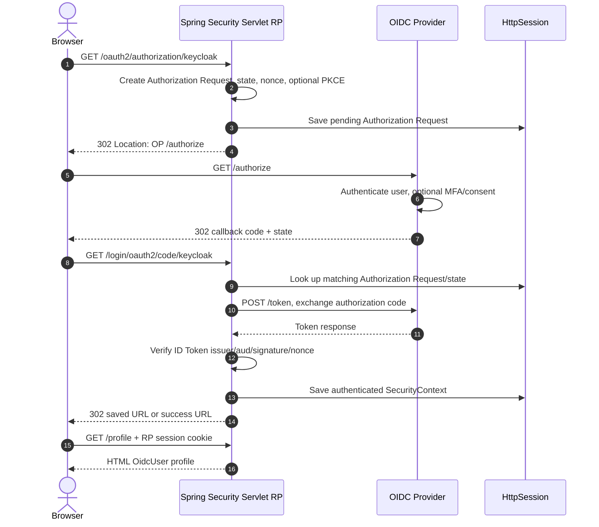
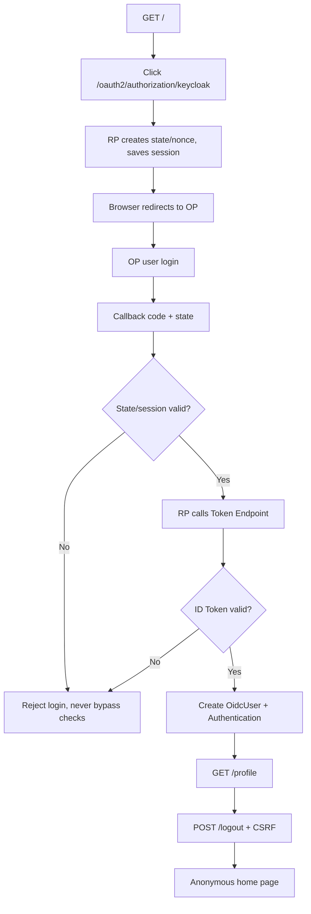

# 34.1. Servlet Application Logging In with a Single OIDC Provider

## 1. Practice Objectives

This lab builds a **Spring Boot Servlet / Spring MVC** application that logs in using **one OpenID Connect Provider (OP)** through Spring Security OAuth2 Client. The demo project is **Learning Portal**; the test OpenID Provider is **Keycloak**. After completing this lab, you will have a browser-based login flow, a profile page protected by an HTTP session, and local logout.

Skills gained:

- Configure Spring Boot MVC, Spring Security, OAuth2 Client, and Thymeleaf.
- Create a **ClientRegistration** with the `authorization_code` grant, `openid` scope, issuer, client ID, and secret.
- Use `SecurityFilterChain` and `.oauth2Login(...)` without implementing a custom callback controller.
- Distinguish between the initiation URL `/oauth2/authorization/keycloak` and the callback `/login/oauth2/code/keycloak`.
- Trace the Authorization Code Flow: redirect, `state`, `nonce`, code exchange, ID Token validation, `OidcUser`, and session cookie.
- Safely access claims with `@AuthenticationPrincipal OidcUser`, without rendering raw token values into HTML.
- Use `POST /logout` with a CSRF token and understand that **RP local logout differs from OP SSO logout**.
- Test Servlet routes using MockMvc and `oidcLogin()`, then verify the protocol with OP + browser integration.
- Diagnose `invalid_redirect_uri`, `invalid_state`, `invalid_client`, `invalid_grant`, issuer/JWKS mismatch, and session/proxy issues.
- Establish a path from HTTP on localhost to an HTTPS reverse proxy in production.

> **Illustrative version baseline:** Java 17+, Spring Boot 3.4.x, Spring Security 6.x, and Keycloak 26.x. Dependencies and APIs may differ when upgrading to newer Spring Boot/Spring Security versions; use the BOM and documentation appropriate for your project version. HTTP is for localhost demos only; public production must use HTTPS.

## 2. Expected Outcomes

The application exposes the following addresses:

| Component | URL |
| --- | --- |
| Demo Servlet RP | `http://localhost:8081` |
| Test provider | `http://localhost:8080` |
| OIDC issuer | `http://localhost:8080/realms/demo` |
| Public home page | `GET /` |
| Start OAuth2 Login | `GET /oauth2/authorization/keycloak` |
| OIDC callback | `GET /login/oauth2/code/keycloak` |
| Protected profile page | `GET /profile` |
| Local logout | `POST /logout` |
| Client ID at provider | `portal-web` |
| Registration ID in Spring | `keycloak` |

When an unauthenticated user accesses `/profile`, Spring Security requires authentication. After authenticating at Keycloak, the app displays the username/email/issuer/subject retrieved from `OidcUser` and establishes an authenticated HTTP session. Logging out clears the local Authentication/session; the SSO session at the provider may still remain active.

### 2.1. Distinguishing the Two Roles

**Spring Boot acts as the OIDC Relying Party / OAuth2 Client**, not the Authorization Server. Keycloak provides `/authorize`, `/token`, JWKS, and the authentication UI.

This lab does not build a **Resource Server**. If the app later exposes REST APIs that accept Bearer Access Tokens, you must configure `.oauth2ResourceServer(...)` separately, and never treat `.oauth2Login(...)` as the verification mechanism for all incoming API tokens.

## 3. System Diagram



Two types of communication:

1. **Front-channel:** the browser navigates via HTTP 302 redirects between the RP and the OP.
2. **Back-channel:** the RP calls the OP Token Endpoint and JWKS using a server-side HTTP client.

The Access Token/Refresh Token and client secret do not need to enter HTML or localStorage for a Spring MVC server-side login to work.

## 4. Detailed Authorization Code Flow



`state` protects the binding between the authorization request and the callback; `nonce` binds the ID Token to the authentication request in OIDC; PKCE protects the authorization code exchange. Never disable these checks when login errors occur.

## 5. Environment Setup

Requirements:

```text
Java 17+
Maven 3.9+ or Maven Wrapper
Docker and Docker Compose
Chrome, Firefox, or equivalent browser
Localhost ports 8080 and 8081 available
```

Verify:

```bash
java -version
mvn -version
docker compose version
```

All credentials in this lab are **test credentials**. Do not use a production OP, real user data, or real secrets.

### 5.1. Why Use a Single OP?

This lab focuses on a single `registrationId` so you can easily trace state/callback/session. When a system supports multiple providers or tenants, you need additional trust/routing policies, identity linking, and separate authorization rules.

### 5.2. HTTP Is for Localhost Only

Local URLs use HTTP to minimize certificate setup requirements for this lab. On the public Internet, OAuth2/OIDC Authorization Code flows and session cookies must use HTTPS.

## 6. Project Structure

```text
oidc-servlet-demo/
├── pom.xml
├── compose.yaml
└── src/
    ├── main/
    │   ├── java/
    │   │   └── com/example/oidcdemo/
    │   │       ├── OidcServletDemoApplication.java
    │   │       ├── SecurityConfig.java
    │   │       └── PageController.java
    │   └── resources/
    │       ├── application.yml
    │       └── templates/
    │           ├── index.html
    │           └── profile.html
    └── test/
        └── java/com/example/oidcdemo/
            └── SecurityRoutesTest.java
```

These package names, realm, and hostnames are examples. There is no SPA JavaScript file handling the authorization code because the application is a **confidential Servlet client**.

## 7. `pom.xml`: Dependencies

Create `pom.xml`:

```xml
<?xml version="1.0" encoding="UTF-8"?>
<project xmlns="http://maven.apache.org/POM/4.0.0"
         xmlns:xsi="http://www.w3.org/2001/XMLSchema-instance"
         xsi:schemaLocation="http://maven.apache.org/POM/4.0.0
         https://maven.apache.org/xsd/maven-4.0.0.xsd">
    <modelVersion>4.0.0</modelVersion>

    <parent>
        <groupId>org.springframework.boot</groupId>
        <artifactId>spring-boot-starter-parent</artifactId>
        <version>3.4.4</version>
        <relativePath/>
    </parent>

    <groupId>com.example</groupId>
    <artifactId>oidc-servlet-demo</artifactId>
    <version>0.0.1-SNAPSHOT</version>
    <name>oidc-servlet-demo</name>

    <properties>
        <java.version>17</java.version>
    </properties>

    <dependencies>
        <dependency>
            <groupId>org.springframework.boot</groupId>
            <artifactId>spring-boot-starter-web</artifactId>
        </dependency>

        <dependency>
            <groupId>org.springframework.boot</groupId>
            <artifactId>spring-boot-starter-security</artifactId>
        </dependency>

        <dependency>
            <groupId>org.springframework.boot</groupId>
            <artifactId>spring-boot-starter-oauth2-client</artifactId>
        </dependency>

        <dependency>
            <groupId>org.springframework.boot</groupId>
            <artifactId>spring-boot-starter-thymeleaf</artifactId>
        </dependency>

        <dependency>
            <groupId>org.springframework.boot</groupId>
            <artifactId>spring-boot-starter-test</artifactId>
            <scope>test</scope>
        </dependency>

        <dependency>
            <groupId>org.springframework.security</groupId>
            <artifactId>spring-security-test</artifactId>
            <scope>test</scope>
        </dependency>
    </dependencies>

    <build>
        <plugins>
            <plugin>
                <groupId>org.springframework.boot</groupId>
                <artifactId>spring-boot-maven-plugin</artifactId>
            </plugin>
        </plugins>
    </build>
</project>
```

### 7.1. Role of the Starters

| Dependency | Reason |
| --- | --- |
| `spring-boot-starter-web` | Servlet/Tomcat, MVC controller |
| `spring-boot-starter-security` | Filter chain, Authentication, CSRF, session security |
| `spring-boot-starter-oauth2-client` | ClientRegistration, OAuth2 Login, OIDC support |
| `spring-boot-starter-thymeleaf` | Server-side HTML templates |
| `spring-boot-starter-test` | JUnit, MockMvc/AssertJ, Spring Test |
| `spring-security-test` | Mock authentication with `oidcLogin()`, CSRF fixtures |

Boot manages compatible versions of Spring Security/Framework via dependency management. Do not add legacy `org.springframework.security.oauth:spring-security-oauth2` to configure modern login.

### 7.2. No WebFlux Starter Needed

The project uses `HttpSecurity` and `SecurityFilterChain`. Do not add `spring-boot-starter-webflux` just because Spring Security has a WebClient API; this lab uses the Servlet stack.

## 8. Running the Keycloak Test OP

Create `compose.yaml`:

```yaml
services:
  keycloak:
    image: quay.io/keycloak/keycloak:26.1.0
    command: ["start-dev"]
    environment:
      KC_BOOTSTRAP_ADMIN_USERNAME: admin
      KC_BOOTSTRAP_ADMIN_PASSWORD: admin
    ports:
      - "127.0.0.1:8080:8080"
```

Run:

```bash
docker compose up -d
```

Open:

```text
http://localhost:8080/admin
```

Demo admin credentials:

```text
admin / admin
```

Only use these weak values on an isolated test machine. `start-dev` is not a production Keycloak configuration.

### 8.1. Create a Realm

In the Admin Console:

1. Create a realm named `demo`.
2. Select the new realm.
3. Go to the Clients section.
4. Create an OpenID Connect client.

### 8.2. Create a Client

Configure the client:

```text
Client ID: portal-web
Client authentication: On
Standard Flow: Enabled
Direct Access Grants: Off (not needed)
```

Valid Redirect URI:

```text
http://localhost:8081/login/oauth2/code/keycloak
```

If the OP console requires a Home URL, use:

```text
http://localhost:8081
```

No broad wildcard redirect URI is needed for this lab to run.

### 8.3. Obtain the Client Secret

From the credentials tab of the `portal-web` client, copy the test secret. **Do not** paste it into source code or store it in plaintext in Git.

### 8.4. Create a User

Create a test user `student1` (or another name), set a password, and allow login according to the OP's policy. If Keycloak requires a first-login password update or email verification, complete those test actions before evaluating the callback.

### 8.5. Verify Discovery

Once the realm exists:

```text
http://localhost:8080/realms/demo/.well-known/openid-configuration
```

A valid OP returns JSON metadata containing:

```json
{
  "issuer": "http://localhost:8080/realms/demo",
  "authorization_endpoint": "...",
  "token_endpoint": "...",
  "jwks_uri": "..."
}
```

This is an illustrative excerpt, not the entire discovery document.

## 9. Configuring `application.yml`

Create `src/main/resources/application.yml`:

```yaml
server:
  port: 8081

spring:
  security:
    oauth2:
      client:
        registration:
          keycloak:
            provider: campus-oidc
            client-id: ${OIDC_CLIENT_ID:portal-web}
            client-secret: ${OIDC_CLIENT_SECRET}
            client-authentication-method: client_secret_basic
            authorization-grant-type: authorization_code
            redirect-uri: "{baseUrl}/login/oauth2/code/{registrationId}"
            scope:
              - openid
              - profile
              - email
        provider:
          campus-oidc:
            issuer-uri: ${OIDC_ISSUER_URI:http://localhost:8080/realms/demo}
```

### 9.1. `registration.keycloak`

`keycloak` is the `registrationId` in Spring Security, which appears in both the initiation and callback URLs.

### 9.2. `provider.campus-oidc`

`campus-oidc` is an application-defined OP configuration name; it does not have to match `registrationId`, `clientId`, or the issuer hostname.

### 9.3. Client ID and Authentication Method

`client-id=portal-web` must match the OP client. For a server-side confidential client, this example uses `client_secret_basic` to authenticate at the Token Endpoint according to the registration.

### 9.4. `openid` Scope

Required to request OIDC so that the application receives an ID Token and uses `OidcUser`. `profile`/`email` request additional claims subject to OP consent/policy; email is not guaranteed to always be present.

### 9.5. `issuer-uri`

The issuer is the OP's trust identifier; Spring Security uses its metadata to discover endpoints/JWKS and validate OIDC claims.

Do not use the UserInfo endpoint as the issuer URI. When using containers, the issuer hostname must be valid for both the browser and the backend according to your network architecture.

### 9.6. Redirect URI

The template:

```text
{baseUrl}/login/oauth2/code/{registrationId}
```

resolves on localhost to:

```text
http://localhost:8081/login/oauth2/code/keycloak
```

It must match the Valid Redirect URI registered at the OP.

## 10. Providing the Secret to the Application

On Bash:

```bash
export OIDC_CLIENT_SECRET='secret-from-test-op'
mvn spring-boot:run
```

On Windows PowerShell:

```powershell
$env:OIDC_CLIENT_SECRET = "secret-from-test-op"
mvn spring-boot:run
```

`secret-from-test-op` is just a placeholder. Use the test secret you obtained from Keycloak.

### 10.1. Do Not Embed Secrets in the Repository

Avoid:

```yaml
client-secret: actual-production-secret
```

in committed files. In production, use your deployment platform's secret store and a rotation policy.

### 10.2. Do Not Dump the Full Environment to Logs

A debug environment dump or a misconfigured Actuator `/env` endpoint can leak secrets. Restrict endpoint access and enforce redaction.

## 11. Main Class

Create `src/main/java/com/example/oidcdemo/OidcServletDemoApplication.java`:

```java
package com.example.oidcdemo;

import org.springframework.boot.SpringApplication;
import org.springframework.boot.autoconfigure.SpringBootApplication;

@SpringBootApplication
public class OidcServletDemoApplication {

    public static void main(String[] args) {
        SpringApplication.run(
            OidcServletDemoApplication.class,
            args
        );
    }
}
```

Spring Boot starts MVC/Tomcat on port `8081` as configured in YAML.

## 12. SecurityFilterChain

Create `src/main/java/com/example/oidcdemo/SecurityConfig.java`:

```java
package com.example.oidcdemo;

import org.springframework.context.annotation.Bean;
import org.springframework.context.annotation.Configuration;
import org.springframework.security.config.Customizer;
import org.springframework.security.config.annotation.web.builders.HttpSecurity;
import org.springframework.security.web.SecurityFilterChain;

@Configuration
public class SecurityConfig {

    @Bean
    SecurityFilterChain securityFilterChain(
            HttpSecurity http) throws Exception {

        http
            .authorizeHttpRequests(auth -> auth
                .requestMatchers(
                    "/", "/error", "/favicon.ico", "/css/**"
                ).permitAll()
                .anyRequest().authenticated()
            )
            .oauth2Login(Customizer.withDefaults())
            .logout(logout -> logout
                .logoutSuccessUrl("/")
                .invalidateHttpSession(true)
                .deleteCookies("JSESSIONID")
            );

        return http.build();
    }
}
```

### 12.1. Keep a Single Chain for This Lab

Here the entire application has only one security mechanism for browser login. If you add a Bearer API later, you may need multiple chains with explicit `securityMatcher` and ordering.

### 12.2. Public Home Page

`/`, `/error`, favicon, and CSS are permitted. Other pages, including `/profile`, require authentication.

### 12.3. `.oauth2Login(...)`

Enables the standard filters for Authorization Code Flow and OIDC. You do not need to write `@GetMapping("/login/oauth2/code/keycloak")` yourself.

### 12.4. CSRF Remains Enabled

There is no `csrf.disable()`. Logout uses `POST` and must include a CSRF token. OAuth2 `state` does not replace CSRF tokens for form actions.

### 12.5. Local Logout

The logout configuration clears the local session and cookie using Servlet defaults. It **does not** automatically call the OP end-session endpoint.

### 12.6. Default Login URL

When an anonymous user accesses a protected route, Spring Security may redirect to `/login`, where the user selects a provider. Linking directly to `/oauth2/authorization/keycloak` also initiates login.

### 12.7. Do Not Use UI Security Rules to Authorize Business Data

For the demo profile page, `authenticated()` is enough to view the current session's information. Real applications require dedicated tenant/resource authorization; an OIDC login does not mean the user is an admin.

## 13. MVC Controller

Create `src/main/java/com/example/oidcdemo/PageController.java`:

```java
package com.example.oidcdemo;

import org.springframework.security.core.Authentication;
import org.springframework.security.core.annotation.AuthenticationPrincipal;
import org.springframework.security.oauth2.client.authentication.OAuth2AuthenticationToken;
import org.springframework.security.oauth2.core.oidc.user.OidcUser;
import org.springframework.stereotype.Controller;
import org.springframework.ui.Model;
import org.springframework.web.bind.annotation.GetMapping;

@Controller
public class PageController {

    @GetMapping("/")
    public String index(
            Authentication authentication,
            Model model) {

        boolean signedIn =
            authentication instanceof OAuth2AuthenticationToken;

        model.addAttribute("signedIn", signedIn);
        return "index";
    }

    @GetMapping("/profile")
    public String profile(
            @AuthenticationPrincipal OidcUser user,
            OAuth2AuthenticationToken authentication,
            Model model) {

        model.addAttribute(
            "username", user.getPreferredUsername()
        );

        model.addAttribute(
            "email", user.getEmail()
        );

        model.addAttribute(
            "subject", user.getSubject()
        );

        model.addAttribute(
            "issuer", user.getIdToken()
                .getIssuer().toString()
        );

        model.addAttribute(
            "registrationId",
            authentication.getAuthorizedClientRegistrationId()
        );

        return "profile";
    }
}
```

### 13.1. `Authentication` on the Home Page

The controller only uses `signedIn` to render the appropriate login/profile button. Access to `/profile` is enforced by the **Spring Security filter chain**, not by a UI boolean.

### 13.2. `@AuthenticationPrincipal OidcUser`

After a successful OIDC login, Spring Security constructs the OIDC principal processed by the framework. The controller reads the needed claims without extracting raw token values.

### 13.3. `OidcUser` Claims May Be Missing

`email` or `preferred_username` may be null. Never treat email as a global user key or grant permissions automatically based on email domain.

### 13.4. OIDC External Identity

When storing an internal user, external identity is typically identified by:

```text
issuer + subject
```

Do not rely on `sub` alone if you may support multiple issuers one day; do not auto-merge users just because they share an email.

### 13.5. Do Not Use the ID Token to Call APIs

`OidcUser.getIdToken()` authenticates the End-User to the RP; the ID Token usually has the RP client ID as its audience. A Resource Server API needs an appropriate **Access Token**, and the API itself must validate issuer/audience/scope.

## 14. Home Page `index.html`

Create `src/main/resources/templates/index.html`:

```html
<!DOCTYPE html>
<html lang="en" xmlns:th="http://www.thymeleaf.org">
<head>
    <meta charset="UTF-8">
    <meta name="viewport"
          content="width=device-width, initial-scale=1">
    <title>OIDC Servlet Demo</title>
</head>
<body>
<main>
    <h1>Learning Portal</h1>
    <p>OIDC login with Spring Security Servlet.</p>

    <section th:if="${!signedIn}">
        <a th:href="@{/oauth2/authorization/keycloak}">
            Sign in with Campus Identity
        </a>
    </section>

    <section th:if="${signedIn}">
        <p>You are signed in.</p>
        <a th:href="@{/profile}">View profile</a>

        <form th:action="@{/logout}" method="post">
            <input type="hidden"
                   th:name="${_csrf.parameterName}"
                   th:value="${_csrf.token}">
            <button type="submit">Sign out</button>
        </form>
    </section>
</main>
</body>
</html>
```

### 14.1. Login Initiation Link

`/oauth2/authorization/keycloak` is Spring Security's default authorization-request endpoint, not the Token Endpoint.

### 14.2. Logout Form

`POST /logout` requires a CSRF token when CSRF is enabled. The template reads `_csrf` from the Spring MVC request and renders a hidden input.

### 14.3. Do Not Expose Secrets in the View

The HTML contains no Client Secret, Authorization Code, ID Token, Access Token, or Refresh Token. Confidential client credentials remain on the backend.

## 15. Profile Page `profile.html`

Create `src/main/resources/templates/profile.html`:

```html
<!DOCTYPE html>
<html lang="en" xmlns:th="http://www.thymeleaf.org">
<head>
    <meta charset="UTF-8">
    <meta name="viewport"
          content="width=device-width, initial-scale=1">
    <title>OIDC Profile</title>
</head>
<body>
<main>
    <h1>User Profile</h1>

    <dl>
        <dt>Username</dt>
        <dd th:text="${username}">username</dd>

        <dt>Email</dt>
        <dd th:text="${email}">email</dd>

        <dt>Issuer</dt>
        <dd th:text="${issuer}">issuer</dd>

        <dt>Subject</dt>
        <dd th:text="${subject}">subject</dd>

        <dt>Registration ID</dt>
        <dd th:text="${registrationId}">registrationId</dd>
    </dl>

    <a th:href="@{/}">Back to home</a>

    <form th:action="@{/logout}" method="post">
        <input type="hidden"
               th:name="${_csrf.parameterName}"
               th:value="${_csrf.token}">
        <button type="submit">Sign out</button>
    </form>
</main>
</body>
</html>
```

`th:text` escapes content when rendering text. Do not use `th:utext` with unsanitized claim values to prevent HTML injection.

### 15.1. Why Display Issuer and Subject?

These two values help illustrate OIDC identity, though they can still be sensitive metadata. In production, only display them when necessary; never copy the entire profile response into logs.

### 15.2. Do Not Create a Token-Display Page

A "debug" page showing full compact JWTs or Access Tokens can leak secrets via browser history, screenshots, and the frontend. This lab only displays the necessary claim metadata.

## 16. Running End-to-End on Localhost

Once the OP, realm, client, and user are ready:

```bash
mvn spring-boot:run
```

Open:

```text
http://localhost:8081
```

Steps:

1. Click "Sign in with Campus Identity".
2. The browser redirects to Keycloak.
3. Log in with the test user.
4. The OP redirects back to `/login/oauth2/code/keycloak`.
5. Spring Security validates the ID Token and creates the local Authentication.
6. Visit `/profile` to view the claims.
7. Reload `/profile` to verify session persistence.
8. Click Sign out, then open `/profile` again.

### 16.1. SavedRequest and Success URL

If the user initially opens `/profile`, Spring Security may save a SavedRequest and return the user to `/profile` after login.

If the user starts at the home page and clicks login, the post-login URL depends on the success handler/default configuration. To always redirect to `/profile`:

```java
.oauth2Login(oauth2 -> oauth2
    .defaultSuccessUrl("/profile", true)
)
```

This choice is for UX, not an OIDC security requirement.

### 16.2. Re-Login Without Password Prompt

After local logout, Keycloak may still maintain an OP SSO session. A subsequent login may authenticate automatically; this does not mean local logout failed.

## 17. Analyzing the Authorization Request

When the browser sends:

```http
GET /oauth2/authorization/keycloak
```

Spring Security reads `ClientRegistration` and builds a URL like:

```text
http://localhost:8080/realms/demo/protocol/openid-connect/auth
  ?response_type=code
  &client_id=portal-web
  &scope=openid%20profile%20email
  &redirect_uri=http%3A%2F%2Flocalhost%3A8081%2Flogin%2Foauth2%2Fcode%2Fkeycloak
  &state=<opaque-random>
```

`nonce`/PKCE parameters may also be included depending on configuration.

### 17.1. `state`

`state` is generated by Spring Security and stored alongside the authorization request to bind the callback. Do not write the raw state into application logs or use it as a public correlation ID.

### 17.2. `nonce`

The OIDC nonce binds the ID Token to the authentication request per the OIDC contract, helping prevent replay attacks in relevant scenarios.

### 17.3. PKCE

PKCE uses `code_challenge` when initiating authorization and `code_verifier` when exchanging the code. If the provider requires it, the Spring Security configuration must support it; never log the verifier.

### 17.4. Redirect URI

The value must match the URI registered in Keycloak. In production, it must use public HTTPS, not an internal hostname or the HTTP address of a reverse-proxied backend.

## 18. Callback and Token Endpoint Exchange

The OP redirects the browser back to:

```text
http://localhost:8081/login/oauth2/code/keycloak
    ?code=<one-time-code>
    &state=<opaque-state>
```

Spring Security:

1. Retrieves the Authorization Request from the repository/session.
2. Matches the state/transaction.
3. Calls the Token Endpoint backend-to-backend with the code and client authentication.
4. Receives the token response.
5. Validates the ID Token's issuer, audience, signature, expiry, and nonce per the OIDC flow.
6. Creates `OAuth2AuthenticationToken`/`OidcUser` and stores the SecurityContext.
7. Redirects the user to the saved request or success URL.

### 18.1. Do Not Write a Custom Callback Handler

If you create a controller that reads `code`, manually calls `/token`, and marks the session authenticated, you assume full responsibility for state/PKCE/nonce/JWS/issuer validation. This lab uses Spring Security's standard filter.

### 18.2. Token Endpoint Does Not Appear in Browser DevTools

The back-channel HTTP call is made by the RP, so it does not appear in the browser's Network tab like a JavaScript request. To debug it, use scrubbed server logs/metrics or restricted test OP logs.

### 18.3. Do Not Log the Full Callback URL

The callback query contains the Authorization Code and state. Log the route template:

```text
/login/oauth2/code/{registrationId}
```

instead of the full URL.

## 19. HTTP Session After Login

The browser typically receives an RP cookie, for example:

```http
Set-Cookie: JSESSIONID=<opaque>; Path=/; HttpOnly
```

The Secure/SameSite attributes depend on configuration and scheme. After login, the browser sends the RP session cookie to access `/profile` without repeating the Authorization Code Flow on every request.

### 19.1. Session Cookie Differs from OP Cookie

Keycloak has its own cookies on `localhost:8080`/the OP host. The RP uses its own session cookie on `localhost:8081`/the RP host. In production, the two sides usually have different hostnames/domains.

### 19.2. Session ID Is a Credential

Do not log `JSESSIONID`, embed it in URLs, or use it as a public support reference.

### 19.3. Session Fixation

The Session ID may be rotated upon successful Authentication due to Spring Security's session fixation protection. Do not tie business identity to a fixed session ID.

### 19.4. Session Persistence

If the app runs across multiple instances, the session store must support a callback landing on a different instance, or deployment routing must be designed accordingly. A callback with a valid cookie but no matching state in the store will still be rejected.

## 20. Three Token Types to Distinguish

| Token | Purpose | Consumer |
| --- | --- | --- |
| ID Token | Authenticates the End-User and provides OIDC info to the RP | OIDC Client |
| Access Token | Authorizes calls to a Resource Server | HTTP Client/API |
| Refresh Token (if present) | Requests a new Access Token per grant policy | OAuth2 Client and AS |

### 20.1. ID Token Is Not an API Bearer Token

Even though both may be JWTs, the ID Token usually has the audience `portal-web`, whereas an API requires an Access Token with its own audience.

### 20.2. Scope Is Not an Admin Role

`openid`, `profile`, and `email` do not grant `ROLE_ADMIN`. Business authorization is a separate application layer.

### 20.3. Do Not Send the Refresh Token to a Resource Server

The Refresh Token is meant solely for the AS Token Endpoint under grant/rotation policy, not as a credential for the Course API.

## 21. `OAuth2AuthorizedClient` in Servlet

Spring Security can store tokens issued for a user and registration as:

```text
OAuth2AuthorizedClient
    -> ClientRegistration
    -> principalName
    -> OAuth2AccessToken
    -> optional OAuth2RefreshToken
```

Related infrastructure:

```java
OAuth2AuthorizedClientRepository
OAuth2AuthorizedClientService
OAuth2AuthorizedClientManager
```

The `/profile` page does not need to fetch the Access Token directly because it only displays OIDC identity.

### 21.1. When Extending to Call APIs

You can use `RestClient` + an OAuth2 interceptor (on supported Spring Security versions) or `WebClient` + a Servlet OAuth2 filter. You must select the right authorized client/registration and API audience/scope.

### 21.2. Do Not Send Tokens to Arbitrary Hosts

A `WebClient` configured with a default current-user OAuth2 authorized client can leak tokens if the caller controls the outbound URL. Use a destination allowlist and per-request selection.

### 21.3. Do Not Cache Access Tokens in a Static Field

Tokens belong to a specific user/registration/context; a global static token easily causes leaks across users or tenants.

## 22. Logout: Local RP vs. OP Session

Spring Security local logout:

```text
POST /logout + CSRF
    -> invalidate session
    -> clear local SecurityContext
    -> redirect /
```

It does not necessarily log out of Keycloak SSO.

### 22.1. When RP-Initiated Logout Is Needed

Spring Security provides:

```java
OidcClientInitiatedLogoutSuccessHandler
```

which can be used when the provider supports OIDC RP-Initiated Logout; you must configure the end-session endpoint and `post_logout_redirect_uri` according to the OP contract.

### 22.2. OP Logout Affects Other Apps

One SSO session can serve multiple RPs. Logging out across the entire OP may force the user to log in again in other apps; decide based on product and security policy.

### 22.3. Do Not Log Logout `Location` Containing `id_token_hint`

OIDC logout redirects sometimes include `id_token_hint`. Avoid writing the full response `Location` header into logs/APM.

## 23. Testing Servlet Routes with MockMvc

You can verify UI/security rules without a real provider using `spring-security-test`.

Targets:

```text
GET /           -> public 200
GET /profile    -> anonymous redirects to login
GET /profile    -> mock OIDC user allowed to view
POST /logout    -> missing CSRF blocked
POST /logout    -> with CSRF processed
```

### 23.1. Test Context Independent of OP Discovery

When `issuer-uri` is in the main YAML, the app may call OP discovery at startup. For MVC slice tests, define a separate test `ClientRegistrationRepository` with valid dummy endpoint URLs to avoid network calls.

### 23.2. Example `SecurityRoutesTest.java`

```java
package com.example.oidcdemo;

import org.junit.jupiter.api.Test;
import org.springframework.beans.factory.annotation.Autowired;
import org.springframework.boot.test.autoconfigure.web.servlet.WebMvcTest;
import org.springframework.boot.test.context.TestConfiguration;
import org.springframework.context.annotation.Bean;
import org.springframework.context.annotation.Import;
import org.springframework.security.oauth2.client.registration.ClientRegistration;
import org.springframework.security.oauth2.client.registration.ClientRegistrationRepository;
import org.springframework.security.oauth2.client.registration.InMemoryClientRegistrationRepository;
import org.springframework.security.oauth2.core.AuthorizationGrantType;
import org.springframework.security.oauth2.core.ClientAuthenticationMethod;
import org.springframework.test.web.servlet.MockMvc;

import static org.springframework.security.test.web.servlet.request.SecurityMockMvcRequestPostProcessors.csrf;
import static org.springframework.security.test.web.servlet.request.SecurityMockMvcRequestPostProcessors.oidcLogin;
import static org.springframework.test.web.servlet.request.MockMvcRequestBuilders.get;
import static org.springframework.test.web.servlet.request.MockMvcRequestBuilders.post;
import static org.springframework.test.web.servlet.result.MockMvcResultMatchers.*;

@WebMvcTest(PageController.class)
@Import({
    SecurityConfig.class,
    SecurityRoutesTest.TestClientConfig.class
})
class SecurityRoutesTest {

    @Autowired
    MockMvc mvc;

    @TestConfiguration
    static class TestClientConfig {

        @Bean
        ClientRegistrationRepository clientRegistrationRepository() {

            ClientRegistration testClient =
                ClientRegistration
                    .withRegistrationId("keycloak")
                    .clientId("portal-web-test")
                    .clientSecret("test-secret-only")
                    .clientAuthenticationMethod(
                        ClientAuthenticationMethod.CLIENT_SECRET_BASIC
                    )
                    .authorizationGrantType(
                        AuthorizationGrantType.AUTHORIZATION_CODE
                    )
                    .redirectUri(
                        "{baseUrl}/login/oauth2/code/{registrationId}"
                    )
                    .authorizationUri(
                        "https://op.test.example/authorize"
                    )
                    .tokenUri(
                        "https://op.test.example/token"
                    )
                    .jwkSetUri(
                        "https://op.test.example/jwks"
                    )
                    .userInfoUri(
                        "https://op.test.example/userinfo"
                    )
                    .userNameAttributeName("sub")
                    .scope("openid", "profile", "email")
                    .clientName("Test OIDC Provider")
                    .build();

            return new InMemoryClientRegistrationRepository(
                testClient
            );
        }
    }

    @Test
    void homePageIsPublic() throws Exception {

        mvc.perform(get("/"))
            .andExpect(status().isOk())
            .andExpect(view().name("index"));
    }

    @Test
    void anonymousProfileNeedsLogin() throws Exception {

        mvc.perform(get("/profile"))
            .andExpect(status().is3xxRedirection())
            .andExpect(redirectedUrl("/login"));
    }

    @Test
    void authenticatedOidcUserViewsProfile() throws Exception {

        mvc.perform(
                get("/profile")
                    .with(oidcLogin().idToken(token -> token
                        .issuer("https://op.test.example")
                        .subject("student-123")
                        .claim(
                            "preferred_username", "student1"
                        )
                    ))
            )
            .andExpect(status().isOk())
            .andExpect(view().name("profile"))
            .andExpect(model().attributeExists(
                "subject", "issuer", "registrationId"
            ));
    }

    @Test
    void logoutWithoutCsrfIsForbidden() throws Exception {

        mvc.perform(
                post("/logout").with(oidcLogin())
            )
            .andExpect(status().isForbidden());
    }

    @Test
    void logoutWithCsrfRedirects() throws Exception {

        mvc.perform(
                post("/logout")
                    .with(oidcLogin())
                    .with(csrf())
            )
            .andExpect(status().is3xxRedirection());
    }
}
```

This example uses a `@WebMvcTest` slice and a custom in-memory registration without reaching the test OP. In other versions, if auto-configuration creates a duplicate registration bean, adjust the test context rather than disabling production OIDC validations.

### 23.3. What Tests Were Not Run in This Example?

This is a lab guide; you need to create the project and run the tests in your own environment. The code above is sample content, not a claim that tests have been executed across all JDK/Boot/OP environments.

## 24. Important Limitations of `oidcLogin()`

`oidcLogin()` creates a mock Authentication and principal for testing.

It **does not** execute:

```text
Browser redirect to OP
Authorization Request persistence
State verification
PKCE code verifier exchange
Token Endpoint HTTP request
Client secret authentication
JWS signature/JWKS validation
Nonce verification
Cookie SameSite enforcement
```

Therefore, MockMvc tests may pass while real browser login still fails due to `redirect_uri` or cookie issues.

### 24.1. Two Necessary Testing Layers

**Layer A — MockMvc:** verifies access control/HTML/controller/CSRF.

**Layer B — OIDC integration/browser E2E:** verifies Authorization Code Flow, OP responses, cookies, TLS, state/nonce, and ID Token validation.

### 24.2. Do Not Disable Signature Validation for Testing

A fake OP must sign the ID Token with a matching test JWK. Do not modify production code to accept `alg=none` or unsigned JWTs.

## 25. Testing the Authorization Redirect Separately

A test can invoke:

```java
MvcResult result = mvc.perform(
        get("/oauth2/authorization/keycloak")
    )
    .andExpect(status().is3xxRedirection())
    .andReturn();

String location =
    result.getResponse().getHeader("Location");
```

Assertion logic:

```text
Location points to the test OP authorization endpoint
response_type = code
client_id = portal-web-test
scope contains openid
redirect_uri matches callback
state has a non-empty value
```

Do not hard-code a fixed `state` or write the full `Location` containing `state` into CI logs.

### 25.1. URL Parsing

A production-grade test should parse query parameters with proper URL/form decoding and handle duplicate params. Do not assert with overly broad substring checks for security-critical fields.

### 25.2. Distinct State per Attempt

Each authorization request should have a transaction-bound state with sufficient entropy; when testing two independent attempts, do not force Spring Security to reuse the same state.

## 26. Fake OIDC Provider for Protocol Testing

To test the real protocol, a fake OP or Keycloak test environment needs:

```text
/.well-known/openid-configuration
/authorize
/token
/jwks
/userinfo (if needed)
```

The test provider must:

1. Register the exact client ID/redirect URI.
2. Issue single-use authorization codes.
3. Return the exact `state` on the callback.
4. Support PKCE if the client uses it.
5. Authenticate the confidential client during code exchange.
6. Issue an ID Token signed with a valid test key.
7. Publish JWKS with matching `iss`, `aud`, `sub`, `exp`, `iat`, and nonce.
8. Simulate errors such as invalid state, invalid client, timeout, and signing key rotation.

### 26.1. No Need for a Real Public OP

Use a local test OP/realm to avoid depending on production availability and real user credentials.

### 26.2. When Is a Real Browser Needed?

To verify **SameSite cookies**, cross-site redirects, HTTPS certificates, or SSO login UI, use Playwright/Selenium with appropriate test hostnames/HTTPS. An HTTP test client is not a browser cookie engine.

## 27. Manual Test Checklist

| Step | Action | Expected Result |
| --- | --- | --- |
| 1 | Open `/` anonymously | Home page renders |
| 2 | Open `/profile` anonymously | Redirects to login |
| 3 | Click Login link | Browser goes to OP |
| 4 | Log in with test user | OP authenticates |
| 5 | OP returns callback | URI `/login/oauth2/code/keycloak` |
| 6 | RP receives callback | State/nonce/token valid |
| 7 | Open `/profile` | OIDC claims displayed |
| 8 | Reload `/profile` | Session persists |
| 9 | POST `/logout` via form | RP local session cleared |
| 10 | Open `/profile` again | Login required |
| 11 | Log in again | OP SSO may make login fast |
| 12 | Use wrong Client Secret | Token Endpoint rejects |
| 13 | Use wrong Redirect URI | OP rejects |
| 14 | Fake callback state | RP rejects |
| 15 | Clear RP cookie before callback | Cannot bypass state |
| 16 | OP temporarily unavailable | App reports appropriate error, no session issued |

## 28. Browser DevTools and Allowed Diagnostic Info

In the Network tab, observe:

- HTTP status of `/oauth2/authorization/keycloak`.
- Authorization endpoint host/route, without **sharing the raw state query**.
- Callback path and status.
- Whether the RP cookie is stored/sent.
- `SameSite`, `Secure`, `HttpOnly`, `Path`, `Domain`, and any blocked reason.
- Final redirect to the profile or error page.

### 28.1. Do Not Paste Callback URLs

The callback URL contains:

```text
code
state
```

These are sensitive OAuth2 transaction data. In tickets/logs, use the route template.

### 28.2. Token Endpoint Does Not Appear as a Browser Fetch

The RP sends the `/token` request back-channel. Inspect safe server logs or fake OP test metrics; do not dump raw form bodies containing the authorization code, client secret, or PKCE verifier.

### 28.3. OP Cookie vs. RP Cookie

The OP manages the SSO cookie; the RP manages the HttpSession cookie. Logging out at the RP does not clear the OP cookie by default.

## 29. Troubleshooting `invalid_redirect_uri`

A message from the OP:

```text
Invalid parameter: redirect_uri
```

may be caused by:

| Cause | Example |
| --- | --- |
| Wrong host | `127.0.0.1` instead of `localhost` |
| Wrong port | 8080 instead of 8081 |
| Wrong scheme | HTTP/HTTPS mismatch |
| Wrong callback registration | `/code/campus` instead of `/code/keycloak` |
| Wrong path prefix | Missing or duplicated `/learning` |
| Wrong OP client config | Valid Redirect URI not registered |
| Incorrect reverse proxy forwarding | App generates internal URL |

### 29.1. Fix at the Source

Update `ClientRegistration` and the OP redirect URI accurately; if behind a proxy, fix the trusted forwarded-header setup.

### 29.2. Do Not Open Broad Wildcards

Never add a production callback wildcard just to make login pass; redirect URI validation is a critical security boundary.

## 30. Troubleshooting `invalid_state`

Spring Security failing to find a matching Authorization Request or rejecting state can be caused by:

```text
Session cookie not sent back on callback
SameSite Strict blocking cross-site navigation
Incorrect Cookie Domain/Path
Session expired while entering MFA
Missing shared session store across instances
Multi-tab authorization requests overwriting each other
State tampered with or forged callback
```

### 30.1. Split Where You Inspect

**Before redirect:** Did the RP save the Authorization Request in the session? Did the browser receive the session cookie?

**Callback:** Did the browser send the cookie to the RP? Did Spring Security find the session/authorization request?

### 30.2. Do Not Bypass State Validation

If the callback has no saved authorization request, never create an authenticated user from raw `code`, raw `sub`, or query params.

### 30.3. Correlation for Debugging

Use a request ID/trace ID or a server-side random login-flow ID; never log `state`, `nonce`, or `code` as an identifier.

## 31. Troubleshooting Token Endpoint

### 31.1. `invalid_client`

Check:

```text
Client ID
Client Secret
Client Authentication method
OP token URI
Client active/disabled status
Credential rotation
```

Do not log the client secret or `Authorization: Basic ...`.

### 31.2. `invalid_grant`

Possible causes:

```text
Code expired
Code reused
Redirect URI mismatch
PKCE verifier mismatch
Code belongs to another client
```

Do not log the raw authorization code or `code_verifier`.

### 31.3. OP Timeout

A Token Endpoint timeout does not prove the OP never processed the code. Do not blindly retry code exchange indefinitely because an authorization code is a one-time credential.

## 32. Troubleshooting Issuer/JWKS

If the app fails to start or login fails due to discovery:

```text
Does issuer-uri point to the right realm?
Is the OP running?
Does the discovery endpoint return metadata?
Can the backend resolve the OP hostname?
```

If ID Token validation fails:

```text
Does iss match the issuer?
Does aud contain the RP clientId?
Does the signature/JWKS match?
Is the token still valid (not expired)?
Does nonce match the transaction?
```

Do not disable issuer/signature verification to work around networking errors.

### 32.1. Container Hostname

`localhost` inside an app container refers only to that container, not the host machine. If you move the RP into Docker, resolve hostname/issuer reachability for both the browser and backend; do not alter claims as a shortcut.

## 33. Cookie SameSite in Real Deployments

On a production browser redirect:

```text
OP (cross-site) -> RP callback
```

A `SameSite=Strict` cookie is typically not sent on cross-site top-level navigation.

For standard top-level GET callbacks, `SameSite=Lax` is usually appropriate.

For cross-site POST callbacks with `response_mode=form_post`, Lax typically does not send cookies; you may need `SameSite=None; Secure` along with tested callback/CSRF protections.

### 33.1. Reference Production Config

```yaml
server:
  servlet:
    session:
      cookie:
        secure: true
        http-only: true
        same-site: lax
        path: /
```

This configuration is intended for public HTTPS and appropriate stacks, and may not work for local HTTP testing in all browsers.

### 33.2. `Secure` Does Not Replace HTTPS

If the public callback is redirected over HTTP, a Secure cookie will not be sent. Fix the public HTTPS URL/proxy rather than removing `Secure` to hide the issue.

### 33.3. Spring Session Differs from Default Servlet Cookies

If you later add Spring Session Redis/JDBC, verify which component actually issues `Set-Cookie` and whether the cookie is named `SESSION` or `JSESSIONID`, rather than relying solely on YAML assumptions.

## 34. Reverse Proxy and Public Base URL

Production topology:

```text
Browser HTTPS:443
    -> Nginx / Ingress
    -> Internal Spring Boot HTTP:8081
```

Spring Boot needs to see the public request scheme/host/port verified by a trusted proxy in order to compute `{baseUrl}`.

Example property:

```yaml
server:
  forward-headers-strategy: framework
```

### 34.1. Proxy Must Sanitize Headers

Only a trusted proxy may set `Forwarded`/`X-Forwarded-*` for the backend; block direct backend access, forged host/proto headers, and malicious prefixes.

### 34.2. Public Callback

The OP must register:

```text
https://portal.example.org/login/oauth2/code/keycloak
```

not an internal address:

```text
http://learning-app:8081/login/oauth2/code/keycloak
```

### 34.3. Do Not Disable CSRF/State/Nonce to Fix Proxy Issues

Security checks do not cause URL configuration errors; fixing header forwarding, cookies/sessions, or OP registration is the proper solution.

## 35. Security Checklist

- [ ] OP/client config matches the right test or production environment.
- [ ] `openid` scope, `authorization_code` grant.
- [ ] Exact callback, HTTPS in production.
- [ ] Client secret absent from HTML/source/logs.
- [ ] Authorization Request stored server-side, state validation intact.
- [ ] ID Token JWS/issuer/audience/expiry/nonce validation intact.
- [ ] Access Token, Refresh Token, and ID Token not exposed to the frontend.
- [ ] `/profile` accessible only to authenticated users.
- [ ] Logout via POST with CSRF token.
- [ ] Session cookie has appropriate Secure/HttpOnly/SameSite attributes.
- [ ] Reverse proxy uses trusted forwarded headers/host allowlist.
- [ ] Raw `code`, `state`, nonce, or sensitive `Location` headers are not logged.
- [ ] OIDC login is not treated as proof of business role/tenant membership.
- [ ] Resource Server, if any, validates Access Tokens separately.
- [ ] Negative tests exist for invalid state, issuer, redirect URI, and credentials.

## 36. Extended Exercises

### Exercise 1 — Change Registration ID

Rename `keycloak` to `campus`. Update:

```text
application.yml registration key
Login URL
Callback URI at OP
```

**Expected answer:** Both `/oauth2/authorization/campus` and `/login/oauth2/code/campus` work properly.

### Exercise 2 — Update Profile Page

Add the `name` profile claim when provided by the OP; use `th:text` and handle null values. Do not render raw HTML from claims.

### Exercise 3 — Keep `/profile` Protected

Try accessing `/profile` via an anonymous browser or MockMvc. Verify that no user information is returned when unauthenticated.

### Exercise 4 — Test Wrong Client Secret

Use an incorrect test secret and observe the Token Endpoint error; restore the real value and never log the secret.

### Exercise 5 — Test Callback on a Different Port

Change the OP callback to port 8082 in the test environment. Observe the redirect URI mismatch and restore the exact URL.

### Exercise 6 — Logout

Log in, POST logout, and log in again. Explain why OP SSO may still skip the password prompt.

### Exercise 7 — `oidcLogin()` vs. Full OIDC

Demonstrate that MockMvc `oidcLogin()` still passes even when the fake OP is turned off. Explain why this does not prove the OIDC protocol works.

### Exercise 8 — Keycloak Unreachable

Stop the OP container before starting the RP. Observe discovery/connection errors by phase; do not disable issuer validation.

### Exercise 9 — Cookies

Inspect Secure/HttpOnly/SameSite/Path in the browser without printing raw cookie values to logs.

### Exercise 10 — HTTPS Reverse Proxy

Use a test HTTPS hostname and ensure `{baseUrl}` is public and the OP redirects the callback to the right scheme/host/path.

### Exercise 11 — Session Timeout

Leave the user on the OP login screen until the RP session expires, then complete the callback. Verify that login fails closed due to the missing authorization transaction.

### Exercise 12 — Two Tabs

Open two login attempts; analyze whether the repository supports multiple pending states in the same session or not. Do not use `session.lastState` to accept a callback from another flow.

### Exercise 13 — Account Without Email

Omit the email claim; the profile page should still work, and users must not be matched to another account solely by email.

### Exercise 14 — Do Not Use ID Token as an API Token

Explain why the API audience differs from the RP clientId and why a separate Access Token/Resource Server policy is required.

### Exercise 15 — OP Logout

Try adding RP-Initiated Logout using the appropriate handler, test local logout vs. OP SSO logout, and do not log `id_token_hint`.

## 37. Review Questions

**1. Is the app in this lab an OAuth2 Client or an Authorization Server?**

> An OAuth2 Client / OIDC Relying Party.

**2. What is `registrationId`?**

> Spring Security's internal key, which is `keycloak` here.

**3. What is the OP's `clientId`?**

> `portal-web`, which does not have to match the registration ID.

**4. What is the login initiation endpoint?**

> `/oauth2/authorization/keycloak`.

**5. What is the default callback?**

> `/login/oauth2/code/keycloak`.

**6. Why is the `openid` scope needed?**

> To request OpenID Connect and receive OIDC authentication/an ID Token.

**7. What handles the callback?**

> The Spring Security OAuth2 Login filter, without needing a custom controller.

**8. What is `state` used for?**

> Binding the authorization request and response, helping prevent CSRF/mix-up attacks.

**9. How does `nonce` differ from `state`?**

> Nonce binds the ID Token to the OIDC authentication request.

**10. What does PKCE use?**

> A code challenge at initiation and a code verifier when exchanging the authorization code.

**11. Does the browser call `/token` directly?**

> No, in this lab's confidential server-side flow, the backend performs the token exchange.

**12. Why is an ID Token not an Access Token?**

> An ID Token authenticates the user to the RP, whereas an Access Token authorizes access to a Resource Server.

**13. What does `OidcUser` contain?**

> The authenticated OIDC principal and claims/token metadata per Spring Security.

**14. Is email always present?**

> No. The OP may omit the email claim.

**15. What should be used as the identity key?**

> Usually issuer + subject, not email alone.

**16. Where is `/profile` protected?**

> In the `SecurityFilterChain` authorization rules.

**17. Why does POST logout require CSRF?**

> The app uses browser cookie sessions; CSRF protects state-changing requests.

**18. Does local logout log out of Keycloak?**

> Not by default.

**19. Is the RP browser cookie sent to the OP?**

> Not normally; the RP and OP manage cookies under separate origins/sites.

**20. Why is `SameSite=Lax` usually suitable for GET callbacks?**

> Top-level cross-site GET navigation can send `Lax` cookies.

**21. Does `MockMvc.with(oidcLogin())` verify a real ID Token signature?**

> No. It creates a mock principal.

**22. Why must the OP issuer be exact?**

> It serves as the trust identity in OIDC discovery and ID Token validation.

**23. When a callback returns `invalid_state`, should you disable state validation?**

> No. Fix the cookie/session/transaction flow instead.

**24. What scheme does a production `redirect_uri` require?**

> Public HTTPS.

**25. Can a client secret be used in frontend JavaScript?**

> No, because a public browser cannot keep a secret safe.

**26. If claims can be decoded from a JWT, can it be trusted?**

> No. Signature, issuer, audience, timestamps, and nonce must be validated per OIDC.

**27. Does an OIDC login prove the user is a tenant admin?**

> No. Business authorization is separate.

**28. Why can Keycloak in Docker cause `localhost` errors?**

> `localhost` inside the app container differs from `localhost` on the host/browser.

**29. Why doesn't this lab use legacy `@EnableOAuth2Sso`?**

> This lab uses modern Spring Security OAuth2 Client and `SecurityFilterChain`.

**30. What are the completion criteria for this lab?**

> Login via one OP, valid callback, authenticated session, profile page, and local logout working; Servlet tests written, and understanding the limits of mocks vs. browser/OP integration.

---

## 38. Summary



A **Spring MVC application with a single OpenID Provider** only needs a valid `ClientRegistration`, `.oauth2Login(...)` enabled in `SecurityFilterChain`, protected pages, and proper Servlet session management. Spring Security handles the Authorization Code Flow, state/nonce, and ID Token verification. The browser follows redirects and sends the RP session cookie; the Token Endpoint exchange happens server-side. For testing, combine **MockMvc** for routes/CSRF with a **fake OP + browser E2E** to verify the protocol, HTTPS/cookies, and failure scenarios. Never weaken security by disabling state, nonce, issuer, or signature validation when encountering configuration errors.

## 39. References

- [Spring Security — Servlet OAuth2 Login](https://docs.spring.io/spring-security/reference/servlet/oauth2/login/index.html): initiation URLs, callbacks, and OIDC Login.
- [Spring Security — OAuth2 Login Advanced](https://docs.spring.io/spring-security/reference/servlet/oauth2/login/advanced.html): authorization requests, user info, and extension points.
- [Spring Security — OAuth2 Client Core](https://docs.spring.io/spring-security/reference/servlet/oauth2/client/core.html): authorized clients and persistence.
- [Spring Security — Servlet Testing](https://docs.spring.io/spring-security/reference/servlet/test/index.html): MockMvc `oidcLogin()` and CSRF fixtures.
- [Spring Security API — OidcUser](https://docs.spring.io/spring-security/reference/api/java/org/springframework/security/oauth2/core/oidc/user/OidcUser.html): OIDC claims/principal.
- [Spring Boot — Security](https://docs.spring.io/spring-boot/reference/web/spring-security.html): web app security configuration.
- [Keycloak — OIDC Services](https://www.keycloak.org/securing-apps/oidc-layers): OIDC endpoints.
- [Keycloak — Server Administration Guide](https://www.keycloak.org/docs/latest/server_admin/): realms, clients, users, credentials.
- [OpenID Connect Core](https://openid.net/specs/openid-connect-core-1_0.html): ID Token, nonce, issuer, and audience.
- [OpenID Connect Discovery](https://openid.net/specs/openid-connect-discovery-1_0.html): issuer metadata/JWKS.
- [RFC 6749 — OAuth2](https://www.rfc-editor.org/rfc/rfc6749): Authorization Code Flow.
- [RFC 7636 — PKCE](https://www.rfc-editor.org/rfc/rfc7636): code challenge/verifier.
- [RFC 9700 — OAuth2 Security BCP](https://www.rfc-editor.org/rfc/rfc9700): OAuth2 security practices.
- [OWASP — Session Management](https://cheatsheetseries.owasp.org/cheatsheets/Session_Management_Cheat_Sheet.html): session cookies.
- [OWASP — CSRF Prevention](https://cheatsheetseries.owasp.org/cheatsheets/Cross-Site_Request_Forgery_Prevention_Cheat_Sheet.html): browser CSRF and SameSite.
