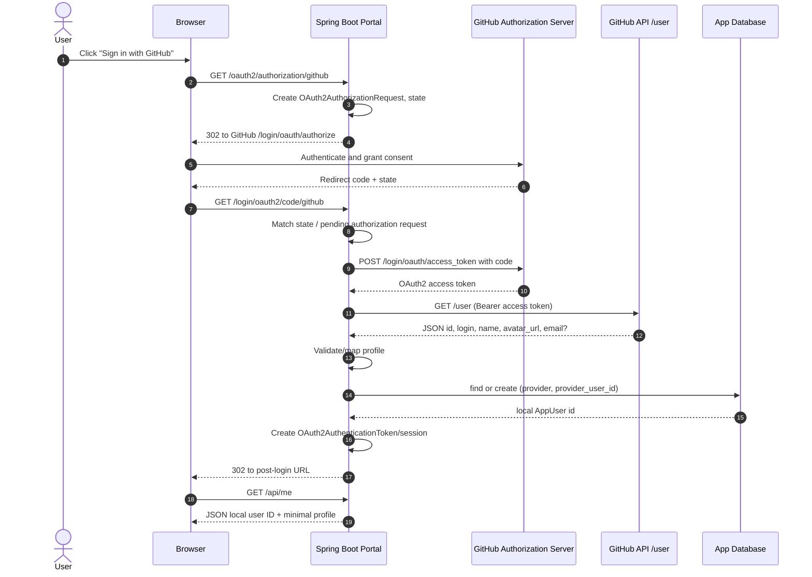
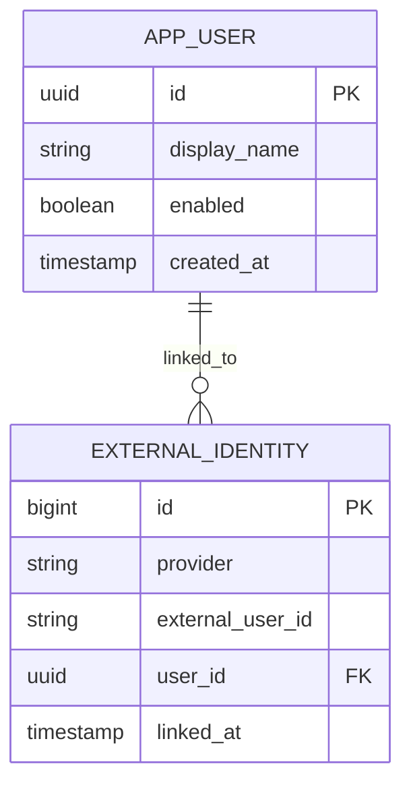
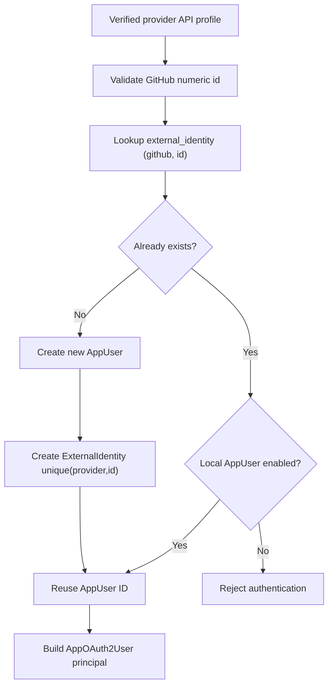

# 34.2. Pure OAuth 2.0 Login and User Profile Mapping

In this lab, we build a **Spring Boot + Spring Security OAuth2 Client** application that allows users to **log in with GitHub OAuth 2.0**, read profile information through the **provider's UserInfo Endpoint/REST API**, map the profile to an **internal account**, and use `@AuthenticationPrincipal` to return information about the currently logged-in user. This lab intentionally chooses **pure OAuth 2.0 without OpenID Connect (OIDC)** to clearly understand the difference between *authorizing API access* and *verifying identity using a standard protocol*.

OAuth 2.0 was designed primarily for **authorization**: the Client obtains an access token to access protected resources. OAuth 2.0 itself **does not standardize an ID Token, `sub`, `iss`, or UserInfo response for login**. Some providers like GitHub expose a profile API, and Spring Security supports `oauth2Login()` to use that profile to create an `Authentication`. This approach is useful for social login, but the application must understand the **provider's specific profile contract**, design a stable identity linking key, and never blindly trust provider attributes as internal permissions.

> **Final result:** The browser accesses `/oauth2/authorization/github` → GitHub prompts for login/consent → GitHub redirects back to `/login/oauth2/code/github` → Spring exchanges the authorization code for an access token → `DefaultOAuth2UserService` calls `https://api.github.com/user` → the application maps `id`/`login` to `AppUser` and `ExternalIdentity` → Spring creates a local authenticated session → `GET /api/me` returns the local user ID, provider, and minimal profile. No `id_token` is needed or received.

The examples use **Spring Boot 3.x, Spring Security 6.x, and Java 17+** with Spring MVC/Servlet. Other Spring Boot versions may change certain APIs or dependency names. **Never put real Client secrets into Git, screenshots, logs, or documentation**. The Java code shown is complete enough to assemble a learning project; when building a production system, you must add database migrations, integration tests with a mock provider, secret management, account linking, and operational controls.

---

## 1. Learning Objectives

After completing this lab, you will be able to:

1. Explain why OAuth2 Login based on a profile API differs from OIDC Login based on a verified ID Token.
2. Register a GitHub OAuth App with the proper callback URI and configure `ClientRegistration` in Spring Boot.
3. Understand the roles of **Resource Owner**, **Client**, **Authorization Server**, and **Resource Server**.
4. Observe the Authorization Code Flow across browser redirects, `state`, callback, and the Token Endpoint.
5. Use `DefaultOAuth2UserService` to retrieve `OAuth2User` from a profile endpoint.
6. Convert provider attributes into a validated profile type instead of passing `Map<String, Object>` throughout the application.
7. Map external identities using **`(provider, providerUserId)`** rather than automatically linking accounts by email.
8. Persist `AppUser` and `ExternalIdentity` in a database with a unique constraint and transaction.
9. Return a custom principal containing the local user ID while preserving the stable provider username.
10. Protect endpoints with Spring Security and verify the result via `/api/me`.
11. Write unit tests for profile mapping, test MVC authorization, and test callback/token/profile failure scenarios.
12. Understand security boundaries around scopes, CSRF, session cookies, access tokens, roles, email, and account linking.

## 2. Lab Architecture



### 2.1. Core Components

| Component | Role |
|---|---|
| `ClientRegistrationRepository` | Configures the OAuth2 client, Client ID, authorize/token/userInfo URIs, and scopes |
| `OAuth2AuthorizationRequestRedirectFilter` | Creates the request and redirects the browser to GitHub |
| `AuthorizationRequestRepository` | Stores the pending authorization request/`state` in the session |
| `OAuth2LoginAuthenticationFilter` | Handles the callback, exchanges the authorization code, and creates Authentication |
| `DefaultOAuth2UserService` | Uses the access token to call the profile API |
| `OAuth2UserService<OAuth2UserRequest, OAuth2User>` | Extension point for custom profile and identity mapping |
| `OAuth2AuthenticationToken` | Spring Security Authentication for OAuth2 Login |
| `AppUser` | Application's internal user account |
| `ExternalIdentity` | Links a provider user to an AppUser |
| `OAuth2AuthorizedClient` | Holds the access token and refresh token if issued by the provider, separate from the profile |
| `SecurityContext`/`HttpSession` | Maintains local login state across subsequent requests |

### 2.2. Key Differences to Understand Immediately

| Pure OAuth 2.0 Login with GitHub | OIDC Login |
|---|---|
| Access token accesses GitHub API `/user` | ID Token is issued by the OP to authenticate the user to the RP |
| Profile JSON has GitHub-specific `id`, `login` | ID Token has standard claims `iss`, `sub`, `aud`, `exp` |
| No `id_token` in the sample flow | Must verify ID Token signature and claims |
| App must know the provider's user-name-attribute | Standard identity is typically based on `(iss, sub)` |
| `DefaultOAuth2UserService`, `OAuth2User` | `OidcUserService`, `OidcUser` |
| Email may be absent or unverified by the app | `email`/`email_verified` are still not the canonical identity key |
| Assurance depends on provider API contract and policies | OIDC provides a more standardized authentication profile, though business policies still apply |

**Do not add the `openid` scope to a GitHub OAuth App expecting it to magically become an OIDC Provider.** The `openid` scope only carries OIDC semantics when the provider actually supports OIDC and issues an ID Token per the specification.

## 3. Business Scenario and Completion Criteria

Assume the Portal has internal users. Each person can log in with GitHub; on first login, a local account is created automatically with the lowest privilege role `ROLE_USER`. On subsequent logins, the same GitHub ID must map back to the **same AppUser**.

**Acceptance criteria:**

- An unauthenticated user opening `/api/me` is redirected to authentication or receives an unauthorized response per configuration.
- `/` allows public access and displays a "Sign in with GitHub" link.
- `/oauth2/authorization/github` redirects to the GitHub authorization endpoint.
- A callback with a valid `state` is processed by Spring; a callback with an invalid `state` is rejected.
- After the callback, the app calls the profile API and validates a valid GitHub `id`.
- The first login creates one `AppUser` and one `ExternalIdentity(provider=github, externalUserId=id)`.
- A second login with the same GitHub ID **does not create a new AppUser**.
- The same email with a different GitHub ID **is not automatically linked** to the existing AppUser.
- The principal exposes the local AppUser ID; **never leaks the access token** in `/api/me`.
- Logout invalidates the local session per policy, without claiming a global GitHub logout.
- Provider/DB errors do not fabricate a dummy `Authentication` or bypass validation.

## 4. Environment Preparation

### 4.1. Requirements

- JDK **17+**.
- Spring Boot **3.x** or a version compatible with Spring Security 6.x.
- Maven or Gradle (this lab uses Maven commands for illustration).
- A browser that can reach GitHub.
- A **GitHub OAuth App** for this lab.
- GitHub Client ID and Client secret stored in environment variables or a secret manager.
- H2 in-memory database for learning; production should use PostgreSQL/MySQL and migrations.

### 4.2. Creating the Project via Spring Initializr

Example project metadata:

```text
Group:    com.example
Artifact: oauth2-profile-lab
Package:  com.example.oauth2profile
Java:     17+
Build:    Maven
Type:     Jar
```

Add dependencies:

```text
Spring Web
Spring Security
OAuth2 Client
Spring Data JPA
H2 Database
Spring Boot Starter Test
Spring Security Test
```

In `pom.xml` (no need to specify explicit versions when using Spring Boot dependency management), the main corresponding dependencies are:

```xml
<dependencies>
  <dependency>
    <groupId>org.springframework.boot</groupId>
    <artifactId>spring-boot-starter-web</artifactId>
  </dependency>
  <dependency>
    <groupId>org.springframework.boot</groupId>
    <artifactId>spring-boot-starter-security</artifactId>
  </dependency>
  <dependency>
    <groupId>org.springframework.boot</groupId>
    <artifactId>spring-boot-starter-oauth2-client</artifactId>
  </dependency>
  <dependency>
    <groupId>org.springframework.boot</groupId>
    <artifactId>spring-boot-starter-data-jpa</artifactId>
  </dependency>
  <dependency>
    <groupId>com.h2database</groupId>
    <artifactId>h2</artifactId>
    <scope>runtime</scope>
  </dependency>
  <dependency>
    <groupId>org.springframework.boot</groupId>
    <artifactId>spring-boot-starter-test</artifactId>
    <scope>test</scope>
  </dependency>
  <dependency>
    <groupId>org.springframework.security</groupId>
    <artifactId>spring-security-test</artifactId>
    <scope>test</scope>
  </dependency>
</dependencies>
```

**Note:** The code in this lab uses `jakarta.persistence.*` and `jakarta.servlet.*` from Spring Boot 3/Spring Security 6, not legacy `javax.*`.

### 4.3. Suggested Source Structure

```text
oauth2-profile-lab/
  pom.xml
  src/
    main/
      java/com/example/oauth2profile/
        Oauth2ProfileApplication.java
        config/SecurityConfig.java
        auth/GithubOAuth2UserService.java
        auth/GithubProfile.java
        auth/GithubProfileMapper.java
        auth/AppOAuth2User.java
        domain/AppUser.java
        domain/ExternalIdentity.java
        repository/AppUserRepository.java
        repository/ExternalIdentityRepository.java
        service/ProfileLinkService.java
        web/MeController.java
      resources/
        application.yml
        static/index.html
    test/
      java/com/example/oauth2profile/
        auth/GithubProfileMapperTest.java
        web/MeControllerTest.java
        service/ProfileLinkServiceTest.java
```

Package names are suggestions and can be adjusted for real projects. You do not need to implement all test files before having the basic flow working.

## 5. Registering a GitHub OAuth App

In GitHub's developer settings, create a new OAuth App according to your account/organization policy.

Local demo details:

```text
Application name: OAuth2 Profile Lab (Development)
Homepage URL: http://localhost:8080
Authorization callback URL:
  http://localhost:8080/login/oauth2/code/github
```

After creating the app, GitHub provides:

```text
Client ID
Client secret
```

Do not paste the Client secret into `application.yml` and commit it. Configure it via environment variables or a secret manager.

### 5.1. Callback URL Must Be Consistent

By default, Spring Security OAuth2 Login uses the callback path:

```text
/login/oauth2/code/{registrationId}
```

With registration ID `github`, the callback URL is:

```text
http://localhost:8080/login/oauth2/code/github
```

If you change the host, port, context path, or reverse proxy, re-check the public callback URL and your GitHub configuration. In production, use **HTTPS** and a strict forwarded-headers policy that trusts only verified proxies.

### 5.2. Distinguishing an OAuth App from a GitHub App

GitHub offers multiple app/integration types with different permission and token models. This lab focuses on a **GitHub OAuth App** using the browser-based Authorization Code Flow. Do not assume that all token characteristics, scopes, expirations, or fine-grained permissions of a GitHub App behave identically.

## 6. Configuring Spring Boot OAuth2 Client

`src/main/resources/application.yml`:

```yaml
server:
  port: 8080

spring:
  security:
    oauth2:
      client:
        registration:
          github:
            client-id: ${GITHUB_CLIENT_ID}
            client-secret: ${GITHUB_CLIENT_SECRET}
            scope:
              - read:user
  datasource:
    url: jdbc:h2:mem:oauth2lab;DB_CLOSE_DELAY=-1
    driver-class-name: org.h2.Driver
    username: sa
    password: ""
  jpa:
    hibernate:
      ddl-auto: create-drop
    open-in-view: false
    show-sql: false
```

Spring Boot includes **common provider defaults** for `github` (authorization URI, token URI, userInfo URI, and user-name attribute), so this demo does not need to declare the `provider.github` section manually. For providers **not in common providers**, you must declare endpoint metadata explicitly.

### 6.1. Equivalent Manual Configuration to Understand the Internals

To see how Spring knows where to call the profile API, here is the explanatory configuration (pick one approach; do not duplicate in the demo YAML):

```yaml
spring:
  security:
    oauth2:
      client:
        registration:
          github:
            client-id: ${GITHUB_CLIENT_ID}
            client-secret: ${GITHUB_CLIENT_SECRET}
            authorization-grant-type: authorization_code
            redirect-uri: "{baseUrl}/login/oauth2/code/{registrationId}"
            scope: read:user
            provider: github
        provider:
          github:
            authorization-uri: https://github.com/login/oauth/authorize
            token-uri: https://github.com/login/oauth/access_token
            user-info-uri: https://api.github.com/user
            user-name-attribute: id
```

Key takeaway: **`user-name-attribute: id`**. GitHub returns `id` as a more durable user identifier than `login` (the username can change). This attribute name **is not OIDC `sub`**; it is part of the GitHub REST API contract.

### 6.2. Setting Environment Variables

Example in a shell environment supporting `export`:

```bash
export GITHUB_CLIENT_ID="your-development-client-id"
export GITHUB_CLIENT_SECRET="your-development-client-secret"
./mvnw spring-boot:run
```

On Windows PowerShell:

```powershell
$env:GITHUB_CLIENT_ID = "your-development-client-id"
$env:GITHUB_CLIENT_SECRET = "your-development-client-secret"
./mvnw spring-boot:run
```

These strings are placeholders. Never put secrets into shell history, screen shares, or source control. In production, use a secret manager and managed rotation.

### 6.3. H2 Is for the Lab Only

`ddl-auto: create-drop` and `jdbc:h2:mem` make demos fast, but **erase data when the application stops**. Never use this in production: use a persistent DB, Flyway/Liquibase migrations, backups, unique constraints, transactions, and DB access controls.

## 7. Understanding the Authorization Redirect Before Writing Mapping Code

When the browser requests:

```http
GET /oauth2/authorization/github HTTP/1.1
Host: localhost:8080
```

Spring creates an `OAuth2AuthorizationRequest`, stores the pending authorization request context (including `state`) in the session/repository, and returns a 302 redirect to GitHub's Authorization Endpoint.

An illustrative URL:

```text
https://github.com/login/oauth/authorize
  ?response_type=code
  &client_id=DEVELOPMENT_CLIENT_ID
  &scope=read%3Auser
  &state=OPAQUE_RANDOM_VALUE
  &redirect_uri=http%3A%2F%2Flocalhost%3A8080%2Flogin%2Foauth2%2Fcode%2Fgithub
```

This is **illustrative**; the actual parameter order and set depend on the Spring Security version, registration, and provider. Never hardcode `state`. If the client/provider uses PKCE according to configuration, the authorization request may also include `code_challenge`; do not assume every GitHub OAuth App has identical PKCE requirements.

### 7.1. Role of `state`

`state` binds the authorization response to the request initiated by the RP, helping prevent login CSRF and callback confusion. When GitHub redirects back:

```text
GET /login/oauth2/code/github?code=EXAMPLE_CODE&state=OPAQUE_RANDOM_VALUE
```

Spring must look up the saved request in the session and match `state`. If the session is missing or `state` does not match, **do not** create a user from the returned code.

### 7.2. Where Is the Access Token Used?

After a valid callback, the **server** exchanges the code at the Token Endpoint, receives an access token, and calls `GET https://api.github.com/user`. The access token is a credential for accessing the GitHub API; it is neither an ID Token nor **a local session cookie**.

Do not return the access token in `/api/me` JSON; if the application does not need to call the GitHub API later, consider an appropriate retention policy for authorized-client tokens.

## 8. GitHub Profile JSON and Potentially Missing Data

Illustrative response from `GET https://api.github.com/user`:

```json
{
  "id": 482193,
  "login": "octocat-lab",
  "name": "Test User",
  "avatar_url": "https://avatars.githubusercontent.com/u/482193",
  "email": null,
  "type": "User"
}
```

Important fields:

| Field | Typical Type | Safe Usage |
|---|---|---|
| `id` | Number | **Stable external user key** within GitHub |
| `login` | String | Display username; can change |
| `name` | String or null | Display name; may be empty |
| `avatar_url` | String or null | Profile picture URL; requires CSP/validation, do not fetch arbitrarily |
| `email` | String or null | Contact info that may be missing; **do not use as a linking key** |
| `type` | String | Provider metadata, not a Portal role or permission |

### 8.1. Why Not Map by Email?

An email address can be:

- Omitted even when OAuth login succeeds.
- Changed or hidden in the profile.
- Unverified by the application at the required assurance level.
- Colliding with an existing internal account.
- Abused by flawed account-linking logic, leading to **account takeover**.

**Identity rule:** Initial linking in this lab uses `(provider="github", providerUserId=String.valueOf(id))`. Never run `findByEmail(...)` and automatically attach an external identity to an existing user.

### 8.2. When Email Is Truly Needed

GitHub has a dedicated email API and corresponding permissions (such as the `user:email` scope for GitHub OAuth Apps). Email entries can include `primary` and `verified` attributes, but using them for business logic requires checking the API contract/permissions, verification status, and account linking policies. Even a **verified email** does not justify auto-linking an external identity to another local account without the user's explicit confirmation.

### 8.3. Do Not Map Roles from Arbitrary Profile Fields

`login=admin`, `type=User`, or a profile field `groups` is not proof of `ROLE_ADMIN`. Internal roles must come from Portal policies or controlled, audited role mappings.

## 9. Data Model: Separating `AppUser` from `ExternalIdentity`

A real-world application should not put `githubId` directly onto a single user table if it may later support multiple providers or account linking.



### 9.1. The `app_user` Table

- `id`: UUID generated by the Portal; independent of the GitHub username.
- `display_name`: normalized display value.
- `enabled`: flag controlling whether access to the Portal is allowed.
- `created_at`: for auditing and business records.

### 9.2. The `external_identity` Table

- `provider`: e.g., `github`, derived from a trusted `ClientRegistration`.
- `external_user_id`: GitHub numeric ID converted to String for multi-provider compatibility.
- `user_id`: FK referencing `app_user`.
- `linked_at`: timestamp when the link was created.

A unique constraint is required on **`(provider, external_user_id)`**. One external identity **cannot** point to two AppUsers.

### 9.3. Illustrative SQL

```sql
CREATE TABLE app_user (
    id UUID PRIMARY KEY,
    display_name VARCHAR(160) NOT NULL,
    enabled BOOLEAN NOT NULL,
    created_at TIMESTAMP WITH TIME ZONE NOT NULL
);

CREATE TABLE external_identity (
    id BIGINT GENERATED BY DEFAULT AS IDENTITY PRIMARY KEY,
    provider VARCHAR(50) NOT NULL,
    external_user_id VARCHAR(128) NOT NULL,
    user_id UUID NOT NULL REFERENCES app_user(id),
    linked_at TIMESTAMP WITH TIME ZONE NOT NULL,
    CONSTRAINT uk_external_identity_provider_subject
        UNIQUE (provider, external_user_id)
);
```

This SQL illustrates the model; UUID/IDENTITY/timestamp syntax may vary between H2 and PostgreSQL/MySQL. The learning project uses Hibernate DDL; production should use controlled migrations.

## 10. The `AppUser` Entity

`src/main/java/com/example/oauth2profile/domain/AppUser.java`:

```java
package com.example.oauth2profile.domain;

import java.time.Instant;
import java.util.UUID;

import jakarta.persistence.Column;
import jakarta.persistence.Entity;
import jakarta.persistence.GeneratedValue;
import jakarta.persistence.GenerationType;
import jakarta.persistence.Id;
import jakarta.persistence.Table;

@Entity
@Table(name = "app_user")
public class AppUser {

    @Id
    @GeneratedValue(strategy = GenerationType.UUID)
    private UUID id;

    @Column(name = "display_name", nullable = false, length = 160)
    private String displayName;

    @Column(nullable = false)
    private boolean enabled = true;

    @Column(name = "created_at", nullable = false, updatable = false)
    private Instant createdAt = Instant.now();

    protected AppUser() {
        // JPA
    }

    public AppUser(String displayName) {
        this.displayName = displayName;
    }

    public UUID getId() {
        return id;
    }

    public String getDisplayName() {
        return displayName;
    }

    public boolean isEnabled() {
        return enabled;
    }

    public void updateDisplayName(String displayName) {
        this.displayName = displayName;
    }
}
```

This lab saves the display name from GitHub upon initial creation. In production, if users can customize their display name in the Portal, define a clear policy before **overwriting** it on every login.

## 11. The `ExternalIdentity` Entity

`src/main/java/com/example/oauth2profile/domain/ExternalIdentity.java`:

```java
package com.example.oauth2profile.domain;

import java.time.Instant;

import jakarta.persistence.Column;
import jakarta.persistence.Entity;
import jakarta.persistence.FetchType;
import jakarta.persistence.GeneratedValue;
import jakarta.persistence.GenerationType;
import jakarta.persistence.Id;
import jakarta.persistence.JoinColumn;
import jakarta.persistence.ManyToOne;
import jakarta.persistence.Table;
import jakarta.persistence.UniqueConstraint;

@Entity
@Table(
    name = "external_identity",
    uniqueConstraints = @UniqueConstraint(
        name = "uk_external_identity_provider_subject",
        columnNames = {"provider", "external_user_id"}
    )
)
public class ExternalIdentity {

    @Id
    @GeneratedValue(strategy = GenerationType.IDENTITY)
    private Long id;

    @Column(nullable = false, length = 50, updatable = false)
    private String provider;

    @Column(
        name = "external_user_id",
        nullable = false,
        length = 128,
        updatable = false
    )
    private String externalUserId;

    @ManyToOne(fetch = FetchType.LAZY, optional = false)
    @JoinColumn(name = "user_id", nullable = false, updatable = false)
    private AppUser user;

    @Column(name = "linked_at", nullable = false, updatable = false)
    private Instant linkedAt = Instant.now();

    protected ExternalIdentity() {
        // JPA
    }

    public ExternalIdentity(
            String provider,
            String externalUserId,
            AppUser user) {
        this.provider = provider;
        this.externalUserId = externalUserId;
        this.user = user;
    }

    public AppUser getUser() {
        return user;
    }

    public String getProvider() {
        return provider;
    }

    public String getExternalUserId() {
        return externalUserId;
    }
}
```

**Why `updatable=false` on provider and user ID?** Identity links must never be silently altered. If unlinking/relinking is needed, use a dedicated workflow with re-authentication, CSRF protection, auditing, and clear ownership policies.

## 12. Spring Data Repositories

`AppUserRepository.java`:

```java
package com.example.oauth2profile.repository;

import java.util.UUID;

import org.springframework.data.jpa.repository.JpaRepository;
import com.example.oauth2profile.domain.AppUser;

public interface AppUserRepository
        extends JpaRepository<AppUser, UUID> {
}
```

`ExternalIdentityRepository.java`:

```java
package com.example.oauth2profile.repository;

import java.util.Optional;

import org.springframework.data.jpa.repository.JpaRepository;
import com.example.oauth2profile.domain.ExternalIdentity;

public interface ExternalIdentityRepository
        extends JpaRepository<ExternalIdentity, Long> {

    Optional<ExternalIdentity> findByProviderAndExternalUserId(
        String provider,
        String externalUserId
    );
}
```

Do not declare `findByEmail(...)` to automatically link an OAuth identity to a local user. When scaling to multiple providers, this repository can still be shared, while each provider needs its own explicit profile mapper.

## 13. Creating the `GithubProfile` Type

Do not let business code depend directly on `Map<String, Object>` from GitHub across every layer.

`src/main/java/com/example/oauth2profile/auth/GithubProfile.java`:

```java
package com.example.oauth2profile.auth;

public record GithubProfile(
    String externalId,
    String login,
    String displayName,
    String avatarUrl,
    String emailHint
) {
}
```

**Meaning:**

- `externalId`: normalized identifier from GitHub `id`.
- `login`: GitHub username; display use only.
- `displayName`: falls back to `login` if `name` is absent.
- `avatarUrl`: optional untrusted URL; do not auto-fetch from the backend.
- `emailHint`: optional, **does not imply verified**.

### 13.1. Why Name It `emailHint`?

The field name reflects the trust boundary of the data. If the system needs a trustworthy email address for sensitive notifications, implement a separate verification workflow or integrate GitHub's verified-emails API with the right scopes and policies. Never name this field `verifiedEmail` when the API response does not guarantee verification.

## 14. Writing a Validated `GithubProfileMapper`

`GithubProfileMapper.java`:

```java
package com.example.oauth2profile.auth;

import java.util.Map;

import org.springframework.security.oauth2.core.OAuth2AuthenticationException;
import org.springframework.security.oauth2.core.OAuth2Error;

public final class GithubProfileMapper {

    private GithubProfileMapper() {
    }

    public static GithubProfile map(
            Map<String, Object> attributes) {

        Object rawId = attributes.get("id");

        if (!(rawId instanceof Number number)
                || number.longValue() <= 0) {
            throw invalidProfile();
        }

        String id = Long.toString(number.longValue());
        String login = requiredText(attributes.get("login"), 100);
        String name = optionalText(attributes.get("name"), 160);
        String displayName = name != null ? name : login;

        String avatarUrl = optionalText(
            attributes.get("avatar_url"), 512
        );

        String emailHint = optionalText(
            attributes.get("email"), 320
        );

        return new GithubProfile(
            id, login, displayName, avatarUrl, emailHint
        );
    }

    private static String requiredText(
            Object raw, int maxLength) {
        String text = optionalText(raw, maxLength);

        if (text == null) {
            throw invalidProfile();
        }

        return text;
    }

    private static String optionalText(
            Object raw, int maxLength) {

        if (raw == null) {
            return null;
        }

        if (!(raw instanceof String value)) {
            throw invalidProfile();
        }

        String normalized = value.trim();

        if (normalized.isEmpty()) {
            return null;
        }

        if (normalized.length() > maxLength) {
            throw invalidProfile();
        }

        return normalized;
    }

    private static OAuth2AuthenticationException invalidProfile() {
        return new OAuth2AuthenticationException(
            new OAuth2Error("invalid_provider_profile"),
            "Provider profile does not contain valid required attributes"
        );
    }
}
```

### 14.1. Invariants Enforced

- GitHub `id` must be a positive number (per this lab's API contract).
- `login` must be a non-empty String; do not use username as the identity key.
- If `name` is missing, `login` is used as the display name.
- `email`/`avatar_url` may be null.
- Abnormally long values or wrong types are rejected rather than written to the database.
- Exception messages are application-controlled strings and never dump raw JSON or access tokens.

This is a learning mapper. In production, consider Unicode character restrictions, text normalization, URL scheme/host checks, HTML escaping/CSP, and provider contract schema changes. **Do not assume strings from a profile are sanitized for all HTML/SQL/URL contexts**; JPA parameter binding protects against SQL injection differently from HTML output encoding.

### 14.2. Note on Numeric IDs

The code above uses `Number.longValue()` for GitHub IDs under the standard contract. To support providers with String or `BigInteger` IDs, write a dedicated mapper matching that provider's specification rather than silently coercing untrusted data through types prone to overflow or collision.

## 15. Service Linking External Identity to a Local Account

`ProfileLinkService` checks whether `(provider, externalId)` already exists so that duplicate users are not created on repeat logins.

`src/main/java/com/example/oauth2profile/service/ProfileLinkService.java`:

```java
package com.example.oauth2profile.service;

import java.util.UUID;

import org.springframework.stereotype.Service;
import org.springframework.transaction.annotation.Transactional;
import org.springframework.security.oauth2.core.OAuth2AuthenticationException;
import org.springframework.security.oauth2.core.OAuth2Error;

import com.example.oauth2profile.auth.GithubProfile;
import com.example.oauth2profile.domain.AppUser;
import com.example.oauth2profile.domain.ExternalIdentity;
import com.example.oauth2profile.repository.AppUserRepository;
import com.example.oauth2profile.repository.ExternalIdentityRepository;

@Service
public class ProfileLinkService {

    private final AppUserRepository users;
    private final ExternalIdentityRepository identities;

    public ProfileLinkService(
            AppUserRepository users,
            ExternalIdentityRepository identities) {
        this.users = users;
        this.identities = identities;
    }

    @Transactional
    public UUID findOrCreateGithubUser(GithubProfile profile) {

        return identities.findByProviderAndExternalUserId(
                "github", profile.externalId()
            )
            .map(identity -> {
                AppUser existing = identity.getUser();

                if (!existing.isEnabled()) {
                    throw new OAuth2AuthenticationException(
                        new OAuth2Error("local_account_disabled")
                    );
                }

                return existing.getId();
            })
            .orElseGet(() -> {
                AppUser created = users.save(
                    new AppUser(profile.displayName())
                );

                identities.saveAndFlush(
                    new ExternalIdentity(
                        "github", profile.externalId(), created
                    )
                );

                return created.getId();
            });
    }
}
```

### 15.1. First Login vs. Subsequent Logins



### 15.2. Why Is a Transaction Required?

Creating `AppUser` and `ExternalIdentity` must succeed or fail as **one consistent unit**. If inserting the identity fails while the user was saved independently, the database could accumulate orphan accounts or unmanaged records.

`@Transactional` is placed on the DB persistence service, **never spanning the HTTP call to GitHub**. Remote UserInfo calls can be slow, so you should never hold a database transaction open while waiting on the network.

### 15.3. Concurrent First Logins

Two concurrent callbacks with the same GitHub ID may both observe that the identity does not yet exist and attempt to insert a record simultaneously. The unique constraint prevents one `(github, id)` from pointing to two users, though one request will hit a constraint violation.

In production, implement an **upsert/conditional insert**, appropriate transaction isolation, or controlled retry in a **new** transaction after confirming the conflict belongs to the same identity. Never catch `DataIntegrityViolationException` and fall back to selecting a user by email. This lab provides baseline transactional behavior; concurrency race testing is an advanced exercise.

### 15.4. Do Not Auto-Link Users by Email

If local account A has email `a@example.test` and GitHub account B also lists that email, **do not** assume B is A. Account linking requires a dedicated workflow that verifies the current session, confirms ownership of the external account, enforces CSRF/session binding, and records an audit trail.

## 16. Custom Principal Containing the Local User ID

If you only return `DefaultOAuth2User` from GitHub, the application reads `principal.getName()` as the GitHub `id`. However, the application usually needs the **local AppUser ID** to access internal data.

We can create a principal that extends `DefaultOAuth2User` while keeping `getName()` compatible with the provider.

`AppOAuth2User.java`:

```java
package com.example.oauth2profile.auth;

import java.util.Collection;
import java.util.Map;
import java.util.UUID;

import org.springframework.security.core.GrantedAuthority;
import org.springframework.security.oauth2.core.user.DefaultOAuth2User;

public final class AppOAuth2User extends DefaultOAuth2User {

    private static final long serialVersionUID = 1L;

    private final UUID appUserId;

    public AppOAuth2User(
            UUID appUserId,
            Collection<? extends GrantedAuthority> authorities,
            Map<String, Object> attributes) {

        // GitHub id is configured as user-name-attribute.
        super(authorities, attributes, "id");
        this.appUserId = appUserId;
    }

    public UUID getAppUserId() {
        return appUserId;
    }
}
```

### 16.1. Two Identifiers to Distinguish

- `principal.getName()`: in this example, the **GitHub numeric ID** (per the `id` key).
- `principal.getAppUserId()`: the Portal's **internal UUID**.

Do not replace `getName()` with email or username `login`, as it can affect the authorized client storage key (`registrationId, principalName`) and may change at the provider.

### 16.2. Storing the Principal in the Session

`DefaultOAuth2User`/custom principals are typically stored with `SecurityContext` in the session. When using Spring Session Redis or distributed sessions, verify serialization compatibility, class versioning, payload size, and never put raw access tokens inside the custom principal. In this example, the principal holds attributes returned from UserInfo; if production handles sensitive PII, consider **storing only minimal data** in the principal or loading full profile records by local user ID.

## 17. Customizing `DefaultOAuth2UserService`

This is the core of the lab: **delegate HTTP/UserInfo parsing to Spring**, and write only mapping and persistence logic in the application layer.

`GithubOAuth2UserService.java`:

```java
package com.example.oauth2profile.auth;

import java.util.HashSet;
import java.util.Set;
import java.util.UUID;

import org.springframework.dao.DataAccessException;
import org.springframework.security.core.GrantedAuthority;
import org.springframework.security.core.authority.SimpleGrantedAuthority;
import org.springframework.security.oauth2.client.userinfo.DefaultOAuth2UserService;
import org.springframework.security.oauth2.client.userinfo.OAuth2UserRequest;
import org.springframework.security.oauth2.client.userinfo.OAuth2UserService;
import org.springframework.security.oauth2.core.OAuth2AuthenticationException;
import org.springframework.security.oauth2.core.OAuth2Error;
import org.springframework.security.oauth2.core.user.OAuth2User;
import org.springframework.stereotype.Service;

import com.example.oauth2profile.service.ProfileLinkService;

@Service
public class GithubOAuth2UserService
        implements OAuth2UserService<OAuth2UserRequest, OAuth2User> {

    private final DefaultOAuth2UserService delegate =
        new DefaultOAuth2UserService();

    private final ProfileLinkService links;

    public GithubOAuth2UserService(ProfileLinkService links) {
        this.links = links;
    }

    @Override
    public OAuth2User loadUser(OAuth2UserRequest userRequest) {

        String registrationId =
            userRequest.getClientRegistration().getRegistrationId();

        if (!"github".equals(registrationId)) {
            throw new OAuth2AuthenticationException(
                new OAuth2Error("unsupported_provider")
            );
        }

        // Spring calls the GitHub UserInfo Endpoint with the access token
        // and returns an OAuth2User with attributes.
        OAuth2User providerUser = delegate.loadUser(userRequest);

        GithubProfile profile =
            GithubProfileMapper.map(providerUser.getAttributes());

        UUID appUserId;

        try {
            appUserId = links.findOrCreateGithubUser(profile);
        } catch (DataAccessException databaseFailure) {
            throw new OAuth2AuthenticationException(
                new OAuth2Error("local_profile_unavailable"),
                databaseFailure
            );
        }

        Set<GrantedAuthority> authorities =
            new HashSet<>(providerUser.getAuthorities());

        // Grant baseline role only. Never derive ROLE_ADMIN from profile.
        authorities.add(new SimpleGrantedAuthority("ROLE_USER"));

        return new AppOAuth2User(
            appUserId,
            authorities,
            providerUser.getAttributes()
        );
    }
}
```

### 17.1. Step-by-Step in `loadUser`

1. Read `registrationId` from **Spring's `ClientRegistration`**, never from an arbitrary query parameter.
2. Delegate to `DefaultOAuth2UserService.loadUser` to call the registration's UserInfo URI with the access token.
3. Receive `OAuth2User` containing the provider attributes.
4. Mapper validates `id`, `login`, and optional fields.
5. `ProfileLinkService` resolves the local AppUser ID inside a transaction.
6. Construct `AppOAuth2User` with the local ID and attributes.
7. Preserve authorities from the OAuth2 user and add only `ROLE_USER` (never infer admin privileges from profile fields).
8. Spring completes the OAuth2 authentication flow and saves the local `SecurityContext`.

### 17.2. This `OAuth2UserService` Is Not `OidcUserService`

For OAuth2-only:

```java
OAuth2UserService<OAuth2UserRequest, OAuth2User>
DefaultOAuth2UserService
OAuth2User
```

For OIDC:

```java
OAuth2UserService<OidcUserRequest, OidcUser>
OidcUserService
OidcUser
```

Do not apply OIDC claim validators such as `nonce` or ID Token signature validation to an OAuth2 provider that does not issue ID Tokens. Conversely, when a provider supports OIDC, use proper Spring OIDC Login instead of inventing identity from profile JSON alone when unnecessary.

### 17.3. What If the Profile API Fails?

`DefaultOAuth2UserService` may throw `OAuth2AuthenticationException` or related exceptions on invalid HTTP responses. Never catch it and create a fallback "anonymous-but-authenticated" user. If the profile lacks a valid required stable ID, **reject the login**.

### 17.4. Unverified Email Mapping

`emailHint` is not used in the service above to look up an existing user. It does not become a role, `principalName`, or authorization decision. Separate an email verification workflow if required by business logic.

### 17.5. Why Not Call GitHub `/user` from Browser JavaScript?

The access token is exchanged by Spring on the server. If the frontend calls the GitHub API directly with a token received from the backend, it expands the token exposure surface. The backend should keep the token in a properly protected authorized-client store and only return needed profile/permission data via internal APIs.

## 18. Configuring `SecurityFilterChain`

`SecurityConfig.java`:

```java
package com.example.oauth2profile.config;

import org.springframework.context.annotation.Bean;
import org.springframework.context.annotation.Configuration;
import org.springframework.security.config.annotation.web.builders.HttpSecurity;
import org.springframework.security.web.SecurityFilterChain;

import com.example.oauth2profile.auth.GithubOAuth2UserService;

@Configuration
public class SecurityConfig {

    @Bean
    SecurityFilterChain securityFilterChain(
            HttpSecurity http,
            GithubOAuth2UserService githubUserService)
            throws Exception {

        return http
            .authorizeHttpRequests(authorize -> authorize
                .requestMatchers(
                    "/", "/index.html", "/login", "/error",
                    "/favicon.ico", "/assets/**"
                ).permitAll()
                .anyRequest().authenticated()
            )
            .oauth2Login(oauth2 -> oauth2
                .userInfoEndpoint(userInfo -> userInfo
                    .userService(githubUserService)
                )
            )
            .logout(logout -> logout
                .logoutSuccessUrl("/")
            )
            .build();
    }
}
```

This configuration:

- Keeps the home page and login/error routes public.
- Protects `/api/me` because there is no `permitAll` rule for it.
- Enables `oauth2Login` with the custom OAuth2 user service.
- Leaves CSRF enabled.
- Uses the default local session to preserve authenticated state.
- Does not expose access tokens in responses.
- On logout, only guarantees local application logout per Spring Security config; **does not guarantee the GitHub browser session is logged out**.

### 18.1. Do Not Write a Custom Callback Controller

`/login/oauth2/code/github` is handled by Spring Security's OAuth2 Login filter. Writing a `@GetMapping("/login/oauth2/code/github")` just to "grab the code and manually exchange the token" easily breaks `state` validation, PKCE, token/client authentication, session binding, and error handling.

### 18.2. Should You Configure a Failure Handler?

By default, Spring Security may redirect to the login page with an error parameter. In production, customize UX, metrics, correlation IDs, and OP/API error reporting, ensuring the handler **fails closed** and never leaks raw exceptions or provider errors. This lab focuses on the core flow, so a custom handler is not added yet.

### 18.3. Do Not Disable CSRF for a Session-Based Portal

CSRF protection remains essential for business POST/PUT/DELETE endpoints and account linking. Authorization Code login uses `state` to protect OAuth2 callback correlation, which **does not replace** CSRF protection for state-changing forms/APIs in the Portal.

## 19. The `/api/me` Endpoint Showing Mapped Information

`MeController.java`:

```java
package com.example.oauth2profile.web;

import java.util.UUID;

import org.springframework.security.core.annotation.AuthenticationPrincipal;
import org.springframework.web.bind.annotation.GetMapping;
import org.springframework.web.bind.annotation.RestController;

import com.example.oauth2profile.auth.AppOAuth2User;

@RestController
public class MeController {

    public record MeResponse(
        UUID appUserId,
        String provider,
        String providerUserId,
        String githubLogin,
        String displayName
    ) {
    }

    @GetMapping("/api/me")
    public MeResponse me(
            @AuthenticationPrincipal AppOAuth2User principal) {

        return new MeResponse(
            principal.getAppUserId(),
            "github",
            principal.getName(),
            principal.getAttribute("login"),
            principal.getAttribute("name")
        );
    }
}
```

Example JSON (mock values):

```json
{
  "appUserId": "dfda09e9-5d8f-4987-a43a-cb7035a6f292",
  "provider": "github",
  "providerUserId": "482193",
  "githubLogin": "octocat-lab",
  "displayName": "Test User"
}
```

**Never return:** access token, refresh token, Client secret, session cookie, `state`, or the entire `OAuth2User.getAttributes()` map. For stricter privacy, you can also omit `providerUserId` from public responses and keep only the local AppUser ID.

### 19.1. Why Does `@AuthenticationPrincipal` Work?

Spring Security places the principal from `OAuth2AuthenticationToken` into the `SecurityContext`. Because our custom `GithubOAuth2UserService` returned `AppOAuth2User`, Spring MVC can inject this type directly. If you switch to another user service whose principal is no longer `AppOAuth2User`, update the controller/tests to avoid receiving an unexpected null.

### 19.2. When the UI Needs Additional Profile Data from the DB

You can implement `AppUserService.getById(principal.getAppUserId())` to load current state from the DB. Do not assume `enabled` and roles cached in the principal remain valid forever until logout; emergency revocation policies may require checking the DB/cache on subsequent requests or invalidating active sessions.

## 20. Home Page with Login Link

`src/main/resources/static/index.html`:

```html
<!doctype html>
<html lang="en">
<head>
  <meta charset="UTF-8">
  <meta name="viewport" content="width=device-width, initial-scale=1">
  <title>OAuth2 Profile Lab</title>
</head>
<body>
  <h1>Pure OAuth 2.0: GitHub Login</h1>
  <p>
    <a href="/oauth2/authorization/github">
      Sign in with GitHub
    </a>
  </p>
  <p>
    After signing in, open
    <a href="/api/me">/api/me</a>
    to view the mapped profile.
  </p>
</body>
</html>
```

You do not need an SPA to implement OAuth2 Login. With Spring MVC, server-rendered HTML or static files are sufficient for the browser to perform the redirect flow.

### 20.1. Local Logout

Spring Security provides a default logout endpoint per configuration; with CSRF enabled, proper logout typically uses **POST** with a CSRF token inside a form. Do not add a GET `/logout` link and assume it will log out across all configurations.

If you want to demonstrate a logout button in HTML, add a server-rendered form with a CSRF token or a properly configured endpoint per security policy. **Never disable CSRF just to use GET logout**.

## 21. Running the Application and Testing in the Browser

1. Set `GITHUB_CLIENT_ID` and `GITHUB_CLIENT_SECRET`.
2. Start the Spring Boot application.
3. Visit `http://localhost:8080/`.
4. Click **Sign in with GitHub**.
5. The browser redirects to GitHub; the user authenticates and approves consent per provider policy.
6. GitHub calls back to `http://localhost:8080/login/oauth2/code/github`.
7. Spring exchanges the code, calls GitHub `/user`, the mapper reads `id`, and the service creates/finds the local user.
8. The browser returns to the Portal. Open `http://localhost:8080/api/me`.
9. Note `appUserId`, `providerUserId`, and `githubLogin` in the JSON output.
10. Perform a **local** logout and log in again with the same GitHub account; verify that the local `appUserId` stays unchanged while the same H2 process is running.

### 21.1. Observing the Flow in Developer Tools

In the Network tab, you should see:

```text
GET /oauth2/authorization/github
  -> 302 GitHub authorize

GitHub authorization & consent (browser)
  -> callback

GET /login/oauth2/code/github?code=...&state=...
  -> Spring handles code exchange server-side

GET /api/me
  -> authenticated profile
```

**Do not screenshot or attach** full callback URLs because they contain the authorization code and state. The browser will not show `POST /token` in the Network tab: that is a **server-to-server** request made by Spring Boot.

### 21.2. Inspecting the Database

In the H2 lab, you can inspect `app_user` and `external_identity` records using an appropriate JPA/data viewer tool. If you need the H2 console, enable it **only in the development profile**, restrict access, and never deploy it to the Internet. Enabling the console is not required for this lab to work.

Expected after first login:

```text
app_user:
  id = local UUID
  display_name = GitHub name or login
  enabled = true

external_identity:
  provider = github
  external_user_id = GitHub numeric id as String
  user_id = local UUID
```

Expected after second login: **the same two records**, with no extra user created. Because H2 is in-memory, if you restart the app with `create-drop`, all data is recreated; seeing a new local UUID after a restart is normal in the lab, not a mapping bug.

## 22. Authorized Client Persistence and Sessions

These are two separate layers:

```text
SecurityContext / HttpSession:
  - Authentication for the Portal
  - AppOAuth2User principal
  - Roles and session metadata

OAuth2AuthorizedClient:
  - ClientRegistration = github
  - Principal name = GitHub user id
  - Access token for calling the GitHub API
  - Refresh token if issued by provider, depending on model
```

A user successfully logging into the Portal **does not mean** the access token will stay valid forever. GitHub/the provider may revoke the token, change policies, or enforce API limits. If the Portal only needs login, define an appropriate token retention policy; never store the access token in browser `localStorage` for "reuse".

### 22.1. Why Not Use an ID Token?

A GitHub OAuth App in this example provides an **OAuth2 access token and UserInfo/REST API profile**, not an OIDC ID Token. Trying to parse the access token as a JWT to read `sub` is wrong: access tokens can be opaque, and even JWT-formatted access tokens are meant for Resource Servers, not RP ID Token authentication.

### 22.2. When Higher Assurance Is Required

If your product needs standardized federated authentication and verifiable claims, consider an OP that **truly supports OIDC**. The flow then switches to `OidcUserService`/`OidcUser`, issuer-sub binding, and ID Token validation. Never simply rename the `id` field to `sub` in a mapper and call it OIDC.

## 23. Unit Testing Profile Mapping

`GithubProfileMapperTest.java`:

```java
package com.example.oauth2profile.auth;

import java.util.HashMap;
import java.util.Map;

import org.junit.jupiter.api.Test;
import org.springframework.security.oauth2.core.OAuth2AuthenticationException;

import static org.assertj.core.api.Assertions.assertThat;
import static org.assertj.core.api.Assertions.assertThatThrownBy;

class GithubProfileMapperTest {

    @Test
    void mapsStableIdAndDisplayName() {
        var attributes = Map.<String, Object>of(
            "id", 482193,
            "login", "octocat-lab",
            "name", "Test User"
        );

        GithubProfile profile =
            GithubProfileMapper.map(attributes);

        assertThat(profile.externalId()).isEqualTo("482193");
        assertThat(profile.login()).isEqualTo("octocat-lab");
        assertThat(profile.displayName())
            .isEqualTo("Test User");
        assertThat(profile.emailHint()).isNull();
    }

    @Test
    void fallsBackToLoginWhenNameAndEmailAreMissing() {
        Map<String, Object> attributes = new HashMap<>();
        attributes.put("id", 77L);
        attributes.put("login", "alice");
        attributes.put("name", null);
        attributes.put("email", null);

        GithubProfile profile =
            GithubProfileMapper.map(attributes);

        assertThat(profile.displayName()).isEqualTo("alice");
        assertThat(profile.emailHint()).isNull();
    }

    @Test
    void rejectsProfileWithoutStableNumericId() {
        var attributes = Map.<String, Object>of(
            "login", "alice"
        );

        assertThatThrownBy(() ->
            GithubProfileMapper.map(attributes)
        ).isInstanceOf(OAuth2AuthenticationException.class);
    }

    @Test
    void rejectsMissingLoginInsteadOfInventingIdentity() {
        var attributes = Map.<String, Object>of(
            "id", 77L
        );

        assertThatThrownBy(() ->
            GithubProfileMapper.map(attributes)
        ).isInstanceOf(OAuth2AuthenticationException.class);
    }
}
```

### 23.1. What Is Tested

- `id` is used as the stable external ID.
- When `name` is empty, `login` is used as the display name.
- A null `email` does not crash the login mapper.
- Missing `id`/`login` is rejected.
- No assumption is made that email is verified or always present.

### 23.2. What Is Not Tested

This is only a mapper unit test. It **does not** verify browser redirects, `state`, token exchange, HTTP UserInfo, database uniqueness, or Spring Security sessions. Those testing layers must be implemented separately.

## 24. Unit Testing the Identity Linking Service

The most important test for `ProfileLinkService` is **idempotent user mapping**. A plan using `@DataJpaTest` or `@SpringBootTest` with H2:

```text
Given an empty database
When  findOrCreateGithubUser(profile id=482193)
Then  there is 1 AppUser and 1 ExternalIdentity(github, 482193)

When  calling findOrCreateGithubUser(profile id=482193) again
Then  the local UUID remains identical and record counts do not change

When  profile id=482194 has the same emailHint
Then  a separate mapping is created (not linked by email)

When  existing AppUser.enabled=false
Then  authentication is rejected and no new role is granted
```

### 24.1. JPA-Compatible Test Example

```java
package com.example.oauth2profile.service;

import org.junit.jupiter.api.Test;
import org.springframework.beans.factory.annotation.Autowired;
import org.springframework.boot.test.context.SpringBootTest;
import org.springframework.transaction.annotation.Transactional;

import com.example.oauth2profile.auth.GithubProfile;
import com.example.oauth2profile.repository.AppUserRepository;
import com.example.oauth2profile.repository.ExternalIdentityRepository;

import static org.assertj.core.api.Assertions.assertThat;

@SpringBootTest
@Transactional
class ProfileLinkServiceTest {

    @Autowired ProfileLinkService service;
    @Autowired AppUserRepository users;
    @Autowired ExternalIdentityRepository identities;

    @Test
    void repeatGithubLoginReusesTheSameLocalUser() {
        var profile = new GithubProfile(
            "482193", "octocat-lab",
            "Lab User", null, null
        );

        var first = service.findOrCreateGithubUser(profile);
        var second = service.findOrCreateGithubUser(profile);

        assertThat(second).isEqualTo(first);
        assertThat(users.count()).isEqualTo(1);
        assertThat(identities.count()).isEqualTo(1);
    }

    @Test
    void sameLoginButDifferentProviderIdIsDifferentIdentity() {
        var a = new GithubProfile(
            "482193", "same-login", "Alice", null, "a@example.test"
        );
        var b = new GithubProfile(
            "482194", "same-login", "Alice", null, "a@example.test"
        );

        var userA = service.findOrCreateGithubUser(a);
        var userB = service.findOrCreateGithubUser(b);

        assertThat(userA).isNotEqualTo(userB);
        assertThat(users.count()).isEqualTo(2);
    }
}
```

**Note:** Because this uses `@SpringBootTest`, Spring Security `ClientRegistration` requires an appropriate test configuration if the environment lacks GitHub credentials. You can supply a test-only dummy config or split profile service tests into a JPA slice + imported service. The test above illustrates expected assertions and should not be taken as executed test output.

### 24.2. Testing Uniqueness in the Database

Beyond service tests, assert that the `(provider, external_user_id)` unique constraint is actually enforced by the database. Unit tests with mocked repositories will not catch transaction races or missing unique constraints.

### 24.3. Concurrency Testing

Two simultaneous first logins can trigger a race condition. In production, test against a real database (such as PostgreSQL Testcontainers), synchronize threads with a barrier, and implement transaction-safe upsert/retry logic. The unique constraint is the **last line of defense**, not a substitute for conflict-handling UX.

## 25. Testing the Authenticated Endpoint with MockMvc

You can use `spring-security-test` to construct an `OAuth2AuthenticationToken` with a custom principal **without calling real GitHub**, in order to test `/api/me`.

```java
import java.util.Map;
import java.util.Set;
import java.util.UUID;

import org.junit.jupiter.api.Test;
import org.springframework.security.core.authority.SimpleGrantedAuthority;
import org.springframework.security.oauth2.client.authentication.OAuth2AuthenticationToken;

import static org.springframework.security.test.web.servlet.request
    .SecurityMockMvcRequestPostProcessors.authentication;
import static org.springframework.test.web.servlet.request
    .MockMvcRequestBuilders.get;
import static org.springframework.test.web.servlet.result
    .MockMvcResultMatchers.*;

@Test
void meReturnsLocalUserIdWithoutTokens() throws Exception {
    UUID localId =
        UUID.fromString("dfda09e9-5d8f-4987-a43a-cb7035a6f292");

    var principal = new AppOAuth2User(
        localId,
        Set.of(new SimpleGrantedAuthority("ROLE_USER")),
        Map.of(
            "id", 482193,
            "login", "octocat-lab",
            "name", "Lab User"
        )
    );

    var auth = new OAuth2AuthenticationToken(
        principal,
        principal.getAuthorities(),
        "github"
    );

    mockMvc.perform(
            get("/api/me").with(authentication(auth))
        )
        .andExpect(status().isOk())
        .andExpect(jsonPath("$.appUserId")
            .value(localId.toString()))
        .andExpect(jsonPath("$.provider").value("github"))
        .andExpect(jsonPath("$.providerUserId").value("482193"))
        .andExpect(jsonPath("$.accessToken").doesNotExist());
}
```

This is an **illustrative test method inside a class with an injected `MockMvc mockMvc`**. To run it in practice, annotate the test class with `@WebMvcTest(MeController.class)` along with the appropriate Spring Security config/test dependencies, or `@SpringBootTest @AutoConfigureMockMvc`.

### 25.1. Why Not Just Use `@WithMockUser`?

`@WithMockUser` creates a `UsernamePasswordAuthenticationToken` with a basic user rather than this lab's `AppOAuth2User`. It is useful for general authorization checks, but the controller expects the custom OAuth2 principal. Using `authentication(auth)` tests the actual principal type and data.

### 25.2. Do Not Confuse Mock Principal Tests with OAuth2 Protocol Testing

The MockMvc test above **does not** call GitHub, exchange a code for a token, or check `state`/PKCE/UserInfo. It only verifies that the controller reads the right principal and does not expose tokens. Integration tests are still needed to verify the real login path.

## 26. Integration Testing Authorization Code + UserInfo with a Fake Provider

To test without relying on live GitHub, use a **fake OAuth2 Authorization Server and UserInfo Endpoint** (WireMock or MockWebServer) with scripted responses.

### 26.1. Test-Only Registration

```text
registrationId = github
authorizationUri = http://127.0.0.1:{port}/authorize
tokenUri = http://127.0.0.1:{port}/token
userInfoUri = http://127.0.0.1:{port}/user
userNameAttributeName = id
scope = read:user
```

Use HTTP localhost only in tests. Production must use HTTPS to a trusted provider.

### 26.2. Happy-Path Scenario

1. MockMvc `GET /oauth2/authorization/github`.
2. Capture the `Location` redirect and retain the HTTP session from the response.
3. Extract `state` from the Spring-generated authorization request (**inside the test fixture only; never log raw state**).
4. Simulate the browser callback with the same session: `GET /login/oauth2/code/github?code=FAKE_CODE&state=EXPECTED_STATE`.
5. The fake Token Endpoint receives `grant_type=authorization_code`, checks Client authentication, and returns valid test access token JSON.
6. The fake UserInfo `/user` verifies the Bearer test token and returns `{"id":482193,"login":"octocat-lab"}`.
7. Spring runs `GithubOAuth2UserService` and creates `AppUser`/`ExternalIdentity`.
8. Assert successful Authentication/session and that `/api/me` returns the matching local ID.
9. Assert that the token store/database does not write secrets to logs.
10. Repeat the login and assert that the same GitHub ID does not create a new local account.

### 26.3. What to Verify on the Fake Provider

- The token request targets the **exact Token Endpoint**, not a URL from an untrusted callback.
- `redirect_uri` matches the registration and Client ID is correct.
- The token response parses properly; no ID Token is expected.
- The UserInfo request includes the right Bearer access token **sent only to the trusted test host**.
- `user-name-attribute=id` is read properly; `login` may change.
- Session and `state` correctly bind the browser flow.
- The authorization code is single-use; replay is rejected.
- DB uniqueness and transactional side effects are valid.

### 26.4. Why Use a Fake Server?

If tests call live GitHub:

- They can hit rate limits.
- They depend on Internet connectivity and OP availability.
- It is hard to deterministically produce 401/429/503 responses, malformed profiles, and token errors.
- Client secrets/tokens could be exposed in CI.
- Callback attacks cannot be safely tested against production users.

Real GitHub tests should only be **manual smoke/contract tests** in an approved test-only environment with test credentials; unit/integration suites should use a fake server.

## 27. Mandatory Negative Tests

| Scenario | Expected Outcome |
|---|---|
| Callback missing `state` | Rejected without calling Token Endpoint |
| Callback with `state` differing from saved request | Rejected without creating Authentication |
| Browser callback without session | Rejected without fabricating an authorization request |
| Expired/reused authorization code | Token Endpoint error, login fails safely |
| Token Endpoint returns `invalid_client` | Do not tell the user "wrong password"; check config |
| Token Endpoint timeout | Do not retry code indefinitely; do not create mock principal |
| UserInfo returns 401 | Do not create AppUser when profile cannot be retrieved |
| UserInfo returns malformed JSON | Reject authentication, log safe category |
| UserInfo missing `id` | Reject; never build identity from email |
| UserInfo `id` changed while email matches | Do not auto-link to existing local user |
| UserInfo missing `email` | Login can succeed if required ID/login are valid |
| UserInfo `name` is null | Fall back to `login` for display name |
| Existing local AppUser disabled | Reject; never grant new roles |
| DB unavailable | Login fails or errors per policy; never skip persistence |
| Two concurrent first logins | Unique constraint holds; no duplicate identity created |
| Unauthorized `/api/me` | Does not return local user/profile |
| GitHub API returns 429/503 | Safe error UX, no token leak |
| Authentication from another provider | Do not apply GitHub mapper to incompatible profiles |
| Open redirect callback | Blocked by registered redirect URI |
| Tokens in JSON/headers logs | Prohibited |
| Local logout | Portal session invalidated; do not claim GitHub logout |

### 27.1. Do Not Fix Failing Tests by Removing `state`

If a fake callback has no saved authorization request, Spring Security stops before calling the Token Endpoint. You must set up **the proper session and state** when testing token/profile errors, rather than bypassing correlation.

### 27.2. Testing Non-JWT Access Tokens

Do not assert that `access_token.split(".")` has three parts. OAuth2 access tokens can be opaque; the profile is fetched via the GitHub UserInfo API rather than decoding the token as user identity.

### 27.3. Testing Profile Schema Drift

Providers may change types or omit optional fields. The mapper should fail closed on invalid **required IDs** while degrading gracefully for optional `email`/`name` per the agreed contract. Emit an `invalid_provider_profile` metric category instead of dumping the full response containing PII.

## 28. Permissions and Account Linking: Separate from OAuth2 Login

A social-login flow involves three distinct concepts:

1. **Authentication:** the user logs into the Portal using a GitHub profile.
2. **Authorization:** what the user is allowed to do inside the Portal.
3. **Account linking:** whether this GitHub identity should be attached to a specific local AppUser.

These are not the same thing.

### 28.1. Baseline Authorization

This lab adds `ROLE_USER` at login, but production should load roles from the **local authorization policy/database**; a user may be suspended or have permissions revoked between logins. Never infer `ROLE_ADMIN` from a GitHub username, email, organization profile, or uncontrolled metadata.

### 28.2. Explicit Account Linking

If a user already signed in via password or corporate OIDC wants to link GitHub:

```text
1. User is already logged in locally with a valid session.
2. User explicitly clicks "Link GitHub".
3. App stores a linking intent in the session/database (CSRF protected).
4. Run the Authorization Code Flow for GitHub.
5. After a valid callback, verify the stable GitHub id.
6. Ensure the identity does not belong to another AppUser.
7. Link to the current AppUser inside a transaction.
8. Record an audit event and report success.
```

Never auto-link solely because `email` matches. Also never use an unauthenticated `?userId=...` query parameter to choose which account receives the identity.

### 28.3. Unlinking Must Be Protected

Before unlinking GitHub, ensure the user retains at least one valid sign-in method if required by product policy. Require recent authentication/step-up, CSRF, confirmation, session revocation policy, and auditing. Never delete an `external_identity` row via GET.

## 29. Policy for Handling Email, Avatar, and Profile Data

### 29.1. Email

- `email=null` is normal for GitHub.
- Do not use an unverified email to grant permissions.
- Do not auto-link local accounts based on email.
- If email is used to send sensitive data, verify it per policy.
- Maintain a privacy/retention policy for collected emails.

### 29.2. Avatar URL

`avatar_url` is external data:

- Do not let the backend fetch arbitrary URLs without SSRF controls.
- When rendering in the browser, apply CSP/allowed image origins, output encoding, and privacy policies.
- Never treat an avatar URL as a trusted source for HTML/JS.
- Provide a local fallback avatar if the URL fails.

### 29.3. Username/Display Name

GitHub `login`/`name` can change; use them only for UI display. If the Portal allows users to edit their display name, do not overwrite their choice on every login without a clear policy. Display names are never identity keys.

### 29.4. Data Minimization

If the Portal only needs a local UUID and a username to greet the user, do not store the entire GitHub profile or organization data. Apply data minimization and explicit retention rules.

## 30. Protecting Client Secrets and Access Tokens

### 30.1. Do Not Store Secrets in Source

Wrong:

```yaml
spring:
  security:
    oauth2:
      client:
        registration:
          github:
            client-secret: gh-secret-real-value
```

Right: use environment variables or a secret manager as configured earlier. In production, restrict read permissions on secrets, enforce rotation, and monitor secret versions.

### 30.2. Do Not Log OAuth2 Responses

Never log:

```text
Authorization: Bearer ...
/login/oauth2/code/github?code=...&state=...
client_secret=...
access_token=...
Cookie: JSESSIONID=...
```

HTTP access logs, reverse proxies, and tracing/observability pipelines also need redaction. A `logger.debug("principal={}", oauthUser)` call can expose profile PII; log only categories, registration IDs, and independent correlation IDs.

### 30.3. Session Cookies

- Use HTTPS in production.
- Set `Secure`/`HttpOnly`/`SameSite` on session cookies appropriately for the flow.
- Ensure reverse proxy forwarded headers are accepted only from trusted proxies.
- Keep Spring Security's default/configured session fixation protection.
- Local logout invalidates the Portal session; do not imply global GitHub SSO logout.

### 30.4. Where Are Tokens Stored?

`OAuth2AuthorizedClient` holds the access token and refresh token (if present). In multi-pod deployments, inspect the actual repository/service storage: an in-memory store on one pod is not shared across pods. Protect the token store with encryption at rest, least privilege, and appropriate retention.

## 31. Troubleshooting by Symptom

| Symptom | Common Cause | What to Check |
|---|---|---|
| `/oauth2/authorization/github` does not redirect | Wrong registration/filter chain | `spring.security.oauth2.client.registration.github` |
| GitHub reports callback mismatch | Registered URL differs from app URL | Host/port/path/HTTPS |
| GitHub shows consent, then callback fails | Session/`state` mismatch | Cookies, session store, callback routing |
| `authorization_request_not_found` | Lost/expired session | SameSite, Redis, multi-tab, multiple pods |
| Token Endpoint `invalid_client` | Wrong secret/Client ID/auth method | Environment variables, OAuth App credentials |
| Token Endpoint `invalid_grant` | Expired/reused code/redirect/PKCE | Callback flow; never blindly retry code |
| GitHub API `/user` returns 401 | Token rejected/revoked | Authorization/token/UserInfo requests |
| GitHub API 403/429 | Scope/quota/policy | Rate limits, provider status, scopes |
| Missing or wrong-type `id` | Profile mapping/schema | Mapper validation; never substitute email for ID |
| `name` is null | Optional field | Fall back to `login` |
| `email` is null | Private email/missing scope | Do not treat as a login failure |
| Subsequent login creates a new account | Using username/email instead of stable ID | Unique(provider,externalId), transaction |
| Login succeeds but `/api/me` throws cast error | Custom user service not wired | `userInfoEndpoint().userService(...)` |
| Fails only behind production proxy | Wrong baseUrl/forwarded headers | Public redirect, trusted proxy |
| Logged out when switching pods | In-memory session store | Shared Spring Session |
| User unexpectedly granted `ROLE_ADMIN` | Over-trusting provider claims | Local role mapping policy |
| AppUsers vanish after restart | H2 `create-drop` | Persistent DB/migrations |

### 31.1. Scoped Debugging

You can temporarily enable Spring Security debug logging in an isolated environment to trace the flow, but never enable HTTP wire/body logging that records secrets in production. Safe fields to observe:

```text
registration_id=github
stage=authorization|callback|token|userinfo|mapping
outcome=success|failure
error_category=invalid_grant|profile_invalid|db_unavailable
correlation_id=internal-random-id
```

Never use `state` or an authorization code as the correlation ID.

## 32. Extending to a Custom OAuth2 Provider

Suppose there is a provider named `partner` that is not included in Spring Boot's common provider defaults.

```yaml
spring:
  security:
    oauth2:
      client:
        registration:
          partner:
            client-id: ${PARTNER_CLIENT_ID}
            client-secret: ${PARTNER_CLIENT_SECRET}
            authorization-grant-type: authorization_code
            redirect-uri: "{baseUrl}/login/oauth2/code/{registrationId}"
            provider: partner
            scope:
              - profile.read
        provider:
          partner:
            authorization-uri: https://auth.partner.example.test/oauth/authorize
            token-uri: https://auth.partner.example.test/oauth/token
            user-info-uri: https://api.partner.example.test/v1/me
            user-name-attribute: user_id
```

This is an **illustrative mock provider**, not a real endpoint to call.

### 32.1. Profile Schema Different from GitHub

Suppose Partner returns:

```json
{
  "user_id": "partner-9e8f",
  "display": "An Nguyen",
  "contact": {
    "email": "an@example.test"
  }
}
```

Do not reuse `GithubProfileMapper` for this payload. Create:

```java
public interface ExternalProfileMapper {
    ExternalProfile map(Map<String, Object> attributes);
}
```

with a dedicated implementation per provider. `ExternalProfile` can share common fields such as `provider`, `externalId`, `displayName`, and email hint, while **provider-specific parsers/validators** handle nested structures, ID types, and each provider's schema.

### 32.2. Keep `provider` Stable and Trusted

Registration IDs can change during configuration refactoring. If `provider` in the identity table relies solely on a transient registration ID, renaming it without a migration will break user links. Production should use a **canonical provider key** that is stable and mapped from allowlisted ClientRegistrations/issuer contracts.

### 32.3. Do Not Send Tokens to the Wrong Resource Server

Partner's access token must never be sent to the GitHub API or any browser-supplied URL. `WebClient` must attach tokens strictly to the matching registration and trusted origin, with redirect and SSRF protections. This is essential when supporting multiple providers.

## 33. When to Switch from Pure OAuth2 to OIDC

Consider OIDC when you need:

- A **standardized identity assertion** instead of treating vendor API JSON as identity.
- Protocol-level separation of issuer and subject.
- ID Token verification via signature, `iss`, `aud`, `exp`, and `nonce`.
- Standardized login across multiple enterprise providers.
- Stronger authentication policy/assurance and clearer SSO semantics.
- OIDC Discovery, RP-Initiated Logout, or compatible OIDC features.

When choosing OIDC, Spring integration switches to:

```java
.oauth2Login(oauth2 -> oauth2
    .userInfoEndpoint(userInfo -> userInfo
        .oidcUserService(customOidcUserService)
    )
)
```

Here `customOidcUserService` is an application-provided bean; **it is not present in the pure-OAuth2 GitHub demo**. With OIDC, the identity key should be verified `(iss, sub)`, not simply an email or username.

**Note:** OIDC does not guarantee email presence or verification, nor does it grant business permissions automatically; you still need account linking and local authorization design.

## 34. Advanced Exercises

### Exercise 1 — Username Changes While Local User Stays the Same

A GitHub user has `id=482193`, initially `login=alice`, later changed to `alice-new`.

**Requirement:** Both logins must return the same `AppUser.id`. Never use `login` as a DB key.

### Exercise 2 — Hidden Email

The profile has `email=null` while `id`/`login` are valid.

**Requirement:** Login still succeeds. If the app needs an email for notifications, require separate verification.

### Exercise 3 — Wrong Provider Data Type

The GitHub API returns `id="482193"` as a String while the mapper contract expects a Number.

**Requirement:** The mapper fails closed with a message that does not expose the raw payload. If the real contract changes, update the mapper and tests deliberately rather than accepting arbitrary types.

### Exercise 4 — Email-Based Account Takeover

An attacker controls a different GitHub ID whose displayed email matches a local admin user.

**Requirement:** Never auto-link or grant admin roles. The stable provider ID governs identity lookup.

### Exercise 5 — Two Concurrent Callbacks

Two callbacks arrive concurrently with the same GitHub ID before the identity exists.

**Requirement:** Unique constraint and safe retry/upsert logic prevent duplicate external identities or orphan users.

### Exercise 6 — UserInfo Returns 429

`GET /user` is rate-limited by GitHub.

**Requirement:** Login fails safely without creating a fake principal or dumping tokens. Apply a bounded, provider-compliant retry policy.

### Exercise 7 — Lost Session

The browser returns to the callback with `code` and `state`, but no pending request exists.

**Requirement:** Reject the callback; fix the session/cookie store without disabling `state`.

### Exercise 8 — Logged Token

An interceptor logs `Authorization: Bearer` and full callback URLs.

**Requirement:** Remove the instrumentation, redact logs, and assess credential exposure/rotation per security policy.

### Exercise 9 — Adding a Second Provider

The Partner provider uses a String `user_id` and a nested email.

**Requirement:** Implement a separate mapper, canonical provider key, and database `unique(provider, externalId)`.

### Exercise 10 — Disabled Local Account

`AppUser` has been disabled, even though GitHub still returns a valid profile.

**Requirement:** `ProfileLinkService` rejects authentication per local policy. OAuth authorization does not override internal system controls.

### Exercise 11 — Wrong HTTP Method on Logout Button

The UI uses `GET /logout` while the app has default CSRF enabled.

**Requirement:** Understand valid local logout with a CSRF token; never disable CSRF as a shortcut.

### Exercise 12 — What `oauth2Login()` Tests Do Not Cover

A test only uses the `oauth2Login()` mock request post-processor.

**Requirement:** Distinguish controller tests from full authorization request/callback/token/UserInfo/database integration.

### Exercise 13 — Treating the Access Token as Identity

A developer base64-decodes the access token and reads `sub` even though the provider does not guarantee a JWT.

**Requirement:** Prohibited. For pure OAuth2, call the profile API with the authenticated access token and validate the stable provider ID per contract; for OIDC, verify a standard ID Token.

### Exercise 14 — Unsafe Avatar URL

The provider profile contains an avatar URL pointing to an internal address.

**Requirement:** Never auto-fetch from the backend; enforce allowlists/SSRF controls and CSP.

### Exercise 15 — Unauthorized Role from Provider

The profile JSON contains an externally supplied `admin=true` field.

**Requirement:** Never auto-grant `ROLE_ADMIN`. Use internal role/permission policies or trusted mappings with an explicit contract.

## 35. Lab Completion Checklist

- [ ] Development GitHub OAuth App created with exact callback `/login/oauth2/code/github`.
- [ ] Client ID and Client secret configured via environment variables or secret manager.
- [ ] `application.yml` uses `github` registration without real secrets.
- [ ] `oauth2Login()` enabled on Spring MVC `SecurityFilterChain`.
- [ ] Browser initiates authorization at `/oauth2/authorization/github`.
- [ ] Spring handles the callback and `state` without a custom validation-bypassing controller.
- [ ] Understands that Token Endpoint and UserInfo API are separate HTTP calls.
- [ ] Does not expect an `id_token` from the GitHub OAuth App demo.
- [ ] `DefaultOAuth2UserService` fetches the profile API using the access token.
- [ ] `GithubProfileMapper` requires stable `id` and `login`.
- [ ] Optional `name`/`email` fields are handled gracefully.
- [ ] Does not use email/username as the identity key.
- [ ] `AppUser` and `ExternalIdentity` tables exist with `unique(provider, externalId)`.
- [ ] Mapping service executes within a DB transaction.
- [ ] Repeat logins reuse the same local AppUser ID.
- [ ] Disabled local accounts cannot authenticate.
- [ ] Custom `AppOAuth2User` holds the local UUID, not raw access tokens.
- [ ] `@AuthenticationPrincipal` on `/api/me` reads the local ID accurately.
- [ ] `/api/me` does not return access/refresh tokens or Client secret.
- [ ] Does not grant admin roles from arbitrary provider attributes.
- [ ] Session cookies, HTTPS, and CSRF follow security policy.
- [ ] Local logout is not mistaken for global GitHub logout.
- [ ] Unit tests exist for the mapper (missing ID/login, null email/name).
- [ ] Tests exist for unique mapping and duplicate races.
- [ ] MockMvc controller test uses the custom OAuth2 principal.
- [ ] Integration test plan covers fake Authorization/Token/UserInfo endpoints.
- [ ] Callbacks with wrong `state` or missing session are rejected.
- [ ] `code`, `state`, `nonce`, verifier, tokens, and cookies are never logged.
- [ ] UserInfo 401/429/503 and DB unavailability are handled safely.
- [ ] Explicit account linking policy exists if multiple login methods are supported.
- [ ] H2 `create-drop` used only in dev; production uses persistent DB/migrations.
- [ ] When adding providers, each profile schema has its own mapper/validation.
- [ ] Design docs clearly distinguish pure OAuth2 Login from OIDC Login.

## 36. References

1. [Spring Security Reference — OAuth2 Login (Servlet)](https://docs.spring.io/spring-security/reference/servlet/oauth2/login/index.html): OAuth2 Login flow and customization.
2. [Spring Security Reference — OAuth2 Login Advanced](https://docs.spring.io/spring-security/reference/servlet/oauth2/login/advanced.html): user service, userInfo endpoint, and provider-specific mapping.
3. [Spring Security Reference — OAuth2 Client (Servlet)](https://docs.spring.io/spring-security/reference/servlet/oauth2/client/index.html): `ClientRegistration`, `OAuth2AuthorizedClient`, and token lifecycle.
4. [Spring Security API — DefaultOAuth2UserService](https://docs.spring.io/spring-security/reference/api/java/org/springframework/security/oauth2/client/userinfo/DefaultOAuth2UserService.html): loading user info/profile.
5. [Spring Security API — OAuth2UserService](https://docs.spring.io/spring-security/reference/api/java/org/springframework/security/oauth2/client/userinfo/OAuth2UserService.html): custom user service contract.
6. [Spring Security API — DefaultOAuth2User](https://docs.spring.io/spring-security/reference/api/java/org/springframework/security/oauth2/core/user/DefaultOAuth2User.html): principal attributes/name/authorities.
7. [Spring Security API — OAuth2AuthenticationToken](https://docs.spring.io/spring-security/reference/api/java/org/springframework/security/oauth2/client/authentication/OAuth2AuthenticationToken.html): login Authentication.
8. [Spring Security Reference — Testing OAuth2](https://docs.spring.io/spring-security/reference/servlet/test/mockmvc/oauth2.html): mocking OAuth2 principals in MockMvc.
9. [Spring Boot Reference — OAuth2 Client](https://docs.spring.io/spring-boot/reference/web/spring-security.html): Boot client registration properties and common providers.
10. [GitHub Docs — Authorizing OAuth Apps](https://docs.github.com/en/apps/oauth-apps/building-oauth-apps/authorizing-oauth-apps): GitHub OAuth App Authorization Code Flow.
11. [GitHub Docs — REST Users: Get the authenticated user](https://docs.github.com/en/rest/users/users#get-the-authenticated-user): `GET /user` and profile schema.
12. [GitHub Docs — REST Users: List email addresses for the authenticated user](https://docs.github.com/en/rest/users/emails#list-email-addresses-for-the-authenticated-user): email API and permissions.
13. [RFC 6749 — OAuth 2.0 Authorization Framework](https://www.rfc-editor.org/rfc/rfc6749): Authorization Code Grant, access tokens, and Client authentication.
14. [RFC 7636 — PKCE](https://www.rfc-editor.org/rfc/rfc7636): code challenge/verifier when PKCE is used.
15. [RFC 9700 — OAuth 2.0 Security Best Current Practice](https://www.rfc-editor.org/rfc/rfc9700): redirect URI, authorization code, mix-up, and token security.
16. [OpenID Connect Core 1.0](https://openid.net/specs/openid-connect-core-1_0.html): differences between OAuth2 and OIDC identity.
17. [Spring Data JPA Reference](https://docs.spring.io/spring-data/jpa/reference/index.html): transactions, repositories, and JPA persistence.
18. [OWASP Authentication Cheat Sheet](https://cheatsheetseries.owasp.org/cheatsheets/Authentication_Cheat_Sheet.html): login sessions, reauthentication, and account protection.
19. [OWASP Session Management Cheat Sheet](https://cheatsheetseries.owasp.org/cheatsheets/Session_Management_Cheat_Sheet.html): cookie/session security.
20. [OWASP Logging Cheat Sheet](https://cheatsheetseries.owasp.org/cheatsheets/Logging_Cheat_Sheet.html): logs without leaking PII/tokens/secrets.

## 37. Summary

This lab built a **pure OAuth 2.0 flow to log in with GitHub** in Spring Security: the browser is redirected to the Authorization Endpoint, the callback validates `state`, the server exchanges the authorization code for an access token, `DefaultOAuth2UserService` calls GitHub `/user`, and the application **maps the stable GitHub `id` to an internal `AppUser` account**.

Three design choices determine the security of the system:

1. **Do not equate OAuth2 with OIDC:** The demo GitHub OAuth App does not issue an ID Token to the RP; UserInfo/profile JSON is processed per GitHub's contract, without assuming standard `iss`/`sub`/`aud` claims.
2. **Do not equate email with identity:** The linking key is **`(canonical provider, stable external user ID)`** with a unique constraint and transaction; linking accounts requires an explicit authenticated workflow.
3. **Do not equate profile with permissions:** `login`/`name`/`email`/`avatar_url` serve display and limited mapping purposes; permissions, sessions, and ownership reside in Portal policies.

An application can wire up OAuth2 Login with just a few lines of `oauth2Login()`. However, a production-ready system also requires **profile validation, consistent persistence, callback/token/UserInfo tests, token and logging controls, safe account linking, role policies, and provider outage handling**. These practices let you scale from your first social login to multiple providers without compromising user identity or access control.
