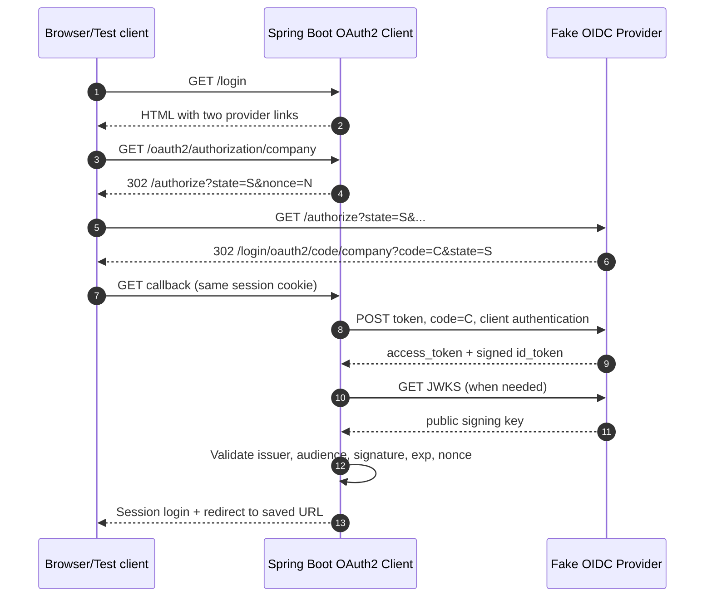

# 34.3. Custom Login Page with Multiple Providers

## 1. Context and Target Outcomes

In a Spring Boot system, users may sign in with **Google** for a personal account or with **Company SSO** to access organizational services. Spring Security OAuth 2.0 / OpenID Connect (OIDC) Client supports multiple `ClientRegistration` entries in the same application. However, the framework's auto-generated login page often falls short of requirements for branding, privacy notices, provider ordering, error messaging, or user experience.

This lab builds a **"Choose how to sign in"** page on Servlet/Spring MVC:

- Two choices: `Google` and `Company SSO`.
- Custom UI built with **Thymeleaf**, never collecting Google/Company passwords directly.
- Each button links to the corresponding Spring Security endpoint `/oauth2/authorization/{registrationId}`.
- Spring Security continues handling the authorization request, `state`, code exchange, ID Token verification, session, and `SecurityContext`.
- The page displays errors/cancellations safely with a button to try signing in again.
- After login, the user returns to the original URL or a default page per policy.
- **MockMvc** tests verify the UI, provider selection, route protection, and principal.
- Production guidance covers cookies, redirect URIs, reverse proxies, secret management, multi-tenancy, and identity mapping.

**Key takeaway:** Customizing the **login page** does not mean writing a custom **OAuth2 callback handler**, manually verifying ID Tokens, or manually exchanging authorization codes. Keep Spring Security's built-in filters and customize only what is actually needed.

> **Version scope:** Java 17+, Spring Boot 3.x, Spring Security 6.5, Servlet/MVC, Thymeleaf. This is a lab for **OAuth2 Client/OIDC Login**, not a guide to running Spring Authorization Server. The Company provider is assumed to be an OIDC Provider with a compatible discovery endpoint; `example.test` addresses are examples only. You must register real clients with each provider to run outside a test environment.

### Final Outcome Diagram

```text
                          CUSTOM LOGIN PAGE
                      GET https://app.example.test/login
                         +--------------------+
                         |    Welcome back    |
                         |                    |
                         | [Google]           |
                         | [Company SSO]      |
                         +---------+----------+
                                   |
                   +---------------+---------------+
                   |                               |
               Google click                   Company click
                   |                               |
    /oauth2/authorization/google       /oauth2/authorization/company
                   |                               |
         Google authorization              Company authorization
                   |                               |
                   +---------------+---------------+
                                   |
                     OP returns authorization code
                                   |
              /login/oauth2/code/{registrationId}
                                   |
                     OAuth2LoginAuthenticationFilter
                                   |
                Verify request state, exchange token, OIDC
                                   |
                          SecurityContext/session
                                   |
                  Original page or /dashboard
```

---

## 2. Why Does the Framework Have a Default Login Page?

When an application configures OAuth2 Login and client registrations, Spring Security can use `DefaultLoginPageGeneratingFilter` to render a default login page at `/login`.

A default page typically displays links like:

```html
<a href="/oauth2/authorization/google">Google</a>
<a href="/oauth2/authorization/company">Company</a>
```

These are not the Authorization Endpoint URLs of Google or Company. They are **internal application endpoints** that tell Spring Security to **construct an authorization request and issue a 302 redirect** to the respective provider.

When you call:

```java
.oauth2Login(oauth2 -> oauth2.loginPage("/login"))
```

you instruct Spring Security **to stop generating that UI automatically**. The application must define a controller/view handling `GET /login`. If you forget, an unauthenticated request may be redirected to `/login` and hit a 404 or a redirect loop.

### Comparing Default vs. Custom Login Pages

| Aspect | Default Page | Custom Page |
| --- | --- | --- |
| UI content | Generated by framework | Designed by application |
| Provider list | From iterable registrations | From allowlist or UI config |
| Login initiation link | `/oauth2/authorization/{id}` | Usually kept as default |
| Authorization code callback | Handled by Spring Security | **Do not re-implement manually** |
| `state` / PKCE / OIDC nonce | Spring Security and OP | **Never construct in the view** |
| Error UX | Default message | Fixed/controlled message |
| Return-to-original-page | Success handler | Can keep default or customize |
| Token validation | Spring Security | **Never delegate to Thymeleaf** |

Spring Security documentation notes that generating links automatically on the default page requires `ClientRegistrationRepository` to also implement `Iterable<ClientRegistration>`. With an application-owned custom page, **do not expose every registration automatically**, especially when an application also defines `client_credentials` registrations for machine-to-machine calls.

---

## 3. Preparing the Lab

### 3.1. Prerequisites

- JDK 17+ and Maven or Gradle.
- A Spring Boot 3.x project with Servlet/Spring MVC.
- Two valid client registrations on two OIDC providers, or one test provider with two clients.
- A browser with DevTools to inspect redirects/cookies.
- A local test application URL: `http://localhost:8080`.
- For staging/production, use HTTPS and a real public host.

If you do not yet have real provider accounts, you can still complete the **UI + MockMvc tests** with synthetic registrations; however, testing real authorization code/ID Token login requires a provider or test OP.

### 3.2. Project Structure

```text
custom-multi-provider-login/
├── pom.xml
└── src/
    ├── main/
    │   ├── java/example/login/
    │   │   ├── LoginApplication.java
    │   │   ├── SecurityConfiguration.java
    │   │   ├── LoginPageController.java
    │   │   └── DashboardController.java
    │   └── resources/
    │       ├── application.yml
    │       ├── templates/
    │       │   ├── login.html
    │       │   └── dashboard.html
    │       └── static/css/
    │           └── login.css
    └── test/
        └── java/example/login/
            └── MultiProviderLoginTest.java
```

In this lab, snippets refer to **planned files in the example project**. At this documentation stage, no source code changes to the Java-learning repository are required.

### 3.3. Maven Dependencies

```xml
<dependencies>
    <dependency>
        <groupId>org.springframework.boot</groupId>
        <artifactId>spring-boot-starter-web</artifactId>
    </dependency>

    <dependency>
        <groupId>org.springframework.boot</groupId>
        <artifactId>spring-boot-starter-security</artifactId>
    </dependency>

    <dependency>
        <groupId>org.springframework.boot</groupId>
        <artifactId>spring-boot-starter-oauth2-client</artifactId>
    </dependency>

    <dependency>
        <groupId>org.springframework.boot</groupId>
        <artifactId>spring-boot-starter-thymeleaf</artifactId>
    </dependency>

    <dependency>
        <groupId>org.springframework.boot</groupId>
        <artifactId>spring-boot-starter-test</artifactId>
        <scope>test</scope>
    </dependency>

    <dependency>
        <groupId>org.springframework.security</groupId>
        <artifactId>spring-security-test</artifactId>
        <scope>test</scope>
    </dependency>
</dependencies>
```

When using the Spring Boot BOM/parent, library versions are already managed. Do not mix a different `spring-security-test` version with the core runtime.

### 3.4. Gradle (Reference)

```groovy
dependencies {
    implementation 'org.springframework.boot:spring-boot-starter-web'
    implementation 'org.springframework.boot:spring-boot-starter-security'
    implementation 'org.springframework.boot:spring-boot-starter-oauth2-client'
    implementation 'org.springframework.boot:spring-boot-starter-thymeleaf'

    testImplementation 'org.springframework.boot:spring-boot-starter-test'
    testImplementation 'org.springframework.security:spring-security-test'
}

tasks.named('test') {
    useJUnitPlatform()
}
```

This lab uses **Servlet**. If your application actually uses WebFlux, `ServerHttpSecurity` and custom login configuration differ.

---

## 4. Registering the Application with Both Providers

Each provider must know your application and the Redirect URIs it allows.

### 4.1. Google

In Google Cloud OAuth client configuration:
- Create an OAuth client of type **Web application**.
- Obtain the `client-id` and `client-secret`.
- Configure the OAuth consent screen and test users while in testing mode.
- Register the **Authorized redirect URI**:

```text
http://localhost:8080/login/oauth2/code/google
```

When deploying to production:

```text
https://app.example.test/login/oauth2/code/google
```

You must configure the exact scheme, host, port (if any), context path, and path; you cannot rely on arbitrary wildcards if the provider does not support them.

### 4.2. Company SSO (OIDC)

Suppose your organization has an OIDC issuer:

```text
https://sso.example.test/realms/company
```

In the provider admin console:
- Create a client `company-portal` or the name assigned by your organization.
- Enable Authorization Code Flow.
- Configure the corresponding client authentication (e.g., confidential client secret).
- Allow the Redirect URI:

```text
http://localhost:8080/login/oauth2/code/company
```

- Grant the baseline scopes `openid`, `profile`, and `email` per policy.
- Verify the issuer's Discovery Document works and includes endpoints/JWKS.

### 4.3. Three IDs Frequently Confused

| Name | Example | Used By |
| --- | --- | --- |
| **registrationId** | `google`, `company` | Spring Security URLs and lookups |
| **clientId** | Value issued by OP | AS identifies the OAuth2 client |
| **provider ID** in YAML | `company-oidc` | Selects AS metadata in Spring Boot |

Example:
- The Company button links to `/oauth2/authorization/company`;
- Spring Security looks up `registration.company`;
- That entry specifies `provider: company-oidc`;
- `company-oidc` specifies the organization's `issuer-uri`.

Never put `client-secret` into the Thymeleaf model, HTML, URLs, JavaScript, or cookies.

---

## 5. Configuring `application.yml` for Multiple ClientRegistrations

```yaml
spring:
  security:
    oauth2:
      client:
        registration:
          google:
            client-id: ${GOOGLE_CLIENT_ID}
            client-secret: ${GOOGLE_CLIENT_SECRET}
            authorization-grant-type: authorization_code
            redirect-uri: "{baseUrl}/login/oauth2/code/{registrationId}"
            scope:
              - openid
              - profile
              - email

          company:
            provider: company-oidc
            client-id: ${COMPANY_CLIENT_ID}
            client-secret: ${COMPANY_CLIENT_SECRET}
            client-authentication-method: client_secret_basic
            authorization-grant-type: authorization_code
            redirect-uri: "{baseUrl}/login/oauth2/code/{registrationId}"
            scope:
              - openid
              - profile
              - email

        provider:
          company-oidc:
            issuer-uri: https://sso.example.test/realms/company

server:
  servlet:
    session:
      timeout: 20m
      cookie:
        http-only: true
        same-site: lax
```

**Explanation of each part:**

1. `registration.google` uses the built-in Google provider metadata supplied by Spring Boot/Spring Security unless overridden.
2. `registration.company` explicitly specifies `provider: company-oidc`, because this is a custom organizational provider.
3. `issuer-uri` enables OIDC Discovery; the issuer must be exact and the provider must support discovery metadata per contract.
4. `redirect-uri` defaults to `{baseUrl}/login/oauth2/code/{registrationId}`. Declaring it explicitly makes it easier to cross-check.
5. The `openid` scope signals an OIDC request; `profile` and `email` depend on provider/policy.
6. `server.servlet.session.timeout` controls the application's HTTP session duration, not the lifetime of the authorization code or OP SSO session.
7. `SameSite=Lax` cookies generally work for top-level GET callbacks in Authorization Code Flow, though they do not automatically handle every cross-site `form_post` case.

For production HTTPS, add the `Secure` cookie policy:

```yaml
server:
  servlet:
    session:
      cookie:
        secure: true
        http-only: true
        same-site: lax
```

**Note:** if you access localhost over HTTP and the browser does not send a `Secure` cookie, the login callback can lose its session. Separate local/production profiles or develop over local HTTPS; never remove `Secure` in production just to "fix" an undiagnosed error.

### 5.1. Environment Values

Conceptual example:

```text
GOOGLE_CLIENT_ID=<test-google-client-id>
GOOGLE_CLIENT_SECRET=<test-google-secret>
COMPANY_CLIENT_ID=<test-company-client-id>
COMPANY_CLIENT_SECRET=<test-company-secret>
```

Never commit real values. In production, use a secret manager, workload identity, or a managed secrets channel; ensure logs, exception traces, and CI output are redacted.

### 5.2. Minimal Scopes

A login page does not need `drive.write`, `calendar.delete`, or broad permissions if you only want to authenticate identity. If you later need to call Google APIs on behalf of the user, design OAuth2 authorization/consent and authorized-client lifecycles as a separate step.

Never let the browser pass `scope=admin` in a query string and blindly append it to the authorization request without policy enforcement.

---

## 6. SecurityFilterChain: Replacing the Default Login Page

Create `src/main/java/example/login/SecurityConfiguration.java`:

```java
package example.login;

import org.springframework.context.annotation.Bean;
import org.springframework.context.annotation.Configuration;
import org.springframework.security.config.annotation.web.builders.HttpSecurity;
import org.springframework.security.web.SecurityFilterChain;

@Configuration
public class SecurityConfiguration {

    @Bean
    SecurityFilterChain securityFilterChain(HttpSecurity http)
            throws Exception {

        return http
            .authorizeHttpRequests(auth -> auth
                .requestMatchers(
                    "/",
                    "/login",
                    "/error",
                    "/favicon.ico",
                    "/css/**",
                    "/js/**",
                    "/images/**",
                    "/oauth2/authorization/**",
                    "/login/oauth2/code/**")
                    .permitAll()
                .anyRequest().authenticated()
            )
            .oauth2Login(oauth2 -> oauth2
                .loginPage("/login")
                .failureUrl("/login?error")
            )
            .logout(logout -> logout
                .logoutSuccessUrl("/login?logout")
                .invalidateHttpSession(true)
                .clearAuthentication(true)
            )
            .build();
    }
}
```

### 6.1. Why Must the Login Page Be `permitAll`?

If `GET /login` also required authentication, the behavior would become:

```text
GET /dashboard (anonymous)
  -> security redirect /login
GET /login (anonymous)
  -> security redirect /login
GET /login ...
```

Therefore, the login page, the CSS it needs, and the error page must be public. Never write `anyRequest().permitAll()` just to make the login page render.

### 6.2. The Authorization Request Endpoint Differs from the Login Page

```text
GET /login
    -> Controller + Thymeleaf view

GET /oauth2/authorization/google
    -> OAuth2AuthorizationRequestRedirectFilter

GET /oauth2/authorization/company
    -> OAuth2AuthorizationRequestRedirectFilter
```

Do not define a controller like:

```java
@GetMapping("/oauth2/authorization/google")
String fakeLogin() { return "dashboard"; }
```

to bypass the provider. Spring Security's filter needs to create the state/PKCE/nonce context and send the protocol-compliant redirect.

### 6.3. The Callback Is Not a Thymeleaf Page

```text
GET /login/oauth2/code/google?code=...&state=...
GET /login/oauth2/code/company?code=...&state=...
```

is handled by `OAuth2LoginAuthenticationFilter`, not a hand-written `@GetMapping`. Permitting the callback path does not disable the filter's state/PKCE/token validation.

### 6.4. Why Use `failureUrl` Instead of Displaying Exceptions Directly?

`failureUrl("/login?error")` routes authentication failures to an application-controlled URL. The login page displays a fixed message.

Do not redirect like:

```text
/login?error_description=<raw-exception-message-or-provider-response>
```

because the message may contain sensitive/untrusted data and poses logging or XSS risks if rendered improperly.

### 6.5. If the App Already Has `formLogin()`

For a hybrid app supporting both local username/password and OAuth2 Login:
- Clearly design which entry point sends the user to `/login`.
- Ensure the `formLogin` processing URL and the OAuth2 callback do not collide.
- Keep CSRF enabled for the local login form POST.
- Note that the two Authentication mechanisms can produce different principal types.

This lab intentionally uses **OAuth2/OIDC only**, so `formLogin()` is omitted.

---

## 7. LoginPageController: Building the Approved Two-Provider List

You could hardcode links in HTML, but a controller lets you:
- Hide a provider if its registration is not configured;
- Set user-friendly labels/descriptions;
- Display error and logout notices;
- Easily scale to more providers;
- **Avoid accidentally exposing `client_credentials` registrations**.

Here we use a **fixed allowlist** from reviewed code. Never take raw `registrationId` values from a request query to build the provider list.

### 7.1. Controller

Create `src/main/java/example/login/LoginPageController.java`:

```java
package example.login;

import java.util.List;

import org.springframework.security.oauth2.client.registration.ClientRegistrationRepository;
import org.springframework.stereotype.Controller;
import org.springframework.ui.Model;
import org.springframework.web.bind.annotation.GetMapping;
import org.springframework.web.bind.annotation.RequestParam;

@Controller
public class LoginPageController {

    public record LoginChoice(
        String registrationId,
        String label,
        String description) {}

    private static final List<LoginChoice> APPROVED_CHOICES =
        List.of(
            new LoginChoice(
                "google",
                "Continue with Google",
                "Use your Google account"),
            new LoginChoice(
                "company",
                "Continue with Company SSO",
                "For employees with an organization account")
        );

    private final ClientRegistrationRepository registrations;

    public LoginPageController(
            ClientRegistrationRepository registrations) {
        this.registrations = registrations;
    }

    @GetMapping("/login")
    public String loginPage(
            @RequestParam(
                name = "error", required = false) String error,
            @RequestParam(
                name = "logout", required = false) String logout,
            Model model) {

        List<LoginChoice> available = APPROVED_CHOICES.stream()
            .filter(choice -> registrations
                .findByRegistrationId(
                    choice.registrationId()) != null)
            .toList();

        model.addAttribute("providers", available);
        model.addAttribute("loginError", error != null);
        model.addAttribute("loggedOut", logout != null);

        return "login";
    }
}
```

### 7.2. Why Not Use `Iterable<ClientRegistration>` in the Main Example?

Not every `ClientRegistrationRepository` implements `Iterable`. Moreover, when there are multiple registrations:
- `google` and `company` are for user login;
- `reports-machine` with `client_credentials` is for batch jobs;
- `billing-machine` should also never appear on the user login page.

This example controls the exact **two approved login providers**. In production, `APPROVED_CHOICES` can be moved to validated UI configuration rather than editing code to add a provider.

### 7.3. The Controller Can Handle a Disabled Provider

If Company SSO has not been declared, `available` contains only Google. This avoids showing a Company button pointing to a missing registration.

However, **hiding a button does not stop a user from calling directly**:

```text
GET /oauth2/authorization/company
```

if the registration still exists. When a provider is blocked by tenant/organization policy, enforce that policy **at the request resolution/authentication boundary**, not merely by hiding UI elements.

### 7.4. Rendering the Login Page Even When Providers Are Empty

If the list is empty, the view should display a notice:

> No sign-in methods are currently available. Please contact your administrator.

Never fall back to an admin client ID or auto-grant `ROLE_USER` just to make the page "work".

---

## 8. Designing an Accessible Thymeleaf UI

Create `src/main/resources/templates/login.html`:

```html
<!DOCTYPE html>
<html lang="en" xmlns:th="http://www.thymeleaf.org">
<head>
    <meta charset="UTF-8">
    <meta name="viewport" content="width=device-width, initial-scale=1">
    <title>Sign In | Learning Portal</title>
    <link rel="stylesheet" th:href="@{/css/login.css}">
</head>
<body>
<main class="login-shell">
    <section class="login-panel" aria-labelledby="login-title">

        <p class="eyebrow">Learning Portal</p>
        <h1 id="login-title">Welcome back</h1>
        <p class="subtitle">
            Choose an identity provider to sign in securely.
        </p>

        <div
            class="notice notice-error"
            role="alert"
            th:if="${loginError}">
            Sign-in could not be completed.
            Please choose a provider and try again.
        </div>

        <div
            class="notice notice-success"
            role="status"
            th:if="${loggedOut}">
            You have been signed out of the application.
        </div>

        <nav class="provider-list" aria-label="Sign-in methods">
            <a
                class="provider-link"
                th:each="provider : ${providers}"
                th:href="@{/oauth2/authorization/{id}(id=${provider.registrationId})}">

                <span class="provider-title"
                      th:text="${provider.label}">
                    Provider Name
                </span>

                <span class="provider-description"
                      th:text="${provider.description}">
                    Description
                </span>
            </a>
        </nav>

        <p class="notice"
           th:if="${#lists.isEmpty(providers)}">
            No sign-in methods are currently available.
            Please contact your administrator.
        </p>

        <p class="privacy-note">
            You will be redirected to your chosen provider's sign-in
            page. This application does not ask you to enter your
            provider password on this page.
        </p>

    </section>
</main>
</body>
</html>
```

### 8.1. Why Should the Buttons Be `<a>` Elements?

In the Authorization Code Flow, this link triggers a **top-level browser navigation** to an internal URL. Spring Security responds with a 302 redirect to the OP.

An `<a href>` link provides:
- Standard keyboard and navigational semantics;
- Support for opening in a new tab, though multi-tab session behavior should be tested;
- No JavaScript or password form submission required;
- No POST form, so no CSRF token is needed to initiate the authorization request.

Using `<button>` with `onclick` navigation requires extra accessibility/JS fallback and offers no security advantage over a proper link.

### 8.2. Why `th:href` Instead of String Concatenation in Java?

```html
th:href="@{/oauth2/authorization/{id}(id=${provider.registrationId})}"
```

Thymeleaf URL expressions handle context paths and URL encoding instead of concatenating raw paths in Java. Even so, **the `registrationId` value must still come from a trusted allowlist**; escaping never replaces authorization.

### 8.3. Why `th:text`?

`th:text` escapes text via the template engine. Never use `th:utext` for provider names, error descriptions, or any user-modifiable string to avoid HTML injection/XSS.

### 8.4. Keep Secrets and Tokens Out of HTML

Never render:

```html
<input type="hidden" name="client_secret" value="...">
<script>const idToken = "eyJ...";</script>
```

Client secrets belong strictly server-side. ID Tokens and access tokens do not need to be sent to the browser just for the login page to work.

---

## 9. Minimal, Responsive CSS with Focus States

Create `src/main/resources/static/css/login.css`:

```css
:root {
    color-scheme: light;
    font-family: system-ui, -apple-system, BlinkMacSystemFont,
                 "Segoe UI", sans-serif;
    color: #172033;
    background: #f4f6fa;
}

* { box-sizing: border-box; }

body {
    margin: 0;
    min-height: 100vh;
}

.login-shell {
    min-height: 100vh;
    display: grid;
    place-items: center;
    padding: 1.5rem;
}

.login-panel {
    width: min(100%, 31rem);
    background: white;
    border: 1px solid #dfe4ef;
    border-radius: 1rem;
    box-shadow: 0 1rem 3rem rgb(26 38 66 / 10%);
    padding: clamp(1.5rem, 5vw, 2.5rem);
}

.eyebrow {
    font-size: 0.8rem;
    text-transform: uppercase;
    letter-spacing: 0.1em;
    color: #4a5680;
}

h1 {
    font-size: clamp(1.6rem, 5vw, 2.1rem);
    line-height: 1.2;
    margin: 0.5rem 0;
}

.subtitle,
.provider-description,
.privacy-note {
    color: #526078;
}

.provider-list {
    display: grid;
    gap: 0.75rem;
    margin-top: 1.75rem;
}

.provider-link {
    border: 1px solid #c7d3ea;
    border-radius: 0.75rem;
    padding: 1rem;
    text-decoration: none;
    color: inherit;
    display: grid;
    gap: 0.3rem;
    background: #fff;
}

.provider-link:hover { background: #f7f9ff; }

.provider-link:focus-visible {
    outline: 3px solid #3053c6;
    outline-offset: 3px;
}

.provider-title {
    font-weight: 650;
}

.provider-description {
    font-size: 0.875rem;
}

.notice {
    border-radius: 0.5rem;
    padding: 0.75rem 1rem;
    margin: 1rem 0;
}

.notice-error {
    background: #fff4f4;
    color: #8b2020;
}

.notice-success {
    background: #ecf9f1;
    color: #1d6637;
}

.privacy-note {
    font-size: 0.85rem;
    line-height: 1.5;
    margin-top: 1.75rem;
}

@media (prefers-reduced-motion: reduce) {
    *, *::before, *::after {
        scroll-behavior: auto !important;
        animation: none !important;
        transition: none !important;
    }
}
```

This example UI has no external CDN, logo, or JavaScript dependencies. If you use real Google or Company SSO logos, follow brand guidelines and serve assets from a managed origin. Embedding icons/logos from third-party hosts on a login page can leak access metadata.

### 9.1. Accessibility Goes Beyond Color

A good login page needs:
- Sufficient contrast;
- A single, descriptive `<h1>`;
- Keyboard `Tab` navigation to every provider;
- Clear `:focus-visible` outlines;
- `role="alert"` on error notices;
- Provider distinction not relying solely on color or icons;
- Error messages stating the next action;
- No continuous automatic redirects when login fails.

---

## 10. How the Login Page Is Rendered

When a user visits:

```http
GET /login HTTP/1.1
Host: localhost:8080
```

Flow:

```text
Spring MVC
    -> LoginPageController.loginPage(error, logout, model)
    -> ClientRegistrationRepository
    -> providers = [google, company] if registered
    -> model["loginError"] = error != null
    -> model["loggedOut"] = logout != null
    -> view name = "login"
    -> Thymeleaf templates/login.html
    -> HTML contains exactly two links
```

The controller **does not read access tokens, ID Tokens, or client secrets** to render the page. Reading registrations only determines which links are available, not user authentication.

### 10.1. If the Provider List Renders Empty

Check:
- Are the properties under `spring.security.oauth2.client.registration` spelled accurately?
- Are client ID/secret configured in the active Spring profile?
- Does `registrationId` in `APPROVED_CHOICES` match the configuration?
- Did provider discovery fail during startup?
- Is a custom `ClientRegistrationRepository` overriding Boot auto-configuration?

Never "fix" this by letting the browser supply client ID/secret to create a registration at runtime.

---

## 11. Clicking Google: How the Authorization Request Works

When the user clicks "Continue with Google":

```text
GET /oauth2/authorization/google
```

Spring Security uses `OAuth2AuthorizationRequestRedirectFilter` and an `OAuth2AuthorizationRequestResolver` to select the registration and build the Authorization Request.

Example redirect URL to the OP (abbreviated):

```text
https://accounts.google.com/o/oauth2/v2/auth
    ?response_type=code
    &client_id=GOOGLE_CLIENT_ID
    &scope=openid%20profile%20email
    &redirect_uri=http%3A%2F%2Flocalhost%3A8080%2Flogin%2Foauth2%2Fcode%2Fgoogle
    &state=OPAQUE_RANDOM_STATE
```

This is an **illustrative diagram**; parameter ordering and extra parameters (PKCE, nonce, prompt) depend on configuration and provider.

### 11.1. Clicking Company

```text
GET /oauth2/authorization/company
```

The framework selects registration `company`, uses the Company issuer's authorization endpoint metadata, and builds a request with its own **fresh state**.

Do not take Google's URL and swap `client_id` for the Company client ID. Each provider has its own issuer, endpoints, credentials, JWKS, and policies.

### 11.2. Redirects Do Not Need Frontend-Generated State

Do not do this:

```javascript
const state = "fixed-state";
window.location.href =
    "https://provider.example/authorize?...&state=" + state;
```

If the frontend constructs the authorization URI manually, you have to solve state/session correlation, PKCE verifiers, nonces, redirect URIs, issuer mix-up, and authorized-client persistence yourself. In this lab, **letting Spring Security build the Authorization Request** is the right approach.

### 11.3. Role of the Browser

The browser performs navigation between RP and OP while holding cookies per policy. The browser **never possesses the client secret**. The backend-to-token-endpoint code exchange uses confidential client authentication when configured.

---

## 12. Callback: Same Application, Different `registrationId`

After logging in at Google, the browser returns to:

```text
GET /login/oauth2/code/google?code=...&state=...
```

After logging in at Company:

```text
GET /login/oauth2/code/company?code=...&state=...
```

Spring Security:
1. Restores the saved authorization request and verifies the correlation context.
2. Identifies the right client registration;
3. Calls the **corresponding provider's** token endpoint with the authorization code;
4. Validates the token response;
5. For OIDC, validates the ID Token (signature, issuer, audience, expiry, nonce per flow/config);
6. Processes UserInfo if applicable;
7. Creates `OAuth2AuthenticationToken` and `OidcUser`;
8. Saves `SecurityContext`/session per policy;
9. Redirects the user to the post-login destination.

**Do not create a `@GetMapping("/login/oauth2/code/{registrationId}")` controller** to grab the code and exchange tokens manually without a security-reviewed special requirement.

### 12.1. OIDC `sub` Is Not Email

In OIDC, `sub` is meaningful only within the scope of its issuer. Two providers could return the same `sub` or `email` without representing the same identity.

Minimal identity key:

```text
(issuer, subject)
```

Never automatically link accounts merely because their email or display name matches. If the product needs account linking, design a dedicated explicit verification/policy flow.

### 12.2. UserInfo and Claims Differ Across Providers

Google and Company may return:
- `preferred_username` only on Company;
- `email` occasionally omitted if scopes/consent are restricted;
- `groups` via provider-specific mappers;
- Display name in the ID Token or UserInfo;
- No group claims if the OP does not emit them.

Controllers should never assume every `OidcUser` has `email`, `name`, or `groups`.

---

## 13. Dashboard: Showing Which Provider the User Used to Sign In

Create `src/main/java/example/login/DashboardController.java`:

```java
package example.login;

import org.springframework.security.core.Authentication;
import org.springframework.security.oauth2.client.authentication.OAuth2AuthenticationToken;
import org.springframework.security.oauth2.core.oidc.user.OidcUser;
import org.springframework.stereotype.Controller;
import org.springframework.ui.Model;
import org.springframework.web.bind.annotation.GetMapping;

@Controller
public class DashboardController {

    @GetMapping("/")
    public String home() {
        return "redirect:/dashboard";
    }

    @GetMapping("/dashboard")
    public String dashboard(
            Authentication authentication,
            Model model) {

        if (!(authentication instanceof OAuth2AuthenticationToken oauth2)) {
            // For this OIDC-login-only lab, this is an unexpected
            // state; do not fabricate an OidcUser.
            throw new IllegalStateException(
                "OAuth2 Login authentication required");
        }

        String registrationId =
            oauth2.getAuthorizedClientRegistrationId();

        String displayName = authentication.getName();
        String subject = null;

        if (oauth2.getPrincipal() instanceof OidcUser oidcUser) {
            subject = oidcUser.getIdToken().getSubject();
            String preferred =
                oidcUser.getPreferredUsername();

            if (preferred != null && !preferred.isBlank()) {
                displayName = preferred;
            }
        }

        model.addAttribute("displayName", displayName);
        model.addAttribute("registrationId", registrationId);
        model.addAttribute("subject", subject);
        return "dashboard";
    }
}
```

### 13.1. What Is Displayed?

- `displayName`: display name with fallback.
- `registrationId`: `google` or `company`; can be mapped to a friendly label in the view.
- `subject`: OIDC subject if available; in real products, display only when genuinely needed.

**Never display the access token, refresh token, raw ID Token, or client secret** in the dashboard or debug UI.

### 13.2. Why Check `instanceof OidcUser`?

`OAuth2AuthenticationToken` can also represent non-OIDC OAuth2 Logins (for instance, certain social OAuth2 providers). If a generic OAuth2 provider is added later, the principal may be an `OAuth2User` without `getIdToken()`.

The code uses `instanceof` to avoid unsafe casts.

### 13.3. The `dashboard.html` Page

```html
<!DOCTYPE html>
<html lang="en" xmlns:th="http://www.thymeleaf.org">
<head>
    <meta charset="UTF-8">
    <meta name="viewport" content="width=device-width, initial-scale=1">
    <title>Dashboard | Learning Portal</title>
    <link rel="stylesheet" th:href="@{/css/login.css}">
</head>
<body>
<main class="login-shell">
    <section class="login-panel">
        <h1>Sign-in Successful</h1>
        <p>
            Hello
            <strong th:text="${displayName}">User</strong>.
        </p>
        <p>
            Provider:
            <strong th:text="${registrationId}">company</strong>
        </p>
        <p th:if="${subject != null}">
            OIDC subject:
            <code th:text="${subject}">sub</code>
        </p>

        <form method="post" th:action="@{/logout}">
            <button type="submit">Sign out of application</button>
        </form>
    </section>
</main>
</body>
</html>
```

With Spring MVC + Thymeleaf/Spring Security integration, `th:action` typically injects the hidden CSRF field via `RequestDataValueProcessor`. If an app uses another template/rendering engine, it must supply a valid CSRF token for `POST /logout` rather than disabling CSRF globally.

---

## 14. Application Logout vs. OP Single Logout

In our example configuration:

```java
.logout(logout -> logout
    .logoutSuccessUrl("/login?logout")
    .invalidateHttpSession(true)
    .clearAuthentication(true))
```

this logs out **at the application (RP) only**:
- Clears/invalidates the local authentication session per config;
- Redirects the user to `/login?logout`;
- **Does not guarantee** the Google or Company OP SSO session is closed;
- **Does not automatically revoke** access/refresh tokens or all authorization grants.

### 14.1. User Clicks Company Again After Logout

If the Company OP SSO cookie is still active, the user may be signed back in immediately without typing a password. That can be expected SSO behavior, not a bug in the login page.

### 14.2. If the Product Requires OIDC RP-Initiated Logout

Spring Security can integrate `OidcClientInitiatedLogoutSuccessHandler` when the OP provides a compatible `end_session_endpoint`. However:
- Not every provider supports it equally;
- Allowed post-logout redirect URIs must be configured;
- Multiple providers/issuers must be handled carefully;
- Unlinking accounts/revoking consent must remain separate from browser logout;
- Never construct OP logout URLs from raw user input.

This lab deliberately uses **local logout** to avoid assuming a single logout handler works identically for both Google and Company.

---

## 15. Post-Login Behavior: Returning to the Original URL

Suppose a user directly opens:

```text
GET /reports/2026
```

before signing in. The security filter can save the original request and redirect to `/login`. After successful authentication, Spring Security's default success handler (SavedRequest-aware per config) typically sends the user back to the saved destination.

```text
Anonymous GET /reports/2026
       |
       v
SavedRequest stored
       |
       v
/login -> Company
       |
       v
OIDC login success
       |
       v
GET /reports/2026
```

### 15.1. Why Not Always Redirect to `/dashboard`?

Configuring:

```java
.oauth2Login(oauth2 -> oauth2
    .defaultSuccessUrl("/dashboard", true))
```

with `alwaysUse=true` forces a redirect to the dashboard even when a saved request exists. That breaks deep-link UX.

If you want `/dashboard` as the default **while still honoring saved requests**, use:

```java
.oauth2Login(oauth2 -> oauth2
    .loginPage("/login")
    .defaultSuccessUrl("/dashboard", false))
```

Or keep the default and let the home route `/` redirect to `/dashboard`.

**Never accept an arbitrary target URL from a query string** like:

```text
/login?returnTo=https://evil.example.test
```

and pass it directly into `setDefaultTargetUrl` or a `Location` header. That is an **open redirect** and can be abused in login flows.

### 15.2. Choosing Destination by Provider

Sometimes Company users need an internal landing page while Google users need onboarding. You can use an `AuthenticationSuccessHandler`, provided you:
- Identify the provider from the authenticated `OAuth2AuthenticationToken.getAuthorizedClientRegistrationId()`, never a raw query param;
- Honor saved requests when required by the business contract;
- Check actual roles/tenant policies;
- Redirect only to allowlisted relative internal URLs;
- Never leak tokens in URL query strings.

---

## 16. Login Errors: Displaying Safely Without Leaking Details

A callback may fail due to:
- The user declining consent;
- `HttpSession` expiring while the user completes MFA;
- State mismatch/multi-tab conflict;
- Token endpoint returning `invalid_client`;
- Provider temporary unavailability;
- Invalid ID Token signature/issuer/audience/nonce;
- User lacking organizational access permission.

The login page only needs a safe notice:

> Sign-in could not be completed. Please try again or choose another method.

In the sample code, `/login?error` toggles the `loginError` flag; the controller **never passes raw exceptions or `error_description` into the view**.

### 16.1. Pinpointing Where an Error Occurred

| Symptom | Phase | Check First |
| --- | --- | --- |
| Clicking Google returns 404 | Start authorization | URL, registration ID, filter chain |
| Clicking Company loops back to login | Login page/entrypoint | Permit rules, controller mapping |
| OP reports `redirect_uri_mismatch` | Authorization request | Registered URI at OP, public baseUrl |
| OP login returns to `/login?error` | RP callback/filter | Session, state, token response, ID Token |
| `authorization_request_not_found` | Callback correlation | Cookie/session, state, multi-tab, cluster |
| `invalid_state_parameter` | Callback correlation | State and authorization request, custom repository |
| `invalid_grant` | Token endpoint | Expired/reused code, PKCE/redirect/client binding |
| `invalid_client` | Token endpoint | Client ID/secret, auth method |
| Invalid ID Token issuer/audience | OIDC validation | Issuer, client registration, JWKS |
| Browser 403 on POST callback | CSRF/response_mode | Filter matcher, SameSite, cookie, method |
| Lost session on staging | Cookie/proxy | HTTPS, forwarded headers, session store |
| Google works but Company fails | Provider-specific | Discovery, scopes, redirect, client policy |
| Login succeeds but admin page returns 403 | Application authorization | Authorities, groups mapping, tenant policy |

### 16.2. Do Not Auto-Retry Correlation Errors Infinitely

If the session cookie is not sent back due to a misconfigured domain/proxy, an automatic redirect:

```text
/login?error -> /oauth2/authorization/company
             -> OP -> callback error -> /login?error -> ...
```

creates an infinite loop. Stop on the error page and let the user **explicitly choose a provider again**.

### 16.3. `authorization_request_not_found` Is Not Only Caused by an Empty Session

With the default repository, a callback `state` differing from the saved request can cause `loadAuthorizationRequest` to return `null`. The login filter may then report `authorization_request_not_found` even when the `HttpSession` still holds a request with a different state.

Never "fix" this by skipping state matching.

---

## 17. State, PKCE, and OIDC Nonce Must Still Be Protected

Customizing the UI **must never** weaken the OAuth2/OIDC protocol.

### 17.1. State

`state` correlates the authorization response back to the exact request/browser context that initiated login, helping prevent login CSRF and response injection.

Let Spring Security:
- Generate an unpredictable state;
- Store the authorization request in the repository (typically `HttpSession`);
- Compare the callback state;
- Remove the pending request after processing;
- Reject requests missing or mismatching correlation.

### 17.2. PKCE

**Proof Key for Code Exchange (RFC 7636)** protects the authorization code against interception/theft on the front-channel.

An authorization request may add:

```text
code_challenge=<S256-challenge>
code_challenge_method=S256
```

After the callback, the token request sends the matching `code_verifier` (stored in the client-side authorization request context).

Spring Security supports PKCE and usually enables it automatically for **public clients** with `client-authentication-method=none`. For confidential clients, PKCE can be enabled additionally based on AS capability and policy.

**Enabling PKCE does not replace state validation.** Never send `code_verifier` to the browser or write it to logs.

### 17.3. Optional PKCE Enforcement for Confidential Clients

When policy requires it, you can use a resolver:

```java
import org.springframework.security.oauth2.client.registration.ClientRegistrationRepository;
import org.springframework.security.oauth2.client.web.DefaultOAuth2AuthorizationRequestResolver;
import org.springframework.security.oauth2.client.web.OAuth2AuthorizationRequestCustomizers;
import org.springframework.security.oauth2.client.web.OAuth2AuthorizationRequestResolver;

@Bean
OAuth2AuthorizationRequestResolver authorizationRequestResolver(
        ClientRegistrationRepository registrations) {

    DefaultOAuth2AuthorizationRequestResolver resolver =
        new DefaultOAuth2AuthorizationRequestResolver(
            registrations, "/oauth2/authorization");

    resolver.setAuthorizationRequestCustomizer(
        OAuth2AuthorizationRequestCustomizers.withPkce());

    return resolver;
}
```

Then wire it into the DSL:

```java
.oauth2Login(oauth2 -> oauth2
    .loginPage("/login")
    .authorizationEndpoint(endpoint -> endpoint
        .authorizationRequestResolver(authorizationRequestResolver)))
```

This is an **optional illustration**, not mandatory for every lab. Ensure the resolver/customizer supports all active providers, and do not change the base URI without updating login links.

### 17.4. OIDC Nonce

In OIDC Authorization Code Flow, `nonce` binds the ID Token to the authentication request. Spring Security handles OIDC identity validation at the appropriate layer.

Never attempt to make an ID Token "valid" by copying `nonce` from a browser query parameter or disabling issuer/signature checks to get a provider working.

---

## 18. Cookies and HttpSession: Conditions for a Successful Callback

By default, Spring Security Servlet stores the pending `OAuth2AuthorizationRequest` in `HttpSession` via its repository.

```text
GET /oauth2/authorization/company
    |
    v
Create authorization request state=S1
Store in HttpSession SESSION-A
    |
    v
302 to OP
    |
    v
OP login/MFA
    |
    v
GET /login/oauth2/code/company?code=C1&state=S1
Cookie: JSESSIONID=<SESSION-A>
    |
    v
Load matching authorization request S1
```

If the callback arrives without the matching session, the framework cannot find the authorization request to verify state.

### 18.1. Common Cookie Failures

- `Domain` does not match callback host;
- Cookie `Path` does not cover the callback;
- `Secure` cookie used over public HTTP;
- Cross-site POST callback with `SameSite=Lax`;
- Browser/webview blocking cookies;
- Session TTL shorter than MFA/consent duration;
- App restart or node switch losing an in-memory session;
- Session logged out/invalidated before callback.

### 18.2. `SameSite=Lax` for Top-Level GET

Most browser Authorization Code callbacks use **top-level GET navigation**, which allows `Lax` cookies under modern browser rules. If an OP requires `response_mode=form_post`, cookie behavior differs and the CSRF filter may also block the POST.

Never set all cookies to `SameSite=None` or disable CSRF app-wide just because one callback failed. Understand the response mode and threat model first.

### 18.3. Running Multiple Replicas

```text
Node A: stores authorization request in local session
Node B: receives OAuth2 callback
Node B: cannot find A's session data
```

For multi-node deployments, consider sticky sessions or **Spring Session** with a secured distributed store, and test load balancing/failover. Sticky sessions do not protect against node crashes, and distributed sessions do not automatically solve multi-tab races.

---

## 19. Multi-Tab and Multi-Provider Issues

A user might:
1. Open the login page in Tab A, click Google, getting state `S1`.
2. Open Tab B, click Company, getting state `S2`.
3. Finish logging in on Tab A.

With some default implementations of `HttpSessionOAuth2AuthorizationRequestRepository`, the session only retains **one pending authorization request**; Tab B overwrites Tab A, causing Tab A's callback to fail.

```text
Tab A: Google -> state=S1
  session pending request = S1

Tab B: Company -> state=S2
  session pending request = S2

Tab A callback state=S1
  repository cannot find matching request
  -> authorization_request_not_found
```

### 19.1. How to Handle This in the Lab

- Do not launch two concurrent login flows in the same browser when testing the happy path.
- If an error occurs, return to the login page and start a **fresh flow**.
- Never fix it by disabling state validation.
- Only build a custom multi-state `AuthorizationRequestRepository` if required by the product, keyed by session+state with TTL, one-time removal, concurrency handling, and a security review.

### 19.2. Do Not Retry Login with the Old Code C1

Authorization codes are single-use and short-lived. When a callback fails due to a missing pending request, initiate a new request/code rather than replaying `C1`.

### 19.3. UX Suggestion

If a user clicks another provider while a login flow is already in progress in another tab, you can display guidance like "A sign-in attempt is already in progress" in the same tab. However, the frontend must never rely on `localStorage` to assert that a user is authenticated.

---

## 20. Customizing the Authorization Request Initiation Path

Default:

```text
/oauth2/authorization/{registrationId}
```

To change it to:

```text
/sso/start/{registrationId}
```

configure:

```java
.oauth2Login(oauth2 -> oauth2
    .loginPage("/login")
    .authorizationEndpoint(authorization ->
        authorization.baseUri("/sso/start")))
```

And update the Thymeleaf link:

```html
<a th:href="@{/sso/start/{id}(id=${provider.registrationId})}">
    Continue signing in
</a>
```

**Do not change only the HTML link while forgetting the authorization endpoint matcher.** Otherwise `/sso/start/company` will return 404 or be blocked.

### 20.1. Initiation Base URI vs. Callback URI

| Purpose | Default | How to Customize |
| --- | --- | --- |
| Login page | `/login` | `oauth2Login().loginPage(...)` |
| Authorization start | `/oauth2/authorization/{id}` | `authorizationEndpoint().baseUri(...)` |
| OAuth2 callback | `/login/oauth2/code/{id}` | `redirectionEndpoint().baseUri(...)` + redirect-uri |
| Logout | `POST /logout` | `logout()` |
| After success | Saved request/default target | `defaultSuccessUrl` or success handler |

The first three URLs **serve completely different functions**. Do not rename all of them to `/login` for "convenience".

---

## 21. Changing the Callback Path

For example, suppose you want the callbacks to be:

```text
https://app.example.test/sso/callback/google
https://app.example.test/sso/callback/company
```

You must synchronize **three places**.

### 21.1. Security Config

```java
.oauth2Login(oauth2 -> oauth2
    .loginPage("/login")
    .redirectionEndpoint(redirection ->
        redirection.baseUri("/sso/callback/*")))
```

### 21.2. Registration `redirect-uri`

```yaml
spring:
  security:
    oauth2:
      client:
        registration:
          google:
            redirect-uri: "{baseUrl}/sso/callback/{registrationId}"
          company:
            redirect-uri: "{baseUrl}/sso/callback/{registrationId}"
```

This is **only the redirect URI override**, not a replacement for the full registration config in Section 5. Keep the client ID, secret, and scopes intact.

### 21.3. Provider Admin Console

Add the exact URIs:

```text
https://app.example.test/sso/callback/google
https://app.example.test/sso/callback/company
```

**Technical note:** the matcher `"/sso/callback/*"` on the filter and the template `"{baseUrl}/sso/callback/{registrationId}"` on the client registration are two distinct representations: one is a **filter URL pattern**, and the other is a **redirect URI template**.

Changing only the Thymeleaf page URL or only the provider console will cause redirect mismatches or callbacks missed by the filter.

---

## 22. Reverse Proxies and Public Origin

Staging/production environments often use this topology:

```text
Browser
  https://app.example.test
       |
       v
Ingress / Reverse Proxy (TLS termination)
       |
       v
Spring Boot
  http://portal-service:8080
```

If the app computes `{baseUrl}` incorrectly using the internal HTTP host, it may send:

```text
redirect_uri=http://portal-service:8080/login/oauth2/code/company
```

The provider will reject it or send the callback to a host where the session cookie does not apply.

### 22.1. Forwarded Headers

When sitting behind a **trusted** proxy:

```yaml
server:
  forward-headers-strategy: framework
```

Spring can read the forwarded scheme/host from the proxy. However, the ingress must **strip or overwrite forwarded headers supplied by external clients**, otherwise an attacker can spoof URL generation.

### 22.2. Deployment Configuration Checklist

- Public scheme is HTTPS;
- Public host matches the cookie domain;
- Redirect URIs match the provider console;
- Context path (if any) is consistent;
- Cookie `Secure` and `SameSite` are configured appropriately;
- Ingress forwarded headers are trusted and sanitized;
- CSRF/session store works across all replicas;
- Callback queries containing `code`/`state` are never logged;
- Internal token endpoints and client secrets are never exposed.

### 22.3. Do Not Use Wildcard Redirect URIs Indiscriminately

Never register overly broad redirect patterns such as:

```text
https://*.example.test/*
```

when disallowed by provider/security policy. Redirect URIs must be constrained to actual hostnames/paths to mitigate authorization code interception and routing confusion.

---

## 23. Customizing the Provider List with `Iterable<ClientRegistration>`

In projects needing more providers, you can list registrations from `ClientRegistrationRepository` if the implementation supports iteration.

Conceptual example:

```java
ClientRegistrationRepository repository = ...;

if (repository instanceof Iterable<?> registrations) {
    for (Object item : registrations) {
        if (item instanceof ClientRegistration registration) {
            // Filter by grant, allowlist, and business policy.
        }
    }
}
```

With Spring Boot defaults, `InMemoryClientRegistrationRepository` implements `Iterable<ClientRegistration>`. Even so, **never blindly display every entry**.

### 23.1. Filtering by Grant and Allowlist

```java
import java.util.Set;
import org.springframework.security.oauth2.core.AuthorizationGrantType;

private static final Set<String> LOGIN_ALLOWED =
    Set.of("google", "company");

private static boolean isApprovedLoginRegistration(
        ClientRegistration registration) {

    return LOGIN_ALLOWED.contains(registration.getRegistrationId())
        && AuthorizationGrantType.AUTHORIZATION_CODE.equals(
            registration.getAuthorizationGrantType());
}
```

This filter checks:
- Registration ID is in the allowlist;
- Grant type is `authorization_code`, not `client_credentials`.

If the application only accepts OIDC, you can check that the registration scope includes `openid`; even then, enforce server-side authentication policies because registration metadata could be misconfigured.

### 23.2. Provider Labels Are Not Trusted HTML

`ClientRegistration.getClientName()` may come from configuration/admin data. When rendering, use `th:text` rather than passing raw HTML into `th:utext`.

### 23.3. UI Provider Ordering

Define an explicit order according to UX/policy, for example:
1. Company SSO;
2. Google.

If you use an unordered `HashMap`/`Set`, buttons can shift positions across builds. In this lab, `APPROVED_CHOICES` is a `List`, so the order is deterministic.

---

## 24. Conditional Providers by Tenant or Email Domain

Some products want:
- Employees to sign in via Company SSO;
- Guests to sign in via Google;
- Tenant A to only use Company;
- Tenant B to use a different OP.

### 24.1. The UI Is Not a Security Boundary

Suppose Tenant A's login page only renders Company. If the Google registration still exists and the initiation route remains public, a user can still call:

```text
GET /oauth2/authorization/google
```

Thus, **hiding a link does not forbid the provider**.

If policy restricts providers per tenant, you need:
- Verified tenant context from host/route;
- Authorization request resolver/entrypoint checking registration against the tenant;
- Callback correlation matching the selected tenant and issuer;
- Post-login account provisioning/role mapping;
- Authorization logic checking tenant resources;
- Negative integration tests proving direct route access is denied.

### 24.2. Do Not Pick a Provider Solely from User-Entered Email

An "Enter email to find your company" UX can be helpful, but easily introduces:
- User enumeration (revealing which emails exist);
- Open redirects if domains map to user-supplied URLs;
- Wrong tenant policy enforcement;
- Leaking emails to third parties prior to consent.

If you build home-realm discovery, use a managed domain-to-provider allowlist and avoid leaking sensitive account details. This is an optional enhancement, not required for this lab.

### 24.3. Same Email Does Not Mean Same Account

Do not auto-link a Google account and a Company account simply because their emails match. Verify issuer+subject, require explicit account-linking approval, and follow organizational policy; emails can change or remain unverified.

---

## 25. MockMvc: Testing the Login Page Without Calling a Real OP

Spring Security Test supports testing:
- Whether the login page renders both choices;
- Whether only allowlisted providers appear;
- Whether GET initiation returns 302 to the right authorization endpoint;
- Whether protected pages redirect to the login page;
- Whether a mocked authenticated user has the right principal/registration ID;
- Logout with CSRF;
- That the error banner does not leak exception/provider details.

**Do not confuse these tests with full end-to-end authorization code testing.**

### 25.1. Test-Only Registrations Without OIDC Discovery

To keep CI from calling the Company discovery endpoint, create synthetic test registrations:

```java
package example.login;

import org.springframework.boot.test.context.TestConfiguration;
import org.springframework.context.annotation.Bean;
import org.springframework.context.annotation.Primary;

import org.springframework.security.oauth2.client.registration.ClientRegistration;
import org.springframework.security.oauth2.client.registration.ClientRegistrationRepository;
import org.springframework.security.oauth2.client.registration.InMemoryClientRegistrationRepository;
import org.springframework.security.oauth2.core.AuthorizationGrantType;
import org.springframework.security.oauth2.core.ClientAuthenticationMethod;

@TestConfiguration
public class TestLoginRegistrations {

    @Bean
    @Primary
    ClientRegistrationRepository testRegistrations() {
        return new InMemoryClientRegistrationRepository(
            registration("google", "Google",
                "https://google-id.test/authorize"),
            registration("company", "Company SSO",
                "https://company-id.test/authorize")
        );
    }

    private ClientRegistration registration(
            String id, String name, String authorizationUri) {

        return ClientRegistration.withRegistrationId(id)
            .clientId("synthetic-" + id + "-client")
            .clientSecret("synthetic-test-only-secret")
            .clientAuthenticationMethod(
                ClientAuthenticationMethod.CLIENT_SECRET_BASIC)
            .authorizationGrantType(
                AuthorizationGrantType.AUTHORIZATION_CODE)
            .redirectUri(
                "{baseUrl}/login/oauth2/code/{registrationId}")
            .scope("openid", "profile", "email")
            .authorizationUri(authorizationUri)
            .tokenUri(
                "https://" + id + "-id.test/token")
            .jwkSetUri(
                "https://" + id + "-id.test/jwks")
            .clientName(name)
            .build();
    }
}
```

This `ClientRegistrationRepository` and those `*.test` URLs are **test fixtures**. Unit/MockMvc redirect initiation tests make no network calls to them.

**Note on Boot test wiring:** If production `application.yml` defines `issuer-uri` causing Boot to attempt discovery during bean creation, use a test profile that overrides the registrations or replaces the repository **before discovery runs**. Adding a `@Primary` bean does not always prevent side effects from an already-created bean. A test profile with synthetic registrations or dedicated configuration imports is usually easier to control.

### 25.2. Testing the SecurityFilterChain/Controller Layer

```java
package example.login;

import org.junit.jupiter.api.Test;
import org.springframework.beans.factory.annotation.Autowired;
import org.springframework.boot.test.autoconfigure.web.servlet.AutoConfigureMockMvc;
import org.springframework.boot.test.context.SpringBootTest;
import org.springframework.context.annotation.Import;
import org.springframework.test.web.servlet.MockMvc;

import static org.hamcrest.Matchers.containsString;
import static org.hamcrest.Matchers.startsWith;
import static org.springframework.test.web.servlet.request.MockMvcRequestBuilders.get;
import static org.springframework.test.web.servlet.result.MockMvcResultMatchers.content;
import static org.springframework.test.web.servlet.result.MockMvcResultMatchers.header;
import static org.springframework.test.web.servlet.result.MockMvcResultMatchers.status;
import static org.springframework.test.web.servlet.result.MockMvcResultMatchers.view;

@SpringBootTest
@AutoConfigureMockMvc
@Import(TestLoginRegistrations.class)
class MultiProviderLoginTest {

    @Autowired
    MockMvc mvc;

    @Test
    void loginPageShowsTwoProviders() throws Exception {
        mvc.perform(get("/login"))
            .andExpect(status().isOk())
            .andExpect(view().name("login"))
            .andExpect(content().string(
                containsString("Continue with Google")))
            .andExpect(content().string(
                containsString("Continue with Company SSO")));
    }

    @Test
    void googleStartRedirectsToGoogleAuthorizationEndpoint()
            throws Exception {

        mvc.perform(get("/oauth2/authorization/google"))
            .andExpect(status().is3xxRedirection())
            .andExpect(header().string(
                "Location",
                startsWith("https://google-id.test/authorize?")));
    }

    @Test
    void companyStartRedirectsToCompanyAuthorizationEndpoint()
            throws Exception {

        mvc.perform(get("/oauth2/authorization/company"))
            .andExpect(status().is3xxRedirection())
            .andExpect(header().string(
                "Location",
                startsWith("https://company-id.test/authorize?")));
    }

    @Test
    void unauthenticatedUserIsSentToLoginPage()
            throws Exception {

        mvc.perform(get("/dashboard"))
            .andExpect(status().is3xxRedirection());
    }

    @Test
    void errorPageShowsSafeMessage() throws Exception {
        mvc.perform(get("/login?error"))
            .andExpect(status().isOk())
            .andExpect(content().string(
                containsString("could not be completed")));
    }
}
```

### 25.3. Do Not Mock the Manager When Testing Start Redirects

`oauth2Login()` in tests already wires up the authorization request filter/resolver. The test only needs:
- Accurate registrations;
- `SecurityFilterChain`;
- MockMvc Security integration;
- A GET request to the internal OAuth2 authorization initiation URL;
- Assertions on the 302 `Location` pointing to the right provider.

It does not need to mock the entire Authorization Server.

### 25.4. Testing State Generation Without Logging Raw State

```java
import java.net.URI;
import org.springframework.web.util.UriComponentsBuilder;

var result = mvc.perform(
        get("/oauth2/authorization/company"))
    .andExpect(status().is3xxRedirection())
    .andReturn();

String location = result.getResponse().getRedirectedUrl();

var params = UriComponentsBuilder
    .fromUri(URI.create(location))
    .build()
    .getQueryParams();

assertThat(params.getFirst("state"))
    .isNotBlank();

assertThat(params.getFirst("response_type"))
    .isEqualTo("code");
```

`assertThat` in the snippet uses AssertJ static import. Never print the full `Location` containing `state` into CI logs; in tests, assert only presence/format. State must be generated and verified by the framework, not a fixed value like `S123`.

### 25.5. Why Start-Redirect Tests Do Not Prove OIDC Login Succeeds

The tests above do not exercise:
- Login at the OP;
- Authorization code callback;
- Code exchange at the token endpoint;
- ID Token signature/issuer/audience/nonce validation;
- UserInfo retrieval;
- Authentication success persistence.

Those belong in separate integration tests **with a mock OP** or E2E tests.

---

## 26. MockMvc: Testing the Principal After Login

Spring Security Test provides `oidcLogin()`, which creates a mock `OidcUser` and `OAuth2AuthenticationToken` for controller tests.

```java
import static org.springframework.security.test.web.servlet.request.SecurityMockMvcRequestPostProcessors.oidcLogin;
import static org.springframework.test.web.servlet.request.MockMvcRequestBuilders.get;
import static org.springframework.test.web.servlet.result.MockMvcResultMatchers.content;
import static org.springframework.test.web.servlet.result.MockMvcResultMatchers.status;

mvc.perform(get("/dashboard")
        .with(oidcLogin()
            .idToken(token -> token
                .claim("sub", "employee-42")
                .claim("preferred_username", "nguyen.an"))))
    .andExpect(status().isOk())
    .andExpect(content().string(
        containsString("nguyen.an")));
```

### 26.1. Should We Test Provider ID?

Yes. Use the Company `ClientRegistration` fixture:

```java
import org.springframework.security.oauth2.client.registration.ClientRegistration;
import org.springframework.security.oauth2.client.registration.ClientRegistrationRepository;

// repository injected or retrieved from the test context:
ClientRegistration company =
    registrations.findByRegistrationId("company");

mvc.perform(get("/dashboard")
        .with(oidcLogin()
            .clientRegistration(company)
            .idToken(token -> token
                .claim("sub", "employee-42"))))
    .andExpect(status().isOk())
    .andExpect(content().string(
        containsString("company")));
```

Do not simply set the ID Token's `iss` claim to the Company issuer and expect `OAuth2AuthenticationToken.getAuthorizedClientRegistrationId()` to change automatically; those are two separate properties.

### 26.2. `@WithMockUser` vs. `oidcLogin()`

`@WithMockUser` is useful for generic role/username checks, but it does not create an `OidcUser`. When a controller calls `getIdToken()`, use `oidcLogin()`.

### 26.3. Mock Login Does Not Verify JWT Signatures

`oidcLogin()` injects an already-authenticated mock `Authentication`. It does not invoke `JwtDecoder`, JWKS, or the authorization code/token endpoint. A test with `iss=wrong` will still render the dashboard because authentication was injected directly into the request. Never infer from this that production skips issuer validation.

---

## 27. MockMvc: Testing Logout and CSRF

With Spring Security's default CSRF enabled, `POST /logout` requires a valid CSRF token.

```java
import static org.springframework.security.test.web.servlet.request.SecurityMockMvcRequestPostProcessors.csrf;
import static org.springframework.security.test.web.servlet.request.SecurityMockMvcRequestPostProcessors.oidcLogin;
import static org.springframework.test.web.servlet.request.MockMvcRequestBuilders.post;
import static org.springframework.test.web.servlet.result.MockMvcResultMatchers.status;
import static org.springframework.test.web.servlet.result.MockMvcResultMatchers.redirectedUrl;

mvc.perform(post("/logout")
        .with(oidcLogin())
        .with(csrf()))
    .andExpect(status().is3xxRedirection())
    .andExpect(redirectedUrl("/login?logout"));
```

Without `csrf()`, a POST is rejected with 403 before reaching the logout filter. That is normal CSRF protection, not an OAuth2 state mismatch.

**Never disable CSRF application-wide** just to make a logout integration test pass.

### 27.1. Logout and Browser Cookies

In production, invalidating the session and clearing authentication forces the browser to establish a new session/login flow. Deleting a specific cookie like `JSESSIONID` can depend on the container/proxy/Spring Session; do not assume `deleteCookies("JSESSIONID")` handles every session store if the app uses a different cookie name.

---

## 28. Integration Testing with a Fake OIDC Provider

To verify the full login flow, you must go beyond MockMvc fixtures:



You can use:
- WireMock/MockWebServer + a fake OIDC issuer;
- A containerized test Authorization Server/OP;
- A mock token endpoint + test JWKS with RSA/EC keys;
- Browser automation in a test environment.

### 28.1. Invariants to Verify

1. Start URL selects the right registration;
2. Authorization request includes `response_type=code`;
3. `state` is random and callback must match it;
4. Redirect URI matches registration and OP policy;
5. PKCE verifier/challenge is valid when enabled;
6. OIDC nonce, issuer, audience, and signature are valid;
7. Callbacks missing or mismatching state are rejected;
8. Tokens with wrong issuer/audience are rejected;
9. UserInfo subject mismatches are rejected when UserInfo is used;
10. Session security context is persisted on success;
11. Users are not logged into the wrong registration/provider;
12. Tokens are never exposed to the browser or logs.

### 28.2. Test Providers Independently

Each provider should have both happy-path and negative tests. A passing Google happy path does not prove Company issuer discovery, claim mapping, or Company callbacks work.

### 28.3. Never Use Production Tokens for "Testing"

Synthetic ID Tokens signed by test keys with a fake issuer are sufficient to verify validation. Never copy real refresh tokens/access tokens into fixtures, CI artifacts, or tickets.

---

## 29. Browser Testing Scenarios

### 29.1. Google Happy Path

1. Open a fresh browser window and visit `/dashboard`.
2. Verify redirect to `/login`.
3. Select Google.
4. Observe the browser navigating to Google's authorization domain.
5. Authenticate with a test user per provider policy.
6. Approve consent if prompted.
7. Return to the app and view the dashboard.
8. Verify registration ID is `google`.
9. Sign out via the POST form and verify `/login?logout`.

### 29.2. Company Happy Path

Repeat, selecting Company:
- Correct Company issuer;
- Redirect URI `/login/oauth2/code/company`;
- Session and dashboard reflect Company;
- No tokens/secrets exposed in HTML.

### 29.3. User Declines Consent

The provider may return `error=access_denied`. The application should return to the login page with a helpful notice, without displaying raw provider error descriptions or looping.

### 29.4. Session Expires During MFA

Leave the user on the MFA screen longer than the test session TTL. On callback, the repository will not find the authorization request. The UI should let the user start a new flow; never accept stale callbacks by bypassing state checks.

### 29.5. Multi-Tab

Open two tabs and initiate both providers concurrently. Observe how the repository handles pending authorization requests; if one tab errors out, the flow must fail closed.

### 29.6. Deep Link

Open `/reports/2026`, complete login, and verify the user returns to the original resource if required by policy.

### 29.7. Forged URLs

Test `/oauth2/authorization/unknown` and query `returnTo=https://evil.example.test`. The system must never open an arbitrary provider or redirect outside the allowlist.

### 29.8. Reverse Proxy

On HTTPS staging, inspect the `redirect_uri` sent to the OP. It must use the public origin, not `http://portal-service:8080`.

---

## 30. Lab Completion Criteria

| Criterion | How to Verify |
| --- | --- |
| `/login` is a custom Thymeleaf page | GET returns application-designed HTML |
| Exact approved choices displayed | Google and Company SSO |
| No machine registrations in UI | Only allowlisted login registrations |
| Google link is accurate | `/oauth2/authorization/google` |
| Company link is accurate | `/oauth2/authorization/company` |
| Authorization start handled by framework | 302 to right OP with state |
| Callback handled by framework | `/login/oauth2/code/{id}` |
| Anonymous users sent to login | Protected page redirects |
| Successful login populates SecurityContext | Dashboard receives Authentication |
| Registration ID distinguishable | Google vs. Company |
| Error UX does not leak info | Fixed banner, no raw exceptions |
| Logout requires CSRF | POST with valid token |
| No client secret in browser | HTML/JS contains no secrets |
| State/PKCE/OIDC not bypassed | Integration test with fake OP as needed |
| Redirect URL matches public host | Local/staging/prod tests |
| Multi-node sessions work | Staging load-balancer test |
| No automatic account linking by email | Clear identity mapping policy |
| Negative tests exist | Missing state, wrong issuer, unknown provider |
| Code contains no real credentials | Secret manager/env injection |
| Tokens/codes/state never logged | HTTP log/APM redaction |

A submission with a polished UI that logs users in by bypassing security filters **fails the lab objectives**.

---

## 31. Troubleshooting by Symptom

| Symptom | Common Cause | Resolution |
| --- | --- | --- |
| GET `/login` returns 404 | Missing MVC controller/view | Create `@GetMapping("/login")` and template |
| Browser loops on `/login` | Login page not `permitAll` | Permit login route and static assets |
| Login page missing CSS | `/css/**` blocked or wrong file path | Permit static files, check Thymeleaf URL |
| Only Google shown, Company missing | Company registration missing/not in allowlist | Check config/profile |
| Clicking Google returns 404 | URL missing `/oauth2/authorization/google` | Fix link and filter base URI |
| Clicking Company returns 404 | registration ID differs from `company` | Compare YAML and HTML |
| OP reports invalid redirect URI | Redirect URI not in OP allowlist | Register exact public URL |
| Company fails at startup | Issuer metadata endpoint unreachable/invalid | Verify issuer/discovery/TLS |
| Google login works, Company fails | Provider-specific client config, scopes, token auth method | Debug each provider individually |
| Callback has code/state but app reports not found | Lost session or state mismatch | Cookies, session TTL, multi-tab, cluster |
| Two login tabs make one tab fail | Pending request overwritten | Custom multi-state repo if required |
| Logging back in immediately skips password | OP SSO session still active | Distinguish local logout vs. OP logout |
| Cookie lost behind HTTPS proxy | Cookie Secure/Domain/Path/proxy | Public origin and trusted forwarded headers |
| `invalid_grant` from token endpoint | Expired/reused code, PKCE/redirect/client mismatch | Check token request; start fresh flow |
| `invalid_client` from token endpoint | Wrong client secret or auth method | Check secret manager/OP client settings |
| Wrong OIDC issuer | Mismatched Company issuer/client registration | Fix issuer/trust configuration |
| Dashboard NPE on new provider | Principal is not `OidcUser` or missing claim | Type check/fallback and test |
| Company user `sub` collides with Google | Identity key designed without issuer | Use `(iss, sub)` and linking policy |
| User has group claim but no role | Missing authorities mapper | Test `GrantedAuthoritiesMapper`/`OidcUserService` |
| `@WithMockUser` test passes, OIDC login broken | Test bypasses OIDC protocol | Add mock OP integration test |
| Request goes to Google with Company client ID | Wrong provider/registration mapping | Check resolver, provider IDs |
| POST `/logout` returns 403 | Missing CSRF token | Add hidden CSRF field, do not disable globally |
| Wrong return URL after login | Success handler `alwaysUse` or saved request | Configure target/saved request properly |
| Login link uses public HTTPS, callback uses internal HTTP | Forwarded headers misconfigured | Configure trusted proxy |
| Credentials appear in browser | Architectural flaw | Keep client secrets/tokens server-side |
| Unknown provider redirects externally | Un-allowlisted resolver/provider input | Enforce provider selection policy |
| Changed callback path and login fails | Matcher, redirect URI, OP out of sync | Update all three places |
| Login HTML shows raw error text | Rendering unescaped provider message | Use fixed/escaped messages only |

### 31.1. Scoped Log Observation

Temporarily raising log levels **with controls in a test environment** helps trace the Spring Security filter chain and OAuth2 phases, but never enable HTTP wire logging of raw tokens/cookies/codes in production.

Safe to log:
- Allowlisted `registrationId`;
- Phase: `authorization_start`, `callback`, `token_exchange`, `login_success`/`failure`;
- Standardized error codes;
- Trace ID independent of state/tokens;
- HTTP status codes and aggregate latency.

Never log:
- Raw authorization code;
- Raw `state`;
- PKCE verifier;
- OIDC nonce;
- ID/access/refresh tokens;
- Client secret;
- Full callback query string;
- Session ID/Cookie/Authorization headers.

---

## 32. Practice Questions with Answers

### Q1 — Does a custom page have to process the authorization code manually?

**No.** `oauth2Login().loginPage("/login")` only replaces the UI. The `/login/oauth2/code/{registrationId}` callback is still handled by Spring Security.

### Q2 — Why is the Google link `/oauth2/authorization/google`?

It is the **internal** endpoint that initiates an authorization request. Spring Security looks up `registrationId=google` and redirects to Google. It is not a token endpoint.

### Q3 — Which `provider` configuration does Company login need?

Registration `company` can point to `provider: company-oidc`, while provider `company-oidc` defines the issuer and discovery metadata.

### Q4 — Can the client secret be placed in a hidden HTML input?

**No.** Client secrets are server-side credentials. Hidden inputs, JavaScript, and browser storage can all be inspected and modified by the client.

### Q5 — Why does `/login` need `permitAll`?

Because anonymous users must be able to view the login page. Securing it behind authentication creates a redirect loop.

### Q6 — Why not write a `@GetMapping` for the callback?

The callback must restore the authorization request, check state/PKCE, exchange the code, validate tokens, and establish `Authentication`. The framework filter already does this; manual implementations easily miss critical security checks.

### Q7 — Where is `state` stored?

Spring Security generates it in the authorization request, stores it in the repository/session context, and compares it on callback. Never take the expected state from the callback query itself.

### Q8 — Should `client_credentials` be shown as a login provider?

**No.** Machine-to-machine grants are not user login options. Use an allowlist and grant filter when building the provider list.

### Q9 — Why didn't Company ask for a password again after logout?

This can happen when the OP SSO session is still active. RP local logout does not automatically log out the OP.

### Q10 — Should the app always auto-switch to Google if Company fails?

Not by default. Users may be required to use Company SSO; switching providers could violate policy or cause account confusion. Let the user choose again and enforce policy.

### Q11 — Two providers return the same email?

Not sufficient to link accounts. Use issuer+subject and an explicit account linking policy.

### Q12 — How do we test without reaching live Google?

Create a test-only `ClientRegistrationRepository` with synthetic authorization/token/JWK URLs; MockMvc tests UI and start redirects. Full OIDC validation requires a fake OP with JWT/JWKS.

### Q13 — Should we set `defaultSuccessUrl("/dashboard", true)`?

Only if UX intentionally discards saved requests. To preserve deep links, use `false` or keep the default handler.

### Q14 — Changed the login initiation base URI without updating links?

Requests will no longer match `OAuth2AuthorizationRequestRedirectFilter`. Update both the DSL and Thymeleaf URLs.

### Q15 — Changed the callback path only in the provider console?

Not enough. You must synchronize the Spring redirection endpoint matcher, registration redirect URI, and OP registration.

### Q16 — Does `SameSite=Lax` always work with `form_post`?

No. Cross-site POST differs from top-level GET; evaluate cookie/CSRF settings specifically. Never disable CSRF app-wide.

### Q17 — Lost session on a cluster even though state was valid?

If the authorization request was stored locally on Node A and the callback hit Node B, state has no matching saved request. Review sticky/shared session stores and failover.

### Q18 — Does `OidcUser` always have `preferred_username`?

No. Providers may omit it. Use fallbacks and proper principal type checks.

### Q19 — Can we trust an arbitrary `returnTo` query parameter?

No. Open redirects can turn the login flow into a redirector to malicious hosts. Allow only validated/allowlisted destinations.

### Q20 — Does `oidcLogin()` test real ID Token signatures?

No. It is a MockMvc `RequestPostProcessor` that creates a mock `Authentication`; separate OIDC protocol/integration tests are needed.

---

## 33. Extended Exercises

### Exercise A — Add a Third Provider

Add an OIDC provider `partner` with its own registration and issuer URI.

Requirements:
- Partner button appears only when allowlisted;
- `/oauth2/authorization/partner` redirects to the right OP;
- Callback `/login/oauth2/code/partner`;
- Dashboard displays `partner`;
- Negative tests for issuer mix-up and anonymous access.

### Exercise B — Display Choices by Tenant

Tenant A only uses Company; Tenant B uses Company + Partner.

Requirements:
- UI determined from trusted tenant context;
- Resolver prevents direct-link policy bypass;
- Never construct AS URLs from user-supplied email/host;
- Tests verifying cross-tenant denial.

### Exercise C — Post-Login Page with Roles

Company emits the `report-readers` group.

Requirements:
- User service/authorities mapper converts verified group to `ROLE_REPORT_READER`;
- `/reports` requires `hasAuthority("ROLE_REPORT_READER")`;
- Google users do not automatically receive business roles;
- Positive, negative, and cross-tenant tests.

### Exercise D — Custom Failure Message by Error Category

Do not render raw `error_description`. Map errors in a handler to fixed categories:
- `cancelled`;
- `expired`;
- `unavailable`;
- `failed`.

Requirements:
- Do not log code/state/token;
- Do not create an auto-login loop;
- Provide a button to re-select a provider;
- UX does not treat every mismatch as an attack.

### Exercise E — Deploy Behind a Reverse Proxy

Run the app on internal HTTP behind public HTTPS. Configure cookies/proxy, register redirect URIs for both providers, and test end-to-end with a browser.

### Exercise F — Multi-Tab Support

If the product genuinely requires parallel logins across multiple tabs, design a custom authorization request repository keyed by session+state. Require tests for TTL, one-time removal, CSRF/correlation, races, and clustering. This is an advanced feature, unnecessary for a simple happy path.

---

## 34. Architecture Summary

```text
                                    BROWSER
                                       |
                                       v
                             GET /login (public)
                                       |
                             LoginPageController
                                       |
                      Only approved registrations
                                       |
                  +--------------------+-------------------+
                  |                                        |
               Google                                  Company
                  |                                        |
         /oauth2/authorization/google        /oauth2/authorization/company
                  |                                        |
                  +--------------------+-------------------+
                                       |
                    OAuth2AuthorizationRequestRedirectFilter
                          - choose ClientRegistration
                          - generate state
                          - PKCE/nonce when applicable
                          - store pending request in session
                                       |
                                       v
                              Authorization Server
                                       |
                                       v
                    /login/oauth2/code/{registrationId}
                                       |
                          OAuth2LoginAuthenticationFilter
                          - match original auth request
                          - code exchange
                          - ID Token / UserInfo validation
                          - create Authentication
                                       |
                                       v
                           SecurityContext + session
                                       |
                               success redirect
                                       |
                                  /dashboard

Trust boundaries:
  - UI list does not grant authorization
  - State prevents callback substitution
  - Provider issuer and registration stay isolated
  - Client secret never goes to browser
  - Redirect targets must be allowlisted
  - User identity is (issuer, subject), not email alone
```

### Core Takeaways

1. **`oauth2Login().loginPage("/login")`** replaces the auto-generated login page, **not the OAuth2/OIDC protocol**.
2. **`GET /oauth2/authorization/{registrationId}`** initiates login; **`/login/oauth2/code/{registrationId}`** is the callback.
3. The login page must be public, backed by an MVC controller and Thymeleaf view; static assets must be accessible without authentication.
4. Both `ClientRegistration` entries must have accurate client credentials, redirect URIs, and metadata per provider.
5. **The provider list must be allowlisted**; never display all registrations unconditionally or let clients pick arbitrary token endpoints/registrations.
6. Spring Security retains responsibility for **state, PKCE, OIDC nonce, code exchange, token validation, and `SecurityContext`**.
7. Success redirects should honor saved requests and prevent open redirects; failure messages must be fixed and free of raw tokens/error details.
8. Application logout differs from OP logout, and `POST /logout` is normally protected by CSRF.
9. Cookies/sessions, `SameSite`, reverse proxies, and shared session stores determine whether the callback can locate the authorization request.
10. **Same email does not mean same identity across issuers**; preserve isolation by issuer+subject and tenant policy.
11. MockMvc `oidcLogin()` is suited for testing authenticated controllers, **not a substitute for full OIDC/JWT validation tests**.
12. A complete lab includes both happy paths and negative cases, especially state mismatch, wrong issuer, unknown provider, missing cookie, and forbidden resources.

### Official References

- [Spring Security 6.5 — OAuth2 Login Core Configuration](https://docs.spring.io/spring-security/reference/6.5/servlet/oauth2/login/core.html)
- [Spring Security 6.5 — OAuth2 Login Advanced Configuration](https://docs.spring.io/spring-security/reference/6.5/servlet/oauth2/login/advanced.html)
- [Spring Security 6.5 — OAuth2 Login Overview](https://docs.spring.io/spring-security/reference/6.5/servlet/oauth2/login/index.html)
- [Spring Security 6.5 — OAuth2 Client Registration](https://docs.spring.io/spring-security/reference/6.5/servlet/oauth2/client/core.html)
- [Spring Security 6.5 — Client Authentication and PKCE](https://docs.spring.io/spring-security/reference/6.5/servlet/oauth2/client/client-authentication.html)
- [Spring Security 6.5 — Servlet OAuth2 MockMvc Tests](https://docs.spring.io/spring-security/reference/6.5/servlet/test/mockmvc/oauth2.html)
- [Spring Security 6.5 — Form Login/Logout Security](https://docs.spring.io/spring-security/reference/6.5/servlet/authentication/logout.html)
- [Spring Security 6.5 — HTTP Security Authorization](https://docs.spring.io/spring-security/reference/6.5/servlet/authorization/authorize-http-requests.html)
- [Spring Security API — OAuth2AuthorizationRequestRedirectFilter](https://docs.spring.io/spring-security/reference/6.5/api/java/org/springframework/security/oauth2/client/web/OAuth2AuthorizationRequestRedirectFilter.html)
- [Spring Security API — OAuth2LoginAuthenticationFilter](https://docs.spring.io/spring-security/reference/6.5/api/java/org/springframework/security/oauth2/client/web/OAuth2LoginAuthenticationFilter.html)
- [RFC 6749 — OAuth 2.0 Authorization Framework](https://www.rfc-editor.org/rfc/rfc6749)
- [RFC 7636 — Proof Key for Code Exchange](https://www.rfc-editor.org/rfc/rfc7636)
- [RFC 9700 — OAuth 2.0 Security Best Current Practice](https://www.rfc-editor.org/rfc/rfc9700)
- [OpenID Connect Core 1.0](https://openid.net/specs/openid-connect-core-1_0.html)
