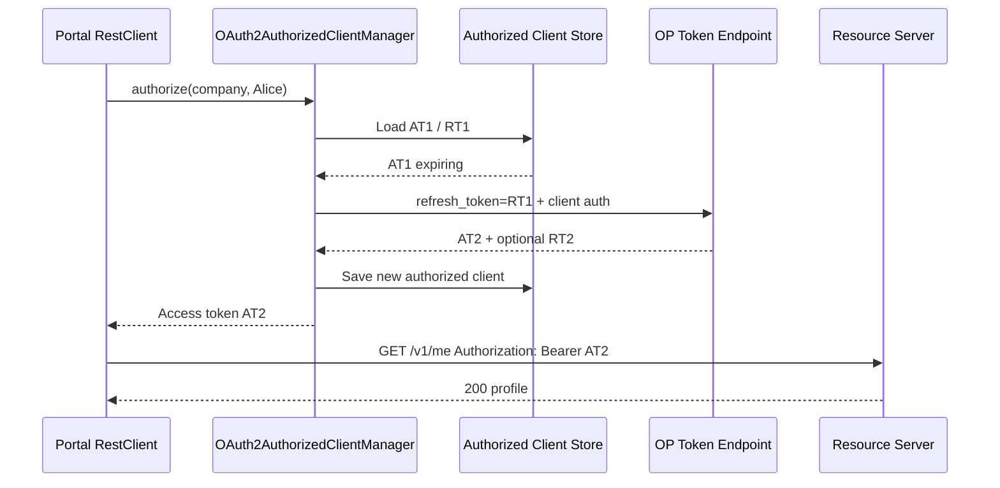

# 34.4. Calling an API on Behalf of a User with RestClient

In a **Spring Security OAuth 2.0 / OpenID Connect (OIDC) Client** application, a user logs into a web portal, and then the portal needs to call another API **using the delegated authority of that exact user**. For example, the user opens `/app/my-profile`, the portal retrieves the access token issued by the Authorization Server for that user, and calls `GET /v1/me` on the Resource Server.

Mistakenly using an **ID Token** as a Bearer token, hard-coding an access token, reusing one user's token for another user, or letting the server call a browser-supplied URL with `Authorization: Bearer ...` attached can cause broken behavior or severe credential leaks. This lab builds the proper path from **OIDC Login → OAuth2AuthorizedClient → RestClient → Resource Server**.

**Sample versions:** Java 17+, Spring Boot **3.5.x**, Spring Security **6.5.x**, and Spring Framework 6.2.x in **Servlet/Spring MVC**. `RestClient` was introduced in Spring Framework 6.1; OAuth2 Client integration via `OAuth2ClientHttpRequestInterceptor` arrived in Spring Security 6.4. Newer versions may have different APIs/auto-configuration, so always check the **Javadoc for your actual dependency version**. `https://id.example.test`, `http://localhost:8090`, client IDs, and tokens below are all **illustrative values**.

> **Lab goal:** The user logs in via Authorization Code + OIDC at the portal; the portal stores the OAuth2 authorized client per user; when the user requests their profile, `RestClient` automatically attaches the **access token** of that exact user to the outbound HTTP request; the API verifies the token and scopes; when the token expires, the authorized client manager can refresh it per OP policy. Never expose access tokens in browser responses.

---

## 1. What You Will Be Able to Do After This Lab

1. Distinguish between **browser session**, **ID Token**, **access token**, and **refresh token**.
2. Understand why `RestClient` does not automatically carry a Bearer token just because `http.oauth2Login()` is enabled.
3. Configure `ClientRegistration` with `authorization_code` and API scopes.
4. Connect `RestClient` to `OAuth2AuthorizedClientManager` using `OAuth2ClientHttpRequestInterceptor`.
5. Specify the right `clientRegistrationId` for outbound calls, scoping the authorized client to the currently logged-in principal.
6. Build an API client `@Service` and a controller returning only safe DTOs.
7. Build a Resource Server that verifies access tokens instead of trusting portal requests just because they share a network.
8. Verify states: unauthenticated, authenticated, valid/expired access token, missing scope, and API 401/403/5xx.
9. Use `MockRestServiceServer` to verify the outbound Bearer header without real credentials.
10. Know when fake OP integration tests are needed instead of `MockMvc.with(oidcLogin())`.
11. Handle token refresh, token rotation, logout, multiple providers, and multiple instances without mixing up tokens.
12. Defend against SSRF, redirect token leakage, over-scoping, secret logging, replay, and unauthorized cross-tenant access.

## 2. Real-World Problem: What Does "On Behalf of the User" Mean?

An architecture has three roles:

- **Portal (OAuth2/OIDC Client or Relying Party):** web application where users log in via a browser.
- **OpenID Provider / Authorization Server (OP/AS):** authenticates users, issues ID Tokens and access tokens, and optionally issues refresh tokens.
- **Resource Server (API):** owns the data; receives Bearer access tokens and validates token signatures, scopes, audience, and business permissions.

```mermaid
sequenceDiagram
    autonumber
    actor B as Alice's Browser
    participant P as Portal - Spring MVC
    participant OP as OpenID Provider
    participant API as Resource Server
    B->>P: GET /oauth2/authorization/company
    P-->>B: 302 OP /authorize, state + PKCE + nonce
    B->>OP: Login / consent
    OP-->>B: 302 /login/oauth2/code/company?code&state
    B->>P: Callback with RP session cookie
    P->>OP: POST /token - code + client authentication
    OP-->>P: ID Token + Access Token + optional Refresh Token
    P->>P: Verify ID Token, create SecurityContext
    P->>P: Save OAuth2AuthorizedClient per user + registration
    B->>P: GET /app/my-profile
    P->>P: OAuth2AuthorizedClientManager looks up valid AT
    opt AT expired and valid RT exists
        P->>OP: POST /token grant_type=refresh_token
        OP-->>P: New AT + optional new RT
    end
    P->>API: GET /v1/me; Authorization: Bearer AT
    API->>API: Validate signature / iss / aud / scope / user
    API-->>P: Alice's profile JSON
    P-->>B: Selected JSON DTO, NO token included
```

### 2.1. Not All Three Token Types Are the Same

| Value | Used By | Purpose | Sent to API? |
| --- | --- | --- | --- |
| **Session cookie** | Browser ↔ portal | Maintains Alice's web session | Not sent to a cross-origin Resource Server |
| **ID Token** | Portal/OIDC Relying Party | Proves authentication result to the client; has `iss`, `aud`, `sub`, `nonce` | **No** — never use as an API Bearer token |
| **Access token (AT)** | Portal → API | Allows Resource Server to decide what permissions the request holds | **Yes**, if the token has the right audience/scope |
| **Refresh token (RT)** | Portal → OP Token Endpoint | Obtains a new AT when the AT expires | **No** — never send to Resource Server |
| **Client secret/private key** | Portal → OP | Authenticates the OAuth2 client at the Token Endpoint | **No** — never send to Resource Server |

A validly signed ID Token still proves claims only for the **client audience**. Never accept an ID Token as an API access token.

### 2.2. Delegation Does Not Mean "The Portal Has Full Privileges"

Suppose the portal has registration `company` with scope `api.profile.read`. When Alice logs in and consents, the access token may only allow reading her profile. The API **must still** verify that Alice is authorized to read the specific object.

If the portal wants to read Bob's profile, it cannot just change `/v1/users/{id}` to Bob and expect an access token "on behalf of Alice" to allow it. The Resource Server must enforce ownership and tenant policies.

### 2.3. Difference from `client_credentials` and Token Exchange

- **Authorization Code + OIDC Login:** the user is present; the authorized client is bound to Alice and the OAuth2 registration.
- **Client Credentials:** the app authenticates with client credentials; the token represents the **application**, not Alice.
- **OAuth2 Token Exchange (RFC 8693):** exchanges one token for another suited to a target audience/delegation per AS policy; this is a separate flow and **does not happen automatically** when calling RestClient.
- **Token relay of an incoming Bearer token:** a different pattern; tokens must never be blindly forwarded to arbitrary hosts.

In this lab, we use the **token issued by the OP for Alice's browser-login authorized client**, not `client_credentials` and not ad-hoc "on-behalf-of" assertions.

## 3. Lab Architecture and Project Layout

```text
localhost:8080                         localhost:8090
+---------------------------------+   +------------------------+
| portal (Spring MVC)             |   | profile-api            |
| spring-boot-starter-oauth2-client|  | OAuth2 Resource Server |
|                                 |   |                        |
| /oauth2/authorization/company   |   | GET /v1/me             |
| /login/oauth2/code/company      |-->| validates access token |
| /app/my-profile                 |AT | scope, aud, ownership  |
| RestClient + OAuth2 interceptor |   |                        |
+---------------+-----------------+   +------------+-----------+
                |                                  ^
                v                                  |
      Trusted development OP / AS ----------------+
       - OIDC Discovery, JWKS
       - /authorize, /token
       - signed ID Token + access token
       - optional rotating refresh token
```

Suggested directory layout if building your own learning project:

```text
oidc-restclient-lab/
  portal/
    pom.xml
    src/main/java/example/portal/
      PortalApplication.java
      WebSecurityConfig.java
      OutboundRestClientConfig.java
      ProfileApiClient.java
      ProfileView.java
      MyProfileController.java
    src/main/resources/application.yml
    src/test/java/example/portal/
      ProfileApiClientTest.java
  profile-api/
    pom.xml
    src/main/java/example/api/
      ProfileApiApplication.java
      ApiSecurityConfig.java
      MeController.java
    src/main/resources/application.yml
```

**There is no requirement to create these exact directories in the current repository.** This is a self-contained lab: learners can spin up both Spring Boot apps or apply individual sections to an existing system.

## 4. Prerequisites Before Running

You need:

- JDK 17 or a runtime supported by the chosen Boot version.
- Maven Wrapper or Gradle Wrapper for the project.
- A sandbox OP such as Keycloak or a test-double OP supporting **OIDC Discovery**, authorization code, signed ID Tokens, and API access tokens.
- An OAuth2 client registration for **portal**.
- OP configured to accept redirect URI `http://localhost:8080/login/oauth2/code/company` for dev; production uses an HTTPS public URI.
- API scope `api.profile.read` registered and granted.
- Resource Server configured with the **issuer** and **audience** the OP uses for access tokens.
- A test user `alice` authorized to call `GET /v1/me`.
- Never place production accounts or secrets into example files.

### 4.1. OP Contract in This Lab

Assumed values:

| Property | Illustrative Value | Meaning |
| --- | --- | --- |
| OP issuer | `https://id.example.test/realms/lab` | Identity/trust boundary |
| Portal registration ID | `company` | Key in Spring `ClientRegistrationRepository` |
| Portal client ID | `portal-web` | OAuth2 client registered at the OP |
| Authorization grant | `authorization_code` | Browser user login |
| Client authentication | `client_secret_basic` | One option, depends on the OP |
| Redirect URI | `http://localhost:8080/login/oauth2/code/company` | Spring OAuth2 Login callback |
| Login scopes | `openid profile api.profile.read` | OIDC login + API read permission |
| Resource API base URL | `http://localhost:8090` | Dev only |
| Expected access-token audience | `profile-api` | Token intended solely for this API |
| Expected API authority | `SCOPE_api.profile.read` | Standard Spring Resource Server scope mapping |

**Important:** Not every OP automatically adds `aud=profile-api` to access tokens when you request scope `api.profile.read`. You may need to configure an audience mapper, resource indicator, or vendor-specific mechanism. If the OP issues **opaque access tokens**, the Resource Server needs token introspection or an equivalent mechanism rather than guessing with a JWT decoder.

### 4.2. Scope, Audience, and User Are Distinct

An access token with `scope=api.profile.read` whose `aud` targets a different API is **not valid** for `profile-api`.

An access token with `aud=profile-api` that lacks `api.profile.read` is **also insufficient**.

An access token with Alice's valid scope and audience **does not** authorize Alice to read all other users' data. The Resource Server must still check subject, ownership, and tenant.

## 5. Portal `pom.xml`

Maven dependencies for the portal:

```xml
<project xmlns="http://maven.apache.org/POM/4.0.0"
         xmlns:xsi="http://www.w3.org/2001/XMLSchema-instance"
         xsi:schemaLocation="http://maven.apache.org/POM/4.0.0
                             https://maven.apache.org/xsd/maven-4.0.0.xsd">
    <modelVersion>4.0.0</modelVersion>

    <parent>
        <groupId>org.springframework.boot</groupId>
        <artifactId>spring-boot-starter-parent</artifactId>
        <version>3.5.0</version>
        <relativePath/>
    </parent>

    <groupId>example</groupId>
    <artifactId>portal</artifactId>
    <version>0.0.1-SNAPSHOT</version>

    <properties>
        <java.version>17</java.version>
    </properties>

    <dependencies>
        <dependency>
            <groupId>org.springframework.boot</groupId>
            <artifactId>spring-boot-starter-web</artifactId>
        </dependency>
        <dependency>
            <groupId>org.springframework.boot</groupId>
            <artifactId>spring-boot-starter-security</artifactId>
        </dependency>
        <dependency>
            <groupId>org.springframework.boot</groupId>
            <artifactId>spring-boot-starter-oauth2-client</artifactId>
        </dependency>
        <dependency>
            <groupId>org.springframework.boot</groupId>
            <artifactId>spring-boot-starter-test</artifactId>
            <scope>test</scope>
        </dependency>
        <dependency>
            <groupId>org.springframework.security</groupId>
            <artifactId>spring-security-test</artifactId>
            <scope>test</scope>
        </dependency>
    </dependencies>

    <build>
        <plugins>
            <plugin>
                <groupId>org.springframework.boot</groupId>
                <artifactId>spring-boot-maven-plugin</artifactId>
            </plugin>
        </plugins>
    </build>
</project>
```

**Version 3.5.0 is pinned solely to illustrate 3.5/6.5 syntax**, not as a recommendation to run an old patch in production. In practice, choose a supported patch release and align with the BOM and exact-version Javadoc; never manually upgrade mismatched Spring Security JARs independently.

### 5.1. Equivalent Gradle Setup

When using Gradle, the corresponding dependencies are:

```groovy
plugins {
    id 'java'
    id 'org.springframework.boot' version '3.5.0'
    id 'io.spring.dependency-management' version '1.1.7'
}

java {
    toolchain {
        languageVersion = JavaLanguageVersion.of(17)
    }
}

dependencies {
    implementation 'org.springframework.boot:spring-boot-starter-web'
    implementation 'org.springframework.boot:spring-boot-starter-security'
    implementation 'org.springframework.boot:spring-boot-starter-oauth2-client'
    testImplementation 'org.springframework.boot:spring-boot-starter-test'
    testImplementation 'org.springframework.security:spring-security-test'
}

tasks.named('test') {
    useJUnitPlatform()
}
```

`RestClient` comes with Spring Web. `OAuth2ClientHttpRequestInterceptor` resides in `spring-security-oauth2-client` in supported versions; you do not need an unrelated OAuth2 SDK just to attach Bearer tokens.

## 6. Portal `application.yml`

```yaml
server:
  port: 8080

spring:
  security:
    oauth2:
      client:
        registration:
          company:
            provider: lab-op
            client-id: ${OIDC_CLIENT_ID:portal-web}
            client-secret: ${OIDC_CLIENT_SECRET}
            client-authentication-method: client_secret_basic
            authorization-grant-type: authorization_code
            redirect-uri: "{baseUrl}/login/oauth2/code/{registrationId}"
            scope:
              - openid
              - profile
              - api.profile.read
        provider:
          lab-op:
            issuer-uri: ${OIDC_ISSUER_URI}

lab:
  profile-api:
    base-url: ${PROFILE_API_BASE_URL:http://localhost:8090}
```

Before running, provide the dev environment variables:

```bash
export OIDC_CLIENT_ID=portal-web
export OIDC_CLIENT_SECRET=dev-only-secret-from-op
export OIDC_ISSUER_URI=https://id.example.test/realms/lab
export PROFILE_API_BASE_URL=http://localhost:8090
```

In Windows PowerShell:

```powershell
$env:OIDC_CLIENT_ID="portal-web"
$env:OIDC_CLIENT_SECRET="<dev-only-client-secret>"
$env:OIDC_ISSUER_URI="https://id.example.test/realms/lab"
$env:PROFILE_API_BASE_URL="http://localhost:8090"
```

**Do not use the literal `id.example.test` when running for real:** it is an illustrative domain. Replace it with your sandbox OP's issuer. `OIDC_CLIENT_SECRET` must come from your sandbox OP or secret manager and never be committed to the repository.

### 6.1. Why Use `issuer-uri`?

Spring builds `ClientRegistration` from metadata published via OIDC Discovery, including the authorization endpoint, token endpoint, and JWKS URI per provider. These values must match the **approved issuer**; never take an issuer from a user query parameter.

On startup, the application may make an HTTP discovery call to the issuer. If the sandbox OP is not running yet, context initialization can fail. You can configure static provider endpoints in a test profile to avoid network dependencies, while production must use verified trust configuration.

### 6.2. Why Is There No `access-token` Property in YAML?

An access token is a **credential issued after authorization**, unlike `client-id`/`client-secret` in `ClientRegistration`. Never hardcode access/refresh tokens in YAML or global beans.

### 6.3. Does HTTP Localhost Work?

This example uses HTTP to localhost for easy local dev setup; production must use **HTTPS/transport security and trusted proxy configuration**. Never send Bearer tokens to an external HTTP origin or connect to a user-chosen host.

## 7. Portal Application and Security Chain

`PortalApplication.java`:

```java
package example.portal;

import org.springframework.boot.SpringApplication;
import org.springframework.boot.autoconfigure.SpringBootApplication;

@SpringBootApplication
public class PortalApplication {
    public static void main(String[] args) {
        SpringApplication.run(PortalApplication.class, args);
    }
}
```

`WebSecurityConfig.java`:

```java
package example.portal;

import org.springframework.context.annotation.Bean;
import org.springframework.context.annotation.Configuration;
import org.springframework.security.config.Customizer;
import org.springframework.security.config.annotation.web.builders.HttpSecurity;
import org.springframework.security.web.SecurityFilterChain;

@Configuration
public class WebSecurityConfig {

    @Bean
    SecurityFilterChain webChain(HttpSecurity http) throws Exception {
        return http
                .authorizeHttpRequests(auth -> auth
                        .requestMatchers("/", "/error").permitAll()
                        .requestMatchers("/app/**").authenticated()
                        .anyRequest().authenticated())
                .oauth2Login(Customizer.withDefaults())
                .oauth2Client(Customizer.withDefaults())
                .build();
    }
}
```

With this configuration:

- `GET /app/my-profile` requires authentication.
- If unauthenticated, the browser is redirected to the login/authorization entry point per configuration.
- `oauth2Login` handles Authorization Code/OIDC Login.
- `oauth2Client` enables OAuth2 client support in the security configuration.
- CSRF remains enabled. If you add browser-session POST/PUT/DELETE endpoints, protect them with CSRF.
- The `oidcLogin()` test helper **does not appear here**; this is production DSL.

### 7.1. Default Login Paths

With registration ID `company`:

```text
GET http://localhost:8080/oauth2/authorization/company
```

Spring Security handles the default callback at:

```text
GET http://localhost:8080/login/oauth2/code/company?code=...&state=...
```

The OP must register the exact redirect URI. Reverse proxies, HTTPS, `Host`, and forwarded headers must align; otherwise the OP can return `invalid_redirect_uri`.

### 7.2. After Login, What Type Is the Principal?

With the `openid` scope and a valid OIDC OP, the principal is typically an `OidcUser` inside an `OAuth2AuthenticationToken`. The name/subject on `Authentication` represents the RP session identity; it is **not** a Bearer access token.

Crucially, `OAuth2AuthorizedClient` is stored associated with **registration `company` and the current principal**. That is the source of the access token for outbound calls.

## 8. Configuring `OAuth2AuthorizedClientManager` for Servlet Requests

`OAuth2AuthorizedClientManager` coordinates looking up authorized clients, obtaining/refreshing tokens via providers, and persisting results in a repository.

`AuthorizedClientManagerConfig.java`:

```java
package example.portal;

import org.springframework.context.annotation.Bean;
import org.springframework.context.annotation.Configuration;
import org.springframework.security.oauth2.client
        .DefaultOAuth2AuthorizedClientManager;
import org.springframework.security.oauth2.client
        .OAuth2AuthorizedClientManager;
import org.springframework.security.oauth2.client
        .OAuth2AuthorizedClientProvider;
import org.springframework.security.oauth2.client
        .OAuth2AuthorizedClientProviderBuilder;
import org.springframework.security.oauth2.client.registration
        .ClientRegistrationRepository;
import org.springframework.security.oauth2.client.web
        .OAuth2AuthorizedClientRepository;

@Configuration
public class AuthorizedClientManagerConfig {

    @Bean
    OAuth2AuthorizedClientManager authorizedClientManager(
            ClientRegistrationRepository registrations,
            OAuth2AuthorizedClientRepository authorizedClients) {

        OAuth2AuthorizedClientProvider provider =
                OAuth2AuthorizedClientProviderBuilder.builder()
                        .authorizationCode()
                        .refreshToken()
                        .build();

        var manager = new DefaultOAuth2AuthorizedClientManager(
                registrations, authorizedClients);
        manager.setAuthorizedClientProvider(provider);
        return manager;
    }
}
```

We declare this bean explicitly so learners can see the dependency wiring. Some Spring Security/Spring Boot versions provide a default manager bean if none is defined; if a suitable manager already exists, **do not create two competing beans for the same role**. Check the auto-configuration for your version.

### 8.1. Why Use `authorizationCode()` and `refreshToken()`?

- `authorizationCode()` supports logic related to the Authorization Code grant.
- `refreshToken()` lets the manager refresh an issued access token when eligible and when a refresh token is present.
- Whether the OP issues a refresh token depends on profile, `offline_access`/consent/policy; **the `openid` scope alone does not guarantee an RT**.
- When no RT exists, the manager cannot magically "renew" the token; re-authentication/re-authorization may be required.

### 8.2. Should You Add `clientCredentials()`?

Not for a lab focused on **calling on behalf of the user**. If you add `client_credentials` to the same manager, ensure each registration/grant/principal remains strictly isolated so an application token is never accidentally used in place of Alice's token.

A scheduled job needing an **application** token should use a dedicated registration/manager, typically via `AuthorizedClientServiceOAuth2AuthorizedClientManager` with `OAuth2AuthorizedClientService`. Never reuse a user's browser token in a background task without explicit entitlement and consent.

### 8.3. Where Does the Repository Store Tokens?

`OAuth2AuthorizedClientRepository`/`OAuth2AuthorizedClientService` have multiple implementations; default storage and save/load mechanics vary depending on actual beans and configuration.

| Scenario | Typical Storage | What to Watch Out For |
| --- | --- | --- |
| Browser servlet session | `HttpSessionOAuth2AuthorizedClientRepository` | Session timeout and session distribution |
| Authenticated principal service | `AuthenticatedPrincipalOAuth2AuthorizedClientRepository` + service | Shared DB, cleanup, and tenant isolation |
| JDBC/custom | `OAuth2AuthorizedClientService` or custom repository | Encryption, rotation, and conditional persistence |
| Background process | Service-backed manager | No `HttpServletRequest`; separate from user session |

**Do not assume a multi-node application shares tokens automatically** just because you added `oauth2Client()`. Always inspect the actual storage implementation.

## 9. Creating `RestClient` with an OAuth2 Interceptor

This is the centerpiece of the lab.

`OutboundRestClientConfig.java`:

```java
package example.portal;

import org.springframework.beans.factory.annotation.Value;
import org.springframework.context.annotation.Bean;
import org.springframework.context.annotation.Configuration;
import org.springframework.security.oauth2.client
        .OAuth2AuthorizedClientManager;
import org.springframework.security.oauth2.client.web.client
        .OAuth2ClientHttpRequestInterceptor;
import org.springframework.web.client.RestClient;

@Configuration
public class OutboundRestClientConfig {

    @Bean
    RestClient profileApiRestClient(
            RestClient.Builder builder,
            OAuth2AuthorizedClientManager manager,
            @Value("${lab.profile-api.base-url}") String baseUrl) {

        var oauth2 = new OAuth2ClientHttpRequestInterceptor(
                manager);

        return builder
                .baseUrl(baseUrl)
                .requestInterceptor(oauth2)
                .build();
    }
}
```

When an outbound request is executed with a resolved `clientRegistrationId` and principal, the interceptor:

1. Calls the authorized client manager to obtain the appropriate authorized client.
2. If the token is still valid per policy, uses the stored access token.
3. If the token needs refreshing and an eligible RT/provider exists, the manager can call the Token Endpoint to get a new token and persist it in the repository.
4. Sets the access token as the Bearer credential in the request's HTTP `Authorization` header.
5. Sends the request via the HTTP client to the configured Resource Server.

**You do not need to write a custom interceptor that concatenates** `"Bearer " + accessToken` in most cases when this API meets your needs. Hand-rolling it risks missing refresh handling, principal scoping, failure handling, or logout cleanup.

### 9.1. Which Spring Security Version?

`OAuth2ClientHttpRequestInterceptor` lives in:

```java
org.springframework.security.oauth2.client.web.client
        .OAuth2ClientHttpRequestInterceptor
```

This integration was introduced in Spring Security 6.4+; older Boot 3.x releases do not include this class. If your IDE cannot find it, check:

```bash
./mvnw dependency:tree -Dincludes=org.springframework.security
```

or:

```bash
./gradlew dependencyInsight --dependency spring-security-oauth2-client --configuration runtimeClasspath
```

Never upgrade `spring-security-oauth2-client` alone out of sync with `spring-security-core`, `config`, and `web` just to get this interceptor. Upgrade the full compatible release train via the Boot BOM and migration guides.

### 9.2. `RestClient.Builder` Instead of a Global `RestClient` for All APIs

Define a dedicated bean named `profileApiRestClient` bound to **one trusted base URL**. Do not create a global `RestClient` that attaches Bearer tokens to any hostname business code calls. When calling public APIs or other hosts, create a **separate `RestClient` without the OAuth2 interceptor**, or configure explicit per-trusted-service token routing.

### 9.3. Does the Interceptor Automatically Know Which Registration to Use?

By default, the interceptor uses `RequestAttributeClientRegistrationIdResolver` to read the registration ID from **RestClient request attributes**. It cannot guess the right client from an arbitrary business ID.

You must pass:

```java
.attributes(clientRegistrationId("company"))
```

or configure an explicit resolver (covered later).

## 10. `ProfileView` — DTO Returned to the Browser

`ProfileView.java`:

```java
package example.portal;

public record ProfileView(String subject, String displayName) {}
```

The DTO holds only the profile fields needed for display. It **never** contains the access token, refresh token, ID Token, `OAuth2AuthorizedClient`, or headers from the outbound response.

Even if the API JSON contains many fields, the portal should map only the fields required under appropriate privacy and authorization policies.

## 11. Calling the API with `RestClient` in a Service

`ProfileApiClient.java`:

```java
package example.portal;

import static org.springframework.security.oauth2.client.web.client
        .RequestAttributeClientRegistrationIdResolver
        .clientRegistrationId;

import org.springframework.stereotype.Service;
import org.springframework.web.client.RestClient;

@Service
public class ProfileApiClient {

    private static final String REGISTRATION_ID = "company";
    private final RestClient profileApiRestClient;

    public ProfileApiClient(RestClient profileApiRestClient) {
        this.profileApiRestClient = profileApiRestClient;
    }

    public ProfileView loadMyProfile() {
        ProfileView result = this.profileApiRestClient
                .get()
                .uri("/v1/me")
                .attributes(clientRegistrationId(REGISTRATION_ID))
                .retrieve()
                .body(ProfileView.class);

        if (result == null) {
            throw new IllegalStateException(
                    "Profile API returned an empty body");
        }
        return result;
    }
}
```

**Line-by-line highlights:**

- `get()`: outbound HTTP GET.
- `uri("/v1/me")`: relative URI under the trusted base URL, never a browser-supplied URL.
- `attributes(clientRegistrationId("company"))`: selects the **OAuth2 client registration**; never swap credentials from user input.
- `retrieve().body(ProfileView.class)`: executes the request, checks HTTP status per `RestClient` contract, and deserializes JSON into the DTO.
- No manual `SecurityContextHolder` access in the service; the default interceptor principal resolver reads from the current request thread's `SecurityContext`.

### 11.1. Exact Static Import

```java
import static org.springframework.security.oauth2.client.web.client
        .RequestAttributeClientRegistrationIdResolver
        .clientRegistrationId;
```

Do not import the identically named helper from `ServletOAuth2AuthorizedClientExchangeFilterFunction` (which is for **WebClient**) or another HTTP service client API. They share the name `clientRegistrationId` but have incompatible attribute semantics between `RestClient` and `WebClient`.

### 11.2. Why Is `RegistrationId` Hardcoded?

In this lab there is a single trusted registration for the API. Letting the service select `company` prevents users from injecting:

```text
?registrationId=attacker-client
?resourceUrl=https://attacker.example
```

In a multi-provider app, outbound registrations are chosen using **server-side policy and verified Authentication**, never raw query parameters. See Section 19 for multi-service examples.

### 11.3. Do Not Instantiate `RestClient` on Every Controller Call

`RestClient` is reusable. A singleton bean manages interceptors and the underlying HTTP connector. Creating a new client per request defeats connection pooling/tracing, leads to inconsistent token attachment, and complicates timeouts/retries.

### 11.4. Should You Manually Set the `Authorization` Header?

No. The interceptor handles it. Adding:

```java
.headers(h -> h.setBearerAuth(userSuppliedToken))
```

risks overwriting the right token with a user-supplied value. Never manually set a Bearer header when the OAuth2 interceptor is responsible for selecting the authorized client.

## 12. Controller Calling the Service Without Returning Tokens

`MyProfileController.java`:

```java
package example.portal;

import org.springframework.web.bind.annotation.GetMapping;
import org.springframework.web.bind.annotation.RestController;

@RestController
public class MyProfileController {

    private final ProfileApiClient profileApiClient;

    public MyProfileController(ProfileApiClient profileApiClient) {
        this.profileApiClient = profileApiClient;
    }

    @GetMapping("/app/my-profile")
    public ProfileView myProfile() {
        return profileApiClient.loadMyProfile();
    }
}
```

Browser calls:

```http
GET /app/my-profile HTTP/1.1
Host: localhost:8080
Cookie: JSESSIONID=<browser-session-id>
```

Portal sends to Resource Server:

```http
GET /v1/me HTTP/1.1
Host: localhost:8090
Authorization: Bearer <access-token-of-current-user>
Accept: application/json
```

Portal responds:

```json
{
  "subject": "alice-subject",
  "displayName": "Alice"
}
```

Never return:

```json
{
  "access_token": "...",
  "refresh_token": "...",
  "id_token": "...",
  "client_secret": "..."
}
```

The sample response only illustrates structure; actual `subject` and `displayName` come from the API, never blindly trusted from a browser request field.

## 13. Resource Server Application to Verify the Token

In a real system, the Resource Server is a separate service. To practice end-to-end, create a Spring Boot app at `localhost:8090`.

### 13.1. `profile-api/pom.xml`

```xml
<project xmlns="http://maven.apache.org/POM/4.0.0"
         xmlns:xsi="http://www.w3.org/2001/XMLSchema-instance"
         xsi:schemaLocation="http://maven.apache.org/POM/4.0.0
                             https://maven.apache.org/xsd/maven-4.0.0.xsd">
  <modelVersion>4.0.0</modelVersion>
  <parent>
    <groupId>org.springframework.boot</groupId>
    <artifactId>spring-boot-starter-parent</artifactId>
    <version>3.5.0</version>
    <relativePath/>
  </parent>
  <groupId>example</groupId>
  <artifactId>profile-api</artifactId>
  <version>0.0.1-SNAPSHOT</version>
  <properties>
    <java.version>17</java.version>
  </properties>
  <dependencies>
    <dependency>
      <groupId>org.springframework.boot</groupId>
      <artifactId>spring-boot-starter-web</artifactId>
    </dependency>
    <dependency>
      <groupId>org.springframework.boot</groupId>
      <artifactId>spring-boot-starter-security</artifactId>
    </dependency>
    <dependency>
      <groupId>org.springframework.boot</groupId>
      <artifactId>spring-boot-starter-oauth2-resource-server</artifactId>
    </dependency>
    <dependency>
      <groupId>org.springframework.boot</groupId>
      <artifactId>spring-boot-starter-test</artifactId>
      <scope>test</scope>
    </dependency>
    <dependency>
      <groupId>org.springframework.security</groupId>
      <artifactId>spring-security-test</artifactId>
      <scope>test</scope>
    </dependency>
  </dependencies>
  <build>
    <plugins>
      <plugin>
        <groupId>org.springframework.boot</groupId>
        <artifactId>spring-boot-maven-plugin</artifactId>
      </plugin>
    </plugins>
  </build>
</project>
```

### 13.2. Resource Server `application.yml`

```yaml
server:
  port: 8090

spring:
  security:
    oauth2:
      resourceserver:
        jwt:
          issuer-uri: ${OIDC_ISSUER_URI}

lab:
  resource:
    audience: profile-api
```

The JWT decoder requires accurate issuer/JWKS trust configuration. Never read an issuer from an unverified JWT and dynamically fetch an arbitrary `jwks_uri`.

### 13.3. API Application Class

```java
package example.api;

import org.springframework.boot.SpringApplication;
import org.springframework.boot.autoconfigure.SpringBootApplication;

@SpringBootApplication
public class ProfileApiApplication {
    public static void main(String[] args) {
        SpringApplication.run(ProfileApiApplication.class, args);
    }
}
```

### 13.4. API Security Chain

`ApiSecurityConfig.java`:

```java
package example.api;

import org.springframework.context.annotation.Bean;
import org.springframework.context.annotation.Configuration;
import org.springframework.http.HttpMethod;
import org.springframework.security.config.Customizer;
import org.springframework.security.config.annotation.web.builders.HttpSecurity;
import org.springframework.security.config.http.SessionCreationPolicy;
import org.springframework.security.web.SecurityFilterChain;

@Configuration
public class ApiSecurityConfig {

    @Bean
    SecurityFilterChain resourceApiChain(HttpSecurity http)
            throws Exception {

        return http
                .securityMatcher("/v1/**")
                .authorizeHttpRequests(auth -> auth
                        .requestMatchers(HttpMethod.GET, "/v1/me")
                            .hasAuthority("SCOPE_api.profile.read")
                        .anyRequest().denyAll())
                .sessionManagement(session -> session
                        .sessionCreationPolicy(
                                SessionCreationPolicy.STATELESS))
                .csrf(csrf -> csrf.disable())
                .oauth2ResourceServer(oauth2 -> oauth2
                        .jwt(Customizer.withDefaults()))
                .build();
    }
}
```

**`csrf.disable()` in this example applies strictly to a stateless API accepting Bearer tokens without browser session cookies.** Never copy this into the portal that uses login sessions and form POSTs. In a mixed cookie/bearer Resource Server or other security models, design CSRF policy separately.

### 13.5. Validating Audience When Verifying JWTs

A default setup may validate issuer and timestamps, but **never assume the Resource Server automatically enforces your desired API audience**. Add an audience validator or configure API audience validation for your version:

```java
package example.api;

import org.springframework.beans.factory.annotation.Value;
import org.springframework.context.annotation.Bean;
import org.springframework.context.annotation.Configuration;
import org.springframework.security.oauth2.core.DelegatingOAuth2TokenValidator;
import org.springframework.security.oauth2.core.OAuth2Error;
import org.springframework.security.oauth2.core.OAuth2TokenValidator;
import org.springframework.security.oauth2.core.OAuth2TokenValidatorResult;
import org.springframework.security.oauth2.jwt.Jwt;
import org.springframework.security.oauth2.jwt.JwtDecoder;
import org.springframework.security.oauth2.jwt.JwtValidators;
import org.springframework.security.oauth2.jwt.NimbusJwtDecoder;

@Configuration
class JwtAudienceConfig {

    @Bean
    JwtDecoder jwtDecoder(
            @Value("${spring.security.oauth2.resourceserver.jwt.issuer-uri}")
            String issuer,
            @Value("${lab.resource.audience}") String audience) {

        NimbusJwtDecoder decoder =
                NimbusJwtDecoder.withIssuerLocation(issuer).build();

        OAuth2TokenValidator<Jwt> audienceValidator = jwt ->
                jwt.getAudience().contains(audience)
                        ? OAuth2TokenValidatorResult.success()
                        : OAuth2TokenValidatorResult.failure(
                                new OAuth2Error(
                                        "invalid_token",
                                        "Required API audience is missing",
                                        null));

        decoder.setJwtValidator(
                new DelegatingOAuth2TokenValidator<>(
                        JwtValidators.createDefaultWithIssuer(issuer),
                        audienceValidator));

        return decoder;
    }
}
```

Notes:

- `JwtDecoder` here validates **incoming access tokens at the Resource Server**; it is not the portal's ID Token decoder.
- This snippet registers **one `JwtDecoder` bean** replacing Boot's default decoder; never declare two competing beans.
- It assumes access tokens are **JWTs**. If the OP issues **opaque tokens**, use token introspection per the OP contract.
- JWT signature, issuer, expiry, and audience must all be validated; **never simply parse a `Jwt` and trust its claims**.
- In production, also enforce `alg` allowlists/JWKS/tenant policies and security-profile validators rather than accepting arbitrary key types requested by JWT headers.

### 13.6. API Controller Reads Identity from Token, Not Query Params

`MeController.java`:

```java
package example.api;

import org.springframework.security.core.annotation.AuthenticationPrincipal;
import org.springframework.security.oauth2.jwt.Jwt;
import org.springframework.web.bind.annotation.GetMapping;
import org.springframework.web.bind.annotation.RestController;

@RestController
public class MeController {

    public record ProfileView(String subject, String displayName) {}

    @GetMapping("/v1/me")
    public ProfileView me(@AuthenticationPrincipal Jwt token) {
        String subject = token.getSubject();
        String display = token.getClaimAsString("preferred_username");

        if (display == null || display.isBlank()) {
            display = subject;
        }
        return new ProfileView(subject, display);
    }
}
```

This example trusts **claims from the JWT verified by Spring Security Resource Server per configuration**, never `?userId=...` from the browser.

If the API manages real internal data, it must also map the verified `(issuer, sub)` to an internal account/tenant in the DB and verify object-level permissions before returning data.

## 14. Running the Lab in Sequence

1. Start the sandbox OP and create client `portal-web` with Authorization Code flow and the exact redirect URI.
2. Configure the OP to issue access tokens for audience `profile-api` and scope `api.profile.read`; create a test user.
3. Start `profile-api` on port 8090 with the same issuer URI.
4. Start `portal` on port 8080 with the sandbox client ID/secret.
5. Open a browser to `http://localhost:8080/oauth2/authorization/company`.
6. Log in with the test user at the OP.
7. After a successful callback, open `http://localhost:8080/app/my-profile`.
8. Verify the JSON reflects the right user and that the API only received a Bearer access token.
9. Test missing-scope and expired-AT scenarios.
10. Perform logout and verify session/browser policy.

In each Maven module:

```bash
./mvnw spring-boot:run
```

Or Gradle:

```bash
./gradlew bootRun
```

Use two separate terminals. These commands only work once you have created the files and configured a real OP; do not treat `.test` URLs as live services.

### 14.1. Three Mandatory Observations

**Observation A — browser to portal**

```http
GET /app/my-profile
Cookie: JSESSIONID=<opaque-session-cookie>
```

**Observation B — portal to API**

```http
GET /v1/me
Authorization: Bearer <opaque-access-token>
```

**Observation C — API response**

```json
{
  "subject": "alice-subject",
  "displayName": "alice"
}
```

Do not screenshot or share raw cookies/tokens to prove the flow. In tests, use counters and redacted metadata.

## 15. Why Does the Interceptor Need the Current `principal`?

By design, an authorized client is keyed by:

```text
ClientRegistration ID + Principal + security/storage context
```

With `OAuth2ClientHttpRequestInterceptor`, the default principal resolver fetches the current `Authentication` from `SecurityContextHolder`. Thus, on a Servlet request handling Alice:

```text
SecurityContextHolder.getContext().getAuthentication()
                       |
                       v
                  principal Alice
                       |
                       v
     authorized client ("company", Alice)
                       |
                       v
                     AT_A
```

When Bob logs in and calls the same endpoint:

```text
authorized client ("company", Bob) -> AT_B
```

**Never use `AT_A` for Bob's request.**

### 15.1. `ClientRegistration` Is Not `OAuth2AuthorizedClient`

| Type | Holds | Lifecycle |
| --- | --- | --- |
| `ClientRegistration` | Registration ID, issuer, client ID, auth method, scopes, redirect URI, endpoints | OAuth2 client configuration |
| `OAuth2AuthorizedClient` | Registration + principal + access token + optional refresh token | Authorization granted to user/app |
| `OAuth2AuthenticationToken` | Authenticated OAuth2 user + registration ID | Browser login Authentication |
| `SecurityContext` | Active Authentication | Request/session |
| `RestClient` | Outbound HTTP config and interceptors | Reusable bean |

Multiple users share **one** `ClientRegistration` but have **separate authorized clients**.

### 15.2. Two Users with the Same `sub` Across Two Issuers

`sub="123"` is meaningful only within its issuer. Never assume `sub=123` from OP Alpha and OP Beta belong to the same account. Token storage and identity mapping must respect registration/issuer/tenant boundaries; never store authorization state in a singleton `currentAccessToken`.

## 16. Configuring a Registration Resolver Based on the Current User

In this lab, the service only calls provider `company`, so it uses an explicit request attribute. In a multi-OP system, you can resolve the registration ID from the **verified `OAuth2AuthenticationToken`**:

```java
package example.portal;

import org.springframework.context.annotation.Bean;
import org.springframework.context.annotation.Configuration;
import org.springframework.security.core.Authentication;
import org.springframework.security.core.context.SecurityContextHolder;
import org.springframework.security.oauth2.client
        .OAuth2AuthorizedClientManager;
import org.springframework.security.oauth2.client.authentication
        .OAuth2AuthenticationToken;
import org.springframework.security.oauth2.client.web.client
        .OAuth2ClientHttpRequestInterceptor;
import org.springframework.web.client.RestClient;

@Configuration
class LoginBasedRestClientConfig {

    @Bean("loginBasedRestClient")
    RestClient loginBasedRestClient(
            OAuth2AuthorizedClientManager manager) {

        var oauth2 = new OAuth2ClientHttpRequestInterceptor(
                manager);

        oauth2.setClientRegistrationIdResolver(request -> {
            Authentication auth = SecurityContextHolder
                    .getContext().getAuthentication();

            return auth instanceof OAuth2AuthenticationToken login
                    ? login.getAuthorizedClientRegistrationId()
                    : null;
        });

        return RestClient.builder()
                .baseUrl("https://resource.example.test")
                .requestInterceptor(oauth2)
                .build();
    }
}
```

**This is an alternative configuration; do not define it alongside the bean in Section 9 unless you intentionally use both.**

Checks to keep in mind:

- `OAuth2AuthenticationToken` must originate from a **trusted login flow**, never constructed from a request parameter.
- Not every OP registration is authorized to call **the same Resource Server**.
- If Alpha and Beta log users in from different issuers, does the API accept both? Are scopes/audiences compatible?
- When `Authentication` is not an OAuth2 login (e.g., username/password or `JwtAuthenticationToken`), the resolver returns null; handle that explicitly instead of falling back to an application-wide token.
- Never use this resolver to silently fall back to `client_credentials` when no user is present.

### 16.1. Do Not Infer Provider from Email Domain Alone

Email domains can change, be aliased, or remain unverified. Choose the client registration using vetted identity/issuer and server-side tenant policy. If business logic lets users pick a connected account, the server must verify ownership of the authorized client before using it.

### 16.2. When `SecurityContextHolder` Is Unavailable

A scheduled task, async thread, or worker queue outside a Servlet request context does not carry the browser's `SecurityContext`. Never fall back to "just use the last logged-in user".

If delegated background access is truly required, build a workflow that records consent/grants properly, uses a service-backed token store, passes a trusted principal reference, and enforces authorization at execution time. A manager suited for non-request contexts can be used there; that is **not** the default path of this lab.

## 17. Custom `principal` Resolvers and the Application-Wide Token Trap

The interceptor uses a `PrincipalResolver`. By default it uses `SecurityContextHolderPrincipalResolver`; you can replace it with `RequestAttributePrincipalResolver` to pass a principal name via request attributes.

Example for a **`client_credentials`** model — never use this as a substitute for this lab's user flow:

```java
import static org.springframework.security.oauth2.client.web.client
        .RequestAttributePrincipalResolver.principal;

// Only when the interceptor is configured with
// new RequestAttributePrincipalResolver() and the registration
// uses client_credentials per policy.
restClient.get()
        .uri("/internal/status")
        .attributes(clientRegistrationId("service-account"))
        .attributes(principal("my-application"))
        .retrieve()
        .toBodilessEntity();
```

Setting `principal="my-application"` for every user's `authorization_code` request **destroys per-user isolation** and causes one user's access token to be stored under a shared principal. Never use this pattern for Alice/Bob just to "cache fewer tokens".

In this lab, keeping the default principal resolver is correct.

## 18. When the Access Token Expires: How Refresh Works

Suppose the OP issues:

```text
Alice:
  AT1 expires at T1
  RT1 available
```

When `/app/my-profile` is called near T1:

1. The interceptor asks the manager for Alice's authorized client for `company`.
2. The manager checks `AT1` against expiry and the provider's clock skew.
3. If needed and `RT1` is valid, the `refresh_token` provider calls the Token Endpoint with `RT1` and client authentication.
4. The OP returns `AT2` and optionally `RT2` (if RT rotation is enabled).
5. The manager/service/repository persists the updated authorized client.
6. The interceptor calls the API using `AT2`.



### 18.1. What If There Is No RT?

Not every OP issues refresh tokens for browser logins. Having the `openid` scope and an ID Token **does not guarantee** an RT. Obtaining an RT may require `offline_access`, extra consent, or OP-specific policy.

If the AT expires and no RT exists, the system must prompt for re-authorization/re-login. Never try to use the ID Token to request new API tokens.

### 18.2. RT Rotation vs. AT Refresh

If the OP enforces refresh token rotation:

```text
RT1 --refresh--> AT2, RT2
RT2 --refresh--> AT3, RT3
```

Once `RT2` is received, never overwrite it with `RT1` from a concurrent request. In multi-instance deployments, the default manager does not provide **distributed single-flight locking**; verify concurrency behavior against your token store and OP policy.

### 18.3. How to Test Token Refresh

- Use a fake OP or sandbox OP configured to issue short-lived ATs.
- Count how many times the Token Endpoint receives `grant_type=refresh_token`.
- Verify `AT2` is sent to the API, not `AT1`.
- Verify `RT2` is persisted if the OP rotates tokens.
- Verify Bob's RT is untouched when Alice refreshes.
- Avoid long `Thread.sleep` calls for timeout testing; use clocks/test fixtures where possible.
- Test that reusing `RT1` triggers `invalid_grant` and is never retried endlessly.

## 19. Multiple Resource Servers or Providers

A portal might call:

```text
Profile API  -> OAuth2 registration company-profile
Billing API  -> OAuth2 registration company-billing
Partner API  -> OAuth2 registration partner
```

Never reuse one API's access token for another API. Tokens have distinct **audience, scope, and trust boundaries**.

Design guidelines:

- Each service uses a dedicated trusted `RestClient` with a fixed base URL.
- Each outbound call attaches the matching registration ID.
- Only call an API when the user holds a valid authorized client for it.
- Each Resource Server validates `iss`, `aud`, scopes, and business authorization.
- Never let the browser pick `registrationId` arbitrarily to probe linked accounts.

Example with two services:

```java
// Trusted profile service:
profileRestClient.get()
        .uri("/v1/me")
        .attributes(clientRegistrationId("company-profile"))
        .retrieve()
        .body(ProfileView.class);

// Trusted billing service:
billingRestClient.get()
        .uri("/v1/invoices")
        .attributes(clientRegistrationId("company-billing"))
        .retrieve()
        .body(String.class);
```

**Not every OP allows two registrations to share one authorized user state.** A new registration generally requires its own authorization/consent. Never copy an RT from one registration to another.

### 19.1. Is "User Logged In with Company" Enough for Billing?

Not necessarily. Browser login proves the user authenticated; the authorized client/token scopes for billing might not have been granted yet. The manager may need to initiate a separate Authorization Code Flow for consent per policy.

### 19.2. Calling an API with a Different Audience

If an AT was issued for `profile-api` and you need to call `billing-api`, do not simply change the `Host` header and forward the token. Use OP-supported authorization, token exchange, resource indicators, or consent flows; that is a separate grant/profile task.

## 20. Distinguishing Errors Across Portal, OP, and Resource Server

A `GET /app/my-profile` request can fail at multiple layers.

| Layer | Signal | Common Meaning |
| --- | --- | --- |
| Portal session | Redirect to login / 401 | User is not authenticated at the RP |
| Authorized client lookup | Missing authorized client | Registration not authorized or storage mismatch |
| OP Token Endpoint | `invalid_client` | Misconfigured client authentication/secret/key |
| OP Token Endpoint | `invalid_grant` | Expired, revoked, or reused authorization code/RT |
| OP Token Endpoint | Timeout / 5xx | OP/network unavailable; refresh outcome may be ambiguous |
| Resource Server | **401** + `invalid_token` | Invalid/expired/revoked AT or bad issuer/audience |
| Resource Server | **403** + `insufficient_scope` | Valid AT but lacking required scope/permission |
| Resource Server | 404 / 500 | Route, data, or server failure |
| HTTP client | TLS / timeout / connect refused | Network, certificate, or client configuration issue |
| Portal JSON decoder | Decode / empty body | API schema or response mismatch |

**A downstream 401 does not necessarily mean the browser session expired.** **A downstream 403 must never trigger swapping scopes or tokens to bypass authorization.**

### 20.1. Anti-Patterns to Avoid

- Receiving `401` from the API and automatically adding `api.admin` scope.
- Seeing `invalid_client` and trying another tenant's secret.
- Seeing `invalid_grant` and retrying `RT1` forever.
- Receiving `403` and using an application admin token to execute the action for the user.
- Switching `jwks_uri` to a host suggested by a response body.
- Disabling Resource Server JWT validation.
- Automatically retrying side-effecting POST/DELETE calls after HTTP timeouts without an idempotency policy.
- Logging full `Authorization` headers to debug.

### 20.2. Handling HTTP Errors in the Portal

`RestClient.retrieve()` throws exceptions on 4xx/5xx statuses. One approach is mapping downstream errors in controller advice to sanitized responses:

```java
package example.portal;

import java.util.Map;

import org.springframework.http.HttpStatus;
import org.springframework.http.ResponseEntity;
import org.springframework.web.bind.annotation.ExceptionHandler;
import org.springframework.web.bind.annotation.RestControllerAdvice;
import org.springframework.web.client.HttpClientErrorException;
import org.springframework.web.client.RestClientResponseException;

@RestControllerAdvice
public class ProfileApiErrorHandler {

    @ExceptionHandler(HttpClientErrorException.Forbidden.class)
    ResponseEntity<Map<String, String>> forbidden() {
        return ResponseEntity.status(HttpStatus.FORBIDDEN)
                .body(Map.of("error", "profile_access_denied"));
    }

    @ExceptionHandler(HttpClientErrorException.Unauthorized.class)
    ResponseEntity<Map<String, String>> apiUnauthorized() {
        return ResponseEntity.status(HttpStatus.BAD_GATEWAY)
                .body(Map.of("error", "profile_api_authentication_failed"));
    }

    @ExceptionHandler(RestClientResponseException.class)
    ResponseEntity<Map<String, String>> upstream() {
        return ResponseEntity.status(HttpStatus.BAD_GATEWAY)
                .body(Map.of("error", "profile_api_unavailable"));
    }
}
```

This is an **illustrative policy**, not a rule that every downstream 403 must return 403 to the browser. For UI pages, you might render a connection/consent prompt; for public APIs, define an explicit error contract.

Never pass raw exception bodies, internal endpoint/token URLs, or upstream HTTP headers to the browser. Non-`RestClientResponseException` failures (TLS/connect/timeout) also need dedicated handlers returning safe errors.

## 21. Failure Handler for `OAuth2ClientHttpRequestInterceptor`

Per the Spring Security 6.5 reference, you can configure an `OAuth2AuthorizationFailureHandler` to remove invalid authorized clients/tokens when the Resource Server rejects a token, avoiding repeated use of rejected credentials.

A variant of `OutboundRestClientConfig`:

```java
package example.portal;

import org.springframework.context.annotation.Bean;
import org.springframework.context.annotation.Configuration;
import org.springframework.security.oauth2.client
        .OAuth2AuthorizedClientManager;
import org.springframework.security.oauth2.client
        .OAuth2AuthorizationFailureHandler;
import org.springframework.security.oauth2.client.web
        .OAuth2AuthorizedClientRepository;
import org.springframework.security.oauth2.client.web.client
        .OAuth2ClientHttpRequestInterceptor;
import org.springframework.web.client.RestClient;

@Configuration
class RestClientWithFailureHandlerConfig {

    @Bean("profileApiWithFailureHandler")
    RestClient profileApiWithFailureHandler(
            RestClient.Builder builder,
            OAuth2AuthorizedClientManager manager,
            OAuth2AuthorizedClientRepository repository) {

        var oauth2 = new OAuth2ClientHttpRequestInterceptor(manager);

        OAuth2AuthorizationFailureHandler failureHandler =
                OAuth2ClientHttpRequestInterceptor
                        .authorizationFailureHandler(repository);

        oauth2.setAuthorizationFailureHandler(failureHandler);

        return builder
                .baseUrl("http://localhost:8090")
                .requestInterceptor(oauth2)
                .build();
    }
}
```

**This is an alternative variant**, not an extra bean to add alongside Section 9 when starting the lab. For service-backed storage, the documentation also provides an overload taking `OAuth2AuthorizedClientService`.

### 21.1. Why Caution Is Needed

A failure handler that deletes an authorized client on token errors must account for:

- Does the 401 truly reflect the **current token**?
- Did a concurrent request just refresh `RT1` → `RT2` and persist a newer authorized client?
- Can deleting by `registrationId + principal` accidentally wipe out freshly updated state in a shared store?
- Are multiple nodes issuing refreshes/401s concurrently?
- Does the API return standard `WWW-Authenticate` headers or misuse 401 for non-token errors?

If your system uses **refresh token rotation** across multiple instances, implement **conditional removal / versioned updates** in custom persistence or synchronization so a stale 401 never deletes a newly saved `AT2`/`RT2`.

### 21.2. Do Not Assume the Interceptor Auto-Retries Every 401

A failure handler can evict the client so the **next** authorization attempt does not reuse an old token, but you must never assume it is safe to replay the current request. For POST/PUT/DELETE, automatic retries can cause duplicate side effects.

Design explicit retry policies per HTTP method, idempotency keys, error semantics, and the OP/Resource Server contract.

## 22. Testing Bearer Headers Practically with `MockRestServiceServer`

This section requires no real OP. The goal is to prove:

1. The service selects registration `company`.
2. The interceptor invokes the authorized client manager.
3. `Authorization: Bearer <test token>` is attached to the **exact outbound request**.
4. Response JSON is mapped into `ProfileView`.
5. The test sends no real tokens over the Internet.

### 22.1. Dependencies

`spring-boot-starter-test`, `spring-security-test`, and Mockito/JUnit are already in `pom.xml`. `MockRestServiceServer` is part of Spring Test.

### 22.2. Test Code

`ProfileApiClientTest.java`:

```java
package example.portal;

import static org.assertj.core.api.Assertions.assertThat;
import static org.mockito.ArgumentMatchers.any;
import static org.mockito.Mockito.mock;
import static org.mockito.Mockito.when;
import static org.springframework.security.oauth2.client.web.client
        .RequestAttributeClientRegistrationIdResolver.clientRegistrationId;
import static org.springframework.test.web.client.match
        .MockRestRequestMatchers.header;
import static org.springframework.test.web.client.match
        .MockRestRequestMatchers.requestTo;
import static org.springframework.test.web.client.response
        .MockRestResponseCreators.withSuccess;

import java.time.Instant;
import java.util.Set;

import org.junit.jupiter.api.AfterEach;
import org.junit.jupiter.api.Test;
import org.springframework.http.HttpHeaders;
import org.springframework.http.MediaType;
import org.springframework.security.authentication.TestingAuthenticationToken;
import org.springframework.security.core.context.SecurityContextHolder;
import org.springframework.security.oauth2.client.OAuth2AuthorizedClient;
import org.springframework.security.oauth2.client.OAuth2AuthorizedClientManager;
import org.springframework.security.oauth2.client.OAuth2AuthorizeRequest;
import org.springframework.security.oauth2.client.registration.ClientRegistration;
import org.springframework.security.oauth2.client.web.client.OAuth2ClientHttpRequestInterceptor;
import org.springframework.security.oauth2.core.AuthorizationGrantType;
import org.springframework.security.oauth2.core.ClientAuthenticationMethod;
import org.springframework.security.oauth2.core.OAuth2AccessToken;
import org.springframework.test.web.client.MockRestServiceServer;
import org.springframework.web.client.RestClient;

class ProfileApiClientTest {

    @AfterEach
    void clearContext() {
        SecurityContextHolder.clearContext();
    }

    @Test
    void sendsCurrentAuthorizedClientAccessTokenToTrustedApi() {
        ClientRegistration registration = ClientRegistration
                .withRegistrationId("company")
                .clientId("test-client")
                .clientSecret("test-only-secret")
                .clientAuthenticationMethod(
                        ClientAuthenticationMethod.CLIENT_SECRET_BASIC)
                .authorizationGrantType(
                        AuthorizationGrantType.AUTHORIZATION_CODE)
                .authorizationUri("https://op.test/authorize")
                .tokenUri("https://op.test/token")
                .redirectUri(
                        "{baseUrl}/login/oauth2/code/{registrationId}")
                .scope("openid", "api.profile.read")
                .build();

        OAuth2AccessToken accessToken = new OAuth2AccessToken(
                OAuth2AccessToken.TokenType.BEARER,
                "test-token-alice",
                Instant.now().minusSeconds(30),
                Instant.now().plusSeconds(600),
                Set.of("api.profile.read"));

        OAuth2AuthorizedClient authorizedClient =
                new OAuth2AuthorizedClient(
                        registration, "alice", accessToken);

        OAuth2AuthorizedClientManager manager =
                mock(OAuth2AuthorizedClientManager.class);

        when(manager.authorize(any(OAuth2AuthorizeRequest.class)))
                .thenReturn(authorizedClient);

        RestClient.Builder builder = RestClient.builder()
                .baseUrl("https://api.test");
        builder.requestInterceptor(
                new OAuth2ClientHttpRequestInterceptor(manager));

        MockRestServiceServer server =
                MockRestServiceServer.bindTo(builder).build();

        server.expect(requestTo("https://api.test/v1/me"))
                .andExpect(header(
                        HttpHeaders.AUTHORIZATION,
                        "Bearer test-token-alice"))
                .andRespond(withSuccess(
                        "{\"subject\":\"alice\",\"displayName\":\"Alice\"}",
                        MediaType.APPLICATION_JSON));

        RestClient client = builder.build();

        SecurityContextHolder.getContext().setAuthentication(
                new TestingAuthenticationToken(
                        "alice", "n/a", "ROLE_USER"));

        ProfileView result = client.get()
                .uri("/v1/me")
                .attributes(clientRegistrationId("company"))
                .retrieve()
                .body(ProfileView.class);

        assertThat(result).isEqualTo(
                new ProfileView("alice", "Alice"));
        server.verify();
    }
}
```

**Note:** `MockRestServiceServer` replaces `RestClient`'s transport layer; the test **makes no network calls** and uses test credentials. This is an **interceptor + request serialization test**, not a test of Authorization Code Flow, refresh providers, or JWT signatures.

### 22.3. Can We Verify the Manager Received the Right Principal and Registration?

Yes. Use `ArgumentCaptor<OAuth2AuthorizeRequest>` or Mockito `argThat(...)` to assert `getClientRegistrationId()` and `getPrincipal().getName()` instead of only stubbing `any(...)`:

```java
// Extended inside the same test, after the outbound call:
ArgumentCaptor<OAuth2AuthorizeRequest> captor =
        ArgumentCaptor.forClass(OAuth2AuthorizeRequest.class);

verify(manager).authorize(captor.capture());

assertThat(captor.getValue().getClientRegistrationId())
        .isEqualTo("company");

assertThat(captor.getValue().getPrincipal().getName())
        .isEqualTo("alice");
```

You will need static import `verify` and `import org.mockito.ArgumentCaptor`. If a request is invoked multiple times due to retry logic, adjust `verify` to match the actual count and policy.

### 22.4. A Separate Test for Bob

Create Bob's authorized client/token fixture and set `Authentication("bob")`. Assert:

```text
Alice -> Authorization: Bearer test-token-alice
Bob   -> Authorization: Bearer test-token-bob
```

Never reuse the same static token for both users when testing token isolation.

## 23. What Are the Limitations of Testing Controllers with `MockMvc`?

You can test an authenticated controller with:

```java
import static org.springframework.security.test.web.servlet.request
        .SecurityMockMvcRequestPostProcessors.oidcLogin;

mvc.perform(get("/app/my-profile")
        .with(oidcLogin()))
        .andExpect(status().isOk());
```

Keep in mind:

- `oidcLogin()` creates a mock principal; **it performs no OP login**.
- It does not automatically populate an authorized client into **the same repository** used by your production `RestClient`/manager.
- When the controller calls an API, **mock/stub `ProfileApiClient`** if testing only MVC behavior, or supply a real manager/repository + mock HTTP server for integration tests.
- Method security/controller authorization relies on the real `SecurityFilterChain`; slice tests missing beans may diverge from production.
- `oauth2Login()` creates an `OAuth2User`; `oidcLogin()` creates an `OidcUser` needed when controllers inspect OIDC claims.

### 23.1. Do Not Equate the Two Testing Layers

| Test | Verifies | Does Not Verify |
| --- | --- | --- |
| `MockMvc.with(oidcLogin())` | MVC, security rules, principal handling | State, PKCE, nonce, Token Endpoint, real tokens |
| `MockRestServiceServer + manager mock` | RestClient interceptor attaching Bearer header/JSON mapping | Refresh, real network/OP |
| Integration with fake OP + API | End-to-end Authorization Code, AT/RT, Resource Server JWT | Vendor-specific production behaviors |
| Browser E2E with sandbox OP | Cookies, redirects, SSO/login, logout UX | Multi-instance RT concurrency races |

Therefore, a complete lab needs **at least unit/interceptor tests plus an OP integration/sandbox flow**.

## 24. End-to-End Testing with a Simulated OP

A fake OP can be a Keycloak sandbox or a stateful test double. It needs:

- OIDC Discovery: expected issuer, authorization/token endpoints, JWKS URI.
- Authorization endpoint: binds `code` to client ID, redirect URI, `state`, `code_challenge`, and `nonce`.
- Token endpoint: redeems codes once, checks client authentication and PKCE verifier.
- ID Token signed with a **private test key**; portal verifies against public JWKS.
- Access token as a JWT with `iss=issuer`, `aud=profile-api`, and required scopes.
- Optional refresh token with expiry and rotation.
- Modes for `invalid_client`/`invalid_grant`/5xx/timeouts.
- Counters for code redemptions/refreshes to assert real behavior.

### 24.1. Happy-Path Scenario

```text
Given:
  OP has user alice and client portal-web
  client redirect URI is accurate
  scope api.profile.read is granted
  API accepts issuer/aud/profile scope

When:
  GET /oauth2/authorization/company
  browser completes OP login/consent
  callback with valid code/state
  GET /app/my-profile

Then:
  portal authenticated OIDC Login
  RestClient uses Alice's access token
  API validates JWT+aud+scope
  JSON subject=Alice
  token does not appear in browser response
```

### 24.2. Negative Security Cases

- Wrong callback `state`: login rejected.
- Mismatched `code_verifier`: OP returns `invalid_grant`.
- Wrong ID Token `nonce`: portal creates no session.
- Wrong ID Token issuer/audience: portal rejects it.
- Resource access token wrong audience: API returns 401.
- Token missing `api.profile.read`: API returns 403.
- Bob's login never receives Alice's AT.
- Browser sends `?registrationId=admin`: service still picks the server-approved registration.
- API timeout: portal handles error safely without printing raw credentials.
- Logout followed by replaying old cookie: no authenticated browser session per policy.

### 24.3. Do Not Use Fake Token Strings to Test JWT Validation

A test returning:

```json
{"access_token": "abc", "id_token": "fake"}
```

does not prove Resource Server signature verification or OIDC ID Token validation. For protocol integration tests, generate real JWTs signed with **test keys**, never production signing keys.

## 25. Expired Access Token and Refresh Token Rotation Scenario

Test a concrete sequence:

```text
T0: Alice is logged in; token store contains AT1/RT1.
T1: Clock/test fixture advances AT1 past the refresh threshold.
T2: Browser GET /app/my-profile.
T3: Manager refreshes with RT1 at OP; OP issues AT2/RT2.
T4: Authorized client store holds AT2/RT2.
T5: API receives Bearer AT2 and returns profile.
T6: Browser GET again while AT2 is still valid.
T7: No unnecessary refresh occurs.
```

Assertions:

1. Token Endpoint receives one valid refresh request.
2. API request **does not** send `AT1` once the manager has refreshed successfully.
3. `RT2` is persisted if the OP rotates tokens.
4. Subsequent requests never reuse `RT1`.
5. Other users'/registrations' tokens remain untouched.
6. Token Endpoint failures never leak the RT into logs.

### 25.1. Two Concurrent Requests

If Alice opens two tabs, requests A and B both see `AT1` expiring and both attempt to refresh `RT1`. Under strict rotation, the OP may detect reuse and revoke the entire token family.

**The default manager is not a distributed refresh lock.** In multi-node production, consider:

- Single-flight locking per authorized client within a node.
- Distributed lease/lock per registration + principal before sending an RT.
- Re-reading the token record **after acquiring the lock**.
- CAS/optimistic versioning when saving AT/RT.
- Bounded timeouts and crash recovery.
- Never retrying `RT1` after an ambiguous Token Endpoint outcome.
- Ensuring `AuthorizationFailureHandler` does not blindly delete a newly persisted `RT2`.

### 25.2. Verify Through the Real API

If `AT1` has not yet expired, the manager will not call the Token Endpoint; a passing `GET /app/my-profile -> 200` test **does not prove refresh worked**. Inspect the fake OP's refresh counter and the persisted token generation.

## 26. Logout, Disconnect, and Token Cleanup

A browser **logging out of the portal** does not mean the OP revoked access/refresh tokens:

| Action | Meaning |
| --- | --- |
| Local RP logout | Destroys browser session/`SecurityContext` at the portal |
| RP-Initiated OIDC Logout | Redirects browser to OP end-session endpoint (if supported/configured) |
| Back-channel Logout | OP notifies RP to terminate sessions via Logout Token |
| Disconnect account | Deletes authorized client and optionally revokes AT/RT at the OP |
| Token expiry | Resource Server rejects expired AT |
| Refresh token revocation | Prevents obtaining new ATs per OP policy |

This lab focuses on calling APIs while the user is logged in. If using a database-backed authorized client service with background sync, local logout **does not automatically delete** refresh tokens from the DB. Define explicit cleanup/revocation policies.

### 26.1. Post-Logout Verification

- POST logout with valid CSRF token.
- Old browser cookie can no longer access `/app/my-profile`.
- Portal never uses Alice's cached token for new requests after logout.
- Bob continues using Bob's token normally.
- If disconnect/revocation is required: OP receives the revocation request for the right client and token generation.
- RP logout is not confused with OP SSO session logout.
- Multi-instance: logging out on Node A must take effect on requests routed to Node B per session policy.

## 27. Protecting Access Tokens from SSRF and Redirect Leakage

This is one of the **most important** lessons in this lab.

### 27.1. Anti-Pattern: User-Supplied URLs

```java
// Never do this:
@GetMapping("/app/proxy")
String proxy(@RequestParam String target) {
    return restClient.get()
            .uri(target) // attacker controls destination
            .attributes(clientRegistrationId("company"))
            .retrieve()
            .body(String.class);
}
```

If `target` is `https://attacker.example/collect`, the portal could send Alice's access token to an attacker-controlled host. Redirect chains, DNS rebinding, private IP ranges, and proxy rewrites compound SSRF risk.

### 27.2. Right Pattern: Trusted Fixed Destinations

In this lab:

```java
return restClient.get()
        .uri("/v1/me")
        .attributes(clientRegistrationId("company"))
        .retrieve()
        .body(ProfileView.class);
```

`RestClient` already has a trusted base URL from server configuration. If you need dynamic path IDs:

- Use a template like `/v1/users/{id}` and validate authorization/ownership.
- Never accept arbitrary schemes, hosts, or ports.
- Never forward Bearer headers to external destinations.
- Configure redirect handling so **sensitive headers are never forwarded cross-origin**.
- Enforce outbound egress allowlists, HTTPS, and hostname verification in production.
- Never let users pick proxies, DNS, or token endpoints.

### 27.3. Beware 3xx Redirects from Downstream APIs

An API might respond with:

```http
HTTP/1.1 302 Found
Location: https://attacker.example/landing
```

Depending on the HTTP client/request factory, redirects may be followed or handled differently. **Never assume every library keeps or strips the `Authorization` header identically across all versions.** Production must inspect and **block cross-origin redirects carrying tokens**, preferring not to follow redirects on token-bearing calls unless business logic requires it.

Tests should return a 302 from the fake API and assert that the Bearer token is **not** forwarded to another host.

### 27.4. Never Share an OAuth2-Enabled `RestClient` with Untrusted APIs

Create separate clients:

```text
profileApiRestClient     -> trusted profile API, has OAuth2 interceptor
publicMetadataRestClient -> public metadata, NO user token
billingRestClient        -> trusted billing API, right registration/scope
```

Never use an OAuth2-intercepted `RestClient` as a generic URL fetcher.

## 28. Security Mistakes to Avoid in Code

| Mistake | Why It Is Dangerous | Fix |
| --- | --- | --- |
| Sending ID Token as API Bearer token | Token is not meant for Resource Server | Use OAuth2 access token with right aud/scope |
| Hardcoding access token in static variable | Cross-user leak, expiry/revocation | Use authorized client manager/repository |
| Using Alice's token for Bob | Violates identity boundary | Scope by principal + registration |
| Letting request pick `registrationId` | Can abuse another authorized client | Trusted server-side policy |
| Letting request pick full URL | SSRF/token exfiltration | Fixed base URL + allowlist |
| Following redirects to other hosts | Leaks `Authorization` header | Cross-origin redirect policy |
| Skipping Resource Server JWT signature | Accepts forged tokens | Trusted issuer/JWKS validators |
| Checking signature without audience | Token for another API accepted | Validate `aud` |
| Checking scope without ownership | User reads other users' objects | Resource-level authorization |
| Granting `ROLE_ADMIN` from email | Privilege escalation | Verified identity + policy |
| Unsynchronized token refresh | RT reuse/rotation race | Single-flight + CAS |
| Retrying token endpoint infinitely | Reuse detection/DoS | Bounded grant-specific policy |
| Auto-retrying POST after timeout | Duplicate side effects | Idempotency policy |
| Logging Token Endpoint request/response body | Leaks client secret/RT | Redaction/no sensitive logs |
| Returning `OAuth2AuthorizedClient` to browser | Leaks AT/RT | Return minimal DTOs only |
| Using plain HTTP outside localhost | Bearer token exposed in transit | HTTPS/TLS verification |
| Using wrong Spring version APIs | Compile/runtime mismatch | Exact Javadoc/dependency graph |
| Confusing OAuth2 Client with Resource Server | Wrong-layer token handling | Separate roles/configurations |

## 29. Common HTTP, Threading, and Performance Pitfalls

### 29.1. `RestClient` Is a Synchronous/Blocking API

`RestClient` fits Spring MVC/Servlet in this lab. It performs blocking HTTP calls; bound connection pools, timeouts, retries, and thread usage if the API is slow.

If your application runs on **Spring WebFlux**, never invoke a blocking `RestClient` directly on the Reactor event loop. Use `WebClient` with `ServerOAuth2AuthorizedClientExchangeFilterFunction` or an appropriate architecture, avoiding `block()` on reactive pipelines.

### 29.2. No `SecurityContext` in Async Threads

For example:

```java
CompletableFuture.supplyAsync(
        () -> profileApiClient.loadMyProfile());
```

does not automatically propagate the browser's `SecurityContextHolder`. The default principal resolver may fail to find Alice, or poorly written fallback code might pick an application token.

Separate request-bound calls from background jobs, passing a **trusted principal reference** and using the right service/manager when delegated background access is genuinely needed. Never push raw refresh tokens onto queue messages.

### 29.3. Configuring Timeouts and Connection Pools

A production `RestClient` HTTP connector needs:

- Connection timeout.
- Read/response timeout.
- Bounded connection pool if supported by the connector.
- Per-downstream circuit breaker/bulkhead.
- Retry policy tailored to HTTP method and idempotency.
- Redirect/TLS/hostname policies.
- Request ID/tracing.
- Metrics free of tokens, cookies, or user PII in labels.

Timeout/connection APIs differ across request factories (JDK HttpClient, Apache HttpComponents, `SimpleClientHttpRequestFactory`, etc.). Never copy timeout methods across connectors/versions without checking Javadoc.

## 30. Spring Security 6.4/6.5 vs. Other Versions

| Situation | Approach |
| --- | --- |
| Boot 3.5 / Security 6.5 | Use `OAuth2ClientHttpRequestInterceptor` as in this lab |
| Security 6.4 | Interceptor introduced; verify exact minor/patch docs |
| Security prior to 6.4 | No built-in RestClient OAuth2 interceptor; use manager manually or upgrade compatibly |
| Security 7.x | Check exact-line docs/Javadoc as APIs/defaults may change |
| Servlet with WebClient | `ServletOAuth2AuthorizedClientExchangeFilterFunction`, not RestClient request attributes |
| WebFlux with WebClient | `ServerOAuth2AuthorizedClientExchangeFilterFunction` and reactive manager |
| Resource Server receiving JWT | `oauth2ResourceServer().jwt()`, **never** OAuth2 login interceptor |
| Background Client Credentials | Service-backed manager, app identity, never mix with user grants |

**Never bump only the `spring-security-oauth2-client` JAR to 6.5 inside a Security 6.1 app.** Use the matching Spring Boot BOM, read migration guides, and run regression tests.

### 30.1. Manual Approach on Older Security Lines (Illustrative)

If a project lacks `OAuth2ClientHttpRequestInterceptor`, you can still obtain the authorized client from the manager and pass it to `RestClient`:

```java
// Illustrates core API only; add full exception handling
// and principal/repository context per Spring Security version.
OAuth2AuthorizeRequest authorizeRequest =
        OAuth2AuthorizeRequest.withClientRegistrationId("company")
                .principal(authentication)
                .build();

OAuth2AuthorizedClient client =
        authorizedClientManager.authorize(authorizeRequest);

if (client == null) {
    throw new IllegalStateException("Authorization required");
}

String token = client.getAccessToken().getTokenValue();

ProfileView profile = restClient.get()
        .uri("/v1/me")
        .headers(h -> h.setBearerAuth(token))
        .retrieve()
        .body(ProfileView.class);
```

This code must run in a Servlet context matching the manager. With a custom service-backed manager outside a request, storage/principal handling differs. **Never cache the token in a singleton field** or let untrusted callers supply the token or API URI.

Key point: the interceptor-based version cuts boilerplate, while the underlying trust and authorized-client semantics must still hold.

## 31. Observability Without Leaking Credentials

A successful trace might log:

```text
event=portal_profile_api
registrationId=company
issuerAlias=lab-op
endpointAlias=profile-api
httpMethod=GET
outcome=success
httpStatus=200
durationMs=58
traceId=opaque-test-trace
```

Refresh:

```text
event=oauth2_authorized_client_refresh
registrationId=company
grant=refresh_token
outcome=success
tokenGeneration=2
```

Never log:

- Raw `Authorization: Bearer ...` headers.
- Access tokens, refresh tokens, ID Tokens.
- Client secrets/private keys.
- Authorization codes, `state`, PKCE verifiers, nonces.
- Browser session cookies.
- Full upstream responses containing sensitive fields.
- Token URL queries containing secrets.
- `OAuth2AuthorizedClient.toString()` or serialized client credentials.
- User emails or arbitrary `sub` values as high-cardinality metric labels.

Use non-sensitive aliases/opaque IDs. Tests may assert that the interceptor generates the right Bearer fixture, while **CI logs should never print tokens**.

## 32. Troubleshooting: If the Lab Fails to Run

| Symptom | Common Cause | What to Check |
| --- | --- | --- |
| `OAuth2ClientHttpRequestInterceptor` not found | Security pre-6.4 or wrong dependency | Maven/Gradle resolved versions |
| `NoSuchMethodError` | Mixed Security/Framework versions | Boot BOM / `runtimeClasspath` |
| Portal fails startup on issuer | OIDC Discovery unreachable / TLS metadata wrong | Issuer URL and trust store |
| OP returns `invalid_redirect_uri` | OP URI differs from public RP origin | `{baseUrl}`/callback/proxy |
| After login `/app/my-profile` redirects to login | Session cookie / sticky / shared session broken | Session persistence/cookie |
| Authorized client is null | Registration ID / principal / repo mismatch | `ClientRegistrationRepository` and manager |
| Interceptor sends no Bearer header | Missing `clientRegistrationId` or principal context | Request attributes / `Authentication` |
| API returns 401 | Invalid AT, bad aud/iss/signature/expiry | JWT decoder / OP token issuance |
| API returns 403 | Missing scope or resource permission | Token scopes, `hasAuthority`, object policy |
| Expired AT does not refresh | Missing RT or provider/manager config | Token response, provider chain |
| OP returns `invalid_grant` | Expired/reused RT, auth code mismatch | OP audit / token family |
| OP returns `invalid_client` | Wrong client secret/method/key | Registration/OP config |
| API returns 5xx | Resource Server failure | Downstream trace and timeout |
| Browser sees AT in response | Controller returns authorized client/token | Return DTO, never token |
| Alice receives Bob's data | Token store/principal mix-up or API ownership bug | Cross-user negative tests |
| REST call uses application token | Wrong principal resolver / `client_credentials` fallback | Separate grants/managers |
| One node works, another fails | Local in-memory authorized client/session store | Shared storage/serialization |
| Low WebFlux throughput | Blocking RestClient on event loop | WebClient/reactive integration |
| API calls attacker URL | SSRF/redirect handling flaw | Fixed destination/egress policy |
| Browser POST returns 403 | CSRF policy | CSRF token in form/request |
| Resource Server rejects opaque AT | JWT decoder expecting JWT | Introspection/proper profile |
| API returns 401 even though portal OIDC login succeeded | ID Token valid but AT audience wrong | Configure API audience |
| RestClient test passes, sandbox OP fails | Mock manager skipped grant/token endpoint | Fake OP end-to-end test |

### 32.1. Safe Investigation Order

1. Verify the **actual resolved Spring Boot/Security/Framework versions**.
2. Verify OP issuer/metadata/redirect URI.
3. Verify the user has an authenticated browser session.
4. Verify registration `company` and the authorized client store.
5. Verify the principal used when `RestClient` calls the manager.
6. Verify the interceptor is attached to the **right `RestClient` bean**.
7. Verify the outbound destination is fixed/trusted.
8. Distinguish OP token-endpoint errors from Resource Server 401/403 errors.
9. Verify API JWT issuer/audience/scope/authorization policies.
10. Check token expiry/refresh and multi-request concurrency.
11. Use fake tokens/OPs for testing; never enable raw Authorization header logging in production.
12. Never disable signature/state/PKCE/nonce/TLS checks as a "quick fix".

## 33. Practice Exercises — From Basic to Advanced

**Exercise 1 — Distinguish ID Token/AT.** The portal already has `OidcUser.getIdToken()`. Can it send that ID Token to `profile-api` instead of an access token?

> No. The ID Token authenticates the user to the RP; the API requires an access token with the right audience and scopes.

**Exercise 2 — Which line attaches the token?** In `ProfileApiClient`, there is no `Authorization` header. What attaches the Bearer token?

> `OAuth2ClientHttpRequestInterceptor`, backed by `OAuth2AuthorizedClientManager` and the registration/principal resolvers.

**Exercise 3 — Wrong helper.** A developer imports `ServletOAuth2AuthorizedClientExchangeFilterFunction.clientRegistrationId` for `RestClient`.

> Wrong request-attribute type. Use `RequestAttributeClientRegistrationIdResolver.clientRegistrationId` for `RestClient`.

**Exercise 4 — Two users.** Alice and Bob share registration `company`. Do they share the same access token?

> No. Authorized clients and tokens are scoped per principal and registration; never store tokens in a singleton.

**Exercise 5 — Missing refresh token.** The OP issues no RT, and the AT expires.

> Re-authorization/re-login may be required; `openid` alone does not guarantee an RT.

**Exercise 6 — Resource Server 401.** Portal OIDC login succeeds, yet the API reports `invalid_token`.

> Inspect the access token, signature, `iss`, `aud`, `exp`, and token format. Never assume an ID Token works as an AT.

**Exercise 7 — Resource Server 403.** The AT is valid, yet the API reports `insufficient_scope`.

> Check consented/granted scopes and the API policy. Never fall back to an admin token to bypass it.

**Exercise 8 — Scope and audience.** A token has `api.profile.read` but `aud=billing-api`.

> `profile-api` must reject it if the audience does not match. Obtain a token with the proper audience per the OP contract.

**Exercise 9 — SSRF.** A controller accepts `?target=https://attacker.example` and passes it to an intercepted `RestClient`.

> Prohibited. Block arbitrary destinations and cross-origin redirects; use a fixed trusted API base URL.

**Exercise 10 — RestClient test.** How do you prove the interceptor attaches the right token without calling a real API?

> Mock the manager to return an authorized client fixture and use `MockRestServiceServer` to assert `Authorization: Bearer test-token`.

**Exercise 11 — False positive.** `MockMvc.with(oidcLogin())` passes. Does that prove the OP issued a valid access token?

> No. That helper mocks the principal; a real OP integration test is needed for code/token exchange.

**Exercise 12 — Concurrent refresh.** Two nodes send `RT1` simultaneously, the OP rotates RTs, and one request gets `invalid_grant`.

> Coordinate refreshes and conditional persistence; the local manager is not a distributed lock.

**Exercise 13 — Token store.** The deployment has three replicas, and authorized clients live only in JVM memory.

> Cross-node lookup is not guaranteed. Use shared storage fitting the architecture and security policy.

**Exercise 14 — Logout.** The browser logs out, yet a background job keeps using an RT in the DB.

> Session logout and authorized-client disconnect/revocation are distinct; define explicit cleanup/revocation rules.

**Exercise 15 — API payload.** The API returns `{"subject":"alice","displayName":"Alice","internalSecret":"..."}`.

> The portal should deserialize/map a minimal DTO and never forward sensitive raw JSON.

**Exercise 16 — Reactive.** A WebFlux controller calls a blocking `RestClient` on the event loop.

> Inappropriate. Use `WebClient`/reactive OAuth2 integration, or offload blocking calls onto a bounded scheduler by design.

**Exercise 17 — Custom resolver.** A resolver always returns `"company"`, even when the user logged in via `partner`.

> Define explicit policy on which OP/registration can call `profile-api`; never use tokens belonging to the wrong user/tenant/audience.

**Exercise 18 — API returns redirect.** The Resource Server returns 302 to an external host.

> Verify the HTTP client's redirect behavior and prevent `Authorization` headers from leaking across origins.

**Exercise 19 — Client credentials.** You want a system health check with no browser user.

> Use a separate application-scoped `client_credentials` registration/manager, never "the most recent user".

**Exercise 20 — End-to-end.** Propose a test suite covering Authorization Code login, API calls, refresh, and logout.

> Use a fake OP issuing signed ID Tokens and ATs, a Resource Server checking aud/scope, and a cookie jar; assert client authorization, token generation, redirects/sessions, and post-logout state.

## 34. Lab Self-Acceptance Checklist

- [ ] Project runs Servlet/MVC on a Spring Security version providing `OAuth2ClientHttpRequestInterceptor`.
- [ ] Created trusted OP registration `company` with accurate client ID/secret and callback.
- [ ] OP supports `api.profile.read` scope and issues ATs for audience `profile-api`.
- [ ] Portal configures `SecurityFilterChain`, `oauth2Login`, and OAuth2 Client support.
- [ ] `OAuth2AuthorizedClientManager` includes appropriate `authorizationCode`/`refreshToken` providers.
- [ ] `OAuth2AuthorizedClientRepository` persists tokens per user and registration accurately.
- [ ] `RestClient` is configured with the interceptor and a trusted fixed base URL.
- [ ] Outbound calls pass `.attributes(clientRegistrationId("company"))`.
- [ ] Default principal resolver reads Alice from the request's `SecurityContext`.
- [ ] Resource Server validates JWT signature, `iss`, `aud`, expiry, and required scopes.
- [ ] API also enforces ownership/tenant business authorization.
- [ ] Browser receives only the `ProfileView` DTO, never access/refresh/ID Tokens.
- [ ] Tests cover 401, 403, missing authorized client, and wrong issuer/audience.
- [ ] `MockRestServiceServer` test proves the Bearer header is attached properly.
- [ ] OP integration test covers Authorization Code, state, PKCE, and nonce.
- [ ] Token expiry/refresh is tested when the OP issues RTs.
- [ ] If multi-instance, tests cover concurrent RT rotation and lost-update prevention.
- [ ] Logout, disconnect, and token revocation are clearly distinguished.
- [ ] No arbitrary URL/token forwarding, open redirects, or SSRF.
- [ ] TLS, cookie, and CSRF policies are production-ready.
- [ ] Raw tokens, secrets, and session cookies are never logged.
- [ ] Spring Boot/Security versions are pinned and verified against BOM and Javadoc.

## 35. Summary: A Proper End-to-End API Call

```text
           Browser (session cookie, no access token)
                             |
                             v
                     Spring MVC Portal
                   /app/my-profile
                             |
                             v
                 Alice's Authentication
                             |
                             v
                ProfileApiClient.loadMyProfile()
                             |
                             v
                    RestClient.get("/v1/me")
                      + attributes(company)
                             |
                             v
                 OAuth2ClientHttpRequestInterceptor
                             |
                 OAuth2AuthorizedClientManager
                    registration = company
                    principal    = Alice
                             |
                 +-----------+------------+
                 |                        |
           AT still valid            AT needs refresh
                 |                        |
                 |                  OP Token Endpoint
                 |                   RT1 -> AT2/RT2
                 |                        |
                 +-----------+------------+
                             |
                             v
                      Authorization:
                      Bearer <access token>
                             |
                             v
                       Profile API
              JWT signature + iss + aud + scope
              + account/tenant authorization
                             |
                             v
                        ProfileView
                             |
                             v
                    Portal returns safe JSON

Must never happen:
  - ID Token used in place of API access token
  - Alice's AT_A used for Bob
  - token sent to arbitrary URL / redirect host
  - refresh token sent in API requests
  - 401/403 bypassed with an admin token
  - browser responses/logs containing tokens or client secrets
```

**Ten Key Takeaways:**

1. **`RestClient` is an outbound HTTP client**; it does not know user tokens without OAuth2 integration.
2. **`OAuth2ClientHttpRequestInterceptor`** bridges `RestClient` to `OAuth2AuthorizedClientManager` (Security 6.4+).
3. **`clientRegistrationId` selects the OAuth2 client**, while the current principal identifies the user's authorized client.
4. **Send the access token, never the ID Token or refresh token** to a Resource Server.
5. **The Resource Server must verify issuer, audience, expiry, signature, scopes, and data ownership**.
6. **Use fixed trusted API destinations**; never let the browser supply arbitrary outbound URLs to prevent Bearer token leaks.
7. **The manager can refresh access tokens**, but RT grants/rotation, persistence, and multi-instance concurrency must be tested against OP policy.
8. **`MockRestServiceServer`** verifies the Bearer header; **fake OP integration tests** verify the real Authorization Code/OIDC flow.
9. **Browser logout does not automatically revoke all access/refresh tokens**; manage token cleanup per business requirements.
10. **Version and web stack matter**: `RestClient` is blocking/Spring MVC; Reactive/WebFlux uses its own integration.

### References

- [Spring Security 6.5 — Authorized Client Features / RestClient Integration](https://docs.spring.io/spring-security/reference/6.5/servlet/oauth2/client/authorized-clients.html).
- [Spring Security 6.5 — OAuth2 Client](https://docs.spring.io/spring-security/reference/6.5/servlet/oauth2/client/index.html).
- [Spring Security — OAuth2 Login (Servlet)](https://docs.spring.io/spring-security/reference/servlet/oauth2/login/index.html).
- [Spring Security — OAuth2 Client (Servlet)](https://docs.spring.io/spring-security/reference/servlet/oauth2/client/index.html).
- [Spring Security API — OAuth2ClientHttpRequestInterceptor](https://docs.spring.io/spring-security/reference/api/java/org/springframework/security/oauth2/client/web/client/OAuth2ClientHttpRequestInterceptor.html).
- [Spring Security API — OAuth2AuthorizedClientManager](https://docs.spring.io/spring-security/reference/api/java/org/springframework/security/oauth2/client/OAuth2AuthorizedClientManager.html).
- [Spring Security API — OAuth2AuthorizedClient](https://docs.spring.io/spring-security/reference/api/java/org/springframework/security/oauth2/client/OAuth2AuthorizedClient.html).
- [Spring Security — RestClient OAuth2 Support in 6.4](https://spring.io/blog/2024/10/28/restclient-support-for-oauth2-in-spring-security-6-4/).
- [Spring Framework — RestClient](https://docs.spring.io/spring-framework/reference/integration/rest-clients.html#rest-restclient).
- [Spring Framework — MockRestServiceServer](https://docs.spring.io/spring-framework/reference/testing/spring-mvc-test-client.html).
- [Spring Security — OAuth2 Resource Server JWT](https://docs.spring.io/spring-security/reference/servlet/oauth2/resource-server/jwt.html).
- [Spring Security — Servlet Testing OAuth2](https://docs.spring.io/spring-security/reference/servlet/test/mockmvc/oauth2.html).
- [Spring Security — Reactive OAuth2 Client](https://docs.spring.io/spring-security/reference/reactive/oauth2/client/index.html).
- [RFC 6749 — OAuth 2.0 Authorization Framework](https://www.rfc-editor.org/rfc/rfc6749).
- [RFC 6750 — Bearer Token Usage](https://www.rfc-editor.org/rfc/rfc6750).
- [RFC 7636 — Proof Key for Code Exchange](https://www.rfc-editor.org/rfc/rfc7636).
- [RFC 8707 — Resource Indicators](https://www.rfc-editor.org/rfc/rfc8707).
- [RFC 8693 — OAuth2 Token Exchange](https://www.rfc-editor.org/rfc/rfc8693).
- [RFC 9700 — OAuth2 Security Best Current Practice](https://www.rfc-editor.org/rfc/rfc9700).
- [OpenID Connect Core 1.0](https://openid.net/specs/openid-connect-core-1_0.html).
- [OWASP OAuth2 Cheat Sheet](https://cheatsheetseries.owasp.org/cheatsheets/OAuth2_Cheat_Sheet.html).
- [OWASP SSRF Prevention Cheat Sheet](https://cheatsheetseries.owasp.org/cheatsheets/Server_Side_Request_Forgery_Prevention_Cheat_Sheet.html).

**Version note:** These examples deliberately use Spring Security 6.4/6.5 APIs to illustrate the lab clearly. When applying to a real project, verify resolved Maven/Gradle dependencies and exact-version Javadoc; never assume every Boot 3.x or Spring Security minor version shares identical APIs or behavior.
