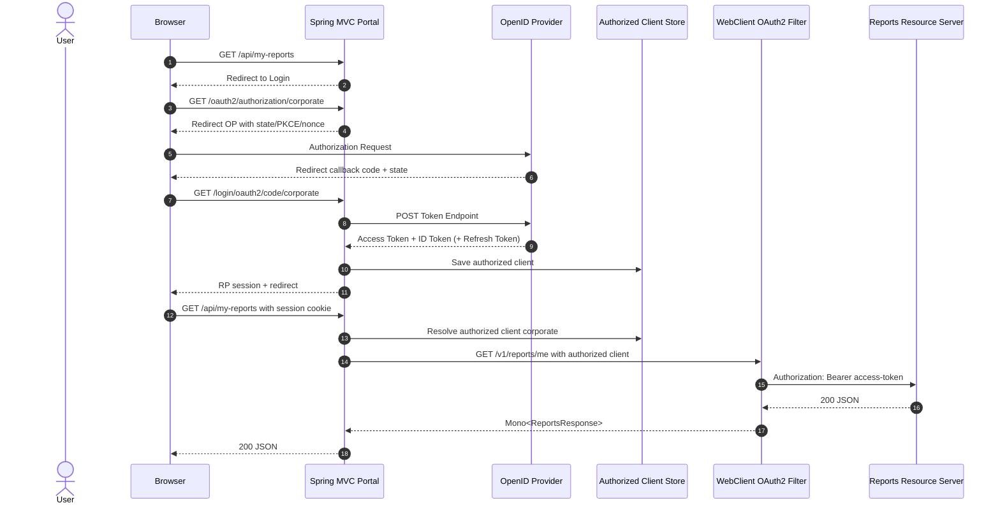

# 34.5. Calling an API with WebClient in a Servlet Application

> **Module:** Spring Security OAuth 2.0 OIDC Client  
> **Chapter:** 34. Practical Labs  
> **Lab:** A **Spring MVC/Servlet** application lets users sign in via OpenID Connect and then calls a Resource Server using **Spring WebClient**, sending the right OAuth2 access token in the `Authorization: Bearer ...` header. The lab extends into Client Credentials, refresh tokens, 401/403 handling, and integration testing.

A Servlet-based Spring Boot application is not forced to use `RestTemplate` or `RestClient` for every HTTP call. It can still use `WebClient`—the Reactor-based HTTP client—while server-side requests continue to be handled via `DispatcherServlet`, `HttpServletRequest`, and `SecurityFilterChain`. Spring Security supports this setup with **`ServletOAuth2AuthorizedClientExchangeFilterFunction`**, an `ExchangeFilterFunction` that looks up or authorizes an `OAuth2AuthorizedClient` and attaches the access token to requests sent to a Resource Server.

The hard part of this lab is not the `webClient.get().retrieve()` syntax. Common mistakes lie in **picking the wrong client/registration**, confusing an **ID Token** with an **access token**, using Person A's authorization in Person B's call, losing Servlet request/security context during async execution, or attaching a default Bearer token to every outbound URL. You must also distinguish when a token already exists after OIDC Login from machine-to-machine scenarios that must acquire a token via Client Credentials.

This lab implements a self-contained example and then highlights what changes when a project uses Spring Security 6.x/7.x, Servlet async, multiple instances, or a real OP.

---

## 1. Expected Outcomes

After completing this lab, you will be able to:

1. Run a Servlet application with `oauth2Login()` and an OIDC Client registration configured.
2. Sign in via a browser using the Authorization Code Flow.
3. Obtain the `OAuth2AuthorizedClient` matching the logged-in user's registration.
4. Build a `WebClient` configured with `ServletOAuth2AuthorizedClientExchangeFilterFunction`.
5. Call a reports API with `WebClient` and verify the Bearer header is added automatically.
6. Choose between `.attributes(oauth2AuthorizedClient(...))` and `.attributes(clientRegistrationId(...))`.
7. Explain when `.block()` is acceptable in Spring MVC and when it is not.
8. Understand how `OAuth2AuthorizedClientManager` issues new tokens, refreshes tokens, and persists authorized clients.
9. Avoid accidentally sending a token to an API with the wrong audience, issuer, or tenant.
10. Use `AuthorizedClientServiceOAuth2AuthorizedClientManager` for work outside a Servlet request.
11. Distinguish `ServletOAuth2AuthorizedClientExchangeFilterFunction` from WebFlux's `ServerOAuth2AuthorizedClientExchangeFilterFunction`.
12. Test happy paths, anonymous requests, unauthorized calls, 401, 403, expired tokens, and zero credential leaks.
13. Evaluate when `RestClient` should be preferred over `WebClient` in a Servlet app.
14. Apply a production checklist covering configuration, timeouts, HTTP error handling, logging, and token stores.

## 2. Practice Scenario

Assume the **Report Portal** system has two services:

- **Portal/Relying Party (RP):** Spring Boot Servlet app serving browsers, using OIDC login with registration `corporate`.
- **Reports API/Resource Server (RS):** Separate service at `https://reports-api.example.test`; requires an **access token** with the matching audience/scope.

User flow:

```text
Browser -> GET https://portal.example.test/api/my-reports
                |
                v
       Spring MVC Controller
                |
          SecurityContext
                |
       OAuth2AuthorizedClient
                |
         WebClient + OAuth2 Filter
                |
       GET https://reports-api.example.test/v1/reports/me
       Authorization: Bearer <access-token>
                |
                v
             JSON response
                |
                v
       Spring MVC returns JSON to browser
```

The browser **never directly receives the access token** in this backend-for-frontend example. The Portal is a confidential OAuth2 Client that keeps the authorized client and tokens server-side. This reduces the chance of tokens leaking into JavaScript or browser storage, while requiring strict protection of sessions, token stores, and server-to-server requests.

## 3. Distinguishing Three Types of Tokens and Credentials

| Artifact | Source | Purpose | Sent to Reports API? |
|---|---|---|---|
| `ID Token` | Issued by OP during OIDC Login | RP verifies user identity, issuer/audience/nonce | **No** — never use as an API Bearer token |
| `Access Token` | Issued by AS for specific scope/resource | Client calls authorized Resource Server | **Yes**, if audience/scope/sender constraints match |
| `Refresh Token` | Optionally issued by AS | Client calls Token Endpoint to get a new access token | **No** — never send to Reports API |
| `Client secret` | Confidential Client secret | Client authentication at Token Endpoint | **No** — never send to Reports API |
| RP session cookie | Created by RP for browser | Browser maintains Portal login session | Never forwarded to Reports API |
| `OAuth2AuthorizedClient` | Stored by Spring Security | Groups registration, principal, and access/refresh tokens | Server-side object; filter extracts access token |

In particular, an access token obtained from an OIDC login **does not automatically** authorize calls to arbitrary APIs. The OP must issue the token for the target Resource Server. If the token only serves the UserInfo endpoint or lacks the `aud`/scopes accepted by Reports API, you must request the appropriate grant/resource/scope per provider contract.

## 4. Servlet WebClient Does Not Turn the Backend into WebFlux

The two architectures below are different.

**This lab:**

```text
Spring MVC Controller (Servlet thread)
   -> WebClient (reactive HTTP client)
   -> External API
   -> Mono<T>
   -> block() at MVC boundary (when a synchronous response is truly needed)
```

**Pure WebFlux server application:**

```text
WebFlux Handler (reactive event loop)
   -> WebClient
   -> Mono<T> / Flux<T> returned directly
   -> SecurityWebFilterChain / Reactor Context
```

In a Servlet app, Spring Security's principal normally lives in `SecurityContextHolder` bound to the request thread, and HTTP request/response objects live in Servlet scope. In WebFlux, the framework relies on `ServerWebExchange` and reactive security contexts.

**Do not use WebFlux's `ServerOAuth2AuthorizedClientExchangeFilterFunction` in place of the Servlet filter** just because both mention WebClient. This lab uses `ServletOAuth2AuthorizedClientExchangeFilterFunction`.

## 5. Components Used

| Class / API | Role in Lab |
|---|---|
| `SecurityFilterChain` | Protects browser endpoints and enables OIDC Login |
| `ClientRegistrationRepository` | Stores `corporate` config: Client ID, issuer, redirect URI, scopes |
| `OAuth2AuthenticationToken` | Authentication after OAuth2/OIDC Login |
| `OAuth2AuthorizedClient` | Holds access token, optional refresh token, and registration |
| `OAuth2AuthorizedClientRepository` | Stores/loads authorized clients per Servlet request |
| `OAuth2AuthorizedClientService` | Stores/loads by registration and principal name |
| `OAuth2AuthorizedClientManager` | Authorizes, refreshes, and manages authorized clients |
| `ServletOAuth2AuthorizedClientExchangeFilterFunction` | Attaches Bearer access token to WebClient requests |
| `@RegisteredOAuth2AuthorizedClient` | Resolves an authorized client in a Spring MVC handler |
| `WebClient` | Calls Reports API over HTTP |
| `Mono<T>` | Represents WebClient's asynchronous result |
| `MockMvc` | Tests Servlet controller/security filter chain |
| Fake OP / fake RS | Tests login/token exchange, Bearer headers, and error paths |

## 6. End-to-End Flow of This Lab



When the access token nears expiration, the authorized-client manager can refresh it according to provider/manager configuration and save the updated record. Do not assume every HTTP request performs a token exchange.

## 7. Requirements and Versions

Examples target **Spring Boot 3.x + Spring Security 6.x** in Java 17+/Jakarta Servlet style; the APIs mentioned may also exist in compatible Spring Security 7.x versions. Never arbitrarily pin a Spring Security version outside the Boot BOM.

Requirements:

- Java and a build tool compatible with Spring Boot projects.
- A sandbox/fake OIDC OP with a Client registration.
- A mock or real Reports API configured for the access-token audience/scope.
- HTTPS for external deployments; localhost/testing can use a suitable test issuer.
- Dedicated test Client ID/secret, never production secrets.

**Note:** Spring Security 6.4+ provides new `RestClient` integration. This lab intentionally uses **WebClient in Servlet** per the practice topic; `RestClient` is compared in a later section.

## 8. Gradle Dependencies

```kotlin
dependencies {
    implementation("org.springframework.boot:spring-boot-starter-web")
    implementation("org.springframework.boot:spring-boot-starter-security")
    implementation("org.springframework.boot:spring-boot-starter-oauth2-client")

    // WebClient and HTTP connector; does not convert the app into
    // a WebFlux server when the Servlet starter is also present.
    implementation("org.springframework.boot:spring-boot-starter-webflux")

    testImplementation("org.springframework.boot:spring-boot-starter-test")
    testImplementation("org.springframework.security:spring-security-test")
    testImplementation("io.projectreactor:reactor-test")
}
```

In Spring Boot, when both MVC and WebFlux starters are present, the application defaults to **Servlet `WebApplicationType`**. You can also declare it explicitly:

```yaml
spring:
  main:
    web-application-type: servlet
```

This property is only illustrative for pinning the stack. Including `spring-boot-starter-webflux` does not turn controllers into reactive controllers or switch to `ServerHttpSecurity`.

### 8.1. If a Project Only Wants WebClient

Depending on build policy, you can pull in only the needed modules of `spring-webflux`/Reactor Netty instead of the full starter. In that case you must configure an HTTP connector explicitly. For a learning lab, `starter-webflux` keeps setup simpler and provides a working HTTP connector out of the box.

### 8.2. Maven

The Maven equivalents are `spring-boot-starter-web`, `spring-boot-starter-security`, `spring-boot-starter-oauth2-client`, and `spring-boot-starter-webflux`, plus `spring-boot-starter-test` and `spring-security-test` in `test` scope.

## 9. Source Code Layout

```text
src/main/java/example/portal/
  ReportPortalApplication.java
  config/
    SecurityConfiguration.java
    ReportsWebClientConfiguration.java
  api/
    ReportsController.java
    ReportsApiClient.java
    ReportDto.java
    ReportsApiExceptionHandler.java

src/main/resources/
  application.yml
  application-dev.yml

src/test/java/example/portal/
  ReportsApiClientTest.java
  ReportsControllerSecurityTest.java
  OidcLoginIntegrationTest.java
```

This layout is a reference; exact class and folder names are optional. For a minimal lab, you can place all classes in one project while still keeping **clear separation of responsibilities**: security config, HTTP client config, outbound API adapter, and browser-facing controller.

## 10. Configuring `ClientRegistration` for OIDC Login

```yaml
# application.yml — URLs below are examples; requires a real or fake OP.
spring:
  security:
    oauth2:
      client:
        registration:
          corporate:
            provider: corporate-op
            client-id: ${OIDC_CLIENT_ID}
            client-secret: ${OIDC_CLIENT_SECRET}
            authorization-grant-type: authorization_code
            client-authentication-method: client_secret_basic
            redirect-uri: "{baseUrl}/login/oauth2/code/{registrationId}"
            scope:
              - openid
              - profile
              - reports.read
        provider:
          corporate-op:
            issuer-uri: https://login.example.test/realms/corporate

reports:
  api:
    base-url: https://reports-api.example.test
```

**Meaning:**

- `corporate` is Spring Security's **registration ID**, used in `/oauth2/authorization/corporate`, the callback, and authorized-client lookups.
- `provider: corporate-op` links the registration to the provider metadata.
- `issuer-uri` must match the ID Token `iss` claim and OIDC Discovery, not an arbitrary hostname.
- `client-id` and `client-secret` come from the OP; never commit secrets to Git.
- `redirect-uri` must match the URI registered at the OP behind any proxy/HTTPS.
- `reports.read` is only meaningful if the OP/RS defines that scope; `resource`/`audience` configuration may also be required depending on the provider.
- `openid` is required to trigger OIDC Login; never omit it and still expect an ID Token.
- `reports.api.base-url` separates the Resource Server URL from the OP issuer.

### 10.1. Do Not Use an Access Token with the Wrong Audience

Suppose the OP issues an access token for the UserInfo endpoint while Reports API requires `aud=reports-api`. Merely adding `reports.read` in YAML might not produce the right audience; verify the OP/RS contract, authorization request resolver, and provider-specific token customization.

### 10.2. Environment Secrets

```text
OIDC_CLIENT_ID=portal-dev
OIDC_CLIENT_SECRET=<managed-test-secret>
```

In production, use a secret manager, Kubernetes Secret, or managed identity; never embed secrets in container images, source code, tickets, or HTTP logs.

## 11. Configuring `SecurityFilterChain`

```java
package example.portal.config;

import org.springframework.context.annotation.Bean;
import org.springframework.context.annotation.Configuration;
import org.springframework.security.config.annotation.web.builders.HttpSecurity;
import org.springframework.security.web.SecurityFilterChain;

@Configuration
public class SecurityConfiguration {

    @Bean
    SecurityFilterChain securityFilterChain(HttpSecurity http)
            throws Exception {

        return http
            .authorizeHttpRequests(auth -> auth
                .requestMatchers(
                    "/", "/public/**", "/error"
                ).permitAll()
                .requestMatchers("/api/**").authenticated()
                .anyRequest().authenticated()
            )
            .oauth2Login(login -> {})
            .oauth2Client(client -> {})
            .build();
    }
}
```

This is the lab baseline. Spring Security handles OIDC login and ID Token verification inside the login pipeline rather than having a controller parse ID Tokens manually.

### 11.1. Must `/oauth2/authorization/**` and the Callback Be Added to `permitAll`?

Spring Security registers OAuth2 Authorization Request and Callback filters in the filter chain with dedicated handling. In a production setup with multiple chains or custom matchers, verify that the initiation and callback URLs are processed by the security filters properly. Never broadly open `/api/**` with `permitAll()` just to work around a redirect error.

### 11.2. CSRF

In a web app using browser sessions, keep Spring Security's default CSRF protection enabled unless an explicit threat model and policy dictate otherwise. `GET /api/my-reports` is read-only; state-changing endpoints need dedicated CSRF tests.

### 11.3. Login Success Does Not Guarantee API Call Success

After a user logs in, `/api/my-reports` can still fail due to:

- No authorized client for the matching registration.
- Access token expired or revoked.
- Token audience/scope mismatch.
- Reports API lacking data or throwing an error.
- Network/proxy/TLS connectivity failure.

The following sections handle those responsibilities explicitly.

## 12. How `OAuth2AuthorizedClientManager` Manages Tokens

`OAuth2AuthorizedClientManager` is the central abstraction for authorizing or re-authorizing a client. It delegates to `OAuth2AuthorizedClientProvider` implementations per grant type:

```text
OAuth2AuthorizedClientManager
    |
    +--> AuthorizationCode provider
    |
    +--> RefreshToken provider
    |
    +--> ClientCredentials provider
    |
    +--> AuthorizedClientRepository / AuthorizedClientService
```

On requests after OIDC Login, the manager can read the stored authorized client. If the access token has expired, the refresh-token provider can call the Token Endpoint for a new token when the AS issued a refresh token and conditions are met.

### 12.1. Token Management Does Not Self-Grant Scopes

The manager cannot turn a token lacking `reports.read` into one with sufficient permissions. It operates strictly according to `ClientRegistration`, grant state, and provider config. Scopes, audiences, and consent belong to the AS/RS contract.

### 12.2. When Should You Declare the Manager Bean Explicitly?

In newer Spring Security versions (especially 6.2+), the framework may auto-configure appropriate default beans when client registration infrastructure is present. However, when you need custom grant providers, token stores, failure handlers, or background jobs, declare the manager explicitly. Always verify which bean is wired so you do not end up with **two managers** where filters and controllers use different instances.

## 13. Example `OAuth2AuthorizedClientManager` on Servlet

If you want to specify supported grants explicitly, you can use:

```java
package example.portal.config;

import org.springframework.context.annotation.Bean;
import org.springframework.context.annotation.Configuration;
import org.springframework.security.oauth2.client.OAuth2AuthorizedClientManager;
import org.springframework.security.oauth2.client.OAuth2AuthorizedClientProvider;
import org.springframework.security.oauth2.client.OAuth2AuthorizedClientProviderBuilder;
import org.springframework.security.oauth2.client.registration.ClientRegistrationRepository;
import org.springframework.security.oauth2.client.web.DefaultOAuth2AuthorizedClientManager;
import org.springframework.security.oauth2.client.web.OAuth2AuthorizedClientRepository;

@Configuration
public class AuthorizedClientConfiguration {

    @Bean
    OAuth2AuthorizedClientManager authorizedClientManager(
            ClientRegistrationRepository registrations,
            OAuth2AuthorizedClientRepository authorizedClients) {

        OAuth2AuthorizedClientProvider provider =
            OAuth2AuthorizedClientProviderBuilder.builder()
                .authorizationCode()
                .refreshToken()
                .clientCredentials()
                .build();

        DefaultOAuth2AuthorizedClientManager manager =
            new DefaultOAuth2AuthorizedClientManager(
                registrations, authorizedClients);

        manager.setAuthorizedClientProvider(provider);
        return manager;
    }
}
```

In a browser-login request lab, `DefaultOAuth2AuthorizedClientManager` fits because a Servlet request/response and repository exist. If your version already auto-configures a suitable default manager, this bean may be **unnecessary**.

### 13.1. Do Not Use the Servlet-Request Manager for Schedulers

`DefaultOAuth2AuthorizedClientManager` depends on a Servlet request context in many scenarios. Scheduled jobs and queue consumers have no `HttpServletRequest`. The machine-to-machine section later uses `AuthorizedClientServiceOAuth2AuthorizedClientManager`.

## 14. `WebClient` Bean with the Servlet OAuth2 Filter

This is the core of the lab:

```java
package example.portal.config;

import org.springframework.beans.factory.annotation.Value;
import org.springframework.context.annotation.Bean;
import org.springframework.context.annotation.Configuration;
import org.springframework.security.oauth2.client.OAuth2AuthorizedClientManager;
import org.springframework.security.oauth2.client.web.reactive.function.client.ServletOAuth2AuthorizedClientExchangeFilterFunction;
import org.springframework.web.reactive.function.client.WebClient;

@Configuration
public class ReportsWebClientConfiguration {

    @Bean
    WebClient reportsWebClient(
            OAuth2AuthorizedClientManager authorizedClientManager,
            @Value("${reports.api.base-url}") String reportsApiBaseUrl) {

        ServletOAuth2AuthorizedClientExchangeFilterFunction oauth2 =
            new ServletOAuth2AuthorizedClientExchangeFilterFunction(
                authorizedClientManager);

        return WebClient.builder()
            .baseUrl(reportsApiBaseUrl)
            .apply(oauth2.oauth2Configuration())
            .build();
    }
}
```

**How it works:**

1. `ServletOAuth2AuthorizedClientExchangeFilterFunction` attaches the filter to `WebClient`.
2. `oauth2Configuration()` also configures `defaultRequest()` to capture the Servlet request/response and `Authentication` when appropriate.
3. When an outbound request carries an `OAuth2AuthorizedClient` or `clientRegistrationId` attribute, the filter picks the matching client.
4. The filter/manager resolves or refreshes the token according to configured providers.
5. The request is sent with header `Authorization: Bearer <access-token>`.

### 14.1. Why Not Call `setDefaultOAuth2AuthorizedClient(true)` Here?

Under secure-by-default design, **an outbound call should carry a token only when you explicitly select an authorized client or registration**. Enabling a default OAuth2 authorized client on a shared `WebClient` can cause every HTTP request to attach the current principal's token, even to unintended hosts. That creates a token exfiltration risk.

### 14.2. No Authorization Header When No Client Is Specified?

With the configuration above, when no authorized client, `clientRegistrationId`, or default is specified, the filter does not guess "send the current user's token to every API". This is a security benefit; never replace it with a global filter that blindly attaches access tokens to every request.

## 15. Option A: Selecting `OAuth2AuthorizedClient` Explicitly

This is the clearest option with the strongest security boundary for this lab.

In the Spring MVC controller, use:

```java
import org.springframework.security.oauth2.client.OAuth2AuthorizedClient;
import org.springframework.security.oauth2.client.annotation.RegisteredOAuth2AuthorizedClient;

@GetMapping("/api/my-reports")
public ResponseEntity<ReportDto[]> myReports(
        @RegisteredOAuth2AuthorizedClient("corporate")
        OAuth2AuthorizedClient authorizedClient) {

    ReportDto[] data = reportsApiClient.fetchMyReports(authorizedClient);
    return ResponseEntity.ok(data);
}
```

`@RegisteredOAuth2AuthorizedClient` is handled by Spring Security's Spring MVC argument resolver, which can invoke the manager to look up or authorize the client for the given registration and current principal.

### 15.1. Why Pass the Object Explicitly?

- The controller declares which registration is allowed for the reports business action.
- The service receives a token bound to the right principal and session.
- The service does not need to dig into `SecurityContextHolder` deeply.
- Service unit tests can build an authorized-client fixture and invoke the method directly.
- `WebClient` will not accidentally send a token if the service omits request attributes.
- Auditing is straightforward when multiple providers and API targets exist.

### 15.2. Never Serialize `OAuth2AuthorizedClient` to the Browser

This object can hold access and refresh tokens. Pass it only between server-side methods; **never** place it in `ResponseEntity`, JSON, logs, public caches, or browser `localStorage`.

## 16. DTO Representing the Reports API

```java
package example.portal.api;

public record ReportDto(
    String id,
    String title,
    String status
) {}
```

Suppose Reports API returns:

```json
[
  {"id":"r-101","title":"Quarterly summary","status":"READY"},
  {"id":"r-102","title":"Expense overview","status":"DRAFT"}
]
```

The DTO contains only data meant for the current user. The real API must also check ownership, tenant, and authorization; the Portal must never treat having a Bearer token as proof that the user can view every report.

## 17. `ReportsApiClient`: Attaching the Authorized Client to Requests

```java
package example.portal.api;

import java.time.Duration;
import org.springframework.stereotype.Service;
import org.springframework.security.oauth2.client.OAuth2AuthorizedClient;
import org.springframework.web.reactive.function.client.WebClient;

import static org.springframework.security.oauth2.client.web.reactive.function.client.ServletOAuth2AuthorizedClientExchangeFilterFunction.oauth2AuthorizedClient;

@Service
public class ReportsApiClient {

    private final WebClient reportsWebClient;

    public ReportsApiClient(WebClient reportsWebClient) {
        this.reportsWebClient = reportsWebClient;
    }

    public ReportDto[] fetchMyReports(
            OAuth2AuthorizedClient authorizedClient) {

        ReportDto[] reports = reportsWebClient
            .get()
            .uri("/v1/reports/me")
            .attributes(oauth2AuthorizedClient(authorizedClient))
            .retrieve()
            .bodyToMono(ReportDto[].class)
            .block(Duration.ofSeconds(5));

        return reports == null ? new ReportDto[0] : reports;
    }
}
```

### 17.1. Line-by-Line Explanation

- `.get()`: outbound HTTP GET, not the browser GET.
- `.uri("/v1/reports/me")`: relative path under the configured fixed `baseUrl`.
- `.attributes(oauth2AuthorizedClient(authorizedClient))`: binds the authorized client **to this request only**.
- `.retrieve()`: retrieves the response and converts non-2xx statuses to errors per default WebClient behavior/handlers.
- `.bodyToMono(ReportDto[].class)`: deserializes JSON once the response arrives.
- `.block(Duration.ofSeconds(5))`: turns the `Mono` into a synchronous result at the **Spring MVC boundary** with a timeout.

### 17.2. Should You Return `[]` When `block()` Returns Null?

This example returns an empty array if the response body is empty to keep the lab simple. In production, a Reports API returning `204` may have different semantics from an empty list; decide per API contract. Never mask HTTP 401/403/5xx by unconditionally returning an empty array.

### 17.3. Why Not Set the Bearer Header Manually?

You could write:

```java
// NOT the recommended pattern for OAuth2 Client.
.header("Authorization",
    "Bearer " + authorizedClient.getAccessToken().getTokenValue())
```

but manual token handling bypasses the OAuth2 filter/manager's lifecycle and failure handling, and increases the chance of tokens leaking into logs or wrong endpoints. Prefer `oauth2AuthorizedClient(...)` when using Spring Security's `WebClient` integration.

## 18. Complete Controller for the Lab

```java
package example.portal.api;

import org.springframework.http.ResponseEntity;
import org.springframework.security.oauth2.client.OAuth2AuthorizedClient;
import org.springframework.security.oauth2.client.annotation.RegisteredOAuth2AuthorizedClient;
import org.springframework.web.bind.annotation.GetMapping;
import org.springframework.web.bind.annotation.RestController;

@RestController
public class ReportsController {

    private final ReportsApiClient reportsApiClient;

    public ReportsController(ReportsApiClient reportsApiClient) {
        this.reportsApiClient = reportsApiClient;
    }

    @GetMapping("/api/my-reports")
    public ResponseEntity<ReportDto[]> myReports(
            @RegisteredOAuth2AuthorizedClient("corporate")
            OAuth2AuthorizedClient authorizedClient) {

        return ResponseEntity.ok(
            reportsApiClient.fetchMyReports(authorizedClient)
        );
    }
}
```

In this case, Reports API roles and scopes are still enforced by the Resource Server. The controller should also apply its own authorization if the endpoint handles sensitive data; `authenticated()` only checks that the user has signed in.

## 19. Why Is `@RegisteredOAuth2AuthorizedClient` a Useful Abstraction?

If the controller manually read:

```java
SecurityContextHolder.getContext().getAuthentication()
```

and queried the authorized client from a service, you would have to manually manage registration IDs, principal names, and token refresh. The annotation and argument resolver let the framework handle those steps cleanly within a Servlet request.

However:

- It only works within properly configured Spring MVC controller argument resolution.
- Both `ClientRegistration` and an authorized client must exist.
- It does not allow a request to silently mint new scopes without OP/consent.
- If the session or token was revoked, the resolver may fail and the flow must handle it safely.
- Tests using `@WithMockUser` do not automatically populate an `OAuth2AuthorizedClient` for this annotation.

## 20. Option B: Selecting `clientRegistrationId` Directly on `WebClient`

If you prefer not to pass the `OAuth2AuthorizedClient` object directly, you can use:

```java
import static org.springframework.security.oauth2.client.web.reactive.function.client.ServletOAuth2AuthorizedClientExchangeFilterFunction.clientRegistrationId;

ReportDto[] reports = reportsWebClient
    .get()
    .uri("/v1/reports/me")
    .attributes(clientRegistrationId("corporate"))
    .retrieve()
    .bodyToMono(ReportDto[].class)
    .block(Duration.ofSeconds(5));
```

Within a Servlet request, `oauth2Configuration()` captures the default request context and `Authentication`; the manager can look up the authorized client for `corporate` and the current principal, refreshing if needed.

### 20.1. Comparing the Two Approaches

| Criterion | Passing `oauth2AuthorizedClient(client)` | Passing `clientRegistrationId("corporate")` |
|---|---|---|
| Explicitness | High, concrete object | High, concrete registration |
| Must controller resolve client? | Yes, if using the annotation | Not mandatory |
| Unit-testing the service | Easy with a fixture object | Needs manager/repository context in integration tests |
| Principal binding | Already bound inside the object | Filter/manager needs the right `Authentication` |
| Refresh/re-authorization | Depends on provider/manager and state | Depends on provider/manager and state |
| Risk of sending wrong token | Possible if wrong object passed | Possible if wrong registration chosen |
| Background jobs | Usable with service manager | Needs appropriate principal/context |

**Never take the registration ID directly from a browser query parameter** and let the API pick any `ClientRegistration`: a user could force the Portal to use another tenant's or Client's token. Choose the registration from a server-side allowlist or business mapping.

## 21. Should You Enable `setDefaultOAuth2AuthorizedClient(true)`?

API:

```java
ServletOAuth2AuthorizedClientExchangeFilterFunction oauth2 =
    new ServletOAuth2AuthorizedClientExchangeFilterFunction(manager);

oauth2.setDefaultOAuth2AuthorizedClient(true);
```

This tells the filter to fall back to the OAuth2 authorized client associated with the current `OAuth2AuthenticationToken` when a request does not specify a client.

### 21.1. The Risk

If that `WebClient` is shared across multiple outbound hosts, every request may carry the access token even when the target host is not the Resource Server the token was issued for.

```text
Shared WebClient:
  GET https://reports-api.example.test/...   -> valid token
  GET https://status.external.example/...     -> may leak token accidentally
```

### 21.2. Lab Recommendation

Keep the default **`false`**, pass `.attributes(...)` explicitly, and constrain `baseUrl`/destinations. If a special design requires a default client, isolate it on a **dedicated `WebClient` bean** that calls only that trusted API, with tests verifying protection against SSRF, redirects, and token forwarding.

## 22. `setDefaultClientRegistrationId` Carries Similar Risks

```java
oauth2.setDefaultClientRegistrationId("corporate");
```

This setting can cause every outbound request made through that `WebClient` to use the default registration, including requests routed to an unexpected host.

It is no substitute for:

- Strict host/path allowlists.
- Audience/scope validation.
- Resource server authorization.
- Tenant isolation.
- HTTP redirect policies.
- Explicit caller intent.

Use it on a dedicated client only after careful review; this lab uses explicit request attributes.

## 23. Differences Between Servlet and WebFlux Filters

| Aspect | Servlet App Using WebClient | WebFlux Server Using WebClient |
|---|---|---|
| Filter class | `ServletOAuth2AuthorizedClientExchangeFilterFunction` | `ServerOAuth2AuthorizedClientExchangeFilterFunction` |
| Security configuration | `HttpSecurity` / `SecurityFilterChain` | `ServerHttpSecurity` / `SecurityWebFilterChain` |
| Context | Servlet request/response, `SecurityContextHolder` | `ServerWebExchange`, Reactor Context |
| Authorized client repository | `OAuth2AuthorizedClientRepository` | `ServerOAuth2AuthorizedClientRepository` |
| Manager | `OAuth2AuthorizedClientManager` | `ReactiveOAuth2AuthorizedClientManager` |
| UI controller | Spring MVC | WebFlux handler |
| Blocking | Acceptable with controls at Servlet boundary | Never block the event loop |

A project with both starters may still run as Servlet. Determine the actual runtime stack via `WebApplicationType`, auto-configuration, and the security filter chain—not by seeing `WebClient` in the code.

## 24. Key Consideration: `.block()` in Spring MVC

`WebClient` returns reactive publishers such as `Mono` or `Flux`. However, an MVC controller with the signature:

```java
public ResponseEntity<ReportDto[]> myReports(...)
```

needs a synchronous value before returning the response. In that situation, calling `.block(Duration)` on the Servlet request processing thread **can be acceptable** because the Servlet model is inherently blocking.

### 24.1. In Return, You Give Up Non-Blocking Benefits at the Controller Boundary

- A Servlet request thread must wait for the API response.
- Concurrency is bounded by the thread pool, connection pool, and timeouts.
- WebClient's HTTP transport may be non-blocking, yet the thread calling `block()` is still blocked.
- The timeout in `block(Duration)` caps waiting at the subscriber boundary; it **does not replace** connect/response timeouts on the HTTP connector.
- Plan for retries, queuing, circuit breakers, and capacity when Reports API slows down.

### 24.2. Never Block Inside a Reactor Event Loop

Never copy patterns like:

```java
return webClient.get()
    .retrieve()
    .bodyToMono(ReportDto[].class)
    .map(items -> someOtherMono.block());
```

inside a WebFlux event loop. Reactive services should compose publishers with `flatMap` and return `Mono`/`Flux`.

## 25. Can You Return `Mono` from Spring MVC?

Spring MVC supports certain reactive return types when WebFlux/reactive adapters are present. However, **it is still a Servlet stack**, not a WebFlux server.

You must distinguish:

- Asynchronous controller/API processing.
- How long the Servlet request context remains valid.
- Whether Spring Security's `SecurityContextHolder`/`RequestContextHolder` is propagated to async threads.
- Whether the OAuth2 filter resolves the authorized client before or after the request context is cleared.
- Error handling, timeouts, and Servlet async dispatch lifecycles.

For an initial lab, **resolve `OAuth2AuthorizedClient` in the controller and pass it explicitly** to avoid depending on thread-local context later in the WebClient reactive chain.

## 26. Servlet `SecurityContextHolder` vs. Reactor Context

Servlet Spring Security propagates `Authentication` via `SecurityContextHolder`, which is normally `ThreadLocal`-based. `WebClient` performs reactive HTTP I/O on separate threads.

If you write:

```java
Mono<ReportDto[]> publisher = reportsWebClient
    .get()
    .uri("/v1/reports/me")
    .attributes(clientRegistrationId("corporate"))
    .retrieve()
    .bodyToMono(ReportDto[].class);

// Moving the publisher onto another scheduler and subscribing later...
```

the Servlet `Authentication`/`HttpServletRequest` may already be gone when the filter tries to resolve them. Spring Security uses `defaultRequest()` to capture request-context attributes, but you should never assume it solves every subscription/time-of-use race outside the request.

### 26.1. Safe Pattern for Async Workflows

- Resolve the authorized client/context at a trusted boundary.
- Pass only minimal required objects/capabilities explicitly into the flow.
- Never stash raw tokens in global static variables or arbitrary Reactor Context entries.
- When refreshes are needed after the request finishes, use a manager/service **designed for non-Servlet-request contexts**.
- Never call `subscribe()` inside a controller and return 200 before knowing whether the API call succeeded.
- Bound task lifetimes, cancellation, and ownership.

## 27. Do Not Call `subscribe()` Manually in a Controller

Anti-pattern:

```java
@GetMapping("/api/my-reports")
String wrong() {
    reportsWebClient.get()
        .uri("/v1/reports/me")
        .retrieve()
        .bodyToMono(String.class)
        .subscribe(value -> log.info("result={}", value));
    return "OK";
}
```

Problems:

- The controller returns 200 before the API call completes.
- Exceptions can fire after the response is already committed.
- The Servlet request/security context may have already closed.
- There is no backpressure, timeout, or clear transaction boundary.
- Logging raw payloads can leak sensitive data.

Instead, use `block(Duration)` at the MVC sync boundary or a proper async MVC pattern with managed context propagation and completion/error handling.

## 28. Handling HTTP 401 from Reports API

Reports API can return 401 because:

- The access token is expired, invalid, or revoked.
- The token has the wrong issuer or audience.
- The Bearer header is missing.
- The RS expects a different token.
- Clock skew or JWKS verification failed.

WebClient `retrieve()` typically throws `WebClientResponseException.Unauthorized` for 401 responses. However, **a 401 from the RS does not mean you should refresh infinitely**.

### 28.1. What Should the Flow Do?

1. Inspect status and `WWW-Authenticate` error codes (without logging the token).
2. If `invalid_token` occurs and an appropriate failure handler is configured, evict the authorized client so the next request re-authorizes or refreshes per policy.
3. Never retry infinitely with the same token.
4. Never forward the token to another issuer/endpoint as a "fallback".
5. When a browser-user grant is no longer valid, prompt for re-authorization/re-consent per policy.
6. Return errors from the Portal per API contract, avoiding raw provider messages.

### 28.2. Targeted Diagnostics

Safe log format:

```text
event=reports_api_failure
registration=corporate
route=/v1/reports/me
status=401
oauth_error=invalid_token
traceId=opaque-123
```

Never log the Bearer header, access token, refresh token, or ID Token.

## 29. HTTP 403 Does Not Always Mean a Broken Token

A token can be valid yet lack `reports.write`, or the user may lack permission to view a specific report. Reports API can return 403.

If you blindly treat every 403 as an invalid token and delete the authorized client, you can:

- Trigger reauthorization loops that never fix missing permissions.
- Force the user to sign in again even though the permission is still absent.
- Mask tenant ownership bugs.
- Increase load on the AS.

Authorization failure handlers should act based on OAuth2 error semantics and application policy. Never delete tokens on a generic 403 without valid invalid-token evidence.

## 30. Failure Handler in `ServletOAuth2AuthorizedClientExchangeFilterFunction`

There is an important difference between the two constructors.

**Manager constructor:**

```java
new ServletOAuth2AuthorizedClientExchangeFilterFunction(manager)
```

This supports custom managers/provider chains, **but per Javadoc it does not automatically configure a `RemoveAuthorizedClientOAuth2AuthorizationFailureHandler` for 401/403 responses from a Resource Server**.

**Repository constructor:**

```java
new ServletOAuth2AuthorizedClientExchangeFilterFunction(
    clientRegistrationRepository,
    authorizedClientRepository
)
```

Per Spring Security Javadoc, this constructor configures a failure handler that removes authorized clients for matching error codes, depending on version.

### 30.1. Should You Use the Repository Constructor for This Lab?

You can if you want simple configuration and do not need a custom manager. However, when you need custom providers, token refresh rules, or complex token stores, the manager constructor offers more control. In that case, inspect and attach an authorization failure handler explicitly:

```java
ServletOAuth2AuthorizedClientExchangeFilterFunction oauth2 =
    new ServletOAuth2AuthorizedClientExchangeFilterFunction(manager);

oauth2.setAuthorizationFailureHandler(
    customAuthorizationFailureHandler
);
```

`customAuthorizationFailureHandler` is an application-defined `OAuth2AuthorizationFailureHandler` bean/function. Client removal must target the right repository/service and classify errors carefully.

### 30.2. Do Not Confuse Token Endpoint Failures with Resource Server Failures

- Token Endpoint `invalid_grant`/`invalid_client`: the manager/provider runs its failure handling during authorize/refresh.
- Reports API 401/403: the outbound WebClient filter notifies its own failure handler.
- A Token Endpoint handler does not automatically handle outbound Resource Server HTTP responses.

## 31. Building a Controlled Failure Handler for a Session Repository

When supported by Spring Security, you can construct `RemoveAuthorizedClientOAuth2AuthorizationFailureHandler` with a removal callback taking registration, principal, and attributes.

Conceptual example:

```java
OAuth2AuthorizationFailureHandler failureHandler =
    new RemoveAuthorizedClientOAuth2AuthorizationFailureHandler(
        (registrationId, principal, attributes) -> {
            // Remove only when the error code is in the handler's
            // allowlist and request/response have been resolved.
            // Servlet repository method:
            // removeAuthorizedClient(registrationId, principal, request, response)
        }
    );

oauth2.setAuthorizationFailureHandler(failureHandler);
```

This is **callback pseudocode** without the logic extracting `HttpServletRequest`/`HttpServletResponse` from attributes; never copy it verbatim into production with an empty lambda body. With a service-backed store, the remover can call `service.removeAuthorizedClient(registrationId, principalName)` after verifying the principal and race policy.

### 31.1. Production Caution: Refresh Rotation

In multi-pod clusters, an older request receiving `invalid_grant`/`invalid_token` might arrive after another pod has already refreshed a new token. A failure handler must not unconditionally delete the newer record. Consider re-read/version/CAS checks in persistent token stores when using refresh token rotation.

## 32. Handling Errors in `ReportsApiClient` Without Leaking Secrets

You can translate HTTP errors into domain exceptions:

```java
public ReportDto[] fetchMyReports(
        OAuth2AuthorizedClient authorizedClient) {

    ReportDto[] result = reportsWebClient
        .get()
        .uri("/v1/reports/me")
        .attributes(oauth2AuthorizedClient(authorizedClient))
        .retrieve()
        .onStatus(
            status -> status.value() == 403,
            response -> reactor.core.publisher.Mono.error(
                new ReportsAccessDeniedException()
            )
        )
        .bodyToMono(ReportDto[].class)
        .block(Duration.ofSeconds(5));

    return result == null ? new ReportDto[0] : result;
}
```

Here `ReportsAccessDeniedException` is an **application-defined class**, not a Spring Security API. For 401, design explicit authorization failure handling and optionally let WebClient throw `WebClientResponseException` for controller advice handling.

### 32.1. Do Not Swallow All Errors

Anti-pattern:

```java
.onErrorResume(error ->
    Mono.just(new ReportDto[0])
)
```

turns 401, 403, 500, and timeouts into "no reports", hiding security and availability failures. Classify errors and return appropriate statuses per your UI/API contract.

### 32.2. Never Return Raw RS Response Bodies to the Browser

The Resource Server might return details containing internal URLs, tenant identifiers, or sensitive messages. Controller advice should map errors to safe error codes, preserve trace IDs, and never dump full exceptions.

## 33. Example `ControllerAdvice`

```java
package example.portal.api;

import org.springframework.http.HttpStatus;
import org.springframework.http.ResponseEntity;
import org.springframework.web.bind.annotation.ExceptionHandler;
import org.springframework.web.bind.annotation.RestControllerAdvice;
import org.springframework.web.reactive.function.client.WebClientResponseException;

@RestControllerAdvice
public class ReportsApiExceptionHandler {

    @ExceptionHandler(ReportsAccessDeniedException.class)
    ResponseEntity<ApiError> denied() {
        return ResponseEntity.status(HttpStatus.FORBIDDEN)
            .body(new ApiError("REPORTS_NOT_AUTHORIZED"));
    }

    @ExceptionHandler(WebClientResponseException.class)
    ResponseEntity<ApiError> upstream(WebClientResponseException ex) {
        if (ex.getStatusCode().value() == 401) {
            return ResponseEntity.status(HttpStatus.BAD_GATEWAY)
                .body(new ApiError("REPORTS_UPSTREAM_UNAUTHORIZED"));
        }
        return ResponseEntity.status(HttpStatus.BAD_GATEWAY)
            .body(new ApiError("REPORTS_UPSTREAM_ERROR"));
    }

    public record ApiError(String code) {}
}
```

And the application-defined exception:

```java
package example.portal.api;

public final class ReportsAccessDeniedException
        extends RuntimeException {
}
```

**Note:** Your API contract determines whether the Portal returns 401, 403, 502, or a redirect/re-consent flow. Returning 502 for upstream 401 distinguishes "Portal session still authenticated" from "delegated token to Reports API invalid"; another product may choose a different error code or reconnect flow. Do not treat the status codes in this snippet as the sole standard.

## 34. Timeouts Are Needed at Two Layers

A `WebClient` can hang if connect/response timeouts are unconfigured, or wait indefinitely if upstream stalls. With a blocking MVC boundary, configure:

1. HTTP connector connect timeout.
2. Response/read timeout.
3. Overall request-level timeout (where applicable).
4. `block(Duration)` at the MVC boundary as an outer backstop.
5. Connection pool and pending acquire limits.
6. Retry rules for 429/503, never retrying every 401/403.

### 34.1. Example Reactor Netty HTTP Connector

```java
import java.time.Duration;
import io.netty.channel.ChannelOption;
import reactor.netty.http.client.HttpClient;
import org.springframework.http.client.reactive.ReactorClientHttpConnector;
import org.springframework.web.reactive.function.client.WebClient;

HttpClient httpClient = HttpClient.create()
    .option(ChannelOption.CONNECT_TIMEOUT_MILLIS, 2000)
    .responseTimeout(Duration.ofSeconds(4));

WebClient.Builder builder = WebClient.builder()
    .clientConnector(new ReactorClientHttpConnector(httpClient));
```

Attach the OAuth2 filter from Section 14 to `builder` and build. Tune transport retries, connection pools, and TLS per your Spring Boot/Reactor Netty version.

### 34.2. Do Not Pick Arbitrarily Short Timeouts

If Reports API has a p99 around 3 seconds, a 200 ms response timeout causes false failures and can trigger retry storms. Choose budgets based on SLAs, load, and fallback policies; test timeouts under controlled network conditions.

## 35. Do Not Send Bearer Tokens When Redirected to an Unknown Host

Suppose Reports API returns:

```http
HTTP/1.1 302 Found
Location: https://attacker.example.test/collect
```

If the HTTP client follows redirects automatically and forwards the `Authorization` header, the token can leak. Redirect behavior depends on the connector and configuration; never assume every WebClient/HTTP connector blocks this safely by default.

### 35.1. Policies to Enforce

- Outbound destination host/path allowlist.
- Review the connector's redirect policy.
- Never forward `Authorization` across origin changes.
- Never let browser parameters control absolute outbound URLs.
- Enforce HTTPS and hostname verification.
- Never print Bearer tokens in logs.
- Test cross-origin 302 responses using a fake Resource Server.

If an API legitimately redirects to another trusted host, configure an explicit allowlist and verify the token audience for that host.

## 36. Beware of SSRF via `WebClient` URIs

Anti-pattern:

```java
@GetMapping("/api/proxy")
String proxy(@RequestParam String url) {
    return reportsWebClient.get()
        .uri(url)
        .attributes(clientRegistrationId("corporate"))
        .retrieve()
        .bodyToMono(String.class)
        .block();
}
```

A user could pass a URL targeting instance metadata, an internal service, or an attacker host; when the filter attaches a token, the impact escalates sharply.

Right pattern:

```java
reportsWebClient.get()
    .uri("/v1/reports/{id}", verifiedReportId)
    .attributes(oauth2AuthorizedClient(authorizedClient))
    ...
```

Use a fixed base URL, path templates, and domain data validation. Never validate URLs merely with `startsWith("https://reports-api...")`, which can be bypassed via lookalike hosts, encoding, or redirects.

## 37. OAuth2 Token Identity and Multi-Tenancy

A multi-tenant application might have:

```text
registrationId: corporate-acme
registrationId: corporate-globex
```

Selecting the wrong registration can send Acme's token to Globex's Reports API. Moreover, identical `sub` values across two issuers do not represent the same account.

### 37.1. Doing It Right

- Resolve the tenant from the authenticated internal account/membership.
- Map tenant → allowlisted `ClientRegistration`/issuer/audience.
- Never trust a user-supplied tenant parameter to choose a token without verification.
- API paths/resources must validate tenant ownership.
- Token store keys should distinguish issuer/subject/registration/tenant per policy.
- Unit and integration tests must include cross-tenant negative cases.

### 37.2. Do Not Arbitrarily Use Email as a Principal Key

Emails can change, remain unverified, or be reassigned. Spring Security's service-based authorized client stores typically key on `registrationId` and `principalName`; design a stable, properly namespaced `principalName`.

## 38. What Happens When the Access Token Expires?

For a supported grant:

```text
GET Reports API needs access token
    |
    v
OAuth2AuthorizedClientManager
    |
    +-- access token still valid --> use it
    |
    +-- token expired / near expiry:
         +-- valid refresh token? -> Token Endpoint refresh
         +-- Client Credentials? -> new grant
         +-- ineligible? -> require re-authorization
    |
    v
Save authorized client per repository/service policy
    |
    v
Call Reports API with new Bearer token
```

Refresh timing can be affected by clock skew and manager configuration. Never scatter `Instant.now().isAfter(expiresAt)` checks across controllers and call the Token Endpoint manually with `WebClient`.

### 38.1. Refresh Tokens Are Not Always Issued

The OP may require `offline_access` or separate consent; some providers do not issue refresh tokens for web apps or certain scopes. A missing refresh token is not necessarily a bug. Your policy may require re-authorization or a different token-expiry flow.

### 38.2. ID Tokens Do Not Auto-Refresh with Access Tokens

Refreshing an API access token **does not mean the OIDC RP authentication session was re-authenticated** or that ID Token claims automatically updated. Session roles and permissions can become stale; maintain a separate policy for permission freshness.

## 39. Persisting `OAuth2AuthorizedClient`

Options:

| Store | Best Fit | Caveats |
|---|---|---|
| `HttpSessionOAuth2AuthorizedClientRepository` | Browser web apps, per-session tokens | Losing session loses client; requires shared session across pods |
| `InMemoryOAuth2AuthorizedClientService` | Dev/test, small demos | Per-process store; lost on restart |
| `JdbcOAuth2AuthorizedClientService` | Servlet apps needing durable/shared tokens | Schema, encryption, backups, principal key |
| Custom service/token vault | Production compliance, multi-tenant/keys | Encryption, rotation, TTL, revocation, CAS |
| Shared session + service | Web + offline integrations | Keep lifecycles clearly separated |

Spring Session Redis/JDBC shares **sessions** across pods; it does not automatically turn an `InMemoryOAuth2AuthorizedClientService` into a distributed token store.

### 39.1. Token Values Are Secrets

Access and refresh tokens must never be printed in logs, serialized in JSON to the browser, or attached to tracing spans. If a DB dump is exposed, evaluate revoking/rotating tokens and all downstream copies.

## 40. Extension: Client Credentials for Backend-to-Backend

When a task does not represent a browser user—such as a scheduled job aggregating system-wide reports—use the `client_credentials` grant if permitted by the AS.

Configure a dedicated registration:

```yaml
spring:
  security:
    oauth2:
      client:
        registration:
          reports-service:
            provider: corporate-op
            client-id: ${REPORTS_SERVICE_CLIENT_ID}
            client-secret: ${REPORTS_SERVICE_CLIENT_SECRET}
            authorization-grant-type: client_credentials
            client-authentication-method: client_secret_basic
            scope:
              - reports.batch.read
```

Never reuse a user's OIDC access token just because one happened to be in some request's `SecurityContext`.

### 40.1. Do Not Issue User-Level Privileges to `client_credentials` Tokens

A Client Credentials token represents the Client/service principal, not an end user. The Resource Server must enforce service-account permissions separately rather than assuming a machine can read every user's data.

## 41. `AuthorizedClientServiceOAuth2AuthorizedClientManager` Outside Requests

Example Spring bean dedicated to background operations:

```java
import org.springframework.context.annotation.Bean;
import org.springframework.security.oauth2.client.AuthorizedClientServiceOAuth2AuthorizedClientManager;
import org.springframework.security.oauth2.client.OAuth2AuthorizedClientManager;
import org.springframework.security.oauth2.client.OAuth2AuthorizedClientProvider;
import org.springframework.security.oauth2.client.OAuth2AuthorizedClientProviderBuilder;
import org.springframework.security.oauth2.client.OAuth2AuthorizedClientService;
import org.springframework.security.oauth2.client.registration.ClientRegistrationRepository;

@Bean("serviceAuthorizedClientManager")
OAuth2AuthorizedClientManager serviceAuthorizedClientManager(
        ClientRegistrationRepository registrations,
        OAuth2AuthorizedClientService authorizedClientService) {

    OAuth2AuthorizedClientProvider provider =
        OAuth2AuthorizedClientProviderBuilder.builder()
            .clientCredentials()
            .build();

    AuthorizedClientServiceOAuth2AuthorizedClientManager manager =
        new AuthorizedClientServiceOAuth2AuthorizedClientManager(
            registrations, authorizedClientService);

    manager.setAuthorizedClientProvider(provider);
    return manager;
}
```

This manager is designed to run **outside an `HttpServletRequest`**, using service-based persistence. With Client Credentials, no user browser session is required.

### 41.1. Stable Principal for Machine Identity

Assign a logical principal to cache/store tokens:

```java
import org.springframework.security.oauth2.client.OAuth2AuthorizeRequest;
import org.springframework.security.oauth2.client.OAuth2AuthorizedClient;

OAuth2AuthorizeRequest request = OAuth2AuthorizeRequest
    .withClientRegistrationId("reports-service")
    .principal("reports-batch")
    .build();

OAuth2AuthorizedClient authorizedClient =
    serviceAuthorizedClientManager.authorize(request);

if (authorizedClient == null) {
    throw new IllegalStateException(
        "Client Credentials authorization was not completed"
    );
}
```

`serviceAuthorizedClientManager` is the injected manager bean from the example above. If you generate a random UUID as the principal every time, the store/cache will accumulate unnecessary authorized-client entries.

## 42. Using `WebClient` from a Scheduled Job

After obtaining `authorizedClient` from the service manager:

```java
ReportDto[] items = reportsWebClient.get()
    .uri("/v1/reports/batch")
    .attributes(oauth2AuthorizedClient(authorizedClient))
    .retrieve()
    .bodyToMono(ReportDto[].class)
    .block(Duration.ofSeconds(10));
```

Points to remember:

- Inside a scheduler there is no Servlet request/session, yet an explicit authorized client was passed.
- If the filter needs to reauthorize/refresh, it must be wired to a manager/service suited for background contexts.
- Never wire a filter solely with `DefaultOAuth2AuthorizedClientManager` and expect refreshes to succeed after the request ends.
- You can create a **dedicated `WebClient` for machine flows** using the service manager and a fixed registration, ensuring zero dependence on `RequestContextHolder`.
- The service registration's token and API audience must be distinct from or validated independently of user registrations.

### 42.1. Designing Two `WebClient` Beans When Needed

```text
reportsUserWebClient:
  servlet manager + user authorized client
  calls user-delegated endpoints

reportsServiceWebClient:
  service manager + machine principal
  calls batch/internal endpoints
```

Never build a "smart" `WebClient` that guesses whether to use a user token or service token by inspecting URLs; keeping permissions explicit is the main benefit of separating clients.

## 43. Refresh Concurrency in the Service Manager

Suppose two pods run a scheduled job simultaneously using a single refresh token `R1`:

```text
Pod A: load R1 -> refresh -> R2
Pod B: load R1 -> refresh -> invalid_grant
```

A shared authorized client store **does not automatically** prevent duplicate refreshes. If the AS enforces refresh token rotation and reuse detection, the race can revoke the grant.

Implement single-flight/distributed locking or CAS/versioned writes keyed by logical authorized client, and ensure error handlers do not delete the newly saved `R2` record because of an older failure from Pod B.

The initial lab can run a single instance; multi-pod production must explicitly test concurrency.

## 44. Token Endpoint HTTP Client vs. Reports API `WebClient`

In this architecture:

```text
Spring Security token response client
  -> POST https://login.example.test/.../token
  -> client_secret/code_verifier/refresh_token
  -> OAuth2AccessTokenResponse

reportsWebClient
  -> GET https://reports-api.example.test/v1/reports/me
  -> Authorization: Bearer access_token
  -> ReportDto[]
```

Never reuse the Reports API `WebClient` (with its Bearer filter) as the HTTP client calling the Token Endpoint. Doing so can accidentally send a user access token to the AS, cause authorization loops, or break Client authentication.

To customize proxies/timeouts for the Token Endpoint, use the dedicated `OAuth2AccessTokenResponseClient` extension point. In Spring Security 6.4+, Servlet uses the `RestClient*TokenResponseClient` family; the `WebClient` in this lab is strictly the **protected resource outbound HTTP client**.

## 45. Comparing `WebClient` and `RestClient` in Spring MVC

| Criterion | WebClient in Servlet | RestClient in Servlet |
|---|---|---|
| Execution API | Reactive `Mono/Flux` | Synchronous/fluent |
| HTTP connector | Reactor Netty or equivalent connector | `ClientHttpRequestFactory` |
| Token integration | `ServletOAuth2AuthorizedClientExchangeFilterFunction` | `OAuth2ClientHttpRequestInterceptor` (6.4+) |
| Registration selection | `.attributes(clientRegistrationId(...))` | `.attributes(clientRegistrationId(...))` (static method in a different package) |
| Client object selection | `oauth2AuthorizedClient(...)` | Via manager/interceptor resolver/policy |
| Use in MVC sync methods | Can call `block(Duration)` | Direct sync API |
| Use in reactive composition | Natural fit | Blocking (not non-blocking) |
| When to consider | Async HTTP workflows, existing WebClient, reactive operators | Mostly synchronous MVC, Spring Security 6.4+ |

If the requirement is **calling an API with WebClient in a Servlet app**, WebClient is fully supported. If an app only makes a few synchronous API calls with no reactive composition, `RestClient` may be simpler on newer versions.

## 46. Test 1 — Fake Reports API with Bearer Token

Goal: test `ReportsApiClient` directly without a real OP.

Create an `OAuth2AuthorizedClient` fixture:

```java
import java.time.Instant;
import org.springframework.security.oauth2.client.OAuth2AuthorizedClient;
import org.springframework.security.oauth2.client.registration.ClientRegistration;
import org.springframework.security.oauth2.core.AuthorizationGrantType;
import org.springframework.security.oauth2.core.OAuth2AccessToken;
import org.springframework.security.oauth2.core.ClientAuthenticationMethod;

ClientRegistration registration = ClientRegistration
    .withRegistrationId("corporate")
    .clientId("test-client")
    .clientSecret("test-secret")
    .authorizationGrantType(AuthorizationGrantType.AUTHORIZATION_CODE)
    .clientAuthenticationMethod(ClientAuthenticationMethod.CLIENT_SECRET_BASIC)
    .redirectUri("{baseUrl}/login/oauth2/code/{registrationId}")
    .authorizationUri("https://op.test.example/authorize")
    .tokenUri("https://op.test.example/token")
    .userInfoUri("https://op.test.example/userinfo")
    .jwkSetUri("https://op.test.example/jwks")
    .userNameAttributeName("sub")
    .scope("openid", "profile", "reports.read")
    .build();

OAuth2AccessToken accessToken = new OAuth2AccessToken(
    OAuth2AccessToken.TokenType.BEARER,
    "synthetic-access-token",
    Instant.now(),
    Instant.now().plusSeconds(600)
);

OAuth2AuthorizedClient authorizedClient =
    new OAuth2AuthorizedClient(
        registration, "test-user", accessToken);
```

Note: this fixture uses placeholders and makes no remote OP calls. To model a fuller OIDC `ClientRegistration`, use `issuerUri` or provider metadata matching your version and setup; here the goal is solely verifying outbound Bearer injection.

### 46.1. Never Use Real Tokens in Test Source

`synthetic-access-token` is a dummy marker; never paste real raw tokens from production or sandbox accounts with live permissions into source code.

## 47. Test 2 — Using a Mock `ExchangeFunction` to Assert the `Authorization` Header

A unit-style approach:

```java
import java.time.Duration;
import org.junit.jupiter.api.Test;
import org.springframework.http.HttpHeaders;
import org.springframework.http.HttpStatus;
import org.springframework.http.MediaType;
import org.springframework.security.oauth2.client.web.reactive.function.client.ServletOAuth2AuthorizedClientExchangeFilterFunction;
import org.springframework.web.reactive.function.client.ClientResponse;
import org.springframework.web.reactive.function.client.ExchangeFunction;
import org.springframework.web.reactive.function.client.WebClient;
import reactor.core.publisher.Mono;

import static org.assertj.core.api.Assertions.assertThat;
import static org.springframework.security.oauth2.client.web.reactive.function.client.ServletOAuth2AuthorizedClientExchangeFilterFunction.oauth2AuthorizedClient;

@Test
void sendsBearerTokenToExpectedResource() {
    ExchangeFunction fakeReportsApi = request -> {
        assertThat(request.url().getHost())
            .isEqualTo("reports-api.example.test");
        assertThat(
            request.headers().getFirst(HttpHeaders.AUTHORIZATION)
        ).isEqualTo("Bearer synthetic-access-token");

        return Mono.just(
            ClientResponse.create(HttpStatus.OK)
                .contentType(MediaType.APPLICATION_JSON)
                .body("[{\"id\":\"r-1\",\"title\":\"Test\",\"status\":\"READY\"}]")
                .build()
        );
    };

    ServletOAuth2AuthorizedClientExchangeFilterFunction oauth2 =
        new ServletOAuth2AuthorizedClientExchangeFilterFunction(
            testAuthorizedClientManager);

    WebClient client = WebClient.builder()
        .baseUrl("https://reports-api.example.test")
        .filter(oauth2)
        .exchangeFunction(fakeReportsApi)
        .build();

    ReportDto[] reports = client.get()
        .uri("/v1/reports/me")
        .attributes(oauth2AuthorizedClient(authorizedClient))
        .retrieve()
        .bodyToMono(ReportDto[].class)
        .block(Duration.ofSeconds(2));

    assertThat(reports).hasSize(1);
}
```

**Limitations of this snippet:** `testAuthorizedClientManager` and `authorizedClient` are fixtures supplied by your test setup. A mock manager must return the matching authorized client without calling a real OP. This is a test **at the HTTP client boundary**, not a standalone compilable JUnit class without those fixtures.

### 47.1. Testing That No Bearer Header Is Sent When No Client Is Selected

Create a `WebClient` with no default client, send a request without `oauth2AuthorizedClient(...)`/`clientRegistrationId(...)`, and assert the fake server receives no `Authorization` header. This prevents regressions where "every request automatically carries a token".

### 47.2. Do Not Log Headers in Assertion Failures in Real Environments

With synthetic fixtures you can assert exact strings. When running staging integration tests with real tokens, assert header presence/type/target host without printing raw tokens in CI output.

## 48. Test 3 — MockMvc Verifying Endpoint Protection

In a Servlet app:

```java
@SpringBootTest
@AutoConfigureMockMvc
class ReportsControllerSecurityTest {

    @Autowired MockMvc mockMvc;

    @Test
    void anonymousCannotReadMyReports() throws Exception {
        mockMvc.perform(get("/api/my-reports"))
            .andExpect(status().is3xxRedirection());
    }
}
```

A 3xx outcome assumes a browser login entry point is configured. If the app uses an API-specific 401 entry point, assert the status matching your contract.

### 48.1. `@WithMockUser` Does Not Automatically Provision `OAuth2AuthorizedClient`

A test like:

```java
@WithMockUser
@Test
void test() { ... }
```

creates a mock `Authentication` but does not run an OIDC token exchange or store an `OAuth2AuthorizedClient`. For controllers using `@RegisteredOAuth2AuthorizedClient`, either:

- Seed the authorized-client repository/service with a fixture.
- Mock the argument resolver/dependency in a controller slice test.
- Run a fake OP integration test covering the full OIDC Login flow.

Never treat a test with only `@WithMockUser` as proof that `WebClient` actually sends a Bearer token obtained from OIDC login.

## 49. Test 4 — Fake OP Verifying Real Login and Token Storage

To verify the **wiring from login to API call**, use a fake OP supporting:

- Authorization Endpoint returning code and state.
- Token Endpoint exchanging code for an access token + signed ID Token.
- JWKS for ID Token signature verification.
- Valid issuer, audience, and nonce.
- UserInfo if used by the app.
- Client authentication and PKCE where applicable.
- Browser session cookies across redirects.

Test flow:

1. Browser initiates `GET /oauth2/authorization/corporate`.
2. Fake OP issues an Authorization Code.
3. Browser delivers callback to RP with session cookie.
4. RP validates state/PKCE and ID Token.
5. RP saves `SecurityContext` and authorized client.
6. Browser calls `/api/my-reports`.
7. Fake Reports API observes the Bearer access token.
8. JSON response matches DTO.
9. Repeat with wrong issuer/audience/code verifier — login must be rejected.
10. Repeat with token missing scope — Reports API must deny per policy.

**Important:** `oauth2Login()` mock principals in tests skip all of these steps; fake OP integration tests are a separate layer.

## 50. Test 5 — Refreshing Expired Tokens

Fake OP issues:

```text
Access A1: expires soon
Refresh R1: valid
```

Then:

1. First request uses `A1`.
2. Test clock/manager sees `A1` needs refreshing.
3. Manager sends a Refresh Token Grant to the OP Token Endpoint.
4. Fake OP returns new access token `A2` and optionally refresh token `R2`.
5. Authorized-client store saves the new state.
6. Reports API receives `A2`.
7. `R1`/`R2` are never sent to Reports API.
8. `invalid_grant` errors are never retried endlessly.
9. Token rotation races between two pods are tested separately.

A test that merely puts `A1` into `OAuth2AuthorizedClient` and asserts header `A1` does not verify the refresh lifecycle.

## 51. Test 6 — Distinguishing 401, 403, and 5xx

| Fake Reports API Response | Expected Behavior |
|---|---|
| 200 + valid JSON | Portal returns the list of reports |
| 200 + malformed JSON | Converted to parse/contract error; never return wrong objects |
| 204 No Content | Per API contract, return `[]` or 204 |
| 401 `invalid_token` | Handle failure/re-authorization per policy |
| 403 `insufficient_scope` | Never endlessly auto-refresh |
| 404 | Preserve resource-not-found semantics without leaking tenant info |
| 429 | Backoff/rate-limit per policy |
| 500/503 | Return safe upstream error without exposing internals |
| Timeout | Bounded wait and clear metrics |
| External redirect | Never forward Bearer token to unknown hosts |

Verify both the HTTP status returned to the browser and side effects on the authorized-client repository.

## 52. Test 7 — Context Propagation

A test might create a publisher on a Servlet request thread and delay subscription to another thread. Depending on `defaultRequest()` behavior, context may be captured from the thread at request-build vs. subscription time.

Scenario:

1. Build `Mono` in the controller.
2. Use `publishOn` or return `Mono` so the framework subscribes later.
3. Omit explicit `OAuth2AuthorizedClient`.
4. Observe whether registration/principal can still be resolved.
5. Add explicit `oauth2AuthorizedClient(client)`.
6. Re-run and verify the Bearer token matches the right user.
7. Never let tokens/schedulers outlive policy.
8. If background work needs refreshes, use the service manager.

The goal is not to claim every async call fails; it is to illustrate that Servlet thread-local context has a clear lifecycle and must be tested in the actual execution context.

## 53. Test 8 — Multi-User Isolation

Two users sign in:

```text
Alice -> authorized client corporate/Alice -> token-A
Bob   -> authorized client corporate/Bob   -> token-B
```

Send interleaved requests through the same singleton `WebClient` bean:

1. Alice calls `/api/my-reports`: Reports API observes `token-A`.
2. Bob calls: Reports API observes `token-B`.
3. Alice calls again: still `token-A`.
4. No shared mutable header is altered globally.
5. Alice logs out: `token-A` never appears on Bob's requests.
6. Alice's refresh never overwrites Bob's authorized client.
7. Cross-tenant tests confirm tokens are never mixed up by email/sub.

This is why you **must never write**:

```java
// ANTI-PATTERN: singleton WebClient with a fixed user token.
WebClient client = WebClient.builder()
    .defaultHeader("Authorization", "Bearer " + currentUserToken)
    .build();
```

A singleton bean must never capture the "current user's" token as a default header at startup or on the first request.

## 54. When Multiple Instances Handle the Same User

If the Portal runs on Kubernetes:

```text
Browser session in shared store
    |
    +-- Pod A resolves authorized client for Alice
    +-- Pod B refreshes access token for Alice
    +-- Pod C receives next API request
```

Requirements:

- Shared Spring Session if security context/tokens live in the session.
- Shared authorized-client service if tokens must outlive sessions.
- Storage keys scoped by registration/principal/tenant.
- Refresh rotation coordination with versioning/CAS where needed.
- Consistent secret/KMS keys across pods.
- No raw tokens in logs.
- Cross-pod login, callback, and refresh tests.

Adding the WebClient filter alone does not turn an in-memory authorized-client store into a distributed store.

## 55. Cookies and OP Redirects

Browser OIDC login typically follows:

```text
/oauth2/authorization/corporate -> OP -> /login/oauth2/code/corporate
```

The callback must find the saved authorization request by `state` in the session/repository. If a load balancer switches pods or blocks cookies, login fails before the Reports API `WebClient` is ever reached.

Check:

- `Secure`, `HttpOnly`, `SameSite`, `Domain`, `Path`.
- Forwarded headers and public redirect URI.
- Identical `ClientRegistration` config across pods.
- Shared session repo when scaling out.
- PKCE verifier and nonce preserved through the callback.
- Cookie behavior in a real browser.
- Never write callback URLs containing code/state to access logs.

Never work around these issues by disabling `state`, `nonce`, or TLS validation.

## 56. Mistake: Using the Portal's Access Token to Call Every API

An access token might contain:

```json
{
  "iss": "https://login.example.test/realms/corporate",
  "aud": ["userinfo"],
  "scope": "openid profile",
  "sub": "alice"
}
```

This is an **example of JWT claims**, not a claim that all access tokens are JWTs.

Reports API requires:

```text
aud = reports-api
scope includes reports.read
```

If the token lacks the right audience/scope, the Resource Server must reject it. Never bypass this by dropping RS audience validation. Fix `ClientRegistration`, authorization request/resource indicators, AS API permissions, and consent per the provider contract.

## 57. Guiding Questions When Receiving 401/403

| Question | Why It Matters |
|---|---|
| Is `Authorization: Bearer ...` present? | Distinguishes filter not attaching token from RS rejecting token |
| Is the Registration ID correct? | Avoids sending another Client's token |
| Is the token expired or revoked? | May need refresh or re-authorization |
| Does the audience match the API? | Prevents token substitution / confused deputy |
| Are the scopes sufficient? | 403 `insufficient_scope` will not self-heal on refresh |
| Are Issuer/JWKS right? | RS must trust the right AS |
| Are user/tenant right? | Prevents cross-user/cross-tenant leakage |
| Is the HTTP status from token vs. policy/ownership? | Avoids needlessly deleting authorized clients |
| Does the browser still have a valid session/cookie? | Separates login flow from Resource API call |
| Did a proxy/redirect change the host? | Risks header leakage or misrouting |

Never print raw tokens in logs to answer these questions. Use synthetic tests and permitted metadata.

## 58. Common Mistakes in Code

| Symptom | Likely Cause | Fix |
|---|---|---|
| `No qualifying bean of type WebClient` | Bean not declared or missing dependency | Add `ReportsWebClientConfiguration`/WebFlux client dependency |
| App accidentally turns into WebFlux | Wrong `WebApplicationType`/reactive stack | Keep Spring MVC/Servlet configuration |
| `ServletOAuth2AuthorizedClientExchangeFilterFunction` won't import | Missing `spring-security-oauth2-client` or wrong version/classpath | Check dependencies |
| No Bearer header sent | Forgot `.attributes(...)` and no default client | Select authorized client explicitly |
| API receives previous user's token | Static/`defaultHeader`/mutable global token | Never store user tokens in a singleton |
| `@RegisteredOAuth2AuthorizedClient` fails to resolve | Missing authorized client/registration or test setup | Log in / seed repo / use fake OP |
| 401 after OIDC Login | Wrong token audience/scope/issuer | Verify AS/RS contract |
| 403 despite valid token | Missing permission/scope/tenant membership | Fix authorization policy; do not retry blindly |
| Repeated 401s | Missing invalid-token cleanup or persistent audience mismatch | Wire failure handler and diagnose root cause |
| `.block()` throws on event loop | Running inside a WebFlux/reactive callback | Compose `Mono`/`Flux` without blocking |
| Background job sees no principal | No Servlet request/security context | Use service-based manager and explicit machine identity |
| Timeouts despite non-blocking HTTP client | MVC thread blocking or slow upstream | Tune timeouts, capacity, and backpressure |
| Tokens lost after restart | In-memory store | Use shared persistent service/session |
| Portal logged out yet OP keeps SSO | RP logout differs from OP logout | Configure OIDC RP-Initiated Logout if needed |
| Refresh token `invalid_grant` across pods | Rotation concurrency | Single-flight / CAS / re-read |
| Tokens leaked in HTTP logs | Wiretap/interceptor/raw exceptions | Redact logs, revoke/rotate if exposed |
| CSRF POST always returns 403 | Browser session CSRF not included | Test `csrf()`/headers per policy |
| Header forwarded on cross-host redirect | Unsafe connector redirect policy | Block cross-origin forwarding / enforce allowlist |

## 59. Lab A — Building a Servlet + WebClient App

**Goal:** MVC controller calls a JSON API using `WebClient`.

1. Add Web, Security, OAuth2 Client, and WebFlux starters.
2. Verify the application runs on the Servlet stack.
3. Create `ReportDto`.
4. Create `ReportsApiClient` calling a fake Reports API.
5. Before attaching the OAuth2 filter, hit an API requiring Bearer auth.
6. Observe 401.
7. Build `reportsWebClient` with the Servlet OAuth2 filter.
8. Use an authorized-client fixture to call the test API.
9. Observe success with a synthetic token.
10. Keep tokens out of logs.

**Outcome:** observe the role of the outbound OAuth2 filter.

## 60. Lab B — OIDC Login and Delegated API Access

**Goal:** browser logs in, then Reports API receives the right access token.

1. Configure `ClientRegistration` `corporate`.
2. Register the redirect URI at the sandbox OP.
3. Enable `oauth2Login()`.
4. Log in with a test account.
5. Add `@RegisteredOAuth2AuthorizedClient("corporate")` to the controller.
6. Pass the authorized client to the service.
7. Attach `oauth2AuthorizedClient(...)` to the `WebClient` request.
8. Fake/real Reports API returns JSON.
9. Verify scope, audience, and ownership.
10. Verify the browser never sees access or refresh tokens.

**Outcome:** server-side OIDC session and delegated API calls work properly.

## 61. Lab C — Selecting Client via Request Attribute

**Goal:** compare the two ways of selecting an authorized client.

1. Keep the `WebClient` bean without a default registration.
2. Call Reports API using an explicit authorized-client object.
3. Call using `clientRegistrationId("corporate")` inside a Servlet request.
4. Compare results.
5. Call an endpoint without attributes; no token should be sent automatically.
6. Attempt an unregistered registration ID; it must fail cleanly.
7. Add a second registration.
8. Verify tokens match the right Client/tenant; never pass raw user input as the registration ID.

**Outcome:** intentional token selection with no global token leakage.

## 62. Lab D — Timeouts and API Errors

**Goal:** separate API errors from login errors.

1. Fake Reports API returns 200 JSON.
2. Return 401 `invalid_token`.
3. Return 403 `insufficient_scope`.
4. Return 429.
5. Return 503.
6. Simulate response delay exceeding the timeout.
7. Verify `ControllerAdvice` maps errors per contract.
8. Never return an empty list for all error types.
9. Never retry 401/403 infinitely.

**Outcome:** safe UX/logging and meaningful error classification.

## 63. Lab E — Refresh Token

**Goal:** manage the access-token lifecycle.

1. Fake OP issues a short-TTL access token and synthetic refresh token.
2. Persist the authorized client.
3. Call Reports API before expiry.
4. Let the token approach expiry.
5. Observe manager refresh when supported by the provider.
6. Fake OP returns a new access token.
7. Verify Reports API receives the new token.
8. Test `invalid_grant` and reauthorization.
9. With two pods, test refresh rotation races.
10. Verify no token values appear in logs.

**Outcome:** understand manager, provider, and repository behavior outside the WebClient HTTP call.

## 64. Lab F — Machine-to-Machine Client Credentials

**Goal:** call an API from a scheduled job with no browser session.

1. Configure registration `reports-service` with Client Credentials.
2. Create `AuthorizedClientServiceOAuth2AuthorizedClientManager`.
3. Call `authorize(... principal("reports-batch"))`.
4. Create a dedicated `WebClient` for the batch use case.
5. Attach the explicit authorized client.
6. Fake Reports API accepts the machine scope.
7. Verify execution succeeds with no `HttpServletRequest` or session.
8. Test concurrent runs and inspect cache/store behavior.
9. Test `invalid_client`; never log the secret.
10. Verify the service token is not granted user-level privileges.

**Outcome:** clean separation between delegated user flows and service-to-service flows.

## 65. Lab G — Blocking Token Leaks to Untrusted Hosts

**Goal:** protect the Bearer token.

1. Use a dedicated `WebClient` with a fixed base URL.
2. Have the fake Reports API return a redirect to another host.
3. Observe the HTTP connector's redirect policy.
4. Block/prevent forwarding `Authorization` to unapproved origins.
5. Test an endpoint accepting an absolute URL from the browser.
6. Remove arbitrary URL proxy functionality.
7. Test duplicate hostname, encoding, and port edge cases.
8. Confirm no tokens appear in application, proxy, or APM logs.
9. Document allowed destinations.
10. Re-run regression tests whenever changing the HTTP connector.

**Outcome:** never turn the OAuth2 filter into a token exfiltration vector.

## 66. Lab H — Two Users Sharing a Singleton `WebClient`

**Goal:** guarantee user isolation.

1. Create authorized clients for Alice and Bob with distinct synthetic tokens.
2. Inject the same `WebClient` bean into the service.
3. Alice calls; fake API sees Alice's token.
4. Bob calls; fake API sees Bob's token.
5. Alice calls again; fake API sees Alice's token.
6. Send concurrent requests if supported by the test harness.
7. Never use a shared mutable `defaultHeader` or token field.
8. Test that Alice's logout does not affect Bob.
9. Test separate tenant A/B registrations.
10. Verify no raw tokens appear in logs.

**Outcome:** a singleton HTTP client remains safe when per-request attributes stay isolated.

## 67. Comprehensive Test Matrix

| Condition | Request to Portal | Outbound WebClient | Expected Outcome |
|---|---|---|---|
| Anonymous browser | `GET /api/my-reports` | Does not call RS | Login redirect/challenge |
| Valid OIDC login, right token | `GET /api/my-reports` | Valid Bearer | 200 JSON |
| Logged in but missing authorized client | `GET /api/my-reports` | No Bearer sent per policy | Reauthorize/error |
| ID Token exists, access token lacks audience | `GET /api/my-reports` | Bearer rejected by RS | 401/403 mapped safely |
| Expired access token with refresh token | `GET /api/my-reports` | New Bearer | 200 if refresh succeeds |
| Refresh `invalid_grant` | `GET /api/my-reports` | No infinite retries | Reconnect/login flow |
| RS 403 missing scope | `GET /api/my-reports` | Does not self-escalate | Safe denied result |
| RS 503 | `GET /api/my-reports` | Bounded timeout/backoff | Safe upstream error |
| No token selected | Outbound test | No `Authorization` | No accidental token sent |
| `DefaultOAuth2AuthorizedClient` mis-enabled | Outbound to external host | Bearer leak risk | Test must catch this |
| Users Alice and Bob | Interleaved requests | Per-user tokens | No token mix-up |
| Different issuers with identical `sub` | Tenant-specific requests | Per-tenant token | No cross-tenant access |
| Client Credentials scheduled job | No Servlet request | Machine token | API authorized per service policy |
| MVC `block` timeout | Slow request | Cancel/timeout | Bounded failure |
| WebFlux event-loop block | Reactive handler | Must not block | Use `Mono` composition |
| Pod A / Pod B | Cross-pod request | Shared token/session works | Login/token preserved |
| Cross-origin redirect | API redirects to external host | No Bearer forwarded | No leak |
| Response body has PII | GET reports | JSON data | Server/client logs redacted |

## 68. Pre-Production Deployment Checklist

1. **Stack:** Does the Portal actually run Servlet `SecurityFilterChain` rather than `SecurityWebFilterChain`?
2. **Dependencies:** Are the `WebClient` HTTP connector and Spring Security OAuth2 Client versions compatible?
3. **Registration:** Are `corporate` issuer, Client ID, secret, redirect URI, and scopes exact?
4. **Audience:** Is the access token issued for Reports API rather than being an ID Token or UserInfo token?
5. **Security config:** Are `oauth2Login()` and authorized-client infrastructure active?
6. **Filter:** Is `ServletOAuth2AuthorizedClientExchangeFilterFunction` wired to `WebClient`?
7. **Selection:** Does every outbound request pass an explicit authorized-client or registration attribute?
8. **Default token:** Is default token attachment disabled on general-purpose `WebClient` beans?
9. **API target:** Fixed base URL/host allowlist, with zero SSRF from user input?
10. **Redirect:** Are Bearer headers blocked from cross-origin forwarding?
11. **Servlet context:** Are subscriptions kept from detaching and losing principal/request context?
12. **Blocking:** Is `block(Duration)` used only at the MVC sync boundary, never on an event loop?
13. **Timeouts:** Are connect/response/overall budgets and connection pools configured?
14. **Error handling:** Are 401, 403, 429, and 5xx classified accurately without swallowing errors?
15. **Failure handler:** Does a manager-based filter attach a Resource Server failure handler when needed?
16. **Token lifecycle:** Are refreshes/re-authorizations handled by the manager/providers rather than raw token code?
17. **Storage:** Does the authorized-client repository/service fit sessions, pods, and background jobs?
18. **Multi-user:** Does the singleton `WebClient` avoid holding any user-specific `Authorization` header?
19. **Multi-tenant:** Are identity, registration, issuer, scope, and audience boundaries protected?
20. **Client Credentials:** Do background jobs use a service-based manager without relying on `HttpServletRequest`?
21. **Logout:** Are RP session logout, OP SSO logout, and authorized-client revocation clearly separated?
22. **Logs:** Are access/refresh/ID tokens, codes, verifiers, Client secrets, and cookies omitted from logs?
23. **Tests:** Are MockMvc, WebClient fake API, fake OP login/refresh, and cross-origin redirect tests in place?
24. **Operations:** Does monitoring of latency, status, refresh, and token-store errors exclude tokens from metric labels?
25. **Rollout:** Have canary/sandbox OP contract tests passed before calling production APIs?

## 69. References

- [Spring Security — Servlet OAuth2 Client](https://docs.spring.io/spring-security/reference/servlet/oauth2/client/index.html): overview of OAuth2 Client capabilities.
- [Spring Security — Authorized Client Features](https://docs.spring.io/spring-security/reference/servlet/oauth2/client/authorized-clients.html): WebClient Integration for Servlet Environments and RestClient.
- [Spring Security — Core Interfaces and Classes](https://docs.spring.io/spring-security/reference/servlet/oauth2/client/core.html): `OAuth2AuthorizedClientManager` and providers.
- [Spring Security API — ServletOAuth2AuthorizedClientExchangeFilterFunction](https://docs.spring.io/spring-security/reference/api/java/org/springframework/security/oauth2/client/web/reactive/function/client/ServletOAuth2AuthorizedClientExchangeFilterFunction.html): request attributes, defaults, and authorization failure handlers.
- [Spring Security API — OAuth2AuthorizedClient](https://docs.spring.io/spring-security/reference/api/java/org/springframework/security/oauth2/client/OAuth2AuthorizedClient.html): access/refresh token model.
- [Spring Security API — OAuth2AuthorizedClientManager](https://docs.spring.io/spring-security/reference/api/java/org/springframework/security/oauth2/client/OAuth2AuthorizedClientManager.html): authorization/re-authorization contract.
- [Spring Security API — DefaultOAuth2AuthorizedClientManager](https://docs.spring.io/spring-security/reference/api/java/org/springframework/security/oauth2/client/web/DefaultOAuth2AuthorizedClientManager.html): Servlet-repository-based manager.
- [Spring Security API — AuthorizedClientServiceOAuth2AuthorizedClientManager](https://docs.spring.io/spring-security/reference/api/java/org/springframework/security/oauth2/client/AuthorizedClientServiceOAuth2AuthorizedClientManager.html): manager outside Servlet requests.
- [Spring Security — Servlet OAuth2 Login](https://docs.spring.io/spring-security/reference/servlet/oauth2/login/index.html): login pipeline.
- [Spring Security — Reactive OAuth2 Client](https://docs.spring.io/spring-security/reference/reactive/oauth2/client/index.html): alternative for WebFlux servers.
- [Spring Security — Servlet Test](https://docs.spring.io/spring-security/reference/servlet/test/index.html): `MockMvc` and authentication fixtures.
- [Spring Framework — WebClient](https://docs.spring.io/spring-framework/reference/web/webflux-webclient.html): builder, retrieve, errors, codecs, and timeouts.
- [Spring Framework — MVC Asynchronous Requests](https://docs.spring.io/spring-framework/reference/web/webmvc/mvc-ann-async.html): async Servlet request processing.
- [Spring Framework — RestClient](https://docs.spring.io/spring-framework/reference/integration/rest-clients.html): synchronous alternative.
- [Spring Boot — Externalized Configuration](https://docs.spring.io/spring-boot/reference/features/external-config.html): per-environment secrets/config.
- [Spring Session — Reference](https://docs.spring.io/spring-session/reference/): shared browser sessions across multiple instances.
- [RFC 6749 — OAuth 2.0 Authorization Framework](https://www.rfc-editor.org/rfc/rfc6749): Authorization Code, Refresh Token, Client Credentials.
- [RFC 6750 — OAuth 2.0 Bearer Token Usage](https://www.rfc-editor.org/rfc/rfc6750): Authorization header and token leakage.
- [RFC 7636 — PKCE](https://www.rfc-editor.org/rfc/rfc7636): `code_challenge`/`code_verifier`.
- [RFC 8707 — Resource Indicators](https://www.rfc-editor.org/rfc/rfc8707): resource/audience parameter.
- [RFC 9700 — OAuth2 Security BCP](https://www.rfc-editor.org/rfc/rfc9700): best current practices.
- [OpenID Connect Core 1.0](https://openid.net/specs/openid-connect-core-1_0.html): ID Token, UserInfo, and Authentication.
- [OWASP OAuth2 Cheat Sheet](https://cheatsheetseries.owasp.org/cheatsheets/OAuth2_Cheat_Sheet.html): client/server security practices.
- [OWASP SSRF Prevention Cheat Sheet](https://cheatsheetseries.owasp.org/cheatsheets/Server_Side_Request_Forgery_Prevention_Cheat_Sheet.html): outbound URL allowlists/redirect checks.

**Conclusion:** `WebClient` works in **Spring MVC/Servlet** without converting the entire server to WebFlux. To call a Resource Server with an OAuth2 access token, attach **`ServletOAuth2AuthorizedClientExchangeFilterFunction`** to a dedicated API `WebClient`, select the authorized client explicitly via `@RegisteredOAuth2AuthorizedClient`/`oauth2AuthorizedClient(...)`, or select a controlled registration via `clientRegistrationId(...)`. `OAuth2AuthorizedClientManager` handles issuing and refreshing tokens, but does not enforce audience/tenant rules on its own or replace Resource Server authorization. At a synchronous MVC boundary, `block(Duration)` can be used with timeouts and capacity planning; outside a Servlet request, use an appropriate manager/service and context propagation. Above all, **never turn a shared `WebClient` into a client that attaches Bearer tokens by default to every destination**, never mix up ID Tokens with access tokens, never log credentials, and thoroughly test real login, Bearer headers, 401/403 handling, refresh, multi-user isolation, and redirects/SSRF.
