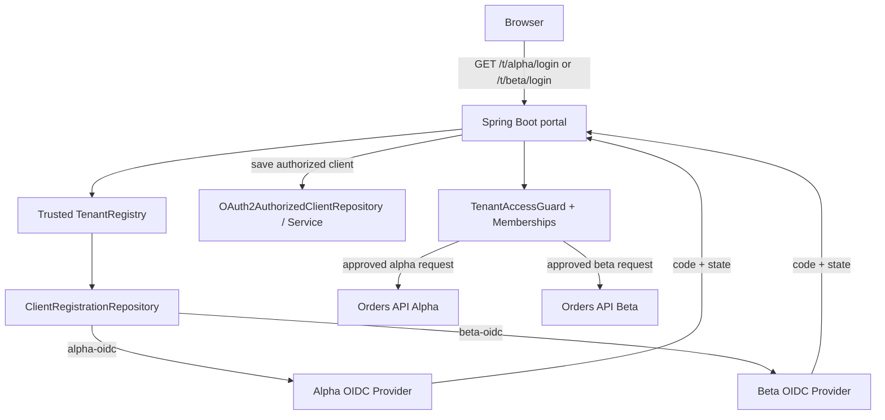
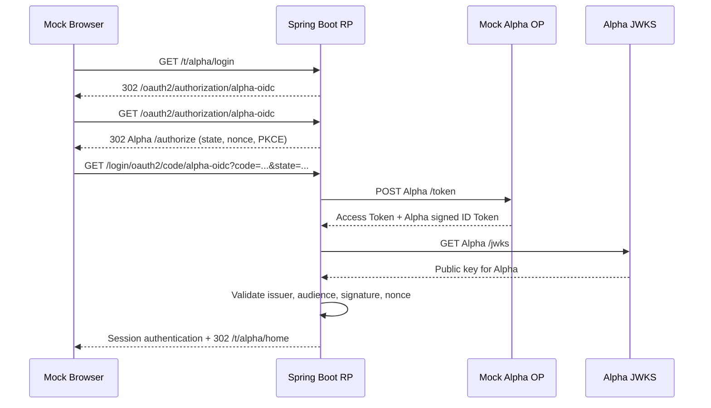

# 34.11. Multi-Tenant Applications with Isolated Client Configurations

A **Spring Security OAuth 2.0/OIDC Client** application can serve multiple enterprise customers (tenants), where each customer uses its own OpenID Provider (OP) or its own OAuth client registration.

For example:

- Tenant **alpha** logs in through `https://idp.alpha.example/realms/alpha` using OAuth client `portal-alpha`.
- Tenant **beta** logs in through `https://idp.beta.example/realms/beta` using OAuth client `portal-beta`.
- Both access the same Spring Boot application at `https://portal.example.org`.
- Each tenant has its own `client-id`, `client-secret`, issuer, scopes, and authorized client.
- Business data, access permissions, and outbound API tokens must **never be mixed** between the two tenants.

This is a practical lab for building a multi-tenant application with **Spring Security OAuth2 Login on the Servlet stack**, using two static `ClientRegistration` entries to clarify the flow before addressing dynamic tenant registration.

**Most important takeaway:** selecting a `ClientRegistration` by tenant **does not grant permission to access that tenant's data**. After login, the application must still verify the registration/issuer/subject and membership/permissions on every business request.

---

## 1. Objectives and Expected Outcomes

After completing this lab, you can:

1. Declare two separate `ClientRegistration` configurations in Spring Boot.
2. Explain the relationship `tenantSlug → registrationId → issuer/clientId/secret`.
3. Create a login initiation URL `/t/{tenant}/login` that selects only from an approved list of tenants.
4. Use Spring Security `oauth2Login()` for multiple providers in the same application.
5. Bind the authorization code callback to the right registration.
6. Redirect after login using the trusted registration, never a browser-supplied URL.
7. Validate `OAuth2AuthenticationToken`, `OidcUser`, `iss`, `sub`, and tenant membership.
8. Prevent an Alpha-authenticated request from reading Beta data even though the user is logged in.
9. Look up `OAuth2AuthorizedClient` by the right registration/principal and avoid sending tokens to the wrong API.
10. Distinguish session-level `Authentication` from authorized-client storage.
11. Test both tenants, wrong issuer, wrong registration, missing membership, and invalid tenant slugs.
12. Design extensions for dynamic registrations, secret rotation, multi-node rollout, and monitoring.

### 1.1. Lab Scope

This lab uses:

| Component | Choice |
|---|---|
| Language | Java 17+ |
| Web stack | Spring MVC / Servlet |
| Security | Spring Security OAuth2 Client + OIDC Login |
| Framework example | Spring Boot 3.x, Spring Security 6.x style |
| Tenants | `alpha` and `beta` |
| Providers | Two independent OIDC issuers |
| Tenant registry | Allowlisted in-memory entries for the lab |
| Membership | In-memory demo implementation, replaced by database/service in production |
| Session | Application browser session |
| API token | `OAuth2AuthorizedClientRepository` |
| Test | JUnit 5, Spring Security Test/MockMvc, optional WireMock |

This is a **complete architectural and core-code practical pattern**, not a preconfigured repository containing every production library and OP. To run it end-to-end, you need a test/staging OP with two client registrations, or mock OPs as shown in the integration testing section.

## 2. Concrete Problem Statement

A SaaS portal operates under a single domain:

```text
https://portal.example.org
```

There are two tenant paths:

```text
Tenant Alpha:
  https://portal.example.org/t/alpha/home
  https://portal.example.org/t/alpha/orders

Tenant Beta:
  https://portal.example.org/t/beta/home
  https://portal.example.org/t/beta/orders
```

Identity details:

| Attribute | Alpha | Beta |
|---|---|---|
| Tenant slug | `alpha` | `beta` |
| Registration ID | `alpha-oidc` | `beta-oidc` |
| Issuer | `https://idp.alpha.example/realms/alpha` | `https://idp.beta.example/realms/beta` |
| Client ID | `portal-alpha` | `portal-beta` |
| Client authentication | `client_secret_basic` | `client_secret_basic` |
| Grant | `authorization_code` | `authorization_code` |
| Scopes | `openid profile email` | `openid profile email` |
| Callback | `/login/oauth2/code/alpha-oidc` | `/login/oauth2/code/beta-oidc` |
| Downstream Orders API | `https://orders.alpha.example/api/orders` | `https://orders.beta.example/api/orders` |

The `.example` hostnames are used for documentation. To run the lab live, substitute two test/tenant OP registrations that you control.

### 2.1. Functional Requirements

- `GET /t/alpha/login` initiates Alpha login.
- `GET /t/beta/login` initiates Beta login.
- The OP returns `code`/`state` to the matching callback.
- Upon successful authentication, the user is redirected to the corresponding tenant's home page.
- `GET /t/alpha/home` requires a principal from the Alpha registration, Alpha issuer, and Alpha membership.
- Logging in via Beta and accessing Alpha must be denied.
- A tenant absent from the registry must not create a new client registration or issuer URL.

### 2.2. Security Requirements

- Never select an issuer from an arbitrary query string.
- Never put `client-secret` in Git, JavaScript, or the browser.
- Authorization Code Flow uses `state`, PKCE per profile, and OIDC ID Token validation.
- Never accept an ID Token issuer or audience belonging to another client.
- Never equate users solely by email while ignoring issuer and subject.
- Never use tenant A's outbound token to call tenant B's API.
- Business data authorization must always check tenant ID and permissions.
- Never log access tokens, refresh tokens, client secrets, authorization codes, or state.

## 3. Overall Architecture



### 3.1. Alpha Flow

```text
GET /t/alpha/login
    |
    v
TenantRegistry: alpha -> alpha-oidc
    |
    v
302 /oauth2/authorization/alpha-oidc
    |
    v
Spring OAuth2AuthorizationRequestRedirectFilter
    |
    v
Alpha OP /authorize?client_id=portal-alpha&state=...
    |
    v
Browser callback:
GET /login/oauth2/code/alpha-oidc?code=...&state=...
    |
    v
Spring exchanges code at Alpha Token Endpoint
    |
    v
Validate ID Token using Alpha issuer/JWKS/clientId
    |
    v
Authentication: registrationId=alpha-oidc
    |
    v
302 /t/alpha/home
    |
    v
TenantAccessGuard verifies Alpha + membership
```

### 3.2. Corresponding Independent Beta Flow

```text
beta -> beta-oidc -> Beta OP -> Beta token/JWKS -> /t/beta/home
```

Never take an authorization code issued by Alpha and exchange it at Beta's Token Endpoint. Callback, `state`, registration, and provider metadata must belong to the same authorization transaction.

## 4. Distinguishing Three Kinds of Identifiers

Three strings that are commonly confused:

```text
tenantSlug     = alpha
registrationId = alpha-oidc
clientId       = portal-alpha
```

| Value | Who defines it? | Where is it used? |
|---|---|---|
| Tenant slug | Application / domain registry | `/t/{tenant}` routing and domain authorization |
| Registration ID | Spring OAuth2 Client | `ClientRegistrationRepository`, authorization start URL |
| Client ID | Authorization Server | OAuth authorization/token requests, ID Token `aud` |

### 4.1. A Tenant Slug Does Not Grant Access

`/t/alpha/home` is a resource path, not proof that the user belongs to Alpha.

### 4.2. Registration ID Is Not the Issuer

You can have two registrations sharing **the same issuer** with different client IDs and secrets. Therefore, never use the issuer alone as the cache key for authorized clients.

### 4.3. Client ID Is Not a Secret

`client_id` routinely appears in the browser authorize request; a confidential `client_secret` must stay strictly server-side.

## 5. Suggested Project Structure

```text
src/
  main/
    java/com/example/portal/
      PortalApplication.java
      security/
        TenantDefinition.java
        TenantRegistry.java
        SecurityConfiguration.java
        TenantLoginSuccessHandler.java
        TenantAccessGuard.java
        TenantMemberships.java
        DemoTenantMemberships.java
      web/
        TenantLoginController.java
        TenantHomeController.java
        TenantOrdersController.java
      orders/
        TenantOrdersGateway.java
    resources/
      application.yml
  test/
    java/com/example/portal/
      security/
        TenantAccessGuardTest.java
      web/
        TenantWebMvcTest.java
    resources/
      application-test.yml
```

In production, replace `DemoTenantMemberships` with a repository/service backed by real tenant membership records and organization-level authorization policies.

## 6. Gradle Dependencies

Assuming the project already uses the Spring Boot Gradle plugin/BOM, declare:

```groovy
dependencies {
    implementation 'org.springframework.boot:spring-boot-starter-web'
    implementation 'org.springframework.boot:spring-boot-starter-security'
    implementation 'org.springframework.boot:spring-boot-starter-oauth2-client'

    testImplementation 'org.springframework.boot:spring-boot-starter-test'
    testImplementation 'org.springframework.security:spring-security-test'
}
```

With Spring Boot 3.x, Java 17+ source compatibility is appropriate. Let Boot's dependency management choose the compatible Spring Security version.

Do not add the Resource Server starter merely because the application is an OAuth2 Client: they are distinct roles. If the same application also accepts inbound Bearer tokens, configure a separate Resource Server chain and verify filter chain ordering.

## 7. Configuring Two Client Registrations in Spring Boot

`src/main/resources/application.yml`:

```yaml
server:
  port: 8080

spring:
  security:
    oauth2:
      client:
        registration:
          alpha-oidc:
            provider: alpha
            client-id: ${ALPHA_OIDC_CLIENT_ID}
            client-secret: ${ALPHA_OIDC_CLIENT_SECRET}
            client-authentication-method: client_secret_basic
            authorization-grant-type: authorization_code
            redirect-uri: "{baseUrl}/login/oauth2/code/{registrationId}"
            scope:
              - openid
              - profile
              - email

          beta-oidc:
            provider: beta
            client-id: ${BETA_OIDC_CLIENT_ID}
            client-secret: ${BETA_OIDC_CLIENT_SECRET}
            client-authentication-method: client_secret_basic
            authorization-grant-type: authorization_code
            redirect-uri: "{baseUrl}/login/oauth2/code/{registrationId}"
            scope:
              - openid
              - profile
              - email

        provider:
          alpha:
            issuer-uri: "https://idp.alpha.example/realms/alpha"
          beta:
            issuer-uri: "https://idp.beta.example/realms/beta"
```

To run against real OPs, you must create both clients in the respective OPs/realms and register the exact two callback URIs.

### 7.1. Why Use Separate `provider` Entries?

Each `ClientRegistration` references its own provider metadata. Using `issuer-uri`, Spring fetches OIDC discovery metadata from that issuer and resolves the Authorization Endpoint, Token Endpoint, JWKS URI, and UserInfo Endpoint.

### 7.2. Separate Client Secrets

```text
ALPHA_OIDC_CLIENT_ID
ALPHA_OIDC_CLIENT_SECRET

BETA_OIDC_CLIENT_ID
BETA_OIDC_CLIENT_SECRET
```

Never reuse the same client secret just to save configuration, especially when two registrations belong to different tenant trust domains.

### 7.3. Issuer URI Is Trusted Configuration

`issuer-uri` is not a secret, yet it is **security-sensitive**. Never allow a user to supply an arbitrary issuer URL and perform discovery or trust derived endpoints from it.

### 7.4. Spring Template-Generated Redirect URI

`"{baseUrl}/login/oauth2/code/{registrationId}"` can expand to:

```text
http://localhost:8080/login/oauth2/code/alpha-oidc
http://localhost:8080/login/oauth2/code/beta-oidc
```

when running locally, or HTTPS production URIs according to trusted deployment/proxy settings.

### 7.5. Scopes Must Follow Each Tenant's Contract

In this demo, both tenants use `openid profile email`. Production configurations may differ:

```yaml
alpha-oidc:
  scope: openid,profile,orders.read

beta-oidc:
  scope: openid,email,orders.view
```

Never assume scopes from one tenant share the same meaning or audience at another tenant.

## 8. Registering Exact Callbacks at Each OP

For a public application:

```text
https://portal.example.org
```

Register:

| OP | Client ID | Exact redirect URI |
|---|---|---|
| Alpha | `portal-alpha` | `https://portal.example.org/login/oauth2/code/alpha-oidc` |
| Beta | `portal-beta` | `https://portal.example.org/login/oauth2/code/beta-oidc` |

Never use wildcard callbacks such as:

```text
https://portal.example.org/*
```

or allow callers to supply arbitrary `redirect_uri` values.

### 8.1. One Registration ID Bound to Its Callback

`alpha-oidc` appears in both the authorization start path and the callback path. Spring Security uses the saved authorization request plus `state` to correlate the callback with the original request.

### 8.2. Never Route Callbacks via a Tenant Query Parameter

Do not design:

```text
/login/oauth2/code?tenant=<untrusted>&code=...
```

and choose the Token Endpoint from that query parameter. The Spring/OAuth authorization transaction must resolve the provider from the trusted registration and correlation state.

### 8.3. PKCE and Nonce

Authorization Code + PKCE is recommended; OIDC requires validating the ID Token issuer, audience, expiry, signature, and nonce when applicable. Never disable `state`, PKCE, or `nonce` to make a callback succeed.

## 9. Creating `TenantDefinition` — Immutable Configuration

Each tenant entry holds only the metadata the application needs:

```java
package com.example.portal.security;

import java.net.URI;

public record TenantDefinition(
        String slug,
        String registrationId,
        String expectedIssuer,
        URI ordersApiUri
) {}
```

Example:

```text
TenantDefinition(
  slug="alpha",
  registrationId="alpha-oidc",
  expectedIssuer="https://idp.alpha.example/realms/alpha",
  ordersApiUri="https://orders.alpha.example/api/orders"
)
```

### 9.1. Why Store `expectedIssuer` in the Registry?

Business code needs to know the expected trust domain when a user accesses `/t/alpha/*`. Even though Spring's OIDC client already validates the ID Token against the selected registration, adding an explicit check in the tenant guard protects against misrouting and configuration mismatch.

### 9.2. `ordersApiUri` Never Comes from the Browser

Outbound OAuth tokens must only go to a trusted Resource Server. Never use `@RequestParam String url` as the destination for a Bearer token.

### 9.3. The Registry Is the Domain-Side Source of Truth

Spring's `ClientRegistrationRepository` knows OAuth client registrations. `TenantRegistry` knows which tenant maps to which registration and API resource. Both sources must stay consistent and be verified in tests.

## 10. `TenantRegistry` Allowlist

Example class:

```java
package com.example.portal.security;

import java.net.URI;
import java.util.Map;

import org.springframework.http.HttpStatus;
import org.springframework.stereotype.Component;
import org.springframework.web.server.ResponseStatusException;
import org.springframework.security.access.AccessDeniedException;

@Component
public final class TenantRegistry {

    private final Map<String, TenantDefinition> bySlug =
        Map.of(
            "alpha",
            new TenantDefinition(
                "alpha",
                "alpha-oidc",
                "https://idp.alpha.example/realms/alpha",
                URI.create("https://orders.alpha.example/api/orders")
            ),
            "beta",
            new TenantDefinition(
                "beta",
                "beta-oidc",
                "https://idp.beta.example/realms/beta",
                URI.create("https://orders.beta.example/api/orders")
            )
        );

    private final Map<String, TenantDefinition> byRegistration =
        Map.of(
            "alpha-oidc", bySlug.get("alpha"),
            "beta-oidc", bySlug.get("beta")
        );

    public TenantDefinition requireSlug(String slug) {
        TenantDefinition tenant = bySlug.get(slug);
        if (tenant == null) {
            throw new ResponseStatusException(
                HttpStatus.NOT_FOUND,
                "Unknown tenant"
            );
        }
        return tenant;
    }

    public TenantDefinition requireRegistrationId(
            String registrationId) {

        TenantDefinition tenant = byRegistration.get(registrationId);
        if (tenant == null) {
            throw new AccessDeniedException(
                "Unknown OIDC client registration"
            );
        }
        return tenant;
    }
}
```

### 10.1. Why Not Concatenate Strings to Build Registration IDs?

Never do:

```java
String registrationId = request.getParameter("tenant") + "-oidc";
```

and assume any value is valid. With an allowlist, the browser can only select an **already existing key** in the registry.

### 10.2. Never Construct Issuer URLs Dynamically from a Slug

Avoid:

```java
String issuer = "https://" + tenant + ".identity.example";
```

when `tenant` has not been verified. Tenant slugs may not map 1:1 to hostnames; more importantly, arbitrary issuer discovery opens SSRF, phishing, and metadata trust confusion surfaces.

### 10.3. Immutable Definitions

`Map.of(...)` in this example is immutable. In production, you can back it with a database/cache snapshot plus metadata signing/versioning; never let an incoming request mutate the registry.

### 10.4. 404 vs. 403

- Unknown tenant slug: `404` may be appropriate to avoid leaking tenant existence.
- Invalid registration ID after authentication: `AccessDeniedException`, never falling back to another tenant.

The exact HTTP status policy may vary by application, but **never accept an arbitrary registration**.

## 11. Per-Tenant Login Initiation Route

Spring Security supports by default:

```text
/oauth2/authorization/{registrationId}
```

We expose a user-friendly route:

```text
/t/{tenant}/login
```

Code:

```java
package com.example.portal.web;

import java.net.URI;

import com.example.portal.security.TenantDefinition;
import com.example.portal.security.TenantRegistry;

import org.springframework.http.HttpStatus;
import org.springframework.http.ResponseEntity;
import org.springframework.web.bind.annotation.GetMapping;
import org.springframework.web.bind.annotation.PathVariable;
import org.springframework.web.bind.annotation.RestController;

@RestController
public final class TenantLoginController {

    private final TenantRegistry tenants;

    public TenantLoginController(TenantRegistry tenants) {
        this.tenants = tenants;
    }

    @GetMapping("/t/{tenant}/login")
    public ResponseEntity<Void> login(
            @PathVariable String tenant) {

        TenantDefinition selected = tenants.requireSlug(tenant);

        URI authorizationStart = URI.create(
            "/oauth2/authorization/" + selected.registrationId()
        );

        return ResponseEntity.status(HttpStatus.FOUND)
            .location(authorizationStart)
            .build();
    }
}
```

### 11.1. Why Only an Internal Redirect?

The controller does not construct `state`, PKCE challenge, `nonce`, or the OP authorization URL itself. It hands off to Spring Security's filter so the framework generates the authorization request safely.

### 11.2. Never Construct the OP Authorization Endpoint Manually

Manually assembling:

```java
String location = issuer + "/authorize?client_id=" + ...;
```

makes it far too easy to omit `state`, PKCE, `nonce`, proper encoding, and login request persistence.

### 11.3. Non-Existent Tenant

`GET /t/unknown/login` must return a controlled error rather than attempting discovery against `unknown` or falling back to Alpha as a default.

### 11.4. If Using Subdomain Routing

You can map:

```text
alpha.portal.example.org -> alpha
beta.portal.example.org  -> beta
```

but only after trusted host normalization and reverse-proxy allowlisting. Never read a raw `X-Forwarded-Host` from an untrusted client to select a tenant.

## 12. `SecurityFilterChain` for the Application

```java
package com.example.portal.security;

import org.springframework.context.annotation.Bean;
import org.springframework.context.annotation.Configuration;
import org.springframework.security.config.Customizer;
import org.springframework.security.config.annotation.web.builders.HttpSecurity;
import org.springframework.security.web.SecurityFilterChain;

@Configuration
public class SecurityConfiguration {

    @Bean
    SecurityFilterChain portalSecurity(
            HttpSecurity http,
            TenantRegistry registry) throws Exception {

        http
            .authorizeHttpRequests(auth -> auth
                .requestMatchers(
                    "/",
                    "/error",
                    "/assets/**",
                    "/t/*/login"
                ).permitAll()
                .anyRequest().authenticated()
            )
            .oauth2Login(oauth2 -> oauth2
                .successHandler(
                    new TenantLoginSuccessHandler(registry)
                )
            );

        return http.build();
    }
}
```

### 12.1. OAuth2 Login URLs

Spring OAuth2 Login filters handle:

```text
/oauth2/authorization/alpha-oidc
/oauth2/authorization/beta-oidc

/login/oauth2/code/alpha-oidc
/login/oauth2/code/beta-oidc
```

These are protocol endpoints handled by security filters, not endpoints for which you write your own controller.

### 12.2. Do Not Replace `authenticated()` with `permitAll()`

`anyRequest().authenticated()` is only the **authentication** layer; it does not check tenant boundaries. Business routes must still invoke `TenantAccessGuard` or equivalent authorization infrastructure.

### 12.3. CSRF

A browser/session application still needs proper CSRF protection for state-changing operations. Do not disable CSRF globally simply because OAuth2 Login uses redirects.

### 12.4. Multiple Security Chains

If the application also exposes `/api/**` accepting Bearer JWTs, use a separate chain with `securityMatcher("/api/**")`. Pay close attention to chain ordering so OAuth callbacks remain on the web login chain.

### 12.5. Dependency Injection Note

`TenantLoginSuccessHandler` below receives the validated registry; it is not a handler that redirects to arbitrary URLs from a query string.

## 13. Login Success Handler Using Trusted Registration

After a callback succeeds, Spring Security creates an `OAuth2AuthenticationToken` carrying the `authorizedClientRegistrationId` of the completed flow.

We use this registration ID to select the tenant's landing page.

```java
package com.example.portal.security;

import java.io.IOException;

import jakarta.servlet.ServletException;
import jakarta.servlet.http.HttpServletRequest;
import jakarta.servlet.http.HttpServletResponse;

import org.springframework.security.core.Authentication;
import org.springframework.security.oauth2.client.authentication
    .OAuth2AuthenticationToken;
import org.springframework.security.web.authentication
    .AuthenticationSuccessHandler;
import org.springframework.security.web.DefaultRedirectStrategy;
import org.springframework.security.web.RedirectStrategy;

public final class TenantLoginSuccessHandler
        implements AuthenticationSuccessHandler {

    private final TenantRegistry registry;

    private final RedirectStrategy redirects =
        new DefaultRedirectStrategy();

    public TenantLoginSuccessHandler(TenantRegistry registry) {
        this.registry = registry;
    }

    @Override
    public void onAuthenticationSuccess(
            HttpServletRequest request,
            HttpServletResponse response,
            Authentication authentication)
            throws IOException, ServletException {

        if (!(authentication instanceof OAuth2AuthenticationToken oauth)) {
            response.sendError(
                HttpServletResponse.SC_FORBIDDEN,
                "Unsupported authentication"
            );
            return;
        }

        TenantDefinition tenant = registry.requireRegistrationId(
            oauth.getAuthorizedClientRegistrationId()
        );

        redirects.sendRedirect(
            request,
            response,
            "/t/" + tenant.slug() + "/home"
        );
    }
}
```

### 13.1. Why Is This Safer Than Redirecting from a Query Parameter?

Wrong:

```java
response.sendRedirect(request.getParameter("returnTo"));
```

A `returnTo=https://attacker.example` parameter creates an open redirect vulnerability. This success handler uses only the slug resolved from the immutable registry.

### 13.2. A Success Handler Alone Is Not Enough for Domain Authorization

A user might log in successfully at the Beta OP yet **not** belong to tenant Beta according to the application. The handler redirects to `/t/beta/home`; the tenant guard must reject data access if membership is invalid.

If denial at login time is required, design an authentication success flow with membership verification and session cleanup per policy rather than sending a raw 403 while leaving an unauthorized session holding sensitive state.

### 13.3. Never Read Registration from a Request Parameter

`authentication.getAuthorizedClientRegistrationId()` comes from the transaction completed by Spring Security, not from `?tenant=...` passed by the browser after callback.

### 13.4. Deep Linking After Login

In a real application, a user may start at `/t/alpha/orders/123`. If you need to return to a deep link, store a **server-side validated destination** belonging to the right tenant; never trust an arbitrary saved URL or query parameter. This example handler always goes to `/home` for simplicity and to prevent open redirects.

## 14. Multi-Tenant OIDC Identity Resolution

After OIDC Login, Spring provides:

- `OAuth2AuthenticationToken`: authenticated principal + registration ID.
- `OidcUser`: ID Token claims and optionally UserInfo claims.
- `OidcIdToken`: issuer, subject, audience, timestamps, nonce/claims.

An identity key should be based on:

```text
(issuer, subject)
```

Not solely on:

```text
email
preferred_username
display_name
```

### 14.1. Why Is the Issuer Part of Identity?

Two different OPs can both issue:

```text
sub = 123
```

yet those users belong to two different trust domains:

```text
(https://idp.alpha.example/realms/alpha, 123)
(https://idp.beta.example/realms/beta, 123)
```

They are **not automatically** the same user.

### 14.2. Client Registration Differs from User Membership

A user authenticated by Alpha's OP does not automatically have every business permission in Alpha. Depending on the domain, membership may need to be checked by the application or a trusted group/entitlement source.

### 14.3. Never Map Roles Directly from Unverified Claims

Spring OIDC Login validates the ID Token. If a custom user service consumes UserInfo or group claims, verify provider trust, subject matching, claim types, and tenant policy.

## 15. `TenantMemberships`: Abstraction for Business Authorization

Suggested data model:

```text
tenant_slug | issuer                                   | subject   | app_user_id | role
------------+------------------------------------------+-----------+-------------+-------
alpha       | https://idp.alpha.example/realms/alpha    | alpha-u1  | 1001        | USER
beta        | https://idp.beta.example/realms/beta      | beta-u1   | 2001        | USER
```

Interface:

```java
package com.example.portal.security;

public interface TenantMemberships {

    boolean isMember(
        String tenantSlug,
        String issuer,
        String subject
    );
}
```

### 15.1. Demo Implementation

```java
package com.example.portal.security;

import java.util.Set;
import org.springframework.stereotype.Component;

@Component
public final class DemoTenantMemberships
        implements TenantMemberships {

    private static final Set<TenantMemberKey> MEMBERS = Set.of(
        new TenantMemberKey(
            "alpha",
            "https://idp.alpha.example/realms/alpha",
            "alpha-u1"
        ),
        new TenantMemberKey(
            "beta",
            "https://idp.beta.example/realms/beta",
            "beta-u1"
        )
    );

    @Override
    public boolean isMember(
            String tenantSlug,
            String issuer,
            String subject) {

        return MEMBERS.contains(
            new TenantMemberKey(tenantSlug, issuer, subject)
        );
    }

    private record TenantMemberKey(
        String tenantSlug,
        String issuer,
        String subject
    ) {}
}
```

### 15.2. Production Implementation

In production, replace this with a database/service checking:

- The tenant account is active.
- The user has an active membership.
- Roles and permissions within the tenant.
- Suspension / deprovisioning status.
- Tenant-specific policies.
- Object ownership / row-level authorization.

### 15.3. Deny by Default

If the membership service cannot return a reliable answer, never grant access simply because OIDC login succeeded. Exact timeout/failure HTTP status policies may differ, but never fail-open on sensitive data.

## 16. `TenantAccessGuard` Enforces Checks on Every Request

This is the single most critical layer for preventing **cross-tenant access**.

Result record:

```java
package com.example.portal.security;

public record TenantIdentity(
    String tenantSlug,
    String registrationId,
    String issuer,
    String subject
) {}
```

Guard:

```java
package com.example.portal.security;

import org.springframework.security.access.AccessDeniedException;
import org.springframework.security.core.Authentication;
import org.springframework.security.oauth2.client.authentication
    .OAuth2AuthenticationToken;
import org.springframework.security.oauth2.core.oidc.user.OidcUser;
import org.springframework.stereotype.Service;

@Service
public final class TenantAccessGuard {

    private final TenantRegistry tenants;
    private final TenantMemberships memberships;

    public TenantAccessGuard(
            TenantRegistry tenants,
            TenantMemberships memberships) {

        this.tenants = tenants;
        this.memberships = memberships;
    }

    public TenantIdentity require(
            String requestedSlug,
            Authentication authentication) {

        TenantDefinition requested = tenants.requireSlug(
            requestedSlug
        );

        if (!(authentication instanceof OAuth2AuthenticationToken oauth)) {
            throw new AccessDeniedException(
                "OIDC authentication required"
            );
        }

        String authenticatedRegistration =
            oauth.getAuthorizedClientRegistrationId();

        if (!requested.registrationId().equals(
                authenticatedRegistration)) {

            throw new AccessDeniedException(
                "OIDC registration does not match requested tenant"
            );
        }

        if (!(oauth.getPrincipal() instanceof OidcUser user)) {
            throw new AccessDeniedException(
                "OIDC principal required"
            );
        }

        if (user.getIdToken().getIssuer() == null) {
            throw new AccessDeniedException(
                "Missing trusted issuer"
            );
        }

        String issuer = user.getIdToken().getIssuer().toString();
        String subject = user.getSubject();

        if (!requested.expectedIssuer().equals(issuer)) {
            throw new AccessDeniedException(
                "OIDC issuer does not match tenant"
            );
        }

        if (subject == null || subject.isBlank()) {
            throw new AccessDeniedException(
                "OIDC subject is missing"
            );
        }

        if (!memberships.isMember(
                requestedSlug,
                issuer,
                subject)) {

            throw new AccessDeniedException(
                "Tenant membership required"
            );
        }

        return new TenantIdentity(
            requestedSlug,
            requested.registrationId(),
            issuer,
            subject
        );
    }
}
```

### 16.1. Four Distinct Checks

1. **Valid tenant slug:** `TenantRegistry.requireSlug`.
2. **Matching `ClientRegistration`:** the Alpha path requires `alpha-oidc`.
3. **Matching issuer/subject:** the user originates from the expected OP.
4. **Valid membership:** the user is authorized for the tenant by the application.

A user holding a generic `ROLE_USER` authority is still not treated as a member of every tenant.

### 16.2. Why Not Check Email?

Emails can change, go unverified, or collide across providers. `(iss, sub)` is stable under the OIDC identity model and can then be linked to a local user.

### 16.3. If the IdP Validated the Issuer, Why Check Again?

Spring Security's ID Token validator verifies the token against the selected registration. The guard adds a **business routing consistency** check so that a `/t/alpha/*` request can never execute under a different authenticated registration or issuer due to configuration or coding mistakes.

### 16.4. What If a User Has Accounts in Both Tenants?

The current browser session still holds only one active `Authentication` by default. The user must log in to the corresponding tenant when switching, or the application must explicitly design a multi-account context; never assume a single session holds two identities simultaneously.

## 17. Home Controller Applying the Guard

```java
package com.example.portal.web;

import java.util.Map;

import com.example.portal.security.TenantAccessGuard;
import com.example.portal.security.TenantIdentity;

import org.springframework.security.core.Authentication;
import org.springframework.web.bind.annotation.GetMapping;
import org.springframework.web.bind.annotation.PathVariable;
import org.springframework.web.bind.annotation.RestController;

@RestController
public final class TenantHomeController {

    private final TenantAccessGuard guard;

    public TenantHomeController(TenantAccessGuard guard) {
        this.guard = guard;
    }

    @GetMapping("/t/{tenant}/home")
    public Map<String, String> home(
            @PathVariable String tenant,
            Authentication authentication) {

        TenantIdentity identity = guard.require(
            tenant,
            authentication
        );

        return Map.of(
            "tenant", identity.tenantSlug(),
            "issuer", identity.issuer(),
            "subject", identity.subject()
        );
    }
}
```

### 17.1. Never Return Tokens in JSON

The response contains no access token, refresh token, client secret, or raw ID Token.

### 17.2. Should `issuer`/`subject` Be Returned Outside Production?

This example helps observe lab behavior. In production, return only the display name, local user ID, and fields permitted for exposure. Identity data still falls under privacy and retention policies.

### 17.3. Do Not Forget the Guard on Other Endpoints

Protecting `/t/{tenant}/home` while forgetting `/t/{tenant}/orders` still leaks data. In production, also enforce service-layer/domain authorization or an authorization manager that checks tenant context on every request and data operation.

## 18. Expected Access Outcomes

| Active login session | Request | Expected outcome |
|---|---|---|
| Alpha, `alpha-u1`, approved membership | `/t/alpha/home` | 200 |
| Alpha, `alpha-u1` | `/t/beta/home` | 403 |
| Beta, `beta-u1`, approved membership | `/t/beta/home` | 200 |
| Beta, `beta-u1` | `/t/alpha/home` | 403 |
| No login | `/t/alpha/home` | Redirect to login or authentication entry point |
| No login | `/t/alpha/login` | 302 starting Alpha authorization |
| Any | `/t/unknown/login` | 404 |
| Alpha registration, wrong issuer | `/t/alpha/home` | Denied |
| Alpha registration, no membership | `/t/alpha/home` | Denied |

Exact HTTP status codes for unauthorized browser requests vary with entry point configuration, content negotiation, and exception handling. What matters is preventing cross-tenant access.

## 19. Storing the Authorized Client After Login

Spring OAuth2 Login typically creates an `OAuth2AuthorizedClient` after exchanging the authorization code at the Token Endpoint.

```text
OAuth2AuthorizedClient
  registrationId = alpha-oidc
  principalName  = <current trusted principal name>
  accessToken    = AT-ALPHA
  refreshToken   = RT-ALPHA (when issued)
```

A Beta login creates a separate authorized client:

```text
registrationId = beta-oidc
accessToken    = AT-BETA
```

### 19.1. Abstractions

- `OAuth2AuthorizedClientRepository`: request/session-oriented retrieval and persistence.
- `OAuth2AuthorizedClientService`: service-oriented storage, typically keyed by registration ID and principal name.
- `OAuth2AuthorizedClientManager`: authorizes, re-authorizes, or refreshes tokens via grant providers.

### 19.2. Never Use a Global Token Variable

Wrong:

```java
static String currentAccessToken;
```

Under concurrency, user A / tenant A would overwrite or use tenant B's token.

### 19.3. Never Cache Solely by Issuer

Two registrations can share an issuer while using different client IDs. The storage key must include at least the appropriate registration and principal context, plus tenant/domain identifiers if needed.

## 20. Looking Up the Tenant's Authorized Client

An MVC controller can load the authorized client from `OAuth2AuthorizedClientRepository` after the guard verifies the principal and registration.

```java
package com.example.portal.web;

import jakarta.servlet.http.HttpServletRequest;

import com.example.portal.security.TenantAccessGuard;
import com.example.portal.security.TenantIdentity;
import com.example.portal.security.TenantRegistry;
import com.example.portal.security.TenantDefinition;

import org.springframework.http.HttpStatus;
import org.springframework.security.core.Authentication;
import org.springframework.security.oauth2.client.OAuth2AuthorizedClient;
import org.springframework.security.oauth2.client.web.OAuth2AuthorizedClientRepository;
import org.springframework.web.server.ResponseStatusException;

public final class TenantAuthorizedClientLookup {

    private final TenantAccessGuard guard;
    private final TenantRegistry tenants;
    private final OAuth2AuthorizedClientRepository authorizedClients;

    public TenantAuthorizedClientLookup(
            TenantAccessGuard guard,
            TenantRegistry tenants,
            OAuth2AuthorizedClientRepository authorizedClients) {
        this.guard = guard;
        this.tenants = tenants;
        this.authorizedClients = authorizedClients;
    }

    public OAuth2AuthorizedClient requireClient(
            String slug,
            Authentication authentication,
            HttpServletRequest request) {

        TenantIdentity identity = guard.require(
            slug,
            authentication
        );

        TenantDefinition tenant = tenants.requireSlug(
            identity.tenantSlug()
        );

        OAuth2AuthorizedClient client =
            authorizedClients.loadAuthorizedClient(
                tenant.registrationId(),
                authentication,
                request
            );

        if (client == null) {
            throw new ResponseStatusException(
                HttpStatus.CONFLICT,
                "Please reconnect your tenant account"
            );
        }

        return client;
    }
}
```

This class is **a Java helper illustrating the data flow**. To use and inject it into controllers, annotate it with `@Component`/`@Service` or declare it as a `@Bean` per your project conventions.

### 20.1. Why Use the Exact Registration ID?

`OAuth2AuthorizedClientRepository.loadAuthorizedClient` takes a `clientRegistrationId`; we retrieve it from the trusted `TenantDefinition` after the guard runs, never from a request parameter.

### 20.2. What If No Client Exists?

Never fall back to another tenant's token. Guide the user through a controlled reconnect flow, or let an authorized client manager re-authorize per policy.

### 20.3. Do Not Assume Every Repository Stores Tokens Identically

Spring may use a session-backed repository, a service-backed repository, or a custom implementation. Across multiple nodes, shared storage and proper consistency guarantees are required.

## 21. Outbound Orders API: Never Let Tokens Go to the Wrong Target

`TenantDefinition` already holds a trusted `ordersApiUri`.

Service:

```java
package com.example.portal.orders;

import java.net.URI;

import org.springframework.security.oauth2.core.OAuth2AccessToken;
import org.springframework.stereotype.Service;
import org.springframework.web.client.RestClient;

@Service
public final class TenantOrdersGateway {

    private final RestClient restClient;

    public TenantOrdersGateway(RestClient.Builder builder) {
        this.restClient = builder.build();
    }

    public String fetchOrders(
            URI trustedOrdersUri,
            OAuth2AccessToken accessToken) {

        return restClient.get()
            .uri(trustedOrdersUri)
            .headers(headers -> headers.setBearerAuth(
                accessToken.getTokenValue()))
            .retrieve()
            .body(String.class);
    }
}
```

### 21.1. Important: The URI Comes from the Trusted Registry

Never do:

```java
@GetMapping("/proxy")
public String proxy(@RequestParam String url) {
    return restClient.get()
        .uri(url)
        .headers(h -> h.setBearerAuth(accessToken))
        .retrieve()
        .body(String.class);
}
```

If the caller controls `url`, the access token can be exfiltrated to an attacker's host.

### 21.2. Redirects and DNS

Even with an initially trusted URL, verify how the HTTP client behaves if the downstream server returns a redirect to another origin or DNS changes. Test no-cross-origin token forwarding against your threat model and HTTP client configuration.

### 21.3. Audience and Scopes

An Alpha access token must never be sent to the Beta API. The Resource Server must still verify audience, issuer, and scopes rather than accepting any Bearer header blindly.

## 22. Orders Controller Combining Guard, Repository, and Gateway

```java
package com.example.portal.web;

import jakarta.servlet.http.HttpServletRequest;

import com.example.portal.orders.TenantOrdersGateway;
import com.example.portal.security.TenantAccessGuard;
import com.example.portal.security.TenantDefinition;
import com.example.portal.security.TenantRegistry;

import org.springframework.security.core.Authentication;
import org.springframework.security.oauth2.client.OAuth2AuthorizedClient;
import org.springframework.security.oauth2.client.web.OAuth2AuthorizedClientRepository;
import org.springframework.web.bind.annotation.GetMapping;
import org.springframework.web.bind.annotation.PathVariable;
import org.springframework.web.bind.annotation.RestController;
import org.springframework.http.HttpStatus;
import org.springframework.web.server.ResponseStatusException;

@RestController
public final class TenantOrdersController {

    private final TenantRegistry tenants;
    private final TenantAccessGuard guard;
    private final OAuth2AuthorizedClientRepository clients;
    private final TenantOrdersGateway gateway;

    public TenantOrdersController(
            TenantRegistry tenants,
            TenantAccessGuard guard,
            OAuth2AuthorizedClientRepository clients,
            TenantOrdersGateway gateway) {
        this.tenants = tenants;
        this.guard = guard;
        this.clients = clients;
        this.gateway = gateway;
    }

    @GetMapping("/t/{tenant}/orders")
    public String orders(
            @PathVariable String tenant,
            Authentication authentication,
            HttpServletRequest request) {

        guard.require(tenant, authentication);

        TenantDefinition definition =
            tenants.requireSlug(tenant);

        OAuth2AuthorizedClient client =
            clients.loadAuthorizedClient(
                definition.registrationId(),
                authentication,
                request
            );

        if (client == null) {
            throw new ResponseStatusException(
                HttpStatus.CONFLICT,
                "Tenant account must be reconnected"
            );
        }

        return gateway.fetchOrders(
            definition.ordersApiUri(),
            client.getAccessToken()
        );
    }
}
```

### 22.1. This Illustrates Fetching an Existing Authorized Client

This example uses the repository to load an existing token; it **does not handle every expired-token case automatically**. Production typically needs `OAuth2AuthorizedClientManager`/providers to reauthorize or refresh tokens before calling the API.

### 22.2. Validate the API Response

Never return a downstream response blindly if it could contain another tenant's data. In particular, if the backend API accepts `tenantId` via query parameter, the Resource Server/gateway must also enforce the authorized tenant.

### 22.3. Never Send the Access Token to the Browser

In a BFF/confidential web architecture, tokens stay on the backend and are sent only via `Authorization: Bearer` to trusted APIs.

## 23. When Refresh or Reauthorization Is Needed: Use a Manager

`OAuth2AuthorizedClientManager` is the abstraction responsible for authorizing or re-authorizing an authorized client.

Servlet manager example:

```java
@Bean
OAuth2AuthorizedClientManager authorizedClientManager(
        ClientRegistrationRepository registrations,
        OAuth2AuthorizedClientRepository repository) {

    DefaultOAuth2AuthorizedClientManager manager =
        new DefaultOAuth2AuthorizedClientManager(
            registrations,
            repository
        );

    OAuth2AuthorizedClientProvider provider =
        OAuth2AuthorizedClientProviderBuilder.builder()
            .authorizationCode()
            .refreshToken()
            .build();

    manager.setAuthorizedClientProvider(provider);
    return manager;
}
```

### 23.1. Supply the Right Request Context

`DefaultOAuth2AuthorizedClientManager` is designed for Servlet requests. When calling it directly, pass an `OAuth2AuthorizeRequest` carrying the principal and appropriate servlet request/response attributes, or use a framework-integrated resolver/HTTP interceptor.

### 23.2. Never Substitute Client Credentials for User Login

A user-delegated Orders API token differs from a service token. If user authorization is absent, never fall back to a broad `client_credentials` token.

### 23.3. Service Manager for Background Jobs

If a tenant background job needs a service token, `AuthorizedClientServiceOAuth2AuthorizedClientManager` is typically appropriate because there is no Servlet request. Ensure the principal key is stable and clearly isolates tenant and registration.

### 23.4. Refresh Rotation

When the OP rotates refresh tokens, the repository/service must persist the new token and avoid stale deletes caused by concurrent refreshes. Keep token lifecycle tests separate from controller tests.

## 24. Can One Browser Session Be Logged Into Two Tenants Simultaneously?

**By default, not in the way you might expect.**

A Spring Security Servlet web session holds a single active `SecurityContext`/`Authentication`. If a user logs into Alpha and then completes a Beta login within the same session, the active `Authentication` switches to Beta.

```text
Session S:
  Step 1: Authentication alpha-oidc
  Step 2: Authentication beta-oidc
  Active:   beta-oidc
```

The authorized client repository may still retain both records, but **that does not mean the current session is simultaneously authenticated for both Alpha and Beta**.

### 24.1. Expected Behavior in This Lab

When the active login is Beta:

```text
GET /t/beta/home  -> allowed if Beta membership
GET /t/alpha/home -> denied
```

### 24.2. If Multi-Account Within One Session Is Required

You must explicitly design a session identity / tenant switching model with reauthentication checks, token ownership rules, CSRF/session semantics, and clear UI. Never simply remove the registration ID check from `TenantAccessGuard`.

### 24.3. Multi-Tab

Two browser tabs starting logins against two providers in the same session may overwrite each other's pending authorization request/state depending on repository implementation. Test multi-tab login and provide a retry UX or design authorization request storage supporting concurrent transactions.

## 25. Why Path-Based Tenant Routing Alone Is Never Enough

An anti-pattern:

```java
@GetMapping("/t/{tenant}/orders")
public List<Order> orders(@PathVariable String tenant) {
    return orderRepository.findByTenantSlug(tenant);
}
```

If Spring Security only checks `authenticated()`, an Alpha-authenticated user can simply change the URL to `/t/beta/orders`.

### 25.1. Domain Data Guard Principle

```text
Authenticated principal
   + verified registration
   + verified issuer/subject
   + active tenant membership
   + domain permission for object
   = allowed data access
```

### 25.2. Check Object Ownership Too

`GET /t/alpha/orders/123` must verify that order 123 belongs to tenant Alpha. Checking that the user is an Alpha member is insufficient if the repository queries by order ID without a `tenant_id` filter.

Conceptual SQL example:

```sql
SELECT *
FROM orders
WHERE tenant_id = :authorizedTenantId
  AND id = :orderId;
```

`:authorizedTenantId` must come from the trusted identity and domain authorization context, never from an unverified request parameter.

## 26. One Issuer, Multiple Client Registrations

Multi-tenancy does not always mean multiple OPs.

Example:

```text
issuer = https://login.company.example

clientId for alpha = alpha-portal
clientId for beta  = beta-portal

registrationId:
  alpha-oidc
  beta-oidc
```

Both registrations share an issuer yet have distinct client IDs, secrets, scopes, and redirects.

### 26.1. Authorized Clients Must Still Stay Isolated

Never cache solely by issuer. Keep registration ID and principal context distinct so tokens are never reused for the wrong client.

### 26.2. Matching `sub` May Represent the Same End-User

With the same issuer, identical subjects may refer to the same OP user. Even then, that user does not automatically hold memberships in both Alpha and Beta.

### 26.3. `aud` Is Scoped to Client ID

Alpha's ID Token must be validated for Alpha's client ID; never accept a token issued for Beta's client ID merely because `issuer` and `sub` match.

## 27. One Tenant, Multiple Providers

A large enterprise tenant may allow logins via:

```text
alpha-employees
alpha-partners
```

In that case, the one-tenant-to-one-registration mapping in this lab expands to:

```text
Tenant
  -> Set<ApprovedClientRegistration>
  -> Approved issuer/client metadata per registration
  -> Identity-to-membership mapping
```

### 27.1. Never Skip Registration Verification

The guard must verify that the active registration **belongs to the tenant's set of approved registrations**, rather than requiring a single fixed registration. It must still verify the issuer/subject mapping per provider.

### 27.2. Never Equate Accounts by Email Alone

An employee and a partner with the same email address may represent two distinct principals. Account linking must rely on trusted proof and local policy.

### 27.3. Provider Selection UX

Allow the tenant to display "Sign in with Company SSO" and "Sign in with Partner ID" driven from a trusted registry. Never accept an arbitrary issuer URL from the browser.

## 28. Scaling to a Dynamic `ClientRegistrationRepository`

With a handful of tenants, `application.yml` suffices. With hundreds or thousands of tenants, static configuration becomes hard to maintain.

An alternative architecture:

```text
Trusted onboarding workflow
  -> validate issuer and security metadata
  -> store tenant registration configuration
  -> store client secret reference in secret manager
  -> publish immutable configuration version
  -> ClientRegistrationRepository snapshot/cache
  -> Spring OAuth2 Login filters use registrationId
```

### 28.1. Separate Onboarding from Browser Login

**Never** call `ClientRegistrations.fromIssuerLocation(userInputIssuer)` on arbitrary browser login requests. On-the-fly discovery exposes SSRF/metadata-poisoning vectors and uncontrolled runtime load.

### 28.2. Onboard Only Approved Issuers

Admin workflow:

1. Verify tenant ownership.
2. Verify domain/issuer through a trusted channel.
3. Verify TLS certificates and metadata trust.
4. Restrict scopes, authentication methods, and algorithms per policy.
5. Register the exact redirect URI at the OP.
6. Store the client ID and secret reference.
7. Test the Token Endpoint and JWKS in staging.
8. Publish an immutable registration version.
9. Audit who created/modified it.
10. Support disable/revoke and rollback.

### 28.3. Example of Controlled Registration Construction

```java
ClientRegistration registration =
    ClientRegistrations
        .fromIssuerLocation(approvedIssuer)
        .registrationId(approvedRegistrationId)
        .clientId(approvedClientId)
        .clientSecret(secretManagerValue)
        .authorizationGrantType(
            AuthorizationGrantType.AUTHORIZATION_CODE)
        .redirectUri(
            "{baseUrl}/login/oauth2/code/{registrationId}")
        .scope("openid", "profile")
        .build();
```

This snippet illustrates **trusted onboarding / runtime snapshot construction**. `fromIssuerLocation` may perform network discovery, so the issuer must be approved and network access controlled before calling it.

### 28.4. Avoid Arbitrary Mutable Maps

If `ClientRegistrationRepository` reloads dynamically, use atomic snapshots and thread safety. Never mutate issuer, client ID, and secret field-by-field while an authorization transaction callback is in flight.

### 28.5. Changing `registrationId` Has Side Effects

Authorized-client storage typically keys records by registration ID. Renaming an ID can orphan existing tokens/session records; plan data migration or reauthentication accordingly.

## 29. Managing Separate Secrets per Tenant

Production layout:

```text
prod/portal/tenants/alpha/oidc/client-secret
prod/portal/tenants/beta/oidc/client-secret
```

Every credential should have:

- A clear source of truth.
- Workload identity / least-privilege read access.
- Version metadata.
- A rotation and rollback plan.
- Read/write audit logging.
- Zero exposure in logs, Actuator endpoints, or CI output.
- Explicit cross-tenant access policies.

### 29.1. Never Expose Client Secrets to the Browser

Confidential backend Authorization Code flows send the client secret when the backend calls the Token Endpoint. Frontend JavaScript must never receive the secret.

### 29.2. Do Not Grant Every Pod Access to Every Tenant Secret Unnecessarily

Under strict tenant trust boundaries, separate services/workload identities or at least per-resource ACLs rather than giving a single runtime identity read access across all tenants.

### 29.3. Multi-Node Secret Rotation

If one replica still holds Alpha secret v1 after the Alpha OP revokes v1, a subset of Alpha requests will fail with `invalid_client`. Track credential version metadata and use rolling rollouts.

### 29.4. Refresh Tokens Are a Different Class of Secret

A client secret belongs to a registration; a refresh token belongs to an authorized client/principal. Never store all users' refresh tokens under the same `client-secret` key.

## 30. Tenant-Isolated Authorized-Client Store

Conceptual schema:

```text
registration_id | principal_name | encrypted_access_token | encrypted_refresh_token
----------------+----------------+------------------------+------------------------
alpha-oidc      | alpha-u1       | ...                    | ...
beta-oidc       | beta-u1        | ...                    | ...
```

Production may also require columns such as:

```text
tenant_id
issuer
subject
token_version
expires_at
updated_at
encryption_key_id
```

### 30.1. Never Take `principalName` from an Untrusted Query

Wrong:

```java
authorizedClientService.loadAuthorizedClient(
    request.getParameter("registrationId"),
    request.getParameter("principalName")
);
```

Always derive these from the trusted `Authentication` and approved tenant registration.

### 30.2. Token Encryption and Access Controls

Database encryption at rest, application IAM, row-level restrictions, and auditing must match the sensitivity of access and refresh tokens.

### 30.3. On Logout

Clearing the local web session does not necessarily revoke tokens at the OP. Depending on security policy, also revoke the authorized client/tokens or trigger OIDC RP-initiated logout.

### 30.4. Never Rely on a Global Singleton Authorized Client

Multiple users and tenants execute concurrently. Never store the most recently issued token in a shared mutable field.

## 31. Session Fixation and Tenant Switching

Spring Security provides session fixation protection and authentication persistence. When a user logs into Alpha and then Beta:

- The session's active `Authentication` can be replaced.
- Previously stored authorized-client records may still remain.
- The tenant UI must reflect the currently active tenant.
- Session cookies do not automatically create isolation between tenants on the same origin.

### 31.1. Never Store a Tenant Attribute Without Re-Validating It

Wrong:

```java
session.setAttribute("tenant", request.getParameter("tenant"));
```

and treating it as proof of authorization. Tenant selection before login is merely user intent; actual rights must be verified after authentication.

### 31.2. If Supporting Explicit Tenant Switching

Options include:

- Requiring re-login into the target tenant.
- Designing an explicit identity/session context-switching flow.
- Using separate browser profiles, subdomains, or session partitions if required by the model.

Each approach needs threat modeling, clear UX, and tests; never assume one OIDC login suffices across tenants.

## 32. Cookies, CSRF, and Reverse Proxies

When the public origin is:

```text
https://portal.example.org
```

while the app runs behind a proxy on `http://portal:8080`, configure forwarded-header trust properly so redirect URIs do not get built with the wrong scheme or host.

### 32.1. Never Trust `X-Forwarded-Host` from Arbitrary Internet Clients

The reverse proxy must strip or overwrite forwarded headers sent by untrusted clients. Otherwise, attackers can manipulate `{baseUrl}` or generated redirect URLs.

### 32.2. `SameSite` and OIDC Callbacks

Browser cookies must still be sent when the OP redirects back to the RP. Test in real browsers, especially for cross-site redirect flows.

### 32.3. CSRF for State-Changing Actions

The OAuth authorization `state` parameter does not replace CSRF tokens for POST/PUT/DELETE operations inside the application after login.

### 32.4. Multi-Tab Callbacks

Two login tabs targeting two providers in the same session can race over the saved OAuth authorization request in that session. Verify framework repository behavior and design retry UX or concurrent request storage if needed.

## 33. Unit Testing `TenantAccessGuard` Without a Real OP

A domain security test can construct `OidcIdToken` and `OAuth2AuthenticationToken` directly. This **does not test cryptographic OIDC validation**; it tests tenant, issuer, registration, and membership mapping.

Example fixture:

```java
package com.example.portal.security;

import java.time.Instant;
import java.util.List;
import java.util.Map;

import org.springframework.security.core.Authentication;
import org.springframework.security.core.authority.SimpleGrantedAuthority;
import org.springframework.security.oauth2.client.authentication
    .OAuth2AuthenticationToken;
import org.springframework.security.oauth2.core.oidc.OidcIdToken;
import org.springframework.security.oauth2.core.oidc.user.DefaultOidcUser;
import org.springframework.security.oauth2.core.oidc.user.OidcUser;

public final class TenantAuthenticationFixtures {

    private TenantAuthenticationFixtures() {}

    public static Authentication oidc(
            String registrationId,
            String issuer,
            String subject) {

        Instant now = Instant.now();

        OidcIdToken token = new OidcIdToken(
            "test-id-token",
            now.minusSeconds(30),
            now.plusSeconds(600),
            Map.of(
                "iss", issuer,
                "sub", subject,
                "aud", "test-client-id"
            )
        );

        OidcUser user = new DefaultOidcUser(
            List.of(new SimpleGrantedAuthority("OIDC_USER")),
            token,
            "sub"
        );

        return new OAuth2AuthenticationToken(
            user,
            user.getAuthorities(),
            registrationId
        );
    }
}
```

### 33.1. Unit Tests

```java
package com.example.portal.security;

import static org.junit.jupiter.api.Assertions.*;

import org.junit.jupiter.api.Test;
import org.springframework.security.access.AccessDeniedException;
import org.springframework.security.core.Authentication;

class TenantAccessGuardTest {

    TenantRegistry registry = new TenantRegistry();
    TenantMemberships memberships = new DemoTenantMemberships();
    TenantAccessGuard guard =
        new TenantAccessGuard(registry, memberships);

    @Test
    void alphaMemberCanAccessAlpha() {
        Authentication auth = TenantAuthenticationFixtures.oidc(
            "alpha-oidc",
            "https://idp.alpha.example/realms/alpha",
            "alpha-u1"
        );

        TenantIdentity identity = guard.require("alpha", auth);

        assertEquals("alpha", identity.tenantSlug());
        assertEquals("alpha-u1", identity.subject());
    }

    @Test
    void alphaLoginCannotAccessBeta() {
        Authentication auth = TenantAuthenticationFixtures.oidc(
            "alpha-oidc",
            "https://idp.alpha.example/realms/alpha",
            "alpha-u1"
        );

        assertThrows(
            AccessDeniedException.class,
            () -> guard.require("beta", auth)
        );
    }

    @Test
    void wrongIssuerIsRejected() {
        Authentication auth = TenantAuthenticationFixtures.oidc(
            "alpha-oidc",
            "https://idp.beta.example/realms/beta",
            "alpha-u1"
        );

        assertThrows(
            AccessDeniedException.class,
            () -> guard.require("alpha", auth)
        );
    }

    @Test
    void missingMembershipIsRejected() {
        Authentication auth = TenantAuthenticationFixtures.oidc(
            "alpha-oidc",
            "https://idp.alpha.example/realms/alpha",
            "unknown-user"
        );

        assertThrows(
            AccessDeniedException.class,
            () -> guard.require("alpha", auth)
        );
    }
}
```

### 33.2. Why Does the Fixture Still Construct an `Authentication` with a Wrong Issuer?

This is a **unit test for the guard**, not an OIDC token validation test. In production, Spring Security must reject an ID Token with the wrong issuer **before** creating an `Authentication`. The test deliberately fabricates a mismatched `Authentication` to prove the guard still blocks cross-tenant access if an earlier layer or configuration fails.

### 33.3. Never Use This Fixture as Proof of Signature Validation

An ID Token containing `"test-id-token"` is not a signed JWS. Use OP/JWKS tests to verify cryptographic OIDC validation.

## 34. MockMvc Tests with `oidcLogin()`

Spring Security Test provides `oidcLogin()` to inject an authenticated OIDC principal for a request without needing a live OP.

Example:

```java
import static org.springframework.security.test.web.servlet.request
    .SecurityMockMvcRequestPostProcessors.oidcLogin;
import static org.springframework.test.web.servlet.request
    .MockMvcRequestBuilders.get;
import static org.springframework.test.web.servlet.result
    .MockMvcResultMatchers.status;

mvc.perform(get("/t/alpha/home")
        .with(oidcLogin()
            .clientRegistration(alphaRegistration)
            .idToken(token -> token
                .claim(
                    "iss",
                    "https://idp.alpha.example/realms/alpha"
                )
                .claim("sub", "alpha-u1")
            )))
    .andExpect(status().isOk());
```

`alphaRegistration` is the `ClientRegistration` with registration ID `alpha-oidc` provided in the test context. If your project defines custom user mappings or security configurations, additional authorities or test beans may be needed.

### 34.1. Testing Cross-Tenant Denial

```java
mvc.perform(get("/t/beta/home")
        .with(oidcLogin()
            .clientRegistration(alphaRegistration)
            .idToken(token -> token
                .claim(
                    "iss",
                    "https://idp.alpha.example/realms/alpha"
                )
                .claim("sub", "alpha-u1")
            )))
    .andExpect(status().isForbidden());
```

### 34.2. Testing Authentication Requirements

An unauthenticated request (without `oidcLogin()`) to `/t/alpha/home` must be blocked by the configured security entry point. An MVC web login chain may redirect rather than always returning 401.

### 34.3. Keeping the Test Context from Calling Production OPs

If the main `application.yml` sets `issuer-uri`, Spring Boot may perform OIDC discovery at application context startup. For offline `@SpringBootTest` runs, activate a test profile with static provider endpoints or start mock OPs **before** context initialization. Never add `oidcLogin()` and assume all network calls are disabled.

## 35. Testing OIDC Client Configuration Without Network Discovery

An `application-test.yml` can specify static test endpoints instead of `issuer-uri` so controller unit/slice tests do not trigger discovery:

```yaml
spring:
  security:
    oauth2:
      client:
        registration:
          alpha-oidc:
            provider: alpha
            client-id: alpha-test-client
            client-secret: alpha-test-secret
            authorization-grant-type: authorization_code
            client-authentication-method: client_secret_basic
            redirect-uri: "{baseUrl}/login/oauth2/code/{registrationId}"
            scope: openid,profile
          beta-oidc:
            provider: beta
            client-id: beta-test-client
            client-secret: beta-test-secret
            authorization-grant-type: authorization_code
            client-authentication-method: client_secret_basic
            redirect-uri: "{baseUrl}/login/oauth2/code/{registrationId}"
            scope: openid,profile
        provider:
          alpha:
            authorization-uri: https://idp.alpha.example/authorize
            token-uri: https://idp.alpha.example/token
            jwk-set-uri: https://idp.alpha.example/jwks
          beta:
            authorization-uri: https://idp.beta.example/authorize
            token-uri: https://idp.beta.example/token
            jwk-set-uri: https://idp.beta.example/jwks
```

### 35.1. Do Not Treat This Test Profile as an OIDC Protocol Test

This profile merely avoids remote discovery when mocking `Authentication`. It does not verify that real OPs serve the expected issuers or JWKS. True OIDC integration tests must stub Discovery/JWKS/Token/UserInfo and issue real signed ID Tokens.

### 35.2. Never Use Test Secrets in Production

`alpha-test-secret` and `beta-test-secret` are strictly for tests. Production must retrieve credentials from a secret manager.

### 35.3. Align with `expectedIssuer`

`TenantRegistry` uses static expected issuers. `oidcLogin()` tests must populate the matching `iss` claim; otherwise the guard rejects the request.

## 36. Full Authorization Code Flow Tests with Two Mock OPs

To test the complete flow:

1. Start two WireMock/test OP servers on dynamic ports.
2. Stub Discovery for each issuer before Spring context startup.
3. Have each OP return distinct Authorization Endpoint, Token Endpoint, JWKS, and UserInfo URLs.
4. Give each OP its own RSA signing keypair.
5. Supply the corresponding `issuer-uri` values via `@DynamicPropertySource` or controlled test configuration.
6. Initiate `GET /oauth2/authorization/alpha-oidc` via MockMvc.
7. Extract `state`, `nonce`, and the PKCE challenge from the redirect.
8. Mint a signed Alpha ID Token with valid `iss`/`aud`/`nonce`.
9. Stub the Alpha Token Endpoint and submit the callback using the same session.
10. Assert Alpha authentication succeeds and redirects to `/t/alpha/home`.
11. Repeat independently for Beta.
12. Verify that an Alpha callback returning a Beta issuer or signing key fails.

### 36.1. Test Sequence



### 36.2. Mismatch Tests

- Alpha callback carrying a `state` created for a Beta transaction.
- Alpha Token Endpoint returning an ID Token signed with Beta's key.
- Alpha ID Token containing Beta's `iss`.
- Alpha ID Token containing Beta's client ID in `aud`.
- Alpha ID Token with the wrong `nonce`.
- Alpha UserInfo returning a different `sub` than the signed ID Token.
- Alpha Token Endpoint returning `invalid_client`.
- Alpha Token Endpoint returning `invalid_grant`.

### 36.3. Do Not Let a Mock Server Mask Bugs

A naive Token Endpoint stub that returns success for every `code` will not catch PKCE or code-reuse bugs. Assert outbound verifier parameters on the stub, or use a stateful mock / real test AS to test AS-side enforcement.

## 37. Running the Application in Local/Staging Environments

Once two test/staging OPs and secrets are configured:

```text
ALPHA_OIDC_CLIENT_ID=...
ALPHA_OIDC_CLIENT_SECRET=...
BETA_OIDC_CLIENT_ID=...
BETA_OIDC_CLIENT_SECRET=...
```

Start Spring Boot using your project's build command.

In the browser:

```text
http://localhost:8080/t/alpha/login
```

If Alpha's OP has the local callback registered properly, the browser redirects to Alpha's OP and returns to:

```text
http://localhost:8080/login/oauth2/code/alpha-oidc
```

After successful authentication, the app redirects to:

```text
/t/alpha/home
```

### 37.1. Testing Beta

```text
http://localhost:8080/t/beta/login
```

After Beta login, the app uses the Beta registration and issuer. Within the same browser session, the active `Authentication` switches to Beta, causing Alpha-protected routes to be rejected by the guard.

### 37.2. Never Use Production Client Secrets Locally

Create two separate OAuth clients in your dev/staging OPs. Never commit secrets to the repository or leave them in shell history when a secret manager or secure injection method is available.

### 37.3. If You See `invalid_redirect_uri`

Check the public base URL, callback path, proxy headers, and the exact redirect URI registered at the matching OP/client.

## 38. Manual Testing Script

| Step | Action | Expected result |
|---|---|---|
| 1 | Visit `/t/alpha/login` | Redirect initiates `alpha-oidc` |
| 2 | Log in as an Alpha tenant user | Succeeds and lands on `/t/alpha/home` |
| 3 | Inspect Alpha home | Displays Alpha identity |
| 4 | Change path to `/t/beta/home` | Rejected |
| 5 | Visit `/t/beta/login` | Redirect initiates `beta-oidc` |
| 6 | Log in as a Beta tenant user | Lands on `/t/beta/home` |
| 7 | Inspect Beta home | Displays Beta identity |
| 8 | Change path to Alpha | Rejected |
| 9 | Visit `/t/unknown/login` | 404; no discovery of a new issuer |
| 10 | Log in as a user without membership | Cannot view protected tenant data |
| 11 | Call Orders Alpha with Alpha token | Only Alpha API receives the Bearer token |
| 12 | Try an untrusted downstream URL | Token is not sent |

### 38.1. Do Not Treat HTTP 200 as the Only Assertion

Always assert registration, issuer/subject, membership, data scope, and outbound token destination.

### 38.2. Do Not Expect One Browser Session to Maintain Two Fully Independent Tenant Sessions

If you need two concurrent active sessions, test with two browser profiles or separate cookie jars.

## 39. Extension Exercise 1: Adding Tenant Gamma

Steps:

1. Add approved tenant `gamma` to the registry.
2. Register the `gamma-oidc` `ClientRegistration`.
3. Configure Gamma's separate issuer and client credentials.
4. Register callback `/login/oauth2/code/gamma-oidc`.
5. Add Gamma membership records.
6. Configure Gamma's trusted Orders API endpoint.
7. Verify Alpha and Beta users cannot access Gamma.
8. Verify unknown tenants are still rejected.

**Criterion:** Adding Gamma must not alter any provider, secret, or token mapping for Alpha or Beta.

## 40. Extension Exercise 2: One Issuer, Multiple Tenant Clients

Switch Alpha and Beta to share an issuer while keeping separate client IDs.

Verify:

- Alpha's `aud` must match Alpha's client ID.
- Beta's `aud` must match Beta's client ID.
- Authorized-client storage never uses issuer as the sole lookup key.
- The guard enforces both registration ID and membership.
- Sharing an OP never grants cross-tenant access.

## 41. Extension Exercise 3: Multiple Providers per Tenant

Add:

```text
alpha-employees -> Alpha employee OP
alpha-partners  -> Partner OP
```

Update `TenantRegistry` to store a set of approved registrations along with expected issuers and policies per registration.

Address:

- Provider selection UI.
- Principal identity linking.
- Employee vs. partner authorization.
- Never trusting email as the sole linking key.
- Selecting outbound API tokens with the appropriate grant and scopes.
- Provider/account-specific logout.

## 42. Extension Exercise 4: Moving the Registry to a Database

Sample model:

```sql
CREATE TABLE tenant_oidc_registration (
    tenant_slug          VARCHAR(100) NOT NULL,
    registration_id      VARCHAR(150) NOT NULL,
    issuer_uri           VARCHAR(500) NOT NULL,
    client_id            VARCHAR(255) NOT NULL,
    secret_reference     VARCHAR(500),
    status               VARCHAR(30) NOT NULL,
    config_version       BIGINT NOT NULL,
    PRIMARY KEY (registration_id)
);
```

### 42.1. Never Store Plaintext Client Secrets

`secret_reference` points to a secret manager, and the actual secret is retrieved via workload identity / IAM.

### 42.2. Never Let Tenant Users Edit Issuers Directly

An admin request to change an issuer must pass onboarding approval, SSRF/redirect URI/TLS checks, and audit logging.

### 42.3. Versioned Snapshots

When configuration changes, publish an immutable snapshot; never let a single request mix a new issuer with an old secret.

## 43. Extension Exercise 5: Token Refresh and Concurrent Requests

For an Alpha user holding `RT-1`:

```text
Request A -> refresh RT-1 -> RT-2
Request B -> concurrently refresh RT-1 -> invalid_grant
```

Design considerations:

- `OAuth2AuthorizedClientManager` with refresh provider.
- Shared token store with encryption at rest.
- Conditional updates/deletes.
- Per-key refresh coordination when the OP enforces strict rotation.
- Retry and reconnect policies.
- Metrics with `phase=TOKEN_REFRESH`.

Test that a failure handler from Request B never deletes `RT-2` that Request A just persisted.

## 44. Extension Exercise 6: BFF Instead of Browser Tokens

Keep access and refresh tokens server-side. The browser only holds a protected session cookie.

```text
Browser cookie
    |
    v
Spring BFF session
    |
    v
Authorized client for current tenant
    |
    v
Trusted tenant Orders API
```

Ensure CSRF protection, session lifecycle management, logout, secure token storage, and trusted host/redirect checks. Never place ID Tokens or access tokens in URLs or `localStorage` merely for frontend convenience.

## 45. Scaling to Many Tenants

With 2 tenants, YAML is enough. With 2,000 tenants, plan for:

- `ClientRegistrationRepository` with efficient lookup and caching.
- Never discovering issuers on every incoming request.
- Approved onboarding workflows preventing SSRF.
- Secret manager versioning and IAM scoping.
- Supporting diverse provider authentication methods.
- Cache invalidation and atomic reloads.
- OP and secret manager rate limits.
- Distributed sessions and authorized-client stores.
- Per-registration/per-tenant audit logging.
- Configuration skew across pods.
- Token refresh pressure and thundering herds.
- Operational offboarding and revocation.
- Data residency and tenant-specific compliance.

### 45.1. Never Fetch Issuer Metadata on the Request Path

It is both slow and dangerous. Run discovery only for approved issuers with an explicit cache and lifecycle.

### 45.2. Avoid Unbounded Caching

Each tenant carries JWKS, caches, and token metadata; enforce eviction, TTLs, size limits, and safe error visibility without leaking secrets.

### 45.3. Offboarding a Tenant

Disable the registration; revoke client credentials/tokens per OP policy; delete memberships/authorized clients; retain audit logs per retention policy. Never reuse an old tenant's registration ID for a new tenant.

## 46. Common Pitfalls

| Symptom | Possible cause | What to check |
|---|---|---|
| Alpha login goes to Beta OP | Wrong registry mapping | `alpha → alpha-oidc`, provider binding |
| `invalid_redirect_uri` | Callback not registered | Exact redirect URI at matching OP/client |
| `invalid_client` | Wrong client ID/secret/auth method | Secret version, Token Endpoint, client registration |
| `invalid_grant` | Code/PKCE/redirect mismatch | `state`, code, verifier, redirect binding |
| Login callback returns state error | Lost session or tab concurrency | Cookies, request repository, session store |
| ID Token issuer mismatch | Wrong OP/realm | Trusted issuer and JWKS |
| ID Token audience mismatch | Wrong client ID used | `aud` must contain expected client ID |
| UserInfo `sub` mismatch | Provider returned a different user | OIDC user service validation |
| Beta user can access Alpha | Missing tenant guard | Registration/issuer/membership check on every route |
| Alpha token sent to Beta API | User-controlled URI or wrong mapping | Trusted target registry, outbound HTTP tests |
| Controller cannot find authorized client | Wrong registration/principal/store | Repository/service mapping |
| Login succeeds but `/home` returns 403 | User lacks membership | Local tenant membership/authorization |
| Some pods fail login after deploy | Config/secret skew | Per-node credential/config version |
| Switching tenant loses Alpha session | Single active `Authentication` in session | Tenant switching / session design |
| Application boot fails | Issuer discovery unavailable | OP availability / test stub timing |
| OAuth tests hit production OP | Test uses production `issuer-uri` | Static mock provider / test profile |

## 47. Threat Model Considerations

### 47.1. Tenant Spoofing

A browser arbitrarily requests `/t/beta`; verify that the active trusted identity is actually authorized for Beta.

### 47.2. Issuer Confusion

An Alpha token must never be accepted as a Beta token, even if `sub` or `email` matches.

### 47.3. Token Audience Confusion

An access token meant for the Alpha API must never be used as a Bearer token for the Beta API.

### 47.4. Arbitrary Issuer Discovery / SSRF

Never accept arbitrary issuer URLs from the browser or unapproved tenant data.

### 47.5. Open Redirects

Never emit `Location` headers derived from unvalidated user-supplied `returnTo` or `redirect_uri` parameters.

### 47.6. Refresh Token Replay

Concurrent requests combined with token rotation can cause stale reuse and token invalidation.

### 47.7. Cross-Tenant Data Access

Every data query must apply tenant filters sourced from the server-side authorized context.

### 47.8. Secret Blast Radius

A workload able to read credentials for all tenants widens the impact if compromised.

### 47.9. Session Fixation and Cookie Misconfiguration

Cookie, CSRF, or `state` flaws can leave a user logged into one tenant while acting under an unintended security context.

### 47.10. Logging Secrets

Never log tokens, authorization codes, `state`, `nonce`, client secrets, Basic auth headers, or sensitive raw OIDC claims.

## 48. Practical Lab Completion Checklist

1. Are `alpha-oidc` and `beta-oidc` configured separately?
2. Do both registrations have the exact client ID, secret, and issuer?
3. Has the OP registered both exact callback URIs?
4. Does `/t/{tenant}/login` select only from an allowlist?
5. Do unknown tenants return an error instead of falling back?
6. Do authorization requests go through Spring Security filters?
7. Does the callback enforce `state` and OIDC validations?
8. Does the success redirect rely on the verified registration rather than raw query params?
9. Does the tenant guard check the registration ID?
10. Does the tenant guard check the ID Token issuer?
11. Does the tenant guard check that `subject` is non-blank?
12. Are memberships and permissions verified server-side?
13. Do all other tenant routes apply the guard and service policies?
14. Are data queries scoped to the authorized tenant ID?
15. Does authorized-client lookup use the approved registration?
16. Does the principal name / token store keying prevent cross-user token reuse?
17. Does the Orders API URI come from the trusted registry?
18. Are tokens prevented from going to arbitrary hosts or across redirects?
19. Are tokens kept out of browser responses?
20. Is token refresh/expiry handled with a sound policy?
21. Is multiple-login behavior within a single browser session clearly understood?
22. Are Alpha users tested and denied access to Beta?
23. Are Beta users tested and denied access to Alpha?
24. Are wrong-issuer and missing-membership cases tested?
25. Are unknown tenant and unknown registration cases tested?
26. Are callback state/nonce/audience/signature failures tested?
27. Are OP Discovery/JWKS/Token/UserInfo flows tested with signed ID Tokens?
28. Are secrets managed through a trusted platform/secret manager?
29. Do rollouts and rotations track credential versions?
30. Do logs and metrics avoid exposing credentials or unnecessary PII?

## 49. Summary

A **multi-tenant Spring Security OAuth2/OIDC Client** application requires more than multiple `registration:` entries in YAML.

A secure design builds a continuous chain of trust:

```text
Untrusted tenant route
    |
    v
Trusted TenantRegistry
    |
    v
Approved ClientRegistration
    |
    v
Spring OAuth2/OIDC authorization + callback validation
    |
    v
Authenticated OAuth2AuthenticationToken / OidcUser
    |
    v
TenantAccessGuard
  = registration + issuer + subject + membership
    |
    v
AuthorizedClientRepository for approved registration
    |
    v
Bearer token to trusted tenant API
    |
    v
Tenant-scoped data authorization
```

This lab demonstrated:

- Two `ClientRegistration` entries (`alpha-oidc`/`beta-oidc`) with isolated issuers, client IDs, and secrets.
- A tenant login route redirecting only to approved registrations.
- A success handler redirecting based on the `Authentication`'s registration ID.
- A guard blocking cross-tenant access even for already authenticated users.
- Authorized-client lookup and outbound API token selection scoped to the trusted tenant.
- Positive and negative tests, along with patterns for dynamic registries and multi-node operations.

**Rule to remember:** OAuth2/OIDC authenticates users and issues tokens per client/provider; **tenant authorization** remains the application's own responsibility and must be enforced at every data boundary.

## 50. References

- [Spring Security — OAuth 2.0 Login, Servlet](https://docs.spring.io/spring-security/reference/servlet/oauth2/login/index.html): `oauth2Login`, authorization redirects, and callbacks.
- [Spring Security — OAuth 2.0 Client, Servlet](https://docs.spring.io/spring-security/reference/servlet/oauth2/client/index.html): registrations and authorized client management.
- [Spring Security — Servlet Configuration](https://docs.spring.io/spring-security/reference/servlet/configuration/java.html): `SecurityFilterChain` and matchers.
- [Spring Security — OAuth2 Login Testing](https://docs.spring.io/spring-security/reference/servlet/test/mockmvc/oauth2.html): `oidcLogin()`, `oauth2Client()`.
- [Spring Security — ClientRegistration API](https://docs.spring.io/spring-security/site/docs/current/api/org/springframework/security/oauth2/client/registration/ClientRegistration.html): registration ID and provider details.
- [Spring Security — OAuth2AuthenticationToken API](https://docs.spring.io/spring-security/site/docs/current/api/org/springframework/security/oauth2/client/authentication/OAuth2AuthenticationToken.html): client registration binding.
- [Spring Security — OAuth2AuthorizedClientRepository API](https://docs.spring.io/spring-security/site/docs/current/api/org/springframework/security/oauth2/client/web/OAuth2AuthorizedClientRepository.html): loading and saving authorized clients.
- [Spring Security — OAuth2AuthorizedClientManager API](https://docs.spring.io/spring-security/site/docs/current/api/org/springframework/security/oauth2/client/OAuth2AuthorizedClientManager.html): authorization and reauthorization.
- [Spring Boot — Externalized Configuration](https://docs.spring.io/spring-boot/reference/features/external-config.html): configuration properties and secrets delivery.
- [Spring Boot — Testing](https://docs.spring.io/spring-boot/reference/testing/index.html): `@SpringBootTest`/`@AutoConfigureMockMvc`.
- [OpenID Connect Core 1.0](https://openid.net/specs/openid-connect-core-1_0.html): issuer, subject, audience, ID Token validation, and UserInfo.
- [OpenID Connect Discovery 1.0](https://openid.net/specs/openid-connect-discovery-1_0.html): trusted issuer metadata.
- [RFC 6749 — OAuth 2.0 Authorization Framework](https://www.rfc-editor.org/rfc/rfc6749): Authorization Code, client registration, and token flows.
- [RFC 7636 — PKCE](https://www.rfc-editor.org/rfc/rfc7636): verifier and challenge.
- [RFC 9700 — OAuth 2.0 Security Best Current Practice](https://www.rfc-editor.org/rfc/rfc9700): mix-up, redirect, and token security guidance.
- [OWASP — OAuth2 Cheat Sheet](https://cheatsheetseries.owasp.org/cheatsheets/OAuth2_Cheat_Sheet.html): OAuth2 integration.
- [OWASP — Authorization Cheat Sheet](https://cheatsheetseries.owasp.org/cheatsheets/Authorization_Cheat_Sheet.html): deny by default and tenant/object authorization.
- [OWASP — Secrets Management Cheat Sheet](https://cheatsheetseries.owasp.org/cheatsheets/Secrets_Management_Cheat_Sheet.html): client credential protection and rotation.
