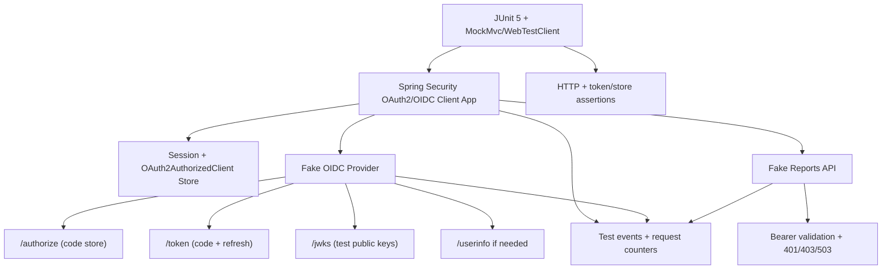
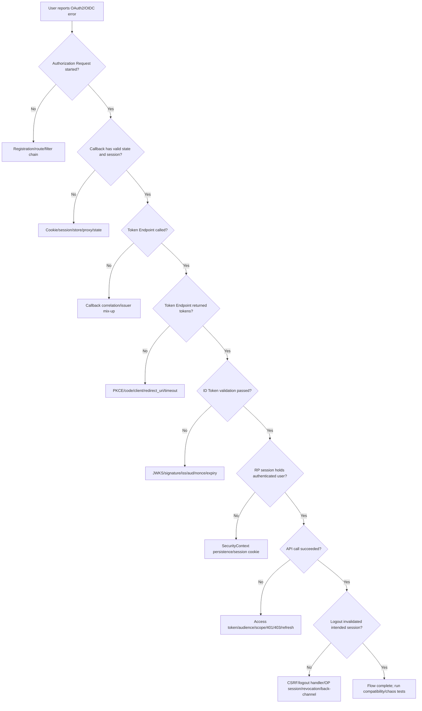
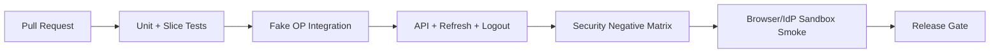

# 34.12. Complete Test Suite and Troubleshooting Scenarios

## 1. Capstone Lab: Proving the OAuth2/OIDC Client Works End-to-End

In isolated exercises, we may have tested `ClientRegistration` configuration, OpenID Connect login, calling an API with a Bearer token, refreshing an access token, and logging out individually. In a real system, however, all of these capabilities belong to **a single chain of dependencies**. A small change to a cookie, callback URI, OAuth2 authorized-client store, or HTTP filter can break several steps even while individual unit tests remain green.

This lab guides you through designing a **complete regression test suite with diagnostic capability**, focused on Spring Security OAuth 2.0/OIDC Client:

```text
Browser initiates login
    -> RP generates state, PKCE, nonce
    -> OP issues authorization code
    -> RP exchanges code for tokens
    -> RP verifies signed ID Token
    -> RP persists session and authorized client
    -> User calls downstream API with access token
    -> Token nears expiration, authorized client is refreshed
    -> API receives new access token
    -> User logs out, session is invalidated
    -> Invalid state/nonce/code/token/tenant cases are rejected
```

**RP** is the Relying Party—our Spring Security application. **OP** is the test OpenID Provider / Authorization Server. **API** is the downstream Resource Server.

A test is considered meaningful not merely when it returns `200`, but when it **proves where tokens originate, where they are sent, issuer/audience/subject binding, single-use code consumption, refresh lifecycle, and the actual effect of logout**.

### 1.1. Expected Outcomes

Upon completing this lab, you can:

1. Build a test environment independent of any production OP.
2. Execute a happy-path OIDC Authorization Code Flow from redirect to authenticated session.
3. Verify `state`, PKCE S256, and OIDC `nonce` per transaction.
4. Generate ID Tokens signed with a test private key and publish public JWKS.
5. Verify signature, `iss`, `aud`, expiry, claims, and UserInfo.
6. Test that `OAuth2AuthorizedClient` is persisted and used to call the intended API.
7. Test refresh tokens, token rotation, and non-expired skip behavior.
8. Distinguish API `401 invalid_token` from `403 insufficient_scope`.
9. Test local logout, CSRF, RP-Initiated Logout, and back-channel logout where supported.
10. Construct reproducible fault scenarios: wrong callback, wrong issuer, JWKS unavailable, refresh race, lost cookie, and API timeout.
11. Organize tests across unit, slice, integration, contract, and browser E2E layers.
12. Use `MockMvc` for Servlet or `WebTestClient` for WebFlux without conflating the two stacks.
13. Diagnose failures using stage-by-stage signals without logging full tokens.
14. Design CI gates, pass/fail criteria, test fixtures, and rollback procedures.
15. Recognize the limits of each test layer and avoid overclaiming security guarantees.

### 1.2. Prerequisites and Scope

The Java examples below primarily use **Servlet Spring MVC + Spring Security OAuth2 Client**, JUnit 5, `MockMvc`, OkHttp `MockWebServer`, and Nimbus JOSE + JWT; a WebFlux variant appears later. They target Java 17+ and modern Spring Security APIs. Package names, test annotations, and certain extension points can vary across Spring Boot 3.x/4.x and Spring Security versions; resolve exact versions through your project's BOM.

Some sections present **complete component code**; others are explicitly marked as **test skeletons to wire into your test fixtures**. This guide does not assume every snippet can be pasted in isolation into a single class and executed standalone, because an integration test requires a complete application context, test registrations, and fake servers.

**Never use production credentials.** All issuers, subjects, client IDs, access/refresh tokens, and RSA keys in this lab are synthetic data.

## 2. Defining "Complete" via Verifiable Contracts

A test suite does not need to simulate the entire Internet to be valuable, but it must measure the critical security boundaries.

| Contract | Input | Key assertion |
| --- | --- | --- |
| Login initiation | `GET /oauth2/authorization/lab` | 302 to approved OP; right client, callback, state, PKCE, nonce |
| Authorization callback | `code` + matching `state` + RP session | RP exchanges code only when pending authorization request matches |
| Token exchange | One-time code + PKCE verifier | OP observes exact client/redirect URI/challenge and receives exactly one request |
| OIDC validation | Signed ID Token | Verifies signature, `iss`, `aud`, `exp`, `nonce`, `sub` |
| Principal mapping | Valid OIDC response | `OidcUser` and authorities are correct; email is not used as default security key |
| Session | RP cookie after login | Subsequent request carries right authentication; session fixation follows policy |
| Authorized client | Access/refresh tokens | Stored under right registration and principal; no cross-tenant mixing |
| API call | `OAuth2AuthorizedClient` | Sends **access token** to right API host/audience/scope; never sends ID Token |
| Refresh | Expired/near-expiry access token | Refreshes exactly once per policy; persists A2/R2 and never replays R1 |
| API error | 401/403/503 | Bounded recovery; no infinite retries or forwarding tokens to other hosts |
| Logout | POST logout + CSRF | Invalidates RP session; OP logout/revocation mechanisms tested separately |
| Fault cases | Wrong state/nonce/issuer/aud/keys | Fail closed; never grant access with an unverifiable token |
| Observability | Traces and metrics | Record stage, status, registration alias; never log secrets |

### 2.1. Three Distinct Layers of Evidence

**Layer A — Controller / SecurityContext.** Mock the principal with `oidcLogin()` or `mockOidcLogin()` to verify how controllers consume `OidcUser`, build DTOs, and enforce method security. It **does not** execute code exchange.

**Layer B — Protocol Integration.** Run the real Spring Security filter chain against a fake OP serving `/token`/`jwks` and genuinely signed ID Tokens. This tests code, PKCE, nonce, JWT validation, session, and token lifecycle.

**Layer C — Browser / Provider E2E.** Run a real browser against an OP sandbox to verify cross-site cookies, redirects, TLS, ingress, MFA, consent, logout UX, and provider-specific behavior.

This lab builds **Layer B** and complements it with Layers A and C where appropriate.

## 3. Test Environment Architecture



Components that must exist **for real** in the integration test:

- The application's security filter chain.
- `ClientRegistrationRepository` or reactive equivalent.
- Authorization request repository holding `state`/`nonce`/PKCE.
- Spring Security's real OAuth2 token response client.
- Real ID Token decoder/validator backed by the test JWKS.
- Real authorized-client repository/service in the test scope.
- A fake HTTP server smart enough to **reject** invalid codes and verifiers.
- A fake HTTP API recording Bearer tokens and returning controlled error responses.

You may mock business databases or email notifiers because they are not the subject under test.

## 4. Lab Project Structure

Suggested layout:

```text
oidc-client-regression-lab/
├── build.gradle
├── src/main/java/example/oidclab/
│   ├── LabApplication.java
│   ├── SecurityConfiguration.java
│   ├── web/MeController.java
│   ├── web/ReportsController.java
│   └── api/ReportsGateway.java
├── src/main/resources/
│   └── application.yml
├── src/test/java/example/oidclab/
│   ├── support/FakeOidcProvider.java
│   ├── support/TestRegistrations.java
│   ├── support/ProtocolAssertions.java
│   ├── LoginFlowIT.java
│   ├── RefreshFlowIT.java
│   ├── ApiCallIT.java
│   ├── LogoutIT.java
│   └── SecurityFailureIT.java
└── src/test/resources/
    └── application-test.yml
```

Names like `FakeOidcProvider`, `TestRegistrations`, and `ProtocolAssertions` are **lab-defined test classes**, not built-in Spring Security APIs.

### 4.1. Gradle Dependencies

Example for Spring Boot Servlet:

```gradle
plugins {
    id 'java'
    id 'org.springframework.boot' version '<spring-boot-version>'
    id 'io.spring.dependency-management' version '<compatible-version>'
}

java {
    toolchain {
        languageVersion = JavaLanguageVersion.of(17)
    }
}

dependencies {
    implementation 'org.springframework.boot:spring-boot-starter-web'
    implementation 'org.springframework.boot:spring-boot-starter-security'
    implementation 'org.springframework.boot:spring-boot-starter-oauth2-client'

    testImplementation 'org.springframework.boot:spring-boot-starter-test'
    testImplementation 'org.springframework.security:spring-security-test'

    // Select versions via the appropriate version catalog/BOM.
    testImplementation 'com.squareup.okhttp3:mockwebserver:<version>'
    testImplementation 'com.nimbusds:nimbus-jose-jwt:<version>'
}

tasks.named('test') {
    useJUnitPlatform()
}
```

The `<...>` strings are placeholders, **not literal Gradle versions ready to build**. Spring Boot 4 organizes some test starters differently from Boot 3; check the exact dependency management and annotation packages in your active project. Never mix mismatched `spring-security-test` and runtime versions.

If using Maven, add the equivalent `spring-security-test`, JUnit Jupiter, Spring Boot Test, MockWebServer, and Nimbus JOSE + JWT dependencies in `test` scope.

### 4.2. Identifying the Stack Correctly

- Servlet MVC: `HttpSecurity`, `SecurityFilterChain`, `MockMvc`, `HttpSession`.
- WebFlux: `ServerHttpSecurity`, `SecurityWebFilterChain`, `WebTestClient`, `WebSession`.
- `WebClient` can be used in **both** Servlet and Reactive apps as an outbound HTTP client; seeing a WebFlux dependency alone does not prove the web server is Reactive.
- Never pair MockMvc's `oidcLogin()` with `WebTestClient` or vice versa.

## 5. Minimal Servlet Application Code

### 5.1. Main Application

```java
package example.oidclab;

import org.springframework.boot.SpringApplication;
import org.springframework.boot.autoconfigure.SpringBootApplication;

@SpringBootApplication
public class LabApplication {

    public static void main(String[] args) {
        SpringApplication.run(LabApplication.class, args);
    }
}
```

### 5.2. Security Configuration

```java
package example.oidclab;

import org.springframework.context.annotation.Bean;
import org.springframework.context.annotation.Configuration;
import org.springframework.security.config.Customizer;
import org.springframework.security.config.annotation.web.builders.HttpSecurity;
import org.springframework.security.web.SecurityFilterChain;

@Configuration
public class SecurityConfiguration {

    @Bean
    SecurityFilterChain securityFilterChain(HttpSecurity http)
            throws Exception {

        return http
            .authorizeHttpRequests(auth -> auth
                .requestMatchers("/", "/signed-out").permitAll()
                .requestMatchers("/api/**").authenticated()
                .anyRequest().authenticated())
            .oauth2Login(Customizer.withDefaults())
            .oauth2Client(Customizer.withDefaults())
            .logout(logout -> logout
                .logoutSuccessUrl("/signed-out"))
            .build();
    }
}
```

The lab starts with simple **local logout** to isolate local session regressions from OP logout. We add RP-Initiated Logout later.

Do not disable CSRF. For a session-based browser app, `POST /logout` requests must include a CSRF token per policy.

### 5.3. Controller Exposing Minimal Identity

```java
package example.oidclab.web;

import org.springframework.http.ResponseEntity;
import org.springframework.security.core.annotation.AuthenticationPrincipal;
import org.springframework.security.oauth2.core.oidc.user.OidcUser;
import org.springframework.web.bind.annotation.GetMapping;
import org.springframework.web.bind.annotation.RestController;

@RestController
public class MeController {

    @GetMapping("/api/me")
    ResponseEntity<Me> me(
            @AuthenticationPrincipal OidcUser user) {

        if (user == null) {
            return ResponseEntity.status(401).build();
        }

        return ResponseEntity.ok(
            new Me(
                user.getSubject(),
                user.getIdToken().getClaimAsString("iss")));
    }

    public record Me(String subject, String issuer) {}
}
```

The controller **never** returns the raw `OidcUser`, raw ID Token, access token, or UserInfo claims; this is a security contract to preserve across upgrades.

In unauthenticated tests, Spring Security normally blocks the request **before** reaching the controller. With an OAuth2 Login entry point, the response may be a `302` redirect to the login page rather than `401`.

### 5.4. Gateway Calling an API with an Access Token

To keep the lab transparent, the gateway accepts the access token supplied by the resolver:

```java
package example.oidclab.api;

import org.springframework.web.client.RestClient;

public final class ReportsGateway {

    private final RestClient client;

    public ReportsGateway(RestClient client) {
        this.client = client;
    }

    public Report get(String accessToken) {
        return client.get()
            .uri("/reports/me")
            .headers(headers ->
                headers.setBearerAuth(accessToken))
            .retrieve()
            .body(Report.class);
    }

    public record Report(String id, String owner) {}
}
```

And the controller:

```java
package example.oidclab.web;

import example.oidclab.api.ReportsGateway;
import org.springframework.security.oauth2.client.OAuth2AuthorizedClient;
import org.springframework.security.oauth2.client.annotation.RegisteredOAuth2AuthorizedClient;
import org.springframework.web.bind.annotation.GetMapping;
import org.springframework.web.bind.annotation.RestController;

@RestController
public class ReportsController {

    private final ReportsGateway gateway;

    public ReportsController(ReportsGateway gateway) {
        this.gateway = gateway;
    }

    @GetMapping("/api/reports/me")
    ReportsGateway.Report report(
        @RegisteredOAuth2AuthorizedClient("lab")
        OAuth2AuthorizedClient authorizedClient) {

        return gateway.get(
            authorizedClient.getAccessToken().getTokenValue());
    }
}
```

**Note:** `@RegisteredOAuth2AuthorizedClient` resolves an authorized client, **not an ID Token**. Production code should include an adapter or domain service enforcing resource/tenant and security policies; the lab keeps data minimal so boundaries stay clear in tests.

Because this is a Servlet application, synchronous `RestClient` is cleaner than calling `.block()` inside a WebFlux event loop. Outbound HTTP clients must enforce trusted base URLs, HTTPS in production, timeouts, and safe redirect policies.

## 6. Test `ClientRegistration` and `ReportsGateway` Beans

To avoid calling production discovery, tests can build `ClientRegistration` from explicit configuration:

```java
@TestConfiguration
public class LabFixtureConfiguration {

    @Bean
    ClientRegistrationRepository testRegistrations(
            @Value("${lab.op.base-url}") String opBase) {

        ClientRegistration registration =
            ClientRegistration.withRegistrationId("lab")
                .clientId("lab-client")
                .clientAuthenticationMethod(
                    ClientAuthenticationMethod.NONE)
                .authorizationGrantType(
                    AuthorizationGrantType.AUTHORIZATION_CODE)
                .redirectUri(
                    "{baseUrl}/login/oauth2/code/{registrationId}")
                .scope("openid")
                .issuerUri("https://issuer.example.test")
                .authorizationUri(opBase + "/authorize")
                .tokenUri(opBase + "/token")
                .jwkSetUri(opBase + "/jwks")
                .clientName("Lab OIDC Provider")
                .build();

        return new InMemoryClientRegistrationRepository(
            registration);
    }

    @Bean
    OAuth2AuthorizedClientService authorizedClientService(
        ClientRegistrationRepository registrations) {

        return new InMemoryOAuth2AuthorizedClientService(
            registrations);
    }

    @Bean
    ReportsGateway reportsGateway(
            @Value("${lab.op.base-url}") String opBase) {

        RestClient client = RestClient.builder()
            .baseUrl(opBase)
            .build();

        return new ReportsGateway(client);
    }
}
```

Import `ClientRegistration`, `ClientRegistrationRepository`, `ClientAuthenticationMethod`, `AuthorizationGrantType`, `RestClient`, and Spring's `@Bean`, `@Value`, and `@TestConfiguration` from their respective modules. Place this class in `src/test/java` and import it into the integration-test context.

### 6.1. Why Use a Public Client in This Lab?

`ClientAuthenticationMethod.NONE` highlights PKCE S256 clearly without adding client secret handling inside the fake OP. In modern Spring Security, public Authorization Code clients typically enable PKCE automatically; on supported versions you can also configure `ClientRegistration.ClientSettings.requireProofKey(true)`.

**Do not rely on assumptions**; tests must explicitly assert `code_challenge_method=S256`. When your production app uses a confidential client, add a fixture verifying **both client authentication and PKCE**.

Here the logical issuer is HTTPS `https://issuer.example.test`, while the fake OP's transport endpoints run on localhost HTTP. This is **strictly a test configuration** with trusted fixtures; production must adhere to issuer metadata, TLS, and egress policies.

### 6.2. Bean Collisions and Test Auto-Configuration

If the main application also defines `ClientRegistrationRepository`, `OAuth2AuthorizedClientService`, or `ReportsGateway`, **override them explicitly** (`@Primary`, test profile, or bean definition overriding) rather than creating duplicate beans and hoping Spring picks the right one.

If a `@SpringBootTest` reads `issuer-uri` and triggers discovery before the fake server is ready, configure explicit endpoint registrations as above or start the fake OP before context initialization. Never disable issuer validation just to make tests boot faster.

## 7. Fake OpenID Provider: Functional Requirements

The goal is a test OP that does not hand out tokens indiscriminately to any request. It needs to:

1. Issue a **single-use** authorization code.
2. Store `client_id`, `redirect_uri`, `code_challenge`, and OIDC `nonce`.
3. Reject wrong clients, wrong redirect URIs, and wrong PKCE verifiers.
4. Sign ID Tokens with a test private key.
5. Publish the public key at `/jwks`.
6. Issue synthetic access tokens and refresh tokens.
7. Rotate refresh tokens upon refresh requests.
8. Return `401 invalid_token` or `403 insufficient_scope` from the fake Reports API.
9. Track request counts and failure stages.
10. Expose fault flags to simulate wrong nonce, wrong issuer, timeouts, and token errors.

To keep the lab clear, the example below uses **OkHttp `MockWebServer`** for `/token`, `/jwks`, and `/reports/me`. The Authorization Endpoint redirect is **captured via the `Location` header** emitted by the RP, after which the test asks the fake OP directly to issue a code. This exercises Spring Security's real backend filter and token exchange, though it **does not simulate the OP's browser UI**; browser E2E requires a complementary test.

### 7.1. Libraries and Test Fixtures

Implementation sketch:

```java
public final class FakeOidcProvider
        implements AutoCloseable {

    private final MockWebServer server =
        new MockWebServer();

    private final RSAKey signingKey;
    private final Map<String, PendingCode> codes =
        new ConcurrentHashMap<>();

    private final Set<String> validRefreshTokens =
        ConcurrentHashMap.newKeySet();

    private final Set<String> issuedAccessTokens =
        ConcurrentHashMap.newKeySet();

    private final AtomicInteger codeExchanges =
        new AtomicInteger();

    private final AtomicInteger refreshExchanges =
        new AtomicInteger();

    private final AtomicInteger apiCalls =
        new AtomicInteger();

    private final AtomicReference<String> lastCodeVerifier =
        new AtomicReference<>();

    private final AtomicReference<String> lastBearer =
        new AtomicReference<>();

    private volatile boolean wrongNonce;
    private volatile boolean wrongIssuer;
    private volatile boolean reportsUnauthorized;

    private final String issuer =
        "https://issuer.example.test";

    public FakeOidcProvider() throws Exception {
        signingKey = new RSAKeyGenerator(2048)
            .keyID("lab-key-1")
            .generate();

        server.setDispatcher(new Dispatcher() {
            @Override
            public MockResponse dispatch(
                    RecordedRequest request) {
                return handle(request);
            }
        });

        server.start();
    }

    public String baseUrl() {
        String value = server.url("/").toString();
        return value.substring(0, value.length() - 1);
    }

    public String issuer() {
        return issuer;
    }

    public int codeExchanges() {
        return codeExchanges.get();
    }

    public int refreshExchanges() {
        return refreshExchanges.get();
    }

    public int apiCalls() {
        return apiCalls.get();
    }

    public String lastCodeVerifier() {
        return lastCodeVerifier.get();
    }

    public String lastBearer() {
        return lastBearer.get();
    }

    public void wrongNonce(boolean value) {
        wrongNonce = value;
    }

    public void wrongIssuer(boolean value) {
        wrongIssuer = value;
    }

    public void reportsUnauthorized(boolean value) {
        reportsUnauthorized = value;
    }

    // issueCode, handle, and helper methods
    // are implemented in the following sections.

    @Override
    public void close() throws IOException {
        server.shutdown();
    }
}
```

Suggested imports: `okhttp3.mockwebserver.*`, `com.nimbusds.jose.*`, `com.nimbusds.jose.jwk.*`, `com.nimbusds.jose.jwk.gen.*`, `com.nimbusds.jwt.*`, `java.util.concurrent.*`, `java.time.*`, and `java.io.IOException`.

Never log `lastCodeVerifier()` or `lastBearer()`; they exist solely for **in-memory** test assertions. In production, never implement a recorder that stores tokens in global fields.

### 7.2. Storing the Authorization Code

Define a test record:

```java
record PendingCode(
    String clientId,
    String redirectUri,
    String codeChallenge,
    String nonce,
    String subject,
    Instant expiresAt) {}
```

Code issuance helper:

```java
public String issueCode(
        String clientId,
        String redirectUri,
        String challenge,
        String nonce,
        String subject) {

    String code = "C-" + UUID.randomUUID();

    codes.put(code, new PendingCode(
        clientId,
        redirectUri,
        challenge,
        nonce,
        subject,
        Instant.now().plusSeconds(90)));

    return code;
}
```

In a more full-featured fake OP, `/authorize` invokes this logic after validating the request and user session. In a `MockMvc` test, we can go directly from the parsed Authorization Request to `issueCode(...)` and then simulate the browser callback.

### 7.3. PKCE Calculation Test Helper

```java
static String s256(String verifier) {
    try {
        byte[] digest = MessageDigest
            .getInstance("SHA-256")
            .digest(
                verifier.getBytes(
                    StandardCharsets.US_ASCII));

        return Base64.getUrlEncoder()
            .withoutPadding()
            .encodeToString(digest);
    }
    catch (GeneralSecurityException ex) {
        throw new IllegalStateException(ex);
    }
}
```

A valid verifier per RFC 7636 has 43–128 characters from `[A-Za-z0-9._~-]`. For `S256`:

\[
\text{challenge} = \operatorname{BASE64URL}_{\text{no padding}}
 (\operatorname{SHA256}(\operatorname{ASCII}(\text{verifier})))
\]

Public test vector:

```text
verifier:
dBjftJeZ4CVP-mB92K27uhbUJU1p1r_wW1gFWFOEjXk

challenge:
E9Melhoa2OwvFrEMTJguCHaoeK1t8URWbuGJSstw-cM
```

Never use this public test vector as a production verifier.

### 7.4. Signing the ID Token in the Fake OP

```java
private String signedIdToken(
        PendingCode transaction,
        String nonce) {

    try {
        Instant now = Instant.now();

        JWTClaimsSet claims =
            new JWTClaimsSet.Builder()
                .issuer(
                    wrongIssuer
                        ? "https://wrong-issuer.example.test"
                        : issuer)
                .subject(transaction.subject())
                .audience(transaction.clientId())
                .issueTime(Date.from(now))
                .expirationTime(
                    Date.from(now.plusSeconds(300)))
                .claim("nonce", nonce)
                .build();

        JWSHeader header = new JWSHeader.Builder(
            JWSAlgorithm.RS256)
            .keyID(signingKey.getKeyID())
            .build();

        SignedJWT jwt = new SignedJWT(header, claims);

        jwt.sign(new RSASSASigner(
            signingKey.toPrivateKey()));

        return jwt.serialize();
    }
    catch (Exception ex) {
        throw new IllegalStateException(
            "Could not sign lab ID Token", ex);
    }
}
```

When `wrongNonce = false`, call:

```java
signedIdToken(code, code.nonce())
```

When `wrongNonce = true`, pass a string different from the nonce the OP received.

**Note on nonce:** some Spring Security versions generate a raw nonce, store it internally, and send a **hash of the raw nonce** to the OP. The fake OP must place into the ID Token **the exact `nonce` value observed in the Authorization Request**, without hashing it a second time.

### 7.5. JWKS Handler

```java
private MockResponse jwks() {
    String body =
        new JWKSet(
            signingKey.toPublicJWK()).toString();

    return new MockResponse()
        .setResponseCode(200)
        .setHeader(
            "Content-Type", "application/json")
        .setBody(body);
}
```

JWKS must contain only the **public key**; never serialize private key material into an HTTP response.

### 7.6. Token Endpoint Handler

The test-only dispatcher routes incoming requests:

```java
private MockResponse handle(
        RecordedRequest request) {

    String path =
        request.getRequestUrl().encodedPath();

    if (path.equals("/jwks")
            && request.getMethod().equals("GET")) {
        return jwks();
    }

    if (path.equals("/token")
            && request.getMethod().equals("POST")) {

        Map<String, String> form =
            decodeForm(request.getBody().readUtf8());

        String grant = form.get("grant_type");

        if ("authorization_code".equals(grant)) {
            return exchangeCode(form);
        }

        if ("refresh_token".equals(grant)) {
            return exchangeRefresh(form);
        }

        return oauthError("unsupported_grant_type");
    }

    if (path.equals("/reports/me")
            && request.getMethod().equals("GET")) {
        return report(request);
    }

    return new MockResponse().setResponseCode(404);
}
```

`decodeForm(...)` is a test utility that parses URL-encoded form bodies:

```java
static Map<String, String> decodeForm(String body) {
    Map<String, String> out = new LinkedHashMap<>();

    if (body == null || body.isBlank()) {
        return out;
    }

    for (String item : body.split("&")) {
        String[] pair = item.split("=", 2);

        String key = URLDecoder.decode(
            pair[0], StandardCharsets.UTF_8);

        String value = URLDecoder.decode(
            pair.length == 2 ? pair[1] : "",
            StandardCharsets.UTF_8);

        if (out.putIfAbsent(key, value) != null) {
            throw new IllegalArgumentException(
                "Duplicate form key");
        }
    }

    return out;
}
```

Production parsers handling untrusted input need stronger error handling; this utility is strictly for tests. Detecting duplicate parameters prevents tests from falsely passing when a request sends multiple `code_verifier` or `client_id` values.

### 7.7. One-Time Authorization Code Exchange

```java
private MockResponse exchangeCode(
        Map<String, String> form) {

    codeExchanges.incrementAndGet();

    String codeValue = form.get("code");

    // Atomic consume: code may be used only once.
    PendingCode code = codes.remove(codeValue);

    if (code == null) {
        return oauthError("invalid_grant");
    }

    if (Instant.now().isAfter(code.expiresAt())) {
        return oauthError("invalid_grant");
    }

    if (!Objects.equals(
            form.get("client_id"), code.clientId())) {
        return oauthError("invalid_client");
    }

    if (!Objects.equals(
            form.get("redirect_uri"),
            code.redirectUri())) {
        return oauthError("invalid_grant");
    }

    String verifier = form.get("code_verifier");
    lastCodeVerifier.set(verifier);

    if (verifier == null
            || !verifier.matches(
                "[A-Za-z0-9._~-]{43,128}")
            || !s256(verifier)
                .equals(code.codeChallenge())) {

        return oauthError("invalid_grant");
    }

    String accessToken = "AT-" + UUID.randomUUID();
    String refreshToken = "RT-" + UUID.randomUUID();

    issuedAccessTokens.add(accessToken);
    validRefreshTokens.add(refreshToken);

    String nonce = wrongNonce
        ? "some-other-nonce"
        : code.nonce();

    String idToken = signedIdToken(code, nonce);

    return json(200, """
        {
          "access_token": "%s",
          "token_type": "Bearer",
          "expires_in": 300,
          "scope": "openid",
          "refresh_token": "%s",
          "id_token": "%s"
        }
        """.formatted(
            accessToken, refreshToken, idToken));
}
```

In production, private keys and tokens are issued by the OP, never by the RP application. In the fake OP, we validate client ID, redirect URI, and PKCE so the integration test cannot pass if Spring Security sends the wrong verifier.

For confidential clients, add verification of `Authorization: Basic ...` or the appropriate client assertion. **Never log client secrets.**

### 7.8. Refresh Token Grant Handler

```java
private MockResponse exchangeRefresh(
        Map<String, String> form) {

    refreshExchanges.incrementAndGet();

    String previous = form.get("refresh_token");

    // remove() performs an atomic consume on the Concurrent Set.
    if (previous == null
            || !validRefreshTokens.remove(previous)) {
        return oauthError("invalid_grant");
    }

    String accessToken = "AT-" + UUID.randomUUID();
    String refreshToken = "RT-" + UUID.randomUUID();

    issuedAccessTokens.add(accessToken);
    validRefreshTokens.add(refreshToken);

    return json(200, """
        {
          "access_token": "%s",
          "token_type": "Bearer",
          "expires_in": 300,
          "scope": "openid",
          "refresh_token": "%s"
        }
        """.formatted(accessToken, refreshToken));
}
```

**Key behavior:** the test OP **consumes** the old refresh token, returning `invalid_grant` if it is reused. This exposes refresh rotation race conditions.

A real OP may have a grace window, session policy, or issue a new ID Token on refresh; add provider-specific contract tests accordingly. Never assume every OP behaves identically to this minimal fixture.

### 7.9. Fake Reports API and OAuth2 Errors

```java
private MockResponse report(
        RecordedRequest request) {

    apiCalls.incrementAndGet();

    String authorization =
        request.getHeader("Authorization");

    lastBearer.set(authorization);

    if (reportsUnauthorized) {
        return new MockResponse()
            .setResponseCode(401)
            .setHeader(
                "WWW-Authenticate",
                "Bearer error=\"invalid_token\"");
    }

    if (authorization == null
            || !authorization.startsWith("Bearer ")) {
        return new MockResponse()
            .setResponseCode(401);
    }

    String token =
        authorization.substring("Bearer ".length());

    if (!issuedAccessTokens.contains(token)) {
        return new MockResponse()
            .setResponseCode(401)
            .setHeader(
                "WWW-Authenticate",
                "Bearer error=\"invalid_token\"");
    }

    return json(200, """
        {"id":"r-1","owner":"test-user-17"}
        """);
}
```

This lab uses **opaque access token aliases** and an in-memory allowlist to test RP forwarding. It **does not yet validate JWT access token audience/issuer/signature**. To test real Resource Server security, use `spring-boot-starter-oauth2-resource-server`, test JWT/JWKS or introspection with real validators, and add wrong-audience and wrong-scope test cases.

### 7.10. Response Helpers

```java
private static MockResponse json(
        int status, String body) {

    return new MockResponse()
        .setResponseCode(status)
        .setHeader(
            "Content-Type", "application/json")
        .setHeader("Cache-Control", "no-store")
        .setBody(body);
}

private static MockResponse oauthError(String error) {
    return json(400, """
        {"error":"%s"}
        """.formatted(error));
}
```

These helpers support deterministic tests. For fault injection, you can return `503`, delay the response, or drop the connection **after** consuming the code or refresh token.

## 8. Starting the Fake OP Before the Spring Context

`ClientRegistration` needs the fake server's actual URL, for example:

```text
http://127.0.0.1:51545/token
http://127.0.0.1:51545/jwks
```

The port is assigned by the OS when `MockWebServer.start()` runs. If the Spring context builds its repository beforehand, it will hold the wrong URL.

One pattern:

```java
@SpringBootTest
@AutoConfigureMockMvc
@Import(LabFixtureConfiguration.class)
class LoginFlowIT {

    private static final FakeOidcProvider OP =
        createProvider();

    @DynamicPropertySource
    static void registerProperties(
            DynamicPropertyRegistry properties) {

        properties.add(
            "lab.op.base-url", OP::baseUrl);
    }

    private static FakeOidcProvider createProvider() {
        try {
            return new FakeOidcProvider();
        }
        catch (Exception ex) {
            throw new ExceptionInInitializerError(ex);
        }
    }

    @AfterAll
    static void stopProvider() throws Exception {
        OP.close();
    }

    @Autowired
    MockMvc mvc;
}
```

Spring Boot / Spring Test may cache application contexts across test classes; avoid leaving a cached context pointing at a fake port that was shut down before another test class runs. Options include:

- Sharing one reusable fixture across the suite and stopping it at the proper lifecycle hook.
- Giving each fake OP its own context cache key.
- Avoiding parallel execution across classes sharing a stateful OP without isolation.
- Managing the server within the test application context lifecycle rather than JUnit statics if finer lifecycle control is needed.

This is one of the most common integration-test pitfalls: each class passes individually, yet running the full suite fails.

## 9. Capturing the Authorization Request and Preserving the Session

This Servlet integration test does not use `oidcLogin()`; a real request must pass through the OAuth2 Login filter chain:

```java
MvcResult started = mvc.perform(
        get("/oauth2/authorization/lab")
            .secure(true)
            .scheme("https")
            .serverName("portal.example.test")
            .serverPort(443))
    .andExpect(status().is3xxRedirection())
    .andExpect(
        header().exists(HttpHeaders.LOCATION))
    .andReturn();

String redirect =
    started.getResponse()
        .getHeader(HttpHeaders.LOCATION);

MockHttpSession session =
    (MockHttpSession)
        started.getRequest().getSession(false);
```

If `session == null`, inspect the authorization request repository, filter chain, and test session setup.

### 9.1. Parsing the Redirect URL

Use Spring's `UriComponentsBuilder`:

```java
URI uri = URI.create(redirect);

MultiValueMap<String, String> query =
    UriComponentsBuilder.fromUri(uri)
        .build()
        .getQueryParams();

String state = query.getFirst("state");
String challenge =
    query.getFirst("code_challenge");
String nonce = query.getFirst("nonce");
String redirectUri = query.getFirst("redirect_uri");
```

If a parser leaves query values percent-encoded, decode them **exactly once** or use a standard URL form query utility. Avoid double decoding and duplicate parameters. When comparing URLs, compare parsed scheme/host/path and decoded URIs per contract.

### 9.2. Assertions on the Authorization Request

```java
assertThat(uri.getHost())
    .isIn("127.0.0.1", "localhost");

assertThat(query.getFirst("response_type"))
    .isEqualTo("code");

assertThat(query.getFirst("client_id"))
    .isEqualTo("lab-client");

assertThat(query.getFirst("scope"))
    .contains("openid");

assertThat(query.getFirst("code_challenge_method"))
    .isEqualTo("S256");

assertThat(state).isNotBlank();
assertThat(nonce).isNotBlank();
assertThat(challenge).isNotBlank();

assertThat(query).doesNotContainKey("code_verifier");
```

Checking `uri.getHost()` against loopback fits the local fake server. In production tests, the expected host must be the **approved OP host**, never matching any arbitrary localhost host.

**Never write raw `redirect` URLs or `state` values into logs.** Instead log a sanitized event such as `registrationId=lab`, `statePresent=true`, `pkce=S256`.

## 10. Running a Full OIDC Login Cycle

Have the fake OP issue a code for the captured Authorization Request:

```java
String code = OP.issueCode(
    query.getFirst("client_id"),
    query.getFirst("redirect_uri"),
    challenge,
    nonce,
    "test-user-17");
```

Then simulate the browser returning to the callback **with the same RP session**:

```java
MvcResult callback = mvc.perform(
        get("/login/oauth2/code/lab")
            .session(session)
            .secure(true)
            .scheme("https")
            .serverName("portal.example.test")
            .serverPort(443)
            .param("code", code)
            .param("state", state))
    .andReturn();
```

Spring Security must now:

1. Load the saved authorization request by `state`.
2. Match the callback against the pending request.
3. Send the Token Request to the fake OP.
4. Send `code_verifier`, which the OP verifies against S256.
5. Receive the signed ID Token.
6. Fetch public JWKS and validate signature, issuer, audience, expiry, and nonce.
7. Build `OidcUser` and `OAuth2AuthenticationToken`.
8. Save the session and the authorized client.

Do not use `@WithMockUser`, `oidcLogin()`, or manual `SecurityContextHolder.setContext(...)` in **this test**: they bypass the flow under test.

### 10.1. Assertions After Callback

```java
assertThat(OP.codeExchanges())
    .isEqualTo(1);

assertThat(OP.lastCodeVerifier())
    .matches("[A-Za-z0-9._~-]{43,128}");

assertThat(s256(OP.lastCodeVerifier()))
    .isEqualTo(challenge);
```

And retrieve the post-login session (accounting for session fixation rotation):

```java
MockHttpSession authenticatedSession =
    (MockHttpSession)
        callback.getRequest().getSession(false);

assertThat(authenticatedSession).isNotNull();

mvc.perform(get("/api/me")
        .session(authenticatedSession))
    .andExpect(status().isOk())
    .andExpect(
        jsonPath("$.subject")
            .value("test-user-17"))
    .andExpect(
        jsonPath("$.issuer")
            .value("https://issuer.example.test"));
```

**Session IDs can change** upon successful authentication. Do not assert that the session ID before and after login stays identical. Verify that once the fake OP consumes code `C1`, a callback replay creates no new authenticated session.

### 10.2. When the Callback Fails

Do not inspect only HTTP `302`: both the success handler **and** failure handler can issue redirects. Check:

- Was the Token Endpoint called?
- Did the OP return tokens or an OAuth2 error?
- Was JWKS fetched?
- Does the session hold an `Authentication`?
- Does a subsequent request to `/api/me` succeed?
- Where does the failure handler send the user?
- Was any user, tenant, or token persisted erroneously?

## 11. Testing `state` and PKCE Replay Protections

One happy-path login is never enough. Add negative cases:

### 11.1. Callback with Wrong `state`

```java
mvc.perform(
        get("/login/oauth2/code/lab")
            .session(session)
            .param("code", code)
            .param("state", "not-the-issued-state"))
    .andReturn();

assertThat(OP.codeExchanges()).isZero();
```

Expected: the RP rejects the callback before token exchange; no new authenticated session is created.

### 11.2. Callback from a Different Browser

Use a fresh `MockHttpSession` or omit any session containing the pending request, and submit `code` and `state` captured from browser A.

Expected: the RP does not exchange the code for tokens and does not authenticate browser B.

### 11.3. Reused Authorization Code

After a successful callback, replay the same `code`. The fake OP must return `invalid_grant` on any second Token Endpoint call, and the RP must not treat the replayed callback as a new login.

Distinguish **the session already authenticated from the first login** from **a replay creating a new authentication**; run replay tests in an independent session/correlation context to avoid false positives.

### 11.4. Wrong PKCE Verifier

Add a test where the fake OP binds the code to a different challenge than `S256(verifier)` sent by the RP; the OP returns `invalid_grant`. No ID Token or authorized client is created.

This scenario proves the **AS enforces PKCE** and the RP handles token failure properly; the happy path proves the RP generates the matching verifier/challenge.

### 11.5. Wrong Redirect URI

The fake OP binds the code to:

```text
https://portal.example.test/login/oauth2/code/lab
```

Yet the Token Request sends a different URI → the OP rejects it. This test catches regressions caused by reverse proxies, context paths, TLS termination, or registration mismatches.

## 12. Testing Real ID Token Validation

`mockOidcLogin()` merely fabricates a principal; in the integration suite, use signed ID Tokens and trusted JWKS via the fake OP above.

### 12.1. Negative Case Matrix

| Case | Fake OP returns | Expected |
| --- | --- | --- |
| V01 | Signed ID Token with matching issuer/aud/nonce | Login succeeds |
| V02 | ID Token signed with wrong private key | Reject |
| V03 | `iss` differs from expected issuer | Reject |
| V04 | `aud` does not contain client ID | Reject |
| V05 | `nonce` differs from Authorization Request value | Reject |
| V06 | `nonce` missing even though RP sent nonce | Reject |
| V07 | Expired ID Token | Reject |
| V08 | `iat`/`auth_time` violates policy | Reject per validator |
| V09 | Disallowed `alg` or `none` | Reject |
| V10 | New `kid` missing from JWKS | Reject if no trusted key can be retrieved |
| V11 | JWKS endpoint timeout with no cached key | Fail closed |
| V12 | UserInfo `sub` differs from ID Token `sub` | Reject OIDC consistency |
| V13 | Multiple audiences with wrong `azp` | Reject per OIDC rules |
| V14 | Wrong authorization-response `iss` | Reject before Token Request if RFC 9207 is enabled |

### 12.2. Example Test for Nonce Mismatch

```java
@Test
void rejectsIdTokenWithWrongNonce()
        throws Exception {

    OP.wrongNonce(true);

    // startFlow() must actually submit the Authorization Request,
    // keep the session, and have the OP issue a one-time code.
    PendingLogin login = startFlow();

    mvc.perform(get("/login/oauth2/code/lab")
            .session(login.session())
            .param("code", login.code())
            .param("state", login.state()))
        .andReturn();

    assertThat(OP.codeExchanges()).isEqualTo(1);

    // Verify with a subsequent request:
    // No new authenticated OidcUser exists.
}
```

`PendingLogin` and `startFlow()` are test helpers defined in your test class per sections 9–10; they are not framework methods.

Crucially, the Token Endpoint may return `200` with a validly signed JWT, yet the RP must still reject the ID Token because **the nonce does not match the transaction**. That is why checking only the Token Endpoint HTTP status is insufficient.

### 12.3. Testing the Difference Between ID Token and Access Token

The OIDC ID Token `aud` must contain the RP's OAuth2 `client_id`. A downstream API has its own audience, such as `reports-api`; **never send the ID Token to an API**, even though both are JWTs carrying `sub`.

If the fake API only compares opaque token strings, add a **Resource Server integration suite** using signed JWT access tokens, a `JwtDecoder` configured with `JwtValidators.createDefaultWithIssuer(...)`, and a dedicated audience validator. Spring Security Test's `mockJwt()` **does not verify real signatures or audiences**.

## 13. Testing API Calls from an Authenticated Session

After successful login, call:

```java
mvc.perform(
        get("/api/reports/me")
            .session(authenticatedSession))
    .andExpect(status().isOk())
    .andExpect(jsonPath("$.id").value("r-1"))
    .andExpect(
        jsonPath("$.owner").value("test-user-17"));

assertThat(OP.apiCalls()).isEqualTo(1);

assertThat(OP.lastBearer())
    .startsWith("Bearer AT-");
```

The prefix assertion above suits the fake OP's **synthetic test token aliases**. In production tests, avoid printing raw Bearer tokens in CI failure messages; compare in-memory equality or use non-sensitive deterministic fixture IDs.

### 13.1. What to Verify Beyond HTTP 200

- `Authorization` was sent to the **approved Reports API host**.
- The request used the access token from the authorized client, not the ID Token.
- The authorized client matches the expected registration, principal, and tenant.
- Bearer tokens are not attached automatically to arbitrary outbound requests.
- The API is called once when no retry is needed.
- `401`/`403` responses are never retried infinitely.
- The API response maps cleanly to the application's DTO/schema.
- Security exceptions translate into contract responses without leaking tokens.
- A token meant for Billing is never sent to the Reports API.

### 13.2. Diagnosing HTTP 401

Stub the API to return:

```http
HTTP/1.1 401 Unauthorized
WWW-Authenticate: Bearer error="invalid_token"
```

Verify the application:

1. Does not treat the error as success.
2. Invokes the appropriate authorized-client failure handler if configured.
3. Does not replay the same access token 10 times.
4. Performs **bounded** reauthorization/refresh if the token truly expired.
5. Keeps raw tokens out of responses and logs.
6. Never switches `tokenUri`/`issuer` to try another provider.

### 13.3. Diagnosing HTTP 403

```http
HTTP/1.1 403 Forbidden
WWW-Authenticate: Bearer error="insufficient_scope"
```

A valid token lacking sufficient scope **is different** from an invalid token. Do not assume refreshing with the same scopes will grant extra permissions. Inspect client registration, consent, entitlements, and domain authorization instead.

### 13.4. Testing Redirects and SSRF

If the API returns `302 Location: https://untrusted.example/...`, the outbound HTTP client must never blindly forward `Authorization: Bearer ...` to that host. Enforce a fixed approved base URL, strict redirect policies on the request factory, and host pinning tests. Never let a user-controlled URI override a trusted resource endpoint.

## 14. Refresh Token: Testing the Real Manager Directly

To verify refresh **without depending on a browser callback**, seed an expired `OAuth2AuthorizedClient` and invoke the real manager against the fake Token Endpoint.

Servlet service-context example:

```java
ClientRegistration registration =
    registrations.findByRegistrationId("lab");

OAuth2AuthorizedClientService store =
    new InMemoryOAuth2AuthorizedClientService(
        registrations);

Authentication principal =
    new UsernamePasswordAuthenticationToken(
        "test-user-17",
        "N/A",
        List.of(
            new SimpleGrantedAuthority("ROLE_USER")));

Instant now = Instant.now();

OAuth2AccessToken expiredAccessToken =
    new OAuth2AccessToken(
        OAuth2AccessToken.TokenType.BEARER,
        "AT-EXPIRED",
        now.minusSeconds(7200),
        now.minusSeconds(3600),
        Set.of("openid"));

OAuth2RefreshToken refreshToken =
    new OAuth2RefreshToken(
        "RT-SEED",
        now.minusSeconds(7200));

OAuth2AuthorizedClient oldClient =
    new OAuth2AuthorizedClient(
        registration,
        principal.getName(),
        expiredAccessToken,
        refreshToken);

store.saveAuthorizedClient(oldClient, principal);

OAuth2AuthorizedClientProvider provider =
    OAuth2AuthorizedClientProviderBuilder.builder()
        .refreshToken()
        .build();

AuthorizedClientServiceOAuth2AuthorizedClientManager manager =
    new AuthorizedClientServiceOAuth2AuthorizedClientManager(
        registrations,
        store);

manager.setAuthorizedClientProvider(provider);
```

Before calling `authorize()`, the fake OP needs `seedRefreshToken("RT-SEED")` to register the test `R1` in its valid store. This helper is **added by the lab** to `FakeOidcProvider`; it is not built into `MockWebServer`.

```java
OAuth2AuthorizeRequest request =
    OAuth2AuthorizeRequest
        .withClientRegistrationId("lab")
        .principal(principal)
        .build();

OAuth2AuthorizedClient refreshed =
    manager.authorize(request);

assertThat(refreshed).isNotNull();

assertThat(refreshed.getAccessToken().getTokenValue())
    .startsWith("AT-");

assertThat(refreshed.getRefreshToken().getTokenValue())
    .startsWith("RT-");

assertThat(OP.refreshExchanges())
    .isEqualTo(1);
```

**Important:** `AuthorizedClientServiceOAuth2AuthorizedClientManager` is meant for service/background contexts; the Servlet request-aware manager is `DefaultOAuth2AuthorizedClientManager`. When an app uses a custom manager, test the real repository and failure handlers too.

### 14.1. Essential Refresh Cases

| Case | Seed | Expected |
| --- | --- | --- |
| F01 | Non-expired access token | No refresh |
| F02 | Access token nearing expiry within skew | Refreshes if provider has `R1` |
| F03 | Expired access token | `A1` is not sent to API |
| F04 | OP returns `A2`/`R2` | Persists `A2`/`R2` under matching principal |
| F05 | OP returns `A2` without `R2` | Handles refresh token per provider/framework contract |
| F06 | `invalid_grant` | No infinite `R1` retries |
| F07 | Network timeout after `R1` consumed | No blind replay of `R1` |
| F08 | N concurrent requests needing refresh | Single-flight / locking as required |
| F09 | Two users on same registration | No cross-user overwrite |
| F10 | Two registrations for same principal | No cross-registration overwrite |
| F11 | App restart | Authorized client reloads cleanly from persistent store |
| F12 | After logout | Token store respects cleanup policy |

### 14.2. Why Rotating Refresh Tokens Require Special Care

Example:

```text
RP: POST /token(refresh_token=R1)
OP: consume R1, issue A2/R2
Network: response lost
RP: retry R1
OP: invalid_grant or replay detection
```

A timeout does not prove the first request failed to execute. A generic retry filter wrapping `manager.authorize()` can accidentally replay a rotating refresh grant. Fault-injection tests should assert **a single `R1` request**, not "eventually get a token at all costs."

### 14.3. Concurrency

If 20 concurrent API requests share an authorized client about to expire, a single-flight / distributed coordination design should guarantee:

```text
R1 used at most once for same token key.
R2 persisted atomically.
No lost update.
No cross-user / cross-tenant token mixing.
```

**Never assume** Spring Security's manager provides distributed single-flight locking across all versions or stores. Across multiple pods, test CAS/optimistic locking or application-level coordination directly.

## 15. Local Logout Tests and CSRF

With default Spring Security Servlet sessions and CSRF, verify:

```java
mvc.perform(
        post("/logout")
            .session(authenticatedSession)
            .with(csrf()))
    .andExpect(status().is3xxRedirection());
```

After logout:

- The local session is invalidated per policy.
- Subsequent requests do not remain authenticated.
- The old `SecurityContext` is never reused.
- Authorized client data is deleted or retained per **actual storage policy**.
- Do not assume the OP logged out or refresh tokens were revoked.

### 15.1. Missing CSRF Must Be Blocked When Policy Requires It

```java
mvc.perform(
        post("/logout")
            .session(authenticatedSession))
    .andExpect(status().isForbidden());
```

This test assumes CSRF is enabled and logout uses `POST /logout`. If your application defines a custom logout matcher or CSRF policy, assert its exact contract. **Never convert logout to GET just to make testing easier.**

### 15.2. Old Session Cookie

In browser integration tests, replay the **old session cookie** after logout and verify protected routes remain inaccessible. In MockMvc, `MockHttpSession` may already be invalidated; passing an invalidated object back into a request can throw test-specific exceptions. Assert that **the session is no longer valid**, rather than expecting one rigid HTTP status when reusing a destroyed `MockHttpSession` object.

With Spring Session / Redis, testing cookie replay at the real HTTP layer is especially valuable.

## 16. RP-Initiated Logout and Other Logout Mechanisms

OIDC logout spans at least four separate mechanisms:

1. **Local logout:** clears the RP authentication and session.
2. **RP-Initiated Logout:** the RP redirects the browser to the OP's `end_session_endpoint`.
3. **Back-Channel Logout:** the OP sends a Logout Token to the RP to terminate identified sessions.
4. **Token Revocation:** the RP calls the revocation endpoint if required by product policy.

Never use a single local-logout test to claim all four mechanisms work.

### 16.1. Servlet RP-Initiated Logout

When the OP supports `end_session_endpoint`, configure:

```java
OidcClientInitiatedLogoutSuccessHandler handler =
    new OidcClientInitiatedLogoutSuccessHandler(
        clientRegistrationRepository);

handler.setPostLogoutRedirectUri(
    "{baseUrl}/signed-out");
```

In the security DSL:

```java
.logout(logout -> logout
    .logoutSuccessHandler(handler))
```

Verify the `Location` header after logout:

```text
Host/path = approved OP end_session_endpoint
post_logout_redirect_uri = public RP allowlisted URI
id_token_hint = ID Token from the matching OIDC session if used by the provider/flow
state = matches callback policy if the app uses logout state
```

Never log the raw `Location` header: `id_token_hint` can carry the ID Token. If the OP is experiencing an outage, the local session must still be cleared per contract, while remote SSO logout outcome is reported honestly.

### 16.2. Revocation

When revoking refresh tokens:

```text
POST /revoke
token=R1
token_type_hint=refresh_token
```

Tests must inspect the **fake OP token store** to verify `R1` can no longer refresh tokens. HTTP 200 alone per RFC 7009 does not indicate whether a token was previously active.

Remote revocation timeouts require their own security/runbook handling; never stall browser logout indefinitely or leave refresh tokens in unprotected queues.

### 16.3. Back-Channel Logout

Where supported by your Spring Security version and stack, have the fake OP post a **signed Logout Token** such as:

```json
{
  "iss": "https://issuer.example.test",
  "aud": "lab-client",
  "iat": 1780000000,
  "jti": "logout-event-1",
  "sid": "op-session-1",
  "events": {
    "http://schemas.openid.net/event/backchannel-logout": {}
  }
}
```

The `iat` value is illustrative; real test fixtures should use current clock timestamps. The Logout Token must be validated for:

- Signature / JWKS.
- Issuer and audience.
- Required claims and `events`.
- `sid` or `sub` per contract.
- Absence of `nonce`.
- Replay and correlation constraints per implementation.

Test with two active RP sessions `sid=S1` and `sid=S2`; a Logout Token targeting `S1` must **never invalidate `S2`** when scoped to a session. When using Spring Session with custom cookies, session-registry / cookie correlation must also be tested.

### 16.4. Reactive vs. Servlet

`OidcClientInitiatedServerLogoutSuccessHandler` is for WebFlux; `OidcClientInitiatedLogoutSuccessHandler` is for Servlet. Never swap them. Verify back-channel logout availability and configuration against your exact Spring Security version.

## 17. Controller Tests: Fast, Not a Substitute for Protocol Integration

To avoid spinning up a fake OP for every JSON formatting assertion, use slice test helpers.

Servlet:

```java
@WebMvcTest(MeController.class)
class MeControllerTest {

    @Autowired
    MockMvc mvc;

    @Test
    void readsSubjectFromOidcPrincipal()
            throws Exception {

        mvc.perform(get("/api/me")
                .with(oidcLogin()
                    .idToken(t -> t
                        .claim("sub", "slice-user")
                        .claim("iss",
                            "https://issuer.example.test"))))
            .andExpect(status().isOk())
            .andExpect(jsonPath("$.subject")
                .value("slice-user"));
    }
}
```

With `@WebMvcTest`, import the right security config and mock any service dependencies required by the controller. If importing the full security configuration fails due to missing registrations or OPs, use a test-only chain to test the **controller** and keep real security integration in a separate test class.

### 17.1. `@WithMockUser` Is Not Equivalent to OIDC Login

`@WithMockUser` typically creates a `UserDetails` principal, not an `OidcUser`. If a controller injects:

```java
@AuthenticationPrincipal OidcUser user
```

then tests should use `oidcLogin()` or a custom `OidcUser`, rather than assuming `@WithMockUser` produces the right type.

### 17.2. Minimal Controller/Unit Case Set

```text
Proper OIDC principal -> DTO matches sub/issuer
Missing optional email -> response honors contract
Same sub across two tenant issuers -> users stay isolated
Missing authorities -> protected action returns 403
Anonymous -> 401/302 per entry point
Wrong principal Java type -> controlled failure
Controller never serializes raw tokens or excessive PII
```

## 18. Reactive WebFlux Variant

Reactive applications swap the corresponding components:

| Servlet | WebFlux |
| --- | --- |
| `SecurityFilterChain` | `SecurityWebFilterChain` |
| `HttpSecurity` | `ServerHttpSecurity` |
| `ClientRegistrationRepository` | `ReactiveClientRegistrationRepository` |
| `OAuth2AuthorizedClientManager` | `ReactiveOAuth2AuthorizedClientManager` |
| `OAuth2AuthorizedClientRepository` | `ServerOAuth2AuthorizedClientRepository` |
| `MockMvc` | `WebTestClient` |
| `HttpSession` | `WebSession` |
| `SecurityContextHolder` | `ReactiveSecurityContextHolder` |
| `oidcLogin()` | `mockOidcLogin()` |
| `jwt()` | `mockJwt()` |

### 18.1. `WebTestClient` and Spring Security

Build an in-process client:

```java
WebTestClient client = WebTestClient
    .bindToApplicationContext(applicationContext)
    .apply(springSecurity())
    .configureClient()
    .baseUrl("https://portal.example.test")
    .build();
```

`springSecurity()` here is the reactive configurator from `SecurityMockServerConfigurers`, **not** the MockMvc configurator.

Fast controller test:

```java
client.mutateWith(mockOidcLogin()
        .idToken(token ->
            token.claim("sub", "reactive-user")))
    .get()
    .uri("/api/me")
    .exchange()
    .expectStatus().isOk()
    .expectBody()
    .jsonPath("$.subject")
        .isEqualTo("reactive-user");
```

However, testing **the real Authorization Code Flow** must not use `mockOidcLogin()`: capture the redirect, carry the `WebSession` `SESSION` cookie to the callback along with `code`/`state`, and let Reactive Spring Security call the fake OP Token and JWKS endpoints.

### 18.2. Reactive Full-Flow Checklist

- [ ] Real `SecurityWebFilterChain` loaded.
- [ ] `ReactiveClientRegistrationRepository` pointing to the fake OP.
- [ ] `WebTestClient` properly bound to `ApplicationContext` or HTTP server.
- [ ] Authorization redirect includes `state`, PKCE S256, and `nonce`.
- [ ] `SESSION` cookie preserved across the callback.
- [ ] Token Request includes the matching code verifier.
- [ ] Signed ID Token verified for issuer, audience, and nonce.
- [ ] `ReactiveSecurityContextHolder` holds authentication in the reactive chain.
- [ ] `ServerOAuth2AuthorizedClientRepository` stores the matching client.
- [ ] `ReactiveOAuth2AuthorizedClientManager` refreshes per policy.
- [ ] Outbound `WebClient` calls the right Resource Server.
- [ ] Reactive logout invalidates `WebSession` per policy.
- [ ] Zero `.block()` calls inside WebFlux production handlers.

When using `WebTestClient.bindToServer()` against a real server, mock exchange mutators **do not turn into credentials over the network**. Use real browser cookies, `Authorization` headers, or an OP sandbox.

## 19. Comprehensive Test Matrix

Use an ID-indexed matrix to track coverage. Rows represent **contracts**, not a mandatory 1:1 count of test methods.

| ID | Area | Case | Pass criterion |
| --- | --- | --- | --- |
| LG-01 | Login | Initiation | Redirects to approved OP |
| LG-02 | Login | Redirect URI | Matches public HTTPS callback |
| LG-03 | Login | PKCE S256 | Challenge and verifier match |
| LG-04 | Login | `state` | Matches pending transaction |
| LG-05 | Login | OIDC nonce | Matches claim in signed ID Token |
| LG-06 | Login | Valid ID Token | Session authenticated |
| LG-07 | Login | Invalid signature | Rejected |
| LG-08 | Login | Wrong issuer | Rejected |
| LG-09 | Login | Wrong audience | Rejected |
| LG-10 | Login | Expired token | Rejected |
| LG-11 | Login | Wrong state | 0 Token Requests |
| LG-12 | Login | Missing state/session | Rejected |
| LG-13 | Login | Code replay | No new login |
| LG-14 | Login | Wrong verifier | `invalid_grant` |
| LG-15 | Login | Wrong redirect URI | `invalid_grant` |
| LG-16 | Login | Wrong response issuer | Code not sent to wrong AS |
| LG-17 | Login | UserInfo sub mismatch | Rejected |
| LG-18 | Login | Session fixation | Fixated session unusable |
| LG-19 | Login | Cookie/forwarded headers | Browser callback works |
| LG-20 | Login | Multi-provider | Right issuer and registration |
| AC-01 | Authorized client | Stored after login | Token stored under right registration/user |
| AC-02 | Authorized client | Persistent store | Reloads properly after restart |
| AC-03 | Authorized client | Wrong principal | Never returns another user's token |
| AC-04 | Authorized client | Wrong tenant | No cross-tenant token access |
| RF-01 | Refresh | `A1` still valid | 0 Refresh Requests |
| RF-02 | Refresh | `A1` expired | 1 Refresh Request per policy |
| RF-03 | Refresh | `A2`/`R2` response | Persists and uses new token |
| RF-04 | Refresh | No `R2` returned | Matches provider contract |
| RF-05 | Refresh | `invalid_grant` | No retry loop |
| RF-06 | Refresh | `R1` consumed + response lost | No blind replay |
| RF-07 | Refresh | Concurrent refresh | No duplicate rotating `R1` |
| RF-08 | Refresh | Multi-instance store | No lost updates |
| RF-09 | Refresh | Token expired | `A1` not sent to API |
| API-01 | API | Bearer forwarding | Sends right access token |
| API-02 | API | ID Token misuse | Never sends ID Token as API bearer |
| API-03 | API | Wrong audience | Resource Server rejects |
| API-04 | API | Wrong scope | 403 per policy |
| API-05 | API | Wrong issuer/signature | 401 |
| API-06 | API | 401 `invalid_token` | Bounded recovery |
| API-07 | API | 403 `insufficient_scope` | No infinite refresh |
| API-08 | API | GET 503/timeout | Bounded retry if safe |
| API-09 | API | POST unknown outcome | No blind retry |
| API-10 | API | Redirect to foreign host | Token not forwarded |
| API-11 | API | Different downstreams | Correct token audience per API |
| API-12 | API | Response schema drift | Mapper contract catches change |
| LO-01 | Logout | Local POST + CSRF | Session invalidated |
| LO-02 | Logout | Missing CSRF | Rejected when CSRF enabled |
| LO-03 | Logout | Old session reuse | Protected API inaccessible |
| LO-04 | Logout | RP-Initiated | Redirects to right OP `end_session` |
| LO-05 | Logout | `post_logout_redirect_uri` | Approved URI |
| LO-06 | Logout | OP unavailable | Local cleanup does not fail open |
| LO-07 | Logout | Revocation | Token can no longer refresh |
| LO-08 | Logout | Valid back-channel token | Target session invalidated |
| LO-09 | Logout | Invalid back-channel JWT | Rejected |
| LO-10 | Logout | Wrong `sid`/tenant | Other sessions stay untouched |
| OPS-01 | Upgrade | Spring Session serializer | Old and new schemas compatible |
| OPS-02 | Upgrade | Two pods | Callback/session works cross-pod |
| OPS-03 | Upgrade | Signing key rotation | JWKS refreshes per policy |
| OPS-04 | Upgrade | TLS/proxy | Trust and redirect URI accurate |
| OPS-05 | Upgrade | Logs | Zero codes, tokens, secrets, or raw PII |
| OPS-06 | Upgrade | Metrics | Report stage and error category |
| OPS-07 | Upgrade | Chaos 429/503 | No retry storm |
| OPS-08 | Upgrade | Rollback | Does not break authorized-client data |

Do not expect all cases to run on every PR; tag them with `fast`, `integration`, `browser`, `migration`, `nightly`, and `security-gate` to schedule by risk.

## 20. Fault Injection: Designing Diagnosable Failures

A useful fake OP / Resource Server exposes fault switches:

```java
enum Fault {
    WRONG_NONCE,
    WRONG_ISSUER,
    WRONG_AUDIENCE,
    WRONG_SIGNATURE,
    EXPIRED_ID_TOKEN,
    JWKS_503,
    TOKEN_503,
    TOKEN_RESPONSE_LOST_AFTER_CODE_CONSUMED,
    REFRESH_RESPONSE_LOST_AFTER_ROTATION,
    REFRESH_INVALID_GRANT,
    API_401,
    API_403,
    API_503,
    LOGOUT_503
}
```

Enable **only one primary fault per test**, unless the goal is explicitly to test the interaction between two faults. Enabling wrong issuer, wrong nonce, and JWKS unavailable at the same time may make the test fail as expected without revealing **which control actually caught the fault**.

### 20.1. Difference Between Pre-Send and Post-Commit Failures

**Before-send failure:**

```text
Connection refused before the Token Endpoint receives the request.
```

**Unknown-outcome failure:**

```text
Token Endpoint receives code/refresh token, consumes it, and issues tokens,
but the response is lost before the RP reads it.
```

These two situations are not equivalent. For single-use authorization codes or rotating refresh tokens, **never retry automatically** when you do not know whether the AS already consumed the credential.

### 20.2. Tracking Request Counters per Endpoint

Counters:

```text
authorizationCodeExchanges
refreshTokenExchanges
clientCredentialsExchanges
jwksGets
userInfoGets
reportsApiGets
logoutRequests
revocationRequests
```

Help verify:

```text
Wrong state -> tokenExchanges = 0.
Happy login -> authorizationCodeExchanges = 1.
Rotating refresh -> refreshTokenExchanges = 1.
Breaker OPEN -> outbound requests stop increasing.
Local logout -> remote revocation count matches config, not assumed 1.
```

Never substitute request counters for asserting the **authentication/authorization outcome**; both must align.

## 21. Troubleshooting Scenario 1: Login Always Redirects to `/login?error`

### Symptom

The user enters valid credentials at the OP, returns to the RP callback, and lands on an error page.

### Isolating the Stage

```text
Authorization Request emitted?
    -> Yes: are state/PKCE/nonce valid?
Callback carries code/state?
    -> Yes: can RP load the pending request?
Token Endpoint called?
    -> Yes: which HTTP status or OAuth error?
ID Token received?
    -> Yes: issuer/audience/signature/nonce?
Authenticated session saved?
    -> Yes: does the browser send the cookie next?
```

### Diagnostic Clues

- **No Token Request:** usually `state`, session, callback route, or issuer guard.
- **Token Endpoint `invalid_grant`:** expired/reused code, PKCE mismatch, wrong redirect URI, or client binding.
- **Token Endpoint `invalid_client`:** client secret, certificate, assertion method, or registration config.
- **Token 200 yet login fails:** ID Token / JWKS / nonce / UserInfo consistency.
- **Callback succeeds yet next request is anonymous:** session persistence, cookie, or proxy config.

### Right Outcome

Never establish an authenticated session if the OIDC token failed verification. Never "fix login" by disabling nonce, issuer, or signature validation.

## 22. Troubleshooting Scenario 2: Wrong `redirect_uri` in Callback

For instance, the OP receives:

```text
redirect_uri=http://portal-internal:8080/login/oauth2/code/lab
```

while the client registered:

```text
https://portal.example.test/login/oauth2/code/lab
```

### Common Causes

- TLS terminates at ingress while the RP sees internal HTTP.
- Forwarded headers are not processed properly.
- Reverse proxy is not listed as a trusted proxy.
- Application context path or callback registration mismatch.
- Port `443` is not inferred properly.
- Spring Security or `{baseUrl}` resolution changed after an upgrade.

### Steps

1. Capture the Authorization Request `Location` and decode `redirect_uri` once.
2. Compare **scheme, host, port, and path** against the OP registration.
3. Check the forwarded-header strategy and trusted proxy headers.
4. Check the callback base URI and registration ID.
5. If the token request is rejected, confirm the exact same URI is sent in both authorization and token steps.
6. Test with a real browser through ingress, not just MockMvc `.secure(true)`.

Never add wildcard redirect URIs at the OP or trust arbitrary `Host`/`Forwarded` headers from the public Internet to "make it work."

## 23. Troubleshooting Scenario 3: PKCE `invalid_grant`

Symptom:

```text
POST /token -> 400 invalid_grant
```

### Checklist

- Does the Authorization Request include `code_challenge_method=S256`?
- Is `code_challenge` present?
- Does the Token Request include `code_verifier`?
- Does `S256(verifier)` match the previously sent challenge?
- Were authorization request attributes lost in session storage or serialization?
- Did the browser carry the right session cookie on callback?
- Was the authorization code already used or expired?
- Does the Token Request `redirect_uri` match the authorize step?
- Was the code issued for the same `client_id`?
- Did a custom request resolver accidentally overwrite the PKCE customizer?

**Never** retry the same authorization code on `invalid_grant`: codes are single-use. Diagnose using sanitized request metadata and a `S256` match boolean without printing raw verifiers or codes.

## 24. Troubleshooting Scenario 4: Nonce Mismatch After OP Upgrade

Some Spring Security implementations store the raw nonce in the request repository while sending a **hashed nonce** over the front channel. The OP must place **the value it received** into the ID Token's `nonce` claim.

If a fake OP hashes the nonce a second time:

```text
RP Authorization Request nonce = N
OP ID Token nonce = SHA256(N)
```

then OIDC nonce validation fails.

### How to Verify

1. Capture `nonce` from the Authorization Request.
2. Decode the test ID Token **after verifying its signature**.
3. Compare the `nonce` claim to the value received by the OP.
4. Confirm the pending authorization request was not lost.
5. Never write raw nonces or ID Tokens to logs.

Never disable nonce validation if the login flow sent a nonce.

## 25. Troubleshooting Scenario 5: JWKS Outage or Key Rotation

### Symptom

New ID Tokens carry `kid=new-key` while the cache holds only `old-key`. When refreshing JWKS, the OP returns `503`.

### Proper Handling Path

```text
Known trusted key in valid cache?
   -> Verify signature per key/TTL policy.
Unknown kid?
   -> Fetch trusted JWKS with bounded policy.
Still unavailable?
   -> Reject token; do not skip signature.
```

### Verification

- Valid old key cached: tokens signed by the old key verify per policy.
- Token signed by new key and JWKS returns new key: validation succeeds.
- Token signed by unknown key while JWKS is unavailable: rejected.
- JWKS URI or token `jku` header pointing to another host: never follow untrusted URLs.
- Unexpected change in metadata `issuer`: never treat as a transient availability failure.

Never share a single JWKS cache across unrelated issuers or tenants merely because they share a hostname.

## 26. Troubleshooting Scenario 6: Login Works, API Calls Return 401

First separate **OIDC Login Authentication** from **downstream API authorization**.

### Causal Chain

```text
OIDC Login success
    -> OidcUser valid
    -> OAuth2AuthorizedClient exists?
    -> Access token selected?
    -> Access token expired?
    -> Audience correct for API?
    -> Scope sufficient?
    -> Resource Server issuer/signature/exp validator?
```

### Common Mistakes

- Sending `id_token` to the API instead of `access_token`.
- Sending a token from the `billing` registration to `reports`.
- Access token missing the target API audience.
- Authorized-client manager loading under the wrong principal name.
- API expecting `SCOPE_reports.read` while the token lacks that scope.
- Client retrying `401` infinitely with the same invalid token.
- Following a redirect to another host and leaking the token there.

### Essential Tests

```text
Login succeeds -> /api/me 200.
Reports GET -> fake API receives right access token.
Wrong audience -> Resource Server rejects.
401 invalid_token -> bounded failure/recovery.
403 insufficient_scope -> no privilege escalation.
```

## 27. Troubleshooting Scenario 7: Refresh Token Rotation Race

### Symptom

Some requests succeed while others fail with `invalid_grant`, especially as the access token nears expiry or when scaling across multiple pods.

### Failure Flow

```text
Pod A reads R1
Pod B reads R1
Pod A refreshes R1 -> A2/R2
Pod B refreshes R1 -> invalid_grant / reuse detection
Pod B might remove authorized client A2/R2 mistakenly
```

### Investigation Checklist

- Is there single-flight coordination per `(registrationId, principalName, tenant/resource)`?
- Does storage enforce atomic compare-and-swap or versioning?
- Could an `invalid_grant` failure handler delete the fresh record written by another pod?
- Did both requests share the same refresh token or receive separate grants?
- What is the OP's refresh token rotation and grace-window policy?
- Can a race overwrite `R2` with stale `R1` in the store?
- Does a retry filter replay rotating `R1` after a timeout?

### Test

Fire 20 concurrent refresh requests with a fake OP that consumes `R1` once. Assert your system policy preserves `A2`/`R2` and never deletes another user's token. **Never** assume the framework manager provides distributed locking automatically.

## 28. Troubleshooting Scenario 8: Logout Succeeds Yet User Still Gets In

First ask: **using what credential or session is access still succeeding?**

- An old RP browser session cookie?
- An OP SSO cookie silently re-logging the user in?
- A still-valid JWT access token accepted by Resource Servers?
- A refresh token remaining in a server-side store?
- Browser Back button displaying a cached page?
- Another browser tab holding a session?
- Another pod retaining session state due to delayed Redis invalidation?

### Contracts to Distinguish

```text
Local logout       -> RP session is no longer authenticated.
RP-Initiated       -> OP SSO logout initiated/completed per provider.
Token revocation   -> token revoked if revocation actually ran.
Back-channel       -> OP instructs RP to invalidate selected sessions.
Browser cache      -> sensitive pages are not displayed against policy.
```

**Never** "solve" this by deleting a frontend cookie and assuming access tokens across all APIs are now revoked.

## 29. Troubleshooting Scenario 9: Logging Out the Wrong Tenant or User

Especially hazardous in multi-provider/multi-tenant setups:

```text
Issuer Acme:
    sub=user-17
    sid=op-session-1

Issuer Beta:
    sub=user-17
    sid=op-session-1
```

`sub` and `sid` values can collide across issuers. Never key sessions or logouts globally by `sub` or `sid` alone.

### Required Tests

- A Logout Token with Acme's `iss` affects only Acme sessions.
- `aud` must match the RP's client ID.
- A signed Logout Token from Beta must never apply to the Acme registration.
- Session `S1` is invalidated by `sid`; `S2` with a different `sid` remains active when protocol-scoped.
- Replaying a Logout Token never reopens or deletes unrelated sessions.
- Remote RP-Initiated Logout targets the exact OP used for login.

## 30. Troubleshooting Scenario 10: 302 Login Loop

Common sequence:

```text
GET /api/me -> redirect login
Callback -> redirect /api/me
GET /api/me -> redirect login again
```

Possible causes:

- Browser does not send the session cookie.
- Misconfigured cookie `SameSite`, `Secure`, domain, or path.
- Session store fails to persist `SecurityContext`.
- Reverse proxy across multiple pods lacks shared session storage.
- Mismatched Spring Security filter chains between `/login/**` and `/api/**`.
- Corrupted saved request cache or redirect target.
- Recent logout followed by browser navigating back to a protected URL.
- Browser policies blocking third-party cookies or specific callback modes.

**How to narrow it down:** if the Token Endpoint is called once and the loop happens on subsequent GETs, suspect session persistence. If every loop calls the Token Endpoint anew, investigate login initiation, saved requests, and cookie behavior.

## 31. Troubleshooting Scenario 11: Login Fails Only During a Rolling Upgrade

Example:

```text
Pod N:
    stores pending authorization request in session.

Pod N+1:
    receives callback with same cookie but fails to deserialize request.
```

Potential causes:

- Incompatible Spring Session serializer.
- Changed session attribute class or package namespace.
- Changed Redis key prefix or TTL.
- Mismatched signing or encryption keys.
- Changed cookie name or path.
- Divergent `ClientRegistration` catalogue or issuer config.
- Pods running different library versions incompatible with serialized session bytes.

### Migration Test

1. Start the flow on version N.
2. Submit the callback on version N+1 backed by the shared session store.
3. Assert `state`/`nonce`/PKCE verifier are read cleanly.
4. Assert token exchange and authentication succeed.
5. Test the reverse direction if rollback is supported.
6. Refresh an older authorized client using the new version.
7. Log out on one pod and verify the other pod no longer trusts the old session.

Where schema compatibility cannot be maintained, plan a session drain or blue/green switchover rather than running a mixed rolling deployment indefinitely.

## 32. Troubleshooting Scenario 12: `client_credentials` Is Not OIDC Login

A workload using:

```text
grant_type=client_credentials
```

has no browser, `state`, PKCE authorization request, OIDC `nonce`, or end-user `OidcUser` like Authorization Code OIDC Login.

A regression suite should test separately:

- Client authentication and scopes.
- Proper Token Endpoint request format.
- Authorized-client cache key for the service principal.
- Token expiry and fresh acquisition.
- Target API audience.
- No end-user session assumptions.
- No invalid refresh-token expectations.
- Bounded retry only if permitted by the provider contract.

Never use `mockOidcLogin()` to "test" machine-to-machine token acquisition.

## 33. Troubleshooting Scenario 13: Resource Server Rejects JWT While OP Is Healthy

A JWT access token can be rejected because:

- `iss` differs from the Resource Server's expected issuer.
- `aud` lacks the API resource identifier.
- Signature or JWKS key mismatch.
- `exp`/`nbf` outside clock skew tolerance.
- Scope mapper mismatch.
- API expects a different token type.
- OP changed signing algorithm or `kid`.
- Token was issued for UserInfo or a different client.
- Application sent the ID Token instead of the access token.

Resource Server tests should use **signed test JWTs** and real validators. `mockJwt()` only tests the controller/authorization layer with a mocked principal, bypassing decoder validation.

## 34. Troubleshooting Scenario 14: Valid API Calls Cause Timeouts and Retry Storms

A global HTTP retry filter may retry all of these identically—which is dangerous:

```text
GET /reports
POST /token authorization_code
POST /token refresh_token
POST /revoke
```

### Policy per Endpoint

| Operation | Recommended retry policy |
| --- | --- |
| JWKS/Discovery GET | Bounded transient retry + trusted cache |
| UserInfo GET | Conditional, when replay-safe |
| Downstream GET | Conditional, with backoff/jitter/budget |
| Authorization Code Token POST | **No blind retry** |
| Rotating Refresh Token POST | **No blind retry** |
| Client Credentials Token POST | Only per provider contract |
| Introspection | Per AS contract; fail closed if unverifiable |
| Revocation | Best effort per policy; never claim remote success unconfirmed |
| Payment / side-effecting API POST | Only when server supports real idempotency keys |

Assert **physical attempts**, not only logical success. An open circuit breaker must not trigger continuous retries on `CallNotPermittedException`.

## 35. Diagnostic Decision Flowchart



An engineer can start from the very first failing step instead of reading the entire codebase at random.

## 36. Test Data and Test Isolation

### 36.1. Each Test Should Maintain Independent State

For the fake OP:

```text
Test A:
    code A, state A, nonce A, subject A
Test B:
    code B, state B, nonce B, subject B
```

Prevent Test B from accidentally consuming Test A's valid refresh token. Options:

- Fresh `FakeOidcProvider` per test class, resetting counters before each method.
- Randomized test subjects and codes.
- Isolated test profiles and repositories.
- Never run tests sharing a mutable fake OP in parallel without proper synchronization.
- Never share a static authenticated `MockHttpSession` across the entire suite.
- Never leak `SecurityContextHolder` across manually managed unit tests.

### 36.2. Avoid Unnecessary Real-Time Waits

- Never `Thread.sleep(...)` for minutes waiting for tokens to expire.
- Seed access tokens with already-expired or custom timestamps.
- Inject `Clock` into custom application code.
- Test near-boundary skew with controlled tolerances.
- Never hard-code a past ID Token `exp` for happy-path tests.

### 36.3. Never Allow a Test OP to Violate the Spec

A fake OP that ignores one-time code semantics, `redirect_uri`, or PKCE lets broken RP code pass. Write unit tests for the fake OP itself:

```text
Correct verifier -> token.
Wrong verifier -> invalid_grant.
Code reuse -> invalid_grant.
Wrong client_id -> reject.
Wrong redirect_uri -> reject.
Expired code -> reject.
Wrong refresh token -> invalid_grant.
Used rotating refresh token -> invalid_grant.
JWKS includes only public keys.
```

## 37. Organizing CI Pipelines

A pipeline can be structured into stages:



### 37.1. Fast PR Gate

Run:

- Controller `@AuthenticationPrincipal` mapping.
- URL and method security.
- PKCE S256 math helper.
- Token expiry and refresh threshold logic.
- API adapter bearer forwarding.
- 401/403 error mapping.
- Logout CSRF and local session behavior.

### 37.2. Integration Gate

Run:

- Full login with signed ID Token and JWKS.
- Wrong state/nonce/issuer/audience/signature.
- Code replay and PKCE verifier mismatch.
- Authorized-client persistence.
- Refresh rotation and `invalid_grant`.
- API 401/403/503/redirect handling.
- Local logout plus OP logout feature tests.
- Cross-tenant policy enforcement.

### 37.3. Nightly / Release Gate

Run:

- Browser sandbox login and logout.
- Multi-instance shared session tests.
- Cross-version session/authorized-client migration.
- JWKS key rotation and OP outages.
- Concurrent refresh stress tests.
- Network fault injection.
- Proxy/cookie/`SameSite`/HTTPS checks.
- Provider-specific client authentication.
- Canary metrics validation.

### 37.4. Release Blocking Criteria

Block a release if:

- Login bypasses state, PKCE, nonce, or JWT validation.
- Authorization codes or rotating refresh tokens can be replayed unconditionally.
- Tokens with the wrong issuer or audience are accepted.
- Bearer tokens are sent to untrusted hosts.
- Cross-tenant identities, authorized clients, or sessions bleed across boundaries.
- Logout fails to invalidate sessions per policy.
- Old/new versions cannot read session/token stores under the chosen rollout strategy.
- OAuth2 secrets appear in logs or error responses.

Never "fix" failing tests by disabling CSRF, signature validation, issuer checks, or `SecurityFilterChain` protections just to get a green build.

## 38. Observability: Log Enough to Debug Without Leaking Credentials

### 38.1. Illustrative Event Names

```text
event=oauth2_login
registrationId=lab
stage=authorization_request
statePresent=true
pkceMethod=S256
noncePresent=true
outcome=started

event=oauth2_login
registrationId=lab
stage=token_exchange
requestCount=1
outcome=success

event=oidc_id_token_validation
registrationId=lab
issuerMatch=true
audienceMatch=true
nonceMatch=false
outcome=rejected

event=oauth2_refresh
registrationId=lab
rotated=true
attemptCount=1
outcome=success

event=oauth2_api_call
downstream=reports
result=401
failureCategory=invalid_token

event=oidc_logout
mechanism=local
sessionInvalidated=true
remoteLogoutConfirmed=false
```

These are **application-defined event names**, not built-in Spring Security defaults.

### 38.2. Data That Must Never Be Logged

```text
authorization code
raw state
PKCE code_verifier
raw OIDC nonce
ID Token
access token
refresh token
client_secret
signed client assertion
Authorization: Bearer/Basic header
session cookie/Set-Cookie value
id_token_hint URL parameter
full callback URL containing code
```

If an assertion framework prints actual vs. expected token strings on failure, prefer test-generated aliases or boolean comparisons that hide raw values. Restrict verbose HTTP wire logging in CI. Avoid using raw `sub` or email as metric labels where privacy or cardinality constraints apply.

### 38.3. Diagnosing with Secret-Free Counters

Tests can assert:

```text
state mismatch:
    token_requests = 0

happy login:
    code_exchanges = 1
    jwks_gets >= 0 (caching allowed)

refresh:
    refresh_exchanges = 1
    access_token_changed = true

API 401:
    api_attempts <= budget

logout:
    local_session_invalidated = true
```

JWKS request count can legitimately be 0 if keys are cached; do not hard-code "every login must fetch JWKS" when caching is expected behavior.

## 39. A Practical Test Report

After running the suite, the report should summarize:

| Area | Total tests | Passed | Failed | Investigation focus |
| --- | ---: | ---: | ---: | --- |
| Login | Per suite | From JUnit | From JUnit | Callback/state/PKCE/JWT |
| Refresh | Per suite | From JUnit | From JUnit | Expiry/rotation/race |
| API calls | Per suite | From JUnit | From JUnit | Bearer/audience/scope/errors |
| Logout | Per suite | From JUnit | From JUnit | Session/OP/CSRF |
| Infrastructure | Per suite | From JUnit | From JUnit | Proxy/cookie/session/cache |
| Security negative | Per suite | From JUnit | From JUnit | Fail-closed controls |

**Never fabricate pass counts.** Populate the report from actual test runs, recording the app, Spring Security, OP fixture versions, and test environment. Failure details should cite stage and diagnostic IDs, never raw token payloads.

## 40. Tiered Practical Exercises

### Exercise A — Happy OIDC Login

Set up the fake OP and test `ClientRegistration`. Send:

```text
GET /oauth2/authorization/lab
```

Assert the redirect contains `state`, PKCE S256, and `nonce`. Have the fake OP issue a code and submit the callback with the right session. Assert the Token Endpoint receives the matching verifier and `/api/me` returns the expected subject and issuer.

### Exercise B — Negative `state` and `nonce`

Repeat with:

```text
Wrong callback state:
    token_exchanges = 0
    no new authenticated session

Wrong signed ID Token nonce:
    token_exchanges = 1
    OIDC authentication rejected
```

Explain why these two failures occur at **two different stages**.

### Exercise C — Refresh Token Rotation

Seed an expired access token `A1` and refresh token `R1`. Have the fake OP return `A2`/`R2`. Assert the next API call uses `A2`, the store persists `R2`, and `R1` cannot be reused.

### Exercise D — API Authorization

Run a fake Resource Server enforcing audience and scope policies. Send a valid token, wrong audience token, and missing-scope token. Expect 200, 401, and 403 per spec and configuration.

### Exercise E — Logout

Submit `POST /logout` with CSRF and assert the session is invalidated. Add an OP `end_session_endpoint`, assert the expected redirect, and ensure `id_token_hint` is never logged.

### Exercise F — Session Migration

Run two app versions sharing a session/token store. Log in on version N, then handle callback and refresh on version N+1. Test the reverse direction if rollback is supported. Assert zero user or tenant mixing.

### Exercise G — Fault Injection

Have the fake Token Endpoint consume the code and drop the response. Assert the client does not resend the code. Have the fake refresh endpoint consume `R1` and drop the response; assert it does not blindly retry `R1`.

### Exercise H — Reactive Port

Migrate `SecurityFilterChain` to `SecurityWebFilterChain`; use `WebTestClient` plus the `SESSION` cookie; preserve all contracts for `state`, PKCE, `nonce`, authorized clients, API calls, and logout.

## 41. Review Questions

**1. Why can't `oidcLogin()` be called a complete integration test?**  
Because the helper injects a pre-built authenticated principal without executing Authorization Code Token Exchange or JWT signature and nonce validation.

**2. What must a minimal full-flow login test verify?**  
Authorization redirect, `state`/PKCE/`nonce`, Token Request, signed ID Token validation, and an authenticated post-callback session.

**3. What must a fake OP reject?**  
Reused/expired codes, wrong client/redirect/verifier, and invalid or reused refresh tokens.

**4. Why shouldn't a test assert `302` alone as proof of successful login?**  
Both success and failure handlers can emit redirects.

**5. When the callback `state` is wrong, how many requests should the Token Endpoint receive?**  
Zero, because the RP rejects the mismatch before code exchange.

**6. Why must the `nonce` in the ID Token equal the value observed by the OP?**  
Nonce binds the ID Token to a specific Authorization Request; the OP only knows the nonce sent to it by the RP.

**7. Can signature verification be skipped on a JWKS cache miss?**  
No; if no matching trusted key can be retrieved, reject the token.

**8. What is the difference between an ID Token and an access token?**  
The ID Token authenticates the user at the RP; the access token authorizes requests to the corresponding Resource Server.

**9. Why isn't an API `403` automatically fixed by refreshing the token?**  
Insufficient scope or permissions is distinct from an expired token.

**10. Why might an access token still work after local logout?**  
Issued tokens follow their own lifecycle and require revocation, introspection, or expiration policies to end early.

**11. Why can't a rotating refresh token be retried blindly?**  
The first attempt may have consumed the token and minted a new pair before the response was lost.

**12. What is single-flight refresh used for?**  
Limiting concurrent refresh attempts for the same authorized-client key.

**13. Does Spring Security's manager automatically lock refreshes across pods?**  
Never assume it does; test storage and coordination per your architecture.

**14. What does `@RegisteredOAuth2AuthorizedClient` inject?**  
The authorized client holding access/refresh tokens, distinct from `@AuthenticationPrincipal`.

**15. Why must tests verify tokens are sent only to the intended host?**  
To prevent Bearer token leakage and cross-resource misuse.

**16. Are local logout and RP-Initiated Logout identical?**  
No. One clears the RP session; the other redirects the browser to the OP's logout flow.

**17. What must a Back-Channel Logout Token validate?**  
Signature, issuer, audience, `events`, timestamps, `sid`/`sub`, and replay/session rules.

**18. Why shouldn't `sub` alone be the identity key across multiple issuers?**  
`sub` is only unique within its issuer namespace and can collide across OPs.

**19. What can cause failures that appear only during a rolling upgrade?**  
Session/authorized-client serialization mismatches, cookie changes, registration drift, shared store differences, or filter behavior changes across versions.

**20. Does a "complete" test suite mean every test must be browser E2E?**  
No. You need layered evidence where each layer verifies its proper contracts and acknowledges its limits.

**21. When should you use `MockMvc`?**  
When the app runs Servlet Spring MVC and you want to test HTTP/filter integration.

**22. When should you use `WebTestClient`?**  
When the app runs WebFlux or when testing endpoints with `WebTestClient`; when binding an application context, apply reactive Spring Security configuration.

**23. Does testing a resource JWT with `mockJwt()` verify real signatures or audiences?**  
No. You need JWT decoder / Resource Server integration tests.

**24. Why does a fake OP also need unit tests?**  
If the fake OP hands out tokens even with a bad verifier, integration tests will fail to catch PKCE bugs.

**25. On an HTTP timeout after a code was consumed, should the client retry?**  
Never automatically; codes are single-use and the server outcome is unknown.

**26. Why avoid snapshotting raw `state`, `nonce`, or tokens?**  
They are random and sensitive values; assert structural properties and bindings while keeping logs clean.

**27. When the JWT `kid` changes, what is the expected behavior?**  
Fetch trusted JWKS per policy and verify the signature; if no key is found, reject.

**28. Does logout require CSRF protection?**  
For browser-session apps, typically yes per CSRF and logout matcher configuration; test both valid and missing CSRF tokens.

**29. Why might security failures return `401` in one setup and `302` in another?**  
`AuthenticationEntryPoint` and login configuration determine the response; match the contract to API vs. browser endpoints.

**30. What is the core principle of OAuth2/OIDC troubleshooting?**  
Pinpoint **the very first failing step**—authorization, callback, token exchange, JWT validation, session, refresh, downstream API, or logout—and investigate with controlled evidence without weakening trust boundaries.

## 42. Lab Handover Checklist

### 42.1. Technical

- [ ] Independent test OP available with zero production credentials.
- [ ] Test OP issues single-use authorization codes, refresh tokens, and signed ID Tokens.
- [ ] Test OP publishes public JWKS without exposing private keys.
- [ ] Real `SecurityFilterChain`/`SecurityWebFilterChain` exercised in tests.
- [ ] Positive/negative login tests verify `state`, PKCE, and `nonce`.
- [ ] Token Request carries a verifier matching the S256 challenge.
- [ ] ID Token validation checks signature, issuer, audience, expiry, and nonce.
- [ ] Subsequent protected requests authenticate as the expected user.
- [ ] Authorized-client store keys records properly by registration and principal.
- [ ] Refresh expiry, rotation, `invalid_grant`, and concurrency cases tested.
- [ ] Fake API checks Bearer tokens and 401/403 behavior.
- [ ] Tokens are never forwarded to untrusted hosts/resources.
- [ ] Local logout invalidates the RP session.
- [ ] OP logout, revocation, and back-channel logout tested separately where supported.
- [ ] Servlet vs. Reactive testing distinctions respected.

### 42.2. Diagnostics and Security

- [ ] Fault injection tests cover wrong state, nonce, JWT, and PKCE.
- [ ] Outage tests cover Token Endpoint, JWKS, UserInfo, and downstream APIs.
- [ ] Unknown-outcome tests cover failures after code or refresh consumption.
- [ ] Shared session, cookie, and proxy tests included when deployment requires them.
- [ ] Cross-tenant, issuer, and registration isolation tested.
- [ ] Every negative security case fails closed.
- [ ] Retries never replay single-use credentials blindly.
- [ ] Tests and reports contain zero raw codes, tokens, secrets, or unnecessary PII.
- [ ] Metrics and traces capture operation, stage, and outcome.
- [ ] CI gates block regressions that weaken validation.
- [ ] Runbooks and rollback plans exist for framework or OP upgrades.

## 43. References

### Standards and Security Guidance

- [RFC 6749 — OAuth 2.0 Authorization Framework](https://www.rfc-editor.org/rfc/rfc6749)
- [RFC 7636 — Proof Key for Code Exchange](https://www.rfc-editor.org/rfc/rfc7636)
- [RFC 9700 — OAuth 2.0 Security Best Current Practice](https://www.rfc-editor.org/rfc/rfc9700)
- [RFC 9207 — Authorization Server Issuer Identification](https://www.rfc-editor.org/rfc/rfc9207)
- [RFC 6750 — Bearer Token Usage](https://www.rfc-editor.org/rfc/rfc6750)
- [RFC 7009 — Token Revocation](https://www.rfc-editor.org/rfc/rfc7009)
- [RFC 7662 — Token Introspection](https://www.rfc-editor.org/rfc/rfc7662)
- [RFC 9068 — JWT Profile for OAuth2 Access Tokens](https://www.rfc-editor.org/rfc/rfc9068)
- [OpenID Connect Core 1.0](https://openid.net/specs/openid-connect-core-1_0.html)
- [OpenID Connect Discovery 1.0](https://openid.net/specs/openid-connect-discovery-1_0.html)
- [OpenID Connect RP-Initiated Logout 1.0](https://openid.net/specs/openid-connect-rpinitiated-1_0.html)
- [OpenID Connect Back-Channel Logout 1.0](https://openid.net/specs/openid-connect-backchannel-1_0.html)
- [OWASP OAuth 2.0 Cheat Sheet](https://cheatsheetseries.owasp.org/cheatsheets/OAuth2_Cheat_Sheet.html)

### Spring Security and Testing

- [Spring Security — Servlet OAuth2 Login](https://docs.spring.io/spring-security/reference/servlet/oauth2/login/index.html)
- [Spring Security — Servlet OAuth2 Client](https://docs.spring.io/spring-security/reference/servlet/oauth2/client/index.html)
- [Spring Security — Servlet OAuth2 Testing](https://docs.spring.io/spring-security/reference/servlet/test/mockmvc/oauth2.html)
- [Spring Security — Servlet OIDC Logout](https://docs.spring.io/spring-security/reference/servlet/oauth2/login/logout.html)
- [Spring Security — Reactive OAuth2 Login](https://docs.spring.io/spring-security/reference/reactive/oauth2/login/index.html)
- [Spring Security — Reactive OAuth2 Client](https://docs.spring.io/spring-security/reference/reactive/oauth2/client/index.html)
- [Spring Security — Reactive OAuth2 Testing](https://docs.spring.io/spring-security/reference/reactive/test/web/oauth2.html)
- [Spring Security — Reactive WebTestClient Setup](https://docs.spring.io/spring-security/reference/reactive/test/web/setup.html)
- [Spring Security — Authorized Clients (Servlet)](https://docs.spring.io/spring-security/reference/servlet/oauth2/client/authorized-clients.html)
- [Spring Security — Authorized Clients (Reactive)](https://docs.spring.io/spring-security/reference/reactive/oauth2/client/authorized-clients.html)
- [Spring Framework — MockMvc](https://docs.spring.io/spring-framework/reference/testing/spring-mvc-test-framework.html)
- [Spring Framework — WebTestClient](https://docs.spring.io/spring-framework/reference/testing/webtestclient.html)
- [Spring Boot — Testing](https://docs.spring.io/spring-boot/reference/testing/spring-boot-applications.html)
- [Spring Session Reference](https://docs.spring.io/spring-session/reference/index.html)
- [Nimbus JOSE + JWT](https://connect2id.com/products/nimbus-jose-jwt)
- [OkHttp MockWebServer](https://square.github.io/okhttp/features/mockwebserver/)

**Remember:** an OAuth2/OIDC Client test suite only provides security value when it separates **real login flows** from mocked principals, verifies **PKCE/state/nonce and ID Token signature/issuer/audience**, tracks authorized-client storage, tests **refresh token rotation and unknown-outcome errors**, confirms **access tokens reach only the intended Resource Server**, and tests **local logout alongside configured OP logout and revocation mechanisms**. Record stage-level signals, add negative tests proving the system **fails closed**, and structure unit, integration, browser, and multi-instance layers thoughtfully. Never rely on isolated 200/302 checks, never disable security just to pass tests, and never allow secrets into logs.
