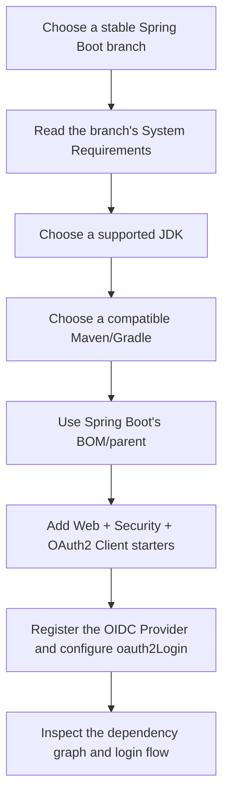

# 4.1. Choosing Compatible Spring Boot, Spring Security, and Java Versions

When creating a **Spring Security OAuth 2.0/OIDC Client** project, the first decision is not writing a `SecurityFilterChain` or configuring `client-id`, but **choosing a compatible set of Spring Boot, Spring Security, Java, and build tool versions that work together**. Choosing the right version set helps the application start reliably, receive security patches, use modern OAuth2 Login/OIDC, and avoid having to manually resolve library conflicts.

This lesson focuses on how to choose versions for an **OAuth2 Client/OIDC Relying Party** application: an application that redirects users to log in via Google, Microsoft Entra ID, Keycloak, or another OpenID Provider; receives an authorization code; exchanges it for tokens; and creates a login session with Spring Security. The examples use Java, Spring MVC (Servlet), Maven, or Gradle.

> **Version reference point:** November 16, 2026. Spring Boot, Spring Security, and Java continue to receive patches and new releases. The version numbers below illustrate combinations released as of this date; in real deployments, check the System Requirements, BOM, and support schedule of your chosen branch.

## 1. Why Must You Choose Versions as a Whole "Stack"?

Spring Boot manages many related components:

- **Spring Boot:** auto-configuration, starters, Maven/Gradle plugins, and dependency management.
- **Spring Framework:** IoC foundation, Spring MVC/WebFlux, HTTP, session, and core APIs.
- **Spring Security:** filter chain, authentication/authorization, OAuth2 Login, OAuth2 Client, OIDC.
- **Java JDK/JRE:** compilation environment and bytecode execution runtime.
- **Maven/Gradle:** tools for dependency resolution, compilation, packaging, and running the application.
- **Servlet container or reactive runtime:** for example, Tomcat when using Spring MVC.
- **Supporting libraries:** Jackson, Nimbus JOSE/JWT, HTTP clients, logging, and test libraries.

In OAuth2/OIDC, Spring Security needs to coordinate with the HTTP layer, sessions, redirect URLs, JSON, and token encryption/signing. Taking `spring-security-oauth2-client` from a newer generation and mixing it into an older Spring Boot version can cause incompatible classes or methods, even if Maven or Gradle still downloads the dependencies successfully.

The easiest rule to apply is:

**Choose the Spring Boot version first → let Spring Boot manage Spring Framework and Spring Security versions → choose a JDK and build tool supported by that Boot branch → add the right OAuth2 Client starter.**



A BOM (*Bill of Materials*) is a set of rules for managing dependency versions. When using the Boot parent/BOM, the application declares `spring-boot-starter-security-oauth2-client` or `spring-boot-starter-oauth2-client` **without pinning a version itself**; Boot selects the corresponding library versions.

## 2. Two Typical Branch Choices

### 2.1. Compatibility Table at the Reference Point

| Component | Spring Boot 3.5 Branch | Spring Boot 4.1 Branch |
|---|---|---|
| Example stable patch release | **3.5.16** | **4.1.2** |
| Spring Framework managed by Boot | 6.2.x | 7.0.x |
| Spring Security managed by Boot | **6.5.11** | **7.1.2** |
| Minimum Java according to Spring Boot | **17** | **17** |
| Maximum Java documented for the branch at this point | **25** | **27** |
| Recommended Java for learning examples | **21 LTS** | **21 LTS** or **25 LTS** |
| Maven | 3.6.3 or later | 3.6.3 or later |
| Officially supported Gradle | 7.6.4+ in the 7.x branch, or 8.4+ in the 8.x branch | 8.14+ in the 8.x branch, or the 9.x branch |
| Default servlet container in the web starter | Tomcat 10.1.x | Tomcat 11.0.x |
| Spring MVC starter | `spring-boot-starter-web` | `spring-boot-starter-webmvc` |
| OAuth2/OIDC Client starter | `spring-boot-starter-oauth2-client` | `spring-boot-starter-security-oauth2-client` |

Detailed values are based on the System Requirements, Managed Dependency Coordinates, and starter lists for each version:

- [Spring Boot 3.5 System Requirements](https://docs.spring.io/spring-boot/3.5/system-requirements.html).
- [Spring Boot 3.5 Managed Dependency Coordinates](https://docs.spring.io/spring-boot/3.5/appendix/dependency-versions/coordinates.html).
- [Spring Boot 4.1 System Requirements](https://docs.spring.io/spring-boot/system-requirements.html).
- [Spring Boot 4.1 Managed Dependency Coordinates](https://docs.spring.io/spring-boot/appendix/dependency-versions/coordinates.html).
- [Spring Boot 4.0 Migration Guide — starter renames](https://github.com/spring-projects/spring-boot/wiki/Spring-Boot-4.0-Migration-Guide).

This table does not mean every Java version between the minimum and maximum is LTS, nor that every third-party library works on all of those Java versions. This reflects **Spring Boot** compatibility; additional libraries and infrastructure also have their own requirements.

### 2.2. Which Branch Should You Choose for Your Project?

**New projects wanting to learn the current ecosystem:** prefer **Spring Boot 4.1.x + Spring Security 7.1.x + Java 21 or 25 LTS**, provided all libraries the application needs support Boot 4. The 4.x branch uses renamed starter coordinates and Spring Framework 7.

**Existing projects on Boot 3, or using libraries not yet ready for Boot 4:** choosing **Spring Boot 3.5.x + Spring Security 6.5.x + Java 21 LTS** is suitable for continued development, upgrades, and preparing a controlled migration.

**Existing projects on Boot 2.x:** plan a separate platform upgrade. Boot 2 uses the `javax.*` generation in many legacy Servlet APIs, while Boot 3/4 moved to `jakarta.*`. Do not just change a few version numbers and expect OAuth2 Login to work.

**Preview releases such as milestones, release candidates, or snapshots:** suitable for testing features or preparing upgrades; do not choose them by default for introductory examples or production systems without a clear testing goal.

You do not need to run the highest version at all costs. A consistent, supported version set with security patches that is compatible with your current IdP and infrastructure is what matters.

## 3. Choosing Java Correctly: Build JDK, Language Level, and Runtime JVM

### 3.1. Distinguishing Three Concepts

| Concept | Example | What does it determine? |
|---|---|---|
| **Compilation JDK** | JDK 21 | Contains `javac` and the required build tools |
| **Target language/bytecode level** | Java 21 (`--release 21`) | Allowed Java syntax and APIs, and the generated class file format |
| **Runtime JVM** | Java 21 or a newer compatible version | Executes the packaged application |

For example, if you build an application with JDK 25 but target Java 21, classes are compiled at the Java 21 level and can run on JVM 21 if dependencies also meet that requirement. If you use JDK 21 to produce Java 21 bytecode and then run it on JVM 17, the application may fail with `UnsupportedClassVersionError`.

**Java 21 LTS** is a balanced practical choice for both branches in the table. **Java 25 LTS** is also suitable if your project and ecosystem need a newer LTS JDK; verify compatibility across the build tool, IDE, and all dependencies.

### 3.2. Do Not Infer Official Support Just Because "Java Runs"

Suppose a Boot 3.5 application happens to start on a JVM newer than the documented maximum. That does **not** automatically make that JVM an officially supported configuration. Conversely, if a project runs on Java 17 but a build plugin requires a newer Gradle version, upgrading only the JDK is not enough.

Compatibility layers to verify together:

1. Spring Boot System Requirements for the exact branch and patch version.
2. The corresponding Gradle/Maven version.
3. The JDK version used by the IDE, build runner, CI, Docker image, and production.
4. The bytecode target specified by the Maven Compiler Plugin or Gradle Java toolchain.
5. Java requirements of non-Spring libraries and Java agents (if any).

### 3.3. Configuring Java with Maven

In a project using the Spring Boot Maven parent, the following property is a simple starting point:

```xml
<properties>
    <java.version>21</java.version>
</properties>
```

Using **JDK 21** for Maven builds is the easiest approach when learning. If you want to compile with a newer JDK while targeting an older version, inspect your `maven-compiler-plugin` configuration and use `--release` appropriately instead of arbitrarily changing environment variables.

### 3.4. Configuring the Java Toolchain with Gradle

```groovy
java {
    toolchain {
        languageVersion = JavaLanguageVersion.of(21)
    }
}
```

A toolchain specifies the JDK required by compilation tasks. The machine running Gradle must still use a JDK compatible with **that Gradle version itself**. These two can use different JDKs: the Gradle daemon runs on JDK A, while `compileJava` uses toolchain JDK B. In CI, standardize both to avoid machine-specific failures.

### 3.5. Commands to Inspect Your Environment

Reference commands for checking your local environment:

```bash
java -version
javac -version
mvn -version
gradle --version
```

If the project already includes the **Maven Wrapper** or **Gradle Wrapper**, prefer the wrapper so the development team uses the exact same build tool version:

```bash
./mvnw -version
./gradlew --version
```

On Windows PowerShell/cmd, use `mvnw.cmd` and `gradlew.bat`. Check the actual JDK path that Maven/Gradle is using; it may differ from the JDK your IDE uses to run the application.

## 4. Choosing the Right Starters for the OAuth2/OIDC Client Role

An application can participate in OAuth2 in several different roles:

| Role | Need | Spring Security Component |
|---|---|---|
| **OAuth2/OIDC Client** | Redirect users to the IdP; receive code/tokens; manage login | OAuth2 Client and `oauth2Login` |
| **OAuth2 Resource Server** | Receive and validate access tokens in an API | `oauth2ResourceServer` |
| **Authorization Server** | Issue authorization codes, access tokens, ID Tokens | Spring Security Authorization Server |
| **Web application** | Has endpoints, sessions, and callback URLs | Spring MVC or WebFlux depending on the app model |

A single application can hold multiple roles, but **the OAuth2 Client starter does not automatically turn it into an Authorization Server**, nor does it automatically make every endpoint of the application a resource server.

### 4.1. With Spring Boot 3.5

The minimal set for Servlet web login typically includes:

```text
org.springframework.boot:spring-boot-starter-web
org.springframework.boot:spring-boot-starter-security
org.springframework.boot:spring-boot-starter-oauth2-client
```

Here, the OAuth2 Client starter puts the required modules on the classpath to configure OAuth2/OIDC Login. The Security starter makes explicit that the application uses Spring Security; the Web starter provides Spring MVC and the servlet container.

### 4.2. With Spring Boot 4.1

Starter names have been standardized:

```text
org.springframework.boot:spring-boot-starter-webmvc
org.springframework.boot:spring-boot-starter-security
org.springframework.boot:spring-boot-starter-security-oauth2-client
```

In Spring Boot 4, legacy names like `spring-boot-starter-web` and `spring-boot-starter-oauth2-client` are still provided during the transition period, but they are **deprecated**. For new projects on Boot 4, use the new names to reduce future renaming work.

Spring Boot 4 also splits several starters and auto-configurations into smaller modules. When upgrading a Boot 3 application with many integrations, you may need to add specific modules for the features you use; a single old dependency no longer guarantees that all components will automatically appear on the classpath.

### 4.3. Servlet or Reactive?

The labs in this module can choose **Spring MVC/Servlet** to understand session-based OAuth2 Login and default callback paths. If you choose WebFlux, the application will use WebFilters and reactive configurations such as `SecurityWebFilterChain` and `ServerHttpSecurity`. **Do not copy Servlet `HttpSecurity`/`SecurityFilterChain` configuration verbatim into WebFlux**.

Choose one consistent model based on project requirements:

- MVC web application with views, controllers, and HTTP sessions: `web` (Boot 3) or `webmvc` (Boot 4).
- Truly reactive application: `webflux` and reactive OAuth2 Login configuration.
- A pure OAuth2 Client application using tokens to call APIs may not need the full web login flow, but still must select the corresponding dependencies and authorized client management approach.

## 5. How Dependency Management Protects Compatibility

For example, on Spring Boot 4.1.2, the BOM manages a cohesive family:

```text
spring-boot-*                  4.1.2
spring-framework-*             7.0.x
spring-security-*              7.1.2
```

With Spring Boot 3.5.16:

```text
spring-boot-*                  3.5.16
spring-framework-*             6.2.x
spring-security-*              6.5.11
```

If you add a starter but manually declare a different Security version, the dependency graph may contain mismatched versions or an API not yet tested with the current Boot release. Therefore:

- **Do not** specify `<version>` on individual Spring Boot starters when using a Maven parent/BOM.
- **Do not** specify versions for individual `spring-security-*` artifacts without a specific reason and compatibility testing process.
- **Do not** mix Spring Framework/Spring Security artifacts from two major lines in one application.
- **Do not** add the legacy `spring-security-oauth` library to implement modern OIDC Login; use the `spring-security-oauth2-*` modules managed by current Spring Security.
- When needing to patch a dependency outside the Boot release cycle, update it in a controlled manner and verify the dependency graph rather than applying bulk version overrides.

### 5.1. Maven Parent and Maven BOM

If you use `spring-boot-starter-parent`, versions are managed automatically. If the project must inherit from another internal parent, you can import `spring-boot-dependencies` in `dependencyManagement`:

```xml
<dependencyManagement>
    <dependencies>
        <dependency>
            <groupId>org.springframework.boot</groupId>
            <artifactId>spring-boot-dependencies</artifactId>
            <version>4.1.2</version>
            <type>pom</type>
            <scope>import</scope>
        </dependency>
    </dependencies>
</dependencyManagement>
```

This is an option **instead of inheriting from the starter parent** in projects requiring a different parent. Note that a BOM manages dependency versions, whereas certain plugin and build defaults are provided separately by the starter parent; projects not inheriting the parent must configure necessary plugins themselves.

### 5.2. Gradle Dependency Management

With the Spring Boot Gradle plugin, you can use `io.spring.dependency-management` or Gradle's native BOM support. When applying the dependency-management plugin, Boot automatically imports the BOM matching the Boot plugin version. You do not need to write versions for individual starters.

An option using Gradle's native BOM support:

```groovy
dependencies {
    implementation platform(
        org.springframework.boot.gradle.plugin.SpringBootPlugin.BOM_COORDINATES
    )

    implementation 'org.springframework.boot:spring-boot-starter-security'
    implementation 'org.springframework.boot:spring-boot-starter-security-oauth2-client'
}
```

If you choose the native BOM, make sure the BOM also applies to other configurations containing managed dependencies, such as `testImplementation`. Both dependency management approaches work; choose one clear mechanism and avoid importing two conflicting BOM versions.

## 6. Complete Maven Example: Spring Boot 4.1.2 + Java 21

Suppose you need to create a web application that logs in via an OIDC Provider. Your `pom.xml` file can start like this:

```xml
<?xml version="1.0" encoding="UTF-8"?>
<project xmlns="http://maven.apache.org/POM/4.0.0"
         xmlns:xsi="http://www.w3.org/2001/XMLSchema-instance"
         xsi:schemaLocation="
           http://maven.apache.org/POM/4.0.0
           https://maven.apache.org/xsd/maven-4.0.0.xsd">

    <modelVersion>4.0.0</modelVersion>

    <parent>
        <groupId>org.springframework.boot</groupId>
        <artifactId>spring-boot-starter-parent</artifactId>
        <version>4.1.2</version>
        <relativePath/>
    </parent>

    <groupId>com.example</groupId>
    <artifactId>oidc-client-demo</artifactId>
    <version>0.0.1-SNAPSHOT</version>
    <name>oidc-client-demo</name>

    <properties>
        <java.version>21</java.version>
    </properties>

    <dependencies>
        <!-- Spring MVC + embedded servlet container -->
        <dependency>
            <groupId>org.springframework.boot</groupId>
            <artifactId>spring-boot-starter-webmvc</artifactId>
        </dependency>

        <!-- Core Spring Security -->
        <dependency>
            <groupId>org.springframework.boot</groupId>
            <artifactId>spring-boot-starter-security</artifactId>
        </dependency>

        <!-- OAuth 2.0 Client / OpenID Connect login -->
        <dependency>
            <groupId>org.springframework.boot</groupId>
            <artifactId>spring-boot-starter-security-oauth2-client</artifactId>
        </dependency>

        <!-- Test dependencies -->
        <dependency>
            <groupId>org.springframework.boot</groupId>
            <artifactId>spring-boot-starter-test</artifactId>
            <scope>test</scope>
        </dependency>
        <dependency>
            <groupId>org.springframework.boot</groupId>
            <artifactId>spring-boot-starter-security-test</artifactId>
            <scope>test</scope>
        </dependency>
    </dependencies>

    <build>
        <plugins>
            <plugin>
                <groupId>org.springframework.boot</groupId>
                <artifactId>spring-boot-maven-plugin</artifactId>
            </plugin>
        </plugins>
    </build>
</project>
```

Notice there are no separate versions for Security, Servlet, Jackson, or token/JWT libraries. The Spring Boot parent manages them through the BOM.

Typical project directory structure:

```text
oidc-client-demo/
├── .mvn/
│   └── wrapper/
├── mvnw
├── mvnw.cmd
├── pom.xml
└── src/
    ├── main/
    │   ├── java/com/example/oidcclient/
    │   │   ├── OidcClientDemoApplication.java
    │   │   └── SecurityConfig.java
    │   └── resources/
    │       └── application.yml
    └── test/
        └── java/com/example/oidcclient/
```

The wrapper files and directories only exist if the project was generated with the Maven Wrapper. You do not need to create a custom OAuth2 Login callback handler class for the default flow because Spring Security includes a filter that handles it.

## 7. Complete Gradle Example: Spring Boot 4.1.2 + Java 21

Equivalent to Maven, the Groovy DSL `build.gradle` file can be written as:

```groovy
plugins {
    id 'java'
    id 'org.springframework.boot' version '4.1.2'
}

// The Boot plugin puts io.spring.dependency-management on the classpath.
apply plugin: 'io.spring.dependency-management'

group = 'com.example'
version = '0.0.1-SNAPSHOT'

java {
    toolchain {
        languageVersion = JavaLanguageVersion.of(21)
    }
}

repositories {
    mavenCentral()
}

dependencies {
    implementation 'org.springframework.boot:spring-boot-starter-webmvc'
    implementation 'org.springframework.boot:spring-boot-starter-security'
    implementation 'org.springframework.boot:spring-boot-starter-security-oauth2-client'

    testImplementation 'org.springframework.boot:spring-boot-starter-test'
    testImplementation 'org.springframework.boot:spring-boot-starter-security-test'
}

tasks.named('test') {
    useJUnitPlatform()
}
```

You can add a `settings.gradle` file:

```groovy
rootProject.name = 'oidc-client-demo'
```

With Spring Boot 4.1, choose a Gradle Wrapper in the officially documented **8.14+** or **9.x** branch. Do not pick Gradle 7.x for a Boot 4.1 project just because an older project still uses it.

For example, a project typically keeps its Gradle Wrapper files in:

```text
gradle/wrapper/gradle-wrapper.properties
gradlew
gradlew.bat
```

The version in `distributionUrl` is the source of truth when using the wrapper. IDEs, developer machines, and CI should invoke the wrapper instead of relying on a globally installed Gradle version.

## 8. If Using Spring Boot 3.5: Keep the Matching Dependency Set

In a Boot 3.5.16 project, the corresponding Maven configuration uses the old starter names:

```xml
<parent>
    <groupId>org.springframework.boot</groupId>
    <artifactId>spring-boot-starter-parent</artifactId>
    <version>3.5.16</version>
    <relativePath/>
</parent>

<properties>
    <java.version>21</java.version>
</properties>

<dependencies>
    <dependency>
        <groupId>org.springframework.boot</groupId>
        <artifactId>spring-boot-starter-web</artifactId>
    </dependency>
    <dependency>
        <groupId>org.springframework.boot</groupId>
        <artifactId>spring-boot-starter-security</artifactId>
    </dependency>
    <dependency>
        <groupId>org.springframework.boot</groupId>
        <artifactId>spring-boot-starter-oauth2-client</artifactId>
    </dependency>
</dependencies>
```

This is an excerpt from `pom.xml`, not a standalone POM file. If using Gradle with Boot 3.5, the corresponding plugin and dependency declarations can be:

```groovy
plugins {
    id 'java'
    id 'org.springframework.boot' version '3.5.16'
}

apply plugin: 'io.spring.dependency-management'

java {
    toolchain {
        languageVersion = JavaLanguageVersion.of(21)
    }
}

repositories {
    mavenCentral()
}

dependencies {
    implementation 'org.springframework.boot:spring-boot-starter-web'
    implementation 'org.springframework.boot:spring-boot-starter-security'
    implementation 'org.springframework.boot:spring-boot-starter-oauth2-client'
}
```

Spring Boot 3.5 manages Spring Security 6.5.x; do not force `spring-security-oauth2-client:7.1.x` into a Boot 3.5 application. If you want to use Security 7.1.x, evaluate upgrading to a compatible Boot 4 branch along with its other migration requirements.

## 9. Minimal OIDC Login Configuration on the Chosen Version Set

Once the build has the right starters, basic OIDC configuration remains largely the same conceptually across both the Boot 3.5 and Boot 4.1 branches.

### 9.1. Registering the Client and Provider

Example `src/main/resources/application.yml`:

```yaml
spring:
  security:
    oauth2:
      client:
        registration:
          company:
            provider: company
            client-id: ${OIDC_CLIENT_ID}
            client-secret: ${OIDC_CLIENT_SECRET}
            authorization-grant-type: authorization_code
            scope:
              - openid
              - profile
              - email
            redirect-uri: "{baseUrl}/login/oauth2/code/{registrationId}"
        provider:
          company:
            issuer-uri: https://id.example.test/realms/company
```

Values such as `example.test` are illustrative; a real environment requires an IdP and a pre-created Client account. `OIDC_CLIENT_ID` and `OIDC_CLIENT_SECRET` are supplied as environment variables or deployment secrets. Never commit real secrets to the repository.

In an OIDC login flow:

1. The user navigates to `/oauth2/authorization/company` to start the flow.
2. Spring creates an authorization request and redirects the browser to the Authorization Endpoint published by the provider.
3. The provider authenticates the user and redirects the browser back to `/login/oauth2/code/company`.
4. Spring exchanges the authorization code for tokens at the Token Endpoint and verifies the ID Token according to OIDC.
5. Spring Security creates an authenticated principal and stores it in the application session, if the flow succeeds.

This is **OAuth2 Client Login**. If the application has its own REST API accepting external `Authorization: Bearer ...` headers, validating tokens for that API is the responsibility of the **Resource Server** part, which requires corresponding design and dependencies.

### 9.2. Basic SecurityFilterChain for Servlet

```java
package com.example.oidcclient;

import org.springframework.context.annotation.Bean;
import org.springframework.context.annotation.Configuration;
import org.springframework.security.config.Customizer;
import org.springframework.security.config.annotation.web.builders.HttpSecurity;
import org.springframework.security.web.SecurityFilterChain;

@Configuration
public class SecurityConfig {

    @Bean
    SecurityFilterChain securityFilterChain(HttpSecurity http) throws Exception {
        http
            .authorizeHttpRequests(authorize -> authorize
                .requestMatchers("/", "/error").permitAll()
                .anyRequest().authenticated()
            )
            .oauth2Login(Customizer.withDefaults());

        return http.build();
    }
}
```

This snippet assumes a Spring MVC/Servlet application with an OIDC Client registration already configured. With the default login configuration, Spring Security provides the appropriate filters; do not create a `@GetMapping("/login/oauth2/code/company")` controller just to exchange the code manually in this flow.

### 9.3. Main Application Class

```java
package com.example.oidcclient;

import org.springframework.boot.SpringApplication;
import org.springframework.boot.autoconfigure.SpringBootApplication;

@SpringBootApplication
public class OidcClientDemoApplication {

    public static void main(String[] args) {
        SpringApplication.run(OidcClientDemoApplication.class, args);
    }
}
```

If you choose Boot 4.1 or 3.5 with Java 21, the basic APIs shown above do not rely on Java syntax newer than the chosen version. When copying another example from the Internet, check whether it was written for Spring Security 5, 6, or 7; some APIs or packages may differ.

## 10. Quick Selection with Spring Initializr

[Spring Initializr](https://start.spring.io/) is a convenient tool for generating a project skeleton with compatible versions. Recommended workflow:

1. Select **Project = Maven** or **Gradle**.
2. Select **Language = Java**.
3. Select **Spring Boot** on your desired stable branch (e.g., 4.1.x or 3.5.x), without accidentally picking `SNAPSHOT`/`RC`.
4. Select **Java = 21** (or a JDK confirmed supported by that branch).
5. Add dependencies **Spring Web / Spring Web MVC**, **Spring Security**, and **OAuth2 Client** according to the Boot branch's naming.
6. Generate the project, open it in your IDE, and keep the wrapper.
7. Register the Client at the IdP and configure `issuer-uri`, `client-id`, secret, and callback appropriately.

Use Initializr to establish a good starting baseline, then inspect the generated `pom.xml` or `build.gradle` to see the exact dependencies declared. Do not copy starters from a Boot 3 article into a Boot 4 project while ignoring the renames.

## 11. Practicing Dependency Graph Inspection

Even when declared properly, a transitive dependency or secondary BOM can affect the final resolved version. The commands below are examples for **learners to inspect their own project**; authoring this document did not execute a build.

### 11.1. With Maven

```bash
./mvnw -version
./mvnw dependency:tree
```

If you want to focus on Spring Security:

```bash
./mvnw dependency:tree -Dincludes=org.springframework.security
```

In PowerShell/cmd on Windows:

```powershell
.\mvnw.cmd -version
.\mvnw.cmd dependency:tree "-Dincludes=org.springframework.security"
```

What to look for: key Spring Security modules belong to the same version family managed by the BOM; no accidental mix of Security 6.x and Security 7.x caused by an unintended override.

### 11.2. With Gradle

```bash
./gradlew --version
./gradlew dependencies --configuration runtimeClasspath
./gradlew dependencyInsight --dependency spring-security-oauth2-client --configuration runtimeClasspath
```

On Windows:

```powershell
.\gradlew.bat --version
.\gradlew.bat dependencies --configuration runtimeClasspath
.\gradlew.bat dependencyInsight --dependency spring-security-oauth2-client --configuration runtimeClasspath
```

`dependencyInsight` helps trace why a particular version was selected. If the IDE shows one version while the command line resolves another, check Gradle sync, repositories, cached metadata, and the actual wrapper version.

### 11.3. Checking the Java Configuration

For example, in a project choosing Java 21, you should expect:

```text
Maven/Gradle runs with a JDK supported by the build tool
Java compilation target: 21
Production runtime: Java 21 or a higher compatible Java version
Spring Boot: exact branch, exact patch version
Spring Security: version managed by the Boot BOM
```

If the Docker runtime only has Java 17 while the build produces Java 21 bytecode, a clean dependency graph will not prevent a runtime failure. Container image and CI configuration are also part of version compatibility decisions.

## 12. Common Compatibility Errors

| Symptom | Common Cause | Resolution |
|---|---|---|
| `UnsupportedClassVersionError` | Running JDK/JRE is older than compiled bytecode | Compare Java target, toolchain, and runtime image |
| `Unsupported class file major version` in Gradle/plugin | Gradle/JDK mismatch or plugin does not support the class version | Choose a Boot-supported Gradle wrapper and matching JDK |
| `NoSuchMethodError` or `NoClassDefFoundError` in Spring | Mixing Spring Framework/Security versions from different lines | Inspect dependency graph, remove manual overrides |
| Cannot resolve new Boot 4 OAuth2 starter | Wrong artifact, repository, or old Boot plugin version | Use `spring-boot-starter-security-oauth2-client` with Boot 4 |
| Boot 3 starter marked deprecated on Boot 4 | Starters were renamed in Boot 4 | Replace old starters with new names and check needed modules |
| `javax.servlet.*` does not exist | Legacy code/library not yet migrated to `jakarta.servlet.*` | Evaluate upgrading the dependency and update imports to the new Servlet API |
| Switching Boot 3 → 4 causes missing auto-configuration classes | Boot 4 modularized and renamed packages | Check the Migration Guide; use the appropriate new starters/modules |
| `SecurityFilterChain` does not accept expected `HttpSecurity` type | App uses WebFlux but copied Servlet configuration | Use `SecurityWebFilterChain` and `ServerHttpSecurity` for reactive |
| Login redirects to IdP but callback fails | Wrong redirect URI, issuer, or client registration | Check IdP configuration; distinguish OAuth2 errors from version errors |
| OIDC token cannot be verified | Wrong issuer, JWKS, system clock, audience, or provider config | Inspect OIDC metadata and token validation; never disable verification casually |
| Works in IDE but fails in CI build | IDE and CI use different JDKs or wrappers | Standardize JDK, wrapper, and build cache across environments |
| Maven/Gradle pulls mismatched dependency versions | Another BOM overrides versions or another module pins a version | Find where the version is declared and unify around the Spring Boot BOM |

Not every OAuth2/OIDC error is caused by versions. For instance, `invalid_client`, `invalid_grant`, `redirect_uri_mismatch`, or `invalid_scope` usually stem from Client registration and interaction with the Authorization Server. Only suspect dependencies when there are clear signs such as missing classes/methods, changed packages, or framework startup failures.

## 13. Upgrading from Boot 3.5 to Boot 4.1: More Than Changing a Version Number

Spring Boot 4 and Spring Security 7 represent a major shift and should be treated as a migration with a clear technical scope.

### 13.1. Areas Requiring Migration

- **Dependencies:** `spring-boot-starter-web` → `spring-boot-starter-webmvc`, `spring-boot-starter-oauth2-client` → `spring-boot-starter-security-oauth2-client`.
- **Spring Security:** 6.x → 7.x; review removed APIs, filter chain configuration, authorization handling, and related changes in the upgrade documentation.
- **Spring Framework:** 6.2 → 7.0; verify compatibility of libraries and Spring integration extensions.
- **Servlet container:** the Boot 4 branch uses Tomcat 11 (Servlet 6.1) instead of Tomcat 10.1 in Boot 3.5's default stack; confirm container and non-Spring servlet filter compatibility.
- **Auto-configuration:** Boot 4 modularized its structure; some packages or dependencies need updates in code and build files.
- **Build:** older Gradle wrappers may no longer be supported; check System Requirements for the Boot 4 branch.
- **Integration tests:** OIDC login, callbacks, sessions, token storage, user mapping, and authorization should be re-verified after migration.

### 13.2. Practical Upgrade Order

1. On the current Boot 3.5 branch, update to an appropriate patch release and ensure a consistent dependency graph.
2. Read the Spring Boot 4 Migration Guide and Spring Security 7 Migration Guide for the APIs your application uses.
3. Select a JDK and wrapper supported by Boot 4.
4. Update the Boot parent/plugin version and starter names.
5. Update code, imports, custom security configuration, or auto-configuration according to version changes.
6. Verify the build and end-to-end OAuth2/OIDC behavior in a test environment.
7. Update CI, Docker images, and production runtimes, then deploy according to your team's plan.

If the application uses many third-party libraries, confirm they support Spring Framework 7 and Boot 4 before deciding to upgrade. Do not resolve issues by mixing Security 6 JARs back into Boot 4.

## 14. OAuth2/OIDC Protocol Compatibility

Choosing compatible Boot/Security/Java versions ensures **the Client runs on a sound platform**. However, login also depends on the **Authorization Server/OpenID Provider**.

A modern Client requires an IdP with appropriate capabilities:

- Provides an Authorization Endpoint and Token Endpoint according to OAuth 2.0.
- If using OIDC, supports `openid`, ID Tokens, and issuer/JWKS metadata for standard token validation.
- Supports the authorization code grant matching the Client registration.
- Allows accurate configuration of callback/redirect URIs.
- Enforces an appropriate client authentication policy (e.g., confidential web client using client secret or a stronger mechanism).
- Supports PKCE according to Client requirements and deployment security policy.
- Uses TLS/HTTPS and parameters, algorithms, and authentication methods supported by the Client.

An "older" IdP does not necessarily fail simply because the Client runs Boot 4; conversely, a non-standard OIDC IdP configuration can fail even when the dependency graph is completely sound. Distinguish **Java/Spring compatibility**, **OAuth2/OIDC protocol compatibility**, and **Client registration configuration**.

### 14.1. Distinguishing OAuth2 Login, OAuth2 Client, and Resource Server

In practice:

- `oauth2Login`: uses Spring Security to authenticate users via redirect/callback and create a session.
- `oauth2Client`: helps the Client obtain, store, refresh, or use authorized clients and access tokens to call downstream APIs by design.
- `oauth2ResourceServer`: used when the application itself exposes an API that must verify incoming bearer access tokens.

The same application can use multiple features. However, when selecting dependencies from Initializr, know your **specific problem** so you do not pull unrelated components into a lab exercise.

## 15. Other Platform Decisions That Affect Versions

### 15.1. Maven or Gradle?

Both are supported by Spring Boot. Choose according to repository standards and team familiarity:

| Criterion | Maven | Gradle |
|---|---|---|
| Dependency declaration | `pom.xml` XML | `build.gradle` Groovy or `build.gradle.kts` Kotlin DSL |
| Version management | Parent and BOM `dependencyManagement` | Boot plugin + dependency-management plugin or native BOM |
| Java configuration | `java.version`/Compiler Plugin | Java toolchain |
| Wrapper | `mvnw`/`mvnw.cmd` | `gradlew`/`gradlew.bat` |
| Inspect dependencies | `dependency:tree` | `dependencies` / `dependencyInsight` |

You do not need to switch to Gradle just to learn Spring Security OAuth2/OIDC; Maven meets every requirement. What matters is **locking the wrapper version**, using the BOM, and keeping build results consistent across environments.

### 15.2. Java LTS and Upgrade Cadence

LTS JDKs are well suited for long-lived applications because of broad ecosystem support. For Boot 3.5/4.1 examples, Java 21 is a straightforward practical choice. If your organization has already moved to Java 25, you can choose Java 25 with a supported branch and verify third-party components.

Do not use Java preview features for an introductory OIDC project without a specific reason; they complicate compilation/runtime setup without contributing anything to OAuth2 Login principles.

### 15.3. Production Runtime and Containers

If the application is compiled with Java 21, the container runtime must also run Java 21 or a compatible newer version. Sample container build instructions for illustration only:

```dockerfile
FROM eclipse-temurin:21-jre
WORKDIR /app
COPY target/oidc-client-demo-0.0.1-SNAPSHOT.jar app.jar
ENTRYPOINT ["java", "-jar", "app.jar"]
```

This example assumes Maven packaged the JAR with the matching name and version. Production systems should manage base images, CPU architectures, and security updates per deployment policy; choosing Boot 4.1 does not automatically synchronize the Java runtime inside your container.

### 15.4. Spring Cloud and Third-Party Libraries

If you use Spring Cloud, Spring Data, database drivers, observability agents, or non-Spring starter libraries, check each project's **own compatibility matrix**. In particular, custom starters or libraries heavily tied to auto-configuration may require code changes when moving from Boot 3 to Boot 4.

Avoid using floating versions such as `latest.release` or `+` for foundational dependencies. A new library release can change the classpath between two builds even when your source code has not changed.

## 16. Specific Version Selection Scenarios

### Scenario A: New OIDC Client Lab Using Maven

Requirement: web login, redirect to IdP, display user info, Java LTS.

**Recommended stack:** Boot 4.1.x, Boot-managed Security (7.1.x), Java 21, Maven Wrapper; starters `webmvc`, `security`, `security-oauth2-client`.

Reason: this is the current Boot 4 starter structure; no need to manually manage Security/JWT versions.

### Scenario B: Internal Application Currently on Boot 3.5

Requirement: add OIDC login to a stable MVC application.

**Recommended stack:** Keep Boot 3.5.x, Java 21, and BOM-managed Security 6.5.x; add `spring-boot-starter-oauth2-client`. Plan an upgrade to Boot 4 when non-Spring dependencies are ready and the upgrade window is appropriate.

Reason: integrating OIDC does not require upgrading the entire application's major line first.

### Scenario C: CI Uses Java 17 While Developers Use Java 25

Requirement: package Boot 4.1 for production running Java 21.

**Resolution:** define Java 21 as the target; provide a matching JDK 21 in CI/toolchain and a compatible Java runtime. If CI only has JDK 17 and cannot supply a Java 21 toolchain, a build targeting Java 21 may fail. Do not work around this by arbitrarily lowering the bytecode target when code uses Java 21 APIs.

### Scenario D: Running Boot 3.5 While Adding Security 7 Directly

Requirement: use a new API in Security 7.

**Resolution:** evaluate migrating to Boot 4 and all related components. If Boot cannot be upgraded yet, prefer the equivalent API in Security 6.5 or adopt a compatible design rather than forcing Security 7 versions into the Boot 3.5 dependency graph.

## 17. Practical Decision Checklist

When starting a Spring Security OAuth 2.0/OIDC Client project, you can fill out this table yourself:

| Question | Example Answer |
|---|---|
| New project or upgrade? | New |
| Which Spring Boot major branch? | 4.1.x |
| Where will Security come from? | Spring Boot BOM → 7.1.x |
| Which build and runtime JDK? | Java 21 LTS |
| Maven or Gradle? | Maven Wrapper |
| Which web stack? | Spring MVC/Servlet |
| Exact OAuth2 Client starter name? | `spring-boot-starter-security-oauth2-client` |
| What role does the application play? | OIDC Relying Party/OAuth2 Client |
| Does the OIDC Provider support discovery? | Yes, `issuer-uri` and metadata |
| Is the Redirect URI registered? | `https://app.example.test/login/oauth2/code/company` |
| Any manual dependency version overrides? | No, unless justified and verified |
| Do CI/Docker share the same Java target? | Java 21 |

For Boot 3.5, adjust the answers for the Security branch and starter names accordingly. This table is useful for reviewing decisions before starting to implement the login flow.

## 18. Authoritative Sources to Check Over Time

The pages below are official references; use URLs tied to **the branch you are deploying**, rather than only visiting `current`, which shifts to newer releases over time:

1. [Spring Boot 4 — System Requirements](https://docs.spring.io/spring-boot/system-requirements.html): Java, Maven, Gradle, and Servlet container requirements for the current stable release.
2. [Spring Boot 3.5 — System Requirements](https://docs.spring.io/spring-boot/3.5/system-requirements.html): requirements specific to the 3.5 branch.
3. [Spring Boot 4 — Managed Dependency Coordinates](https://docs.spring.io/spring-boot/appendix/dependency-versions/coordinates.html): exact versions of Spring Framework, Spring Security, and libraries managed by the BOM.
4. [Spring Boot 3.5 — Managed Dependency Coordinates](https://docs.spring.io/spring-boot/3.5/appendix/dependency-versions/coordinates.html): BOM for the 3.5 branch.
5. [Spring Boot — Build Systems and Starters List](https://docs.spring.io/spring-boot/reference/using/build-systems.html): renamed starters in Boot 4.
6. [Spring Boot 4.0 Migration Guide](https://github.com/spring-projects/spring-boot/wiki/Spring-Boot-4.0-Migration-Guide): starter changes, modularization, and upgrade notes.
7. [Spring Boot Gradle Plugin — Managing Dependencies](https://docs.spring.io/spring-boot/gradle-plugin/managing-dependencies.html): BOM in Gradle and the dependency-management plugin.
8. [Spring Security — Getting Spring Security](https://docs.spring.io/spring-security/reference/getting-spring-security.html): dependency management and principles for using Spring Security with Boot.
9. [Spring Security — OAuth2 Login (Servlet)](https://docs.spring.io/spring-security/reference/servlet/oauth2/login/core.html): configuring OIDC/OAuth2 Login on Spring MVC.
10. [Spring Initializr](https://start.spring.io/): generate a matching project by Boot branch and build tool.

## 19. Key Takeaways

**Spring Boot is the version anchor.** Choose Boot first, use its parent/BOM to bring in matching Spring Security and Spring Framework versions, pick a JDK and build tool per System Requirements, and use the right starters for your major line.

For examples as of November 2026, two clear stacks are:

```text
Spring Boot 3.5.16
    + Spring Security 6.5.11 (Boot BOM)
    + Java 21 LTS
    + spring-boot-starter-web
    + spring-boot-starter-oauth2-client
```

or:

```text
Spring Boot 4.1.2
    + Spring Security 7.1.2 (Boot BOM)
    + Java 21 LTS
    + spring-boot-starter-webmvc
    + spring-boot-starter-security-oauth2-client
```

Both can build OAuth2/OIDC Client applications. Reliability comes from **a consistent version stack and properly configured features**, not from manually assembling the latest releases of individual libraries.
