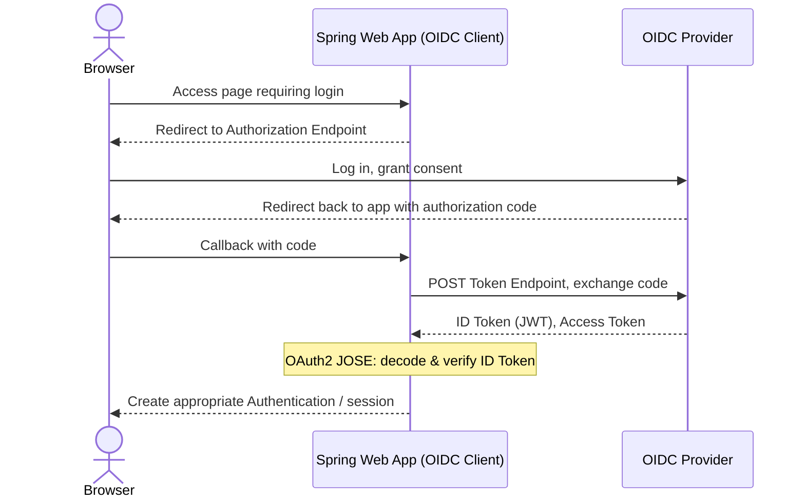
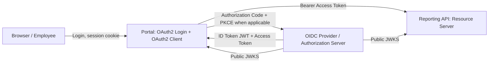

# 4.4. The Role of OAuth2 JOSE in OIDC and JWT Processing

When setting up a **Spring Security OAuth 2.0 / OpenID Connect (OIDC) Client** application, we frequently encounter the `spring-security-oauth2-jose` module. Its name often misleads learners into thinking it is the component that performs login, calls APIs, or issues access tokens itself. In reality, **OAuth2 JOSE provides the cryptographic capabilities and JWT handling required for an application to read and verify tokens according to JOSE standards**. It supports OAuth2 Client, OIDC Login, and JWT Resource Server at different points in the request lifecycle.

To understand this module's role, separate four concepts:

- **OAuth 2.0** defines how a client obtains resource access and uses an access token; the standard does not mandate that every access token be a JWT.
- **OIDC** extends OAuth 2.0 to provide login/identity authentication; OIDC uses an **ID Token** structured as a JWT.
- **JWT (JSON Web Token)** is a format for representing claims as a token; a JWT can be signed (JWS) or encrypted (JWE) under the related specifications.
- **JOSE (JSON Object Signing and Encryption)** is a family of standards specifying how to sign, encrypt, and describe keys/algorithms for JSON data, including JWS, JWE, JWK, and JWA.

**Key message:** `spring-security-oauth2-jose` is the **cryptographic token-processing piece** in Spring Security. It does not replace `spring-security-oauth2-client` or `spring-security-oauth2-resource-server`, and it does not turn the application into an Authorization Server.

## 1. Positioning OAuth2 JOSE in the Spring Security Ecosystem

| Module / Component | Primary Responsibility | Relationship to JOSE |
| --- | --- | --- |
| `spring-security-oauth2-client` | Registers OAuth2 clients, executes grant flows, manages authorized clients; supports `oauth2Login()` | When logging in via **OIDC**, verifies the JWT-formatted ID Token using JOSE capabilities |
| `spring-security-oauth2-jose` | Provides APIs and implementations for JWT, JWS, JWK, `JwtDecoder` / `JwtEncoder` | A supporting layer for signed/cryptographic tokens; does not perform login or authorization itself |
| `spring-security-oauth2-resource-server` | Extracts bearer tokens from HTTP requests, authenticates and builds `Authentication`, authorizes APIs | For **JWT bearer tokens**, typically uses JOSE's `JwtDecoder` to verify signatures and claims |
| Spring Authorization Server | Issues tokens and exposes metadata/JWKS per authorization server configuration | May use JOSE capabilities when issuing JWTs, but is a separate application/component |

Two cases must be distinguished from the start:

1. **OIDC Login:** the client receives an **ID Token** from an identity provider. The application must validate the token to establish user authentication during login.
2. **JWT Resource Server:** an API receives a **JWT-formatted access token** from a caller. The API must verify the signature, required claims, and authorization conditions before serving resources.

An **OAuth2 Client that only forwards an access token to another API** may not need to decode that JWT itself. Even if the access token is an opaque string, the client still sends the token verbatim via `Authorization: Bearer ...`. Whether a token can be read as JSON **does not determine** whether it can be used to call an API.

## 2. What Does JOSE Consist Of?

### 2.1. JWT: A Container for Claims

A JWT typically describes information such as:

```json
{
  "iss": "https://idp.example.com/realms/acme",
  "sub": "user-183",
  "aud": "reporting-api",
  "scope": "reports.read",
  "iat": 1794800000,
  "exp": 1794803600
}
```

This is an **illustrative payload example**; timestamps are Unix epochs and do not represent a real token. Common meanings:

| Claim | Meaning | Why care? |
| --- | --- | --- |
| `iss` (*issuer*) | Entity that issued the token | Only trust tokens from configured issuers |
| `sub` (*subject*) | Principal the token describes | A technical identifier, not guaranteed to be an email |
| `aud` (*audience*) | Intended recipient(s) of the token | Prevents tokens issued for another service from being accepted by your API |
| `iat` (*issued at*) | Issuance timestamp | Useful in time-based validation policies |
| `exp` (*expiration*) | Expiration timestamp | Reject expired tokens |
| `nbf` (*not before*) | Earliest time the token becomes valid | Prevents using a token too early |
| `scope` / `scp` | Granted scopes, depending on issuer | Mapped to authorities for authorization |

**A JWT is only a packaging format for claims.** Being able to read a JWT payload does not prove the token is valid. Base64URL strings in a JWT are trivial to decode; **verifying the signature, algorithm, issuer, audience, expiration, and permissions** is the essential security work.

### 2.2. JWS: Signing to Guarantee Integrity and Origin

The most common case is a **JWT signed using JWS Compact Serialization**:

```text
BASE64URL(header).BASE64URL(payload).BASE64URL(signature)
```

Example header:

```json
{
  "alg": "RS256",
  "typ": "JWT",
  "kid": "signing-key-2026-11"
}
```

- `alg` indicates the signature algorithm; **the server must restrict trusted algorithms**, never blindly trusting the header.
- `kid` helps pick the right key from a JWK Set when the provider has multiple keys or rotates keys.
- `typ` is a hint about the object type; this value is not a substitute for verifying the token's intended purpose.
- With `RS256`, the Authorization Server signs with its **private key**; the Resource Server uses the corresponding **public key** to verify. A public key cannot produce a valid signature in place of the private key.

A signature ensures the content **has not been tampered with while still passing verification** under trusted algorithms/keys; it **does not make claims secret**. Never assume data inside a signed JWT is encrypted.

### 2.3. JWE: Encryption Is a Different Concept

JOSE also includes **JWE (JSON Web Encryption)**, typically using compact serialization with **five dot-separated parts** instead of the three parts of JWS:

```text
protectedHeader.encryptedKey.iv.ciphertext.authenticationTag
```

JWE is designed for content confidentiality, whereas JWS provides signing and integrity verification. **Do not infer that because JOSE includes JWE, Spring Security Resource Server automatically supports every kind of encrypted JWE/JWT.** Standard JWT configuration with `NimbusJwtDecoder` primarily processes signed JWTs/JWS; encrypted JWTs require dedicated decryption design and integration matching the provider.

### 2.4. JWK and JWKS: Describing and Discovering Keys

**JWK (JSON Web Key)** is a JSON representation of a cryptographic key. **JWKS (JSON Web Key Set)** is a collection of JWKs, usually published by the Authorization Server at an HTTPS endpoint.

A JWKS containing an RSA public key can take a compact form:

```json
{
  "keys": [
    {
      "kty": "RSA",
      "use": "sig",
      "kid": "signing-key-2026-11",
      "alg": "RS256",
      "n": "<modulus-base64url>",
      "e": "AQAB"
    }
  ]
}
```

Values in `<...>` are placeholders, not usable keys. Notable fields:

- `kty`: key type (`RSA`, `EC`, ...).
- `kid`: key identifier, usually matching `kid` in the JWT header.
- `use`: intended key usage (e.g., `sig` for signing).
- `n`, `e`: RSA public parameters; a public JWKS **never** contains private keys.

With JWKS, a Resource Server can verify JWTs from an Authorization Server without sharing a private signing key. When the Authorization Server **rotates keys**, the JWKS can publish new keys; the decoder must refresh keys via caching/refresh mechanisms and endpoint reachability. Applications should use HTTPS and only trust the JWKS endpoint belonging to the configured issuer, avoiding fetching keys from arbitrary URLs inside a token.

### 2.5. JWA: Algorithm Suite

**JWA (JSON Web Algorithms)** defines the names and usage of JOSE algorithms such as `RS256`, `ES256`, `PS256`, and `HS256`. In real deployments, the Authorization Server and verifying application must agree on allowed algorithms:

| Example Algorithm | Key Type / Mechanism | Deployment Notes |
| --- | --- | --- |
| `RS256` | Asymmetric RSA signature | Common when the Resource Server only holds the public key |
| `ES256` | Asymmetric ECDSA | Requires matching EC keys and decoder configured to accept the algorithm |
| `PS256` | Asymmetric RSA-PSS | Requires both issuer and decoder support |
| `HS256` | Symmetric HMAC | Both issuer and verifier share a secret; does not use public-key JWKS like RSA |

Do not enable all algorithms indiscriminately. **Choose algorithms from your trust contract with the issuer**, never from an unverified token header.

## 3. Where Does OAuth2 JOSE Participate in OIDC Login?

### 3.1. Following an Authorization Code Flow



When the application receives an ID Token, Spring Security must verify OIDC requirements such as:

- The ID Token signature and the algorithm/key supported by the provider.
- `iss` matches the trusted issuer.
- `aud` contains the appropriate `client_id`, plus `azp` constraints when required by OIDC conditions.
- `exp`, `iat`, and related time constraints.
- `nonce` when sent in the authentication request, to bind the response to the original login flow.

**Separation of responsibilities:** OAuth2/OIDC Login implements **the login protocol, state/callback handling, and principal construction**; the JOSE module provides the **JWT processing/signature verification** capabilities required by that workflow. Do not re-implement ID Token validation by calling `Base64.decode` and trusting claims blindly.

> **An ID Token is not an access token.** The ID Token's primary audience is the **OIDC client**, used to verify authentication details. An access token's audience is the **Resource Server/API**, used to grant access. Even though both can be JWTs, never send an ID Token to an API as a bearer access token.

### 3.2. Setting Up an OIDC Client in Spring Boot

With Spring Boot using the modern Spring Security ecosystem, common starter dependencies are:

```gradle
dependencies {
    implementation 'org.springframework.boot:spring-boot-starter-web'
    implementation 'org.springframework.boot:spring-boot-starter-security'
    implementation 'org.springframework.boot:spring-boot-starter-oauth2-client'
}
```

The `spring-boot-starter-oauth2-client` starter normally pulls in the Security modules needed for an OAuth2/OIDC Client, **including JOSE capabilities as a transitive dependency**. To avoid redundant declarations, inspect the dependency graph of the exact Spring Boot version you use before manually adding `spring-security-oauth2-jose`.

Example `application.yml`:

```yaml
spring:
  security:
    oauth2:
      client:
        registration:
          corporate:
            provider: corporate
            client-id: ${OIDC_CLIENT_ID}
            client-secret: ${OIDC_CLIENT_SECRET}
            authorization-grant-type: authorization_code
            scope:
              - openid
              - profile
              - email
        provider:
          corporate:
            issuer-uri: https://idp.example.com/realms/acme
```

With OIDC Discovery, `issuer-uri` lets Spring load the provider's metadata (endpoints and related JWKS info). The URI must match the issuer published by the provider. `OIDC_CLIENT_ID`/`OIDC_CLIENT_SECRET` are environment variables; never hardcode secrets in the repository. On the OIDC Provider side, register the matching application callback, such as `/login/oauth2/code/corporate` at your actual deployment hostname.

Example `SecurityFilterChain` configuration:

```java
@Configuration
class OidcWebSecurityConfig {
    @Bean
    SecurityFilterChain webSecurity(HttpSecurity http) throws Exception {
        http
            .authorizeHttpRequests(auth -> auth
                .requestMatchers("/", "/public/**").permitAll()
                .anyRequest().authenticated()
            )
            .oauth2Login(Customizer.withDefaults());

        return http.build();
    }
}
```

This Java snippet illustrates the modern DSL style, omitting corresponding Spring Framework and Spring Security imports. When a user visits `/oauth2/authorization/corporate`, the application initiates login; during the callback, Spring Security OIDC processes the ID Token. The application typically receives an `OidcUser` principal:

```java
@RestController
class CurrentUserController {

    @GetMapping("/me")
    Map<String, String> currentUser(@AuthenticationPrincipal OidcUser oidcUser) {
        return Map.of(
            "sub", oidcUser.getSubject(),
            "issuer", oidcUser.getIssuer().toString()
        );
    }
}
```

`OidcUser` should only be used on endpoints configured to require authentication properly. Any profile claims returned by the application must adhere to privacy and authorization requirements.

### 3.3. What If the System Only Uses OAuth2 Login Without OIDC?

When the provider is an OAuth2 provider that does not implement OIDC and the application does not request the `openid` scope, the flow can use `OAuth2User` and the provider's user-info API. **There is no OIDC ID Token verification step if the provider does not issue an ID Token.** However, the OAuth2 Client dependency may still pull JOSE into the application due to starter packaging; that does not turn an OAuth2 response into OIDC.

## 4. Where Does OAuth2 JOSE Participate in a JWT Resource Server?

### 4.1. API Flow Receiving a Bearer JWT

```mermaid
sequenceDiagram
    participant C as OAuth2 Client
    participant A as API (Resource Server)
    participant K as OIDC/OAuth2 Provider JWKS
    C->>A: GET /api/reports + Bearer access token
    Note over A: BearerTokenAuthenticationFilter extracts token
    A->>K: Fetch/refresh JWKS when needed
    K-->>A: Public JWKs
    Note over A: NimbusJwtDecoder verifies JWS & claims
    Note over A: JwtAuthenticationProvider / converter builds Authentication
    A-->>C: 200 if authorized; 401/403 otherwise
```

Each processing component has a distinct responsibility:

| Step | Typical Spring Security Component | Role |
| --- | --- | --- |
| Find bearer token in incoming request | `BearerTokenAuthenticationFilter` | Reads `Authorization: Bearer ...` |
| Authenticate JWT | `JwtAuthenticationProvider` with `JwtDecoder` | Orchestrates verification and turns a valid JWT into an authentication object |
| Decode/verify JWS | `NimbusJwtDecoder` (with OAuth2 JOSE support) | Verifies signature with trusted keys, runs configured validators |
| Map claims to authorities | `JwtAuthenticationConverter` | E.g., `scope: reports.read` → `SCOPE_reports.read` |
| Decide whether endpoint access is allowed | `AuthorizationFilter` and rules | Applies `hasAuthority`, `hasRole`, and corresponding policies |

Order matters: **a valid signature does not mean sufficient permissions**, and a matching `scope` does not mean the token has the right `aud` or `iss`. Both token authentication and resource authorization are required.

### 4.2. Dependencies to Declare

```gradle
dependencies {
    implementation 'org.springframework.boot:spring-boot-starter-web'
    implementation 'org.springframework.boot:spring-boot-starter-security'
    implementation 'org.springframework.boot:spring-boot-starter-oauth2-resource-server'
}
```

The Resource Server starter typically includes the two parts required for JWT bearer authentication:

- `spring-security-oauth2-resource-server`: HTTP bearer authentication and API protection integrations.
- `spring-security-oauth2-jose`: signed JWT, JWK, and decoder processing/verification.

If managing dependencies at the individual module level instead of using Spring Boot starters, ensure **both modules** are actually on the classpath when you want the Resource Server to validate JWTs. Adding only JOSE does not install the bearer filter; adding only the Resource Server component without JOSE processing is insufficient for the JWT flow.

### 4.3. Configuring a JWT API with Issuer and Audience

Example `application.yml` for `reporting-api`:

```yaml
spring:
  security:
    oauth2:
      resourceserver:
        jwt:
          issuer-uri: https://idp.example.com/realms/acme
          audiences:
            - reporting-api
```

- `issuer-uri` points to a trusted issuer; Spring typically uses OIDC/OAuth metadata to discover the JWKS endpoint and validate the `iss` claim.
- `audiences` requires the token to have an `aud` matching this API. This property is supported in modern Spring Boot lines; if your version lacks this property, configure an `aud` validator in Java.
- In deployments that need to avoid relying on discovery at startup time, you can supply both `issuer-uri` and a controlled `jwk-set-uri` to explicitly state the source of public keys **while still validating the issuer**. The JWKS URI must never be taken directly from an unverified JWT.

Example security rule:

```java
@Configuration
class ReportingApiSecurityConfig {

    @Bean
    SecurityFilterChain apiSecurity(HttpSecurity http) throws Exception {
        http
            .authorizeHttpRequests(auth -> auth
                .requestMatchers("/api/reports/**")
                    .hasAuthority("SCOPE_reports.read")
                .anyRequest().authenticated()
            )
            .oauth2ResourceServer(resourceServer ->
                resourceServer.jwt(Customizer.withDefaults()));

        return http.build();
    }
}
```

In the common default configuration, the `reports.read` scope in the JWT's `scope` or `scp` claim is mapped to the `SCOPE_reports.read` authority. The rule above is **API authorization**; it does not live inside `JwtDecoder` and does not appear automatically just by enabling JOSE.

A client can call:

```http
GET /api/reports/quarterly HTTP/1.1
Host: reporting-api.example.com
Authorization: Bearer <access-token>
```

The API normally returns `401 Unauthorized` when no token is provided or the token is invalid, and `403 Forbidden` when the token is authenticated but lacks permissions. Applications may customize error handling, but should not turn a machine-to-machine API into an OIDC login redirect.

### 4.4. When a Custom Validator Is Needed for Audience

If properties configuration alone does not cover all validation needs, you can define a `JwtDecoder` bean and attach validators. The snippet below uses a trusted JWKS endpoint along with the default issuer validator:

```java
@Configuration
class JwtDecoderConfig {

    @Bean
    JwtDecoder jwtDecoder() {
        String issuer = "https://idp.example.com/realms/acme";
        String jwksUri = "https://idp.example.com/realms/acme/protocol/openid-connect/certs";

        NimbusJwtDecoder decoder = NimbusJwtDecoder
            .withJwkSetUri(jwksUri)
            .build();

        OAuth2TokenValidator<Jwt> issuerAndTimes =
            JwtValidators.createDefaultWithIssuer(issuer);

        OAuth2TokenValidator<Jwt> audience = jwt ->
            jwt.getAudience().contains("reporting-api")
                ? OAuth2TokenValidatorResult.success()
                : OAuth2TokenValidatorResult.failure(
                    new OAuth2Error("invalid_token", "Invalid audience", null));

        decoder.setJwtValidator(
            new DelegatingOAuth2TokenValidator<>(issuerAndTimes, audience));

        return decoder;
    }
}
```

Points to understand in this example:

1. `NimbusJwtDecoder` fetches public keys from a **fixed JWKS URI trusted by the application**; the URI is illustrative and must be replaced with your IdP's exact endpoint.
2. `JwtValidators.createDefaultWithIssuer(issuer)` retains default checks for issuer and timestamps; the audience validator is then added via `DelegatingOAuth2TokenValidator`.
3. `getAudience()` is a list because the `aud` claim can contain multiple recipients.
4. The example does not write its own signature verification or manual Base64URL decoding. The framework owns signature verification; the application adds **business constraints**.
5. Allowed signing algorithms, JWKS cache settings, and key rotation policies must be aligned with the provider. With the default JWK decoder, algorithm support should not be broadened without justification.

The example uses a JWKS URL structure commonly seen across IdPs; each provider may use a different URL. For JWTs from multiple issuers, route to corresponding decoders/trust configurations rather than merging all issuers into an arbitrary pool of public keys.

## 5. Distinguishing ID Token vs. JWT Access Token Flows

This is one of the biggest sources of design mistakes when learning OAuth2/OIDC:

| Criterion | **OIDC ID Token** | **JWT Access Token** |
| --- | --- | --- |
| Who consumes it? | The **OIDC Client** application logging in the user | The **Resource Server** providing an API |
| Purpose | Confirms the login event and identity information | Authorizes access to resources per granted scopes/permissions |
| `aud` typically points to | The Client ID of the login application | The API/resource identifier, depending on IdP design |
| Claims to pay attention to | `iss`, `sub`, `aud`, `exp`, `iat`, `nonce`, `azp` per OIDC context | `iss`, `sub`, `aud`, `exp`, `nbf`, `scope`/`scp` or authorization claims |
| Where does Spring process it? | OIDC Login filter/provider, coordinating with JOSE to verify the JWT | Resource Server filter/provider, coordinating with the JOSE decoder |
| Interchangeable? | **No** | **No** |

Both tokens can be JWSs, have dot-separated parts, and verify against the same issuer's JWKS. **A valid signature does not give them the same meaning.** If an API only verifies signatures and ignores `aud`, it could accidentally accept an ID Token or a token intended for another service. Therefore, a Resource Server needs proper audience validation and must never accept tokens issued for the wrong purpose.

## 6. Architecture Combining OIDC Client and JWT API

Suppose a user logs into an admin portal using OIDC, and the portal then calls a reporting API:



At the **Portal**:

- OIDC Login uses JOSE to verify the **ID Token**; the result is the user's `OidcUser`/`Authentication` in the portal.
- OAuth2 Client holds and sends the **access token** when calling the Reporting API. The portal does not need to parse the access token itself in order to forward it to the API.
- The portal's session cookie is a mechanism for maintaining browser login state, **not** a bearer token for another API to accept directly.

At the **Reporting API**:

- The Resource Server receives the access token and uses JOSE to validate the JWT for issuer, audience, expiration, and keys/algorithms.
- After authentication, the API enforces scope/authority policies per endpoint.
- If the Authorization Server issues an **opaque access token** instead of a JWT, the API must use an appropriate **opaque token introspection** mechanism; the JOSE JWT decoder cannot be used to guess or "decode" an opaque string.

One application can simultaneously handle OAuth2 Login, OAuth2 Client, and Resource Server roles. When serving both browsers and APIs, configure distinct `SecurityFilterChain` beans scoped by URL patterns so APIs do not redirect to login pages and bearer APIs do not inherit browser session policies. JOSE still handles only the JWT/JWS layer used within those flows.

## 7. Dependency Configuration for Three Common Scenarios

Choose dependencies based on **the application's role**, not whether a token "looks like a JWT".

| Project Scenario | Typical Starters | What Is JOSE Needed For? |
| --- | --- | --- |
| Website with employee OIDC login | `spring-boot-starter-oauth2-client`, `spring-boot-starter-security` | Verifying the **OIDC ID Token** |
| Backend using `client_credentials` only and sending access tokens to an API | `spring-boot-starter-oauth2-client` | Does not necessarily need to decode the access token; JOSE may still appear as a transitive dependency |
| REST API receiving bearer JWTs | `spring-boot-starter-oauth2-resource-server`, `spring-boot-starter-security` | Verifying signature/claims of **JWT access tokens** |
| REST API receiving only opaque bearer tokens | `spring-boot-starter-oauth2-resource-server`, `spring-boot-starter-security` | Usually does not need a JWT decoder; uses introspection per IdP contract |
| App doing both OIDC Login and serving a JWT API | Both OAuth2 Client and Resource Server starters | Handles ID Tokens on the login side and access tokens on the inbound API side |

When using Spring Boot starters, **do not manually add every `spring-security-*` module with mismatched versions**. Let Spring Boot's dependency management synchronize versions. When troubleshooting classpath issues, inspect the application's dependency tree to see whether `spring-security-oauth2-jose` and a JWT implementation library like Nimbus JOSE + JWT are present.

Example of declaring individual modules in a Spring Security application without starters:

```gradle
dependencies {
    implementation 'org.springframework.security:spring-security-oauth2-resource-server'
    implementation 'org.springframework.security:spring-security-oauth2-jose'
}
```

These are only the **two dependencies related to a JWT Resource Server**, not the full configuration for a web application. Other Spring Security integrations, the HTTP server, and dependency management must still be provided by the project.

## 8. Common Misconceptions When Using OAuth2 JOSE

### 8.1. "Reading the JWT means the token is valid"

False. Merely decoding Base64URL to read JSON does not verify the signature. The token could be expired, tampered with, from a forged issuer, or issued for a different API. **Use a `JwtDecoder` configured with trust and validators**, rather than parsing the payload manually and trusting `role`/`scope`.

### 8.2. "Having `spring-security-oauth2-jose` automatically protects endpoints"

False. JOSE provides token processing, while extracting the Bearer header, building `Authentication`, and enforcing endpoint rules require **Resource Server** components and an appropriate `SecurityFilterChain` configuration.

### 8.3. "Enabling `oauth2Login()` makes every API accept JWTs"

False. `oauth2Login()` configures user login for a web application. If an API needs to accept bearer tokens from another service, use `oauth2ResourceServer()` in the appropriate API filter chain.

### 8.4. "A token signed by the same IdP can be used for any API"

False. JWTs may share an issuer while having different **audiences, token types, scopes, tenants, and permissions**. Enforce `aud`, `iss`, permission policies, and claims appropriate for your API.

### 8.5. "Having a JWKS URL means the server will never face key errors"

False. You can still hit network failures, HTTPS certificate errors, stale JWKS caches during key rotation, missing `kid` values, or disallowed algorithms. Monitor validation failures and operate reliable key rotation; never disable signature verification to "fix" an incident.

### 8.6. "A signed JWT means the contents inside are secret"

False. A JWS signature does not encrypt the payload. Do not put sensitive data in a JWT solely because it is signed; use TLS, minimize token data, and consider encryption/token design where content confidentiality is required.

### 8.7. "Access tokens are always JWTs and ID Tokens can always call APIs"

False. Access tokens may be JWTs or opaque; ID Tokens belong to OIDC Login and must not be used in place of access tokens. Design clients and Resource Servers around the provider's **actual token contract**.

## 9. Practical Troubleshooting Hints

| Symptom | Possible Cause | What to Check |
| --- | --- | --- |
| JWT Resource Server cannot create `JwtDecoder` or JWT classes are missing | Missing or incompatible JOSE/JWT dependency | Check starters, dependency graph, and Spring Security version |
| Fails to start with `issuer-uri` | Wrong discovery URL, unreachable metadata, issuer mismatch | Verify exact issuer, TLS, metadata, and network connectivity |
| API returns `401` even though JWT decodes in an online tool | Invalid signature, `kid`, issuer, audience, expiration, or algorithm | Safely inspect JWT headers/claims, trust config, and auth logs |
| API returns `403` with a valid JWT | Missing scope/authority per security rules | Check `scope`/`scp` claims and `JwtAuthenticationConverter` |
| OIDC Login fails during ID Token processing | Invalid `iss`, `aud`, `nonce`, expiration, signature, or metadata | Check client registration, redirect URI, provider metadata, and clock synchronization |
| Token signed with `ES256` while decoder only trusts another algorithm | Algorithm/key mismatch | Adjust decoder in a controlled way per the IdP's committed algorithm |
| Old tokens work, new tokens fail after key rotation | Stale JWKS cache/endpoint or `kid` out of sync | Inspect current JWKS, cache refresh behavior, and rotation strategy |

Never log **raw access tokens, ID Tokens, client secrets, or private keys** when debugging. If correlation is needed, log only safe metadata (such as verified issuer, error category, correlation ID, and `kid` when appropriate) and mask sensitive credentials.

## 10. Review Questions

**Question 1.** A Spring Boot application logs in via OIDC and receives a JWT-formatted ID Token. Which component handles the login flow, and which verifies the JWT signature?

**Answer:** OAuth2/OIDC Login executes the flow and creates `Authentication`; OAuth2 JOSE capabilities / the JWT decoder decode and verify the ID Token according to OIDC rules.

**Question 2.** An API uses `oauth2ResourceServer().jwt()`, but the project only added `spring-security-oauth2-resource-server` without JOSE. What should be reviewed?

**Answer:** The JWT decoder and JOSE classes may be missing from the classpath. Use the `spring-boot-starter-oauth2-resource-server` starter or declare both the Resource Server and JOSE modules matching the project's version.

**Question 3.** A token has three segments `header.payload.signature`, its `scope` can be read, but its `kid` is not found in JWKS. Can we trust the scope and allow access?

**Answer:** No. If the signature cannot be verified with a trusted key, the claims must not be trusted. Check the issuer, JWKS, `kid`, algorithm, and key rotation process.

**Question 4.** The same IdP issues an ID Token to a web app and a JWT access token to an API. Can the ID Token be used to call the API?

**Answer:** No. The ID Token is intended for the client to verify a login session; the API requires an access token with the proper audience and permissions. Sharing the same issuer or signing key does not make them interchangeable.

**Question 5.** If an API uses opaque token introspection, does it need to decode tokens with `NimbusJwtDecoder`?

**Answer:** No. The Resource Server configures opaque-token introspection to validate tokens with the issuer. `NimbusJwtDecoder` is meant for the appropriate JWT verification flow.

## 11. References

- [Spring Security Reference — OAuth 2.0 Client](https://docs.spring.io/spring-security/reference/servlet/oauth2/client/index.html)
- [Spring Security Reference — OAuth 2.0 Login](https://docs.spring.io/spring-security/reference/servlet/oauth2/login/index.html)
- [Spring Security Reference — OAuth 2.0 Resource Server JWT](https://docs.spring.io/spring-security/reference/servlet/oauth2/resource-server/jwt.html)
- [Spring Security Reference — Opaque Token](https://docs.spring.io/spring-security/reference/servlet/oauth2/resource-server/opaque-token.html)
- [RFC 7515 — JSON Web Signature (JWS)](https://www.rfc-editor.org/rfc/rfc7515)
- [RFC 7516 — JSON Web Encryption (JWE)](https://www.rfc-editor.org/rfc/rfc7516)
- [RFC 7517 — JSON Web Key (JWK)](https://www.rfc-editor.org/rfc/rfc7517)
- [RFC 7518 — JSON Web Algorithms (JWA)](https://www.rfc-editor.org/rfc/rfc7518)
- [RFC 7519 — JSON Web Token (JWT)](https://www.rfc-editor.org/rfc/rfc7519)
- [OpenID Connect Core 1.0 — ID Token](https://openid.net/specs/openid-connect-core-1_0.html)

**Takeaway for project setup:** choose **OAuth2 Client** to log in or call APIs with delegated authorization, choose **Resource Server** to protect an API receiving bearer tokens, and understand **OAuth2 JOSE** as the foundation for reading/verifying JWT/JWS and JWK used by those features when tokens have that format. Security depends on **signature, issuer, audience, validity window, and authorization together**, not merely on whether a JWT can be decoded into JSON.
