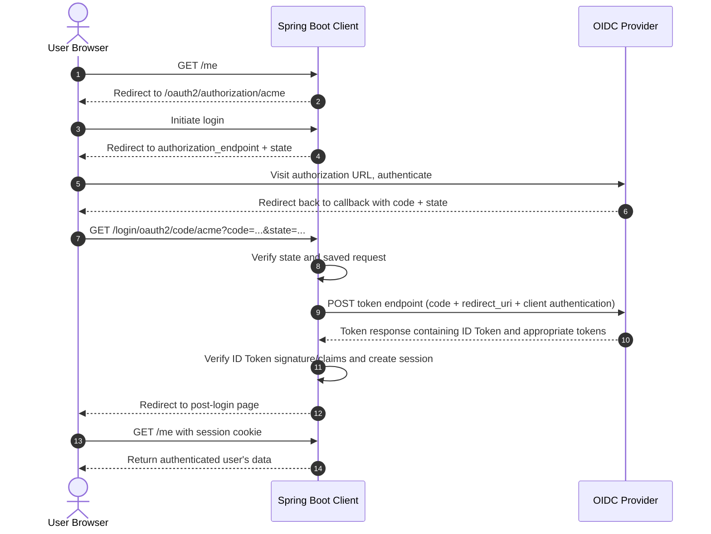

# 4.6. Registering an Application at an OAuth/OIDC Provider

## 1. Purpose and Context

Before a Spring Security application can redirect users to a provider to log in with OAuth 2.0/OpenID Connect (OIDC), **the application must be registered at the provider**. Registration tells the Authorization Server/Identity Provider:

- Which application is requesting authentication, identified by a **client ID**.
- What kind of application it is, and whether it can protect a **client secret**.
- Which **redirect URI** users are returned to after authentication.
- Which **grant types** and **scopes** the application is allowed to use.
- Which policies apply to the application, such as which accounts may log in, token lifetimes, consent screens, or the client authentication method.

In the **Spring Security OAuth 2.0 OIDC Client** module, imagine a Spring Boot application serving an internal website `employee-portal`. A user opens the portal, is redirected to the OIDC provider to log in, and then returns to the application. Spring Security handles the Authorization Code flow, validates the ID Token, and establishes a login session.

This lesson focuses on **registering the client at the provider and wiring the registration outputs into Spring Security**. The illustrative addresses, client IDs, and values below should be replaced with your project's real data.

### Expected Outputs After Registration

A successful OIDC login setup typically yields these outputs:

| Information | Illustrative Example | Role |
| --- | --- | --- |
| **Issuer URI** | `https://id.example.com/realms/acme` | Identifies the trusted OIDC provider |
| **Client ID** | `employee-portal` | Identifies the application at the provider |
| **Client secret** | `<secret-from-secret-manager>` | Authenticates a confidential client at the token endpoint |
| **Redirect URI** | `http://localhost:8080/login/oauth2/code/acme` | Where the provider returns the user after issuing an authorization code |
| **Grant** | `authorization_code` | Enables login via authorization code |
| **Scopes** | `openid profile email` | Requests OIDC authentication and access to needed profile details |
| **Client authentication method** | `client_secret_basic` or a supported method | How the backend presents credentials at the token endpoint |
| **OIDC metadata** | Published via Discovery | Provides authorization, token, JWKS, UserInfo endpoints, etc. |

Not every provider labels all fields with the exact same names. Some call the application an *application*, *client*, *app registration*, *OAuth client*, *service principal*, or *relying party*. Match by **field meaning** rather than relying on button labels in a specific admin UI version.

## 2. Understanding Roles Before Creating a Client

A typical OIDC login flow includes:

| Role | In the Example | Responsibility |
| --- | --- | --- |
| **End User** | Employee using the website | Logs in and grants consent when required |
| **OIDC Client / Relying Party** | Spring Boot `employee-portal` | Initiates login, receives authorization code, exchanges tokens, verifies ID Token |
| **OpenID Provider (OP)** | `https://id.example.com` | Authenticates users, issues tokens, and publishes metadata/public keys |
| **Resource Server** (if any) | Profile API, Employee API | Receives access tokens and protects resources/APIs |

**Registering an OAuth/OIDC client is not creating user accounts.** Administrators register the **application**, and users then log in with their own accounts according to OP policies.

### Distinguishing OAuth 2.0 from OIDC During Registration

- **OAuth 2.0** focuses on delegating authorization so a client can access resources. After the Authorization Code flow, the client receives an access token to call APIs per granted scopes.
- **OpenID Connect** extends OAuth 2.0 to standardize user identity authentication. With a request including the `openid` scope, a valid OIDC authentication response results in an **ID Token** containing identity/authentication claims.
- **Access tokens** are for APIs/Resource Servers, whereas **ID Tokens** are for the OIDC Client. Do not use an access token as proof of login in place of an ID Token, and do not send an ID Token in place of an access token to call an API.
- Some providers only support OAuth 2.0 for a given product/API without full OIDC support. When aiming for standard OIDC login with `oauth2Login`, verify that the provider supplies OIDC Discovery, ID Tokens, JWKS, and the relevant endpoints/claims.

## 3. Choosing the Right Application Type and Flow

This decision should be made **before creating the app registration**.

| Application Type | Ability to Keep Secrets | Common Registration Type | Recommended Flow |
| --- | --- | --- | --- |
| **Spring Boot web server** handling login and holding sessions on the backend | Can protect secrets on the backend | **Confidential / Web application** | **Authorization Code**; combine with PKCE when supported/required |
| **SPA** running JavaScript in the browser | Cannot protect a client secret | **Public / Browser / SPA** | **Authorization Code + PKCE** |
| **Mobile/desktop app** | Cannot protect a secret bundled inside the app | **Public / Native app** | **Authorization Code + PKCE** and allowed redirects |
| **Backend service** calling APIs without a user | Can protect secrets/keys | **Machine-to-machine / Confidential client** | **Client Credentials** |
| **Input-constrained device** | Depends on design | Device/provider-specific client | Device Authorization Grant if supported by OP |

This lesson covers the **Spring Boot web server, Authorization Code flow, and OIDC login** case. If the project only needs service-to-service communication, the configuration differs: use `client_credentials` and typically do not register a redirect URI or the `openid` scope.

### Confidential Clients and Public Clients

A **confidential client** runs in a controlled backend environment and can protect a `client_secret` or use private-key/mTLS client authentication. Secrets remain on the server only.

A **public client** such as an SPA, mobile app, or desktop app **has no secure long-lived secret**; never embed secrets in JavaScript source code, build files, mobile apps, or environment variables bundled to the client. Public clients use PKCE to bind the authorization code to the party that initiated the request.

PKCE is also helpful for confidential clients, but **PKCE does not replace client authentication** when the provider requires confidential clients to authenticate at the token endpoint. Do not pick the Implicit flow or Resource Owner Password Credentials just to avoid configuring redirects/callbacks; neither is appropriate as a default choice for new applications.

## 4. Preparing Before Registering at the Provider

Before opening the OP admin portal, determine these parameters:

1. **Environment:** local, staging, production. Prefer a separate client registration per environment.
2. **Application URL:** e.g., local `http://localhost:8080` and production `https://portal.example.com`.
3. **Spring Registration ID:** e.g., `acme`. This ID appears in the default login initiation and callback URLs.
4. **Exact Redirect URI:** `{baseUrl}/login/oauth2/code/{registrationId}`, expanded into concrete URIs.
5. **Application type and grant:** confidential web client, `authorization_code`.
6. **Minimal scopes:** `openid` (mandatory to request OIDC login), plus `profile` and `email` if genuinely needed.
7. **OP Issuer:** e.g., `https://id.example.com/realms/acme`.
8. **Test accounts/groups:** who is allowed to log in and whether administrator consent approval is required.

Example for Spring Boot running on port 8080:

```text
Base URL:          http://localhost:8080
Registration ID:   acme
Redirect URI:      http://localhost:8080/login/oauth2/code/acme

Base URL:          https://portal.example.com
Registration ID:   acme
Redirect URI:      https://portal.example.com/login/oauth2/code/acme
```

**The Redirect URI is the callback address**, not the provider's login page and not the application's home page. In Spring Security OAuth2 Login, the default callback endpoint is `/login/oauth2/code/{registrationId}`. The app also typically exposes the **login initiation URL** `/oauth2/authorization/{registrationId}`; those two URLs serve different purposes.

### Why Must the Redirect URI Match?

The Authorization Server may only return the authorization code to a registered address under its redirect URI validation policy. Exact matching prevents an attacker from substituting a redirect URL they control to steal the code.

Differences that commonly trigger `redirect_uri_mismatch`:

- `http` vs. `https`;
- `localhost` vs. `127.0.0.1`;
- mismatched port `8080` vs. `8081`;
- casing differences in the path or path suffix;
- presence or absence of a trailing `/` on the URL;
- registering `/callback` while Spring sends `/login/oauth2/code/acme`;
- Spring Boot running behind a reverse proxy and generating redirects with an internal address instead of the external domain.

Some OPs have special rules for localhost or native apps; use URI forms permitted by the provider. For production, prefer HTTPS and an explicit callback allowlist. Avoid wildcard redirect URIs in production.

## 5. Application Registration Workflow at an OAuth/OIDC Provider

Most providers follow a similar workflow despite different admin UIs.

### Step 1 — Choose the Appropriate Tenant/Realm/Organization

Sign in with an account that has app administration permissions at the OP. Select the exact **tenant**, **realm**, **organization**, or **project** where your system's users will authenticate.

This step is critical because a single server can host multiple tenants or realms with completely different issuers, user directories, access policies, and registered applications.

Illustrative example:

```text
Provider host: https://id.example.com
Realm/Tenant: acme
Issuer:       https://id.example.com/realms/acme
```

Do not guess the issuer from the domain name alone; take the exact issuer from the provider's official metadata or configuration UI.

### Step 2 — Create the Application/Client Registration

Choose the create client/app registration option and give it a clear name, for example:

```text
Display name: Employee Portal (Development)
Client ID:    employee-portal-dev
Environment:  Development
Application:  Web / Server-side
Protocol:     OpenID Connect
```

Some OPs auto-generate the **client ID**; others let you enter it. **Display name** is an administrative label, while **client ID** is the value the application sends in OAuth requests and uses when validating the ID Token's audience. They do not need to be identical.

If your system has multiple independent applications, it is usually best to create **a separate client per application** to manage permissions, secrets, and rotation schedules independently.

### Step 3 — Select the Authentication Flow

Enable:

- **Authorization Code Grant** (some UIs call this *Standard Flow*).
- **OIDC** or equivalent OIDC features.
- **PKCE (S256)** when required by the OP or by your application's design.

For a confidential web backend, enable an appropriate **client authentication** mechanism, such as `client_secret_basic`, `client_secret_post`, or private-key authentication if supported by the OP. Do not simultaneously enable unneeded grants like password grant, implicit grant, or client credentials simply because the UI offers those checkboxes.

Note: **Grants allowed for the application** and **scopes per request** are two different concepts. Grants determine which token exchange flows are permitted; scopes represent the information/permissions the client requests.

### Step 4 — Declare Redirect URIs and Related URLs

For the local example:

```text
Allowed redirect URIs:
  http://localhost:8080/login/oauth2/code/acme

Allowed logout redirect URIs (if using OP logout):
  http://localhost:8080/

Application/Home URL:
  http://localhost:8080/
```

In production:

```text
Allowed redirect URIs:
  https://portal.example.com/login/oauth2/code/acme

Allowed logout redirect URIs (if used):
  https://portal.example.com/

Application/Home URL:
  https://portal.example.com/
```

The **Logout redirect URI** differs from the login callback: only configure it when using the OP's logout feature and according to the OP's requirements. The application's **post-login success URL** also differs from the OAuth callback: Spring Security receives the code at the callback first and only then forwards the user to the intended page.

**Allowed origins/CORS/Web origins** are separate from redirect URIs. For a server-side Spring Boot application, the browser typically navigates via HTTP redirects to the OP while the authorization code exchange happens on the backend. Therefore, do not open CORS to all origins automatically; only add origins when the architecture genuinely requires cross-origin browser calls.

### Step 5 — Grant Scopes, Permissions, and Consent

For basic OIDC login:

| Scope | Expected Meaning | Notes |
| --- | --- | --- |
| `openid` | Requests OIDC login with an ID Token | Required for OIDC login |
| `profile` | Requests standard profile claims | Actual claims depend on the OP and policies |
| `email` | Requests `email`/`email_verified` claims | Does not guarantee every user has an email |
| Custom API scope | E.g., `employee.read` to call Employee API | Register only when supported by the API, OP, and authorization model |

Scopes may need to be **configured/permitted at the OP** before an application can request them. If the OP displays a consent screen, prepare the app name, description, logo, or privacy policy according to the provider's rules. Some public providers require app verification or limit test users before going public.

Request only the permissions you need. Do not assume `profile` or `email` scopes grant permission to call custom enterprise APIs; API permissions must be configured separately when needed.

### Step 6 — Obtain Client ID, Secret, and Metadata

After saving the application, collect:

- **Client ID** to configure `spring.security.oauth2.client.registration.*.client-id`.
- **Client secret** or equivalent client authentication credential, used only for confidential clients; it may only be displayed once.
- **Issuer URI** so Spring Security can auto-discover OIDC endpoints.
- **Allowed scopes**, **token endpoint auth method**, and consent/policy details if applicable.

Never paste a client secret into public documentation, issue trackers, screenshots, or repositories. Use a secret manager, securely managed environment variables, and your infrastructure's secret rotation mechanism.

### Step 7 — Allow Test Users and Check Login Policies

Depending on the provider, a client may only work for:

- Users belonging to an internal tenant/organization;
- Assigned application groups or roles;
- A test user allowlist while the app is in development/testing status;
- Users who complete MFA, satisfy conditional access, or receive admin consent approval.

If login fails even with the right redirect URI and secret, check access policies, account status, and application assignment. Those issues cannot be fixed solely by editing Spring's `application.yml`.

## 6. Example Registration in Keycloak Using General Principles

Keycloak is an OIDC-compliant provider; examples use the **realm** and **client** model. Tab and option names can vary across Keycloak versions, so the description below focuses on the corresponding parameters.

Suppose:

| Parameter | Illustrative Value |
| --- | --- |
| Realm | `acme` |
| OIDC Issuer | `https://id.example.com/realms/acme` |
| Client ID | `employee-portal-dev` |
| Client type/protocol | `OpenID Connect` |
| Client authentication | Enabled, because the Spring Boot backend holds a secret |
| Standard/Authorization Code flow | Enabled |
| Valid redirect URI | `http://localhost:8080/login/oauth2/code/acme` |
| Client secret | Generated by Keycloak or per chosen auth method |
| Scope | `openid`; `profile`, `email` when permitted |

High-level steps:

1. Open realm `acme` and create an OIDC client with ID `employee-portal-dev`.
2. Choose a confidential client by enabling client authentication; enable Authorization Code/Standard Flow.
3. Register Spring Boot's callback, and add a post-logout redirect if needed.
4. Save and retrieve client credentials securely.
5. Confirm the issuer from OIDC Discovery, checking that metadata contains authorization endpoint, token endpoint, and JWKS URI.
6. Use a test account in that realm to log in through Spring Boot.

Keycloak may offer options for **client scopes**, **consent required**, **PKCE code challenge method**, **service accounts**, and other flows. Enable only what relates to the feature you are deploying; **service accounts/Client Credentials are not needed** for standard user login.

### Comparing Registration Across Other Providers

| Provider / Service Type | Differences to Note |
| --- | --- |
| **Google Identity** | Typically requires configuring a project, OAuth consent screen, OAuth client type *Web application*, and authorized redirect URIs; certain scopes and public publishing require verification |
| **Microsoft identity platform / Entra ID** | App registration is tied to a tenant and supported account types; choose Web platform, redirect URI, certificates/secrets, delegated/API permissions, and consent |
| **Auth0** | Application type, Allowed Callback URLs, Allowed Logout URLs, Allowed Web Origins, and user connection policies |
| **Keycloak** | Realm, client authentication, flows, valid redirect URIs, client scopes, and realm keys/metadata |
| **OAuth 2.0 providers without OIDC** | May lack standard OIDC ID Tokens/issuer metadata; requires dedicated OAuth2 Client configuration and an appropriate user-info retrieval mechanism if login is desired |

Each product updates its UI and authentication requirements over time; consult the admin documentation for the exact tenant/version you deploy while keeping the core principles of client type, redirects, scopes, and secret protection intact.

## 7. Using Registration Details in Spring Boot

The example uses **Spring Boot 3.x / Spring Security 6.x**, a Servlet (MVC) application with `oauth2Login`. The hostnames, issuer, and registration ID below are illustrative data.

### 7.1. Declaring Dependencies

With Maven:

```xml
<dependencies>
    <dependency>
        <groupId>org.springframework.boot</groupId>
        <artifactId>spring-boot-starter-web</artifactId>
    </dependency>
    <dependency>
        <groupId>org.springframework.boot</groupId>
        <artifactId>spring-boot-starter-security</artifactId>
    </dependency>
    <dependency>
        <groupId>org.springframework.boot</groupId>
        <artifactId>spring-boot-starter-oauth2-client</artifactId>
    </dependency>
</dependencies>
```

Spring Security OAuth2 Client handles client registration configuration, sending authorization requests, exchanging codes for tokens, and processing OIDC login. With an OIDC provider exposing valid Discovery metadata, configuring `issuer-uri` is simpler than copying each endpoint individually.

### 7.2. Configuring `application.yml`

```yaml
server:
  port: 8080

spring:
  security:
    oauth2:
      client:
        registration:
          acme:
            provider: acme-idp
            client-id: ${OIDC_CLIENT_ID}
            client-secret: ${OIDC_CLIENT_SECRET}
            client-authentication-method: client_secret_basic
            authorization-grant-type: authorization_code
            redirect-uri: "{baseUrl}/login/oauth2/code/{registrationId}"
            scope:
              - openid
              - profile
              - email
        provider:
          acme-idp:
            issuer-uri: https://id.example.com/realms/acme
```

Field meanings:

| Property | Explanation |
| --- | --- |
| `registration.acme` | Local **Registration ID**. Default login initiation URL is `/oauth2/authorization/acme` |
| `provider: acme-idp` | Links the registration to the provider configuration section |
| `client-id` | Value taken from the app registration at the OP |
| `client-secret` | Secret of a **confidential client**, loaded from a secure environment |
| `client-authentication-method` | Must match how the client is registered at the token endpoint; `client_secret_basic` is only an example |
| `authorization-grant-type` | `authorization_code` for the browser login flow |
| `redirect-uri` | URI Spring sends in the authorize request; must match an allowed callback at the OP |
| `scope` | Scopes Spring requests; `openid` identifies OIDC login |
| `provider.acme-idp.issuer-uri` | OIDC issuer used for Discovery and ID Token validation |

Note: `acme` (registration ID), `acme-idp` (provider ID), and `employee-portal-dev` (client ID at the OP) are **three distinct identifiers**. For instance, the `/login/oauth2/code/acme` callback uses the **registration ID**, not the client ID.

If the OP requires an auth method other than `client_secret_basic`, choose the supported method. If the app is a public client, do not configure a secret like a confidential client; select PKCE and client authentication suited to your client type and Spring Security version.

### 7.3. Supplying Client Credentials Securely

On a development machine, values can be supplied via environment variables in your shell or runtime environment. Illustrative PowerShell example:

```powershell
$env:OIDC_CLIENT_ID = "employee-portal-dev"
$env:OIDC_CLIENT_SECRET = "<get-from-secret-manager>"
```

Or inject secrets through your deployment tool/secret store so they are not typed directly into command history. Illustrative values in examples are not real secrets.

In containers/Kubernetes/cloud, use your platform's secret management service, identity bindings, access controls, and rotation workflows. **Never commit `application.yml` with real secrets**, never print secret variables to logs, and never send secrets to frontend HTML or JavaScript.

### 7.4. Configuring the Security Filter Chain

```java
import org.springframework.context.annotation.Bean;
import org.springframework.context.annotation.Configuration;
import org.springframework.security.config.Customizer;
import org.springframework.security.config.annotation.web.builders.HttpSecurity;
import org.springframework.security.web.SecurityFilterChain;

@Configuration
public class SecurityConfiguration {

    @Bean
    SecurityFilterChain securityFilterChain(HttpSecurity http) throws Exception {
        http.authorizeHttpRequests(authorize -> authorize
                .requestMatchers("/", "/public/**").permitAll()
                .anyRequest().authenticated());

        http.oauth2Login(Customizer.withDefaults());

        return http.build();
    }
}
```

`oauth2Login` registers the mechanisms needed to initiate OAuth2/OIDC login and handle the default callback. A request to a protected page triggers login; with multiple client registrations, a provider selection page can be used. To test the `acme` registration directly, open:

```text
http://localhost:8080/oauth2/authorization/acme
```

After successful authentication at the OP, the browser is returned to:

```text
http://localhost:8080/login/oauth2/code/acme?code=<authorization-code>&state=<state>
```

**Spring Security handles this callback** and sends the code-exchange request for tokens on the backend. Do not write a manual controller to receive the code and exchange tokens yourself when using the default `oauth2Login` mechanism.

### 7.5. Reading Identity After Login

Example controller receiving the `OidcUser` authenticated by Spring Security:

```java
import java.util.Map;

import org.springframework.security.core.annotation.AuthenticationPrincipal;
import org.springframework.security.oauth2.core.oidc.user.OidcUser;
import org.springframework.web.bind.annotation.GetMapping;
import org.springframework.web.bind.annotation.RestController;

@RestController
public class ProfileController {

    @GetMapping("/me")
    public Map<String, Object> me(@AuthenticationPrincipal OidcUser user) {
        return Map.of(
                "subject", user.getSubject(),
                "issuer", user.getIssuer().toString()
        );
    }
}
```

`sub` is the user identifier scoped by issuer; do not use email as a durable primary key just because you requested the `email` scope. Email addresses can change or be omitted from tokens; if using email for display or business data mapping, handle missing values and email verification status according to policy.

### 7.6. Complete Login Flow Diagram



For flows with PKCE, the client also generates a `code_verifier`, sends `code_challenge` in the authorization request, and sends `code_verifier` during code exchange. Whether PKCE is enabled automatically or requires extra configuration depends on the Spring Security version and client registration type; meet the actual requirements of your OP.

## 8. OIDC Discovery: Fetching Exact Endpoints from the Issuer

An OIDC-compliant OP publishes an **OpenID Provider Configuration** (Discovery) document. In a realm-based example, you can inspect the document at:

```text
https://id.example.com/realms/acme/.well-known/openid-configuration
```

Illustrative abbreviated response:

```json
{
  "issuer": "https://id.example.com/realms/acme",
  "authorization_endpoint": "https://id.example.com/realms/acme/protocol/openid-connect/auth",
  "token_endpoint": "https://id.example.com/realms/acme/protocol/openid-connect/token",
  "userinfo_endpoint": "https://id.example.com/realms/acme/protocol/openid-connect/userinfo",
  "jwks_uri": "https://id.example.com/realms/acme/protocol/openid-connect/certs",
  "response_types_supported": ["code"],
  "id_token_signing_alg_values_supported": ["RS256"]
}
```

The endpoints above mirror Keycloak's structure. **The issuer must match the exact `issuer` value published by the OP.** For instance, an issuer containing a different realm/tenant will fail ID Token validation even when the client ID and secret are correct.

Meaning of these endpoints:

- **Authorization endpoint:** where the browser is sent to authenticate and obtain an authorization code.
- **Token endpoint:** where the backend exchanges the authorization code for tokens; this is typically a server-to-server call.
- **UserInfo endpoint:** fetches additional claims about the user using the access token when supported by the flow and provider.
- **JWKS URI:** publishes public keys so clients can verify signatures on ID Tokens signed with asymmetric algorithms.

To inspect Discovery in an environment you are authorized to access:

```bash
curl --fail --silent --show-error \
  "https://id.example.com/realms/acme/.well-known/openid-configuration"
```

Configuring `issuer-uri` lets Spring Security use Discovery. When an OP does not provide standard Discovery, you may have to declare endpoints manually as an OAuth2 Client, though in that case **do not assume the provider is OIDC** if there is no ID Token and OIDC conformance.

Never accept arbitrary issuer/JWKS URLs from user input or from an unverified JWT. The application must pre-configure trusted providers and rely on valid HTTPS connections.

## 9. Registering and Deploying Across Multiple Environments

A common mistake is registering a client for `localhost` and copying the exact same client ID/secret into production. That invites confusion around redirects, access control, secret management, and per-environment revocation.

Example registration organization:

| Environment | Illustrative Client ID | Callback |
| --- | --- | --- |
| **Local** | `employee-portal-local` | `http://localhost:8080/login/oauth2/code/acme` |
| **Staging** | `employee-portal-staging` | `https://staging.portal.example.com/login/oauth2/code/acme` |
| **Production** | `employee-portal-prod` | `https://portal.example.com/login/oauth2/code/acme` |

The issuer for each environment may be the same or different depending on tenant/realm design. If sharing an issuer, ensure user, consent, and redirect policies remain properly isolated per environment.

### Spring Boot Behind a Reverse Proxy or Load Balancer

When the public URL is `https://portal.example.com` while Spring Boot behind a proxy receives internal HTTP requests, `{baseUrl}` computed from the request can be wrong if the app does not process proxy headers properly.

With trusted proxy infrastructure, configure forwarding of `Forwarded`/`X-Forwarded-*` headers and trust policies at both proxy and application layers. Depending on Spring Boot and the environment, you can use:

```yaml
server:
  forward-headers-strategy: framework
```

Enable this setting only when the deployment enforces a proper proxy trust boundary; never accept arbitrary forwarded headers from the Internet. The goal is for Spring to build redirect URIs using the user's true **external origin**, not an internal hostname/port.

For setups with intentionally fixed callbacks, you can configure an explicit redirect URI per environment instead of `{baseUrl}`, provided the OP registers that exact URI as well.

## 10. Testing Login After Registration

After configuring both the OP and the application, run tests in sequence.

### 10.1. A Successful Login

1. Start the Spring Boot application and confirm the public page is accessible.
2. Open `http://localhost:8080/oauth2/authorization/acme` in a private browser window.
3. Observe the redirect to the right OP/issuer and authorization endpoint.
4. Log in with an authorized account; complete MFA/consent if required by the OP.
5. Confirm the OP redirects back to `/login/oauth2/code/acme`.
6. Once Spring Security processes the callback, visit `/me` and verify the app identifies `sub` and the configured issuer.
7. Close the session/log out via the application mechanism and retry to verify consistent login behavior.

### 10.2. Checking Authorization Request Parameters

In the browser's Network tab, the authorization URL sent to the OP typically includes:

| Parameter | What to Observe |
| --- | --- |
| `client_id` | Exact registered client ID |
| `response_type` | `code` in the Authorization Code flow |
| `redirect_uri` | Matches an allowed callback at the OP |
| `scope` | Includes `openid` for OIDC login and other scopes as needed |
| `state` | Random value bound to the request; verified at callback |
| `nonce` | May be present per OIDC Client mechanics, binding the ID Token to the request |
| `code_challenge` and `code_challenge_method` | Present when using PKCE; `S256` is the recommended method |

Never paste real authorization codes, ID Tokens, access tokens, or client secrets into bug reports. `state` and `nonce` must also be bound per session to defend against forgery and replay.

### 10.3. Rejection Cases to Verify

- Unregistered callback: the OP must reject the authorization request.
- Account without access to the application: the OP must enforce the policy properly.
- Unpermitted scope: the OP rejects or restricts the scope per configuration.
- Wrong/invalid client secret: token exchange fails.
- ID Token with mismatched issuer/audience: the client must reject authentication.
- Invalid `state`/`nonce`: the flow must fail without creating a login session.
- Logout and re-login: verify session behavior at both the application and the OP per product requirements.

These are scenarios to **verify in an authorized test environment**, not a claim that they have been executed for this lesson's example.

## 11. Common Errors and Root-Cause Tracing

| Symptom / Error Code | Likely Cause | Where to Check |
| --- | --- | --- |
| `redirect_uri_mismatch` or `invalid_redirect_uri` | Callback sent by Spring does not match registered URI; wrong protocol/domain/port/path | OP app registration, `redirect-uri`, reverse proxy |
| `invalid_client` when calling token endpoint | Wrong client ID/secret or client authentication method | Secret store, OP credentials, `client-authentication-method` |
| `unauthorized_client` | `authorization_code` grant not enabled or client incompatible with flow | Grant/flow config at the OP |
| `invalid_scope` | Scope not allowed or scope name mismatch | OP client scopes, Spring `scope` |
| `invalid_grant` | Expired code, reused code, wrong redirect URI/verifier, or policy denial | Token exchange, callback, PKCE, clock skew |
| `invalid_request` / PKCE required | Missing `code_challenge` or unsupported PKCE method | PKCE configuration on OP and Spring |
| Cannot log in despite valid account | App/role not assigned, tenant restriction, MFA/consent, test users | Application policy and registration status at the OP |
| `issuer mismatch` or `iss` error | Wrong realm/tenant/issuer, mixed endpoints across environments | `issuer-uri` and OIDC Discovery |
| Signature/JWKS error | Wrong OP/issuer, unreachable JWKS, rotated keys, disallowed algorithm | `jwks_uri`, cache, TLS, algorithms |
| `state` mismatch, login loop | Lost session/cookie, tampered callback, reverse proxy or load balancer not preserving state/session | Cookies, session store, state, proxy |
| Missing ID Token or only receiving `OAuth2User` | Did not request `openid` or provider lacks full OIDC support | Scopes, provider metadata, token response |
| UserInfo error or missing `email` claim | Missing permission/claim, different endpoint, OP consent/policy | `userinfo_endpoint`, scopes, claim mapper |
| Callback succeeds but page returns 403 | Authenticated, but lacking business authority/role | Role mapping and Spring authorization config |

Some error codes are returned by the OP, while errors like `issuer mismatch`, signature failure, or state mismatch are usually detected by Spring Security while handling the callback. Pinpointing **the exact stage where the error occurs** determines whether to fix the OP, Spring configuration, or network/proxy.

### Reading the Flow When Troubleshooting

```text
(1) Was the browser redirected to the right authorization endpoint?
       |
       +-- No  → Spring registration / proxy / login path
       |
       +-- Yes
             |
             v
(2) Did the OP accept client_id, redirect_uri, scopes, and the user?
       |
       +-- No  → App registration / consent / policy / grant
       |
       +-- Yes
             |
             v
(3) Did the callback reach the exact /login/oauth2/code/{registrationId}?
       |
       +-- No  → Redirect URI / proxy / callback path
       |
       +-- Yes
             |
             v
(4) Did Spring exchange the code for tokens successfully?
       |
       +-- No  → Client authentication / secret / PKCE / code
       |
       +-- Yes
             |
             v
(5) Was the ID Token verified, claims validated, and a session created?
       |
       +-- No  → Issuer / JWKS / audience / nonce / cookie-session
       |
       +-- Yes → Move on to checking business authorization (if errors persist)
```

Enable appropriate logging in test environments and record only **registration identifier, correlation ID, error type, HTTP status, and trusted issuer**. Never enable logging that prints full authorization headers, client secrets, or tokens. When reporting an issue to a provider, redact sensitive credentials before attaching screenshots or logs.

## 12. Security Decisions to Lock In Alongside App Registration

Filling out the registration fields correctly does not guarantee a completely secure system. Decide on these policies at setup time:

- **Least privilege:** register only needed flows/scopes; separate clients across applications and environments.
- **Secret protection:** keep secrets in the backend/secret manager, restrict access, and plan rotation and revocation.
- **Strict redirect URIs:** declare only addresses actually used; never use broad wildcards in production.
- **PKCE:** use for public clients and per OP policy; consider enabling for confidential web clients for stronger code protection.
- **State/nonce:** rely on reputable library mechanisms; never disable them to "fix" login errors.
- **HTTPS:** mandatory for production endpoints; control TLS and forwarded headers at the proxy.
- **Internal authorization:** OIDC authenticates the user, while the application still must enforce roles and data access permissions. Never assume a user is an admin just because login succeeded.
- **Token separation:** APIs validate access tokens for Resource Servers; web clients use ID Tokens for OIDC login.
- **Application lifecycle:** establish procedures to revoke clients, rotate client secrets, update redirect URIs, and record owners.

Some providers also enforce limits on redirect URI counts, allowed URLs for mobile apps, consent verification, domain verification, or single-tenant/multi-tenant policies. Address those at the provider so Spring's OAuth/OIDC requests are accepted.

## 13. Relation to Client Credentials and Other Configurations

A single Spring project can simultaneously implement:

- **OIDC login** for users via `authorization_code` and the `openid` scope;
- **OAuth2 Client** calling APIs on behalf of users using received access tokens;
- **Client Credentials** for workers/services calling APIs using the application's own identity;
- **Resource Server** for the project's own API validating incoming Bearer access tokens from other clients.

These features may share the same OP, but do not necessarily share the same **app registration**, grant, or scopes. Example table:

| Use Case | Grant / Usage | Redirect URI | Needs ID Token? |
| --- | --- | --- | --- |
| Employee logs into Employee Portal | `authorization_code` with OIDC | Yes | Yes |
| Order Service calls Inventory API on its own | `client_credentials` | No | Usually no |
| API validates token from a calling service | OAuth2 Resource Server | Not a client redirect | Never use ID Token in place of access token |

In particular, **registering an OIDC app at an OP** provides a client ID, secret, and issuer, yet Spring Security still needs **the role configured properly**. Changing `authorization_code` to `client_credentials` does not turn an application into user OIDC login.

## 14. Summary of a Complete Configuration

For a Spring Boot web application logging in through an OIDC Provider, the registration and integration flow summarizes to:

1. Select the right tenant/realm and obtain the OIDC Provider's **issuer**.
2. Register a **Web/confidential client** for the application, enabling the **Authorization Code flow** and an appropriate PKCE policy.
3. Declare **redirect URIs** matching Spring's `/login/oauth2/code/{registrationId}` callback for each environment.
4. Permit minimal **scopes**, including `openid` for OIDC login.
5. Obtain the **client ID**, protect the **client secret**, and confirm the client authentication method and user policies.
6. Map these details into `spring.security.oauth2.client.registration` and `provider.*.issuer-uri`; enable `oauth2Login`.
7. Test login via `/oauth2/authorization/{registrationId}` and verify authorization code receipt, ID Token validation, and session creation.
8. Troubleshoot errors by stage: authorization request at the OP, token exchange on the backend, and ID Token validation and authorization in Spring.

**A successful connection is not just having a client ID and secret**: the OIDC Provider must permit the right flow, redirects, scopes, and users, while Spring Security must trust the right issuer, handle callbacks safely, and verify the ID Token before granting a login session.
