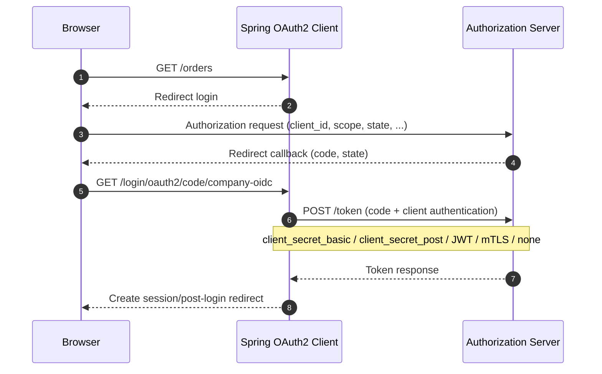

# 4.7. Declaring Client ID, Client Secret, and Client Authentication Method

When integrating **Spring Security OAuth 2.0 Client** with an Authorization Server or OpenID Provider (OP), the Spring application must know which identity it is registered under and how to prove that identity. The three directly related settings are **`client-id`**, **`client-secret`** (if applicable), and **`client-authentication-method`**.

They appear under Spring Boot's `spring.security.oauth2.client.registration` configuration and are mapped into a `ClientRegistration` in Spring Security. Declaring these three fields properly lets the application exchange an authorization code for tokens, refresh an access token, or acquire a token via `client_credentials` using the method permitted by the provider. Misconfiguring them commonly leads to `invalid_client`, even when the user already logged in successfully on the provider's page.

> **Scope:** This lesson focuses on configuring an OAuth2/OIDC **Client** using Spring Boot and Spring Security; the application acts as the client connecting to an Authorization Server. Configuring the client registration *on the Authorization Server side* is a separate task, though both sides must match.

## 1. Distinguishing Concepts Before Configuring

| Concept | What is it? | Is it a secret? |
|---|---|---|
| `registrationId` | Internal name in Spring, e.g., `company-oidc`. Used to look up `ClientRegistration` and initiate login via `/oauth2/authorization/{registrationId}`. | No. |
| `client-id` | Identifier issued by the Authorization Server for a registered client application. | Normally not treated as a secret; still govern its usage scope properly. |
| `client-secret` | Shared secret between a confidential client and the Authorization Server to authenticate the client. | **Yes**. Must be stored and transmitted using secret-protection mechanisms. |
| `client-authentication-method` | How the client presents credentials or proof of authentication at the token endpoint, e.g., `client_secret_basic`. | The method name itself is not a secret. |
| `authorization-grant-type` | Mechanism for requesting authorization/tokens, e.g., `authorization_code` or `client_credentials`. | No; this is a distinct concept from the client authentication method. |
| `redirect-uri` | Callback endpoint for `authorization_code`; the provider compares it against registered URIs. | No, though it must match and be strictly controlled. |
| `scope` | Permissions/scopes requested by the application; OIDC uses the `openid` scope. | No; values must be permitted by the provider. |

`client-id` is **not** a user's login username or password. `client-secret` is **not** the user's password. Nor should `client-secret` be confused with the OpenID Provider's ID Token signing key or an access token issued by the provider after authorization.

One application can define multiple registrations, such as `employee-login` for OIDC login and `billing-service` for `client_credentials`. Each registration can have its own `client-id`, authentication method, scopes, and provider.

### 1.1. Confidential Clients and Public Clients

A **confidential client** runs in an environment trusted enough to keep credentials on the server side: e.g., a Spring MVC backend, Spring WebFlux backend, or Backend for Frontend (BFF). The provider can issue a `client-secret` for this client type, or require asymmetric key/mTLS authentication.

A **public client** cannot keep long-lived credentials secret, such as a JavaScript app running in a browser or a native app installed on a user's device. These clients typically use `client-authentication-method: none` combined with Authorization Code + **PKCE**. Embedding a `client-secret` in JavaScript, a frontend bundle, or a native app does not turn it into a confidential client because users can extract the secret.

A Spring application running entirely on the server is typically a confidential client, though the client type must be established in both provider configuration and deployment architecture. Do not choose `none` just to bypass an error caused by a wrong secret.

### 1.2. Grant Type vs. Client Authentication

These are two independent axes of choice:

- `authorization_code`: receives a code via callback after the browser is redirected to the provider; the client typically authenticates at the token endpoint when exchanging the code for tokens.
- `client_credentials`: the application requests a token representing itself, with no interactive user.
- `refresh_token`: requests a new access token from a refresh token; if the client is confidential, the provider may still require client authentication.
- `client_secret_basic`, `client_secret_post`, `private_key_jwt`, etc. are **client authentication methods**, usable with compatible grant types registered at the provider.

For example, `authorization_code + client_secret_basic` is a common OIDC login setup for a backend; `client_credentials + client_secret_basic` is a service-to-service call setup. Both use the same client authentication method, but different grant types and purposes.

## 2. Obtaining Registration Details from the Authorization Server

Before editing `application.yml`, register an OAuth2/OIDC application in the provider's admin console and collect the corresponding details:

1. **Issuer URI** or the provider's authorization/token/JWK endpoints. For OIDC providers supporting discovery, the issuer is usually enough for Spring to locate metadata.
2. **Client ID** issued by the provider, matching the application and target environment.
3. **Client secret** if the provider registers a secret-based confidential client. Some systems display this value only once upon creation or rotation.
4. **Token endpoint authentication method** accepted by the provider, such as `client_secret_basic` or `client_secret_post`. Different providers have different defaults.
5. **Allowed grant types**, **redirect URIs**, and **scopes**. For OIDC login, you need the `authorization_code` grant and the `openid` scope.
6. If using `private_key_jwt`: public key/JWKS details required by the provider, allowed signing algorithms, and audience rules. If using mTLS: client certificate, private key, and the provider's TLS requirements.

On the Authorization Server, the registration must permit the same method that Spring sends. Changing properties only on the Spring side will not update the configuration stored at the provider.

```text
  Spring OAuth2/OIDC Client                  Authorization Server
  -------------------------                 --------------------
  registrationId: "company-oidc"            Registered application
  client-id: <issued-client-id>    <------> client_id: <issued-client-id>
  client-secret: <protected-secret> <------> client credentials
  method: client_secret_basic      <------> allows client_secret_basic
  grant: authorization_code        <------> allows authorization_code
  redirect: /login/oauth2/code/... <------> registered redirect URI
```

OIDC discovery metadata may advertise `token_endpoint_auth_methods_supported`. This property describes methods supported by the server in general; the specific application must still be registered and permitted to use the chosen method. Do not assume from a provider's name that every tenant/client shares the exact same settings.

## 3. Declaring in Spring Boot via `application.yml`

### 3.1. Dependencies

For a Spring Boot project with the appropriate web starter (Spring MVC or WebFlux), add OAuth2 Client and Spring Security:

```groovy
// build.gradle: Spring MVC example
dependencies {
    implementation 'org.springframework.boot:spring-boot-starter-web'
    implementation 'org.springframework.boot:spring-boot-starter-security'
    implementation 'org.springframework.boot:spring-boot-starter-oauth2-client'
}
```

For a Reactive application, use `spring-boot-starter-webflux` instead of `spring-boot-starter-web`. The `spring.security.oauth2.client.*` properties below are supported by Spring Boot on both stacks; the difference lies in the beans and security chains created by the framework.

### 3.2. Template for a Confidential OIDC Client Using HTTP Basic

Example `src/main/resources/application.yml`:

```yaml
spring:
  security:
    oauth2:
      client:
        registration:
          company-oidc:
            provider: company-idp
            client-id: "${OIDC_CLIENT_ID}"
            client-secret: "${OIDC_CLIENT_SECRET}"
            client-authentication-method: client_secret_basic
            authorization-grant-type: authorization_code
            redirect-uri: "{baseUrl}/login/oauth2/code/{registrationId}"
            scope:
              - openid
              - profile
              - email
        provider:
          company-idp:
            issuer-uri: "https://login.example.org/realms/company"
```

This is an illustrative configuration; replace the issuer and values issued by your provider:

- `company-oidc` is the **registration ID** chosen by the application; it is used in `/oauth2/authorization/company-oidc` and the callback path `/login/oauth2/code/company-oidc`.
- `company-idp` is the provider configuration ID referenced by the registration's `provider` field.
- `${OIDC_CLIENT_ID}` and `${OIDC_CLIENT_SECRET}` are placeholders resolved by Spring from runtime configuration sources such as environment variables. Never put real secrets directly into files committed to Git.
- `client-authentication-method: client_secret_basic` instructs Spring to send client credentials via HTTP Basic at the token endpoint.
- `redirect-uri` uses Spring Security's `{baseUrl}` and `{registrationId}` placeholders; the resolved URL must match a URL permitted at the provider.
- The `openid` scope activates OIDC semantics. `profile` and `email` are example scopes that must be supported/permitted by the provider.
- `issuer-uri` points to the **provider's issuer**, not the callback URL and not the URL of an API the app will call with an access token.

If the application is publicly accessed at `https://app.example.org`, the corresponding callback is:

```text
https://app.example.org/login/oauth2/code/company-oidc
```

That callback URL must be registered at the provider for the matching client ID. In local environments, a separate URI like `http://localhost:8080/login/oauth2/code/company-oidc` is typically registered if the provider permits HTTP loopback redirects.

### 3.3. Syntax in `application.properties`

The exact same settings can be declared in properties format:

```properties
spring.security.oauth2.client.registration.company-oidc.provider=company-idp
spring.security.oauth2.client.registration.company-oidc.client-id=${OIDC_CLIENT_ID}
spring.security.oauth2.client.registration.company-oidc.client-secret=${OIDC_CLIENT_SECRET}
spring.security.oauth2.client.registration.company-oidc.client-authentication-method=client_secret_basic
spring.security.oauth2.client.registration.company-oidc.authorization-grant-type=authorization_code
spring.security.oauth2.client.registration.company-oidc.redirect-uri={baseUrl}/login/oauth2/code/{registrationId}
spring.security.oauth2.client.registration.company-oidc.scope=openid,profile,email
spring.security.oauth2.client.provider.company-idp.issuer-uri=https://login.example.org/realms/company
```

Spring Boot automatically binds these properties into `ClientRegistration` objects. For Servlet apps, the lookup bean has type `ClientRegistrationRepository`; for Reactive apps, `ReactiveClientRegistrationRepository`. In standard setups, you do not need to create custom beans just to pass client ID and secret.

### 3.4. Supplying Credentials to the Runtime Environment

Example in PowerShell when running locally:

```powershell
# Variable names for illustration only; supply values via your chosen secret mechanism.
$env:OIDC_CLIENT_ID = "<client-id-from-provider>"
$env:OIDC_CLIENT_SECRET = "<secret-from-secure-source>"
./gradlew bootRun
```

The commands above show how Spring reads environment variables; in practice, avoid typing secrets directly in commands saved in shell history, CI logs, or shared terminal recordings. IDE run configurations, secret managers, protected CI variables, or your deployment platform's secret injection are common options.

With containers, credentials can be injected from the orchestrator's secret store:

```yaml
# Excerpt from a Kubernetes Deployment container configuration
env:
  - name: OIDC_CLIENT_ID
    valueFrom:
      secretKeyRef:
        name: company-oidc-credentials
        key: client-id
  - name: OIDC_CLIENT_SECRET
    valueFrom:
      secretKeyRef:
        name: company-oidc-credentials
        key: client-secret
```

This snippet assumes the Secret `company-oidc-credentials` already exists and is securely managed. A Kubernetes Secret alone does not imply comprehensive encryption: proper RBAC permissions, environment-level encryption at rest, and strict read/write restrictions are still required. Never commit manifests containing cleartext or trivially decoded base64 secret values.

> A `.env` file sitting next to the project is not automatically read by Spring Boot across all launch methods. Tooling or the runtime must load the file into the environment or a configuration source; if using a local file, restrict read permissions and exclude it from Git.

## 4. Client Authentication Methods

The `client-authentication-method` value is passed into `ClientRegistration` and determines how Spring constructs requests to the token endpoint. Each method must match the configuration at the Authorization Server.

| Method | Proof Sent by Client to Token Endpoint | Typical Use Case |
|---|---|---|
| `client_secret_basic` | `client_id` and `client_secret` via HTTP `Authorization: Basic ...`. | Backend confidential client; usually the simplest choice if supported by the provider. |
| `client_secret_post` | `client_id` and `client_secret` in the URL-encoded form body of the token request. | Provider only accepts credentials in the request body. |
| `none` | Sends no secret to authenticate the client; still sends `client_id` where required by protocol. | Public client, combined with Authorization Code + PKCE. |
| `client_secret_jwt` | JWT client assertion signed symmetrically using the shared secret. | Provider supports JWT client authentication and expects an assertion. |
| `private_key_jwt` | JWT client assertion signed with the client's private key; provider verifies with the public key. | Confidential client wanting asymmetric authentication. |
| `tls_client_auth` / `self_signed_tls_client_auth` | Client certificate over a mutual TLS connection. | Enterprise/provider integrations requiring certificate-based auth, depending on version and provider support. |

**No method allows skipping HTTPS when sending secrets or tokens over the network.** HTTP Basic only Base64-encodes credentials—it does not encrypt them; TLS protects data in transit. `client_secret_post` does not make the secret "disappear" either: it merely moves where it is placed in the HTTP request.

### 4.1. `client_secret_basic`

When exchanging an authorization code for tokens, the conceptual HTTP request looks like:

```http
POST /oauth2/token HTTP/1.1
Host: login.example.org
Authorization: Basic <redacted>
Content-Type: application/x-www-form-urlencoded

grant_type=authorization_code&code=<authorization-code>&redirect_uri=<callback-uri>
```

Spring Security builds the authentication header from `client-id` and `client-secret` per OAuth2 rules; you do not need to Base64-encode or attach the header yourself for default token requests. Usage:

```yaml
client-id: "${OIDC_CLIENT_ID}"
client-secret: "${OIDC_CLIENT_SECRET}"
client-authentication-method: client_secret_basic
```

This option fits when the provider specifies `client_secret_basic` as the token endpoint authentication method. If a provider requires non-standard credential encoding, Spring Security provides hooks to customize token request HTTP headers; apply them only after verifying against official provider documentation.

### 4.2. `client_secret_post`

With `client_secret_post`, client credentials are sent in the POST request body:

```http
POST /oauth2/token HTTP/1.1
Host: login.example.org
Content-Type: application/x-www-form-urlencoded

grant_type=authorization_code&code=<authorization-code>&redirect_uri=<callback-uri>&client_id=<redacted-id>&client_secret=<redacted-secret>
```

The only configuration difference from the basic example is:

```yaml
client-authentication-method: client_secret_post
```

Spring Security supports this out of the box without writing a custom token request builder in standard cases. Use it only when the provider accepts or requires it. Never log the full token request body, because the body contains the secret.

### 4.3. `none` for Public Clients and PKCE

If the provider registers the client as a public client, **omit `client-secret`** and declare:

```yaml
spring:
  security:
    oauth2:
      client:
        registration:
          public-app:
            provider: company-idp
            client-id: "${PUBLIC_CLIENT_ID}"
            client-authentication-method: none
            authorization-grant-type: authorization_code
            redirect-uri: "{baseUrl}/login/oauth2/code/{registrationId}"
            scope: openid,profile
        provider:
          company-idp:
            issuer-uri: "https://login.example.org/realms/company"
```

Spring Security supports **PKCE (Proof Key for Code Exchange)** and automatically enables PKCE for public clients when `client-secret` is omitted and `client-authentication-method` is `none`. PKCE uses a random `code_verifier` and corresponding `code_challenge` to bind the authorization code to the client that initiated the request. This prevents an attacker who steals an authorization code from exchanging it without the verifier.

`none` does not mean the application skips **user** authentication; OIDC Login still requires the user to log in at the provider. It only means the client does not use a secret-based authentication method at the token endpoint. Nor does PKCE turn a public client into a confidential client or replace redirect/callback protection.

### 4.4. `client_secret_jwt`

Instead of sending the secret directly via Basic/body, the client uses the secret to sign a JWT assertion and sends that assertion as client authentication proof. The token request typically includes parameters:

```text
client_assertion_type=urn:ietf:params:oauth:client-assertion-type:jwt-bearer
client_assertion=<signed-JWT>
grant_type=client_credentials
```

The JWT assertion typically contains `iss`, `sub`, `aud`, `jti`, `iat`, and `exp`. The provider dictates allowed HMAC algorithms, key policies, and accepted audiences. This JWT is **not** an ID Token or an access token issued by the provider.

Example selecting this method:

```yaml
spring:
  security:
    oauth2:
      client:
        registration:
          reporting-service:
            provider: company-idp
            client-id: "${REPORT_CLIENT_ID}"
            client-secret: "${REPORT_CLIENT_SECRET}"
            client-authentication-method: client_secret_jwt
            authorization-grant-type: client_credentials
            scope: reports.read
```

This property alone only declares the intent to use `client_secret_jwt`. For token requests to actually include a valid signed JWT assertion, you must configure a compatible token response client/assertion-signing converter for your Spring Security version, such as variants of `NimbusJwtClientAuthenticationParametersConverter` with an HMAC key source. Never assume adding the property alone suffices across all versions and grant flows.

### 4.5. `private_key_jwt`

With `private_key_jwt`, the client signs assertions using its own private key; the Authorization Server verifies the signature with the registered public key or JWK. The advantage is avoiding sharing a symmetric secret with the provider; in exchange, you must manage the key pair, algorithm, `kid`, and rotation policy.

High-level registration properties example:

```yaml
client-id: "${PARTNER_CLIENT_ID}"
client-authentication-method: private_key_jwt
authorization-grant-type: client_credentials
```

Beyond these properties, you must provision the private key securely and configure a JWT assertion signer for token requests; the provider must have the public key/JWKS and allow the method. **Never place a private key in `application.yml` or commit private key files to the repository.**

### 4.6. Client Authentication with Mutual TLS

With `tls_client_auth` or `self_signed_tls_client_auth`, the client must establish a TLS connection presenting an appropriate client certificate. This method also requires HTTP client and certificate/key store configuration and cannot be completed via `client-authentication-method` alone. The provider may validate a PKI chain or match a registered certificate according to its own rules.

This is an advanced setup useful when systems require certificate-based application identity. Verify that Spring Security, the HTTP client, the TLS runtime, and the Authorization Server all support the method before choosing it.

## 5. Declaring `ClientRegistration` in Java When Customization Is Needed

For standard configurations, prefer properties/YAML and Spring Boot auto-configuration. However, understanding `ClientRegistration` shows how Spring uses the three declared values.

```java
import org.springframework.security.oauth2.client.registration.ClientRegistration;
import org.springframework.security.oauth2.client.registration.ClientRegistrations;
import org.springframework.security.oauth2.core.ClientAuthenticationMethod;
import org.springframework.security.oauth2.core.AuthorizationGrantType;

ClientRegistration registration = ClientRegistrations
        .fromIssuerLocation("https://login.example.org/realms/company")
        .registrationId("company-oidc")
        .clientId(System.getenv("OIDC_CLIENT_ID"))
        .clientSecret(System.getenv("OIDC_CLIENT_SECRET"))
        .clientAuthenticationMethod(ClientAuthenticationMethod.CLIENT_SECRET_BASIC)
        .authorizationGrantType(AuthorizationGrantType.AUTHORIZATION_CODE)
        .redirectUri("{baseUrl}/login/oauth2/code/{registrationId}")
        .scope("openid", "profile", "email")
        .build();
```

`ClientRegistrations.fromIssuerLocation(...)` uses the provider's discovery metadata to populate endpoint parameters. In real applications, do not place loose snippets inside a controller: if using programmatic registration, register an appropriate `ClientRegistrationRepository` or `ReactiveClientRegistrationRepository` bean and manage its configuration and lifecycle properly. For typical Spring Boot projects, the YAML shown earlier is shorter and easier to maintain.

In the Java API:

- `ClientAuthenticationMethod.CLIENT_SECRET_BASIC` corresponds to YAML value `client_secret_basic`.
- `ClientAuthenticationMethod.CLIENT_SECRET_POST` corresponds to `client_secret_post`.
- `ClientAuthenticationMethod.NONE` corresponds to `none`, typically used for secretless clients.
- `ClientAuthenticationMethod.PRIVATE_KEY_JWT` and `CLIENT_SECRET_JWT` represent JWT methods, though the token client needs assertion-signing configuration as noted above.

Never log `registration.getClientSecret()`, never return a full `ClientRegistration` from a config-inspection API, and never print objects holding secrets during startup failures.

## 6. Integrating the Registration with OAuth2 Login

With Servlet/Spring MVC, a minimal security configuration can look like:

```java
import org.springframework.context.annotation.Bean;
import org.springframework.context.annotation.Configuration;
import org.springframework.security.config.Customizer;
import org.springframework.security.config.annotation.web.builders.HttpSecurity;
import org.springframework.security.web.SecurityFilterChain;

@Configuration
class SecurityConfiguration {
    @Bean
    SecurityFilterChain securityFilterChain(HttpSecurity http) throws Exception {
        return http
                .authorizeHttpRequests(auth -> auth
                        .requestMatchers("/", "/error").permitAll()
                        .anyRequest().authenticated())
                .oauth2Login(Customizer.withDefaults())
                .oauth2Client(Customizer.withDefaults())
                .build();
    }
}
```

With the `company-oidc` registration, the default login initiation path is:

```text
GET /oauth2/authorization/company-oidc
```

Spring Security reads `ClientRegistration` and builds the authorization request; when the browser returns to `/login/oauth2/code/company-oidc`, the framework exchanges the authorization code for tokens at the token endpoint using the configured client authentication method. `oauth2Login()` handles interactive login, while `oauth2Client()` supports managing authorized clients to use tokens when calling downstream APIs.

A Reactive/WebFlux application has an equivalent DSL with different bean types:

```java
import org.springframework.context.annotation.Bean;
import org.springframework.context.annotation.Configuration;
import org.springframework.security.config.Customizer;
import org.springframework.security.config.annotation.web.reactive.EnableWebFluxSecurity;
import org.springframework.security.config.web.server.ServerHttpSecurity;
import org.springframework.security.web.server.SecurityWebFilterChain;

@Configuration
@EnableWebFluxSecurity
class ReactiveSecurityConfiguration {
    @Bean
    SecurityWebFilterChain securityWebFilterChain(ServerHttpSecurity http) {
        return http
                .authorizeExchange(auth -> auth
                        .pathMatchers("/", "/error").permitAll()
                        .anyExchange().authenticated())
                .oauth2Login(Customizer.withDefaults())
                .oauth2Client(Customizer.withDefaults())
                .build();
    }
}
```

The two examples above target **two different application stacks**; do not put both `SecurityFilterChain` and `SecurityWebFilterChain` into one project just to support the same registration. The client ID/secret/method declarations in `application.yml` can look identical, whereas token management and HTTP client implementations differ between the two stacks.

## 7. Dedicated Configuration for `client_credentials`

If Spring needs to fetch a token to call an API in the background, with no browser and no OIDC login, you can declare a service-to-service client:

```yaml
spring:
  security:
    oauth2:
      client:
        registration:
          audit-api:
            provider: company-idp
            client-id: "${AUDIT_CLIENT_ID}"
            client-secret: "${AUDIT_CLIENT_SECRET}"
            client-authentication-method: client_secret_basic
            authorization-grant-type: client_credentials
            scope:
              - audit.write
        provider:
          company-idp:
            issuer-uri: "https://login.example.org/realms/company"
```

`client_credentials` does not need `redirect-uri`, the `openid` scope, or user login; the token represents the application itself with permissions granted by the provider. Application code must use an appropriate `OAuth2AuthorizedClientManager` (Servlet) or `ReactiveOAuth2AuthorizedClientManager` (Reactive) to acquire and use tokens. For jobs without an incoming web request, use the manager variant backed by `OAuth2AuthorizedClientService` / `ReactiveOAuth2AuthorizedClientService` rather than a manager requiring a servlet request or `ServerWebExchange`.

This configuration does not call any API by itself. It registers how to obtain tokens; your HTTP client and authorized-client manager handle executing token requests when the application needs them.

## 8. Why Should You Never Hardcode Secrets?

The following example is **unfit** to be committed to a repository:

```yaml
spring:
  security:
    oauth2:
      client:
        registration:
          company-oidc:
            client-id: "real-production-client-id"
            client-secret: "real-production-password"
```

The problem is not only that Git repositories might be public. Secrets can also leak through repository clones, container images, config files bundled in artifacts, debug logs, monitoring tools, or memory dumps. Even if you change the value in a later commit, the old value remains in Git history.

Principles to apply in your project:

1. **Supply secrets at runtime**, such as from a secret manager, platform injection, or protected environment variables. Restrict who and what processes can read them.
2. **Isolate environments**: dev, staging, and production use separate client IDs/secrets, redirect URIs, and environment-appropriate scopes. Never reuse a production secret on a personal machine.
3. **Use HTTPS** for authorization, token, and callback endpoints in deployed environments; verify reverse proxy config, certificates, and public hostnames.
4. **Keep secrets out of logs**: avoid printing HTTP Authorization headers, token request bodies, environment variables, or configuration property values when enabling debug/trace logging.
5. **Manage the credential lifecycle**: rotate secrets upon expiration, staff/vendor changes, or suspected exposure. If the provider supports two concurrent credentials, perform zero-downtime transitions.
6. **Minimize privileges**: grant the client only the grant types, redirect URIs, and scopes it actually needs; do not grant broad permissions just to test login.
7. **Protect signing keys**: if using `private_key_jwt`, store the private key in a proper keystore/secret manager, and publish and rotate public keys/JWKs systematically.
8. **Respond to leaks**: revoke/rotate credentials, audit where the secret appeared, and inspect for anomalous client usage; merely deleting the string from the current file is not enough.

Note: the **Authorization Server** side may store a hashed client secret for verification; the **OAuth2 Client** side needs the usable secret to build client authentication requests. Do not take example `spring.security.oauth2.authorizationserver.client.*` properties and copy them verbatim into `spring.security.oauth2.client.registration.*`.

## 9. Tracing the Communication Flow to See Where Credentials Are Sent



In the Authorization Code/OIDC flow:

- `client_id` normally appears in the browser authorization request because the provider needs to know which client is requesting access. This is expected.
- A confidential client's `client_secret` is used when **the Spring backend calls the token endpoint**. It is never placed in the authorization URL and never sent back to the browser.
- `state` and, with PKCE, `code_challenge` in the authorization request serve different purposes from a secret. `code_verifier` is used when exchanging the code for tokens.
- The ID Token and access token are issued **after** the code exchange succeeds; they do not replace client credentials.

For `client_credentials`, browser and authorization code steps are omitted: the application calls the token endpoint directly using the `client_credentials` grant and the configured client authentication method.

## 10. Verifying Configuration Without Exposing Secrets

After configuring, you can verify in this order:

1. **Confirm the registration exists**: the app starts with `spring-boot-starter-oauth2-client` and has the right `registrationId`. If unresolved placeholder errors occur, check environment variable names and injection mechanisms.
2. **Verify issuer/discovery**: `issuer-uri` points to the right issuer, the provider's metadata endpoint is reachable from the machine running the app, and TLS certificates are valid.
3. **Verify the first redirect**: open `/oauth2/authorization/company-oidc` on the app with OAuth2 Login; the browser should redirect to the right provider's authorization endpoint with the expected `client_id` and `redirect_uri`.
4. **Run login in a test environment**: after callback, confirm a login session is created. If failures happen only at the code-for-token exchange step, inspect the registration ID, client ID, secret, and authentication method first.
5. **Cross-check with the provider**: confirm the client ID belongs to the right tenant/environment, the token endpoint accepts the chosen method, and the grant type and redirect URI are permitted.
6. **Check safe logging**: record only error codes, correlation IDs, and HTTP statuses stripped of sensitive data. Never enable full dumps of token endpoint HTTP bodies/headers.

In Servlet apps, you can look up a registration by ID while reading only non-sensitive metadata:

```java
import org.springframework.security.oauth2.client.registration.ClientRegistration;
import org.springframework.security.oauth2.client.registration.ClientRegistrationRepository;

ClientRegistration registration =
        repository.findByRegistrationId("company-oidc");

if (registration == null) {
    throw new IllegalStateException("Missing OAuth2 registration: company-oidc");
}

String method = registration.getClientAuthenticationMethod().getValue();
// You can inspect the method in configuration; never print getClientSecret().
```

This snippet assumes `repository` is an injected `ClientRegistrationRepository` bean in a Servlet app. In Reactive apps, the equivalent is `ReactiveClientRegistrationRepository.findByRegistrationId(...)`, returning `Mono<ClientRegistration>`. This illustrates reading configuration metadata—do not build a public "health endpoint" exposing registration details.

### 10.1. Common Errors

| Symptom | Causes Worth Checking | Remediation |
|---|---|---|
`invalid_client` or HTTP 401 at the token endpoint | Wrong client ID/secret; expired secret; provider disallows chosen method; occasionally incompatible credential encoding. | Cross-check provider and Spring registrations; rotate secret if needed; confirm `client_secret_basic` vs. `client_secret_post`. |
`unauthorized_client` | Client is not permitted to use the grant type or violates provider policy. | Grant `authorization_code`/`client_credentials` properly at the provider. |
`unsupported_grant_type` | Grant type not supported by endpoint/provider. | Check `authorization-grant-type` and provider documentation. |
`redirect_uri_mismatch` | Actual redirect URI differs from registered URI, possibly wrong domain/port/scheme behind a reverse proxy. | Align URI at provider, `redirect-uri`, and controlled forwarded headers. |
`invalid_scope` | Requested scope not granted; missing `openid` when expecting OIDC login. | Adjust scopes per provider policy and application purpose. |
`invalid_grant` | Code already used/expired, mismatched redirect URI or PKCE verifier, or refresh token no longer valid. | Check code lifecycle, callback alignment, session/PKCE, and system clock. |
Cannot find matching `client_id`/callback | Wrong `registrationId`, `provider` reference, or customized default login path. | Check mapping between internal ID and provider, and login initiation URL. |
JWT client assertion signing/verification error | Wrong key, `kid`, algorithm, audience, clock skew, or `exp`/`jti` claims. | Update signer/JWK and assertion parameters per provider docs. |
Client secret works locally but fails in production | Missing env var, wrong key name, secret in wrong namespace, container lacks read access. | Inspect runtime secret injection without printing secret values to logs. |

A single `invalid_client` error does not prove the secret itself is wrong; check both how the application **sends** credentials and which method the **provider allows**.

## 11. Checklist When Deploying a New Registration

| Item to Confirm | Example / Notes |
|---|---|
Client type | Confidential backend or public client? |
Environment & issuer | Does `company-idp` have the right issuer for dev/staging/prod? |
Client ID | Correct app/tenant, issued by the provider. |
Client secret or private key | Present if required by method, provisioned securely, not expired. |
Authentication method | Matches exactly the method permitted by the provider. |
Grant type | `authorization_code` for OIDC login; `client_credentials` for service-to-service calls. |
Redirect URI | Matches actual URL; required only for redirect-based grants. |
Scopes | Includes `openid` for OIDC login; API permissions as needed. |
PKCE | Mandatory for many public clients, optionally required for confidential clients. |
Deployment | Secret injection, TLS, reverse proxy, session storage if needed. |
Error observability | Can detect login/token failures without leaking credentials/tokens. |

## 12. Review Questions

1. Why do `registrationId` and `client-id` often have different values even though both are called "IDs"?
2. How does `client_secret_basic` differ from `client_secret_post` in where the secret is transmitted? Why do both require HTTPS?
3. Can an SPA running in the browser protect a `client-secret` simply by hiding it in an environment variable at build time?
4. Why can `authorization_code` and `client_secret_basic` not be treated as interchangeable alternatives?
5. If a provider registers `client_secret_post` while Spring is configured with `client_secret_basic`, at which step of OIDC Login will the error occur?
6. With `private_key_jwt`, which half of the key pair must the provider publish/hold, and which half must the Spring application keep secret?
7. When calling `client_credentials` in a scheduled job with no HTTP request, which kind of authorized-client manager should be used?

## References

- [Spring Boot — OAuth2 Client properties and registration](https://docs.spring.io/spring-boot/reference/security/oauth2.html)
- [Spring Security — Client Authentication Support (Servlet)](https://docs.spring.io/spring-security/reference/servlet/oauth2/client/client-authentication.html)
- [Spring Security — Client Authentication Support (Reactive)](https://docs.spring.io/spring-security/reference/reactive/oauth2/client/client-authentication.html)
- [Spring Security — Authorization Grants (Servlet), including Public Client and PKCE](https://docs.spring.io/spring-security/reference/servlet/oauth2/client/authorization-grants.html)
- [Spring Security — OAuth2 Client Core Model](https://docs.spring.io/spring-security/reference/servlet/oauth2/client/core.html)
- [RFC 6749 — The OAuth 2.0 Authorization Framework](https://www.rfc-editor.org/rfc/rfc6749)
- [RFC 7636 — Proof Key for Code Exchange (PKCE)](https://www.rfc-editor.org/rfc/rfc7636)
- [OpenID Connect Core 1.0 — Client Authentication](https://openid.net/specs/openid-connect-core-1_0.html#ClientAuthentication)
