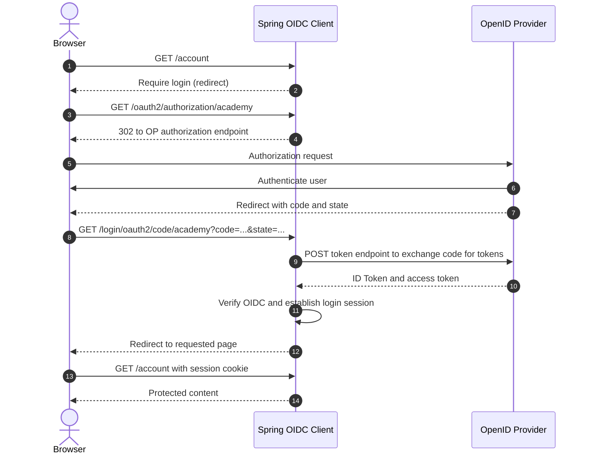

# 4.9. Minimal Configuration with `application.yml` or `application.properties`

For a **Spring Security OAuth 2.0 / OpenID Connect (OIDC) Client** application to log in through an identity provider, the essential configuration usually lives in Spring Boot's `application.yml` **or** `application.properties`. You need to tell Spring Security **which client the application is**, **which OpenID Provider (OP) to use**, **which scopes to request**, and **where to receive callbacks**. Most of the remaining Authorization Code Flow work—including browser redirects, exchanging the authorization code, and processing OIDC login—can be left to Spring Security.

This lesson uses **Spring Boot 3.x, Spring Security 6.x, and a Servlet/Spring MVC web application**. The URLs, client IDs, secrets, and provider names are examples only. Property names generally remain compatible across adjacent versions, though when working on a specific project you should check the documentation for that exact version.

## 1. Minimal Inputs Before Writing Configuration

Suppose you have an application:

- **Spring application:** `http://localhost:8080` when running locally; `https://app.example.com` when deployed.
- **Registration ID** in Spring: `academy`. This is an arbitrary name distinguishing each OAuth2 Client Registration within the same application.
- **OpenID Provider:** illustrative issuer `https://idp.example.com/realms/academy`.
- **Client ID:** value issued by the OP when registering the application, e.g., `academy-web`.
- **Client secret:** secret issued by the OP for a **confidential client** backend application; never write it directly in documentation or Git.
- **Authorization grant:** `authorization_code`, with browser redirect and callback.
- **Scopes:** at minimum `openid` so that it is an **OIDC login**; `profile` and `email` may be added when needed.

At the OP, the application must have a registered callback URI matching where it runs. With Spring Security's default path:

```text
Local:
http://localhost:8080/login/oauth2/code/academy

Production:
https://app.example.com/login/oauth2/code/academy
```

The OP typically requires a list of **allowed redirect URIs**; the URI sent in the authorization request must match according to the OP's rules. Never allow redirects to arbitrary domains. Many OPs permit HTTP on loopback for development, whereas **public/production environments must use HTTPS**.

Basic conditions for the example to work:

1. The application has the OAuth2 Client dependency and the matching web starter.
2. The OP supports **OIDC Discovery** (metadata from issuer) and **Authorization Code Flow**.
3. Client ID/secret are properly issued for the OP, and the application's redirect URI is allowed.
4. The application can reach the issuer/authorization/token/JWKS endpoints over valid TLS.
5. At least one suitable `SecurityFilterChain` enables `oauth2Login()`, or you rely on Spring Boot's default login configuration when no custom chain is defined yet.

## 2. Dependencies for a Spring Boot OIDC Client

With Maven and Spring Boot's dependency management, the most important dependency is:

```xml
<dependency>
    <groupId>org.springframework.boot</groupId>
    <artifactId>spring-boot-starter-oauth2-client</artifactId>
</dependency>
```

For a Spring MVC application, you also normally include:

```xml
<dependency>
    <groupId>org.springframework.boot</groupId>
    <artifactId>spring-boot-starter-web</artifactId>
</dependency>
```

With Gradle:

```groovy
dependencies {
    implementation 'org.springframework.boot:spring-boot-starter-web'
    implementation 'org.springframework.boot:spring-boot-starter-oauth2-client'
}
```

The OAuth2 Client starter provides components to configure client registrations, initiate login, receive authorization codes, and integrate OIDC. Without the matching starter, declaring `spring.security.oauth2.client.*` properties **will not automatically enable** the OAuth2 Login filters and mechanisms.

> This lesson focuses on a **server-side website using OIDC login**, which can hold login sessions on the backend. If the application is a pure API receiving `Authorization: Bearer <token>`, review **OAuth2 Resource Server** configuration rather than using OIDC login configuration as a substitute.

## 3. Option 1 — `application.yml`: Clear and Readable Version

Create or open `src/main/resources/application.yml`:

```yaml
spring:
  security:
    oauth2:
      client:
        registration:
          academy:
            provider: academy-provider
            client-id: ${OIDC_CLIENT_ID}
            client-secret: ${OIDC_CLIENT_SECRET}
            authorization-grant-type: authorization_code
            scope:
              - openid
              - profile
              - email
            redirect-uri: "{baseUrl}/login/oauth2/code/{registrationId}"
        provider:
          academy-provider:
            issuer-uri: ${OIDC_ISSUER_URI}
```

Here:

- `registration.academy` defines **one client registration**. `academy` is the `registrationId` used in the login initiation and callback URLs.
- `provider: academy-provider` points to the `provider.academy-provider` section below. The provider alias name can differ from the registration name.
- `client-id` and `client-secret` are application credentials issued by the OP; `${...}` placeholders are resolved by Spring Boot from available configuration sources such as environment variables.
- `authorization-grant-type: authorization_code` selects the code-for-token exchange flow common for OIDC web apps.
- `scope` is the list of requested scopes. `openid` turns the OAuth 2.0 authorization request into an OIDC authentication request; `profile` and `email` request extra claims if permitted by the OP.
- `redirect-uri` defines the application's callback. `{baseUrl}` and `{registrationId}` are placeholders processed by **Spring Security** inside the URI template; they differ from `${OIDC_CLIENT_ID}`, which is resolved by Spring's property mechanism.
- `issuer-uri` is the **OIDC issuer identifier** published by the OP. Spring Security can use issuer discovery to find the authorization endpoint, token endpoint, JWKS URI, and related metadata.

The `issuer-uri` value **is not an arbitrary login page URL** and is not `/authorize` or `/token` by default. Take the exact issuer from OP documentation or metadata—for example, an OP may publish an issuer with path `/realms/academy`. The `issuer` in metadata and the `iss` claim in the ID Token must match the configured value.

### 3.1. Shorter Scope Syntax

Spring Boot supports inline YAML list syntax:

```yaml
scope: [openid, profile, email]
```

Or keep the multi-line list as in the main example. Both are equivalent. Putting multiple scopes into a single improperly formatted string can cause the OP to parse scopes incorrectly and return `invalid_scope`.

### 3.2. Which Fields Can Actually Be Omitted?

If you want to rely on Spring Security defaults, `redirect-uri` in the example can be omitted because the default path for Servlet OAuth2 Login is:

```text
{baseUrl}/login/oauth2/code/{registrationId}
```

Similarly, several values can be inferred from provider metadata or Spring Boot conventions. Even so, in a first configuration lesson, **declaring `authorization-grant-type` and `redirect-uri` explicitly** helps readers clearly see the flow and callback. When trimming down, only omit properties you have confirmed the framework/provider supplies by default.

For confidential clients, `client-secret` is usually required by the OP. If using a public client unable to keep a secret, configuration differs: `client-authentication-method: none`, PKCE, and OP support conditions; **never drop the secret arbitrarily from a backend example** and assume the flow retains the same level of protection.

## 4. Option 2 — `application.properties`: Equivalent Configuration

If the project uses `src/main/resources/application.properties`, convert the YAML hierarchy into dot-separated keys:

```properties
spring.security.oauth2.client.registration.academy.provider=academy-provider
spring.security.oauth2.client.registration.academy.client-id=${OIDC_CLIENT_ID}
spring.security.oauth2.client.registration.academy.client-secret=${OIDC_CLIENT_SECRET}
spring.security.oauth2.client.registration.academy.authorization-grant-type=authorization_code
spring.security.oauth2.client.registration.academy.scope=openid,profile,email
spring.security.oauth2.client.registration.academy.redirect-uri={baseUrl}/login/oauth2/code/{registrationId}

spring.security.oauth2.client.provider.academy-provider.issuer-uri=${OIDC_ISSUER_URI}
```

**Both the YAML and properties examples describe the exact same client registration.** Pick the one format your project uses to avoid overlapping configs that are hard to trace. When an app has both `application.yml` and `application.properties`, Spring Boot applies property-source precedence rules; do not leave differing values for the same property in two files without intentionally managing precedence.

Quick comparison:

| Aspect | `application.yml` | `application.properties` |
| --- | --- | --- |
| Property grouping | Indented tree under `spring → security → oauth2` | Full key path on each line |
| Scope list | `scope: [openid, profile, email]` or YAML list | `scope=openid,profile,email` |
| Environment placeholders | `client-id: ${OIDC_CLIENT_ID}` | `client-id=${OIDC_CLIENT_ID}` |
| Callback template | `redirect-uri: "{baseUrl}/..."` | `redirect-uri={baseUrl}/...` |
| Common pitfalls | Wrong indentation depth, tabs, YAML typing | Misspelled keys, duplicate keys, or missing separators |

YAML **must use spaces for indentation**, avoiding tabs. The `provider` block must sit at the same level as `registration` under `client`; nesting `provider` inside `registration.academy` prevents Spring from seeing the configuration as expected.

## 5. Secrets and Environment Variables: Preparation Before Running

In the example, Spring Boot looks for these variables:

```text
OIDC_CLIENT_ID
OIDC_CLIENT_SECRET
OIDC_ISSUER_URI
```

Suppose the real values provided by the OP are:

```text
OIDC_CLIENT_ID=academy-web
OIDC_CLIENT_SECRET=<mock-secret-not-for-real-use>
OIDC_ISSUER_URI=https://idp.example.com/realms/academy
```

This only illustrates variable names and URI format. When running the app, substitute your environment's real values; avoid sharing client secrets over chat, public docs, or commits.

Example in **Windows PowerShell**, setting variables in the shell only for the current process and its child processes:

```powershell
$env:OIDC_CLIENT_ID = "academy-web"
$env:OIDC_CLIENT_SECRET = "<real-secret-from-op>"
$env:OIDC_ISSUER_URI = "https://idp.example.com/realms/academy"

# Run the application from this shell using the Maven Wrapper if the project uses Maven:
./mvnw.cmd spring-boot:run
```

Example in **bash/zsh** on Linux or macOS:

```bash
export OIDC_CLIENT_ID='academy-web'
export OIDC_CLIENT_SECRET='<real-secret-from-op>'
export OIDC_ISSUER_URI='https://idp.example.com/realms/academy'

# If the project includes the Maven Wrapper:
./mvnw spring-boot:run
```

Only run after replacing placeholder strings with valid credentials. With Gradle, use `./gradlew bootRun` or `gradlew.bat bootRun` depending on the OS.

### 5.1. Why Use `${OIDC_CLIENT_SECRET}`?

Spring Boot resolves placeholders via **Externalized Configuration**. This lets the exact same codebase run in local, staging, and production with different values. Client secrets can be supplied via:

- Process environment variables.
- A secret manager or the deployment platform's secret injection mechanism.
- A secure configuration source managed outside Git.

Never place real secrets in committed `application.yml`/`application.properties`, screenshots, or logs. A `.env` file containing variables **is not automatically loaded by Spring Boot just because it sits next to `application.yml`**; you need an environment loader or matching config integration.

If a required placeholder has no value, application startup/binding may fail. That is far better than silently starting with an empty client ID or secret that is hard to diagnose. Never set a dummy secret fallback for production like `${OIDC_CLIENT_SECRET:demo}`.

### 5.2. Distinguishing IDs, Secrets, and Issuers

| Variable/Key | Nature | Can Be Public? |
| --- | --- | --- |
| `client-id` | Identifier of the OAuth2 client registered at the OP | Usually not a secret |
| `client-secret` | Credential for the backend to authenticate the client to the OP | **No**; must be protected |
| `issuer-uri` | Issuer identifier and metadata lookup source of the OP | Usually public, but must come from a trusted source |
| `registrationId` | Internal Spring alias such as `academy` | Not a credential |
| `redirect-uri` | Application callback endpoint | Public URL, yet must be registered and controlled |

Do not confuse **client secret** with **authorization code**, **access token**, **ID Token**, or **session cookie**. Each value serves a different step and has its own security requirements.

## 6. How Does Spring Security Use These Properties?

Spring Boot binds `spring.security.oauth2.client.registration.*` keys into client registration configurations used by Spring Security during login. When the OP supports discovery via issuer, required metadata is fetched based on `issuer-uri`.

One cycle in the example configuration:



Two key endpoints are normally provided automatically by Spring Security filters:

| URL | Responsibility |
| --- | --- |
| `GET /oauth2/authorization/academy` | Initiates OAuth2/OIDC login for registration ID `academy`. |
| `GET /login/oauth2/code/academy` | Receives the authorization code callback (`query` response mode). |
| `GET /login` | Default login page generated by Spring Security in certain configurations when no custom page is defined. |

You do not need to write a controller for the default callback. Spring Security uses filters to correlate the authorization response with the original request (e.g., via `state`), exchange the code, validate the ID Token, and create the `Authentication`/principal according to OIDC rules.

**The callback endpoint must match configuration.** With `registrationId=academy`, the default callback is `/login/oauth2/code/academy`, not `/login/oauth2/code/academy-provider`. `academy-provider` is only the provider alias used in properties.

## 7. Do You Need to Write a `SecurityFilterChain` Yourself?

### 7.1. When There Is No Custom Security Configuration Yet

For a basic Spring Boot Servlet application with the OAuth2 Client starter and a valid registration, Spring Boot can auto-configure default OAuth2 Login security components if the application **does not yet define its own `SecurityFilterChain` bean**. This is a quick way to test login and verify the client registration.

However, in real applications, you usually want to separate public URLs from URLs requiring authentication. In that case, define an explicit chain.

### 7.2. With an Explicit `SecurityFilterChain`

Java example:

```java
import org.springframework.context.annotation.Bean;
import org.springframework.context.annotation.Configuration;
import org.springframework.security.config.Customizer;
import org.springframework.security.config.annotation.web.builders.HttpSecurity;
import org.springframework.security.web.SecurityFilterChain;

@Configuration
public class SecurityConfig {

    @Bean
    SecurityFilterChain securityFilterChain(HttpSecurity http) throws Exception {
        http
            .authorizeHttpRequests(auth -> auth
                .requestMatchers("/", "/error", "/assets/**").permitAll()
                .anyRequest().authenticated()
            )
            .oauth2Login(Customizer.withDefaults());

        return http.build();
    }
}
```

If you define a `SecurityFilterChain` and forget `oauth2Login()`, the client registration properties alone **do not guarantee** that the app will handle OIDC login as intended. In applications with multiple filter chains, configure request matchers and chain ordering so `/oauth2/authorization/**` and `/login/oauth2/code/**` are handled by the chain configured with OAuth2 Login.

Never disable `csrf()` just to make a login demo work. OAuth2 `state` and CSRF protection for session-backed forms/requests defend against different threats.

### 7.3. Reading Logged-In User Information

Once the flow is configured properly, a Spring MVC controller can receive the OIDC principal:

```java
import java.util.Map;

import org.springframework.security.core.annotation.AuthenticationPrincipal;
import org.springframework.security.oauth2.core.oidc.user.OidcUser;
import org.springframework.web.bind.annotation.GetMapping;
import org.springframework.web.bind.annotation.RestController;

@RestController
public class MeController {

    @GetMapping("/me")
    public Map<String, String> me(@AuthenticationPrincipal OidcUser user) {
        return Map.of(
            "subject", user.getSubject(),
            "name", user.getFullName() != null
                ? user.getFullName() : "(not provided)"
        );
    }
}
```

This snippet assumes the endpoint is only accessible to users authenticated **via OIDC**; if the app supports additional authentication mechanisms, handle the corresponding principal types. Never expose raw ID Tokens, access tokens, refresh tokens, or sensitive claims in responses.

## 8. Testing the Configuration Locally

Once the OP has registered the callback and the application starts cleanly, you can follow this sequence:

1. Open a clean browser or private window so a fresh login session is easy to observe.
2. Visit `http://localhost:8080/oauth2/authorization/academy`. The browser should redirect to the authorization endpoint of your configured issuer.
3. Inspect the authorization request in the Network tab: confirm the right `client_id`, right `redirect_uri`, `response_type=code`, `scope` containing `openid`, and a non-empty `state`.
4. Log in at the OP with a test account; approve consent if prompted by the OP.
5. The browser should return to `http://localhost:8080/login/oauth2/code/academy` with the authorization code and state. Spring Security processes the callback and creates a session.
6. Visit `/me` or a protected URL to confirm the application recognizes the OIDC principal.

For clients using PKCE, the outgoing request to the OP may also include `code_challenge` and `code_challenge_method=S256`. **Do not assume PKCE is definitely enabled just because OAuth2 Login works**; PKCE activation depends on client type, Spring Security version, customizers, and OP requirements. If the OP requires PKCE, configure and verify it properly; never bypass OP security requirements.

### 8.1. Spring Security Must See the Right Issuer

OIDC metadata is typically discovered from the issuer via well-known discovery rules, such as the metadata document published by the OP. The response commonly contains:

```json
{
  "issuer": "https://idp.example.com/realms/academy",
  "authorization_endpoint": "https://idp.example.com/realms/academy/protocol/openid-connect/auth",
  "token_endpoint": "https://idp.example.com/realms/academy/protocol/openid-connect/token",
  "jwks_uri": "https://idp.example.com/realms/academy/protocol/openid-connect/certs"
}
```

This is an **example structure** of metadata and does not imply these exact paths are universal across all OPs. When discovery works on the OP, you normally **do not need to enter each endpoint manually** in `application.yml`. If discovery is unsupported, endpoints may need to be configured explicitly per Spring Security capabilities and OP docs; in that case, it is no longer the simple issuer-only variant of this lesson.

### 8.2. Why Does Local Need an Exact Callback?

Suppose the application runs on port 8080, while at the OP you only registered:

```text
http://localhost:9090/login/oauth2/code/academy
```

Even with valid `client-id` and `client-secret`, the OP may still return `redirect_uri_mismatch` or `invalid_redirect_uri` because the application sends `http://localhost:8080/login/oauth2/code/academy`. Changing port, hostname, scheme, or context path changes the URI; always compare **the actual URI appearing in the authorization request** with the OP's allowlist.

## 9. Configurations to Add Only When Needed

The goal is to start from a **minimal configuration** and add fields only as required by the application or the OP.

### 9.1. When the OP Requires a Specific Client Authentication Method

Confidential clients typically use a mechanism such as `client_secret_basic` or `client_secret_post`. If the OP only supports one specific method, declare it under the registration:

**YAML:**

```yaml
spring:
  security:
    oauth2:
      client:
        registration:
          academy:
            client-authentication-method: client_secret_basic
```

**Properties:**

```properties
spring.security.oauth2.client.registration.academy.client-authentication-method=client_secret_basic
```

These two snippets only show the **additional key** for the full configuration in sections 3/4 and do not work standalone. Pick the method matching your OP and registered client type. Never switch `client_secret_basic` to `client_secret_post` blindly without diagnosing the root cause.

### 9.2. When Not Using Discovery via Issuer

Some OPs support OAuth2 without full OIDC discovery or use custom endpoints. Spring Security supports declaring provider endpoints explicitly, for example:

```yaml
spring:
  security:
    oauth2:
      client:
        provider:
          academy-provider:
            authorization-uri: https://idp.example.com/oauth2/authorize
            token-uri: https://idp.example.com/oauth2/token
            jwk-set-uri: https://idp.example.com/oauth2/keys
            user-info-uri: https://idp.example.com/oidc/userinfo
            user-name-attribute: sub
```

The URIs above are examples only. **Do not use these mock endpoints as a production configuration.** For OIDC, ensure issuer values, ID Token verification algorithms, and endpoints match the real provider; when discovery is available, using `issuer-uri` is simpler and prevents URL mismatches.

If using a plain OAuth2 client without `openid`, the app may receive `OAuth2User` instead of `OidcUser`. OAuth2 Login and OIDC Login are not completely synonymous.

### 9.3. When Running Behind a Reverse Proxy

The public application might be `https://app.example.com` while the internal backend receives HTTP on `localhost:8080`. If Spring infers `{baseUrl}` wrongly, the authorization request could carry callback `http://localhost:8080/login/oauth2/code/academy` instead of the public HTTPS URL.

Spring Boot may need settings such as:

```yaml
server:
  forward-headers-strategy: framework
  servlet:
    session:
      cookie:
        secure: true
        http-only: true
        same-site: lax
```

Only use forwarded headers settings with a **trusted reverse proxy** that strips or overwrites spoofed headers from external clients. `SameSite=Lax` cookies generally work for top-level GET callbacks; if the OP uses `form_post`, review cookie policies compatible with that response mode. These are deployment decisions, not mandatory properties for a minimal local example.

### 9.4. When Supporting Multiple OIDC Providers

Each provider can have its own `registrationId` and `provider`:

```yaml
spring:
  security:
    oauth2:
      client:
        registration:
          academy:
            provider: academy-provider
            client-id: ${ACADEMY_CLIENT_ID}
            client-secret: ${ACADEMY_CLIENT_SECRET}
            scope: [openid, profile]
            authorization-grant-type: authorization_code
          partner:
            provider: partner-provider
            client-id: ${PARTNER_CLIENT_ID}
            client-secret: ${PARTNER_CLIENT_SECRET}
            scope: [openid, profile]
            authorization-grant-type: authorization_code
        provider:
          academy-provider:
            issuer-uri: ${ACADEMY_ISSUER_URI}
          partner-provider:
            issuer-uri: ${PARTNER_ISSUER_URI}
```

Then there are two distinct login initiation URLs:

```text
/oauth2/authorization/academy
/oauth2/authorization/partner
```

Corresponding default callbacks are `/login/oauth2/code/academy` and `/login/oauth2/code/partner`. Each registration must have its own callback and credentials registered at its respective OP. This is an **extension**, not required for a single-provider setup.

## 10. Using Profiles to Separate Local, Staging, and Production

Spring Boot allows profile-specific values such as `application-local.yml`, `application-staging.yml`, or `application-prod.yml`. Shared properties like client registration IDs, scopes, or the redirect template can live in `application.yml`; only values that change across environments need overrides.

Example local-only configuration snippet:

```yaml
# application-local.yml
server:
  port: 8080

logging:
  level:
    org.springframework.security: INFO
```

Run with the `local` profile via `spring.profiles.active=local` or environment variable `SPRING_PROFILES_ACTIVE=local`. **Do not put real client secrets inside committed profile files.** Secrets should still come from environment variables or a secret manager.

Configuration sources in Spring Boot follow a **precedence order**; for example, environment variables and command-line arguments can override values in config files. To avoid painful debugging, maintain a single clear source of truth for each secret parameter per environment and know exactly which source is active.

## 11. Common Configuration Errors

| Symptom | What to Check | Example Causes and Remedies |
| --- | --- | --- |
| App fails to start due to missing configuration | Placeholders/environment | `OIDC_CLIENT_ID` or `OIDC_ISSUER_URI` not provided; environment variables not loaded into the actual process. |
| Clicking login does not reach the OP | Starters, filter chain, URL | Missing `spring-boot-starter-oauth2-client`, custom `SecurityFilterChain` omitted `oauth2Login()`, or wrong registration ID called. |
| OP returns `invalid_client` | Client ID/secret, auth method | Wrong secret, client registered in wrong tenant, wrong client authentication method, or client not granted the flow. |
| OP returns `invalid_redirect_uri` | `redirect-uri` and allowlist | Wrong host/port/path/scheme, or proxy causes Spring to compute `{baseUrl}` wrongly. |
| OP returns `invalid_scope` | `scope` | Scope not allowed by provider, syntax error, or missing app configuration at OP. |
| OP reports unsupported flow | `authorization-grant-type` | Client does not have Authorization Code Flow enabled, or OP requires PKCE while client sent no challenge. |
| Discovery error / issuer mismatch | `issuer-uri`, metadata | Wrong issuer, wrong tenant/path, unreachable metadata, or ID Token `iss` mismatch. |
| SSL handshake failure | HTTPS/TLS | Expired certificate, wrong hostname, or trust store missing appropriate CA; never disable TLS verification. |
| Callback returns state/session error | Session cookies, load balancing | Cookie not sent back, expired session, incompatible SameSite/Path, or multiple instances not sharing sessions. |
| Login succeeds yet redirects back to login | Session & `SecurityContext` storage | Session not persisted, wrong `Secure`/domain cookie setting, or misconfigured custom chain. |
| OIDC login works, yet API calls fail | OAuth2 Client vs. Resource Server | API needs its own access token/audience/scopes; session cookies and ID Tokens cannot substitute for access tokens. |

During debugging you may inspect configuration logs and redirect steps, but **avoid logging `client-secret`, `Authorization: Bearer`, callback codes, ID Tokens, refresh tokens, session IDs, or `code_verifier`**. When sharing logs for support, redact sensitive values first.

## 12. Mini Practice Exercises

### Exercise A — Convert YAML to Properties

Given:

```yaml
spring:
  security:
    oauth2:
      client:
        registration:
          training:
            client-id: ${TRAINING_CLIENT_ID}
            scope: [openid, profile]
```

Equivalent `application.properties`:

```properties
spring.security.oauth2.client.registration.training.client-id=${TRAINING_CLIENT_ID}
spring.security.oauth2.client.registration.training.scope=openid,profile
```

This is a **syntax-practice snippet**, not enough to run a working client without a provider, grant type, and remaining required properties.

### Exercise B — Renaming Registration ID from `academy` to `training`

If you change:

```yaml
registration:
  training:
    provider: academy-provider
```

then the default login initiation URL changes to:

```text
/oauth2/authorization/training
```

And the default callback becomes:

```text
/login/oauth2/code/training
```

The `academy-provider` name can stay because it is a provider alias. **Remember to update the redirect URI allowlist at the OP** if the new callback is used.

### Exercise C — Removing the `openid` Scope

If configuration only includes `profile` and `email`, it is **no longer a standard OIDC login request**. Spring Security may handle it as an OAuth2 Login if supported by the provider, but you cannot expect an ID Token or `OidcUser`. To learn and verify OIDC, always start with `openid`.

### Exercise D — Writing the Correct Production Callback

The app runs publicly at `https://portal.example.com`, registration ID is `sso`, and it uses the default redirect URI template. The callback to register at the OP is:

```text
https://portal.example.com/login/oauth2/code/sso
```

Do not use an internal container host or port 8080 if that is not the public URL. If the app uses a context path or special proxy rewrite, inspect the actual URL emitted in the authorization request.

## 13. Recommended Starting Configurations for a New Project

For **an OIDC provider with issuer discovery** and a **confidential web client**, you can start with either of these two variants.

**`application.yml`:**

```yaml
spring:
  security:
    oauth2:
      client:
        registration:
          academy:
            provider: academy-provider
            client-id: ${OIDC_CLIENT_ID}
            client-secret: ${OIDC_CLIENT_SECRET}
            authorization-grant-type: authorization_code
            scope: [openid, profile, email]
            redirect-uri: "{baseUrl}/login/oauth2/code/{registrationId}"
        provider:
          academy-provider:
            issuer-uri: ${OIDC_ISSUER_URI}
```

**`application.properties`:**

```properties
spring.security.oauth2.client.registration.academy.provider=academy-provider
spring.security.oauth2.client.registration.academy.client-id=${OIDC_CLIENT_ID}
spring.security.oauth2.client.registration.academy.client-secret=${OIDC_CLIENT_SECRET}
spring.security.oauth2.client.registration.academy.authorization-grant-type=authorization_code
spring.security.oauth2.client.registration.academy.scope=openid,profile,email
spring.security.oauth2.client.registration.academy.redirect-uri={baseUrl}/login/oauth2/code/{registrationId}
spring.security.oauth2.client.provider.academy-provider.issuer-uri=${OIDC_ISSUER_URI}
```

After providing the three environment variables, registering the right callback at the OP, and ensuring Spring Security handles `oauth2Login()`, you can start at `/oauth2/authorization/academy` and verify the outcome at a protected URL. When expanding later, adjust one element at a time: scopes, redirect URI, provider, client authentication method, PKCE, session/cookies, or reverse proxy.

### Official Documentation for Further Reference

- [Spring Boot Reference — OAuth2 Client](https://docs.spring.io/spring-boot/reference/web/spring-security.html), OAuth2 Client configuration section.
- [Spring Security Reference — OAuth 2.0 Login](https://docs.spring.io/spring-security/reference/servlet/oauth2/login/index.html).
- [Spring Security Reference — OAuth 2.0 Client](https://docs.spring.io/spring-security/reference/servlet/oauth2/client/index.html).
- [Spring Security Reference — OAuth2 Login Advanced](https://docs.spring.io/spring-security/reference/servlet/oauth2/login/advanced.html), customizing login and authorization endpoints.
- [OpenID Connect Discovery 1.0](https://openid.net/specs/openid-connect-discovery-1_0.html), metadata and issuer discovery.
- [OpenID Connect Core 1.0](https://openid.net/specs/openid-connect-core-1_0.html), Authorization Code Flow, `openid` scope, and ID Token.
