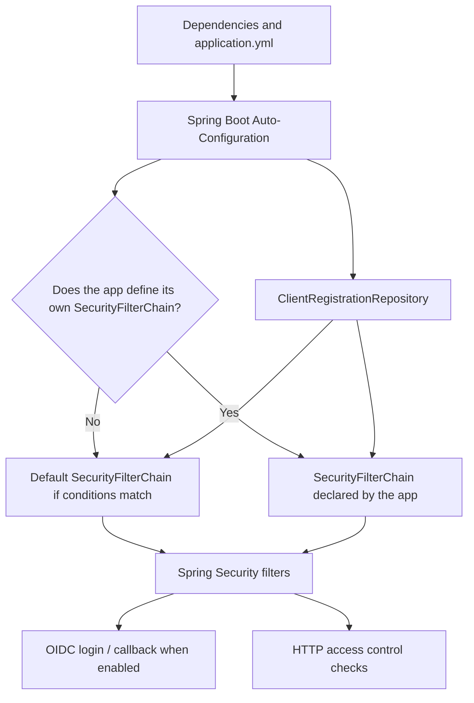
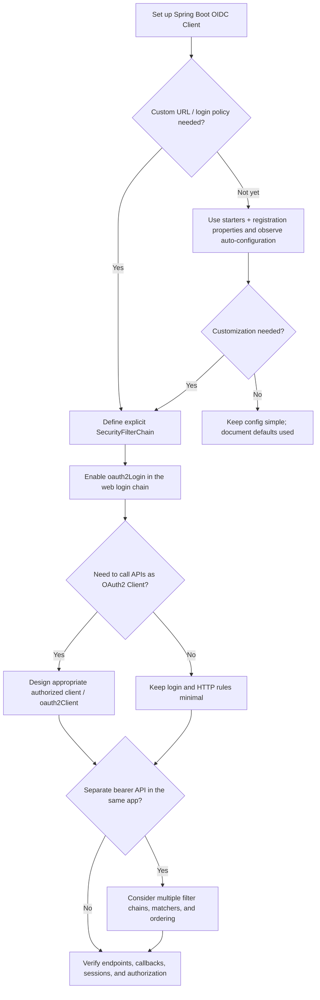

# 4.10. Comparing Auto-Configuration and Explicit Security Configuration

> **Module:** Spring Security OAuth 2.0 OIDC Client  
> **Chapter:** 4. Project Setup  
> **Focus:** Understand what Spring Boot auto-configures when using OAuth 2.0/OIDC Client, what changes when declaring a `SecurityFilterChain`, and how to transition from default configuration to explicit configuration while preserving the login flow.

When building a Spring Boot application that logs in via OpenID Connect (OIDC), you can start with dependencies and a few properties in `application.yml`. The application can already redirect users to the identity provider and handle callbacks without writing a security configuration class.

However, once you need public pages, restricted admin paths, a custom login page, API calls with access tokens, or multiple `SecurityFilterChain` beans, the application usually must declare an explicit Security configuration. At that point, a small change such as adding a `SecurityFilterChain` bean can disable the default OIDC login behavior Spring Boot previously provided if you forget to call `oauth2Login()`.

This lesson presents both approaches as **two control levels of the same system**. Auto-configuration creates suitable components when conditions are met; explicit Security configuration determines HTTP policies and which login/authorization mechanisms are enabled in the filter chain.

## 1. Learning Objectives

After this lesson, you will be able to:

1. Identify the roles of **Spring Boot auto-configuration**, **Spring Security**, and `spring.security.oauth2.client.*` properties.
2. Distinguish OAuth 2.0 Client registration (`ClientRegistration`) from HTTP security configuration (`SecurityFilterChain`).
3. Explain why declaring a `SecurityFilterChain` bean causes Spring Boot to yield definition of the default filter chain to the application.
4. Preserve OIDC login when changing access policies with `authorizeHttpRequests()` and `oauth2Login()`.
5. Distinguish `oauth2Login()` from `oauth2Client()`, avoiding the assumption that enabling Client for API calls automatically enables user login.
6. Design appropriate filter chains for web and APIs while avoiding missing callbacks, login URLs, or unprotected paths.
7. Verify actual behavior via browser navigation, controlled logging, and bean inspection in the `ApplicationContext`.

## 2. Three Configuration Layers to Keep Separate

Do not lump all OAuth 2.0/OIDC Client functionality into a single idea of "Spring Security is configured". At least three layers work together.

| Layer | Examples | Key Decisions |
|---|---|---|
| **Dependencies / classpath** | `spring-boot-starter-oauth2-client`, `spring-boot-starter-security` | Which features and bean types can be auto-configured |
| **Client registration / provider metadata** | `spring.security.oauth2.client.registration.corp.*`; `provider.corp.issuer-uri` | Which OP the client registers with, and which client ID, redirect URI, and scopes are used |
| **HTTP Security / filter chain** | `SecurityFilterChain` bean with `authorizeHttpRequests()` and `oauth2Login()` | Which endpoints require authentication; which requests redirect to login; which login flows and filters are active |

Underneath, Spring Security builds a `FilterChainProxy` and the corresponding security filters to process requests. Spring Boot connects dependencies, property bindings, and default beans when conditions allow.

Their relationship can be visualized as:



**Crucial point:** providing your own `SecurityFilterChain` usually replaces **the default filter chain** created by Boot, but **it does not erase client registration settings from properties**. As long as Boot still creates `ClientRegistrationRepository` from valid configuration, that bean continues to be used by `oauth2Login()` and `oauth2Client()` inside your explicit chain.

## 3. What Is Auto-Configuration in This Context?

Spring Boot uses auto-configuration classes and conditions such as the presence of matching classes/dependencies, corresponding properties, or **the absence of a user-defined bean**. The goal is a working out-of-the-box setup with minimal code.

For a **Servlet Spring MVC** application on Spring Boot 3.x / Spring Security 6.x, typical behavior includes:

- When Spring Security is on the classpath, Boot provides default HTTP protection if the application has not defined its own `SecurityFilterChain`.
- When OAuth 2.0 Client is properly configured with client registrations, Boot and Spring Security can activate the default OAuth 2.0/OIDC login flow in the web app.
- From `spring.security.oauth2.client.registration.*` and `provider.*`, Boot can build the appropriate `ClientRegistrationRepository`.
- Spring Security uses the client components to construct authorization requests, handle callbacks, exchange authorization codes, and manage authenticated principals when login is enabled.

Details of which beans belong to Boot vs. Spring Security, and exact activation conditions, can vary by version. This lesson uses **Spring Boot 3.x and Spring Security 6.x (Servlet stack)** as the illustrative context; when using Spring Boot 4.x or another line, verify against that branch's reference documentation.

### 3.1. Spring Boot Decides by Conditions, Not by "Reading the Developer's Mind"

Suppose you declare:

```java
@Bean
SecurityFilterChain securityFilterChain(HttpSecurity http) throws Exception {
    return http.build();
}
```

Even at just a few lines, this is still an application-provided `SecurityFilterChain` bean. Whether Boot backs off from creating its default chain does not depend on whether your snippet is "secure enough" yet.

The snippet above **is not a complete configuration template**: it neither defines endpoint authorization rules nor enables login. It merely illustrates a common cause of learners thinking Spring Boot "suddenly stopped doing OAuth login" after adding a configuration class.

Therefore, remember the rule: **once you provide a chain yourself, you are responsible for declaring that chain's mechanisms and rules**.

### 3.2. Auto-Configuration Differs from Spring Security Defaults

Two concepts are often confused:

- **Spring Boot auto-configuration:** decides whether to create default beans based on the classpath, properties, and existing beans.
- **Spring Security defaults:** when a DSL method like `oauth2Login(Customizer.withDefaults())` is called, Spring Security registers filters and applies that feature's defaults unless customized by the application.

An explicit chain can still rely on **many Spring Security defaults**. Being explicit does not require manually configuring every OAuth endpoint or every filter.

## 4. Preparing a Shared Sample Project for Both Approaches

To compare fairly, use the same Spring Boot web project and the same OIDC Provider. Lab assumptions:

| Component | Illustrative Value |
|---|---|
| Web Client | `http://localhost:8080` |
| OIDC Provider / issuer | `http://localhost:9000/realms/learning` |
| Registration ID | `learning` |
| Client ID | `spring-web-client` |
| Registered Redirect URI | `http://localhost:8080/login/oauth2/code/learning` |
| Scope | `openid`, `profile`, `email` |

These are just learning names and ports. Real Identity Providers (IdP/OP) may use different URLs, issuer paths, client authentication requirements, scopes, and token-issuance behaviors. Outside localhost, use HTTPS.

### 4.1. Dependencies

Maven example, without pinning versions when the project manages versions via the Spring Boot parent/BOM:

```xml
<dependencies>
    <dependency>
        <groupId>org.springframework.boot</groupId>
        <artifactId>spring-boot-starter-web</artifactId>
    </dependency>
    <dependency>
        <groupId>org.springframework.boot</groupId>
        <artifactId>spring-boot-starter-security</artifactId>
    </dependency>
    <dependency>
        <groupId>org.springframework.boot</groupId>
        <artifactId>spring-boot-starter-oauth2-client</artifactId>
    </dependency>
</dependencies>
```

In some setups, the OAuth 2.0 Client starter already pulls in required Spring Security dependencies. Listing the security starter explicitly here clarifies the learning intent. If using WebFlux, configuration uses `SecurityWebFilterChain` and different reactive APIs; never copy a Servlet `HttpSecurity` bean verbatim into WebFlux.

### 4.2. Registration via Properties

`src/main/resources/application.yml`:

```yaml
server:
  port: 8080

spring:
  security:
    oauth2:
      client:
        registration:
          learning:
            provider: learning
            client-id: spring-web-client
            client-secret: ${OIDC_CLIENT_SECRET}
            authorization-grant-type: authorization_code
            redirect-uri: "{baseUrl}/login/oauth2/code/{registrationId}"
            scope:
              - openid
              - profile
              - email
        provider:
          learning:
            issuer-uri: http://localhost:9000/realms/learning
```

At the OP, register the matching client ID and redirect URI, create a test account, and supply `OIDC_CLIENT_SECRET` via an environment variable or secret manager. Never store real client secrets in Git.

Parts to understand:

- `registration.learning` defines a Client registration with ID `learning`.
- `provider.learning.issuer-uri` identifies the OP and enables OIDC discovery when the provider publishes valid metadata.
- `scope: openid` makes the login request use OIDC rather than plain OAuth 2.0.
- `redirect-uri` uses Spring Security placeholders, forming the default callback for that registration ID.
- Client registration defines **protocol parameters with the OP**; it does not decide whether `/admin` is permitted or restricted.

If the OP is not running, the issuer URI is unreachable, or metadata is invalid, provider discovery will fail. That is a provider configuration issue, not necessarily an `authorizeHttpRequests()` error.

### 4.3. Observation Controller

To clearly see the difference between a public page and a login-protected page, use a minimal controller:

```java
package example.web;

import java.util.Map;
import org.springframework.security.core.annotation.AuthenticationPrincipal;
import org.springframework.security.oauth2.core.oidc.user.OidcUser;
import org.springframework.web.bind.annotation.GetMapping;
import org.springframework.web.bind.annotation.RestController;

@RestController
class DemoController {

    @GetMapping("/")
    String home() {
        return "Public home";
    }

    @GetMapping("/me")
    Map<String, String> me(@AuthenticationPrincipal OidcUser user) {
        return Map.of(
            "subject", user.getSubject(),
            "issuer", user.getIdToken().getIssuer().toString()
        );
    }

    @GetMapping("/admin")
    String admin() {
        return "Admin area";
    }
}
```

In this lesson `/me` is used after a successful OIDC login. If another authentication type is allowed later or this endpoint could be reached without an `OidcUser`, handle the principal type accordingly to avoid wrong assumptions. Never return raw ID tokens, access tokens, refresh tokens, or session cookies from an observation endpoint.

## 5. Approach A — Relying on Auto-Configuration

With only the dependencies and `application.yml` in section 4, **no `SecurityConfig` class or `SecurityFilterChain` bean is written yet**. When your Spring Boot version's auto-configuration conditions are satisfied, Boot provides a default security configuration for an app with OAuth 2.0 Client registrations.

### 5.1. Typical Experience

1. Start Spring Boot after the OP is ready.
2. Visit `http://localhost:8080/me` in a logged-out window.
3. The app sends the user into the login flow, either via a default login page or the authorization initiation path `/oauth2/authorization/learning`.
4. The browser goes to the OP, the user authenticates, and the OP returns to `/login/oauth2/code/learning` with an authorization code.
5. Spring Security processes the callback, validates the OIDC result, and establishes authenticated state/session for the web app.
6. Upon revisiting `/me`, the controller can receive `OidcUser`.

Common default paths in Spring Security OAuth2 Login:

| Function | Default Path |
|---|---|
| Initiate authorization request | `/oauth2/authorization/{registrationId}` |
| Receive OAuth2 login callback | `/login/oauth2/code/{registrationId}` |
| Default login page | `/login`, depending on login page config and active login mechanisms |

Do not rigidly assume the browser must always pass through the exact same URL sequence or that every version renders an identical `/login` page. When verifying, inspect your application's actual response headers and Network tab.

### 5.2. Advantages

- Minimal code, convenient for proving whether OP integration works.
- Client configuration is centralized in properties; changing Client ID, issuer, or scopes does not require rewriting the filter chain.
- Reduces the risk of missing filters during initial setup.
- Useful as a baseline to compare behavior before and after customization.

### 5.3. Limitations

Auto-configuration targets common cases and cannot guess product-specific policies:

- It does not know whether `/`, `/docs/**`, or `/pricing` should be public.
- It cannot infer which role `/admin/**` should require.
- It does not know what custom login page, logout behavior, access denied page, or session policy the app wants.
- It does not automatically separate stateless APIs from session-backed browser UIs.
- It does not replace deciding how OP groups/roles map to application authorities.

When these behaviors are needed, switch to **explicit Security configuration**.

## 6. Approach B — Declaring an Explicit `SecurityFilterChain`

Keep the exact same dependencies, controller, and `application.yml`. Only add a configuration class:

```java
package example.web;

import org.springframework.context.annotation.Bean;
import org.springframework.context.annotation.Configuration;
import org.springframework.security.config.Customizer;
import org.springframework.security.config.annotation.web.builders.HttpSecurity;
import org.springframework.security.web.SecurityFilterChain;

@Configuration
class SecurityConfig {

    @Bean
    SecurityFilterChain webSecurityFilterChain(HttpSecurity http) throws Exception {
        return http
            .authorizeHttpRequests(authorize -> authorize
                .requestMatchers("/", "/error", "/assets/**").permitAll()
                .requestMatchers("/admin", "/admin/**").hasRole("ADMIN")
                .anyRequest().authenticated()
            )
            .oauth2Login(Customizer.withDefaults())
            .build();
    }
}
```

Line-by-line explanation:

- `@Bean SecurityFilterChain`: the application supplies its own filter chain. Boot will not create a default chain to replace this one.
- `authorizeHttpRequests()`: explicitly states access rules for URLs covered by this chain.
- `permitAll()`: requests still pass through the security chain, but are permitted to reach public endpoints. It does not create endpoints itself; `/assets/**` must actually be served if you want assets loaded.
- `hasRole("ADMIN")`: requires an authority with the standard `ROLE_` prefix under default settings. Logging in via OIDC **does not automatically guarantee** the principal has this role.
- `anyRequest().authenticated()`: all remaining URLs require valid authentication.
- `oauth2Login(Customizer.withDefaults())`: explicitly enables OAuth2/OIDC login in this chain, using the existing `learning` registration.
- `build()`: constructs the `SecurityFilterChain` from `HttpSecurity`.

**You do not strictly need `@EnableWebSecurity`** just to declare the bean in a conventionally configured Spring Boot Servlet app. If a project uses a different Security setup or needs specialized configuration, consult your specific version's docs.

### 6.1. Components Still Reused Automatically

After defining your own `SecurityFilterChain`, Spring Boot can still provide `ClientRegistrationRepository` from `application.yml`, as long as it is not replaced by a custom bean. When `oauth2Login()` is enabled, Spring Security reads that repository for client ID, provider endpoints, scopes, and redirect URI.

Therefore, **you do not need to move every value from YAML into Java** just because you defined a filter chain.

| Component | Stays in `application.yml` | Declared in `SecurityConfig` |
|---|---|---|
| `client-id`, `client-secret` | Yes | No need to copy |
| `issuer-uri` / provider endpoints | Yes | No need to copy |
| OAuth2 registration scopes | Yes | No need to copy |
| Rules for `/`, `/admin/**` | No | Yes, via `authorizeHttpRequests` |
| Enabling OIDC login on the HTTP chain | Default when Boot auto-configures the chain | Yes, via `oauth2Login` |
| Custom login page / login success handler | Usually needs Java or custom components | Yes, when required |
| Separate strategies for API and web across chains | Registration alone is not enough | Yes, via security matchers and chain ordering |

### 6.2. Why Is Forgetting `oauth2Login` Such a Common Mistake?

Compare these two versions:

**Incomplete — authenticates HTTP, but does not enable OIDC login:**

```java
@Bean
SecurityFilterChain missingOidcLogin(HttpSecurity http) throws Exception {
    return http
        .authorizeHttpRequests(auth -> auth.anyRequest().authenticated())
        .build();
}
```

**With OIDC login — same policy, with the login flow enabled:**

```java
@Bean
SecurityFilterChain withOidcLogin(HttpSecurity http) throws Exception {
    return http
        .authorizeHttpRequests(auth -> auth.anyRequest().authenticated())
        .oauth2Login(Customizer.withDefaults())
        .build();
}
```

Do not put both beans in the app at the same time; they are **contrasting alternatives**, not code to deploy together.

In the first version, having `spring.security.oauth2.client.registration.learning` only means **the Client registration exists**; the filter chain was never told to install the login mechanism. The exact HTTP result depends on whatever other authentication mechanisms/filters happen to be present, but you **cannot expect OAuth2 Login to work as it did when Boot built the default chain**.

In the second version, `oauth2Login()` ensures the explicit filter chain is configured with OAuth 2.0/OIDC Login. Security still requires a valid registration and provider.

## 7. Direct Side-by-Side Comparison

| Criterion | Auto-Configuration | Explicit Security |
|---|---|---|
| Initial setup | Mostly dependencies + properties | Dependencies + properties + `SecurityFilterChain` bean |
| Who decides HTTP rules? | Default rules when auto-config conditions match | Application decides inside `authorizeHttpRequests` |
| OIDC login | May be enabled by default when OAuth2 Client registration is validly configured | Must explicitly call `oauth2Login()` on the chain needing login |
| Client registration | Usually bound by Boot from properties | Can continue using repository from properties |
| Public / admin pages | Default behavior, unaware of business rules | Exact URLs and permission requirements declared |
| Custom login/logout | Limited when relying solely on defaults | Explicitly configure handlers, URLs, and behavior |
| Multiple URL groups with different policies | Not the default goal | Multiple chains with `securityMatcher` and `@Order` |
| Code volume | Low | Grows with customization level |
| Deployment risk | Easy to misunderstand defaults, missing app-specific policies | Easy to omit login, callbacks, or fallback chains if misconfigured |
| Best suited for | POCs, labs, simple apps | Production apps with explicit access and session requirements |

There is no fixed "security level" tied to fewer or more lines of code. Security depends on **protecting the right endpoints, validating the protocol properly, and enforcing appropriate authorization policies**. Auto-configuration gives a convenient baseline; explicit Security lets you implement deliberate policies.

## 8. Distinguishing `oauth2Login` and `oauth2Client` in Explicit Configuration

These two DSL methods have similar names, yet solve different problems:

| DSL | Purpose | Primary Outcome |
|---|---|---|
| `oauth2Login()` | Logs users into the web app via Authorization Code and optionally OIDC | Creates `Authentication`; with OIDC typically yields `OidcUser` |
| `oauth2Client()` | Supports authorized Client operations to access APIs | Integrates storage/retrieval of authorized clients and features for using OAuth2 Clients |
| `oauth2ResourceServer()` | Application acts as an API receiving bearer access tokens | Validates incoming request tokens and enforces resource permissions |

When you only need OIDC login, you can usually start with `oauth2Login()`. When the Client also needs to use access tokens to call APIs, learn `OAuth2AuthorizedClient`, `OAuth2AuthorizedClientRepository`/`OAuth2AuthorizedClientService`, and `OAuth2AuthorizedClientManager` according to your flow and architecture.

Example extending the same chain:

```java
@Bean
SecurityFilterChain browserChain(HttpSecurity http) throws Exception {
    return http
        .authorizeHttpRequests(auth -> auth
            .requestMatchers("/").permitAll()
            .anyRequest().authenticated()
        )
        .oauth2Login(Customizer.withDefaults())
        .oauth2Client(Customizer.withDefaults())
        .build();
}
```

`oauth2Client()` **does not replace `oauth2Login()`**. Calling `oauth2Client()` alone does not create an OIDC login flow or corresponding user session. Conversely, `oauth2Login()` performs login, while API call logic and token refresh handling still must be properly designed for the Client.

### 8.1. Two Independent States to Observe

After a successful OIDC login, the web application can hold an authenticated session. Calling another API still depends on **an access token issued for the right Resource Server and scopes**. An API may return 401/403 even while the user remains logged in to the web app.

Avoid using an **ID token** as a bearer token to call APIs. The ID token is meant for the Client to verify identity; an access token is issued to access a Resource Server. Explicit vs. automatic configuration does not change this boundary.

## 9. When Do You Need to Create `ClientRegistrationRepository` in Java?

`application.yml` configuration is usually sufficient when Client ID, issuer, scopes, and redirect URI are known ahead of time. However, some applications must register many dynamic tenants, read from a custom config store, or build registrations differently from standard property binding.

In those cases, you can define a `ClientRegistrationRepository` bean (such as an `InMemoryClientRegistrationRepository`) or a custom implementation resolving clients dynamically by context.

**Extension point note:** if the application declares its own `ClientRegistrationRepository` bean, Boot's property-based repository auto-configuration will **back off** in favor of your bean. Thus, adding a manual repository is not an isolated one-line tweak—it can affect all visible registrations.

Difference between the two actions:

| You Add | Main Impact |
|---|---|
| `@Bean SecurityFilterChain` | Application takes over HTTP filters and security rules; Boot skips its default chain |
| `@Bean ClientRegistrationRepository` | Application takes over supplying OAuth2 Client registrations; ensure desired registrations still exist |

Do not create a custom `ClientRegistrationRepository` just to make `/public` open—that is the job of `authorizeHttpRequests`. Conversely, do not add extra filter chains just to select issuer/client ID per tenant: that belongs to the registration/provider selection layer and may need a proper multi-tenancy design.

## 10. Custom Login Page: Small Change, Still Needs Every Connection

When a product wants its own login page instead of the default screen, you can declare:

```java
@Bean
SecurityFilterChain customLoginChain(HttpSecurity http) throws Exception {
    return http
        .authorizeHttpRequests(auth -> auth
            .requestMatchers("/", "/login", "/css/**", "/images/**").permitAll()
            .anyRequest().authenticated()
        )
        .oauth2Login(oauth2 -> oauth2
            .loginPage("/login")
        )
        .build();
}
```

Now **the application must provide the `/login` endpoint/view**. Calling `loginPage("/login")` does not generate your product's HTML UI automatically.

In your custom view, the OIDC login link is typically:

```html
<a href="/oauth2/authorization/learning">Sign in with organization account</a>
```

When a user clicks this link, Spring Security creates an authorization request from the `learning` registration and redirects to the OP.

The default callback path remains `/login/oauth2/code/learning` unless you deliberately reconfigure it. Never change the redirect URI in one place and forget to update it at the IdP. When serving behind a reverse proxy, `{baseUrl}` must resolve to the valid public URL; configure forwarded headers only with a trusted proxy and per Spring Boot guidance.

## 11. Multiple `SecurityFilterChain` Beans: When Web and API Need Different Policies

An application may serve both a browser-login UI and a REST API accepting bearer tokens. If every request enters a single chain configured with `oauth2Login()`, unauthenticated API clients could receive an HTML login redirect instead of the `401` response expected by the API contract.

When two distinct policies are needed, use multiple chains with `@Order` and `securityMatcher`. Illustrative example extending a project with a Resource Server (requires adding `spring-boot-starter-oauth2-resource-server` and appropriate JWT verifier config):

```java
import org.springframework.context.annotation.Bean;
import org.springframework.context.annotation.Configuration;
import org.springframework.core.annotation.Order;
import org.springframework.security.config.Customizer;
import org.springframework.security.config.annotation.web.builders.HttpSecurity;
import org.springframework.security.config.http.SessionCreationPolicy;
import org.springframework.security.web.SecurityFilterChain;

@Configuration
class TwoChainsConfig {

    @Bean
    @Order(1)
    SecurityFilterChain apiChain(HttpSecurity http) throws Exception {
        return http
            .securityMatcher("/api/**")
            .authorizeHttpRequests(auth -> auth
                .anyRequest().authenticated()
            )
            .sessionManagement(session -> session
                .sessionCreationPolicy(SessionCreationPolicy.STATELESS)
            )
            .oauth2ResourceServer(resource -> resource
                .jwt(Customizer.withDefaults())
            )
            .build();
    }

    @Bean
    @Order(2)
    SecurityFilterChain webChain(HttpSecurity http) throws Exception {
        return http
            .authorizeHttpRequests(auth -> auth
                .requestMatchers("/", "/login", "/error").permitAll()
                .anyRequest().authenticated()
            )
            .oauth2Login(Customizer.withDefaults())
            .build();
    }
}
```

**Points to understand before applying:**

1. Spring Security evaluates chains in order; the first chain whose `securityMatcher` matches handles the request. `@Order(1)` catches `/api/**` first; `@Order(2)` handles all remaining URLs.
2. `securityMatcher()` defines **which requests the entire chain processes**. It differs from `requestMatchers()` inside `authorizeHttpRequests()`, which sets allow/deny rules within an already selected chain.
3. Because the web chain omits a narrow `securityMatcher`, it acts as a **fallback** for `/oauth2/authorization/learning` and `/login/oauth2/code/learning`. If both chains only match narrow paths, requests outside them risk bypassing security filter chains altogether.
4. The API chain uses **Resource Server** mechanics to validate bearer access tokens; it does not redirect to an OP for browser login. This snippet only illustrates coexistence alongside a Client—it does not automatically turn the Client web module into a Resource Server.
5. For stateless APIs, CSRF, CORS, exception handling, and public endpoints must be designed for the actual client type and auth mechanism. Never disable CSRF globally across the whole app just to satisfy a single API requirement.
6. JWT-protected APIs need valid verifier configuration, such as provider issuer URI/JWK and audience policies if applicable; the code above does not replace that configuration.

This is why explicit configuration becomes essential as an application grows from a login demo into a multi-capability product.

## 12. Comparing Common "Back-Off" Points

In Spring Boot, **back-off** means auto-configuration detects that the application already provided an equivalent component and skips creating its default bean. Use this table to trace changes:

| Application Change | What May Back Off | What Should Not Automatically Disappear |
|---|---|---|
| Adding `SecurityFilterChain` | Boot's default web security chain | Client registrations from YAML if still validly configured |
| Adding `ClientRegistrationRepository` | Repository auto-configured from properties | HTTP chain unless another condition changes |
| Customizing login page with `oauth2Login().loginPage(...)` | Default generated login UI | Registration, authorization request, and callback if URLs match |
| Adding `@Order` / `securityMatcher` | Application-controlled URL-to-chain selection | No automatic fallback chain is created unless defined by the app |
| Adding `oauth2Client()` | Adds OAuth2 Client capabilities to the chain | Does not enable OIDC Login if `oauth2Login()` is missing |

This is a **conceptual model**, not an immutable list of every auto-configuration class across all versions. To verify exact behavior in a running project, inspect the condition evaluation report and actual beans.

### 12.1. Choosing the Right Place to Edit Configuration

Common requirements:

| Requirement | Right Place to Edit |
|---|---|
| Change Client ID/secret | `spring.security.oauth2.client.registration.*` or secret source |
| Change IdP/issuer | `spring.security.oauth2.client.provider.*.issuer-uri` and related IdP registration |
| Add `email` scope | Registration scope property; verify IdP policy |
| Make `/pricing` public | `authorizeHttpRequests().requestMatchers("/pricing").permitAll()` |
| Restrict `/admin/**` to a specific role | HTTP rules and authority/role mapping from the right source |
| Create a custom login page | `oauth2Login().loginPage(...)` plus controller/view and public assets |
| Change callback URL | Spring Security redirection/endpoint config and OP registration must match |
| Call another API after login | `oauth2Client()` where appropriate, authorized client/token handling, and API client |
| Independent web login and bearer API | Consider multiple `SecurityFilterChain` beans with matchers and ordering |
| Select registrations dynamically per tenant | Dedicated repository/resolver layer, not HTTP rules alone |

## 13. Hands-On Before-and-After Comparison Scenarios

The three exercises below use the exact same OP configuration and controller from section 4. Only the Security declaration changes so you can clearly see its impact.

### Lab A — No `SecurityFilterChain` Defined

**Goal:** observe behavior when Spring Boot is allowed to create the default chain.

**Prerequisites:**

- Web, security, and OAuth2 Client starters declared.
- `learning` client registration and issuer are active.
- No `SecurityFilterChain` bean or other interfering security config exists.

**Steps:**

1. Start the OP, then start the application.
2. Open a private browser window and visit `/me`.
3. Observe redirect/login, sign in, and observe the callback.
4. Visit `/me` again and note `subject` and `issuer` (do not record tokens).
5. Try `/` and `/admin` to observe default status—do not mistake this for a designed business policy.

**Expected result:** the OIDC Login flow can run with default configuration when your version's auto-configuration conditions match. This serves as a baseline for comparison and does not enforce `/admin` role restrictions by default.

**Question:** which parts come from YAML, and which come from default HTTP Security?

### Lab B — `SecurityFilterChain` Present, Forgot `oauth2Login`

**Goal:** see the effect of the application providing its own chain.

**Steps:**

1. Add an explicit config using `authorizeHttpRequests(auth -> auth.anyRequest().authenticated())` and `build()`, **without calling `oauth2Login()`**.
2. Restart the application.
3. Visit `/me` in a private window.
4. Compare Network/redirects against Lab A. Do not assume an exact HTTP status code if the project includes other auth mechanisms.
5. Add `.oauth2Login(Customizer.withDefaults())`, rerun, and observe the OIDC flow.

**Expected result:** without `oauth2Login()`, the new chain is not configured with OIDC login as expected; after adding the DSL while keeping valid registration, the login flow works again.

**Question:** why did YAML still contain `registration.learning` yet login behavior changed? Where did Boot back off?

### Lab C — Public Policy and Admin Authorization

**Goal:** turn defaults into intentional application policy.

**Steps:**

1. Use the full configuration from section 6.
2. While logged out, verify `/` is accessible.
3. While logged out, verify `/me` initiates login.
4. Log in via OIDC with a lab account and verify `/me`.
5. Visit `/admin` with an account not yet mapped to `ROLE_ADMIN`.
6. Configure role/authority mapping matching your app design and IdP, then retry with a genuinely authorized account.

**Expected result:** `/` is public; `/me` requires login; `/admin` is allowed only when the authentication holds the matching authority. Possessing a valid ID token does not automatically grant the `ADMIN` role.

**Question:** if login succeeds yet `/admin` returns 403, should you check `issuer-uri` or authority mapping first?

### Lab D — Independent Web Login and Bearer API

**Goal:** verify chain selection for two URL groups.

**Prerequisites:** Resource Server starter, JWT verifier, or suitable bearer token mechanism has been added.

**Steps:**

1. Use the two-chain configuration from section 11.
2. Call `/api/example` without a bearer token and note the API response.
3. Open `/me` in an unauthenticated browser and observe the OIDC flow.
4. Send a valid access token to the API; observe the Resource Server validating the token and permissions.
5. Confirm requests to `/oauth2/authorization/learning` and callbacks hit the web chain rather than being intercepted by the API chain.

**Expected result:** API and web enforce independent authentication mechanisms as intended. Never use an ID token in place of an access token to call the API.

## 14. Observation and Diagnostic Methods

When suspecting an auto-configuration is no longer active, inspect **actual beans and requests** rather than just reading YAML.

### 14.1. Checking Spring Boot's Condition Evaluation Report

Spring Boot supports debug mode for the auto-configuration condition report. In development, launch the app with `--debug` or set appropriate log levels per Boot docs. The report shows which auto-configurations matched or did not match and why—for example, a bean already provided by the application.

Read the report as **condition data for the current version**, not as a substitute for observing HTTP behavior. Avoid sharing full logs if they contain environment properties or sensitive data.

If the project uses Spring Boot Actuator, the `conditions` endpoint can aid inspection in controlled environments; strictly restrict access to diagnostic endpoints, especially in production.

### 14.2. Observing the Filter Chain

Enable Security logging at a practical level in a lab environment, for example:

```yaml
logging:
  level:
    org.springframework.security: DEBUG
```

Logs can show which filter chain a request enters and where it is handled. Never enable TRACE or log tokens, authorization codes, cookies, or secrets in environments with real data. Use only sanitized logs in documentation.

### 14.3. Browser and HTTP Observation

In Developer Tools → Network, track:

- Does the browser receive a redirect when accessing a protected path?
- Does the authorization request sent to the OP have the right `client_id`, `redirect_uri`, and `scope`? Do not save raw `state` or code values.
- Does the callback return to the exact registered hostname, port, and path?
- After the callback, does the application maintain a session and return expected principal data?
- Do `permitAll`, `authenticated`, and role rules behave as expected on target paths?

Isolate errors by layer:

| Symptom | What to Check First |
|---|---|
| After adding SecurityConfig, browser does not enter OIDC login | Does the new chain call `oauth2Login()`? Do URLs match that chain? |
| App fails at startup regarding provider | `issuer-uri`, discovery metadata, connectivity to OP, registration config |
| OP reports invalid `redirect_uri` | Actual callback value vs. URI registered at OP |
| Custom `/login` returns 404 | Did the app implement the `/login` endpoint/view? |
| Login succeeds, yet `/admin` is denied | Role/authority mapping and rules for `/admin`; never infer roles from login alone |
| API receives HTML redirect instead of 401 | Chain selection and authentication entry point for API paths |
| A path passes through no filters | Do chain `securityMatcher` rules omit that URL? Is there a fallback chain? |
| Cookie/session works, yet API call fails | Access token, scopes, audience, verifier, and Resource Server policy |

## 15. Easy-to-Get-Wrong Configuration Choices

### 15.1. Assuming Registration Alone Suffices After Adding a Custom Chain

Configuring client ID and issuer only creates **registration metadata**; it does not ensure OIDC login is enabled in an application-defined chain. To enable login, call `oauth2Login()` on the chain handling browser requests that require login.

### 15.2. Treating `requestMatchers` and `securityMatcher` as Identical

`requestMatchers()` inside `authorizeHttpRequests()` evaluates rules for requests **after a chain has already been selected**. `securityMatcher()` at the `HttpSecurity` level decides **whether the chain applies to the request at all**. Mixing up these two levels can cause login callbacks or admin URLs to bypass expected filters.

### 15.3. Using `WebSecurityCustomizer` to "Open" URLs Without Understanding Its Impact

When the goal is simply allowing public URLs, prefer `permitAll()` so requests still pass through the Security filter chain. Bypassing completely via `web.ignoring()` prevents security filters from processing the request at all. Only ignore paths deliberately when you understand the consequences.

### 15.4. Disabling CSRF Across the Entire Web App So POST Requests Work

Apps using browser sessions and cookies generally need CSRF protection. If you have a separate stateless API, design a dedicated CSRF policy matching your architecture rather than disabling it for all URLs just to make one test request return 200. Logout POST requests and HTML forms must work with active CSRF protection.

### 15.5. Hardcoding Client Secrets and Tokens in Source Code

Client secrets are sensitive configuration. Never put real secrets in committed `application.yml`, never log raw access/refresh/ID tokens, and never place sensitive data in URLs or screenshots. Use environment variables or a secret store.

### 15.6. Assuming OIDC Login Automatically Grants Admin Privileges

`OidcUser` gives the app access to OIDC-verified identity and claims. However, `hasRole("ADMIN")` checks Spring Security authorities. If the provider returns custom roles/groups, design a proper mapping from a trusted claim source; never assume every OP emits `roles` in the exact same structure.

### 15.7. Moving All Registrations into Java Without Reason

Defining a `SecurityFilterChain` bean does not force declaring `ClientRegistrationRepository` manually. Keeping protocol parameters and secrets in proper configuration mechanisms keeps Security Java code focused on policy, reducing duplication and environment drift.

## 16. How to Make Decisions at Project Start and Growth



A practical roadmap can follow these stages:

1. **Start:** add the OAuth2 Client starter and OIDC registration, confirming login works with the default chain.
2. **Add business rules:** create a `SecurityFilterChain`, specify public/authenticated/role-restricted URLs, and add `oauth2Login()`.
3. **Integrate APIs:** design how access tokens are acquired, stored, refreshed, and sent via authorized clients when needed; keep ID tokens strictly for Client authentication.
4. **Scale architecture:** separate bearer APIs and browser OIDC into distinct chains with explicit matchers; add fallbacks, error handling, and per-request-type CSRF/CORS/session controls.
5. **Operate:** document provider configuration, permissions, callback URLs, and diagnostics; re-verify behavior after every framework upgrade.

## 17. Self-Check Questions

**Question 1.** You declared `spring.security.oauth2.client.registration.learning` in YAML. Then you added a `SecurityFilterChain` bean containing only `anyRequest().authenticated()`. Why might OIDC login stop working?

*Hint:* the default chain backed off; the new chain lacks `oauth2Login()`.

**Question 2.** Does adding a custom `SecurityFilterChain` require rewriting all client IDs, issuers, and scopes in Java?

*Hint:* no. Registrations from properties continue to be provided by Boot unless overridden by a custom repository bean.

**Question 3.** What is the difference between `securityMatcher("/api/**")` and `requestMatchers("/api/**").authenticated()`?

*Hint:* one decides which chain is selected, and the other sets authorization policy inside the selected chain.

**Question 4.** You want a "Sign in with company" button on a custom `/login` page. Besides `loginPage("/login")`, what else is needed?

*Hint:* create the endpoint/view, permit access to the page/assets, and link to `/oauth2/authorization/{registrationId}`; ensure the callback is still handled.

**Question 5.** When a user successfully logs in via OIDC, is that enough to grant access to `/admin`?

*Hint:* no. Role/authority mapping and endpoint rules must authorize it.

**Question 6.** If the web session works yet an API call returns 401, must you necessarily fix the OIDC login config?

*Hint:* not necessarily. Inspect the access token and how the Resource Server receives and validates tokens.

**Question 7.** When is `oauth2Client()` needed in addition to `oauth2Login()`?

*Hint:* when the application needs OAuth2 Client capabilities to manage granted authorizations and call protected resources in an appropriate flow.

## 18. Official References

- [Spring Boot Reference — Spring Security](https://docs.spring.io/spring-boot/reference/web/spring-security.html): how Boot configures default web security and extension points via application-declared beans.
- [Spring Boot Reference — OAuth2](https://docs.spring.io/spring-boot/reference/web/spring-security.html#web.security.oauth2): OAuth 2.0 integration in Boot applications, depending on version.
- [Spring Security — OAuth 2.0 Login](https://docs.spring.io/spring-security/reference/servlet/oauth2/login/index.html): `oauth2Login()`, authorization request config, and login callbacks.
- [Spring Security — OAuth 2.0 Client](https://docs.spring.io/spring-security/reference/servlet/oauth2/client/index.html): `ClientRegistrationRepository` and authorized clients.
- [Spring Security — Authorize HTTP Requests](https://docs.spring.io/spring-security/reference/servlet/authorization/authorize-http-requests.html): `authorizeHttpRequests()` and URL authorization.
- [Spring Security — Java Configuration](https://docs.spring.io/spring-security/reference/servlet/configuration/java.html): `SecurityFilterChain`, multiple chains, and `securityMatcher`.
- [OpenID Connect Core 1.0](https://openid.net/specs/openid-connect-core-1_0.html): OIDC authentication protocol requirements, ID tokens, and validation steps.

**Key project takeaway:** treat **Client registration** and **SecurityFilterChain** as two separate decisions. Spring Boot builds a sensible configuration when the application has not stepped in; once you write your own chain, actively enable OIDC Login and define URL policies for your requirements while continuing to reuse client registrations from properties.
