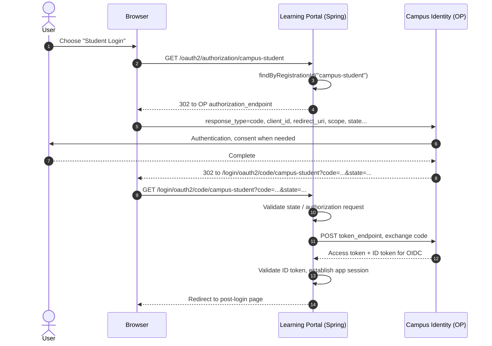
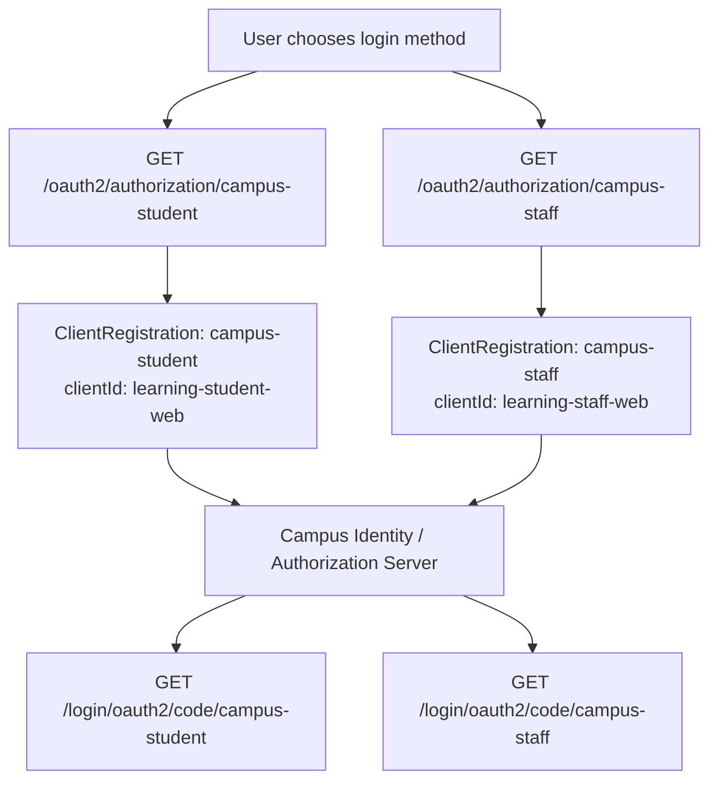

# 5.2. Registration ID, Client Name, and Their Meaning in URLs

## Lesson Objectives

After this lesson, you will be able to:

- Distinguish between **`registrationId`**, **`clientName`**, **`clientId`**, and **provider ID** in Spring Security OAuth 2.0/OIDC Client's `ClientRegistration` configuration.
- Explain why login initiation URLs typically follow the form `/oauth2/authorization/{registrationId}`, while callback URLs typically follow the form `/login/oauth2/code/{registrationId}`.
- Trace how Spring selects the right `ClientRegistration`, redirects to the Authorization Server, and processes the returned authorization code.
- Configure two client registrations that share one OpenID Provider while still having separate login and callback URLs.
- Build a custom login page with display labels from `clientName`, and understand the impact of changing `registrationId` or customizing URLs.
- Identify common errors such as mismatched registration IDs, `redirect_uri_mismatch`, wrong callback paths, proxies altering `baseUrl`, and confusing display names with OAuth identifiers.

## 1. Context: One Login Provider, Multiple Naming Concepts

Suppose the **Learning Portal** application is a Spring Boot web application that lets users sign in through the **Campus Identity** system. There are two user groups: students and instructors. Both sign in at the same OpenID Provider, yet the application creates two different **client registrations**, with separate policies and client IDs.

We name them locally in Learning Portal as follows:

| Property | Student Login | Instructor Login |
| --- | --- | --- |
| `registrationId` | `campus-student` | `campus-staff` |
| `clientName` | `Campus Identity - Student` | `Campus Identity - Staff` |
| `clientId` | `learning-student-web` | `learning-staff-web` |
| Provider alias in configuration | `campus` | `campus` |
| OIDC Issuer | `https://id.campus.example.org` | `https://id.campus.example.org` |
| Login initiation URL at Portal | `/oauth2/authorization/campus-student` | `/oauth2/authorization/campus-staff` |
| Redirect URI registered by Portal with OP | `https://portal.example.org/login/oauth2/code/campus-student` | `https://portal.example.org/login/oauth2/code/campus-staff` |

These values have different meanings. `registrationId` is **Spring's internal key** for selecting a client registration; `clientName` is a **human-readable name**, usually for the UI; `clientId` is **the application's identifier at the Authorization Server**; and `campus` under `provider` is **a local provider configuration key** shared by both registrations.

This is the main principle of the lesson:

> In Spring Security, the `{registrationId}` segment in the default URLs primarily helps the application **select the right OAuth2 Client configuration**. It does not automatically become the `client_id` of the OAuth request, nor is it the user's username.

## 2. What Does `ClientRegistration` Represent?

Spring Security uses the `org.springframework.security.oauth2.client.registration.ClientRegistration` class to describe an OAuth2/OIDC Client registered with a provider.

A `ClientRegistration` includes:

- **Local identifier:** `registrationId`.
- **Display name:** `clientName`.
- **Registration details at the Authorization Server:** `clientId`, client authentication method, and `clientSecret` if applicable.
- **Flow specification:** `authorizationGrantType`, `redirectUri`, `scopes`.
- **Provider details:** authorization URI, token URI, issuer, JWK Set URI, UserInfo URI, and other details required depending on the provider type.

Spring Security places registrations in a `ClientRegistrationRepository` for lookup by `registrationId`. An application can contain one or more registrations.

Example of key interfaces/APIs:

```java
ClientRegistration clientRegistration =
    clientRegistrationRepository.findByRegistrationId("campus-student");

String localKey = clientRegistration.getRegistrationId();
String displayName = clientRegistration.getClientName();
String oauthClientId = clientRegistration.getClientId();
String redirectTemplate = clientRegistration.getRedirectUri();
String authorizationUri =
    clientRegistration.getProviderDetails().getAuthorizationUri();
```

Here:

- `findByRegistrationId("campus-student")` looks up **Spring's registration**, without sending a request to the OP.
- `getClientName()` is the configured display name; it does not determine whether the OP accepts the client.
- `getClientId()` is the value sent in the OAuth `client_id` parameter.
- `getRedirectUri()` is typically a **URI template** that Spring expands when initiating an authorization request.
- `getProviderDetails().getAuthorizationUri()` is the actual endpoint on the Authorization Server, distinct from the login initiation path on Learning Portal.

### 2.1. Four Easily Confused Names

| Name | Identifier scope | Example | Where does it appear? |
| --- | --- | --- | --- |
| `registrationId` | Spring Client's internal key | `campus-student` | YAML under `registration`, Spring default URLs, repository lookup, authorized-client key |
| `clientName` | Human-readable label for the registration | `Campus Identity - Student` | Login UI generated by the app or Spring, depending on configuration |
| `clientId` | OAuth Client identifier at the Authorization Server | `learning-student-web` | `client_id` parameter of the authorization request; client authentication/token exchange per configured method |
| Provider alias | Spring Boot provider configuration linking key | `campus` | YAML `registration.<id>.provider` and `provider.<alias>` |

There are also the OIDC Provider's **`issuer-uri`**, the **username** from the OIDC `preferred_username` claim, and **`client_name`** in some client registration protocols on the Authorization Server side. They do not automatically match `ClientRegistration.clientName` in the Spring application.

### 2.2. `registrationId` Belongs to Spring, Not a Mandatory OAuth 2.0 Field

OAuth 2.0 defines `client_id`, the authorization endpoint, the token endpoint, and authorization rules. It **does not require** every client to have a field named `registrationId`. This is an identifier Spring Security uses to manage multiple OAuth client configurations within one application.

For example, an OP issues `client_id = learning-student-web`. In Learning Portal, the development team may set the registration ID to `campus-student` to express business meaning. The two strings do not need to match.

Even so, `registrationId` should be stable and readable. Because it is placed into default URLs, choose a string suitable as a URL path segment, such as `google`, `campus`, `github`, or `campus-student`. Avoid spaces, characters requiring complex escaping, and inconsistent values across environments.

## 3. Spring Boot Configuration: `registrationId` Is the Key Name Under `registration`

An illustrative configuration for **Spring Boot + Spring Security OAuth2 Login**:

```yaml
spring:
  security:
    oauth2:
      client:
        registration:
          campus-student:
            provider: campus
            client-id: ${CAMPUS_STUDENT_CLIENT_ID}
            client-secret: ${CAMPUS_STUDENT_CLIENT_SECRET}
            client-authentication-method: client_secret_basic
            authorization-grant-type: authorization_code
            redirect-uri: "{baseUrl}/login/oauth2/code/{registrationId}"
            client-name: "Campus Identity - Student"
            scope:
              - openid
              - profile
              - email

          campus-staff:
            provider: campus
            client-id: ${CAMPUS_STAFF_CLIENT_ID}
            client-secret: ${CAMPUS_STAFF_CLIENT_SECRET}
            client-authentication-method: client_secret_basic
            authorization-grant-type: authorization_code
            redirect-uri: "{baseUrl}/login/oauth2/code/{registrationId}"
            client-name: "Campus Identity - Staff"
            scope:
              - openid
              - profile
              - email

        provider:
          campus:
            issuer-uri: https://id.campus.example.org
```

These are **illustrative** URLs and domain names, not a production configuration. The example assumes two confidential clients storing secrets on the backend and an OP supporting OIDC Discovery. You must add the appropriate OAuth2 Client dependency, supply environment variables containing the client credentials, and register the actual redirect URIs at the OP.

Exact explanation of the key structure:

```text
spring.security.oauth2.client
  |
  +-- registration
  |     |
  |     +-- campus-student    <-- registrationId #1
  |     |     +-- client-id    <-- clientId issued by the OP
  |     |     +-- client-name  <-- clientName used for display
  |     |     +-- provider: campus
  |     |
  |     +-- campus-staff      <-- registrationId #2
  |           +-- client-id
  |           +-- client-name
  |           +-- provider: campus
  |
  +-- provider
        |
        +-- campus            <-- provider configuration key, not a registrationId
              +-- issuer-uri
```

Both `registration` entries point to `provider.campus` while keeping **two different `client-id`s**. Multiple registrations can also point to the same provider with different scopes or authentication methods if the provider and policy allow it.

### 3.1. What If `client-name` Is Omitted?

In Spring Security's standard `ClientRegistration` builder behavior, `clientName` is used as a display name and can default from `registrationId` when no custom name is set. For a registration named `campus-student`, the default label may be less user-friendly than `Campus Identity - Student`.

Therefore, if the application has a login provider selection page, set a meaningful `client-name` for users. It is purely a UI label; changing the label does not alter `client-id`, the registration ID, the token endpoint, or the callback URL.

### 3.2. `provider` Is a Configuration Reference

In the example:

```yaml
registration:
  campus-student:
    provider: campus
```

`campus` is the key Spring Boot uses to look up:

```yaml
provider:
  campus:
    issuer-uri: https://id.campus.example.org
```

When the provider supports discovery, Spring can fetch metadata containing the authorization endpoint, token endpoint, JWK Set URI, UserInfo endpoint, etc., using the trusted issuer.

**Do not infer** that because `provider: campus`, the path `/oauth2/authorization/campus` will automatically exist. This default URL must use an **existing registration ID**; in the current configuration, only `campus-student` and `campus-staff` exist.

## 4. The Two Default URLs of Spring Security OAuth2 Login

When using the default `oauth2Login()` configuration, two groups of URLs appear most often.

| URL | Which application owns it? | Role in the flow |
| --- | --- | --- |
| `/oauth2/authorization/{registrationId}` | **Spring Client** (Learning Portal) | Starts the OAuth authorization request; selects the registration by `{registrationId}` and redirects to the OP |
| `/login/oauth2/code/{registrationId}` | **Spring Client** (Learning Portal) | Receives the authorization response/callback from the OP (usually `code`, `state`); Spring processes the login |
| OP's `authorization_endpoint` | **Authorization Server** (Campus Identity) | Renders/orchestrates authentication and consent when needed; returns an authorization code |
| OP's `token_endpoint` | **Authorization Server** | Client exchanges the authorization code for tokens |
| OP's `userinfo_endpoint` | **OpenID Provider** | Client uses the access token to retrieve profile claims when needed and permitted |

The first two initiation and callback URLs **are not Authorization Server endpoints**. They are endpoints on the Spring application side, handled by filters in the `SecurityFilterChain` when OAuth2 Login is properly configured.

### 4.1. Login Initiation URL: `/oauth2/authorization/{registrationId}`

By default, Spring Security supports authorization initiation requests of the form:

```text
https://portal.example.org/oauth2/authorization/campus-student
```

In the example:

- The `/oauth2/authorization/` part is the default **authorization request base URI** set by Spring Security.
- `campus-student` is the **registration ID** Spring uses to look up `ClientRegistration`.
- Spring builds an authorization request from that registration and returns an HTTP redirect to the **OP's authorization endpoint**.

A GET request to Learning Portal:

```http
GET /oauth2/authorization/campus-student HTTP/1.1
Host: portal.example.org
```

May be answered with an HTTP 302 whose `Location` looks similar to (shortened for readability):

```text
https://id.campus.example.org/oauth2/authorize
  ?response_type=code
  &client_id=learning-student-web
  &redirect_uri=https%3A%2F%2Fportal.example.org%2Flogin%2Foauth2%2Fcode%2Fcampus-student
  &scope=openid%20profile%20email
  &state=<random-state>
```

If PKCE is used, the request may also include `code_challenge` and `code_challenge_method=S256`; in OIDC there may be a `nonce`. The actual endpoint and exact parameters depend on the provider, the registration, and enabled protections. Values inside `<...>` are placeholders, not fixed values.

Notice the distinction:

```text
Spring URL path:
    /oauth2/authorization/campus-student
                              ^ registrationId

OAuth request to OP:
    client_id=learning-student-web
              ^ clientId of the selected registration
```

**The registration ID is not sent to the OP as a required parameter named `registration_id`**. The OP cares about `client_id`, `redirect_uri`, scope, PKCE, and other standard parameters.

### 4.2. Callback URL: `/login/oauth2/code/{registrationId}`

After the user authenticates and the OP processes the request, in the Authorization Code Flow, the browser is redirected back to the registered redirect URI:

```text
https://portal.example.org/login/oauth2/code/campus-student?code=<code>&state=<state>
```

In Spring Security's default configuration, the callback group uses the pattern `/login/oauth2/code/*`. The `registrationId` in the pattern normally matches the registration that initiated the request. Spring reads the saved authorization request state, checks `state` correlation, uses the corresponding registration, and exchanges the code at the token endpoint.

Do not assume Spring merely looks at the last path segment and trusts every callback parameter. The login mechanism also binds the response to the saved authorization request, validating state, code, redirect URI, and the corresponding OAuth/OIDC conditions.

### 4.3. Flow Sequence Diagram



The two 302 redirects in the diagram serve different purposes: the first sends the user from Spring to the OP to request authorization, and the second returns the authorization result from the OP to Spring's redirect URI.

### 4.4. OIDC Login Still Uses These Two URLs

OIDC builds on OAuth 2.0. When a registration has the `openid` scope and the provider supports OIDC, Spring Security can process the ID Token, user identity, and UserInfo according to the OIDC flow. However, the default URLs to **initiate** login and **receive the callback** still follow OAuth2 Login conventions.

Example:

```text
GET /oauth2/authorization/campus-student
  -> authenticate at OP
  -> GET /login/oauth2/code/campus-student?code=...&state=...
  -> OAuth2/OIDC Client completes login
```

There is no requirement to name the callback `/oidc/callback` or to include `openid` in the registration ID name.

## 5. URI Templates: `{baseUrl}` and `{registrationId}`

In YAML, a commonly used redirect URI is:

```yaml
redirect-uri: "{baseUrl}/login/oauth2/code/{registrationId}"
```

This is a template that Spring expands per authorization request, for example:

```text
baseUrl         = https://portal.example.org
registrationId  = campus-student

redirect_uri    = https://portal.example.org/login/oauth2/code/campus-student
```

If the web app is deployed under the `/learning` context path, `baseUrl` may include that context path, depending on deployment and forwarded headers:

```text
baseUrl         = https://portal.example.org/learning
registrationId  = campus-student

redirect_uri    = https://portal.example.org/learning/login/oauth2/code/campus-student
```

Spring Security supports common redirect URI template variables such as `{baseUrl}`, `{baseScheme}`, `{baseHost}`, `{basePort}`, `{basePath}`, and `{registrationId}`. When using templates, be sure you understand **the actual expanded URL** and register that exact URL with the provider.

### 5.1. Why Must the Redirect URI Be Registered Accurately?

The Authorization Server typically requires an OAuth Client's redirect URI to match its registered URI list according to its security policy.

For example, the OP has registered:

```text
https://portal.example.org/login/oauth2/code/campus-student
```

But the actual request sends:

```text
http://portal-internal:8080/login/oauth2/code/campus-student
```

It may be rejected with `redirect_uri_mismatch`, `invalid_request`, or an equivalent error, depending on the provider.

A common cause is running the application behind a reverse proxy/ingress: externally users access HTTPS, while Spring sees an internal HTTP connection. Trusted forwarded headers and the proxy must be configured properly so Spring constructs the accurate external base URL. In Spring Boot, depending on the deployment model, appropriate configuration may be needed, such as:

```yaml
server:
  forward-headers-strategy: framework
```

This is an environment-dependent example; you must ensure the proxy only forwards/overrides trusted forwarded headers. **Never** blindly trust `X-Forwarded-Host` sent directly by an Internet client.

### 5.2. `registrationId` in the Callback Is Not a Secret

The callback URL is visible to the browser, reverse proxy logs, and configuration at the OP. The `registrationId` value must therefore be treated as a **public** local identifier; never use it to store a client secret or personal information.

Transaction security does not come from hiding `campus-student`; it comes from HTTPS, redirect URI binding, `state`, PKCE, client authentication when required, and validating the authorization code and ID Token per OIDC rules.

### 5.3. What Changes If You Rename `registrationId`?

If you rename the registration from:

```yaml
registration:
  campus-student:
```

to:

```yaml
registration:
  campus-learner:
```

while still using the default URI templates, you get:

```text
Before:
  /oauth2/authorization/campus-student
  /login/oauth2/code/campus-student

After:
  /oauth2/authorization/campus-learner
  /login/oauth2/code/campus-learner
```

Login links on the frontend must be updated accordingly. The OP must also have its redirect URI list updated if the callback changes. Places that look up by registration ID—such as annotations, managers, or the authorized client store—must be updated to match.

**Changing `registrationId` does not automatically change the application's `clientId`** at the OP, but it can prevent users from signing in if callbacks and old references are not updated in sync.

## 6. What Is `clientName` Used For?

`clientName` is the friendly name of the registration. It is especially useful when the application lets users choose among multiple providers or login methods.

Example:

```yaml
registration:
  campus-student:
    client-name: "Campus Identity - Student"
  campus-staff:
    client-name: "Campus Identity - Staff"
```

The UI can display:

```text
Choose a login method

[Campus Identity - Student]
[Campus Identity - Staff]
```

In Spring Security configurations where the default login page is auto-generated, Spring can use the client name as the OAuth2 Login link label. This depends on the registration type, repository, and whether the generated login page is used.

When building a custom login page, the application controls the labels and links. `clientName` does not alter the `/oauth2/authorization/{registrationId}` endpoint.

### 6.1. `clientName` Is Not User Identity Information

Distinguish clearly:

- `clientName = "Campus Identity - Student"`: display name of the **OAuth client registration**.
- `OidcUser.getFullName()` or the `name` claim: profile name of the **authenticated user**.
- `clientId = "learning-student-web"`: **OAuth client** identifier registered at the OP.
- `registrationId = "campus-student"`: Spring's **local registration** key.

Do not use `clientName` as an account name, do not send it in place of `client_id`, and do not treat it as an OP-verified claim.

### 6.2. Is `clientName` the Display Name on the OP Side?

Not necessarily. The consent screen or login confirmation page at the OP may show **the client name registered at the OP**, according to the OP's client management mechanism. The `client-name` string in Spring's YAML does not automatically update the application's display name at the OP.

Example:

```text
At Learning Portal:
    clientName = "Campus Identity - Student"

At OP:
    Application display name = "Learning Portal Student"
```

The two names can differ. To change what the OP displays, you must update the registration on the OP side or the appropriate dynamic registration process, not just edit Learning Portal's YAML.

## 7. Auto-Generated Login Page and Custom Login Pages

### 7.1. Default Login Page

If the application enables `oauth2Login()` and uses the appropriate default login page, Spring Security can generate a login page listing links to the configured client registrations.

To generate links for multiple OAuth2 Clients, Spring needs to enumerate the registrations, such as an `Iterable<ClientRegistration>` repository like `InMemoryClientRegistrationRepository`. The `clientName` field is typically the display label on the generated page.

Example security chain:

```java
@Configuration
class SecurityConfiguration {

    @Bean
    SecurityFilterChain webSecurity(HttpSecurity http) throws Exception {
        http
            .authorizeHttpRequests(authorize -> authorize
                .requestMatchers("/", "/assets/**").permitAll()
                .anyRequest().authenticated()
            )
            .oauth2Login(Customizer.withDefaults());

        return http.build();
    }
}
```

Users accessing a protected page can be sent to the default login page to choose a provider/registration. Link labels reflect `clientName` when Spring generates the links; link targets still rely on `registrationId`.

### 7.2. Custom Login Page

Many products want full control over logos, labels, language, and option order. In that case, a custom login page can contain links such as:

```html
<a href="/oauth2/authorization/campus-student">
  Sign in with Student Account
</a>

<a href="/oauth2/authorization/campus-staff">
  Sign in with Staff Account
</a>
```

The `href` attributes must use the exact registration ID. The text inside `<a>...</a>` is purely a UI label and may differ from `clientName` without changing the OAuth flow.

Spring Security example when specifying a custom login page:

```java
@Bean
SecurityFilterChain webSecurity(HttpSecurity http) throws Exception {
    http
        .authorizeHttpRequests(authorize -> authorize
            .requestMatchers("/", "/login", "/assets/**").permitAll()
            .anyRequest().authenticated()
        )
        .oauth2Login(oauth2 -> oauth2
            .loginPage("/login")
        );

    return http.build();
}
```

The application must provide a controller/view or corresponding handler for `/login`. Once a custom login page is set, you cannot expect Spring to continue generating HTML like the default login page.

If using Spring MVC with a `/login` controller, return a view template and configure view rendering appropriately for the project. The HTML snippet above assumes deployment at the root path; if there is a context path or different base path, construct links accordingly.

### 7.3. Reading Registration Details to Generate Links Dynamically

If you want to render the login options from `ClientRegistrationRepository`, you can read the configured registrations and build the corresponding URLs:

```java
@GetMapping("/login-options")
List<Map<String, String>> loginOptions(
        ClientRegistrationRepository repository) {

    if (!(repository instanceof Iterable<?> iterable)) {
        throw new IllegalStateException(
            "Configured repository does not support iteration"
        );
    }

    List<Map<String, String>> options = new ArrayList<>();

    for (Object candidate : iterable) {
        ClientRegistration registration = (ClientRegistration) candidate;

        if (!AuthorizationGrantType.AUTHORIZATION_CODE.equals(
                registration.getAuthorizationGrantType())) {
            continue;
        }

        options.add(Map.of(
            "registrationId", registration.getRegistrationId(),
            "clientName", registration.getClientName(),
            "authorizationStartUrl",
            "/oauth2/authorization/" + registration.getRegistrationId()
        ));
    }

    return options;
}
```

This is an illustrative example of reading registration details in an application with an iterable repository; real code needs imports, context path handling, and filtering of which registrations are allowed to be displayed. An application should not automatically expose every service client configuration or OAuth client not intended for user login.

Building links as shown above depends on **the default authorization base URI**; if the application changes the base URI, the generated path must be updated accordingly.

## 8. Customizing the Authorization Start URL

Default:

```text
/oauth2/authorization/{registrationId}
```

You can change the authorization request base URI, for example to `/signin/oauth2`:

```java
@Bean
SecurityFilterChain securityFilterChain(HttpSecurity http) throws Exception {
    http
        .authorizeHttpRequests(authorize -> authorize
            .requestMatchers("/login", "/assets/**").permitAll()
            .anyRequest().authenticated()
        )
        .oauth2Login(oauth2 -> oauth2
            .loginPage("/login")
            .authorizationEndpoint(endpoint -> endpoint
                .baseUri("/signin/oauth2")
            )
        );

    return http.build();
}
```

Then the login links the frontend must use are:

```text
/signin/oauth2/campus-student
/signin/oauth2/campus-staff
```

This is the **request-handling path on the Client**, not the OP's authorization endpoint. Changing the base URI in Spring while forgetting to update `<a href>` on the custom login page will break login initiation.

In applications needing special behavior, Spring also allows customizing `OAuth2AuthorizationRequestResolver`; when doing so, preserve essential OAuth/OIDC values and protections such as `state`, redirect URI, PKCE, and nonce where applicable.

## 9. Customizing the Callback/Redirection URL

Default:

```text
/login/oauth2/code/{registrationId}
```

If you want a callback like `/signin/callback/{registrationId}`, you must coordinate **both the endpoint receiving the authorization response** and **the redirect URI sent to the provider**.

Example with Spring Security:

```java
@Bean
SecurityFilterChain securityFilterChain(HttpSecurity http) throws Exception {
    http
        .authorizeHttpRequests(authorize -> authorize
            .anyRequest().authenticated()
        )
        .oauth2Login(oauth2 -> oauth2
            .redirectionEndpoint(endpoint -> endpoint
                .baseUri("/signin/callback/*")
            )
        );

    return http.build();
}
```

And at the same time in the registration:

```yaml
spring:
  security:
    oauth2:
      client:
        registration:
          campus-student:
            redirect-uri: "{baseUrl}/signin/callback/{registrationId}"
```

The actual callback must be registered at the provider, for example:

```text
https://portal.example.org/signin/callback/campus-student
```

If `redirectionEndpoint().baseUri(...)` and the client registration's `redirect-uri` do not match, the OP may redirect accurately to the registered URI while Spring has no filter listening at that path.

**Be careful with wildcards:** In the redirection endpoint configuration API, a pattern like `/signin/callback/*` is used for path matching; meanwhile, the `redirect-uri` sent to the OP must be the actual expanded URI, typically without wildcards.

### 9.1. Can `{registrationId}` Be Omitted from the Callback?

Some systems choose a fixed redirect URI such as:

```text
https://portal.example.org/oauth/callback
```

This can be viable if the client/framework is properly customized to resolve the corresponding authorization request and registration, and the callback endpoint matches exactly. However, when configuring multiple `ClientRegistration`s, the `{registrationId}` template is a clear and convenient choice: each registration has a distinct URI, reducing confusion during provider registration and operations.

Do not remove `{registrationId}` just for a shorter URL while overlooking how Spring identifies the registration from the authorization response. With default code, use the templates supported by Spring Security and keep paths synchronized.

## 10. `registrationId` in Other Spring Security APIs

This name appears throughout the lifecycle of an OAuth2 Client, not only in URLs.

### 10.1. Looking Up from `ClientRegistrationRepository`

```java
ClientRegistration registration =
    clientRegistrationRepository.findByRegistrationId("campus-student");
```

If the registration ID does not exist, the repository usually returns `null` or a higher-level mechanism may throw an error. When configuring multiple providers, do not use `clientName` or `clientId` as the key when calling lookup-by-registration-ID APIs.

### 10.2. Working with `OAuth2AuthorizedClient`

Once a principal is authorized, Spring can store state in `OAuth2AuthorizedClient` and retrieve it using the registration ID plus principal.

Controller example:

```java
@GetMapping("/oauth-client-info")
Map<String, String> oauthClientInfo(
        @RegisteredOAuth2AuthorizedClient("campus-student")
        OAuth2AuthorizedClient authorizedClient) {

    return Map.of(
        "registrationId",
        authorizedClient.getClientRegistration().getRegistrationId(),
        "clientName",
        authorizedClient.getClientRegistration().getClientName()
    );
}
```

The example assumes an appropriate authorized client exists in the current authentication context and the endpoint is protected. Never return access tokens or refresh tokens from a controller just for debugging.

### 10.3. Using `OAuth2AuthorizedClientManager`

An authorize call also uses the registration ID:

```java
OAuth2AuthorizeRequest request =
    OAuth2AuthorizeRequest
        .withClientRegistrationId("campus-student")
        .principal(authentication)
        .build();

OAuth2AuthorizedClient client =
    authorizedClientManager.authorize(request);
```

The manager uses the registration ID to select the client and handle configured grants; it **does not look up by the `clientName` label**. In a Servlet application, actual behavior also depends on the request context, authentication, and authorized client store.

### 10.4. Choosing a Default Registration

An application with multiple registrations that wants the primary "Sign In" button to always lead to one option can link directly to:

```text
/oauth2/authorization/campus-student
```

There is no need to change `clientName`, nor to change the issuer. Choosing a registration is an application-level choice: based on business requirements, not on whether OPs share a domain.

## 11. Multiple Registrations with One Provider: Why Is It Useful?

A single provider can register multiple OAuth Clients for different purposes:

- **Student Portal:** access/scopes appropriate for students.
- **Staff Portal:** different scopes or authentication policies, if supported by the OP.
- **Environment:** dev, staging, and production typically have separate client IDs and callbacks.
- **Architecture:** a confidential web backend client and a public mobile client are separate clients at the OP.
- **Tenants or partners:** may use different issuers or the same issuer depending on design.

Example in one application:



Sharing the same issuer does not negate the meaning of the registration ID; each registration still represents a specific client registration.

### 11.1. When Not to Create Additional Registrations

Not every role or user type needs a separate OAuth client. If all users sign in at the same OP, share the same OAuth/OIDC policies, and the application enforces authorization using internal roles after login, one registration may be enough. Do not create multiple registrations solely to infer permissions from the URL the user chose: actual permissions must be based on trusted data and the policies of the application/Resource Server.

In particular, signing in via `/oauth2/authorization/campus-staff` **does not by itself prove** that the user is an instructor. Identity and business permissions must be verified after authentication, even when the registration is named `staff`.

## 12. Managing URLs in Real-World Deployments

### 12.1. Reverse Proxy, HTTPS, and Public Host

A typical deployment looks like:

```text
Browser (HTTPS)
    |
    v
https://portal.example.org
    |
    v
Ingress / reverse proxy
    |
    v
Spring Boot at http://portal-service:8080
```

If Spring generates the redirect URI from the internal address, the provider may reject it. During deployment, determine:

1. The application's public host and scheme.
2. The context path/base path that users actually see.
3. How the server processes trusted forwarded headers.
4. The exact redirect URI registered at the OP.
5. The callback filter pattern Spring is listening on.

These checks matter more than whether `clientName` looks nice, because **the redirect URI is an OAuth security boundary**.

### 12.2. Context Path

If configured:

```yaml
server:
  servlet:
    context-path: /learning
```

external paths may be:

```text
https://portal.example.org/learning/oauth2/authorization/campus-student
https://portal.example.org/learning/login/oauth2/code/campus-student
```

Hard-coded HTML links to `/oauth2/authorization/campus-student` will omit `/learning` when the browser resolves from the root host. Generate URLs taking the context path into account, or supply the base path from the server to the frontend.

### 12.3. Changing Registration IDs in an Environment with Active Users

Changing `registrationId` can affect in-flight OAuth requests, old login links, registered callbacks, and authorized clients stored by registration ID. If migrating a production environment, plan a synchronized deployment or an appropriate transition period so active flows are not broken.

The `(registrationId, principal)` pair is commonly used to identify an OAuth2 authorized client in Spring's store. Changing the ID merely to rename a UI label can prevent previously stored tokens from being found under the new key. **If you only want to change the label, change `clientName` instead of renaming `registrationId`.**

### 12.4. Frontend-Supplied URLs Must Never Automatically Grant Permissions

For example, the frontend has two buttons:

```text
Student login -> /oauth2/authorization/campus-student
Staff login   -> /oauth2/authorization/campus-staff
```

The path only selects the **registration**. After the callback, the application must still validate the ID Token, bind issuer/subject, and then apply authorization rules. An attacker can hit the Staff button's URL directly; this endpoint cannot serve as a role check.

## 13. Common Errors and How to Find the Root Cause

| Symptom | Possible cause | What to check |
| --- | --- | --- |
| Clicking login button does not redirect to OP | Link uses wrong registration ID, or authorization request base URI was customized | Compare `<a href>` with `registration.<id>` and `authorizationEndpoint().baseUri` |
| `/oauth2/authorization/campus` does not work | There is a provider alias `campus` but no registration ID `campus` | Check the list of keys under `registration` |
| OP reports `invalid_client` | Client ID/secret/authentication method mismatch | Check the registration config at OP and `client-id`, do not substitute registration ID |
| OP reports `redirect_uri_mismatch` | Actual callback URL has wrong host/scheme/path or is unregistered | Check the expanded template URI and the callback list at the OP |
| Callback reaches Portal but returns 404/unhandled | Redirection filter pattern and callback path are out of sync | Compare `redirect-uri` with `redirectionEndpoint().baseUri(...)` |
| Login page shows a strange label or only a technical code | `client-name` not declared, or UI page does not use this value | Update `client-name` or the login template |
| Changed `client-name` but OP still shows the old name | Display name registered at the OP is managed separately | Update the display name in OP configuration if needed |
| Old links fail after changing `registrationId` | Start/callback URLs, annotations, managers, or authorized-client keys still use old ID | Synchronously update all references and redirect URIs at the OP |
| Works in dev, callback fails in production | Host/proxy/context path/forwarded headers differ | Compare external base URL with the URI registered at the OP |
| Clicked Staff button but signed into a Student account | OP authenticated a valid identity; registration selection URL is not a role gate | Check internal authorization after login |
| Multiple registrations exist but default page does not list them properly | Repository is not iterable or login page was customized | Check iterable repository, grant type, and login page mechanism in use |

### 13.1. Step-by-Step Analysis of a `redirect_uri_mismatch` Error

Suppose OP logs or an error message shows the request had:

```text
client_id    = learning-student-web
redirect_uri = http://localhost:8080/login/oauth2/code/campus-student
```

While the OP has registered:

```text
https://portal.example.org/login/oauth2/code/campus-student
```

We can deduce:

- Spring selected the `campus-student` registration if `client_id` is right.
- The mismatch is in **the callback's host and scheme**, not `clientName`.
- Check `baseUrl`, the reverse proxy, and forwarded-headers configuration, then confirm the final URI matches at the OP.

If the OP reports that the client ID does not exist, the issue lies in **`client-id`** configuration or OP-side registration; changing `client-name` text will not fix it.

### 13.2. Distinguishing Types of 404s

If the initial request:

```text
GET /oauth2/authorization/campus-student
```

returns 404, check whether the application has a `SecurityFilterChain` enabling OAuth2 Login, has the corresponding registration, and whether the endpoint base URI was modified.

If the OP already redirected back to:

```text
GET /login/oauth2/code/campus-student?code=...&state=...
```

but returns 404, check the redirection endpoint configuration, context path, and reverse proxy routing. These two errors follow different paths and should not be diagnosed identically.

## 14. Security Principles When Using Registration IDs in URLs

- **Use HTTPS** for production redirect URIs and related endpoints; restrict strictly to registered URIs.
- **Keep `clientSecret` on the backend** of confidential clients. Client IDs and registration IDs are not passwords, but secrets and tokens must be protected.
- **Do not treat registration IDs as permissions:** users can directly invoke the URL of any login button; authorization must occur after authentication.
- **Do not blindly accept arbitrary callbacks:** `state`, PKCE, redirect URI binding, client authentication, and OIDC ID Token validation must be handled properly by the library.
- **Do not build `redirect_uri` from untrusted host headers** in public proxy environments; ensure trusted host/proxy configuration.
- **Separate configuration per environment:** dev and production usually require separate client IDs, secrets, and redirect URIs; avoid accidentally using a localhost callback in production.
- **Do not put tokens into application URLs:** the Authorization Code Flow by default passes only the authorization code in the callback; tokens are exchanged over a direct back-channel.

## 15. Practice Exercises

### Exercise 1: Analyze the YAML

Given the configuration:

```yaml
spring:
  security:
    oauth2:
      client:
        registration:
          my-sso:
            provider: corp-idp
            client-id: office-portal-prod
            client-name: "Company Account"
            authorization-grant-type: authorization_code
            redirect-uri: "{baseUrl}/login/oauth2/code/{registrationId}"
            scope: [openid, profile]
        provider:
          corp-idp:
            issuer-uri: https://login.company.example
```

Suppose the app runs at `https://portal.company.example`. Identify:

1. What is the Registration ID?
2. What is the Client name?
3. What value is sent as `client_id`?
4. What is the default login initiation URL?
5. What is the expected callback URL?
6. What is the Provider alias?

**Answers:**

| Question | Value |
| --- | --- |
| 1 | `my-sso` |
| 2 | `Company Account` |
| 3 | `office-portal-prod` |
| 4 | `https://portal.company.example/oauth2/authorization/my-sso` |
| 5 | `https://portal.company.example/login/oauth2/code/my-sso` |
| 6 | `corp-idp` |

### Exercise 2: Rename the Login Button

Product wants the button changed from "Company Account" to "SSO Login". Do not change the OAuth flow or OP-side configuration.

**Appropriate solution:** update `client-name` or the login page UI label. Keep `registrationId`, `client-id`, and `redirect-uri` unchanged unless there is a technical reason to change them.

### Exercise 3: Change the Registration ID

The engineering team renames `my-sso` to `enterprise-sso` while leaving the provider unchanged.

**Needs updating:** the `/oauth2/authorization/enterprise-sso` link, the `/login/oauth2/code/enterprise-sso` callback if using the template, the client's redirect URI list at the OP, and all Java/config references to the old registration ID. The provider alias `corp-idp` can be **kept unchanged** if the same issuer and endpoints are still used.

### Exercise 4: Can User Role Be Inferred from the URL?

Someone chooses:

```text
/oauth2/authorization/campus-staff
```

After login, can the application automatically assign the `STAFF` role?

**No.** The registration ID only selects the client registration. The `STAFF` role must be based on authentication results and a trusted authorization source, according to application policy.

### Exercise 5: Customizing Login Initiation

The application changed the authorization endpoint base URI to `/auth/start`. Which link is valid for the `my-sso` registration?

**Answer:** `/auth/start/my-sso`. The `/oauth2/authorization/my-sso` link is only valid when still using the default authorization base URI or a separate compatible configuration.

## 16. Review Questions

**1. Is `registrationId` the `client_id` sent to the Authorization Server?**

> No. `registrationId` is Spring's local key. Spring looks up the configuration and sends that registration's `clientId` in the OAuth `client_id` parameter.

**2. Why do two registrations with the same provider have two different `/oauth2/authorization/...` URLs?**

> Because each URL selects a different `ClientRegistration`. Both can point to the same Authorization Server while maintaining separate client IDs, scopes, and redirect URIs.

**3. If `client-name` changes, do the default URLs change?**

> No. The default URLs are tied to `registrationId`; `clientName` is only for display naming.

**4. If the OP allows the `/login/oauth2/code/google` callback, yet the application registers `registrationId=campus`, does the callback match automatically?**

> No. When using the default redirect URI template, the callback for `campus` is `/login/oauth2/code/campus`. You must register the actual URI or customize consistently.

**5. If `registration.provider: campus`, is `/oauth2/authorization/campus` guaranteed to work?**

> No. `campus` is a provider alias, whereas the end of the URL is a key under `registration`. Only URLs corresponding to an actual registration will be matched.

**6. If the application has a custom `/login` page yet still fails to call the OP, what should be checked?**

> Check `href` on the login page, the `registrationId` key, whether the security chain enables `oauth2Login()`, and whether the authorization request base URI was customized.

**7. Can you rely on `/oauth2/authorization/admin` to grant admin permissions?**

> No. That is only a registration name. Identity must be authenticated and business authorization rules applied separately.

---

## Key Takeaways

In Spring Security OAuth2/OIDC Client, **`registrationId` is the local identifier of a `ClientRegistration`**, used to look up configuration and typically appearing in two default URLs: **`/oauth2/authorization/{registrationId}`** to initiate login and **`/login/oauth2/code/{registrationId}`** to receive the callback. **`clientName` is a display name** freely chosen for UX; **`clientId` is the OAuth Client identifier that the Authorization Server receives in `client_id`**; and the **provider alias** simply helps Spring reference the provider's configuration. When changing a registration ID or URI, you must synchronously update links, callback templates, OP-side configuration, and places that look up authorized clients.
