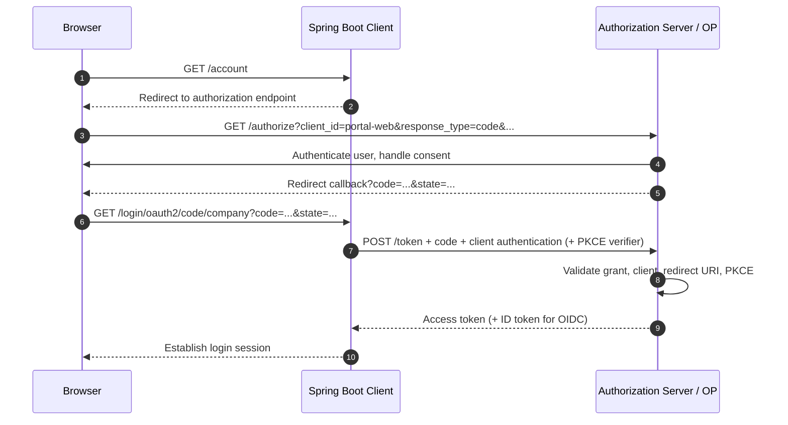

# 5.3. Client ID, Client Secret, and ClientAuthenticationMethod

In **Spring Security OAuth 2.0/OIDC Client**, each `ClientRegistration` describes how the application is registered with an Authorization Server (AS) or OpenID Provider (OP). The three most easily confused properties are **`clientId`**, **`clientSecret`**, and **`clientAuthenticationMethod`**. They directly relate to how the AS identifies and, where appropriate, authenticates the *client application* before issuing tokens.

The three properties answer three different questions:

| Property | Primary question | Example |
|---|---|---|
| **Client ID** — `clientId` | Which client application is making the request? | `portal-web` |
| **Client secret** — `clientSecret` | Does the application have a secret credential issued at registration? | Secret value stored in a secret manager |
| **Client authentication method** — `clientAuthenticationMethod` | **How** must the application prove its identity to the AS? | `client_secret_basic`, `client_secret_post`, or `none` |

**A Client ID is not a password. A client secret is not a user password. Client authentication does not replace user login or PKCE.** Understanding these three layers properly helps avoid `invalid_client` errors, prevents leaking secrets to the frontend, and lets you choose the Spring Security configuration suited to your deployment model.

## 1. Placing the Three Properties in the OAuth 2.0 Flow

An OAuth 2.0/OIDC Client can interact with the AS at two main points:

1. **Authorization endpoint:** where the browser is sent so the user can sign in/grant consent, typically using `client_id` so the AS knows which registration the request comes from.
2. **Token endpoint:** where the client exchanges an authorization code, refresh token, or other valid grant for tokens; here the AS may require **client authentication**.

Example of a Spring MVC application using the OIDC Authorization Code Flow:



In this example, `client_id` appears in the authorization request. `client_secret`, if present, is sent **directly from the backend to the token endpoint**, according to the registered method; it is never placed in browser redirect URLs.

The **Client Credentials Grant** has no browser or end user, yet still requires the AS to identify and typically authenticate the client at the token endpoint. Conversely, an SPA or native app is a **public client** that cannot be assumed capable of keeping a client secret confidential; they normally use Authorization Code + PKCE with a client authentication method of `none`.

## 2. Client ID: Identifier of an OAuth Client

### 2.1. What Does Client ID Mean?

`client_id` is **the identifier that the Authorization Server issues for a client registration**. The AS uses it to look up configuration such as:

- Allowed grant types: `authorization_code`, `client_credentials`, or others.
- Which redirect URIs are registered, such as `https://portal.example.org/login/oauth2/code/company`.
- Scopes, audience, consent policy, or applicable security policies.
- Whether the client is public or confidential and which client authentication methods are allowed.
- OIDC parameters such as ID token signing/encryption, logout URIs, and client identity attributes, if supported.

In OIDC, `client_id` is also the value the Relying Party normally checks in the **audience (`aud`)** of the ID token. This ensures the ID token was issued for the intended application, unlike an access token whose audience targets an API.

Example of multiple applications sharing one OP:

| Registration | Illustrative `client_id` | Deployment type |
|---|---|---|
| `company-web` | `portal-web-prod` | Spring Boot web confidential client |
| `company-spa` | `portal-spa-prod` | Pure SPA public client |
| `company-mobile` | `portal-mobile-prod` | Native mobile public client |
| `reporting-job` | `reporting-worker-prod` | Backend service confidential client |

Different IDs let the AS distinguish redirect URIs, credential lifecycles, scopes, and policies. A product may need **multiple registrations** instead of sharing a single client ID across backend, SPA, and mobile.

### 2.2. Is Client ID a Secret?

**No.** A Client ID routinely appears in redirect URLs, JavaScript configuration, request logs, or system discovery. Knowing a client ID alone does not allow someone to act as a **confidential client** when the AS enforces client authentication properly.

A Client ID is also **not a user ID**. Different values:

| Value | Who/what does it identify? |
|---|---|
| `client_id` | OAuth client/application registration |
| OIDC `sub` | End user within the issuer and subject policy scope |
| Access token `aud` | Intended Resource Server/API receiving the access token |
| OIDC ID token `aud` | Intended RP/client receiving the ID token |
| `registrationId` in Spring | Local name Spring uses to look up `ClientRegistration` |

A common mistake is confusing `registrationId` and `clientId`. In configuration:

```yaml
spring:
  security:
    oauth2:
      client:
        registration:
          company:
            client-id: portal-web-prod
```

- `company` is the **registration ID**, chosen by the Spring application; the default endpoint to initiate login may be `/oauth2/authorization/company`.
- `portal-web-prod` is the actual **client ID** that must be registered at the AS; it is sent via the `client_id` parameter.

Renaming `company` in Spring configuration does not mean changing the client ID at the AS. However, changing `client-id` generally requires updating the registration at the AS and rechecking policies, redirect URIs, and ID token audience.

## 3. Client Secret: Credential for Confidential Clients

### 3.1. What Does Client Secret Do?

`client_secret` is a credential shared between the AS and a confidential client, typically a high-entropy string. It enables the client to authenticate to the AS at the token endpoint (and other endpoints if required by protocol/policy).

Examples:

- Spring Boot running on an organization-controlled server can hold the secret in a secret manager and send it to the token endpoint over HTTPS.
- A cron job running inside managed infrastructure can use a secret when obtaining an access token via `client_credentials`.
- A JavaScript SPA, APK, desktop binary, or CLI distributed to users **cannot protect a shared secret from users who control the execution environment**.

**A client secret is not a user account password.** The AS authenticating the client does not mean it has authenticated a user. In the Authorization Code Flow, the OP still handles End-User login; in the Client Credentials Grant, the token typically represents the client's own permissions, not tied to an interactive user session.

### 3.2. When Must a Client Secret Not Be Used?

Do not place a shared client secret in:

- React/Vue/Angular bundles served to the browser.
- Build environment variables such as `VITE_CLIENT_SECRET` or `NEXT_PUBLIC_CLIENT_SECRET`; values baked into the client bundle can still be read.
- APK/IPA files, desktop/CLI applications distributed to users.
- JavaScript sending requests from the browser to the token endpoint.
- Authorization URLs, query parameters, error messages, or application logs.

**Obfuscating/minifying** code or packaging `client_secret` as an encrypted string alongside its decryption key still does not make it a secret if the client itself must decrypt it in the user's environment.

Public clients use **`ClientAuthenticationMethod.NONE`** (configuration string `none`) and typically pair **Authorization Code + PKCE** in the login flow. PKCE uses a fresh `code_verifier` per authorization request, helping prevent an attacker who steals an authorization code from exchanging it for tokens; **PKCE does not turn a public client into a confidential client**.

### 3.3. Confidential Clients Cannot Rely Solely on a Client Secret Either

A backend is permitted to hold credentials when protective controls are in place:

- HTTPS/TLS for all requests to the AS.
- Never commit secrets to Git, artifacts, or public images.
- Restrict secret read access to the process that needs it.
- Never write secrets to application logs, stack traces, tracing, or telemetry.
- Have a **rotation** and revocation process if compromise is suspected.
- Use distinct secrets across environments and, where appropriate, across applications/services.

If operators lose control of the host/container or an attacker gains access to the secret manager and application runtime, a confidential client can still be impersonated. Being "confidential" is a property of **being able to manage credentials in the deployment environment**, not an absolute guarantee.

## 4. ClientAuthenticationMethod: How the Client Authenticates at the Token Endpoint

In Spring Security, `ClientAuthenticationMethod` is a **value object** representing the client authentication method. Common examples:

```java
ClientAuthenticationMethod.CLIENT_SECRET_BASIC
ClientAuthenticationMethod.CLIENT_SECRET_POST
ClientAuthenticationMethod.NONE
```

Spring Boot has the corresponding property:

```yaml
client-authentication-method: client_secret_basic
```

**This method must match the method registered/supported at the Authorization Server.** Having a secret while declaring `none`, or the AS requiring `client_secret_basic` while the client sends `client_secret_post`, can both cause token requests to be rejected.

### 4.1. Common Methods

| Protocol value | What does the client send? | Usage model | Notes |
|---|---|---|---|
| `client_secret_basic` | Client ID and secret in the HTTP Basic Authorization header | Confidential client using a shared secret | Common, usually preferred when supported by the AS |
| `client_secret_post` | `client_id` and `client_secret` in the `application/x-www-form-urlencoded` body | Confidential client using a shared secret | Use only when suitable for the AS; avoid logging request bodies |
| `none` | Sends no authenticating client credential | Public client | Still sends `client_id` as required by the token endpoint |
| `client_secret_jwt` | JWT assertion signed with the client secret | Confidential client | Must build/sign assertion per spec and manage the shared key |
| `private_key_jwt` | JWT assertion signed with the client's private key | Confidential client | Client holds private key; AS verifies against registered public key |
| mTLS, e.g., `tls_client_auth` | Client certificate via TLS mutual authentication | High-security confidential client | Requires support in the AS, HTTP/TLS stack, and library version |

Distinguish between **standard/protocol values** and **constants pre-defined in a specific Spring Security version**. The three Basic/Post/None constants are commonly used directly and stable; JWT or mTLS methods may require configuring an HTTP client, signing keys, token client converters, and version-appropriate support.

### 4.2. `client_secret_basic`

The client authenticates at the token endpoint via an HTTP header:

```http
POST /oauth2/token HTTP/1.1
Host: login.example.org
Content-Type: application/x-www-form-urlencoded
Authorization: Basic <base64-encoded-client-id-and-secret>

grant_type=authorization_code&code=<authorization-code>&redirect_uri=https%3A%2F%2Fapp.example.org%2Flogin%2Foauth2%2Fcode%2Fcompany
```

HTTP Basic in OAuth 2.0 encodes the client ID and secret per form-url-encoding rules before forming `username:password` and Base64-encoding it. **Base64 is not secure encryption**; TLS protects the transport.

Spring Security's token client formats this properly when using the appropriate converters; do not manually concatenate Basic headers when the framework already supports it.

Note that `Authorization: Basic ...` here is **OAuth client authentication with the Authorization Server**, completely distinct from `Authorization: Bearer ...` that the client sends to a Resource Server to call an API.

### 4.3. `client_secret_post`

With this method, credentials appear in the form body:

```http
POST /oauth2/token HTTP/1.1
Host: login.example.org
Content-Type: application/x-www-form-urlencoded

grant_type=authorization_code
&code=<authorization-code>
&redirect_uri=https%3A%2F%2Fapp.example.org%2Flogin%2Foauth2%2Fcode%2Fcompany
&client_id=portal-web
&client_secret=<server-held-secret>
```

The body above is wrapped across lines for readability; an actual HTTP request form-encodes the fields in a single payload. Because the secret is in the request body, be careful with reverse proxies, HTTP instrumentation, or form-data loggers.

Do not switch to `client_secret_post` just because Basic uses an `Authorization` header; both are client authentication and must match the AS configuration. Per RFC 6749, placing the secret in the request body should only be chosen when HTTP Basic cannot be used or is unsupported by the AS.

### 4.4. `none`

A public client has no client authentication credential. Example token request:

```http
POST /oauth2/token HTTP/1.1
Host: login.example.org
Content-Type: application/x-www-form-urlencoded

grant_type=authorization_code
&client_id=browser-spa
&code=<authorization-code>
&redirect_uri=https%3A%2F%2Fspa.example.org%2Fcallback
&code_verifier=<verifier-created-for-this-request>
```

**`client_id` still serves as an identifier**, even though the client does not prove itself with a secret. The Authorization Server enforces grant checks, registered redirect URI checks, and PKCE verifier verification against the corresponding authorization code.

There is no reason to add an empty Basic header or send `client_secret=undefined` in the request. A client registered with `none` must execute the exact public-client flow supported by the AS.

### 4.5. `private_key_jwt` and `client_secret_jwt`

These are two methods that authenticate the client with a **JWT assertion** instead of sending a raw client secret via Basic or the body:

- `client_secret_jwt`: the client signs the assertion using the shared secret with a symmetric algorithm accepted by the AS.
- `private_key_jwt`: the client signs the assertion with its private key; the AS verifies the signature using a registered public key/JWKS or certificate.

An assertion typically carries claims such as:

| Claim | Typical meaning |
|---|---|
| `iss` | Client ID of the assertion issuer |
| `sub` | Client ID being authenticated |
| `aud` | Audience required by the AS, typically tied to the token endpoint/issuer per an AS-supported profile |
| `exp` | Very short expiration time of the assertion |
| `iat` / `jti` | Supports timestamping and replay prevention per policy |

A token request may contain:

```text
grant_type=client_credentials
client_id=reporting-worker
client_assertion_type=urn:ietf:params:oauth:client-assertion-type:jwt-bearer
client_assertion=<signed-JWT-assertion>
```

The assertion must be signed with a key known to the AS and verified according to policy. **Changing a single YAML line to `private_key_jwt` does not automatically generate keys, register JWKS, sign assertions, or configure TLS/HTTP clients**. You need the token response client integration and JWT signer appropriate for the Spring Security version in use.

## 5. How Does ClientAuthenticationMethod Differ from Grant Type, PKCE, and User Login?

These four concepts often sit side by side in configuration, yet serve different purposes.

| Component | Question answered | Example |
|---|---|---|
| `authorizationGrantType` | Which **authorization grant flow** is the client using to request a token? | `authorization_code`, `client_credentials` |
| `clientAuthenticationMethod` | How does the client **authenticate itself** to the AS? | `client_secret_basic`, `none` |
| **PKCE** | Can the party exchanging the authorization code prove it initiated the corresponding request? | `code_challenge` + `code_verifier` |
| **User authentication (OIDC)** | Which End-User did the OP authenticate for the RP? | ID token with `iss`, `sub`, `aud` |

Some real-world combinations:

| Scenario | Grant type | Client authentication | PKCE | User? |
|---|---|---|---|---|
| Spring MVC web app with OIDC login and a secret | `authorization_code` | `client_secret_basic` | Recommended | Yes |
| Pure SPA with OIDC login | `authorization_code` | `none` | Required per modern best practice | Yes |
| Native mobile app | `authorization_code` | `none` | Required | Yes |
| Spring background job calling an API | `client_credentials` | `client_secret_basic` or stronger mechanism | Not applicable | No |
| Backend exchanging a refresh token | `refresh_token` | As required by the client type/registration | Not applicable to the refresh request itself | Not a new login step |

**Never** use `client_credentials` as a login on behalf of an end user. Successful client authentication at the token endpoint does not create an OIDC session for a user.

Likewise, PKCE remains valuable for confidential clients in the Authorization Code Flow: credentials authenticate the client's identity, while PKCE binds the authorization code exchange to the original authorization request.

## 6. Spring Boot Configuration: Confidential OIDC Client

### 6.1. Dependencies

Example of a Spring Boot MVC application with an OIDC login flow:

```groovy
dependencies {
    implementation 'org.springframework.boot:spring-boot-starter-security'
    implementation 'org.springframework.boot:spring-boot-starter-oauth2-client'
}
```

This example is for a **Servlet-based web app**. If an application is only a REST Resource Server receiving bearer tokens, it does not necessarily need to register an OAuth client or hold a client secret.

### 6.2. `application.yml`

```yaml
spring:
  security:
    oauth2:
      client:
        registration:
          company:
            provider: company
            client-id: ${COMPANY_OIDC_CLIENT_ID}
            client-secret: ${COMPANY_OIDC_CLIENT_SECRET}
            client-authentication-method: client_secret_basic
            authorization-grant-type: authorization_code
            redirect-uri: "{baseUrl}/login/oauth2/code/{registrationId}"
            scope:
              - openid
              - profile
              - email
        provider:
          company:
            issuer-uri: ${COMPANY_OIDC_ISSUER_URI}
```

Explanation:

- `registration.company` creates the local registration ID `company`.
- `client-id` must match the client ID issued by the OP.
- `client-secret` is supplied from environment variables/secret injection **on the server**.
- `client-authentication-method` must match the OP's method; HTTP Basic is selected here.
- `authorization-grant-type` specifies Authorization Code Flow, independent of the client authentication method.
- `redirect-uri` is the RP callback; the OP must allow the final URI after Spring expands placeholders.
- `scope: openid` indicates an OIDC request; `profile` and `email` are additional claim scopes per OP policy.
- `issuer-uri` is used for OIDC discovery if supported by the OP.

Injecting environment variables into the server runtime **does not remove secret management requirements**. Do not print all environment variables to logs; do not place `COMPANY_OIDC_CLIENT_SECRET` in Docker build args, frontend environments, or public debug dumps.

With the configuration above, the default login initiation path is typically:

```text
GET /oauth2/authorization/company
```

After the OP redirects to `/login/oauth2/code/company`, Spring Security uses the declared `ClientRegistration` to exchange the code for tokens.

### 6.3. Minimal SecurityFilterChain

```java
import org.springframework.context.annotation.Bean;
import org.springframework.context.annotation.Configuration;
import org.springframework.security.config.Customizer;
import org.springframework.security.config.annotation.web.builders.HttpSecurity;
import org.springframework.security.web.SecurityFilterChain;

@Configuration
public class SecurityConfig {

    @Bean
    SecurityFilterChain securityFilterChain(HttpSecurity http) throws Exception {
        http
            .authorizeHttpRequests(auth -> auth
                .requestMatchers("/", "/error").permitAll()
                .anyRequest().authenticated())
            .oauth2Login(Customizer.withDefaults());

        return http.build();
    }
}
```

Spring Boot can auto-configure `ClientRegistrationRepository` from the properties above. Spring Security's `oauth2Login()` uses the repository to select the registration, build the authorization request, handle the callback, exchange the code, and process the OIDC principal.

**Note on PKCE:** for confidential clients, it is good practice to actively enable PKCE with `S256` if supported by the Authorization Server; whether PKCE is enabled automatically can depend on the Spring Security version and registration type. You can configure `OAuth2AuthorizationRequestCustomizers.withPkce()` via an authorization request resolver to enforce PKCE consistently.

### 6.4. Client Authentication Happens at the Token Request, Not on the Login Screen

For example, client `company` is registered with `client_secret_basic`:

- The browser **does not receive** `COMPANY_OIDC_CLIENT_SECRET`.
- When the callback brings the authorization code back to Spring Boot, the backend sends an HTTPS request to the token endpoint.
- The token client puts the credential into the HTTP Basic header as configured.
- The AS rejects it if credentials are wrong, the method is disallowed, or the grant/code is invalid.
- Once OIDC login succeeds, Spring Security validates the ID token and creates a session for the End-User.

An application can have a valid client secret and **still fail OIDC Login** due to an invalid redirect URI, issuer, ID token audience, PKCE, or user condition. Do not blame every token/login error on a wrong secret.

## 7. Spring Boot Configuration: Public Client Without a Secret

A public client declares:

```yaml
spring:
  security:
    oauth2:
      client:
        registration:
          public-client:
            provider: company
            client-id: company-public-client
            client-authentication-method: none
            authorization-grant-type: authorization_code
            redirect-uri: "{baseUrl}/login/oauth2/code/{registrationId}"
            scope:
              - openid
              - profile
        provider:
          company:
            issuer-uri: ${COMPANY_OIDC_ISSUER_URI}
```

Here **`client-secret` is intentionally omitted**. The public registration on the OP side must also be configured without client authentication, with the corresponding redirect URI and grant type.

Example Spring Security Servlet configuration to **explicitly enable PKCE** on authorization requests:

```java
import org.springframework.context.annotation.Bean;
import org.springframework.context.annotation.Configuration;
import org.springframework.security.config.Customizer;
import org.springframework.security.config.annotation.web.builders.HttpSecurity;
import org.springframework.security.oauth2.client.registration.ClientRegistrationRepository;
import org.springframework.security.oauth2.client.web.DefaultOAuth2AuthorizationRequestResolver;
import org.springframework.security.oauth2.client.web.OAuth2AuthorizationRequestCustomizers;
import org.springframework.security.web.SecurityFilterChain;

@Configuration
public class PublicClientSecurityConfig {

    @Bean
    SecurityFilterChain publicClientFilterChain(
            HttpSecurity http,
            ClientRegistrationRepository registrations) throws Exception {

        var resolver = new DefaultOAuth2AuthorizationRequestResolver(
            registrations, "/oauth2/authorization");

        resolver.setAuthorizationRequestCustomizer(
            OAuth2AuthorizationRequestCustomizers.withPkce());

        http
            .authorizeHttpRequests(auth -> auth
                .requestMatchers("/", "/error").permitAll()
                .anyRequest().authenticated())
            .oauth2Login(login -> login
                .authorizationEndpoint(endpoint ->
                    endpoint.authorizationRequestResolver(resolver)));

        return http.build();
    }
}
```

This code is an example of a **Spring Security Servlet OAuth client** executing the Authorization Code Flow on the server while declaring `none` for client authentication. It does not mean a pure JavaScript SPA naturally uses Spring's `oauth2Login()`: if JavaScript directly performs OIDC, the SPA needs a frontend OIDC library and the Spring API normally acts as a **Resource Server**.

If building an SPA + Backend for Frontend (BFF), the BFF can be registered as a **confidential client** and keep tokens on the backend; the browser interacts only with the BFF via a session cookie. The client type depends on where the code that **actually exchanges the code for tokens and protects credentials** runs.

## 8. Creating `ClientRegistration` in Java

`ClientRegistration` is the object describing a client registration in Spring Security. `ClientRegistrationRepository` (often `InMemoryClientRegistrationRepository` in simple setups) stores or looks up registrations by `registrationId`.

### 8.1. Building from OIDC Issuer Metadata

When the OP supports discovery, you can build a registration from the issuer:

```java
import org.springframework.context.annotation.Bean;
import org.springframework.context.annotation.Configuration;
import org.springframework.security.oauth2.client.registration.ClientRegistration;
import org.springframework.security.oauth2.client.registration.ClientRegistrations;
import org.springframework.security.oauth2.client.registration.ClientRegistrationRepository;
import org.springframework.security.oauth2.client.registration.InMemoryClientRegistrationRepository;
import org.springframework.security.oauth2.core.ClientAuthenticationMethod;
import org.springframework.security.oauth2.core.AuthorizationGrantType;

@Configuration
public class OAuth2ClientRegistrationConfig {

    @Bean
    ClientRegistrationRepository clientRegistrationRepository() {
        String issuer = System.getenv("COMPANY_OIDC_ISSUER_URI");
        String clientId = System.getenv("COMPANY_OIDC_CLIENT_ID");
        String clientSecret = System.getenv("COMPANY_OIDC_CLIENT_SECRET");

        ClientRegistration company = ClientRegistrations
            .fromIssuerLocation(issuer)
            .registrationId("company")
            .clientId(clientId)
            .clientSecret(clientSecret)
            .clientAuthenticationMethod(ClientAuthenticationMethod.CLIENT_SECRET_BASIC)
            .authorizationGrantType(AuthorizationGrantType.AUTHORIZATION_CODE)
            .redirectUri("{baseUrl}/login/oauth2/code/{registrationId}")
            .scope("openid", "profile", "email")
            .build();

        return new InMemoryClientRegistrationRepository(company);
    }
}
```

`ClientRegistrations.fromIssuerLocation(...)` uses the provider's metadata discovery when supported; it **does not register a new client on the OP**. The AS/OP must already have a registration with the matching client ID, secret, authentication method, grant type, and redirect URI.

In real-world applications, use Spring Boot configuration properties/a secret manager along with required-configuration validation before startup. If defining your own `ClientRegistrationRepository` bean, pay attention to auto-configuration behavior so you do not accidentally create two inconsistent configuration sources.

### 8.2. Client Credentials Grant with a Shared Secret

A backend client calling an API in service-to-service mode can create a registration like this:

```java
import org.springframework.security.oauth2.client.registration.ClientRegistration;
import org.springframework.security.oauth2.core.AuthorizationGrantType;
import org.springframework.security.oauth2.core.ClientAuthenticationMethod;

ClientRegistration inventory = ClientRegistration
    .withRegistrationId("inventory-service")
    .clientId("inventory-sync-service")
    .clientSecret(System.getenv("INVENTORY_CLIENT_SECRET"))
    .clientAuthenticationMethod(ClientAuthenticationMethod.CLIENT_SECRET_BASIC)
    .authorizationGrantType(AuthorizationGrantType.CLIENT_CREDENTIALS)
    .tokenUri("https://auth.example.org/oauth2/token")
    .scope("inventory.read")
    .build();
```

Here there is no `redirectUri` or `authorizationUri` because `client_credentials` does not redirect a user. The client needs `OAuth2AuthorizedClientManager`/an appropriate token client mechanism to acquire tokens when calling the API; **merely creating a `ClientRegistration` does not automatically trigger a token request**.

Another registration may use `CLIENT_SECRET_POST` if required by the AS, but never switch methods just to mask another error without verifying the AS configuration.

### 8.3. Meaning of the Getters

```java
ClientRegistration registration =
    clientRegistrationRepository.findByRegistrationId("company");

String registrationId = registration.getRegistrationId();
String clientId = registration.getClientId();
ClientAuthenticationMethod method =
    registration.getClientAuthenticationMethod();
AuthorizationGrantType grant =
    registration.getAuthorizationGrantType();
```

Never write `registration.getClientSecret()` to logs, JSON responses, actuator endpoints, or debug pages. When inspecting configuration, log only non-sensitive fields such as registration ID, grant/method type, and known issuer; a client ID is normally not secret, though internal information policies should still be considered.

### 8.4. One `ClientRegistrationRepository` Can Hold Multiple Registrations

A backend application that both signs users in via OIDC and calls an API in service-to-service mode can have:

```yaml
spring:
  security:
    oauth2:
      client:
        registration:
          company-login:
            provider: company
            client-id: ${LOGIN_CLIENT_ID}
            client-secret: ${LOGIN_CLIENT_SECRET}
            client-authentication-method: client_secret_basic
            authorization-grant-type: authorization_code
            redirect-uri: "{baseUrl}/login/oauth2/code/{registrationId}"
            scope: openid,profile
          inventory-job:
            provider: inventory-as
            client-id: ${JOB_CLIENT_ID}
            client-secret: ${JOB_CLIENT_SECRET}
            client-authentication-method: client_secret_basic
            authorization-grant-type: client_credentials
            scope: inventory.read
        provider:
          company:
            issuer-uri: ${COMPANY_OIDC_ISSUER_URI}
          inventory-as:
            token-uri: https://auth.example.org/oauth2/token
```

Two independent registrations allow you to:

- Set purpose-specific **scopes** and **grant types**.
- Issue/revoke/rotate the job's credentials without breaking user login.
- Separate user permissions from workload permissions.
- Use two AS instances or one AS with two different policies.

Avoid sharing one client ID/secret across multiple functions when authorization requirements, lifecycle management, or deployment environments differ.

## 9. Registration at the AS Must Be Compatible with Spring Configuration

Suppose the Spring Boot side declares:

```yaml
client-id: portal-web
client-secret: ${PORTAL_SECRET}
client-authentication-method: client_secret_basic
authorization-grant-type: authorization_code
redirect-uri: "{baseUrl}/login/oauth2/code/{registrationId}"
```

At minimum, the Authorization Server side needs matching configuration:

| AS-side configuration | Must align with Spring |
|---|---|
| Client identifier | `portal-web` |
| Client type | Confidential |
| Authentication method at token endpoint | `client_secret_basic` |
| Credential | Secret matching `PORTAL_SECRET` |
| Grant type | `authorization_code` |
| Redirect URI | Absolute URI after Spring's template is expanded |
| Scope | Scopes requested by the RP and allowed by the AS |
| PKCE policy | Must be compatible with Spring sending `code_challenge`/`code_verifier` |
| ID token claims/issuer (if OIDC) | Aligns with issuer, client ID, and OP policy |

Changing a user's password will **not automatically update the client secret**. Conversely, rotating the client secret does not necessarily invalidate existing user sessions.

In staging/production environments, redirect URIs normally differ. It is best to manage registrations and secrets separately per environment so a staging deployment never accidentally uses production credentials or vice versa.

### 9.1. Reverse Proxies and `{baseUrl}`

When Spring Boot runs behind a proxy:

```text
Browser -> https://portal.example.org -> reverse proxy -> http://app:8080
```

The template `{baseUrl}/login/oauth2/code/{registrationId}` must be resolved using the **public origin** registered with the OP. If the application derives `http://app:8080/...`, the OP may reject the redirect URI.

Configure forwarded headers from trusted proxies per Spring Boot/infrastructure guidelines. Never blindly trust `X-Forwarded-Host`/`Forwarded` supplied by arbitrary Internet clients.

A wrong `redirect_uri` often breaks authorization/token exchange even when `client_id` and `client_secret` are completely accurate.

## 10. Lifecycle and Protection of Client Secrets

### 10.1. Where to Store Secrets

For a confidential Spring Boot client:

| Location | Recommendation |
|---|---|
| Runtime-integrated secret manager | Suitable; supports access control, auditing, and rotation |
| Backend process environment variable | Usable if infrastructure restricts read access, logs, and dumps |
| Configuration file readable only by the backend | Usable if protected and lifecycle-managed |
| `application.yml` committed to Git | Avoid placing real values here |
| Dockerfile `ENV`/build args baked into artifacts | Avoid exposing secrets in image/build history |
| Frontend `.env`/JavaScript bundle | Must never be used for confidential secrets |
| CI/CD logs, exceptions, tracing | Must never leak credentials |

A `.env` file ignored by Git can still leak via backups, developer machines, CI artifacts, or logs. Consider the entire **secret lifecycle**, not merely whether it is committed to the repository.

### 10.2. Rotation and Revocation

A client secret rotation procedure typically includes:

1. Generate a new credential at the AS/OP, if the system supports multiple active secrets concurrently.
2. Update the secret manager and workload configuration.
3. Deploy/restart/refresh Spring Boot instances still using the old secret.
4. Verify requests to the token endpoint authenticate successfully with the new secret.
5. Revoke the old secret once all instances have switched over.

If the AS allows only one active secret at a time, rotation may require a cutover window or a different rollout mechanism. Do not assume every provider supports two concurrent secrets.

For `private_key_jwt`, you must manage key IDs, key rotation, and the corresponding JWKS/public keys; that mechanism differs from replacing a `client_secret` string.

### 10.3. Limiting Blast Radius When Credentials Leak

An exposed secret can allow another party to impersonate the confidential client at the token endpoint. The impact depends on grant type, policies, scopes, and token validation.

For instance, with `client_credentials`, a leaked client secret can allow an attacker to obtain access tokens with the workload's permissions. With `authorization_code`, an attacker would still need a valid authorization code and matching conditions, yet secret exposure remains an incident requiring remediation.

Additional defenses include: least-privilege scopes, specific audiences, appropriate token TTLs, PKCE for Authorization Code, mTLS/private key assertions where needed, token endpoint monitoring, and rapid credential revocation.

## 11. Diagnosing Client Authentication Errors Accurately

When the token endpoint returns an error, determine **when the error occurred** and **which authentication method the client actually sent**.

| Symptom | Common possibilities | Resolution steps |
|---|---|---|
| `invalid_client` when exchanging code/token | Wrong ID/secret; mismatched method; rotated credential; invalid JWT assertion; client does not exist | Check AS registration and backend method/credential config; log safely |
| `unauthorized_client` | Client is not permitted to use the grant type or corresponding policy | Check allowed grant types, client type, and AS policy |
| `invalid_grant` when exchanging code | Code expired/already used; wrong redirect URI; PKCE verifier mismatch | Check transaction, redirect URI, PKCE, and timing |
| Login redirect rejected before token request | Redirect URI, client ID, scope, authorization endpoint policy | Check redirect URL and registered client at the AS |
| `invalid_scope` | Scope not allowed by the AS | Compare scopes requested by Spring with allowed scopes |
| Token request does not send Basic header even though AS requires Basic | `client-authentication-method` set to `none`/`post` or a different converter | Set the right method; inspect token client configuration |
| Token request sends Basic but AS only allows `client_secret_post` | Mismatch with registered method | Compare OP documentation/config and Spring |
| Public client fails with "missing secret" | AS registered a confidential client while frontend is public | Register a public client with `none` and PKCE, or move OAuth into a BFF |
| Tried `private_key_jwt` but AS rejects assertion | Public key not registered, wrong `aud`/`exp`/`alg`, or missing proper signer | Complete the JWT client assertion integration |
| Only some requests fail after secret change | Some instances still hold old credentials or cached config | Check rollout/rotation across each instance |

**`invalid_client` differs from `invalid_grant`.** Failed client authentication mainly involves credentials/method; invalid authorization code/PKCE involves the grant. Even when providers occasionally return sparse error messages, separating the concepts helps investigate at the right layer.

### 11.1. Observing Without Leaking Secrets

You can log non-sensitive identifying metadata and configuration:

```java
ClientRegistration registration = repository.findByRegistrationId("company");

if (registration == null) {
    throw new IllegalStateException("Missing OAuth2 registration: company");
}

logger.info("OAuth2 registration={} authMethod={} grantType={}",
        registration.getRegistrationId(),
        registration.getClientAuthenticationMethod().getValue(),
        registration.getAuthorizationGrantType().getValue());
```

This snippet assumes the class already has `logger` and `repository`. Never put `getClientSecret()`, the `Authorization` header, the token request body, or access/refresh tokens into logs. With DEBUG/TRACE logging in the HTTP stack, configure appropriate masking/redaction.

If you need to test the token endpoint in a test environment, create a separate client credential with limited scopes; never copy production secrets into terminal history, bug reports, or sharing tools.

## 12. Design Cases to Consider

### 12.1. Spring MVC SSR or BFF

**Use a confidential client** if the backend actually executes OAuth, keeps secrets/private keys safe, and tokens are not sent out to the browser.

```text
Browser --session cookie--> Spring MVC/BFF (dedicated client ID + secret)
                                     |
                                     | HTTPS, client_secret_basic
                                     v
                              Authorization Server
```

The browser does not directly hold the client secret. When using the Authorization Code Flow, the frontend/browser still goes through the authorization redirect, while the backend performs the token exchange.

### 12.2. React SPA Calling a Spring REST API Directly

**An SPA is a public client**, so the frontend OIDC SDK uses Authorization Code + PKCE with a public `client_id` and **no client secret**.

```text
SPA (client_id; PKCE; client auth = none)
      |
      +---- Authorization Server / OP
      |
      +---- Bearer access token ----> Spring Resource Server API
```

In this architecture, the Spring REST API is a Resource Server; validating bearer access tokens **does not require the API to use the same client ID/secret as the SPA**. The access token's audience must target the API and be validated by the API.

### 12.3. Service-to-Service Without a User

**A confidential client** fits backend jobs or services. The grant is usually `client_credentials`, paired with a client authentication method permitted by the AS.

Distinguish a workload account from an end user: the access token might not contain a `sub` representing a logged-in user, and there is no OIDC ID token in a standard service-to-service flow.

### 12.4. Multi-Tenant or Multiple Identity Providers

An application supporting multiple tenants/OPs may need **multiple `ClientRegistration`s** to separate issuers, client IDs, credentials, and authentication methods. Never select an issuer or token endpoint arbitrarily from untrusted input; map tenants to an allowlist of trusted OPs.

If OP A uses `client_secret_basic` and OP B uses `private_key_jwt`, those are two distinct client authentication configurations; do not force every registration to share one method simply because both perform OIDC login.

## 13. Checklist for Designing a `ClientRegistration`

Before deploying an OAuth/OIDC client, verify the following questions:

1. **Who is the actual OAuth client?** Browser JavaScript, mobile app, Spring backend, or a background job?
2. **Can that client keep credentials safe from end users?** If not, register a public client with `none` and an appropriate flow; do not embed a secret.
3. **Which `client_id` was issued by the AS/OP?** Does it match the intended environment, tenant, and client registration?
4. **Which client authentication method does the AS require?** `client_secret_basic`, `client_secret_post`, JWT assertion, mTLS, or `none`?
5. **If there is a secret/private key, how is it managed?** Secret store, TLS, access control, rotation, revocation, logging.
6. **Which grant type is allowed?** Authorization Code (and PKCE), Client Credentials, or another use case?
7. **Do the redirect URI and token endpoint match?** Check proxies, public base URL, HTTPS, and Spring's registration ID.
8. **Are scopes/audience/issuer fit for purpose?** OIDC Login needs `openid`; APIs must receive access tokens with the right audience; API permissions do not automatically follow from client authentication.
9. **When errors occur, have you separated client authentication from grant validation?** Inspect errors from the authorization endpoint, token endpoint, and validation components separately.
10. **Are registrations separated by application and environment?** Avoid one secret shared across too many systems.

**Principle to remember:** `clientId` identifies the application, `clientSecret` is an optional credential for confidential clients, and `ClientAuthenticationMethod` specifies **how the application presents credentials to the Authorization Server**. This is entirely distinct from OIDC user authentication, PKCE, and Resource Server access token validation.

## 14. References

- [RFC 6749 — The OAuth 2.0 Authorization Framework](https://www.rfc-editor.org/rfc/rfc6749): defines client identifiers, client credentials, public/confidential clients, and token endpoint authentication.
- [RFC 7636 — Proof Key for Code Exchange by OAuth Public Clients](https://www.rfc-editor.org/rfc/rfc7636): PKCE in the Authorization Code Flow.
- [RFC 7523 — JWT Profile for OAuth 2.0 Client Authentication and Authorization Grants](https://www.rfc-editor.org/rfc/rfc7523): JWT assertions for client authentication.
- [RFC 8705 — OAuth 2.0 Mutual-TLS Client Authentication and Certificate-Bound Access Tokens](https://www.rfc-editor.org/rfc/rfc8705): mTLS client authentication.
- [RFC 9700 — Best Current Practice for OAuth 2.0 Security](https://www.rfc-editor.org/rfc/rfc9700): modern OAuth security recommendations.
- [OpenID Connect Core 1.0](https://openid.net/specs/openid-connect-core-1_0.html): OIDC client and token endpoint authentication methods.
- [Spring Security — OAuth 2.0 Client](https://docs.spring.io/spring-security/reference/servlet/oauth2/client/index.html): `ClientRegistration`, `ClientRegistrationRepository`, configuration, and token clients.
- [Spring Security — OAuth 2.0 Login](https://docs.spring.io/spring-security/reference/servlet/oauth2/login/index.html): OAuth 2.0/OIDC login integration in Servlet applications.
