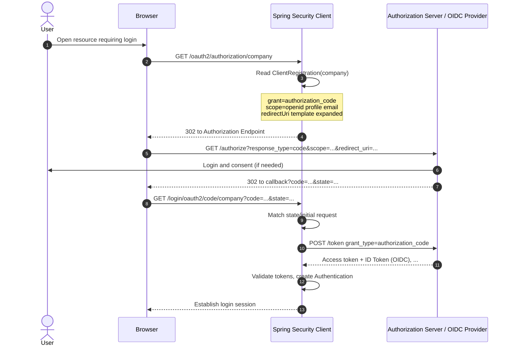

# 5.4. AuthorizationGrantType, Scope, and Redirect URI Templates

In Spring Security OAuth 2.0/OIDC Client, a **`ClientRegistration`** object describes a Client application registered with an Authorization Server or OpenID Provider (OP). Alongside `client-id`, `client-secret`, and provider endpoint information, three properties directly shape how the Client operates: **`authorizationGrantType`**, **`scopes`**, and **`redirectUri`**.

These three properties answer three questions:

1. **`AuthorizationGrantType`:** *Which OAuth 2.0 flow* does the Client use to obtain authorization and tokens?
2. **`scope`:** *Which permissions or information groups* does the Client request?
3. **Redirect URI template:** After processing an authorization request, *to which exact Client URL* must the Authorization Server return the browser?

For a web application signing in via OIDC, a common combination is:

```yaml
authorization-grant-type: authorization_code
scope:
  - openid
  - profile
  - email
redirect-uri: "{baseUrl}/login/oauth2/code/{registrationId}"
```

These values only make sense as part of a **complete `ClientRegistration`**, synchronized with the configuration at the identity provider and the path Spring Security actually handles.

## 1. Where Do These Three Properties Live in `ClientRegistration`?

Spring Security represents a Client with the `org.springframework.security.oauth2.client.registration.ClientRegistration` class. Related methods:

| Java property | Data type | Spring Boot configuration property | Meaning |
|---|---|---|---|
| `getAuthorizationGrantType()` | `AuthorizationGrantType` | `authorization-grant-type` | Specifies the grant type used for the registration |
| `getScopes()` | `Set<String>` | `scope` | Set of scopes requested by the Client |
| `getRedirectUri()` | `String` | `redirect-uri` | Client callback URI or URI template |

Full configuration snippet example:

```yaml
spring:
  security:
    oauth2:
      client:
        registration:
          company:
            client-id: ${OIDC_CLIENT_ID}
            client-secret: ${OIDC_CLIENT_SECRET}
            provider: company
            client-authentication-method: client_secret_basic
            authorization-grant-type: authorization_code
            scope:
              - openid
              - profile
              - email
            redirect-uri: "{baseUrl}/login/oauth2/code/{registrationId}"
        provider:
          company:
            issuer-uri: https://id.example.test/realms/company
```

Here:

- `company` under `registration` is the **`registrationId`**, the key the Spring application uses to locate the right `ClientRegistration`.
- `client-id` is the Client identifier issued by the provider, **not necessarily identical** to `registrationId`.
- `provider.company.issuer-uri` helps Spring discover the Authorization Endpoint, Token Endpoint, JWK Set, and OIDC metadata, if the provider supports discovery.
- `client-authentication-method` describes **how the Client authenticates to the Token Endpoint**; this is a separate property from `authorization-grant-type`.
- `scope` and `redirect-uri` belong to the specific registration. Two registrations sharing a provider can still request different scopes or have separate callbacks.

In a Spring Boot application using `spring.security.oauth2.client.registration.*`, Boot binds these configuration properties into `ClientRegistration` instances and stores them in a `ClientRegistrationRepository`. With custom Java configuration, developers can build `ClientRegistration` using the builder; the OAuth 2.0 rules remain the same.

## 2. Big Picture Before Diving Into Each Property

With the **Authorization Code Grant**, where `authorization-grant-type=authorization_code` and `scope=openid profile email`, the login process looks like:



The three properties participate at different points:

- **Grant type:** determines which flow the Client initiates. For authorization code, the authorization request carries `response_type=code` and the token request carries `grant_type=authorization_code`.
- **Scope:** is included in the authorization request (e.g., `scope=openid%20profile%20email`). The provider decides which scopes are granted.
- **Redirect URI template:** is expanded by Spring into a concrete callback URL and sent in the authorization request. The IdP uses that URL to return the browser to the Client.

If choosing the **Client Credentials Grant** so a service calls an API using its own identity, the browser steps and Redirect URI above do not apply. Therefore, evaluate these three properties **together within the same flow**, not as isolated configuration lines.

## 3. `AuthorizationGrantType`: Choosing the Token Acquisition Mechanism

### 3.1. What Is a Grant Type in OAuth 2.0?

The grant type represents how an OAuth2 Client obtains authorization to request a token. It affects which endpoints are used, required parameters, how the Client authenticates, and whether an interactive user is involved.

In Spring Security, the grant type is an `AuthorizationGrantType` value, such as:

```java
import org.springframework.security.oauth2.core.AuthorizationGrantType;

AuthorizationGrantType loginGrant =
    AuthorizationGrantType.AUTHORIZATION_CODE;

AuthorizationGrantType serviceGrant =
    AuthorizationGrantType.CLIENT_CREDENTIALS;
```

In Spring Boot YAML, values use standard OAuth 2.0 strings:

```yaml
authorization-grant-type: authorization_code
```

or:

```yaml
authorization-grant-type: client_credentials
```

**Choose a grant type that fits the application's goal and the grants permitted by the Authorization Server for the registered Client.** Simply having a constant in Spring does not mean the IdP permits that grant for every Client.

### 3.2. Common Grants

| Grant type | Interactive user? | Redirect URI in the flow? | Suitable use case |
|---|---|---|---|
| `authorization_code` | Yes; via browser and login/consent screens when needed | **Yes** | Web applications signing in with OAuth2/OIDC |
| `client_credentials` | No; Client authenticates directly with Token Endpoint | **No** | Service-to-service, batch jobs, backends calling APIs as the application identity |
| `refresh_token` | Not during the refresh step | No new redirect step | Using a valid refresh token to get a new access token, not for initiating interactive login |
| `implicit` (legacy) | Yes | Yes, though tokens may travel via front channel | Legacy flow; **should not be chosen** for new designs |
| `password` (legacy) | No redirect; Client directly receives user password | No | Unsuitable for modern OIDC Login; avoid in new projects |

Spring Security may support additional grants or extensions depending on version and configuration. However, when building an **OIDC login application with `oauth2Login`**, the baseline choice is **`AuthorizationGrantType.AUTHORIZATION_CODE`**.

`refresh_token` must be distinguished from a `ClientRegistration`'s primary grant type property: a registration initially using `authorization_code` can receive a refresh token if allowed by the provider, and when refreshing is needed, the OAuth2 Client uses the `refresh_token` grant at the Token Endpoint. Do not change a registration to `refresh_token` just to "enable refresh tokens".

### 3.3. Why Does Authorization Code Fit OIDC Login?

An OIDC Login verifies a user's identity via an OpenID Provider. The Authorization Code Flow exchanges data across two channels:

1. **Front channel:** the browser is redirected to the Authorization Endpoint and returns to the Client's callback with an authorization code.
2. **Back channel:** the Spring Client exchanges the code with the Token Endpoint over a direct connection, receiving tokens and validating the ID Token.

An authorization code is a short-lived, typically single-use code; it is not an access token used to call APIs. In modern deployments, **PKCE** binds the code to the Client's request and reduces the risk of a stolen code being exchanged for tokens.

`authorization-grant-type=authorization_code` **does not by itself replace** `state`, `nonce` (OIDC), PKCE, HTTPS, or redirect URI validation. They address distinct security requirements.

### 3.4. How Does Client Credentials Differ from Authorization Code?

Client Credentials is used when application A calls API B **without representing a signed-in user**. For example, an automated report-reading batch job:

```yaml
spring:
  security:
    oauth2:
      client:
        registration:
          reporting-job:
            provider: reporting-api
            client-id: ${REPORT_JOB_CLIENT_ID}
            client-secret: ${REPORT_JOB_CLIENT_SECRET}
            client-authentication-method: client_secret_basic
            authorization-grant-type: client_credentials
            scope:
              - reports.read
        provider:
          reporting-api:
            token-uri: https://api.example.test/oauth2/token
```

With this registration:

- The Client sends a token request with `grant_type=client_credentials`.
- There is no `response_type=code` or browser returning to a callback.
- No `redirect-uri` is needed to complete the grant.
- The `reports.read` scope is an example API permission; the provider/API must actually define and permit it.
- Do not use `oauth2Login` as a user login flow for this registration.

The resulting access token represents the Client's permissions per provider policy, not confirmation that a specific user signed in. Consequently, `openid` should not be added by default to a registration used purely for Client Credentials.

### 3.5. Distinguishing Grant Type from Client Authentication Method

The two properties often sit adjacent in YAML:

```yaml
authorization-grant-type: authorization_code
client-authentication-method: client_secret_basic
```

They answer two independent questions:

- `authorization_code`: **Which flow** does the Client use to obtain authorization/tokens?
- `client_secret_basic`: **How** does the Client prove its identity to the Token Endpoint?

A **confidential client** running on a backend can use authorization code and authenticate to the Token Endpoint with a client secret or an IdP-accepted mechanism. A **public client** that cannot protect a secret must use an appropriate mechanism, typically with PKCE; never embed a client secret in JavaScript or user-distributed apps.

## 4. `scope`: What Permissions Is the Client Requesting?

### 4.1. Scopes Are Requested Names, Not a Guarantee of Received Claims

OAuth 2.0 uses the `scope` parameter to express the Client's desired access scope. Spring Security stores this as a `Set<String>` inside `ClientRegistration`.

In YAML:

```yaml
scope:
  - openid
  - profile
  - email
```

In the Java builder:

```java
.scope("openid", "profile", "email")
```

When creating an authorization request, Spring encodes the scope list per OAuth 2.0 syntax, typically:

```text
scope=openid%20profile%20email
```

Spaces between scopes are URL-encoded in the URL. Scope names are protocol/provider-defined tokens: for instance, `openid` is a standard OIDC scope, whereas `orders.read` is an example custom API scope. Never use arbitrary names if the Authorization Server does not recognize or permit them.

### 4.2. Standard OIDC Scopes

In an OIDC Client application, familiar scopes include:

| Scope | Meaning |
|---|---|
| `openid` | Requests OIDC authentication; typically required to receive an ID Token in the Authorization Code Flow |
| `profile` | Requests profile claims such as `name`, `preferred_username`, `picture`, `locale` |
| `email` | Requests `email` and `email_verified` |
| `address` | Requests the `address` claim as an object |
| `phone` | Requests `phone_number` and `phone_number_verified` |
| `offline_access` | Per OIDC, requests offline access when the user is no longer present; refresh token issuance still depends on provider policy and conditions |

In OIDC, **`openid` is the signal that distinguishes an authentication request from pure OAuth 2.0**. The remaining scopes are optional depending on actual requirements.

For example, an admin portal that only needs to display name and email:

```yaml
scope:
  - openid
  - profile
  - email
```

There is no need to request `address`, `phone`, or `offline_access` by default just to sign in. Requesting excessive scopes degrades the consent experience, exceeds data minimization needs, and triggers `invalid_scope` errors if unsupported by the provider.

### 4.3. Requested Scopes and Granted Scopes Can Differ

Suppose a Client requests:

```text
openid profile email phone
```

The provider may grant only:

```text
openid profile email
```

or return an error if the Client is not permitted to request `phone`. If the provider returns the granted scope set in the token response, use that information in the right context. Never assume scopes in YAML equal the actual permissions of the access token.

Similarly, the `email` scope merely expresses a request for the email claim group. The provider does not necessarily return `email` or `email_verified`, because data may be missing, unapproved, or restricted by policy. Profile claims may appear in the ID Token, the UserInfo response, or only one of the two.

### 4.4. Scopes Are Not Equivalent to Spring Security Roles

For example, an access token having the `reports.read` scope does not automatically create a `ROLE_ADMIN` `GrantedAuthority` in the application session. Distinguish:

- **OAuth2 scope:** permission scope granted to a token by the Authorization Server or claim group requested by an OIDC Client.
- **Internal role/authority:** permission used by the application to authorize access to a screen or action.
- **Token audience:** resource/API the token is intended for; a matching scope with the wrong audience still makes the token invalid for an API.

If the application is a **Resource Server**, mapping scopes to authorities (such as the `SCOPE_` prefix in certain default configurations) belongs to the access token/API verification layer. It does not mean every scope in `ClientRegistration` automatically becomes a user role when `oauth2Login` finishes.

### 4.5. How Should Custom Scopes Be Handled?

Provider scopes can follow many naming patterns:

```text
read:invoices
invoices.read
https://api.example.test/scopes/orders.read
api://resource-id/access_as_user
```

These are illustrative examples, not universal scopes. Consult the provider's documentation, verify granted Client permissions, and check consent requirements. In code, centralize scope names into meaningful configuration instead of scattering literals across controllers and services.

A `ClientRegistration` has **a default scope set** for authorization requests created from that registration. When scopes must be requested per feature, configure an authorization request customizer or separate registrations as appropriate for your design; do not arbitrarily append query parameters to URLs assuming Spring will still manage state/authorized clients properly.

## 5. Redirect URI Template: Callback Built from the Current Request

### 5.1. What Actually Is a Redirect URI?

The Redirect URI (also called callback URL) is an address **belonging to the Client application** where the Authorization Server sends the browser back after the authorization step. With the Authorization Code Flow, the callback typically receives:

```text
https://app.example.test/login/oauth2/code/company?code=ONE_TIME_CODE&state=RANDOM_STATE
```

Here, **the registered redirect URI** sent in the authorization request is the URL **excluding** `code` and `state`:

```text
https://app.example.test/login/oauth2/code/company
```

The `code` and `state` query parameters are added by the Authorization Server **after processing the authorization request**.

With Spring Security Servlet OAuth2 Login, the default callback is handled by `OAuth2LoginAuthenticationFilter` matching the pattern:

```text
/login/oauth2/code/*
```

Thus the common template is:

```yaml
redirect-uri: "{baseUrl}/login/oauth2/code/{registrationId}"
```

You do not need to write a custom `@GetMapping` to receive the code in the default `oauth2Login` flow. The Spring Security filter handles the callback, validates `state`/saved request state, and performs the token exchange.

### 5.2. Why Use a Template Instead of a Fixed URL?

If an application has multiple environments, hosts, context paths, or registrations, one template can automatically produce the corresponding URL:

```text
Template:
{baseUrl}/login/oauth2/code/{registrationId}

For local:
http://localhost:8080/login/oauth2/code/company

For production:
https://app.example.test/login/oauth2/code/company

With application context path /portal:
https://app.example.test/portal/login/oauth2/code/company
```

Note that **the IdP must still allow the actual redirect URIs** the Client may use. A template in Spring does not automatically register callbacks at the Authorization Server.

### 5.3. URI Template Variables Supported by Spring

In Spring Security `ClientRegistration`, commonly used variables are:

| Variable | Example when request hits `https://portal.example.test/portal` | Meaning |
|---|---|---|
| `{baseScheme}` | `https` | Scheme of the public address |
| `{baseHost}` | `portal.example.test` | Host of the public address |
| `{basePort}` | Empty string or `:8443` if a custom port is used | Port, including `:` when needed |
| `{basePath}` | `/portal` | Application context path/base path |
| `{baseUrl}` | `https://portal.example.test/portal` | Equivalent to `{baseScheme}://{baseHost}{basePort}{basePath}` |
| `{registrationId}` | `company` | Registration key configured in Spring |

Developers may also encounter `{action}` in some historical Spring Security templates, where the resolver uses `login` for OAuth2 Login. For modern practice, the explicit template `{baseUrl}/login/oauth2/code/{registrationId}` aligns more clearly with the default callback path.

**`{baseUrl}` is the Client application's address**, not the IdP's issuer URL or Authorization Endpoint. If the IdP lives at `https://id.example.test` while users access the application at `https://portal.example.test`, the callback still resides on `portal.example.test`.

### 5.4. Template Expansion Process

Suppose:

```text
registrationId: company
Public URL: https://portal.example.test
template: {baseUrl}/login/oauth2/code/{registrationId}
```

When Spring builds the authorization request, the resolver expands the template:

```text
https://portal.example.test/login/oauth2/code/company
```

Then puts the URL-encoded value into the `redirect_uri` parameter:

```http
GET /oauth2/authorize?response_type=code&
    client_id=portal-web&
    redirect_uri=https%3A%2F%2Fportal.example.test%2Flogin%2Foauth2%2Fcode%2Fcompany&
    scope=openid%20profile%20email&
    state=RANDOM_STATE HTTP/1.1
Host: id.example.test
```

The example is line-wrapped for explanation; a real request is a valid single-line URL and may also contain `nonce`, PKCE challenge, and other parameters.

During the token exchange of the Authorization Code Flow, the Client sends the same redirect URI as in the authorization request. The provider verifies this match to protect the authorization code from being redeemed in a different context.

## 6. Distinguishing Three Easily Confused URIs

| Name | Example | Owned by whom? | Used where? |
|---|---|---|---|
| **Login initiation URI** | `/oauth2/authorization/company` | Spring Client | User/browser visits here to **start** OAuth2 Login |
| **Authorization Endpoint** | `https://id.example.test/oauth2/authorize` | Authorization Server | Spring redirects the browser here |
| **Redirect URI / callback** | `https://portal.example.test/login/oauth2/code/company` | Spring Client | Authorization Server redirects the browser back here |

There is also the **Token Endpoint**, e.g., `https://id.example.test/oauth2/token`, called directly by Spring when exchanging the authorization code.

**These URIs are not interchangeable.** Setting `redirect-uri` to the Token Endpoint URL or to the initiation URL `/oauth2/authorization/company` will break the flow. Setting `authorization-uri` to the Client's own callback is also wrong because the browser will not reach the Authorization Server.

An easy rule of thumb:

- `/oauth2/authorization/{registrationId}`: **start**.
- IdP Authorization Endpoint: **sign in / authorize**.
- `/login/oauth2/code/{registrationId}`: **return**.
- IdP Token Endpoint: **exchange code for tokens**.

## 7. Complete Configuration in Spring Boot

### 7.1. Example `application.yml` for OIDC Login

Suppose the provider has issuer `https://id.example.test/realms/company`, and the Client is registered with Redirect URI `https://portal.example.test/login/oauth2/code/company`:

```yaml
server:
  port: 8080

spring:
  security:
    oauth2:
      client:
        registration:
          company:
            provider: company
            client-id: ${OIDC_CLIENT_ID}
            client-secret: ${OIDC_CLIENT_SECRET}
            client-authentication-method: client_secret_basic
            authorization-grant-type: authorization_code
            scope:
              - openid
              - profile
              - email
            redirect-uri: "{baseUrl}/login/oauth2/code/{registrationId}"

        provider:
          company:
            issuer-uri: https://id.example.test/realms/company
```

This YAML matches the general configuration style of Spring Boot 3.x/4.x and Spring Security OAuth2 Client. To run in practice, add the OAuth2 Client dependency matching your Spring Boot branch, a valid IdP, a registered Client, and environment variables for ID/secret. The `example.test` domain is illustrative only.

Spring Boot will create a `ClientRegistration` for `registrationId=company`. With `issuer-uri`, discovery supplies the endpoint details needed for OIDC. You do not need to manually specify `authorization-uri`, `token-uri`, or `jwk-set-uri` if the provider metadata is accurate and Spring supports this configuration approach.

**Never write real client secrets directly in YAML committed to a repository.** Use environment variables, a secret manager, or your deployment platform's secure configuration mechanism.

### 7.2. Enabling Spring Security OAuth2 Login (Servlet)

```java
import org.springframework.context.annotation.Bean;
import org.springframework.context.annotation.Configuration;
import org.springframework.security.config.Customizer;
import org.springframework.security.config.annotation.web.builders.HttpSecurity;
import org.springframework.security.web.SecurityFilterChain;

@Configuration
public class SecurityConfig {

    @Bean
    SecurityFilterChain securityFilterChain(HttpSecurity http) throws Exception {
        http
            .authorizeHttpRequests(authorize -> authorize
                .requestMatchers("/", "/error").permitAll()
                .anyRequest().authenticated()
            )
            .oauth2Login(Customizer.withDefaults());

        return http.build();
    }
}
```

This is a Spring MVC/Servlet configuration. WebFlux uses different reactive APIs such as `ServerHttpSecurity` and `SecurityWebFilterChain`.

With the configuration above, the login initiation URL is:

```text
http://localhost:8080/oauth2/authorization/company
```

The corresponding callback in a local environment:

```text
http://localhost:8080/login/oauth2/code/company
```

If using this local URL for testing, register that exact URL at the IdP when the IdP permits loopback callbacks. In production, use HTTPS and register callbacks using the actual public host.

### 7.3. Meaning of Each Configuration Line

| Configuration line | What does it change? |
|---|---|
| `authorization-grant-type: authorization_code` | Spring uses the Authorization Code Grant for the registration |
| `scope: [openid, profile, email]` | Spring requests OIDC authentication and profile/email claim groups |
| `redirect-uri: "{baseUrl}/login/oauth2/code/{registrationId}"` | Spring builds the callback URL per host/context path and specific registration |
| `client-authentication-method: client_secret_basic` | Spring authenticates the Client with the Token Endpoint via HTTP Basic, if allowed by the IdP |
| `issuer-uri: ...` | Spring discovers provider metadata, endpoints, and OIDC token verification details |
| `provider: company` | Registration uses the provider configuration keyed as `company` |

Here `scope` and `redirect-uri` are bound directly to the registration, while OAuth2 endpoints are configured on the provider. This lets multiple registrations share one provider while keeping separate client IDs, scopes, or callbacks.

## 8. Creating `ClientRegistration` in Java

Spring Boot properties are the common approach, yet registrations can also be created in Java, such as when configuration is supplied by a tenant management system.

With an OIDC Provider supporting discovery:

```java
import org.springframework.security.oauth2.client.registration.ClientRegistration;
import org.springframework.security.oauth2.client.registration.ClientRegistrations;
import org.springframework.security.oauth2.core.AuthorizationGrantType;
import org.springframework.security.oauth2.core.ClientAuthenticationMethod;

ClientRegistration registration = ClientRegistrations
    .fromIssuerLocation("https://id.example.test/realms/company")
    .registrationId("company")
    .clientId(System.getenv("OIDC_CLIENT_ID"))
    .clientSecret(System.getenv("OIDC_CLIENT_SECRET"))
    .clientAuthenticationMethod(ClientAuthenticationMethod.CLIENT_SECRET_BASIC)
    .authorizationGrantType(AuthorizationGrantType.AUTHORIZATION_CODE)
    .scope("openid", "profile", "email")
    .redirectUri("{baseUrl}/login/oauth2/code/{registrationId}")
    .build();
```

`ClientRegistrations.fromIssuerLocation(...)` initializes the builder from metadata published by the provider; subsequent methods override or add Client details. The discovery call must be able to reach the provider. The example only shows object construction; in a real application, register it in an appropriate `ClientRegistrationRepository` or use Boot's auto-configuration instead.

Once you have a `ClientRegistration` object, you can read the three properties:

```java
AuthorizationGrantType grantType = registration.getAuthorizationGrantType();
var scopes = registration.getScopes();
String redirectUriTemplate = registration.getRedirectUri();

System.out.println(grantType.getValue());
System.out.println(scopes);
System.out.println(redirectUriTemplate);
```

The result of `getRedirectUri()` is **the configured URI template**; it may still contain `{baseUrl}` and `{registrationId}`. Placeholders are expanded **when Spring creates an authorization request**, not merely by calling the getter.

### 8.1. Do Not Manually Expand the Template with Simple String Replacement

Avoid logic like:

```java
// Avoid doing this to replace the full URI resolution mechanism.
String callback = template.replace("{baseUrl}", "http://localhost:8080");
```

Manual string replacement easily misses proxy headers, context paths, ports, encoding, and other variables. Let Spring's OAuth2 authorization request mechanism handle expansion, or use an explicit fixed URI when clearly required.

### 8.2. Distinguishing Static Registration from Per-Request Values

`ClientRegistration` stores **configuration**. The final callback URL can depend on the actual incoming request:

```text
ClientRegistration.redirectUri:
{baseUrl}/login/oauth2/code/{registrationId}

Request A arrives via:
https://portal.example.test
→ https://portal.example.test/login/oauth2/code/company

Request B arrives via:
https://staging.example.test
→ https://staging.example.test/login/oauth2/code/company
```

This is useful when one deployment serves multiple valid hosts, but carries risk if host/proxy headers come from untrusted sources. The IdP's callback allowlist and proxy configuration must match the set of truly permitted hosts.

## 9. Changing the Redirect URI to a Custom Path

Suppose the application needs the callback:

```text
https://portal.example.test/auth/oidc/callback/company
```

Changing YAML alone is not enough. You must **synchronize three places**.

### 9.1. Change Redirect URI in `ClientRegistration`

```yaml
spring:
  security:
    oauth2:
      client:
        registration:
          company:
            redirect-uri: "{baseUrl}/auth/oidc/callback/{registrationId}"
```

This is a snippet; preserve the remaining properties in the full configuration.

### 9.2. Change the Path Spring Security Listens On

```java
@Bean
SecurityFilterChain securityFilterChain(HttpSecurity http) throws Exception {
    http
        .authorizeHttpRequests(authorize -> authorize
            .requestMatchers("/", "/error").permitAll()
            .anyRequest().authenticated()
        )
        .oauth2Login(oauth2 -> oauth2
            .redirectionEndpoint(redirection -> redirection
                .baseUri("/auth/oidc/callback/*")
            )
        );

    return http.build();
}
```

`redirectionEndpoint().baseUri(...)` tells the Spring Security filter **which path receives authorization responses**. It must match the actual callback path generated by the template.

### 9.3. Register the Actual URI at the IdP

Example for a production environment:

```text
https://portal.example.test/auth/oidc/callback/company
```

If this URL is not registered or still points to the old callback, the IdP may report `redirect_uri_mismatch`. If the IdP allows the URL while Spring still listens on `/login/oauth2/code/*`, the browser returns to a path not handled by the OAuth2 Login filter.

**Note:** `redirectionEndpoint` is distinct from `authorizationEndpoint`. Changing the login initiation path `/oauth2/authorization/{registrationId}` is a separate setting; do not confuse it with the callback.

## 10. Redirect URI Compatibility with Reverse Proxies and Context Paths

### 10.1. Typical Scenario

Externally users visit:

```text
https://portal.example.test
```

Yet requests pass through a load balancer/reverse proxy to the Spring app:

```text
http://app-internal:8080
```

If Spring sees the internal host/scheme when expanding `{baseUrl}`, it may send:

```text
http://app-internal:8080/login/oauth2/code/company
```

While the IdP only permits:

```text
https://portal.example.test/login/oauth2/code/company
```

The result is typically a callback failure due to a redirect URI mismatch. The cause lies in **the public address Spring uses when building the authorization request**, not in scopes.

### 10.2. Configuration Approach

The proxy must supply the public host/protocol information via appropriate headers. Depending on infrastructure, Spring Boot can be configured to process forwarded headers, for example:

```yaml
server:
  forward-headers-strategy: framework
```

Exact setup depends on your reverse proxy/container and Spring Boot version. **Only trust forwarded headers when set or controlled by a trusted proxy**; never allow arbitrary external Clients to spoof host and scheme and make the application generate unintended callbacks.

To investigate issues, inspect the actual `redirect_uri` in the authorization request (after URL-decoding) and compare it against the public address and callback configuration at the IdP.

### 10.3. Should a Fixed Callback URL Be Used?

A fixed URI can be used for a known environment:

```yaml
redirect-uri: "https://portal.example.test/login/oauth2/code/company"
```

This avoids inferring the host from incoming requests if the application only operates on a single public origin, though it requires different configurations across local/staging/production. When using a fixed URI, ensure the browser can actually reach that URL and Spring Security listens on that exact path.

Do not use overly broad wildcard templates to accept arbitrary redirect URLs. Registering specific Callback URIs at the IdP remains a necessary security control.

## 11. Multiple `ClientRegistration`s in One Application

An application can support login from two different providers or two different Clients:

```yaml
spring:
  security:
    oauth2:
      client:
        registration:
          partner-a:
            provider: partner-a
            client-id: ${PARTNER_A_ID}
            client-secret: ${PARTNER_A_SECRET}
            authorization-grant-type: authorization_code
            scope: [openid, profile, email]
            redirect-uri: "{baseUrl}/login/oauth2/code/{registrationId}"
          partner-b:
            provider: partner-b
            client-id: ${PARTNER_B_ID}
            client-secret: ${PARTNER_B_SECRET}
            authorization-grant-type: authorization_code
            scope: [openid]
            redirect-uri: "{baseUrl}/login/oauth2/code/{registrationId}"
        provider:
          partner-a:
            issuer-uri: https://login-a.example.test/issuer
          partner-b:
            issuer-uri: https://login-b.example.test/issuer
```

The two login initiation URLs are:

```text
/oauth2/authorization/partner-a
/oauth2/authorization/partner-b
```

The two expanded callbacks are:

```text
https://portal.example.test/login/oauth2/code/partner-a
https://portal.example.test/login/oauth2/code/partner-b
```

Even with the same template, `{registrationId}` keeps the callbacks distinct. This also means each Client at each IdP must register its corresponding callback. Setting `registrationId` to `partner-a` while registering a callback ending in `/partner-b` will likely cause the authorization request to be rejected.

Some providers allow multiple `ClientRegistration`s to point to the same issuer; in that case, each registration still retains its own client ID, scopes, and callback per its registration contract.

## 12. Typical Configuration Mistakes and How to Isolate Causes

| Symptom | Related property | Common cause | How to isolate |
|---|---|---|---|
| IdP reports `unsupported_grant_type` | `authorization-grant-type` | Server does not support the grant or Client is not permitted to use it | Compare the grant registered at the IdP with the token request |
| OAuth2 Login does not open a login page | `authorization-grant-type` | Registration specifies `client_credentials` instead of `authorization_code` | Check registration and `/oauth2/authorization/...` start URL |
| IdP reports `invalid_scope` | `scope` | Misspelled scope, unapproved scope, or unsupported by provider | Inspect actual scopes in the authorization request |
| Login succeeds but `email` is missing | `scope` or claim mapping | Missing `email` scope, IdP omits it, or claim is in UserInfo | Inspect ID Token, UserInfo, and granted scopes |
| IdP reports `redirect_uri_mismatch` | `redirect-uri` | Wrong scheme/host/port/path or unregistered callback | URL-decode `redirect_uri` in Authorization Endpoint URL and compare with IdP |
| Callback reaches Client but goes unhandled | `redirect-uri` and filter path | Customized callback without updating `redirectionEndpoint().baseUri` | Compare callback path against `SecurityFilterChain` |
| Callback returns `invalid_grant` on code exchange | `redirect-uri` or PKCE/code | Redirect URI at token exchange mismatches, code expired/reused, PKCE wrong | Check authorization code flow steps without logging secrets/tokens |
| Callback missing or invalid `state` | Session/flow | Lost session or callback does not match initial authorization request | Check cookies/session, host, proxy, request repository |
| Redirect URI contains `http://app-internal:8080` | `{baseUrl}` and proxy | Forwarded headers not processed properly | Check public host/protocol and proxy configuration |
| App has multiple IdPs but returns to wrong registration | `{registrationId}` | Wrong registrationId in link/callback or IdP configuration | Compare start URL, `ClientRegistration`, and registered callback |

When encountering an error, avoid changing grant, scope, and callback all at once before retesting: first identify **at which step the error occurs**. For example, `invalid_scope` during the authorization request generally has nothing to do with Spring's callback listener; conversely, a 404 on callback is usually a path/filter issue.

### 12.1. How to Safely Observe the Flow in Development

1. Check the login initiation URL: `/oauth2/authorization/{registrationId}`.
2. In the browser, inspect the request redirected to the Authorization Endpoint. Verify **`response_type`**, `scope`, and `redirect_uri`.
3. URL-decode `redirect_uri` and compare it character-by-character with the URI allowed at the IdP.
4. Once the IdP redirects back to the Client, confirm the callback path matches the Spring Security filter.
5. If the token exchange step fails, inspect the response/error from the Token Endpoint safely; never paste client secrets, authorization codes, session cookies, or real tokens into shared logs/screenshots.
6. If login succeeds yet user details are missing, inspect claims in the ID Token/UserInfo and scope/consent policy instead of altering the redirect URI.

`response_type=code` is an Authorization Endpoint parameter in the authorization code flow; `grant_type=authorization_code` is a Token Endpoint parameter for exchanging the code. Do not confuse the two when reading requests.

## 13. Directly Related Security Principles

### 13.1. Redirect URIs Must Be Specific and Controlled

- Register callbacks using the exact URI the Client uses; avoid overly permissive wildcards.
- Use HTTPS for production callbacks; HTTP loopback callbacks should only be used where appropriate for provider policy and dev/native environments.
- Never take a dynamic redirect URI from an unvalidated user-supplied query parameter.
- Never perform an open redirect from the callback to an arbitrary user-specified external URL.
- Protect the HTTP session and `state` to bind the authorization response to the initiated request.
- For the Authorization Code Flow, use PKCE according to your version, Client capability, and Authorization Server support policy.

If an Authorization Server detects an invalid redirect URI, it should not redirect to the unverified URI to report the error; doing so can leak codes or create an attack vector.

### 13.2. Least-Privilege Scopes

- Request only scopes genuinely needed for the current feature.
- Do not request `address`, `phone`, or `offline_access` merely because the provider supports them.
- Never treat configured scopes as proof of user consent.
- Never derive internal roles solely from scopes the Client requested.
- Never put access tokens, refresh tokens, or client secrets into browser URLs.

### 13.3. Do Not Equate Authorization Grants with Data Access Rights

The grant type defines **the process for obtaining tokens**. Scopes define **the permissions/information groups requested in that process**. The redirect URI defines **the browser callback target in redirect-based flows**.

For example, the same Client obtaining an authorization code with `scope=openid profile` does not automatically grant the application permission to call an `orders.write` API. Calling that API requires an access token with the right audience and permissions accepted by the Authorization Server/API.

## 14. Practice Questions

### Exercise 1: Identify Properties

Given the configuration:

```yaml
registration:
  accounting:
    authorization-grant-type: authorization_code
    scope: [openid, profile, email]
    redirect-uri: "{baseUrl}/login/oauth2/code/{registrationId}"
```

Suppose the Client receives requests at `https://erp.example.test`. Answer:

1. Which grant type is being used?
2. Which scope indicates this is an OIDC request?
3. What is the actual callback URL?
4. Where must that callback be registered?

**Answers:** `authorization_code` grant; `openid` scope; callback `https://erp.example.test/login/oauth2/code/accounting`; register the URI at the Authorization Server/OpenID Provider for the `accounting` Client.

### Exercise 2: Distinguish Scope and Claim

An application configures `scope: [openid, profile, email]`, yet after login `email` is absent from the ID Token. Does this prove the configuration is wrong?

**Hint:** Not necessarily. The provider might return `email` at UserInfo, lack an email value on the account, withhold permission, or restrict claims by policy. Check granted scopes and claim sources; never assume a scope guarantees every claim will be returned.

### Exercise 3: Changing the Callback Path

To change the callback to `/auth/callback/accounting`, which components must change?

**Answer:** (1) `redirect-uri` in `ClientRegistration`, (2) `oauth2Login().redirectionEndpoint().baseUri(...)` so Spring listens there, and (3) the valid Redirect URI list at the IdP. Keep `registrationId` consistent.

### Exercise 4: Switching to Client Credentials

A browserless batch job only needs to call the `reports.read` API. Are `openid`, `redirect-uri`, and `oauth2Login` needed?

**Answer:** Normally no. Use `client_credentials`, request the `reports.read` API scope per the provider contract, and use the OAuth2 Client to acquire an access token directly via the Token Endpoint. User authentication/OIDC ID Tokens do not belong to this flow.

## 15. Summary Table for `ClientRegistration`

| If you need... | Set/choose... | Also verify... |
|---|---|---|
| Users signing in via OIDC | `authorization_code` | Provider supports OIDC, `openid` scope, callback, PKCE/state |
| Displaying name and email | `scope: [openid, profile, email]` | Provider/consent and whether claims are actually populated |
| Backend calling an API without a user | `client_credentials` | Client authentication and corresponding API scopes |
| Default callback | `{baseUrl}/login/oauth2/code/{registrationId}` | IdP has the exact resolved URI registered |
| Custom callback | Template matching the new path | Sync `redirectionEndpoint().baseUri` and IdP |
| Multiple providers/clients | Dedicated `registrationId` per Client | Corresponding start URL, callback, scopes, and client ID |
| Running behind a proxy | Template resolving public URL or fixed callback | Public host/scheme/port, forwarded headers from trusted proxy |
| Reading config in Java | `getAuthorizationGrantType()`, `getScopes()`, `getRedirectUri()` | Getter returns template, not necessarily expanded callback URL |

## 16. Official References

- [Spring Security — Core Interfaces and Classes](https://docs.spring.io/spring-security/reference/servlet/oauth2/client/core.html): defines `ClientRegistration`, meaning of each property, and repositories.
- [Spring Security — Authorization Grant Support](https://docs.spring.io/spring-security/reference/servlet/oauth2/client/authorization-grants.html): support for authorization code, client credentials, PKCE, and using redirect URI templates.
- [Spring Security — OAuth2 Login Core Configuration](https://docs.spring.io/spring-security/reference/servlet/oauth2/login/core.html): authorization requests, default callback URLs, and `oauth2Login`.
- [Spring Security — OAuth2 Login Advanced Configuration](https://docs.spring.io/spring-security/reference/servlet/oauth2/login/advanced.html): customizing `redirectionEndpoint().baseUri(...)` and filter paths.
- [Spring Security API — ClientRegistration](https://docs.spring.io/spring-security/reference/api/java/org/springframework/security/oauth2/client/registration/ClientRegistration.html): `getAuthorizationGrantType()`, `getScopes()`, `getRedirectUri()`, and supported placeholders.
- [Spring Security API — ClientRegistration.Builder](https://docs.spring.io/spring-security/reference/api/java/org/springframework/security/oauth2/client/registration/ClientRegistration.Builder.html): configuration via Java builder.
- [RFC 6749 — The OAuth 2.0 Authorization Framework](https://www.rfc-editor.org/rfc/rfc6749): grants, scopes, redirect URIs, and authorization codes.
- [RFC 7636 — Proof Key for Code Exchange](https://www.rfc-editor.org/rfc/rfc7636): protecting authorization codes with PKCE.
- [OpenID Connect Core 1.0](https://openid.net/specs/openid-connect-core-1_0.html): the `openid` scope, ID Tokens, and standard claims.

The three values **`AuthorizationGrantType`, `scope`, and Redirect URI template** must be read as a unified configuration set: **which flow** the Client uses, **what permissions** it requests, and **where it returns**. Once you master them in `ClientRegistration`, you can configure OIDC login yourself, explain the redirect URLs Spring generates, and isolate most initial issues in an OAuth2 Client integration.
