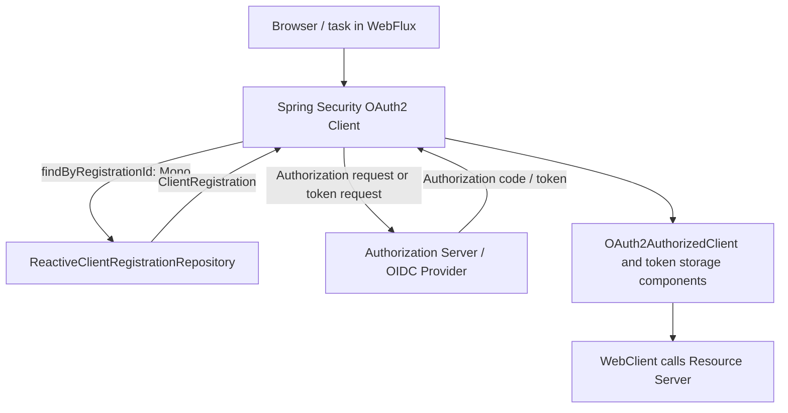
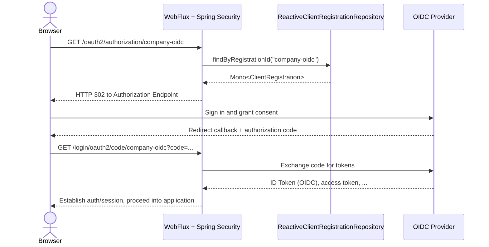

# 5.8. `ReactiveClientRegistrationRepository` in WebFlux Applications

## 1. Why Does WebFlux Need `ReactiveClientRegistrationRepository`?

When a Spring WebFlux application acts as an **OAuth 2.0 Client** or uses **OAuth 2.0 Login/OpenID Connect (OIDC)**, the application must know how it is registered with the Authorization Server: what `client_id` it uses, which grant types are allowed, where the redirect URI is, which scopes exist, and which endpoints the Authorization Server exposes. Spring Security packages this information inside a **`ClientRegistration`** object.

`ReactiveClientRegistrationRepository` is the **contract for retrieving OAuth2 client configurations** in the reactive stack. It lets Spring Security look up a `ClientRegistration` by `registrationId` as a `Mono<ClientRegistration>`:

```java
public interface ReactiveClientRegistrationRepository {
    Mono<ClientRegistration> findByRegistrationId(String registrationId);
}
```

For example, when a user chooses to sign in via a provider whose `registrationId` is `company-oidc`, WebFlux must load the matching client configuration before creating the redirect request to the Authorization Server. When a service needs to use `client_credentials` to call an API, token management components also need to look up the client's configuration by its corresponding ID.

The `Reactive...` name here emphasizes a **retrieval API suited to Reactor/WebFlux**, not that the OAuth2 configuration itself is automatically synchronized remotely or refreshed in real time. With an in-memory implementation, lookup is fast and returns a `Mono` from available data; with a custom implementation, the data source may be a config store or a reactive database.

### Position in the OAuth2/OIDC Flow



**Scope of responsibility to remember:** this repository stores or looks up **client registration configurations**, **not** access tokens, refresh tokens, logged-in users, or sessions. The object holding issued tokens is `OAuth2AuthorizedClient`; it is managed by other components.

## 2. What Does `ClientRegistration` Contain?

A `ClientRegistration` describes the relationship between **one OAuth2 client application** and **one Authorization Server/Provider**. Commonly used fields include:

| Property | Meaning | Example |
| --- | --- | --- |
| `registrationId` | Internal key Spring Security uses to look up the registration | `company-oidc`, `reporting` |
| `clientId` | ID issued by the Authorization Server for the application | `employee-portal` |
| `clientSecret` | Client secret if required by the client type/grant; must stay on the backend | Supplied from environment variable/vault |
| `clientAuthenticationMethod` | How the client authenticates at the Token Endpoint | `client_secret_basic`, `client_secret_post`, `none` |
| `authorizationGrantType` | How permissions/tokens are requested | `authorization_code`, `client_credentials` |
| `redirectUri` | URL receiving responses in redirect-based flows | `{baseUrl}/login/oauth2/code/{registrationId}` |
| `scopes` | Permissions/scopes requested by the client | `openid`, `profile`, `report.read` |
| `providerDetails` | Provider endpoints, issuer, and JWK/UserInfo details | Authorization URI, Token URI, JWK Set URI |
| `clientName` | Friendly display name for the registration | `Corporate SSO` |

Three identifiers to distinguish:

- **`registrationId`** is Spring Security's **internal key**, appearing in the `/oauth2/authorization/{registrationId}` path and in `findByRegistrationId(...)` calls.
- **`clientId`** is managed by the **Authorization Server**; the application sends it when executing the OAuth2/OIDC protocol.
- **`issuer`** identifies the **Authorization Server/OIDC Provider**; a single issuer can serve multiple distinct client registrations.

For instance, two applications sharing the same issuer while differing in `clientId`, `redirectUri`, or scopes can be described by two independent `ClientRegistration`s.

## 3. Differences Between Servlet and WebFlux

Spring Security provides two API sets corresponding to the two web stacks:

| Aspect | Servlet/MVC | Reactive/WebFlux |
| --- | --- | --- |
| Registration configuration store | `ClientRegistrationRepository` | `ReactiveClientRegistrationRepository` |
| Lookup | `ClientRegistration findByRegistrationId(String)` | `Mono<ClientRegistration> findByRegistrationId(String)` |
| In-memory implementation | `InMemoryClientRegistrationRepository` | `InMemoryReactiveClientRegistrationRepository` |
| HTTP security configuration | `HttpSecurity`, `SecurityFilterChain` | `ServerHttpSecurity`, `SecurityWebFilterChain` |
| Authorized client coordinator | `OAuth2AuthorizedClientManager` | `ReactiveOAuth2AuthorizedClientManager` |
| Corresponding HTTP client | `RestClient`/`WebClient` as needed | `WebClient` to preserve the reactive chain |

The two repository interfaces **are not directly interchangeable**. If an application uses WebFlux, declaring a Servlet `ClientRegistrationRepository` bean does not give WebFlux a `ReactiveClientRegistrationRepository` bean. Likewise, Servlet's `SecurityFilterChain` is not reactive's `SecurityWebFilterChain`.

This is especially easy to confuse when a project includes both `spring-boot-starter-web` and `spring-boot-starter-webflux` in dependencies: Spring Boot usually prioritizes the MVC/Servlet model when both are present, unless the application configuration explicitly specifies the web application type. Determine the web stack architecture before choosing repository types and security configuration.

## 4. Auto-Configuration in Spring Boot WebFlux

### 4.1. Required Dependencies

For a Spring Boot WebFlux application using OIDC Login or OAuth2 Client:

```gradle
dependencies {
    implementation 'org.springframework.boot:spring-boot-starter-webflux'
    implementation 'org.springframework.boot:spring-boot-starter-security'
    implementation 'org.springframework.boot:spring-boot-starter-oauth2-client'
}
```

`spring-boot-starter-oauth2-client` brings Spring Security's OAuth2 Client components onto the classpath. When running on WebFlux with matching registration configuration, Spring Boot can **automatically create a `ReactiveClientRegistrationRepository`** from `spring.security.oauth2.client.registration.*` and `spring.security.oauth2.client.provider.*`.

### 4.2. Example: OIDC Provider Using `issuer-uri`

`application.yml`:

```yaml
spring:
  security:
    oauth2:
      client:
        registration:
          company-oidc:
            provider: company
            client-id: ${COMPANY_OIDC_CLIENT_ID}
            client-secret: ${COMPANY_OIDC_CLIENT_SECRET}
            authorization-grant-type: authorization_code
            redirect-uri: "{baseUrl}/login/oauth2/code/{registrationId}"
            scope:
              - openid
              - profile
              - email
            client-name: Corporate SSO
        provider:
          company:
            issuer-uri: https://idp.example.com/realms/engineering
```

In the example:

1. Spring Boot reads the registration keyed **`company-oidc`**.
2. `provider: company` links the registration to the provider definition named `company`.
3. `issuer-uri` lets Spring Security discover Authorization Server/OIDC Provider metadata, including required endpoints when the provider supports standard discovery.
4. Spring Boot builds the `ClientRegistration` and places it into the appropriate reactive repository.
5. When needed, Spring Security retrieves it via `findByRegistrationId("company-oidc")`.

`issuer-uri` must be the exact issuer of the provider, including any path/realm segment. The provider must publish compliant metadata and be reachable from the application environment when discovering configuration. Issuer discovery normally happens during registration construction/startup, **not as an HTTP request to the issuer on every repository read by default**.

For providers that do not support metadata discovery, provider endpoints can be configured explicitly:

```yaml
spring:
  security:
    oauth2:
      client:
        registration:
          partner:
            provider: partner-auth
            client-id: ${PARTNER_CLIENT_ID}
            client-secret: ${PARTNER_CLIENT_SECRET}
            authorization-grant-type: authorization_code
            redirect-uri: "{baseUrl}/login/oauth2/code/{registrationId}"
            scope: read_profile
        provider:
          partner-auth:
            authorization-uri: https://auth.partner.example/authorize
            token-uri: https://auth.partner.example/token
            user-info-uri: https://api.partner.example/userinfo
            user-name-attribute: id
```

This is an example of **OAuth2 Login based on provider user information**, not necessarily OIDC. If OIDC is desired, the provider must actually support OIDC and the application must configure appropriate authentication/metadata settings (especially the `openid` scope); do not assume every OAuth2 provider is OIDC.

### 4.3. Enabling OAuth2 Login in WebFlux

```java
@Configuration
@EnableWebFluxSecurity
public class WebfluxSecurityConfig {

    @Bean
    SecurityWebFilterChain securityWebFilterChain(ServerHttpSecurity http) {
        return http
            .authorizeExchange(exchanges -> exchanges
                .pathMatchers("/", "/public/**").permitAll()
                .anyExchange().authenticated()
            )
            .oauth2Login(Customizer.withDefaults())
            .oauth2Client(Customizer.withDefaults())
            .build();
    }
}
```

Types are imported from `org.springframework.security.config.web.server.ServerHttpSecurity`, `org.springframework.security.web.server.SecurityWebFilterChain`, `org.springframework.security.config.annotation.web.reactive.EnableWebFluxSecurity`, and corresponding Spring packages. The example omits `import` statements for readability.

When a user visits `/oauth2/authorization/company-oidc`, Spring Security uses that registration to start the authorization-code flow. The default callback path is typically `/login/oauth2/code/company-oidc`; the URI must match what is permitted at the Authorization Server. In production applications, use HTTPS, configure forwarded headers/reverse proxies properly, and protect cookies/sessions/CSRF according to your web app's characteristics.

`oauth2Login(...)` handles **interactive login**, whereas `oauth2Client(...)` enables integration pieces so the application can **act as an OAuth2 Client**. The `ReactiveClientRegistrationRepository` bean supplies client registration details to both flows, without initiating login or calling APIs on its own.

## 5. Looking Up Registrations Reactively

### 5.1. Using the Configured Spring Bean

In WebFlux code, inject the interface directly rather than depending on the in-memory implementation:

```java
@RestController
class ClientRegistrationInfoController {

    private final ReactiveClientRegistrationRepository registrations;

    ClientRegistrationInfoController(
            ReactiveClientRegistrationRepository registrations) {
        this.registrations = registrations;
    }

    @GetMapping("/internal/oauth2/registrations/{registrationId}")
    Mono<Map<String, Object>> find(@PathVariable String registrationId) {
        return registrations.findByRegistrationId(registrationId)
            .map(registration -> Map.<String, Object>of(
                "registrationId", registration.getRegistrationId(),
                "clientName", registration.getClientName(),
                "grantType", registration.getAuthorizationGrantType().getValue(),
                "scopes", registration.getScopes()
            ))
            .switchIfEmpty(Mono.error(new ResponseStatusException(
                HttpStatus.NOT_FOUND, "Registration not found")));
    }
}
```

Types such as `Mono`, `Map`, `@RestController`, `@GetMapping`, `@PathVariable`, `HttpStatus`, and `ResponseStatusException` use their corresponding imports. The `/internal/...` path is illustrative; **do not expose client registration details publicly** without a genuine operational need. The example intentionally returns only non-secret fields; never return `clientSecret` from an API.

Explanation of the processing pipeline:

- `findByRegistrationId(...)` returns `Mono<ClientRegistration>` when the registration exists.
- `map(...)` transforms the configuration into the needed info while preserving the reactive chain.
- `switchIfEmpty(...)` handles the not-found case with an HTTP 404 error in this illustrative endpoint.
- Never call `.block()`, because WebFlux handlers run on an asynchronous, non-blocking execution model.

Note that **`Mono.empty()`** represents a lookup with no result in `InMemoryReactiveClientRegistrationRepository`; if writing a custom implementation, follow reactive semantics rather than returning `null`.

### 5.2. Do Not Confuse `Mono` with Automatic Parallel Execution

Example:

```java
Mono<ClientRegistration> registrationMono =
    registrations.findByRegistrationId("company-oidc");

return registrationMono.map(ClientRegistration::getClientName);
```

`Mono` describes a computation or value that may become available asynchronously. It lets WebFlux components compose operations without blocking a thread waiting for results. **Do not assume each `Mono` runs on its own thread.** With an in-memory repository, a simple lookup can complete immediately upon subscription. With a reactive data backend, retrieval may involve asynchronous I/O.

## 6. Creating a Repository Manually with `InMemoryReactiveClientRegistrationRepository`

When client registrations are built from custom configuration, you can declare the bean manually. Example of a backend using `client_credentials` to call a Reporting API:

```java
@Configuration
class ReportingClientRegistrationConfig {

    @Bean
    ReactiveClientRegistrationRepository clientRegistrations(
            @Value("${integration.reporting.client-id}") String clientId,
            @Value("${integration.reporting.client-secret}") String clientSecret) {

        ClientRegistration reporting = ClientRegistration
            .withRegistrationId("reporting")
            .clientId(clientId)
            .clientSecret(clientSecret)
            .clientAuthenticationMethod(
                ClientAuthenticationMethod.CLIENT_SECRET_BASIC)
            .authorizationGrantType(
                AuthorizationGrantType.CLIENT_CREDENTIALS)
            .tokenUri("https://idp.example.com/oauth2/token")
            .scope("report.read")
            .clientName("Reporting Service")
            .build();

        return new InMemoryReactiveClientRegistrationRepository(reporting);
    }
}
```

The example uses `ClientRegistration`, `InMemoryReactiveClientRegistrationRepository`, `ReactiveClientRegistrationRepository`, `ClientAuthenticationMethod`, `AuthorizationGrantType`, `@Value`, `@Configuration`, and `@Bean` from Spring/Spring Security.

Custom configuration values are declared, for example:

```yaml
integration:
  reporting:
    client-id: ${REPORTING_CLIENT_ID}
    client-secret: ${REPORTING_CLIENT_SECRET}
```

`client_credentials` requests a token **for the application/service**, does not sign in a user, and needs no `redirectUri`. If a project needs both a `company-oidc` registration for login and `reporting` for calling an API, the repository must contain **both registrations**.

**Crucial point about auto-configuration:** When you declare a custom `ReactiveClientRegistrationRepository` bean, Spring Boot may stop creating the default repository bean from `spring.security.oauth2.client.registration.*` properties. Therefore, **never assume registrations in YAML will be automatically merged** into your custom bean. Choose a single unified configuration source, or build all needed `ClientRegistration`s yourself for that repository.

### When to Use the In-Memory Repository?

`InMemoryReactiveClientRegistrationRepository` is suitable when:

- The set of client registrations is known in advance and rarely changes during runtime.
- Declared via configuration files/environment variables at deployment time.
- You want to avoid a remote data store dependency on the login and token-acquisition path.

This repository stores **client descriptions** in the application process. It **does not automatically pick up changes from a vault or database** after initialization, and is not a token cache.

## 7. Custom Repositories and Dynamic Client Registration

A *multi-tenant* application may need to select an OIDC Provider or client registration based on the tenant. In that case, you can write a class implementing `ReactiveClientRegistrationRepository`, illustrated architecturally as:

```java
@Component
final class TenantClientRegistrationRepository
        implements ReactiveClientRegistrationRepository {

    private final ReactiveTenantClientStore store;

    TenantClientRegistrationRepository(ReactiveTenantClientStore store) {
        this.store = store;
    }

    @Override
    public Mono<ClientRegistration> findByRegistrationId(String registrationId) {
        return store.findByRegistrationId(registrationId)
            .map(this::toClientRegistration);
    }

    private ClientRegistration toClientRegistration(TenantClientConfig config) {
        // Convert validated configuration into a ClientRegistration.
        // Must supply clientId, grant type, provider endpoints, scopes, etc.
        throw new UnsupportedOperationException("Implement mapping here");
    }
}
```

This snippet is an **illustrative design skeleton**, not runnable standalone code: `ReactiveTenantClientStore` and `TenantClientConfig` are application abstractions, and `toClientRegistration` must be implemented against your actual data source. The main point is that the contract returns `Mono<ClientRegistration>` and the query flow should use **non-blocking** drivers/connections where supported by the backend.

When designing a dynamic repository, consider:

1. **Stable identifiers:** `registrationId` must map unambiguously to one registration; never derive a provider from an untrusted URL parameter without validation.
2. **Tenant boundaries:** users of tenant A must never be able to point to a registration holding tenant B's secrets or configuration.
3. **Secret storage:** keep client secrets in an appropriate secret manager with a rotation mechanism; avoid logging or exposing them in response payloads.
4. **Caching and invalidation:** querying a database on every token/login call ties latency and availability of the auth flow directly to the config store. Caching with TTL or update mechanisms must balance performance and correctness after rotation.
5. **Never block the event loop:** avoid synchronous JDBC, blocking HTTP clients, or `.block()` inside `findByRegistrationId`. If a blocking library is unavoidable, isolate it on an appropriate scheduler and evaluate the cost rather than hiding `.block()` inside `Mono.just(...)`.
6. **When configuration changes:** authorized clients/tokens issued under an old registration may still be cached elsewhere. Updating a registration/secret does not automatically purge or reissue all authorized clients; have a corresponding token lifecycle policy.

To prevent **SSRF** and unwanted redirects, never build authorization URIs/token URIs by directly concatenating hostnames supplied by external requests. Only contact providers registered/permitted by system policy; validate issuers/redirect URIs and related domains.

## 8. How Does the Repository Relate to `OAuth2AuthorizedClient` and `WebClient`?

### 8.1. Types Very Easily Confused

| Type | Role | Holds issued tokens? |
| --- | --- | --- |
| `ReactiveClientRegistrationRepository` | Looks up **client configuration** by `registrationId` | **No** |
| `ClientRegistration` | Describes client ID, grant, scopes, endpoints, etc. | **No** |
| `OAuth2AuthorizedClient` | Pairs `ClientRegistration` with an access token and, if present, refresh token | **Yes** |
| `ServerOAuth2AuthorizedClientRepository` | Stores/loads authorized clients in a WebFlux request/response context | **Yes**, per implementation |
| `ReactiveOAuth2AuthorizedClientService` | Stores/loads authorized clients via reactive API outside or independent of a specific request | **Yes**, per implementation |
| `ReactiveOAuth2AuthorizedClientManager` | Coordinates acquiring/refreshing tokens and retrieving authorized clients | Not a config repository |

These objects **do not replace one another**: `ClientRegistration` states *how to request a token*, whereas `OAuth2AuthorizedClient` carries *the concrete token already obtained*. Depending on whether the context is a web request or a background job, Spring Security uses different implementations to manage authorized clients.

### 8.2. End-to-End `client_credentials` Example in WebFlux

Suppose the `ReactiveClientRegistrationRepository` bean already holds the `reporting` registration as in section 6. For a service-to-service task not tied to a browser request, you can use `AuthorizedClientServiceReactiveOAuth2AuthorizedClientManager`:

```java
@Configuration
class ReportingAuthorizedClientConfig {

    @Bean
    ReactiveOAuth2AuthorizedClientService authorizedClientService(
            ReactiveClientRegistrationRepository registrations) {
        return new InMemoryReactiveOAuth2AuthorizedClientService(registrations);
    }

    @Bean
    ReactiveOAuth2AuthorizedClientManager authorizedClientManager(
            ReactiveClientRegistrationRepository registrations,
            ReactiveOAuth2AuthorizedClientService authorizedClients) {

        ReactiveOAuth2AuthorizedClientProvider provider =
            ReactiveOAuth2AuthorizedClientProviderBuilder.builder()
                .clientCredentials()
                .build();

        var manager =
            new AuthorizedClientServiceReactiveOAuth2AuthorizedClientManager(
                registrations, authorizedClients);
        manager.setAuthorizedClientProvider(provider);
        return manager;
    }
}
```

Calling the API using the token supplied by the manager:

```java
@Service
class ReportingApiClient {

    private final ReactiveOAuth2AuthorizedClientManager authorizedClientManager;
    private final WebClient webClient;

    ReportingApiClient(ReactiveOAuth2AuthorizedClientManager authorizedClientManager,
                       WebClient.Builder webClientBuilder) {
        this.authorizedClientManager = authorizedClientManager;
        this.webClient = webClientBuilder
            .baseUrl("https://reporting-api.example.com")
            .build();
    }

    Mono<String> fetchReport() {
        OAuth2AuthorizeRequest request = OAuth2AuthorizeRequest
            .withClientRegistrationId("reporting")
            .principal("reporting-batch")
            .build();

        return authorizedClientManager.authorize(request)
            .switchIfEmpty(Mono.error(new IllegalStateException(
                "OAuth2 client was not authorized")))
            .flatMap(authorizedClient -> webClient.get()
                .uri("/api/reports/latest")
                .headers(headers -> headers.setBearerAuth(
                    authorizedClient.getAccessToken().getTokenValue()))
                .retrieve()
                .bodyToMono(String.class));
    }
}
```

Data flow:

1. The manager is asked to authorize `reporting`.
2. The manager retrieves **`ClientRegistration`** through `ReactiveClientRegistrationRepository`.
3. The provider for `client_credentials` requests an access token from the Token Endpoint when needed.
4. `ReactiveOAuth2AuthorizedClientService` stores/loads the corresponding `OAuth2AuthorizedClient`, avoiding unnecessary token requests while the current token remains usable.
5. `WebClient` sends the access token to the Reporting API; the Reporting API side must act as a **Resource Server** to validate the bearer token and enforce authorization.

`principal("reporting-batch")` is the key representing the context the manager uses to track the authorized client in service-to-service calls; it is **not** a real user signed in via OAuth2 Login. In multi-instance applications, the authorized client storage choice must fit the architecture; `InMemoryReactiveOAuth2AuthorizedClientService` stores state only within a single process.

To reduce manual header setting, Spring Security also provides `ServerOAuth2AuthorizedClientExchangeFilterFunction` integrated with `WebClient`. You can construct the filter with a `ReactiveOAuth2AuthorizedClientManager` and pass `clientRegistrationId`/authorized client via request attributes, while strictly controlling target APIs and used registrations. Do not configure a default token across all `WebClient` requests and accidentally send it to unrelated hosts.

> **Safety note:** The token sent in `Authorization: Bearer ...` must be intended for the target Resource Server; never use an OIDC ID Token as an access token. Avoid logging tokens/secrets and validate audience, scopes, and issuer on the Resource Server side.

## 9. How Do WebFlux OAuth2 Login and the Repository Interact?

With `company-oidc`, a web application flow using authorization code (typically with OIDC) can be visualized as:



`ReactiveClientRegistrationRepository` participates by **supplying client configuration metadata** wherever Spring Security needs it. Protecting `state`, PKCE when applicable, handling token exchange, validating the ID Token, and creating the principal are handled by other components of the Spring Security/OIDC flow.

Do not confuse the following elements:

- **OIDC ID Token**: provides authentication identity to the OAuth2 client; not a default credential for calling APIs.
- **OAuth2 access token**: credential used to call a Resource Server according to granted permissions and audience.
- **Web session cookie**: browser mechanism used to maintain login state in a WebFlux application if the architecture uses sessions.
- **ClientRegistration**: describes how the client interacts with the Authorization Server; contains neither user identity nor issued tokens.

## 10. Testing Repository Lookups

Because this is a reactive API, Reactor Test provides `StepVerifier` to verify publishers without starting an HTTP server. Test dependencies:

```gradle
dependencies {
    testImplementation 'io.projectreactor:reactor-test'
    testImplementation 'org.junit.jupiter:junit-jupiter'
}
```

Example testing the in-memory repository:

```java
class ReactiveClientRegistrationRepositoryTest {

    private final ClientRegistration reporting = ClientRegistration
        .withRegistrationId("reporting")
        .clientId("test-client")
        .clientSecret("test-secret")
        .authorizationGrantType(AuthorizationGrantType.CLIENT_CREDENTIALS)
        .tokenUri("https://auth.example.test/token")
        .scope("report.read")
        .build();

    private final ReactiveClientRegistrationRepository repository =
        new InMemoryReactiveClientRegistrationRepository(reporting);

    @Test
    void findsRegistrationById() {
        StepVerifier.create(repository.findByRegistrationId("reporting"))
            .assertNext(registration -> {
                assertEquals("reporting", registration.getRegistrationId());
                assertEquals("test-client", registration.getClientId());
            })
            .verifyComplete();
    }

    @Test
    void returnsEmptyWhenMissing() {
        StepVerifier.create(repository.findByRegistrationId("missing"))
            .verifyComplete();
    }
}
```

This example uses `StepVerifier`, JUnit Jupiter, static imports such as `assertEquals`, and the Spring Security types introduced earlier. It verifies **the configuration retrieval contract**. To test OAuth2 Login end-to-end or `WebClient` actually using tokens, add tests at the security filter/web layer with a mock provider or appropriate integration environment; a repository test alone does not prove the entire authorization flow works.

## 11. Common Errors When Using `ReactiveClientRegistrationRepository`

| Symptom | Common cause | What to check |
| --- | --- | --- |
| Cannot inject `ReactiveClientRegistrationRepository` | Missing OAuth2 Client starter, missing registration config, app not running as WebFlux, or auto-config bean not created | Check dependencies, web application type, YAML, and auto-configuration conditions |
| `/oauth2/authorization/company-oidc` fails to initiate login properly | Wrong `registrationId`, registration does not exist, or security chain lacks OAuth2 Login | Compare key under `registration`, path, and `oauth2Login()` |
| Redirect callback rejected | URI declared at provider mismatches Spring-generated redirect URI, scheme/host mismatch behind proxy | Check `redirect-uri`, HTTPS, and forwarded headers |
| Provider metadata discovery fails | Wrong `issuer-uri`, `.well-known` endpoint unreachable, TLS/cert or metadata error | Check exact issuer and connectivity at startup |
| SSO login loses its registration after adding a custom bean | Custom bean replaces default auto-config and contains only one registration | Include all registrations in the active repository |
| WebFlux code calling `.block()` causes errors/slow requests | Using blocking API on event loop/reactive chain | Return `Mono`, compose with `flatMap`/`map`, use reactive I/O |
| `ClientRegistration` exists, yet API receives no bearer token | Repository holds metadata only; not authorized or `WebClient` not configured to send token | Check authorized client manager and outbound HTTP client |
| Client credentials obtains a token, yet API returns `403` | Token lacks required scope/role or authorization policy differs | Check scopes, authorities, audience, and Resource Server policies |
| Tenants see each other's registrations | Missing tenant/registration ID enforcement or loose config mapping | Bind tenants strictly to permitted registrations and access policies |

A root-cause investigation should follow the data path: **does the registration exist and match → are provider endpoints right → was a token acquired successfully → was the token attached to the right API request → does the Resource Server accept the token/permissions**. Each step belongs to a different layer of responsibility, preventing misguided edits to the repository when the real issue lies in tokens or authorization.

## 12. Design Recommendations for Real-World WebFlux Applications

**Applications with few providers and static config:** Prefer declaring registrations in `application.yml` and letting Spring Boot create the repository. This minimizes custom code and leverages discovery from `issuer-uri` when supported by the provider.

**Applications needing Java configuration:** Use `InMemoryReactiveClientRegistrationRepository` with an explicit list of `ClientRegistration`s. You must manage the complete set of registrations when defining the bean yourself.

**Multi-tenant applications or frequent provider changes:** Choose a custom repository returning `Mono<ClientRegistration>`, use reactive I/O sources wherever possible, enforce tenant controls, manage secrets, and design caching/invalidation. Consider how secret rotation and issuer changes affect existing authorized clients/tokens.

**Services only calling external APIs:** No `oauth2Login()` is needed without interactive login. You still need `ReactiveClientRegistrationRepository` to declare clients and `ReactiveOAuth2AuthorizedClientManager`/integrated HTTP clients to acquire and use access tokens.

**Services only accepting bearer tokens on their own APIs:** That is a **Resource Server** responsibility; `ReactiveClientRegistrationRepository` is not needed if the service neither performs OAuth2 Login nor calls other APIs as an OAuth2 Client.

## 13. Review Questions

**Q1.** A WebFlux app has a `ClientRegistration` with `registrationId="company-oidc"` and `clientId="portal"`. Which value is passed to `findByRegistrationId(...)`?

**Answer:** Pass **`company-oidc`**, because the method looks up by the internal `registrationId` key, not by `clientId`.

**Q2.** Inside a WebFlux endpoint, should you write `registrations.findByRegistrationId(id).block()` to return results faster?

**Answer:** **No.** Return `Mono` and compose with reactive operators. `.block()` can stall the event loop or throw errors in a non-blocking context.

**Q3.** The `reporting` registration has complete client ID/secret and token URI. Why does `WebClient` still call the API without a bearer token?

**Answer:** Because **the repository holds metadata only**. You must use an authorized client manager or `WebClient` integration to acquire tokens and attach them to outbound requests.

**Q4.** Can Spring MVC's `ClientRegistrationRepository` be injected directly into a WebFlux configuration?

**Answer:** It should not be. Spring Security WebFlux works with **`ReactiveClientRegistrationRepository`** and `SecurityWebFilterChain`. The two repositories are different interfaces.

**Q5.** Why can an `InMemoryReactiveClientRegistrationRepository` bean declaring only `reporting` break the `company-oidc` flow even though the YAML still exists?

**Answer:** Because a manually declared bean can cause Boot **not to create the auto-configured repository**. Spring Security only sees registrations present in the active bean; add `company-oidc` to that repository or standardize on Boot configuration.

## 14. References

- [Spring Security Reference — Reactive OAuth 2.0 Client](https://docs.spring.io/spring-security/reference/reactive/oauth2/client/index.html)
- [Spring Security Reference — Reactive OAuth 2.0 Login](https://docs.spring.io/spring-security/reference/reactive/oauth2/login/index.html)
- [Spring Security API — `ReactiveClientRegistrationRepository`](https://docs.spring.io/spring-security/site/docs/current/api/org/springframework/security/oauth2/client/registration/ReactiveClientRegistrationRepository.html)
- [Spring Security API — `InMemoryReactiveClientRegistrationRepository`](https://docs.spring.io/spring-security/site/docs/current/api/org/springframework/security/oauth2/client/registration/InMemoryReactiveClientRegistrationRepository.html)
- [Spring Security API — `ReactiveOAuth2AuthorizedClientManager`](https://docs.spring.io/spring-security/site/docs/current/api/org/springframework/security/oauth2/client/ReactiveOAuth2AuthorizedClientManager.html)
- [Spring Boot Reference — OAuth2 Client configuration](https://docs.spring.io/spring-boot/reference/web/spring-security.html)
- [OpenID Connect Core 1.0](https://openid.net/specs/openid-connect-core-1_0.html)

**Core takeaway:** `ReactiveClientRegistrationRepository` is the `Mono`-based retrieval point for `ClientRegistration` in WebFlux. It tells Spring Security **how the application's client is configured to communicate with a provider**. **Acquiring, storing, and using access tokens** belongs to `ReactiveOAuth2AuthorizedClientManager` and authorized client components; **validating access tokens sent to an API** belongs to the Resource Server.
