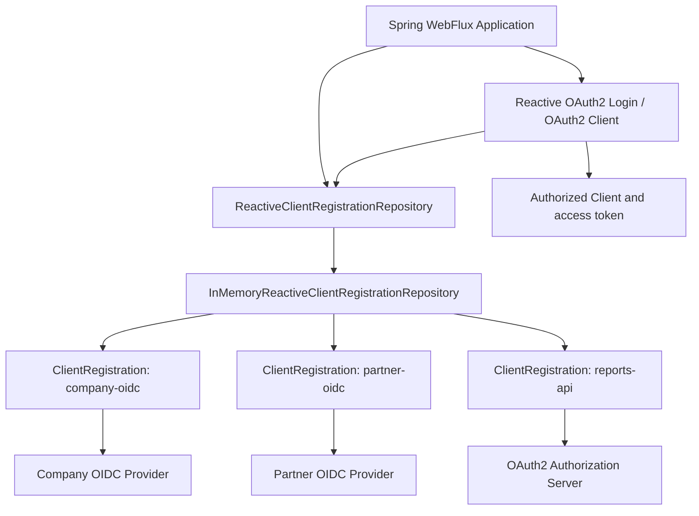
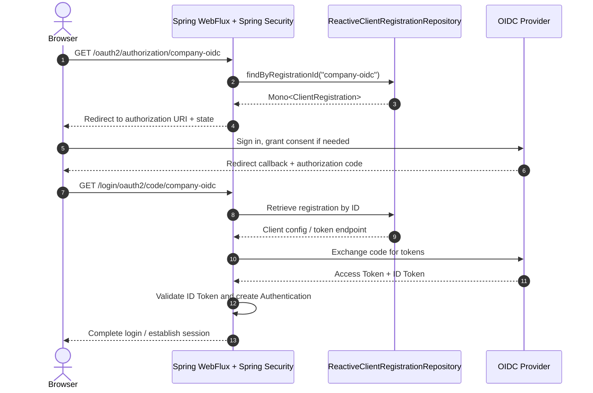

# 5.9. `InMemoryReactiveClientRegistrationRepository` and Java Configuration

## 1. Context: Storing OAuth2/OIDC Client Configuration in WebFlux Applications

In a Spring Security application using **Spring WebFlux**, before signing in with OpenID Connect (OIDC) or calling APIs via OAuth 2.0 Client, the system must know **how the application is registered with the Authorization Server/OpenID Provider**: `client_id`, grant type, scopes, endpoints, and redirect URI.

Spring Security represents each application configuration as a **`ClientRegistration`** object. When there are multiple providers or multiple use cases, Spring needs a place to look up `ClientRegistration` objects by **`registrationId`**.

On the reactive stack, the abstraction used is **`ReactiveClientRegistrationRepository`**. The built-in and simplest implementation is **`InMemoryReactiveClientRegistrationRepository`**, storing the set of registrations in the application process's memory.

Examples:

- `company-oidc`: employee login using OIDC Authorization Code.
- `partner-oidc`: partner user login from another issuer.
- `reports-api`: a backend client using the `client_credentials` grant to call the Reports API without a user.

All three can be declared in Java and passed into an `InMemoryReactiveClientRegistrationRepository`, after which Spring Security components select the right registration by ID.

> **Main point:** `InMemoryReactiveClientRegistrationRepository` manages **client configurations registered with providers**, not user access tokens, not user data, and not an Authorization Server. Tokens and authorization state belong to other **Authorized Client** components.

## 2. Related Concepts

### 2.1. Component Diagram



Comparison table of easily confused components:

| Component | Data type/responsibility | When is it used? |
| --- | --- | --- |
| `ClientRegistration` | Client ID, grant, scopes, provider endpoints, redirect URI, etc., for **one registration** | When configuring an OAuth/OIDC Client |
| `ReactiveClientRegistrationRepository` | Interface for looking up registrations by ID, returning `Mono<ClientRegistration>` | In WebFlux |
| `InMemoryReactiveClientRegistrationRepository` | Implementation storing multiple `ClientRegistration`s in memory | Fixed / infrequently changing configuration |
| `InMemoryClientRegistrationRepository` | Repository for **Servlet**, not reactive | Spring MVC / Servlet |
| `OAuth2AuthorizedClient` | An authorized registration, paired with an access token and possibly a refresh token | After tokens have been issued |
| `ReactiveOAuth2AuthorizedClientService` / `ServerOAuth2AuthorizedClientRepository` | Stores/retrieves **authorized clients** in the appropriate context | When holding and using tokens |
| `ReactiveOAuth2AuthorizedClientManager` | Coordinates acquiring, refreshing/re-issuing, and using authorized clients | When calling OAuth-protected APIs |

The repositories in the first rows and authorized client storage **are not interchangeable**. Registering `client_id` at the OIDC Provider is also a separate task from constructing a `ClientRegistration` object in code.

### 2.2. Interface and Implementation

In essence, the reactive repository interface has one primary method:

```java
public interface ReactiveClientRegistrationRepository {
    Mono<ClientRegistration> findByRegistrationId(String registrationId);
}
```

`Mono<ClientRegistration>` can:

- Emit a `ClientRegistration` matching the ID, then complete.
- Complete **without emitting a value** if the ID is not found in the in-memory implementation.
- Emit an error signal if a custom repository fails during retrieval.

Because this is a reactive API, when looking up inside a reactive pipeline use `map`, `flatMap`, `switchIfEmpty`, etc., instead of calling `block()` on the event loop.

`InMemoryReactiveClientRegistrationRepository` also implements `Iterable<ClientRegistration>`. Spring Security can iterate over client registrations when needed to build login choices; this iterable capability is not mandatory for every custom implementation.

There are two common ways to construct the repository:

```java
new InMemoryReactiveClientRegistrationRepository(firstRegistration, secondRegistration);

// Or:
new InMemoryReactiveClientRegistrationRepository(
        List.of(firstRegistration, secondRegistration));
```

Each registration needs a **unique `registrationId`**. These IDs are lookup keys **internal to the Spring application**, distinct from the `clientId` issued by the Authorization Server.

### 2.3. Why `Reactive`?

Spring MVC uses `ClientRegistrationRepository` with synchronous lookup. Spring WebFlux uses `ReactiveClientRegistrationRepository` with Reactor `Mono`-based lookup, suited to components operating under a non-blocking model.

| Criterion | Servlet / Spring MVC | Reactive / Spring WebFlux |
| --- | --- | --- |
| Interface | `ClientRegistrationRepository` | `ReactiveClientRegistrationRepository` |
| In-memory implementation | `InMemoryClientRegistrationRepository` | `InMemoryReactiveClientRegistrationRepository` |
| Lookup | `ClientRegistration findByRegistrationId(...)` | `Mono<ClientRegistration> findByRegistrationId(...)` |
| HTTP security | `HttpSecurity` and `SecurityFilterChain` | `ServerHttpSecurity` and `SecurityWebFilterChain` |
| OAuth2 authorization manager | `OAuth2AuthorizedClientManager` | `ReactiveOAuth2AuthorizedClientManager` |
| Common HTTP client | `RestClient` / Servlet integration | `WebClient` / Reactive integration |

**Similar names do not mean APIs can be mixed.** A WebFlux `SecurityWebFilterChain` must receive the reactive repository. Adding both `spring-boot-starter-web` and `spring-boot-starter-webflux` may cause Spring Boot to pick the Servlet application type based on configuration/conditions, creating confusion with reactive examples. This lesson intentionally uses **WebFlux**.

## 3. When Should You Declare the Repository in Java?

Spring Boot already supports configuring OAuth2 Clients via `application.yml` or `application.properties`. For example:

```yaml
spring:
  security:
    oauth2:
      client:
        registration:
          company-oidc:
            provider: company
            client-id: ${COMPANY_CLIENT_ID}
            client-secret: ${COMPANY_CLIENT_SECRET}
            authorization-grant-type: authorization_code
            scope: openid,profile,email
        provider:
          company:
            issuer-uri: https://login.example.com/realms/company
```

When using WebFlux and auto-configuration conditions are met, Spring Boot can convert these properties into `ClientRegistration`s and create an `InMemoryReactiveClientRegistrationRepository` bean.

**Java configuration** is beneficial when:

- You want to encapsulate `ClientRegistration` creation logic into a clean Java method.
- You want to combine multiple providers/grants or create registrations conditionally per environment.
- You want to use `ClientRegistrations.fromIssuerLocation(...)` to build configuration via Discovery.
- You need to customize/override fields not conveniently expressed by property bindings.
- You do not use Spring Boot's auto-configuration or want direct control over the repository bean.

In return, Java declaration requires the application to manage the mapping between properties, secrets, provider endpoints, and `ClientRegistration` itself. For simple configurations, property-based configuration is usually easier to maintain.

**An important note:** once you declare your own `ReactiveClientRegistrationRepository` bean, Spring Boot's corresponding auto-configuration normally **backs off** and stops creating a repository from registration properties. Therefore, you must put **every needed registration** into this Java bean, or design a proper combining mechanism, rather than expecting Spring to merge both sources automatically.

## 4. Practice Problem and Prerequisites

We will configure a **Spring WebFlux OIDC Client** application with:

| Parameter | Illustrative value |
| --- | --- |
| Application | `employee-portal` |
| OIDC issuer | `https://login.example.com/realms/company` |
| Client ID at OP | `employee-portal-web` |
| Registration ID in Spring | `company-oidc` |
| Grant type | `authorization_code` |
| Client authentication | `client_secret_basic` |
| Scopes | `openid`, `profile`, `email` |
| Redirect URI | `{baseUrl}/login/oauth2/code/{registrationId}` |
| Actual local callback | `http://localhost:8080/login/oauth2/code/company-oidc` |

Before running Spring, register a web/confidential client at the OIDC provider, enable Authorization Code Grant, register the exact callback, and obtain the client ID/secret. The hostnames and credentials above are examples, not real accounts.

### 4.1. Dependencies

Example `pom.xml` with Spring Boot 3.x and Spring Security 6.x (exact versions managed by the Spring Boot BOM):

```xml
<dependencies>
    <dependency>
        <groupId>org.springframework.boot</groupId>
        <artifactId>spring-boot-starter-webflux</artifactId>
    </dependency>

    <dependency>
        <groupId>org.springframework.boot</groupId>
        <artifactId>spring-boot-starter-security</artifactId>
    </dependency>

    <dependency>
        <groupId>org.springframework.boot</groupId>
        <artifactId>spring-boot-starter-oauth2-client</artifactId>
    </dependency>
</dependencies>
```

If using Gradle Kotlin DSL, the equivalent is:

```kotlin
dependencies {
    implementation("org.springframework.boot:spring-boot-starter-webflux")
    implementation("org.springframework.boot:spring-boot-starter-security")
    implementation("org.springframework.boot:spring-boot-starter-oauth2-client")
}
```

Classes under `org.springframework.security.oauth2.client.registration` are directly available via the OAuth2 Client starter. You do not need to write a custom WebFlux server handler for token exchange when using `oauth2Login`.

### 4.2. Externalizing Non-Sensitive Configuration and Secrets

Instead of writing client secrets in Java code, declare placeholders in `application.yml`:

```yaml
server:
  port: 8080

app:
  oauth2:
    company:
      issuer-uri: https://login.example.com/realms/company
      client-id: ${COMPANY_OIDC_CLIENT_ID}
      client-secret: ${COMPANY_OIDC_CLIENT_SECRET}
```

In real environments, the two variables holding ID/secret must be injected through a secure operational configuration mechanism. Never commit real secrets to Git; never print secrets, authorization codes, ID Tokens, or access tokens in logs.

## 5. Java Configuration: Creating the Repository Bean from OIDC Discovery

This is the cleanest approach when the provider supports **OIDC Discovery** and publishes standard endpoints.

Create `ReactiveOAuth2SecurityConfig.java`:

```java
import org.springframework.beans.factory.annotation.Value;
import org.springframework.context.annotation.Bean;
import org.springframework.context.annotation.Configuration;
import org.springframework.security.config.Customizer;
import org.springframework.security.config.annotation.web.reactive.EnableWebFluxSecurity;
import org.springframework.security.config.web.server.ServerHttpSecurity;
import org.springframework.security.oauth2.client.registration.ClientRegistration;
import org.springframework.security.oauth2.client.registration.ClientRegistrations;
import org.springframework.security.oauth2.client.registration.InMemoryReactiveClientRegistrationRepository;
import org.springframework.security.oauth2.client.registration.ReactiveClientRegistrationRepository;
import org.springframework.security.oauth2.core.AuthorizationGrantType;
import org.springframework.security.oauth2.core.ClientAuthenticationMethod;
import org.springframework.security.web.server.SecurityWebFilterChain;

@Configuration
@EnableWebFluxSecurity
public class ReactiveOAuth2SecurityConfig {

    @Bean
    ReactiveClientRegistrationRepository clientRegistrationRepository(
            @Value("${app.oauth2.company.issuer-uri}") String issuerUri,
            @Value("${app.oauth2.company.client-id}") String clientId,
            @Value("${app.oauth2.company.client-secret}") String clientSecret) {

        ClientRegistration company = ClientRegistrations
                .fromIssuerLocation(issuerUri)
                .registrationId("company-oidc")
                .clientId(clientId)
                .clientSecret(clientSecret)
                .clientAuthenticationMethod(
                        ClientAuthenticationMethod.CLIENT_SECRET_BASIC)
                .authorizationGrantType(
                        AuthorizationGrantType.AUTHORIZATION_CODE)
                .redirectUri(
                        "{baseUrl}/login/oauth2/code/{registrationId}")
                .scope("openid", "profile", "email")
                .clientName("Company SSO")
                .build();

        return new InMemoryReactiveClientRegistrationRepository(company);
    }

    @Bean
    SecurityWebFilterChain securityWebFilterChain(ServerHttpSecurity http) {
        return http
                .authorizeExchange(exchanges -> exchanges
                        .pathMatchers("/", "/public/**").permitAll()
                        .anyExchange().authenticated())
                .oauth2Login(Customizer.withDefaults())
                .build();
    }
}
```

The code defines two main beans:

1. **`clientRegistrationRepository`**: builds a `ClientRegistration` from the issuer and registration details and passes it to `InMemoryReactiveClientRegistrationRepository`. The bean is exposed under the **reactive interface** so Spring Security can find it.
2. **`securityWebFilterChain`**: configures HTTP request protection in WebFlux and enables OAuth2/OIDC Login.

Here `ClientRegistrations.fromIssuerLocation(...)` **fetches metadata from the provider while building configuration**, populating endpoints such as authorization, token, JWKS, and UserInfo according to the OP's capabilities/metadata. Network access occurs when the bean is created at application startup; **do not run Discovery per request**. If the OP is unavailable at startup, registration creation may fail.

### 5.1. Explaining the Builder Chain

| Java call | Meaning |
| --- | --- |
| `fromIssuerLocation(issuerUri)` | Initializes the builder from metadata of a trusted issuer |
| `registrationId("company-oidc")` | Lookup key in the repository |
| `clientId(clientId)` | Client ID registered at the OP |
| `clientSecret(clientSecret)` | Secret protected by the backend |
| `clientAuthenticationMethod(...)` | How the client authenticates at the token endpoint |
| `authorizationGrantType(AUTHORIZATION_CODE)` | Selects the Authorization Code flow |
| `redirectUri(...)` | Callback that Spring Security will handle |
| `scope("openid", "profile", "email")` | Requested scopes; `openid` activates OIDC processing |
| `clientName("Company SSO")` | Display label usable on a login page |
| `build()` | Completes creation of the `ClientRegistration` |

One point to remember: **`registrationId` differs from `clientId`**.

```text
registrationId = company-oidc  -> URL /oauth2/authorization/company-oidc
clientId       = employee-portal-web -> value sent to the provider

Default callback:
http://localhost:8080/login/oauth2/code/company-oidc
```

Do not build callbacks from `clientId` when Spring uses `registrationId` in the URI template.

### 5.2. Why Use `fromIssuerLocation`?

If the OP supports Discovery and the issuer is accurate, Spring can retrieve standard information from OIDC/OAuth metadata documents without repeating endpoints manually. An abbreviated metadata structure might look like:

```json
{
  "issuer": "https://login.example.com/realms/company",
  "authorization_endpoint":
    "https://login.example.com/realms/company/protocol/openid-connect/auth",
  "token_endpoint":
    "https://login.example.com/realms/company/protocol/openid-connect/token",
  "jwks_uri":
    "https://login.example.com/realms/company/protocol/openid-connect/certs"
}
```

The URLs above illustrate a common path convention of an OP; the application must use **real metadata** from a managed issuer. `fromIssuerLocation` discovers info from standard metadata endpoints supported by Spring Security; if you only want to query OpenID Provider Configuration, `ClientRegistrations.fromOidcIssuerLocation(...)` is available in supporting versions.

Benefits:

- Less manual URL copying.
- Explicit issuer configuration for managing the right realm/tenant.
- Lets the library continue using metadata to configure ID Token verification.

In exchange, the application depends on accurate metadata and OP connectivity at configuration time. For environments with restricted network access at startup, endpoints can be configured explicitly if architecture and library version permit.

## 6. Fully Manual Java Configuration with `ClientRegistration.withRegistrationId`

In some systems, the Authorization Server does not provide Discovery, or operators need explicit control over specific endpoints. In that case, use the `ClientRegistration.withRegistrationId(...)` builder.

The following example only illustrates **an alternative way to build a registration** for `company` in section 5; do not declare two repository beans simultaneously in the same application context.

```java
import org.springframework.security.oauth2.client.registration.ClientRegistration;
import org.springframework.security.oauth2.core.AuthorizationGrantType;
import org.springframework.security.oauth2.core.ClientAuthenticationMethod;
import org.springframework.security.oauth2.core.oidc.IdTokenClaimNames;

public class ManualRegistrationExample {

    public static ClientRegistration company(
            String clientId, String clientSecret) {

        return ClientRegistration.withRegistrationId("company-oidc")
                .clientId(clientId)
                .clientSecret(clientSecret)
                .clientAuthenticationMethod(
                        ClientAuthenticationMethod.CLIENT_SECRET_BASIC)
                .authorizationGrantType(
                        AuthorizationGrantType.AUTHORIZATION_CODE)
                .redirectUri(
                        "{baseUrl}/login/oauth2/code/{registrationId}")
                .scope("openid", "profile", "email")
                .issuerUri("https://login.example.com/realms/company")
                .authorizationUri(
                        "https://login.example.com/realms/company/protocol/openid-connect/auth")
                .tokenUri(
                        "https://login.example.com/realms/company/protocol/openid-connect/token")
                .jwkSetUri(
                        "https://login.example.com/realms/company/protocol/openid-connect/certs")
                .userInfoUri(
                        "https://login.example.com/realms/company/protocol/openid-connect/userinfo")
                .userNameAttributeName(IdTokenClaimNames.SUB)
                .clientName("Company SSO")
                .build();
    }
}
```

When using the manual approach, the bean method in section 5 can call:

```java
ClientRegistration company =
        ManualRegistrationExample.company(clientId, clientSecret);

return new InMemoryReactiveClientRegistrationRepository(company);
```

Distinguish these endpoints clearly:

| Endpoint/parameter | Role |
| --- | --- |
| `authorizationUri` | Browser is redirected here for user authentication and code issuance |
| `tokenUri` | Backend exchanges the authorization code for tokens |
| `jwkSetUri` | Publishes public keys for verifying JWS ID Token signatures |
| `userInfoUri` | Fetches user claims via the UserInfo endpoint per flow and scopes |
| `issuerUri` | OP identifier that must match the `iss` claim of the ID Token |
| `redirectUri` | Callback **of the Spring application**, must match what is registered at the OP |

Do not confuse `issuerUri` with `authorizationUri`. In OIDC, the issuer identifies **the source of trust**, whereas the authorization endpoint is the URL handling authentication requests from the browser.

Manual configuration increases control but also raises the risk of misconfiguring issuer, callback, UserInfo, JWKS, or metadata when the OP changes. If genuinely using OIDC, supply enough info to verify the ID Token per OIDC rules—do not just set `scope("openid")` and skip security checks.

## 7. One Repository Holding Multiple `ClientRegistration`s

`InMemoryReactiveClientRegistrationRepository` can hold multiple registrations so the application can pick providers or grants on demand.

### 7.1. Multiple OIDC Providers

Suppose the project has two registrations built from two trusted issuers:

```java
ClientRegistration company = ClientRegistrations
        .fromIssuerLocation(companyIssuer)
        .registrationId("company-oidc")
        .clientId(companyClientId)
        .clientSecret(companyClientSecret)
        .clientAuthenticationMethod(
                ClientAuthenticationMethod.CLIENT_SECRET_BASIC)
        .authorizationGrantType(AuthorizationGrantType.AUTHORIZATION_CODE)
        .redirectUri("{baseUrl}/login/oauth2/code/{registrationId}")
        .scope("openid", "profile")
        .build();

ClientRegistration partner = ClientRegistrations
        .fromIssuerLocation(partnerIssuer)
        .registrationId("partner-oidc")
        .clientId(partnerClientId)
        .clientSecret(partnerClientSecret)
        .clientAuthenticationMethod(
                ClientAuthenticationMethod.CLIENT_SECRET_BASIC)
        .authorizationGrantType(AuthorizationGrantType.AUTHORIZATION_CODE)
        .redirectUri("{baseUrl}/login/oauth2/code/{registrationId}")
        .scope("openid", "profile")
        .build();

return new InMemoryReactiveClientRegistrationRepository(company, partner);
```

The snippet above is an **illustrative method body** inside a factory method where `companyIssuer`, `partnerIssuer`, `companyClientId`, etc. are already securely loaded; it is not a standalone Java class. In a real application, place it inside **one** repository bean with parameters injected from properties/a secret manager.

Now there are two login initiation URLs:

```text
/oauth2/authorization/company-oidc
/oauth2/authorization/partner-oidc
```

And two callbacks:

```text
/login/oauth2/code/company-oidc
/login/oauth2/code/partner-oidc
```

Each callback URL must be registered at its respective provider. The two registrations can have different issuers, different client IDs, and different scopes. Never reuse the same `registrationId` for two providers; the repository must have distinct lookup keys.

### 7.2. Adding Client Credentials for the Backend

The same repository can also contain a client for **machine-to-machine API calls**:

```java
ClientRegistration reports = ClientRegistration
        .withRegistrationId("reports-api")
        .clientId(reportsClientId)
        .clientSecret(reportsClientSecret)
        .clientAuthenticationMethod(
                ClientAuthenticationMethod.CLIENT_SECRET_BASIC)
        .authorizationGrantType(AuthorizationGrantType.CLIENT_CREDENTIALS)
        .tokenUri("https://auth.example.com/oauth2/token")
        .scope("reports.read")
        .clientName("Reports API")
        .build();

return new InMemoryReactiveClientRegistrationRepository(company, reports);
```

`reportsClientId` and `reportsClientSecret` here represent credentials issued specifically for the backend. Client Credentials requires neither a redirect URI nor the `openid` scope. It simply acquires an access token representing the client to access APIs within its granted scope.

**Putting the `reports-api` registration into the repository does not automatically trigger API calls.** The application must use a reactive authorized client manager or `WebClient` integration to acquire an access token and attach it to requests.

### 7.3. Options When Initializing from a List

Multiple registrations can be passed as a list:

```java
List<ClientRegistration> registrations = List.of(
        companyRegistration,
        partnerRegistration,
        reportsRegistration
);

ReactiveClientRegistrationRepository repository =
        new InMemoryReactiveClientRegistrationRepository(registrations);
```

The variables `companyRegistration`, `partnerRegistration`, and `reportsRegistration` must be built beforehand using builders. The repository is a **snapshot** of the registrations passed at initialization. There is no built-in public dynamic lifecycle API on `InMemoryReactiveClientRegistrationRepository` to add/remove/edit registrations at runtime. If you need to support hundreds of tenants or instantaneous registration changes, consider a custom repository reading from centrally managed config, caches, or a database per operational requirements.

## 8. Looking Up Registrations by ID in a Reactive Pipeline

`ReactiveClientRegistrationRepository` provides a unified access point, letting other code use registrations without depending on whether the implementation stores them in memory, a database, or a remote source.

Example lookup helper service:

```java
import org.springframework.security.oauth2.client.registration.ClientRegistration;
import org.springframework.security.oauth2.client.registration.ReactiveClientRegistrationRepository;
import org.springframework.stereotype.Service;
import reactor.core.publisher.Mono;

@Service
public class ClientRegistrationLookup {

    private final ReactiveClientRegistrationRepository repository;

    public ClientRegistrationLookup(
            ReactiveClientRegistrationRepository repository) {
        this.repository = repository;
    }

    public Mono<ClientRegistration> requireRegistration(String registrationId) {
        return repository.findByRegistrationId(registrationId)
                .switchIfEmpty(Mono.error(
                        new IllegalArgumentException(
                                "Registration not found: " + registrationId)));
    }

    public Mono<String> providerName(String registrationId) {
        return requireRegistration(registrationId)
                .map(ClientRegistration::getClientName);
    }
}
```

When calling `providerName("company-oidc")`, the reactive pipeline can return `Company SSO`. When calling with a non-existent ID, `switchIfEmpty` turns the empty `Mono` into an error handleable at the application layer.

Pay attention to three details:

1. **`Mono.empty()`** differs from a network access error. In an in-memory repository, a missing ID is a normal lookup outcome; do not immediately treat it as a connection failure to the Authorization Server.
2. Lookup **does not request tokens**, does not authenticate users, and sends no HTTP requests to the provider. It only reads already-held configuration.
3. Never call `block()` inside a WebFlux request handler to obtain `ClientRegistration`. If logic needs to react to the lookup result, use `flatMap`, `map`, and Reactor operators.

### 8.1. Should the Repository Be Looked Up by Its Concrete Class?

No. The bean should be declared and injected via **`ReactiveClientRegistrationRepository`** so logic stays flexible:

```java
@Bean
ReactiveClientRegistrationRepository clientRegistrationRepository() {
    return new InMemoryReactiveClientRegistrationRepository(
            companyRegistration());
}
```

If another backend is needed later, code using `findByRegistrationId(...)` barely needs to change.

Meanwhile, when you genuinely need to iterate over all registrations using `Iterable`, keep in mind that **the repository interface does not guarantee enumeration support**. Iteration is a feature of the `InMemoryReactiveClientRegistrationRepository` implementation. Custom login selection pages should iterate over registrations via an appropriate interface/mechanism rather than assuming every repository implements `Iterable`.

## 9. Connecting the Repository to OAuth2 Login on WebFlux

When `SecurityWebFilterChain` enables:

```java
http.oauth2Login(Customizer.withDefaults());
```

Spring Security can use the `ClientRegistration`s in the reactive repository to initiate and complete OAuth2/OIDC login. For the `company-oidc` registration, the usual paths are:

```text
Initiate login:
GET /oauth2/authorization/company-oidc

Receive callback from OIDC Provider:
GET /login/oauth2/code/company-oidc?code=...&state=...
```

A typical processing sequence:



In a real application, Spring Security also manages `state` and the corresponding OIDC/PKCE security requirements. The diagram focuses solely on the repository's role; additional components may exist to store authorization requests, exchange/session state, and authorized clients.

### 9.1. Controller After Login

Example of an endpoint returning only minimal data of the authenticated user:

```java
import java.util.Map;

import org.springframework.security.core.annotation.AuthenticationPrincipal;
import org.springframework.security.oauth2.core.oidc.user.OidcUser;
import org.springframework.web.bind.annotation.GetMapping;
import org.springframework.web.bind.annotation.RestController;
import reactor.core.publisher.Mono;

@RestController
public class ProfileController {

    @GetMapping("/me")
    public Mono<Map<String, String>> me(
            @AuthenticationPrincipal OidcUser user) {

        return Mono.just(Map.of(
                "subject", user.getSubject(),
                "issuer", user.getIssuer().toString()
        ));
    }
}
```

`OidcUser` represents a user authenticated via OIDC login. The example assumes `/me` is accessed only via OIDC; in systems with multiple authentication mechanisms, handle the corresponding principal and non-`OidcUser` cases appropriately.

**Never return raw ID Tokens or access tokens to the browser just to display a profile.** Client registrations and ID Tokens serve different purposes: routing/authorization configuration versus authentication evidence.

### 9.2. Redirect URI When Running Behind a Reverse Proxy

The `{baseUrl}/login/oauth2/code/{registrationId}` URI template can depend on the incoming request URL. If WebFlux runs behind an ingress/reverse proxy and sees an internal HTTP origin, the application may generate a redirect URI different from the public URL registered at the OP.

Depending on infrastructure and Spring Boot version, forwarded header handling can be configured at the application layer once the proxy establishes a trust boundary:

```yaml
server:
  forward-headers-strategy: framework
```

Trust `Forwarded`/`X-Forwarded-*` only when the proxy controls the header source; never accept arbitrary forwarded headers from the Internet. Compare the OP-allowed callback with the URI Spring **actually sends in the authorization request** before troubleshooting `redirect_uri_mismatch` errors.

## 10. The Repository Is Also Used When Calling APIs with `WebClient`

`oauth2Login` handles sign-in. When a WebFlux application needs to **call an OAuth 2.0-protected API**, `ClientRegistration`s are also used by `ReactiveOAuth2AuthorizedClientManager` to acquire and manage access tokens.

For HTTP calls made within a request/user context, you can integrate with `WebClient` via `ServerOAuth2AuthorizedClientExchangeFilterFunction`.

Example configuration:

```java
import org.springframework.context.annotation.Bean;
import org.springframework.context.annotation.Configuration;
import org.springframework.security.oauth2.client.ReactiveOAuth2AuthorizedClientManager;
import org.springframework.security.oauth2.client.web.reactive.function.client.ServerOAuth2AuthorizedClientExchangeFilterFunction;
import org.springframework.web.reactive.function.client.WebClient;

@Configuration
public class ApiWebClientConfig {

    @Bean
    WebClient protectedApiWebClient(
            ReactiveOAuth2AuthorizedClientManager authorizedClientManager) {

        var oauth2 = new ServerOAuth2AuthorizedClientExchangeFilterFunction(
                authorizedClientManager);

        return WebClient.builder()
                .filter(oauth2)
                .build();
    }
}
```

Example usage in a reactive controller:

```java
import static org.springframework.security.oauth2.client.web.reactive.function.client
        .ServerOAuth2AuthorizedClientExchangeFilterFunction.clientRegistrationId;

import org.springframework.web.bind.annotation.GetMapping;
import org.springframework.web.bind.annotation.RestController;
import org.springframework.web.reactive.function.client.WebClient;
import reactor.core.publisher.Mono;

@RestController
public class ReportsController {

    private final WebClient api;

    public ReportsController(WebClient protectedApiWebClient) {
        this.api = protectedApiWebClient;
    }

    @GetMapping("/reports")
    public Mono<String> reports() {
        return api.get()
                .uri("https://reports.example.com/api/summary")
                .attributes(clientRegistrationId("reports-api"))
                .retrieve()
                .bodyToMono(String.class);
    }
}
```

Here:

- `clientRegistrationId("reports-api")` specifies which registration to use to acquire an access token. It is **not** the `client_id` issued by the OP.
- The filter and authorized client manager are responsible for obtaining, reusing, or re-issuing tokens according to the grant and authorization state.
- If the grant is `client_credentials`, the Authorization Server issues an access token for the application identity. If the grant is `authorization_code`, an appropriate user authorization context is needed.
- The `/reports` endpoint in the example can be placed under your system's authorization rules. The target service must validate the token and check audience/scopes/roles itself.

**Avoid arbitrarily setting `setDefaultOAuth2AuthorizedClient(true)` or applying a default client across every `WebClient` call.** Doing so can send tokens to unintended hosts/endpoints. Select registrations explicitly or create dedicated `WebClient`s with controlled target origins.

### 10.1. Calling Client Credentials Outside HTTP Requests (Scheduled Job / Background Worker)

The previous example used a filter tied to a reactive request context. For a background job without a `ServerWebExchange`, Spring Security provides **`AuthorizedClientServiceReactiveOAuth2AuthorizedClientManager`**, suited for service-tier/scheduler use.

A simple configuration:

```java
import org.springframework.context.annotation.Bean;
import org.springframework.context.annotation.Configuration;
import org.springframework.security.oauth2.client.AuthorizedClientServiceReactiveOAuth2AuthorizedClientManager;
import org.springframework.security.oauth2.client.InMemoryReactiveOAuth2AuthorizedClientService;
import org.springframework.security.oauth2.client.ReactiveOAuth2AuthorizedClientManager;
import org.springframework.security.oauth2.client.ReactiveOAuth2AuthorizedClientProvider;
import org.springframework.security.oauth2.client.ReactiveOAuth2AuthorizedClientProviderBuilder;
import org.springframework.security.oauth2.client.ReactiveOAuth2AuthorizedClientService;
import org.springframework.security.oauth2.client.registration.ReactiveClientRegistrationRepository;

@Configuration
public class BackgroundOAuth2Config {

    @Bean
    ReactiveOAuth2AuthorizedClientService backgroundAuthorizedClientService(
            ReactiveClientRegistrationRepository repository) {
        return new InMemoryReactiveOAuth2AuthorizedClientService(repository);
    }

    @Bean("backgroundAuthorizedClientManager")
    ReactiveOAuth2AuthorizedClientManager backgroundAuthorizedClientManager(
            ReactiveClientRegistrationRepository repository,
            ReactiveOAuth2AuthorizedClientService backgroundAuthorizedClientService) {

        ReactiveOAuth2AuthorizedClientProvider provider =
                ReactiveOAuth2AuthorizedClientProviderBuilder.builder()
                        .clientCredentials()
                        .build();

        var manager = new AuthorizedClientServiceReactiveOAuth2AuthorizedClientManager(
                repository, backgroundAuthorizedClientService);
        manager.setAuthorizedClientProvider(provider);
        return manager;
    }
}
```

In a project that already has multiple `ReactiveOAuth2AuthorizedClientManager` or `ReactiveOAuth2AuthorizedClientService` beans, use `@Qualifier` or bean names when injecting to distinguish request-scoped managers from background managers.

A service using the manager and `WebClient`:

```java
import org.springframework.beans.factory.annotation.Qualifier;
import org.springframework.security.oauth2.client.OAuth2AuthorizeRequest;
import org.springframework.security.oauth2.client.ReactiveOAuth2AuthorizedClientManager;
import org.springframework.stereotype.Service;
import org.springframework.web.reactive.function.client.WebClient;
import reactor.core.publisher.Mono;

@Service
public class ReportsGateway {

    private final ReactiveOAuth2AuthorizedClientManager manager;
    private final WebClient api = WebClient.builder()
            .baseUrl("https://reports.example.com")
            .build();

    public ReportsGateway(
            @Qualifier("backgroundAuthorizedClientManager")
            ReactiveOAuth2AuthorizedClientManager manager) {
        this.manager = manager;
    }

    public Mono<String> fetchSummary() {
        OAuth2AuthorizeRequest request = OAuth2AuthorizeRequest
                .withClientRegistrationId("reports-api")
                .principal("background-reports-job")
                .build();

        return manager.authorize(request)
                .switchIfEmpty(Mono.error(
                        new IllegalStateException("Could not obtain access token")))
                .flatMap(authorized -> api.get()
                        .uri("/api/summary")
                        .headers(headers -> headers.setBearerAuth(
                                authorized.getAccessToken().getTokenValue()))
                        .retrieve()
                        .bodyToMono(String.class));
    }
}
```

`principal("background-reports-job")` is a **stable** technical identifier for the manager to look up the authorized client; it is not an end user. The result of `manager.authorize(request)` is a `Mono`, so the service composes a pipeline with `flatMap` rather than calling `block()`.

If only OIDC login is needed, the application does not necessarily need this background manager snippet. It is shown to clarify that **the same client registration repository** can serve different grants while **token issuance and storage** belong to separate components.

## 11. In-Memory Data: Scope, Limits, and Lifecycle

The term **InMemory** applies to **the copy of client registration configuration** inside the application process:

- The repository is initialized with one or more `ClientRegistration`s.
- Lookup by ID reads the stored configuration.
- When the application restarts, code/properties rebuild the repository.
- There is no built-in feature to watch changes in the Authorization Server's registration table.
- Each WebFlux instance in a deployment cluster typically has its own repository.
- It does not hold tokens, sessions, or a user database.

### 11.1. When Is InMemory Appropriate?

| Case | Assessment |
| --- | --- |
| One to a few fixed issuers/registrations | Appropriate, easy to understand and configure |
| Demo, learning environments, or small integration services | Appropriate |
| Each deployment has its own registration set per profile/config | Can be appropriate |
| Hundreds of tenants added/removed continuously at runtime | Consider a custom repository or dynamically managed source |
| Need to change a client secret immediately without restarting | Default InMemory does not auto-update; requires application-designed reload/switch mechanism |
| Need to share access tokens across multiple nodes | Must handle authorized client persistence; the registration repository does not solve this |

### 11.2. Secret Rotation and Multi-Instance Deployment

When an OP rotates a **client secret**, already-built `ClientRegistration`s may still hold the old secret in memory. If environment variables/secret stores change without rebuilding registrations, the application may keep sending the old credential to the token endpoint.

Therefore, design a controlled secret rotation process: update the secret store and OP, redeploy instances or use a supported config-refresh mechanism, and monitor for `invalid_client` errors during the transition window. Do not write a new secret into a random field expecting `InMemoryReactiveClientRegistrationRepository` to pick it up automatically.

### 11.3. Do Not Conflate the Repository with Metadata/JWKS Caches

`ClientRegistration` can contain issuer and endpoints fetched via Discovery. However:

- **InMemory repository** stores registration configuration.
- **Discovery/JWKS HTTP cache** handles fetching metadata and public keys.
- **Authorized client cache** handles the access/refresh token lifecycle.

These are three separate purposes. When an OP rotates signing keys, a `kid not found` issue typically relates to **the JWKS cache and token verification**, not the registration disappearing from the InMemory repository.

## 12. Common Configuration Errors

| Symptom | Possible cause | Resolution |
| --- | --- | --- |
| `No qualifying bean of type ReactiveClientRegistrationRepository` | Bean not declared and auto-configuration could not create repository | Check WebFlux/OAuth2 Client dependencies and `@Bean` |
| Servlet repository bean exists, yet WebFlux ignores it | Mistakenly used `InMemoryClientRegistrationRepository` | Switch to `InMemoryReactiveClientRegistrationRepository` |
| `findByRegistrationId("company-oidc")` emits nothing | Wrong registration ID or ID not added to repository | Check `registrationId` in Java and the ID used in URLs |
| `/oauth2/authorization/company-oidc` does not process login | `oauth2Login` not enabled, missing registration, or wrong URL | Check `SecurityWebFilterChain` and repository bean |
| `redirect_uri_mismatch` | OP callback differs from template/actual URL | Compare scheme, host, port, path, and reverse proxy |
| `invalid_client` | Wrong client ID/secret/authentication method | Check OP registration, secret manager, `clientAuthenticationMethod` |
| `invalid_scope` | Scope does not exist or is not granted to client | Compare `scope(...)` with OP configuration |
| `authorization_code` rejected | Grant disabled, code expired/reused, wrong PKCE or redirect | Check token exchange/flow at the OP |
| Cannot read Discovery | Wrong issuer, missing metadata, DNS/TLS/OP failure | Check issuer URL and metadata endpoints |
| Missing ID Token or not processed as OIDC | Missing `openid` or OP does not support standard OIDC | Check scopes and issuer metadata |
| ID Token validation fails | Invalid issuer, audience, signature, nonce, JWKS, or timestamps | Check OIDC Client validation without disabling security |
| `WebClient` sends request but API returns 401 | No token sent, invalid token, or wrong audience | Check selected registration, client manager, and Resource Server |
| `WebClient` API call returns 403 | Valid token lacks required scope/permission | Check scopes and Resource Server policies |
| Client Credentials works in web request, fails in scheduler | Manager relies on `ServerWebExchange` or unsuitable principal | Use `AuthorizedClientServiceReactiveOAuth2AuthorizedClientManager` for background |
| Changed client secret, yet app still uses old secret | Repository initialized from stale config | Redeploy or perform controlled config refresh |

Distinguish **registration lookup errors** from **token acquisition errors** and **API call errors**. They happen at different stages:

```text
ClientRegistration lookup
       |
       +-- Wrong ID / missing repository? → fix Spring configuration
       |
       v
OAuth2 Authorization / Token request
       |
       +-- invalid_client / grant / scope? → fix OP + credentials
       |
       v
OIDC Login / API call
       |
       +-- ID Token error? → issuer / JWKS / nonce / audience
       |
       +-- API 401 / 403? → Bearer token / scope / resource server
```

## 13. Security When Configuring the Repository in Java

### 13.1. Least Privilege and Secret Protection

- Each client should receive only the **necessary grants and scopes**. For instance, OIDC login uses `authorization_code` and `openid`, while machine-to-machine APIs use `client_credentials` and appropriate API scopes.
- Put client secrets/private keys into a **secret manager** or protected environment config; avoid storing them directly in source, artifacts, logs, exceptions, or public docs.
- Connect to Authorization Servers only over trusted HTTPS/TLS. Never take `issuerUri` or `jwkSetUri` from arbitrary user input.
- Never expose an internal endpoint returning an entire `ClientRegistration`; it may contain `clientSecret`.
- With multiple providers, keep `registrationId` stable and enforce login/access rights according to tenant, scopes, and application policy.
- When using `WebClient`, attach Bearer tokens only to **the intended target APIs**. Do not send a user's token by default on every outbound request.
- Validate ID Tokens using OIDC checks and validate access tokens at the Resource Server. Having a valid registration is not sufficient to authenticate users/API requests.

### 13.2. Behavior Behind a Reverse Proxy

Because the redirect URI can depend on `{baseUrl}`, if a WebFlux app runs behind a reverse proxy you must configure forwarded header handling properly **and trust only managed proxies**. The callback sent to the OP must match an allowed URI. Avoid declaring broad wildcard redirect URIs to work around callback errors.

### 13.3. Logging and Observability

Fields safe to record in technical logs: registration ID, client name, configured issuer, error timestamp, HTTP status, correlation ID, and OAuth error code. Never log client secrets, raw ID Tokens, raw access tokens, refresh tokens, or full `Authorization` headers.

## 14. Verifying Behavior After Configuration

### 14.1. Verifying the Bean and ID Lookup

You can create an internal service like `ClientRegistrationLookup` in section 8 and verify:

- `company-oidc` can be looked up and has the expected client name.
- `partner-oidc` is found if added to the repository.
- `reports-api` has the `client_credentials` grant when registered.
- A non-existent ID yields a `Mono.empty()` from the repository, and the service can translate it into an error as needed.

Inspect only **non-sensitive** metadata; never print `getClientSecret()` in logs/test output.

### 14.2. Verifying Interactive Login

With a client registered at the OP:

1. Run the WebFlux app on port 8080 and visit `http://localhost:8080/oauth2/authorization/company-oidc`.
2. Verify the browser redirects to the right Authorization Server/issuer.
3. Check `client_id`, `redirect_uri`, `scope`, `response_type=code`, and `state` in the authorization request.
4. Sign in with an authorized test account and complete consent if required by the OP.
5. Verify the `/login/oauth2/code/company-oidc` callback is processed by Spring Security and `/me` returns authenticated user details.
6. Test an invalid registration ID or a callback outside allowed redirect URIs to observe the corresponding rejection.

Do not write your own controller to intercept the authorization code or disable state/nonce validation "just to log in faster". Those mechanisms are essential security controls of the OAuth/OIDC flow.

### 14.3. Verifying Outbound API Calls

If you have the `reports-api` registration:

1. Call `ReportsGateway.fetchSummary()` in the configured backend context; the manager acquires a token via `client_credentials`.
2. The Resource Server validates the access token and the `reports.read` scope.
3. When the token expires, the authorized client manager re-acquires a token per the corresponding grant and provider.
4. Test an insufficient scope or wrong-audience token to observe the API denying access.

These are **behavioral test scenarios**, not live execution results from this lesson's environment.

## 15. Frequently Asked Questions

**1. Why doesn't code that only creates the repository automatically log users in?**

The repository only stores registrations. The application also needs a `SecurityWebFilterChain` enabling `oauth2Login`, a real OP, valid client ID/secret, registered redirect URIs, and an authorized user.

**2. Is `InMemoryReactiveClientRegistrationRepository` an access token cache?**

No. `ClientRegistration` holds **configuration**; `OAuth2AuthorizedClient` carries token data after issuance. Tokens are stored in `ReactiveOAuth2AuthorizedClientService` or `ServerOAuth2AuthorizedClientRepository` depending on design.

**3. Why use `InMemoryReactiveClientRegistrationRepository` instead of `InMemoryClientRegistrationRepository`?**

Because the application is **Spring WebFlux**. The reactive repository performs lookups returning `Mono` and is used by reactive-stack OAuth2 components; the Servlet repository belongs to a different stack.

**4. Does renaming `registrationId` have any impact?**

Yes. It affects lookups in code, the `/oauth2/authorization/{registrationId}` URL, and the callback URI if the template contains `{registrationId}`. If changing the ID, synchronize code and callbacks at the OP.

**5. Does declaring it in Java override `spring.security.oauth2.client.registration.*`?**

Normally a directly declared repository bean stops Spring Boot from creating the auto-configured repository. Do not assume YAML registrations are merged automatically. Decide on a single configuration source or intentionally assemble all registrations in your bean.

**6. Should `block()` be called to access the repository?**

Not in a reactive request pipeline. `findByRegistrationId` returns `Mono<ClientRegistration>`; use Reactor operators. With the in-memory implementation, lookup is fast in practice, yet the reactive contract prevents coupling code to the current implementation.

**7. Can registrations be changed while the system is running?**

The in-memory implementation has no built-in dynamic management API. When adding tenants or rotating secrets without redeploying is required, build a custom `ReactiveClientRegistrationRepository` with an appropriate sync/refresh policy, always protecting secrets.

**8. Is OIDC Discovery required when creating `ClientRegistration` in Java?**

Not mandatory if all required endpoints/details are configured manually. However, for OPs supporting Discovery, `ClientRegistrations.fromIssuerLocation(...)` reduces duplication and URL typos while ensuring provider metadata comes from a trusted issuer.

## 16. Summary

`InMemoryReactiveClientRegistrationRepository` is the in-memory implementation of **`ReactiveClientRegistrationRepository`**, used to manage and look up **`ClientRegistration`**s in **Spring Security WebFlux** applications. Each `ClientRegistration` describes a client registered at an OAuth2/OIDC Provider, including client ID, grant type, scopes, redirects, and endpoints.

With **Java configuration**, the main steps are:

1. Build `ClientRegistration` via `ClientRegistrations.fromIssuerLocation(...)` or `ClientRegistration.withRegistrationId(...)`.
2. Pass one or more registrations with distinct IDs into `new InMemoryReactiveClientRegistrationRepository(...)`.
3. Expose the bean as type `ReactiveClientRegistrationRepository`.
4. Enable `oauth2Login` for OIDC login, and `oauth2Client` or a reactive authorized client manager when calling APIs.
5. Keep credentials secure, align callbacks/issuers with the OP, and keep the configuration repository distinct from authorized client/token stores.

From this foundation, an application can add multiple providers, select registrations by context, and reuse the same configuration data for OIDC login or OAuth2 Client calls, while separating **client registration storage**, **access token issuance**, and **API authentication/authorization**.

### Official References

- [Spring Security — Reactive OAuth2 Client: Core Interfaces and Classes](https://docs.spring.io/spring-security/reference/reactive/oauth2/client/core.html)
- [Spring Security — Reactive OAuth2 Login: Core Configuration](https://docs.spring.io/spring-security/reference/reactive/oauth2/login/core.html)
- [Spring Security — Reactive OAuth2 Client: Authorized Client Features](https://docs.spring.io/spring-security/reference/reactive/oauth2/client/authorized-clients.html)
- [Spring Security — InMemoryReactiveClientRegistrationRepository API](https://docs.spring.io/spring-security/site/docs/6.5.x/api/org/springframework/security/oauth2/client/registration/InMemoryReactiveClientRegistrationRepository.html)
