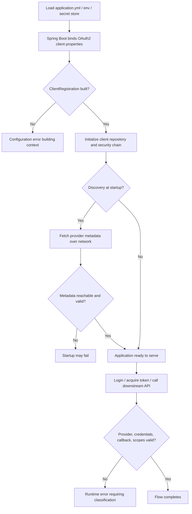
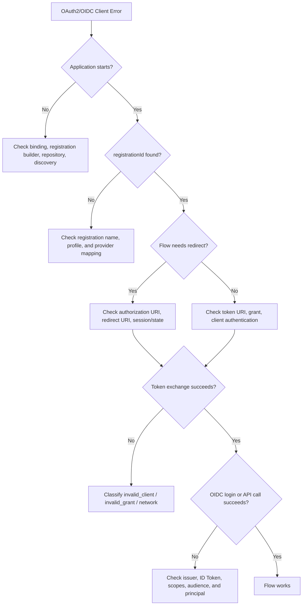

# 5.10. Validation Constraints and Handling Missing Configuration

In Spring Security OAuth 2.0 / OpenID Connect (OIDC) Client, `ClientRegistration` describes how an application is registered with an Authorization Server or OpenID Provider (OP). This object specifies `clientId`, client authentication method, grant type, redirect URI, scopes, and provider endpoints. A misconfiguration can prevent the application from starting, cause login to fail on redirect, or surface only when the application calls an API with an access token.

**Validation constraints** are not just about whether a property has a value. Distinguish:

1. **Structural validity:** Spring Boot can bind the properties and Spring Security can construct `ClientRegistration`.
2. **OAuth 2.0/OIDC semantic validity:** Values are compatible with the grant type, client authentication method, and provider metadata.
3. **Operational validity:** The provider exists, the issuer/endpoints are reachable, the redirect URI is registered accurately, the secret is still active, and tokens carry appropriate audiences/scopes.

A successfully constructed `ClientRegistration` **does not guarantee** the entire login or token-acquisition flow will succeed. Conversely, not every omitted field is an error: for instance, a public client using `client-authentication-method: none` has no client secret, and `client_credentials` needs no redirect URI.

## 1. Scope and Source of a `ClientRegistration`

In Spring Boot, configuration normally lives under two branches:

- `spring.security.oauth2.client.registration.<registration-id>.*`: **client application** details and how the client requests authorization.
- `spring.security.oauth2.client.provider.<provider-id>.*`: corresponding **Authorization Server/OpenID Provider** details.

A `registrationId` is a logical key for the application to select a client, such as `company-login` or `inventory-service`. It is not synonymous with the provider-issued `client-id`. One provider can serve multiple registrations, and a registration must point to the right provider.

Example:

```yaml
spring:
  security:
    oauth2:
      client:
        registration:
          company-login:
            provider: company
            client-id: "${OIDC_CLIENT_ID}"
            client-secret: "${OIDC_CLIENT_SECRET}"
            client-authentication-method: client_secret_basic
            authorization-grant-type: authorization_code
            redirect-uri: "{baseUrl}/login/oauth2/code/{registrationId}"
            scope:
              - openid
              - profile
              - email
        provider:
          company:
            issuer-uri: "https://login.example.org/realms/company"
```

In this example:

- `company-login` is the `registrationId`, used in the default login initiation URL `/oauth2/authorization/company-login`.
- `company` is the `providerId`, linked to the configuration under `provider.company`.
- `client-id` and `client-secret` come from external configuration; never put real secrets in source code or logs.
- `issuer-uri` lets Spring Security/Spring Boot fetch metadata from a discovery-supporting provider, including required endpoints.
- `redirect-uri` contains Spring template variables; the expanded URL must match the callback registered at the provider.

By default, if `registration.<id>.provider` is omitted, Spring Boot uses the registration ID to identify the provider. That works for built-in common providers or providers sharing the same name, yet easily breaks when internal IDs and provider IDs differ. When needed, configure `provider` explicitly.

> **Version note:** Supported grant types, client authentication methods, validation rules, and defaults can vary across Spring Security/Spring Boot versions. Custom checks shown in this lesson represent application-level policies; do not treat them as an exhaustive list of internal assertions enforced by every framework version.

## 2. Classifying Required, Conditional, and Optional Fields

| `ClientRegistration` property | Meaning and validation principles |
|---|---|
| `registrationId` | Must uniquely identify the registration in the repository. Use a stable, non-blank name and do not confuse it with the provider-side client ID. |
| `clientId` | Client identifier issued by the provider. Needs a meaningful value; a wrong ID may only be caught when calling authorization/token endpoints. |
| `clientSecret` | Depends on the client authentication method. Typically required for `client_secret_basic` or `client_secret_post`, **not** required for public clients using `none`; methods like JWT client assertions have separate key constraints. |
| `clientAuthenticationMethod` | Must align with a method supported by the provider and with the client type (public/confidential). |
| `authorizationGrantType` | Must be compatible with the intended flow and grants allowed by the provider, such as `authorization_code` or `client_credentials`. |
| `redirectUri` | Relevant for redirect flows like authorization code. Not automatically required for client credentials. Actual value must match registration at the provider. |
| `scopes` | Depends on API/provider requirements. OIDC Login needs `openid`; missing business scopes can cause login to succeed while API calls are denied. |
| `providerDetails.authorizationUri` | Needed for redirecting users in the authorization-code flow; can come from discovery or explicit configuration. |
| `providerDetails.tokenUri` | Needed when exchanging an authorization code, refreshing tokens, or acquiring tokens via client credentials. |
| `providerDetails.issuerUri` | Useful and typically recommended for OIDC; must match the issuer published by the provider and used when verifying OIDC claims. |
| `providerDetails.jwkSetUri` | Used where public keys are needed to verify tokens/signatures; can be pulled from metadata when using discovery. |
| `providerDetails.userInfoEndpoint` | Depends on login flow and how user info is retrieved; for non-OIDC OAuth2 Login, UserInfo URI and user-name attribute may be required. |
| `clientName` | Display name for the client; not the client ID used to authenticate with the provider. |

Do not maintain a "every field is required" checklist for all registrations. Validate according to **grant type + client authentication method + provider characteristics + application needs**.

### 2.1. Authorization Code and OIDC Login

This flow sends the user's browser to the authorization endpoint and then receives an authorization code at the callback. Items to verify include:

1. `client-id` and provider match the registered client.
2. Provider exposes valid authorization and token endpoints.
3. `redirect-uri` expands to a URL permitted by the provider, with exact scheme, host, port, and path.
4. Client authentication method is appropriate: confidential clients can use a secret; public clients normally use `none` and require PKCE under modern provider policies.
5. For OIDC, request the `openid` scope; issuer, ID Token, and verification keys must match metadata and protocol rules.
6. If the application needs specific claims, verify the provider issues them and handle missing optional claims gracefully.

`profile` and `email` do not replace `openid`. A valid ID Token confirms the login result for the client, whereas an access token authorizes access to a Resource Server. Never use an ID Token as an access token to call APIs.

### 2.2. Client Credentials

This is a machine-to-machine flow without a user browser, callback, or user ID Token:

```yaml
spring:
  security:
    oauth2:
      client:
        registration:
          inventory-service:
            provider: company
            client-id: "${INVENTORY_CLIENT_ID}"
            client-secret: "${INVENTORY_CLIENT_SECRET}"
            client-authentication-method: client_secret_basic
            authorization-grant-type: client_credentials
            scope:
              - inventory.read
        provider:
          company:
            token-uri: "https://login.example.org/realms/company/protocol/openid-connect/token"
```

In this example, `redirect-uri` and `authorization-uri` do not participate in the `client_credentials` token-issuance flow. The critical parts are the token endpoint, client authentication method, and scopes granted by the provider. Some providers require extra settings, such as audience/resource indicators or client assertions; those are provider-specific contracts, not universal defaults.

### 2.3. Non-OIDC OAuth2 Login

Plain OAuth 2.0 does not standardize ID Tokens. If login relies on user info from an OAuth2 provider, the application typically needs to configure a UserInfo/user-attributes endpoint and specify the identifier field (such as `id` or `login`) when the provider lacks built-in defaults.

Do not assume "having `client-id` + `client-secret` is enough for login": the required property set depends on the provider and chosen authentication protocol.

## 3. Missing Configuration Can Surface at Multiple Stages



**Do not assume every configuration error occurs at startup.** Errors depend on when the system actually exercises the registration:

| Stage | Example error | Resolution |
|---|---|---|
 Property binding | Invalid YAML structure, wrong property name, missing placeholder, invalid enum/type value | Inspect root cause exception, check property sources and active profiles. |
 Building `ClientRegistration` | Missing data required by framework to construct registration, undefined provider | Supply fields matching grant type, provider, and Spring version in use. |
 Discovery | Wrong issuer URI, DNS/TLS error, unreachable metadata endpoint, issuer mismatch in metadata | Check well-known endpoint, truststore, proxy, exact issuer, and network reachability. |
 Security initialization | Missing `ClientRegistrationRepository` / `ReactiveClientRegistrationRepository` bean in custom login config | Check starters, web stack, and auto-configuration conditions. |
 Login redirect | Provider rejects `redirect_uri`, `scope`, or `client_id` | Compare actual expanded template URL with registration on the provider side. |
 Callback/token exchange | `invalid_client`, `invalid_grant`, expired code, wrong client authentication method | Check secret, enabled grant, code/state, and redirect URI; never log codes/tokens. |
 OIDC validation | Invalid issuer, audience, signature, timestamps, or nonce | Read verification message, compare metadata and config; never disable validation. |
 Calling Resource Server | Token missing scope/audience, expired token, or wrong client chosen | Check the client registration used for outbound API calls and provider-granted permissions. |

With `issuer-uri`, metadata retrieval may occur while initializing registrations. Consequently, network issues to the Identity Provider can prevent the application from starting in certain setups. When you want to decouple application availability from startup discovery, you can explicitly configure managed and tested endpoints, trading off operator responsibility for keeping metadata up to date.

## 4. Handling Missing Fields: Distinguishing "Required" from "Defaulted"

Spring Boot supports common provider defaults and certain default property values. However, those defaults do not guarantee that the registration matches configuration on the Authorization Server.

Principles:

- **Core field missing:** if the application requires a registration, detect early and report `registrationId` + field name clearly; never fabricate fake client IDs, redirect URIs, or secrets just to let the app boot.
- **Branch-specific field:** check it only when the grant type/client authentication method actually uses it. For instance, do not require a redirect URI for client credentials.
- **Provider details:** prefer issuer discovery when supported and appropriate. If configuring manually, supply the endpoints needed by the actual flow.
- **Spring Boot defaults:** read **final bound values** instead of guessing from YAML. Built-in provider defaults or environment properties may have modified the registration.
- **Optional integrations:** if an OAuth2 integration is disabled in a given environment, do not leave half a set of OAuth2 properties pretending to be a valid registration; isolate configuration by profile/condition appropriately.
- **Environment-specific secrets:** retrieve from environment variables, a secret manager, or controlled config sources. If a confidential client lacks a required secret, fail fast with a clear configuration error rather than substituting a meaningless default string.

### 4.1. Avoid Configurations That Merely "Look Valid"

The snippet below easily causes hard-to-spot bugs:

```yaml
# Example to avoid
spring:
  security:
    oauth2:
      client:
        registration:
          company-login:
            client-id: "placeholder"
            client-secret: "change-me"
```

`placeholder` or `change-me` are still strings, so purely structural checks cannot tell they are dummy values. When running locally without an IdP, use a test provider and dedicated local credentials; when login is not used, deliberately adjust that environment's authentication mode.

### 4.2. Property Placeholders Do Not Replace Validation

```yaml
client-id: "${OIDC_CLIENT_ID}"
client-secret: "${OIDC_CLIENT_SECRET}"
```

This syntax references configuration variables. It does not check whether the client is registered at the provider or whether the secret has expired. Additionally, configuration sources have precedence rules: environment variables, profiles, command-line arguments, or a config server can make the actual runtime value differ from the default file. When diagnosing, log only property names and config source names, never secret values.

## 5. Intentional Validation at Application Startup

The framework performs its own checks during binding and registration construction, yet applications often need extra business rules: "registration `company-login` must exist", "`openid` scope is required", "confidential client requires a secret", "disallow HTTP endpoints outside local environments", etc.

The example below illustrates **additional checks in a Servlet application** after Spring Boot builds `ClientRegistrationRepository`. Imports are omitted; `ApplicationRunner` is a Spring Boot interface, and `StringUtils` comes from Spring Framework:

```java
@Configuration
class OAuth2RegistrationPreflight {

    @Bean
    ApplicationRunner verifyCompanyLogin(ClientRegistrationRepository repository) {
        return args -> {
            ClientRegistration registration =
                    repository.findByRegistrationId("company-login");

            require(registration != null,
                    "Missing OAuth2 client registration: company-login");

            require(StringUtils.hasText(registration.getClientId()),
                    "company-login: client-id must be configured");

            require(AuthorizationGrantType.AUTHORIZATION_CODE.equals(
                    registration.getAuthorizationGrantType()),
                    "company-login: expected authorization_code grant");

            require(registration.getScopes().contains("openid"),
                    "company-login: OIDC Login requires openid scope");

            require(StringUtils.hasText(registration.getRedirectUri()),
                    "company-login: redirect-uri must be configured");

            var provider = registration.getProviderDetails();
            require(StringUtils.hasText(provider.getAuthorizationUri()),
                    "company-login: provider authorization-uri missing");
            require(StringUtils.hasText(provider.getTokenUri()),
                    "company-login: provider token-uri missing");

            ClientAuthenticationMethod method =
                    registration.getClientAuthenticationMethod();
            if (ClientAuthenticationMethod.CLIENT_SECRET_BASIC.equals(method)
                    || ClientAuthenticationMethod.CLIENT_SECRET_POST.equals(method)) {
                require(StringUtils.hasText(registration.getClientSecret()),
                        "company-login: confidential client secret missing");
            }
        };
    }

    private static void require(boolean condition, String message) {
        if (!condition) {
            throw new IllegalStateException(message);
        }
    }
}
```

Key takeaways from the example:

1. `findByRegistrationId(...)` returns `null` when no matching registration exists; failing fast avoids cryptic errors when users try to sign in.
2. `ClientRegistration` is already built by the framework before `ApplicationRunner` runs. If binding/building/discovery fails earlier, the preflight will not run and the root cause must be resolved at that stage.
3. Do not impose a secret requirement on public clients using `none`. For advanced authentication methods, validate keys and signing setup per provider.
4. The example checks required data for OIDC login; it does not yet verify whether the issuer is actually valid or the provider is reachable. Verifying that requires integration tests or appropriate health/diagnostic checks.
5. Never include `getClientSecret()` in error messages, logs, or exceptions. Log only the registration name and missing property name.

For WebFlux applications, the corresponding repository is `ReactiveClientRegistrationRepository`; fetching a registration returns `Mono<ClientRegistration>`. Do not copy Servlet beans and return types directly into WebFlux, and never call `block()` on the event loop. If an application must validate before serving traffic, design a managed initialization step aligned with the Reactive lifecycle.

### 5.1. When Should You Write a Custom Validator?

Add a configuration-layer validator when there is a stable contract worth checking early, such as:

- A specific registration must exist in production.
- An OIDC Login registration must include the `openid` scope.
- Production providers must use an approved HTTPS issuer.
- A client permitted only for `client_credentials` must not receive a different grant type via an accidental profile mix-up.
- Client/registration names must stay consistent across config files, login start URLs, and authorized client selection code.

Do not turn a validator into a homebrew OAuth2/OIDC specification enforcer that rejects other valid client types. Specific policy checks (such as requiring PKCE, redirect URI policies, or client assertions) should reflect your system's provider policies.

## 6. Checking Redirect URIs, Issuers, and Endpoints

### 6.1. Redirect URI After Template Expansion

Spring Security supports URI templates such as:

```yaml
redirect-uri: "{baseUrl}/login/oauth2/code/{registrationId}"
```

For example, with `baseUrl=https://app.example.org` and `registrationId=company-login`, the expected callback is:

```text
https://app.example.org/login/oauth2/code/company-login
```

When `redirect_uri_mismatch` occurs, compare **the actual value sent in the authorization request** with the URI registered at the provider, including:

| Component | Example mismatch |
|---|---|
| Scheme | `http` internally at the app vs. `https` at the browser |
| Host | `localhost`, internal hostname, public domain, or another environment's domain |
| Port | `:8080` leaking into a public URL inappropriately |
| Path | `/login/oauth2/code/company-login` vs. another custom callback |
| Base path/context path | App hosted under `/app` while callback misses or duplicates `/app` |
| Registration ID | Callback path contains a different ID than the one the app is using |

When placing the application behind a reverse proxy/load balancer, configure forwarded-header handling to match your infrastructure, such as Spring Boot's `server.forward-headers-strategy`. Trust only headers set by trusted proxies; never blindly accept arbitrary forwarded host/scheme headers from the Internet.

If you change the default callback endpoint in Spring Security, update **both** the registration's `redirect-uri` and the security chain's redirection endpoint config. Updating only one side causes path mismatches.

### 6.2. Issuer and Metadata Discovery

`issuer-uri` is the exact identifier of the Authorization Server/OpenID Provider, not an arbitrary URL on the same domain. Metadata discovery supplies information such as the authorization endpoint, token endpoint, JWK Set URI, and provider capabilities.

Common failure scenarios:

- Issuer has a different realm/tenant path, or differs by a trailing slash from what the provider publishes.
- TLS certificate is not trusted by the JVM, or DNS/proxy/firewall blocks connectivity.
- Metadata returns a different issuer than the configured issuer.
- Provider does not expose discovery at the expected location.
- Manually declared authorization endpoint and token endpoint belong to two different tenants.

With OIDC, never fix issuer/audience/signature errors by disabling ID Token verification. Fix the configuration, truststore, connectivity, or the registration itself at the provider.

### 6.3. HTTPS and Local Environment Exceptions

In production, issuer, authorization endpoint, token endpoint, and external browser redirect URIs must typically use HTTPS; providers also enforce their own security policies and URI rules. Loopback HTTP paths are sometimes permitted for local development under provider rules. Do not treat local exceptions as defaults for production.

## 7. Distinguishing Errors Often Lumped Together as "Missing Config"

### 7.1. Registration Not Found

Symptom: visiting `/oauth2/authorization/company-login` does not start the expected flow, or code calling `findByRegistrationId("company-login")` receives `null`.

Check:

1. Does the ID in code/URL match the `registration.company-login` key?
2. Does the active environment profile load that configuration branch?
3. Is the registration's `provider` mapped properly?
4. Is the app running Servlet or Reactive, and does it have matching repository and security chain beans?
5. Is a custom bean overriding auto-configuration, or are config conditions unmet?

If an app configures zero OAuth2 clients yet tries to enable `oauth2Login()`, a missing repository/registration error can occur while building the security chain. Do not fix it by adding an empty dummy registration.

### 7.2. `invalid_client`

This error typically comes from the Authorization Server during the token request or client authentication step. Check client ID, secret, whether the secret rotated, `client_secret_basic` vs. `client_secret_post`, grants enabled for the client, and the target environment/tenant. **Never** print client secrets or `Authorization` headers to debug.

### 7.3. `invalid_grant`

This can result from an expired or reused authorization code, a mismatched redirect URI during token exchange, an invalid refresh token, or provider policy. Do not blame everything on "missing `client-secret`". Distinguish the failure stage across redirect, callback, token endpoint, and sanitized provider messages.

### 7.4. Missing `openid` or OIDC Metadata

If the goal is OIDC Login yet `openid` is not requested, the app may take non-ID-Token OAuth2 Login behavior or the provider may respond unexpectedly. If `openid` is present yet metadata/ID Token fails, verify issuer, JWK, provider OIDC support, and client registration on the provider side.

### 7.5. Login Succeeds, Yet API Returns 401/403

This is typically a **token-selection and downstream authorization error**, not necessarily a failed `ClientRegistration` creation. Check:

- Whether the app sent an access token or mistakenly sent an ID Token.
- Whether the selected authorized client matches the intended `registrationId` and principal.
- Whether scopes/audience/resources required by the API were actually granted by the provider.
- Whether the access token expired/was revoked, or refresh/reauthorization failed.
- Whether the Resource Server has matching issuer configuration and authorization policies.

### 7.6. Unable to Fetch Metadata at Startup

This issue happens before login even begins. Check DNS, TLS, routing, proxies, issuer URL, and the discovery endpoint response from the application's deployment environment. Never work around it with a fake issuer or by disabling token verification just to make startup pass.

## 8. Policies for Optional Configuration and Multiple Environments

A system can have clients for user login, clients for background jobs, and clients active only in specific environments. Clearly declare which registrations are **mandatory** and which **appear only when a feature is enabled**.

Example configuration layout:

```text
application.yml                 # common configuration, no real credentials
application-local.yml           # test provider/local callback or local mode
application-staging.yml         # staging issuer and registration
application-prod.yml            # production issuer and registration
secret store / environment      # client ID, client secret, signing credentials
```

Operational principles:

- Use descriptive IDs: `company-login`, `billing-service`; do not reuse one registration across distinct roles merely because they share a provider.
- Production configuration must be validated thoroughly before serving traffic. For critical integrations, fail fast on static errors like missing registrations/credentials.
- Truly optional features should have an explicit disabled mode and matching security setup. Simply adding `@ConditionalOnProperty` to a custom bean **does not automatically disable** all Spring Boot OAuth2 property binding/auto-configuration; control both property branches and security setup.
- Never output secrets, authorization codes, refresh tokens, access tokens, session cookies, or ID Tokens in diagnostic logs.
- When rotating secrets, synchronize the new value at the provider and application via your deployment workflow, accounting for overlap windows or config reload/restart.
- Restrict read access to secrets and configuration metadata by role. For client credentials, grant least-privilege scopes and never substitute an end-user account.
- If the app depends on online discovery at startup, explicitly design behavior for temporary provider outages. Consider explicitly managed endpoint data or deployment strategies suited to availability requirements; avoid bypassing security checks.

## 9. Configuration Testing Strategy

Not every bug can be reproduced by pure unit tests. Separate testing into three layers by goal:

| Test layer | What is verified | Expected outcome |
|---|---|---|
 Static config / repository | Registration IDs exist; grant types, scopes, and endpoints resolve properly | Catches property typos, wrong profiles, or missing registrations before runtime. |
 Integration with test IdP | Discovery, PKCE if applicable, redirect/callback, token exchange, issuer, and claims | Verifies the protocol contract between client and provider. |
 End-to-end | Browser login, sessions/cookies, refresh tokens, downstream API calls | Exposes reverse proxy, token scope, clustering, and authorization issues. |

Example verifying the repository in a Spring Boot Servlet test:

```java
@SpringBootTest
class OAuth2ClientRegistrationTest {

    @Autowired
    ClientRegistrationRepository repository;

    @Test
    void companyLoginHasRequiredContract() {
        ClientRegistration registration =
                repository.findByRegistrationId("company-login");

        assertNotNull(registration);
        assertEquals(AuthorizationGrantType.AUTHORIZATION_CODE,
                registration.getAuthorizationGrantType());
        assertTrue(registration.getScopes().contains("openid"));
        assertTrue(StringUtils.hasText(
                registration.getProviderDetails().getTokenUri()));
    }
}
```

This test verifies the registration was built inside the Spring context. If the test relies on `issuer-uri` with live discovery, context startup may make network calls; in automated unit/integration tests, use mock metadata via a test server or explicit provider config for deterministic results.

Beyond the happy path, test missing `client-id`, empty secret on a confidential client, wrong provider ID, invalid redirect URI, unreachable issuer, token endpoint returning `invalid_client`, and API rejections due to missing scopes. Each failure should produce a clear cause message helping operators pinpoint the affected property without leaking secrets.

## 10. Ordered Diagnostic Workflow

When an error occurs, answer these questions in order:



This order separates **local configuration errors**, **Authorization Server contract errors**, **callback/session context errors**, and **Resource Server access errors**. In operational logs and alerts, attach `registrationId`, environment, processing step, and sanitized error codes; these are far more useful than dumping entire requests or token responses.

## 11. Synthesis Scenario

Suppose a BFF application has two clients:

- `company-login` uses OIDC authorization code for user sign-in.
- `inventory-service` uses client credentials so the BFF can call an inventory management service.

When deploying to production, `company-login` is missing `OIDC_CLIENT_SECRET`, while `inventory-service` omits `redirect-uri`. A generic validator requiring both fields on every client will report **two errors**, where the redirect URI error on `inventory-service` is a false positive.

The semantically sound approach is:

1. Check whether `company-login` uses `client_secret_basic` or another method requiring a secret. If so, treat the missing secret as a configuration error that must be fixed before accepting traffic.
2. For `inventory-service`, do not require a redirect URI because `client_credentials` has no callback. Verify `token-uri`, client authentication method, and the `inventory.read` scope instead.
3. Verify `company-login` includes `openid` and a callback URI matching the production domain.
4. Once static config is valid, test against the real or staging provider to confirm the secret is accepted, the issuer is accurate, and tokens carry the right permissions.

This demonstrates the value of validating **against each registration's specific contract**: avoiding both missed required settings and false rejections of valid clients simply because they use a different grant type.

## 12. Review Questions

1. Why can a successfully constructed `ClientRegistration` still fail at the step of exchanging an authorization code for tokens?
2. Under what circumstances can `client-secret` validly be empty? When must it have a value?
3. Why should `redirect-uri` not be required for every registration with `authorization-grant-type=client_credentials`?
4. When using `issuer-uri`, how can a DNS or TLS error affect application startup?
5. How do `registrationId`, `clientId`, and `providerId` differ?
6. If callbacks traverse a reverse proxy and `redirect_uri_mismatch` appears, which URL components must be compared?
7. When OIDC Login succeeds yet a downstream API returns 403, why should you not immediately change `client-secret`?
8. How can you fail fast on static configuration errors while still avoiding printing secrets to logs?

## References

- [Spring Boot Reference — OAuth2 Client Configuration](https://docs.spring.io/spring-boot/reference/security/oauth2.html)
- [Spring Security Reference — OAuth2 Client, Core Model](https://docs.spring.io/spring-security/reference/servlet/oauth2/client/core.html)
- [Spring Security Reference — OAuth2 Client (Reactive)](https://docs.spring.io/spring-security/reference/reactive/oauth2/client/index.html)
- [Spring Security Reference — OAuth2 Login Advanced Configuration](https://docs.spring.io/spring-security/reference/servlet/oauth2/login/advanced.html)
- [Spring Security API — ClientRegistration.Builder](https://docs.spring.io/spring-security/reference/api/java/org/springframework/security/oauth2/client/registration/ClientRegistration.Builder.html)
