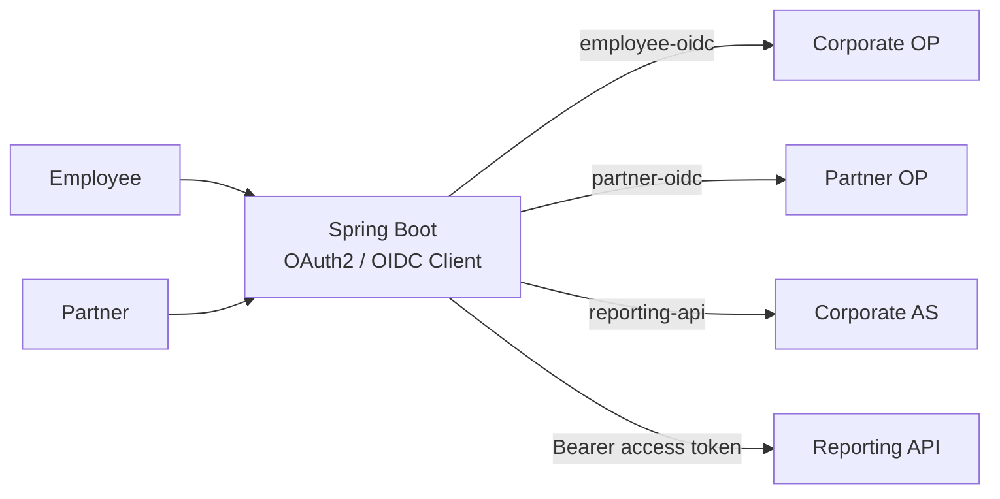
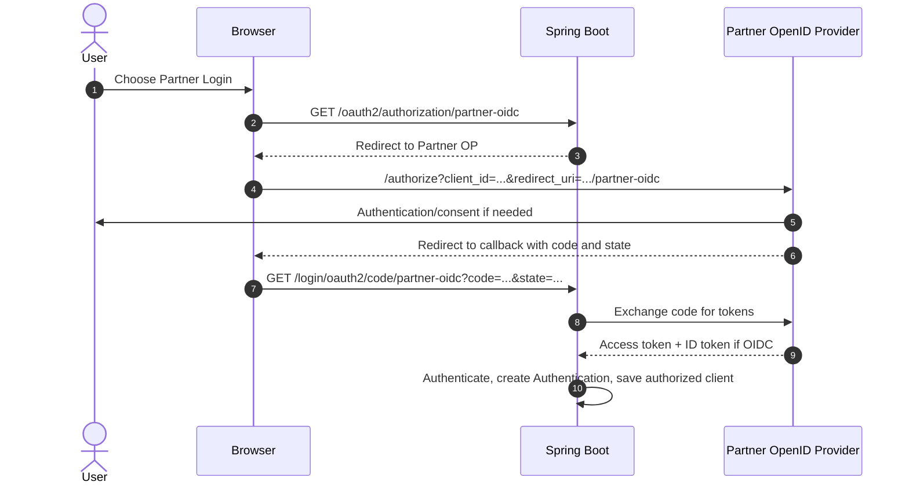

# 5.11. Managing Multiple Registrations in One Application

A Spring Boot application may need **multiple OAuth 2.0/OIDC connections at the same time**: employees sign in via the company's Identity Provider, partners sign in via another provider, and a background job uses **Client Credentials** to call an API. Spring Security does not require creating a separate application for each connection. Instead, declare multiple **`ClientRegistration`** instances inside the same **`ClientRegistrationRepository`**, then select the right registration when logging in or acquiring tokens.

This lesson focuses on how to organize, identify, select, use, store, and operate multiple registrations in **Spring Security OAuth 2.0 / OIDC Client**.

## 1. Understanding Clearly What a Registration Represents

**`ClientRegistration`** holds the configuration needed for an OAuth 2.0 Client to interact with an Authorization Server, for example:

- `registrationId`: **internal identifier key of the Spring application**.
- `clientId` and `clientSecret`: client identity issued by the Authorization Server (secret depends on client type).
- `authorizationGrantType`: how authorization is requested, such as `authorization_code` or `client_credentials`.
- `redirectUri`: callback receiving the authorization code for redirect-based flows.
- `scopes`: permissions requested by the client.
- Provider details: authorization endpoint, token endpoint, issuer, JWK Set URI, UserInfo endpoint, etc.

A registration is **configuration**, not yet an access token. Token state after authorization is represented by **`OAuth2AuthorizedClient`**.

| Component | What does it hold? | What is it used for? |
| --- | --- | --- |
| **`ClientRegistration`** | Client ID, grant type, scopes, redirect URI, endpoints | Describes one connection configuration to an Authorization Server |
| **`ClientRegistrationRepository`** | Collection of `ClientRegistration`s | Looks up configuration by `registrationId` |
| **`OAuth2AuthorizedClient`** | Registration, principal name, access token, refresh token if present | Represents an authorized connection/granted token |
| **`OAuth2AuthorizedClientRepository` / `Service`** | Authorized clients keyed by registration and principal | Stores/loads/removes token state |
| **`OAuth2AuthorizedClientManager`** | Coordination flow with authorization providers | Reuses, acquires, or refreshes tokens per grant |

**Important distinction:** the same `ClientRegistration` can yield **multiple `OAuth2AuthorizedClient`s**, each tied to a principal or appropriate authorization context. Conversely, adding a new registration to configuration **does not automatically log users in** and **does not automatically generate tokens**.

### 1.1. Registration ID Differs from Client ID

Suppose the Authorization Server issues a client with ID `spring-web-company-prod`. In Spring Boot we can configure:

```yaml
spring:
  security:
    oauth2:
      client:
        registration:
          employee-oidc:
            client-id: spring-web-company-prod
```

Then:

- **`employee-oidc`** is the `registrationId` used in the application, login URLs, callbacks, and repository lookups.
- **`spring-web-company-prod`** is the `client_id` sent to the Authorization Server.

The two names **do not have to match**. Changing `registrationId` changes the lookup key and usually changes the default callback URI; changing `client-id` changes the client identity registered at the Authorization Server.

### 1.2. Do Multiple Registrations Require Multiple Providers?

**No.** One provider can serve multiple registrations to separate:

- User-interactive applications and machine-to-machine applications.
- Clients for staging and production.
- Scopes, audiences, or API access rights.
- Client IDs and secrets across business groups.
- Tenants, organizations, or login policies.

Conversely, an application may declare multiple registrations simply because users sign in via **multiple distinct Identity Providers**.

## 2. Architecture Example: Two OIDC Logins and One Machine Client

Suppose a portal needs three connections:

| Registration ID | Provider | Grant type | Purpose |
| --- | --- | --- | --- |
| `employee-oidc` | Internal Identity Provider | `authorization_code` | Employees signing in via OIDC |
| `partner-oidc` | Partner Identity Provider | `authorization_code` | Partners signing in via OIDC |
| `reporting-api` | Internal Authorization Server | `client_credentials` | Background job calling the reporting API |



In this example, `employee-oidc` and `reporting-api` can share **the same company provider metadata**, while differing in `client-id`, `client-secret`, grant type, and scopes.

**Three registrations do not mean three active login sessions.** When a user chooses a provider to sign in, the current web session holds one corresponding `Authentication`; authorized clients can be stored per registration/principal with their own lifecycles.

## 3. Declaring Multiple Registrations in Spring Boot

The following example uses Spring Boot 3.x and Spring Security 6.x on the Servlet stack. Domain names, client IDs, and secrets are illustrative values.

### 3.1. Dependencies

If using Gradle:

```groovy
dependencies {
    implementation 'org.springframework.boot:spring-boot-starter-web'
    implementation 'org.springframework.boot:spring-boot-starter-security'
    implementation 'org.springframework.boot:spring-boot-starter-oauth2-client'
}
```

`spring-boot-starter-oauth2-client` provides OAuth2 Client and OIDC login components; Spring Security Web and OAuth2 Login must be enabled properly in the security configuration.

### 3.2. `application.yml`

```yaml
spring:
  security:
    oauth2:
      client:
        registration:
          employee-oidc:
            provider: corporate
            client-id: ${EMPLOYEE_OIDC_CLIENT_ID}
            client-secret: ${EMPLOYEE_OIDC_CLIENT_SECRET}
            authorization-grant-type: authorization_code
            redirect-uri: "{baseUrl}/login/oauth2/code/{registrationId}"
            scope:
              - openid
              - profile
              - email

          partner-oidc:
            provider: partner
            client-id: ${PARTNER_OIDC_CLIENT_ID}
            client-secret: ${PARTNER_OIDC_CLIENT_SECRET}
            authorization-grant-type: authorization_code
            redirect-uri: "{baseUrl}/login/oauth2/code/{registrationId}"
            scope:
              - openid
              - profile

          reporting-api:
            provider: corporate
            client-id: ${REPORTING_CLIENT_ID}
            client-secret: ${REPORTING_CLIENT_SECRET}
            authorization-grant-type: client_credentials
            scope:
              - reports.read

        provider:
          corporate:
            issuer-uri: https://id.corp.example.test/realms/company
          partner:
            issuer-uri: https://login.partner.example.test/realms/partners
```

**Structure explanation:**

- `registration.employee-oidc` and `registration.reporting-api` both declare `provider: corporate`: two distinct clients share endpoint metadata for the same Authorization Server.
- `registration.partner-oidc` uses a different provider.
- `provider.*.issuer-uri` uses OIDC/OAuth metadata discovery when supported by the Authorization Server. Spring must be able to reach the issuer and metadata appropriate for the environment.
- `scope: openid` is for **OIDC login**. `reporting-api` requests only `reports.read` in machine-to-machine mode, requiring no user login.
- `redirect-uri` is for the `authorization_code` flow. `client_credentials` has no browser callback.
- Environment variables supply credentials per deployment environment; never write real secrets into Git, READMEs, or logs.

Each `registrationId` must be **unique** within the same repository. Keys like `employee-oidc` and `partner-oidc` also appear in the default login initiation URLs.

### 3.3. Do Not Confuse `registration` with `provider`

```text
spring.security.oauth2.client
├── registration
│   ├── employee-oidc  ------> provider: corporate
│   ├── partner-oidc   ------> provider: partner
│   └── reporting-api  ------> provider: corporate
└── provider
    ├── corporate      ------> issuer-uri: https://id.corp.example.test/...
    └── partner        ------> issuer-uri: https://login.partner.example.test/...
```

**Registration** defines *client identity and the types of permissions to request*. **Provider** defines *the authorization system and endpoints to communicate with*. One provider can be shared, yet each registration still needs the right scopes, grant, client ID, and client authentication.

If a provider lacks a compatible discovery endpoint, required URLs can be declared using properties such as `authorization-uri`, `token-uri`, `jwk-set-uri`, and `user-info-uri`. Which fields are actually needed depends on the OAuth2/OIDC flow.

## 4. `ClientRegistrationRepository` Manages All Configurations

Spring Boot typically builds a `ClientRegistrationRepository` from these configuration entries. A common implementation is **`InMemoryClientRegistrationRepository`**.

Minimal API:

```java
ClientRegistration findByRegistrationId(String registrationId);
```

Example service looking up registrations by ID:

```java
import org.springframework.security.oauth2.client.registration.ClientRegistration;
import org.springframework.security.oauth2.client.registration.ClientRegistrationRepository;
import org.springframework.stereotype.Service;

@Service
public class RegistrationCatalog {

    private final ClientRegistrationRepository registrations;

    public RegistrationCatalog(ClientRegistrationRepository registrations) {
        this.registrations = registrations;
    }

    public ClientRegistration required(String registrationId) {
        ClientRegistration registration =
                registrations.findByRegistrationId(registrationId);

        if (registration == null) {
            throw new IllegalArgumentException(
                    "Unknown registration: " + registrationId);
        }
        return registration;
    }
}
```

Use `findByRegistrationId("employee-oidc")` to obtain the OIDC configuration for employees; `findByRegistrationId("reporting-api")` returns the machine client configuration.

**Do not use this method to obtain an access token.** `ClientRegistration` holds only static metadata; tokens reside in `OAuth2AuthorizedClient` and authorized-client stores.

### 4.1. Listing Registrations

Some repositories also implement `Iterable<ClientRegistration>`, including `InMemoryClientRegistrationRepository`. Example:

```java
import java.util.ArrayList;
import java.util.List;
import org.springframework.security.oauth2.client.registration.ClientRegistration;
import org.springframework.security.oauth2.client.registration.ClientRegistrationRepository;

public List<String> listConfiguredIds(ClientRegistrationRepository repository) {
    List<String> ids = new ArrayList<>();

    if (repository instanceof Iterable<?> iterable) {
        for (Object item : iterable) {
            if (item instanceof ClientRegistration registration) {
                ids.add(registration.getRegistrationId());
            }
        }
    }
    return ids;
}
```

**Not every custom repository supports iteration**. `ClientRegistrationRepository` only guarantees lookup by ID; if the application needs a list for a menu, maintain a dedicated allowlist catalog or an abstraction suited to your data.

When rendering registrations in the UI, filter for registrations **intended for user login**. Never put `reporting-api` with `client_credentials` into an Identity Provider login menu.

## 5. Letting Users Choose a Provider at Login

### 5.1. Login Initiation Endpoint by Registration ID

With Spring Security Servlet's default configuration, the Authorization Code Flow initiation URL is:

```text
/oauth2/authorization/{registrationId}
```

The example application has two links:

```html
<a href="/oauth2/authorization/employee-oidc">
  Employee Login
</a>

<a href="/oauth2/authorization/partner-oidc">
  Partner Login
</a>
```

When a user selects a link, `OAuth2AuthorizationRequestRedirectFilter` looks up the corresponding registration and creates an authorization request with `client_id`, `scope`, `redirect_uri`, `state`, and other parameters for that provider.

- Choosing `employee-oidc` → redirects to Corporate OP.
- Choosing `partner-oidc` → redirects to Partner OP.
- Choosing `reporting-api` → not a login option: that is Client Credentials.

### 5.2. `SecurityFilterChain` for Multiple OIDC Logins

```java
import org.springframework.context.annotation.Bean;
import org.springframework.context.annotation.Configuration;
import org.springframework.security.config.Customizer;
import org.springframework.security.config.annotation.web.builders.HttpSecurity;
import org.springframework.security.web.SecurityFilterChain;

@Configuration
public class SecurityConfig {

    @Bean
    SecurityFilterChain securityFilterChain(HttpSecurity http) throws Exception {
        return http
            .authorizeHttpRequests(authorize -> authorize
                .requestMatchers("/", "/public/**", "/error").permitAll()
                .anyRequest().authenticated()
            )
            .oauth2Login(Customizer.withDefaults())
            .oauth2Client(Customizer.withDefaults())
            .build();
    }
}
```

`oauth2Login()` handles user login via Authorization Code/OIDC; `oauth2Client()` supports OAuth2 Client features when the application needs to work with authorized clients. You do not need to create a separate `SecurityFilterChain` per registration merely because there are two OIDC providers.

When you have not configured a custom login page, Spring Security can generate a default login page listing the Authorization Code registrations found when the repository supports `Iterable`. With a custom-designed login screen, explicitly create links to each `/oauth2/authorization/{registrationId}`.

### 5.3. Custom Login Page

Suppose the actual UI uses `/login`:

```java
@Bean
SecurityFilterChain securityFilterChain(HttpSecurity http) throws Exception {
    return http
        .authorizeHttpRequests(authorize -> authorize
            .requestMatchers("/", "/login", "/public/**", "/error").permitAll()
            .anyRequest().authenticated()
        )
        .oauth2Login(oauth -> oauth
            .loginPage("/login")
            .permitAll()
        )
        .build();
}
```

The application must **serve GET `/login`** via an MVC controller or matching view. An HTML template can contain the two login links shown above.

Create links only for pre-defined, purpose-built registrations; never construct a login URL from an arbitrary provider URL or `client-id` entered by a user.

## 6. Redirect URI of Each Registration

When declaring:

```yaml
redirect-uri: "{baseUrl}/login/oauth2/code/{registrationId}"
```

Spring Security builds callbacks by `registrationId`:

| Registration | Redirect URI if origin is `https://app.example.test` |
| --- | --- |
| `employee-oidc` | `https://app.example.test/login/oauth2/code/employee-oidc` |
| `partner-oidc` | `https://app.example.test/login/oauth2/code/partner-oidc` |

Each Authorization Server must be configured to allow the exact Redirect URI **of its corresponding client ID**. Sharing the same application hostname does not mean every OP automatically accepts every callback.



**Note:** `{baseUrl}` depends on public scheme/host/port/context path. When running behind a load balancer/ingress, ensure forwarded headers from trusted proxies are processed or set explicit Redirect URIs per environment. If using a non-default callback path, also update `oauth2Login().redirectionEndpoint().baseUri(...)` to match.

## 7. Knowing Which Registration the User Signed In With

After a successful OAuth2/OIDC login in a Servlet application, `OAuth2AuthenticationToken` exposes:

```java
String registrationId = token.getAuthorizedClientRegistrationId();
```

This name tells the application **the login source** of the current session.

Example endpoint displaying session metadata:

```java
import java.security.Principal;
import java.util.Map;
import org.springframework.security.oauth2.client.authentication.OAuth2AuthenticationToken;
import org.springframework.web.bind.annotation.GetMapping;
import org.springframework.web.bind.annotation.RestController;

@RestController
public class SessionController {

    @GetMapping("/api/session")
    Map<String, String> session(Principal principal) {
        if (!(principal instanceof OAuth2AuthenticationToken token)) {
            throw new IllegalStateException("Expected OAuth2/OIDC login");
        }

        return Map.of(
            "registrationId", token.getAuthorizedClientRegistrationId(),
            "principalName", token.getName()
        );
    }
}
```

If the user just signed in via `partner-oidc`, `getAuthorizedClientRegistrationId()` returns `partner-oidc`. If via `employee-oidc`, the result is `employee-oidc`.

With OIDC login, the principal can be **`OidcUser`**. To identify users durably, rely on the **issuer + subject (`sub`)** key pair or an explicitly managed identity mapping. Never assume two accounts sharing the same email across two issuers belong to the same person or may be auto-linked.

### 7.1. Distinguishing Login Source from Application Permissions

`registrationId` only tells you which login configuration the user went through. It **does not by itself prove the user is an employee, administrator, or approved partner**.

For example, placing an account from `employee-oidc` into an internal permission group still requires verifying the issuer, trusted claims/roles, and mapping authorities per policy. Never grant administrative privileges solely because a request involves the string `employee-oidc`.

Similarly, different Identity Providers can issue a `groups` claim with different meanings. When converting claims to `GrantedAuthority`, maintain explicit per-provider mappings to avoid mixing permissions.

## 8. Authorized Client: Each Registration Has Its Own Token State

**`OAuth2AuthorizedClient`** pairs a registration with a principal and issued tokens. Two users sharing a registration typically hold separate tokens; the same user can hold separate authorized clients for two registrations.

```text
ClientRegistrationRepository (configuration)
├── employee-oidc
├── partner-oidc
└── reporting-api

OAuth2AuthorizedClientRepository / Service (runtime tokens)
├── (employee-oidc, alice) --> access token A, refresh token A?
├── (employee-oidc, bob)   --> access token B, refresh token B?
├── (partner-oidc, carol)  --> access token C, refresh token C?
└── (reporting-api, nightly-report-job) --> access token D
```

In several storage implementations, the logical lookup key is **`(registrationId, principalName)`**; Servlet repositories also receive request/response and `Authentication` to handle session/context-scoped storage.

### 8.1. How Do Repository and Service Differ?

| API | Typically used when |
| --- | --- |
| **`OAuth2AuthorizedClientRepository`** | An HTTP request/response, session, or web principal is present |
| **`OAuth2AuthorizedClientService`** | Accessing tokens by registration + principal outside an HTTP request scope |

Common implementations include `HttpSessionOAuth2AuthorizedClientRepository`, `AuthenticatedPrincipalOAuth2AuthorizedClientRepository`, `InMemoryOAuth2AuthorizedClientService`, and `JdbcOAuth2AuthorizedClientService`.

When calling the service to retrieve a token, remember the service is **a store**. It does not automatically refresh an access token simply because a caller invokes `loadAuthorizedClient(...)`. Re-issuance/refresh lifecycles go through **`OAuth2AuthorizedClientManager`** with an appropriate provider.

### 8.2. Loading the Authorized Client of the Registration Used for Login

Inside an authenticated request, you can obtain the registration from `OAuth2AuthenticationToken` and look up the authorized client:

```java
import java.security.Principal;
import java.util.Map;
import org.springframework.security.oauth2.client.OAuth2AuthorizedClient;
import org.springframework.security.oauth2.client.web.OAuth2AuthorizedClientRepository;
import org.springframework.security.oauth2.client.authentication.OAuth2AuthenticationToken;
import org.springframework.web.bind.annotation.GetMapping;
import org.springframework.web.bind.annotation.RestController;
import jakarta.servlet.http.HttpServletRequest;

@RestController
public class ConnectionController {

    private final OAuth2AuthorizedClientRepository clients;

    public ConnectionController(OAuth2AuthorizedClientRepository clients) {
        this.clients = clients;
    }

    @GetMapping("/api/my-connection")
    Map<String, String> myConnection(
            Principal principal,
            HttpServletRequest request) {

        if (!(principal instanceof OAuth2AuthenticationToken login)) {
            throw new IllegalStateException("Expected OAuth2 login");
        }

        String registrationId = login.getAuthorizedClientRegistrationId();

        OAuth2AuthorizedClient client =
                clients.loadAuthorizedClient(registrationId, login, request);

        if (client == null) {
            return Map.of(
                "registrationId", registrationId,
                "state", "not-found"
            );
        }

        return Map.of(
            "registrationId", registrationId,
            "state", "stored",
            "expiresAt",
            String.valueOf(client.getAccessToken().getExpiresAt())
        );
    }
}
```

This example returns metadata solely for illustration. **Never return raw token values in JSON responses and never write tokens to logs.**

If the user signed in via `partner-oidc`, the snippet loads the authorized client for **`partner-oidc`**, not automatically `employee-oidc`'s token. If a record does not exist yet, handle it per business rules rather than silently switching to another registration.

### 8.3. Using the `@RegisteredOAuth2AuthorizedClient` Annotation

For endpoints where the registration is known statically, Spring Security supports:

```java
import org.springframework.security.oauth2.client.OAuth2AuthorizedClient;
import org.springframework.security.oauth2.client.annotation.RegisteredOAuth2AuthorizedClient;
import org.springframework.web.bind.annotation.GetMapping;
import org.springframework.web.bind.annotation.RestController;

@RestController
public class EmployeeApiController {

    @GetMapping("/api/employee-token-metadata")
    String metadata(
        @RegisteredOAuth2AuthorizedClient("employee-oidc")
        OAuth2AuthorizedClient client
    ) {
        return "registration=" +
            client.getClientRegistration().getRegistrationId();
    }
}
```

This example is suitable only when the endpoint is genuinely designed for the `employee-oidc` registration and the principal can be authorized per configuration. If a request belongs to a `partner-oidc` session, do not assume the annotation lets you use an employee token or "swap" two identities. Dedicated authorization, account mapping, and handling for missing authorized clients are required.

## 9. Calling APIs with Multiple Registrations: Explicitly Choose Which Client Is Used

When the application calls a Resource Server, it must know **which registration is permitted to acquire a token for that API**. A common mistake is having three registrations while an HTTP client defaults to grabbing a token from the current login session, sending the wrong audience or scope to the API.

Design rules:

- The system reporting API uses `reporting-api`.
- Employee-only APIs use a token/registration accepted by the API and permitted by policy.
- Partner APIs use tokens from the provider/registration authorized for the partner API.
- Never transfer tokens across providers simply because all of them are `Bearer` tokens.

The Resource Server validates tokens against its own issuer, audience, scopes, and policies. **An OIDC ID token is for the login client; never send an ID token instead of an access token to an API.**

### 9.1. `AuthorizedClientManager` and Providers

`OAuth2AuthorizedClientManager` manages finding authorized clients, acquiring tokens, or refreshing tokens. It uses `OAuth2AuthorizedClientProvider`s matching each grant.

There are two common implementations on the Servlet stack:

| Manager | Suitable for |
| --- | --- |
| **`DefaultOAuth2AuthorizedClientManager`** | Code running in an HTTP Servlet request context, with `OAuth2AuthorizedClientRepository` |
| **`AuthorizedClientServiceOAuth2AuthorizedClientManager`** | Services or scheduled jobs without `HttpServletRequest`/`Response`, using `OAuth2AuthorizedClientService` |

In an application using multiple grants, the manager must include providers supporting every needed grant. For example, `clientCredentials()` issues tokens for machine clients; `refreshToken()` works when a valid refresh token exists and the flow/policy supports it.

### 9.2. Dedicated Manager for `client_credentials`

Configuration for a batch job without an HTTP request:

```java
import org.springframework.context.annotation.Bean;
import org.springframework.context.annotation.Configuration;
import org.springframework.security.oauth2.client.*;
import org.springframework.security.oauth2.client.registration.ClientRegistrationRepository;

@Configuration
public class ReportingOAuth2Config {

    @Bean("reportingAuthorizedClientManager")
    OAuth2AuthorizedClientManager reportingAuthorizedClientManager(
            ClientRegistrationRepository registrations,
            OAuth2AuthorizedClientService authorizedClientService) {

        OAuth2AuthorizedClientProvider provider =
            OAuth2AuthorizedClientProviderBuilder.builder()
                .clientCredentials()
                .build();

        AuthorizedClientServiceOAuth2AuthorizedClientManager manager =
            new AuthorizedClientServiceOAuth2AuthorizedClientManager(
                registrations, authorizedClientService);

        manager.setAuthorizedClientProvider(provider);
        return manager;
    }
}
```

A service explicitly selects `registrationId` when needing an access token:

```java
import org.springframework.beans.factory.annotation.Qualifier;
import org.springframework.security.oauth2.client.OAuth2AuthorizeRequest;
import org.springframework.security.oauth2.client.OAuth2AuthorizedClient;
import org.springframework.security.oauth2.client.OAuth2AuthorizedClientManager;
import org.springframework.stereotype.Service;

@Service
public class ReportingAccessTokenProvider {

    private final OAuth2AuthorizedClientManager manager;

    public ReportingAccessTokenProvider(
        @Qualifier("reportingAuthorizedClientManager")
        OAuth2AuthorizedClientManager manager
    ) {
        this.manager = manager;
    }

    public String currentToken() {
        OAuth2AuthorizeRequest request = OAuth2AuthorizeRequest
            .withClientRegistrationId("reporting-api")
            .principal("nightly-report-job")
            .build();

        OAuth2AuthorizedClient authorized = manager.authorize(request);

        if (authorized == null) {
            throw new IllegalStateException(
                "Authorization unavailable for reporting-api"
            );
        }

        return authorized.getAccessToken().getTokenValue();
    }
}
```

Here:

1. `"reporting-api"` selects the exact **`client_credentials` configuration**.
2. `"nightly-report-job"` is a **technical** principal name for the manager/service to store and retrieve the token; it is not a logged-in user.
3. The manager can reuse a still-valid token or request a new token via the token endpoint when needed.
4. Client Credentials normally does not rely on refresh tokens; when a token expires, the provider uses client credentials to request another token.

In real applications, the manager can be integrated with **`RestClient` / `WebClient`** using an appropriate OAuth2 interceptor/filter to attach Bearer tokens automatically. Whichever approach you choose, **explicitly specify the registration ID for calls requiring a token** to avoid implicitly picking the wrong client.

### 9.3. Why Not Use an Arbitrary Principal for Every Request?

If every call to the manager uses a different string:

```text
(reporting-api, job-run-001)
(reporting-api, job-run-002)
(reporting-api, job-run-003)
```

the service will keep many separate authorized clients and request many tokens despite running the same workload. Using a stable name for the same context allows proper token reuse.

Conversely, if the application genuinely has **multiple tenants or distinct workload identities**, do not merge them all into one authorized client merely to save tokens. Separate registrations/credentials and principals along tenant security boundaries.

## 10. Can One User Link Multiple OAuth2 Accounts?

Yes, though this is an **account linking feature** that must be built separately.

Suppose a user signed in via `employee-oidc` and later wants to authorize the application to access data from `partner-oidc`. There are two independent concerns:

1. **Authenticating the current application user**: the current web session holds the `Authentication` of an internal user.
2. **Authorizing an additional external connection**: the application must run a separate authorization flow to obtain an authorized client and tokens for the partner provider.

Simply having two entries in `ClientRegistrationRepository` **does not automatically merge two accounts into one identity**. Linking must be approved by the user or policy, stored as a controlled mapping, and keep identities separated by issuer.

For instance, a business mapping table could be structured as:

| Internal User ID | Issuer | Subject at issuer | Registration |
| --- | --- | --- | --- |
| `user-142` | `https://id.corp.example.test/...` | `subject-abc` | `employee-oidc` |
| `user-142` | `https://login.partner.example.test/...` | `partner-sub-789` | `partner-oidc` |

This is an illustrative mapping, **not a table structure auto-created by Spring Security**. If an application implements account linking, prevent unintended switching of the primary login session when starting an extra authorization flow, and enforce CSRF protection, account ownership verification, secure token storage, and unlink revocation.

## 11. Separating Configuration by Environment and Secrets

When an application has multiple registrations, the number of secrets, callbacks, and scopes to manage increases. A simple matrix helps prevent configuration mix-ups:

| Registration | Local | Staging | Production |
| --- | --- | --- | --- |
| `employee-oidc` | Local client ID/secret | Staging client ID/secret | Production client ID/secret |
| `partner-oidc` | Sandbox partner client | Staging partner client | Production partner client |
| `reporting-api` | `reports.read` on dev API | Token for staging API | Token for production API |

You can keep the same `registrationId` across environments so API-calling code and callback paths remain unchanged, while issuing **separate client IDs/secrets per deployment**. When the callback uses:

```text
{baseUrl}/login/oauth2/code/{registrationId}
```

environments will have distinct URIs such as:

```text
http://localhost:8080/login/oauth2/code/employee-oidc
https://staging.app.example.test/login/oauth2/code/employee-oidc
https://app.example.test/login/oauth2/code/employee-oidc
```

Register the right URI with **each environment's client ID** at the respective provider. Providers may apply special rules for loopback HTTP locally; staging and production should use HTTPS.

### 11.1. Configuration with Profiles

`application.yml` can share the registration structure and placeholders; profiles or environment variables supply concrete values. When grants, scopes, or provider URLs must differ by environment, use `application-local.yml`, `application-staging.yml`, and `application-prod.yml` as appropriate.

**Avoid placing production secrets in committed profile files**. Use a secrets manager or environment variables from your deployment system. If an issuer uses metadata discovery, ensure the endpoint is reachable when registrations are initialized.

### 11.2. Proxies and Callback URLs

If the app runs behind a reverse proxy, `{baseUrl}` can derive the wrong scheme or host if the backend sees only an internal URL. Configure the proxy to send trusted forwarded headers and, depending on topology, use:

```yaml
server:
  forward-headers-strategy: framework
```

Trust forwarded headers only from proxies you control; the proxy must overwrite headers sent directly by external Internet clients. Alternatively, set explicit per-environment `redirect-uri` values when the public origin is fixed.

With multiple registrations, a proxy misconfiguration can break **all Authorization Code callbacks**; a `registrationId` or allowlist mistake may affect only a single provider.

## 12. When Is a Custom `ClientRegistrationRepository` Needed?

Configuration from `application.yml` usually suffices when the registration set is known ahead of time and changes only across deployments. In multi-tenant systems or platforms integrating many organizations, registrations may need to be loaded from a database/configuration service.

Cases calling for a custom `ClientRegistrationRepository`:

- Each organization connects its own issuer or client ID.
- Registrations are added/removed dynamically during operations.
- Administrators need to control scopes or client IDs of a connection.
- Secrets are retrieved per tenant from a secure secret store.
- The number of registrations is too large to declare manually.

An example interface implementation:

```java
import org.springframework.security.oauth2.client.registration.ClientRegistration;
import org.springframework.security.oauth2.client.registration.ClientRegistrationRepository;

public class DatabaseClientRegistrationRepository
        implements ClientRegistrationRepository {

    @Override
    public ClientRegistration findByRegistrationId(String registrationId) {
        // 1. Look up registrationId from a trusted configuration store.
        // 2. Verify the tenant/registration is enabled and permitted for use.
        // 3. Build a valid ClientRegistration from validated data.
        // 4. Return null if not found.
        throw new UnsupportedOperationException(
            "Implement with a trusted configuration store"
        );
    }
}
```

This is an **abstraction skeleton**, not runnable code; a real repository must handle configuration lifecycle, caching, and validation.

### Security Boundaries for Dynamic Registration

- Never let users pass an arbitrary `issuer-uri` or `token-uri` and have the backend call it directly, as this creates an **SSRF** risk.
- Never expose client secrets to browsers or logs.
- Bind registrations to authenticated tenants; never rely solely on an unvalidated `registrationId` string in the URL.
- Never let callback `redirect_uri` point to an arbitrary user-entered domain.
- When changing client configuration, account for previously issued authorized clients: old tokens may no longer be valid for the new issuer/client ID/scopes.
- If an automated menu is needed, source the list from a trusted catalog rather than assuming a custom repository supports `Iterable`.

As the number of registrations grows, build a server-side **tenant → registration ID** mapping enforced by policy instead of accepting registration IDs directly from the UI without authorization checks.

## 13. Common Errors When Having Multiple Registrations

| Symptom | Common cause | How to verify and resolve |
| --- | --- | --- |
| Login link to `/oauth2/authorization/foo` errors out | No `foo` registration, or config does not support Authorization Code | Check keys under `registration` and grant type |
| Provider A login works, provider B reports `invalid_redirect_uri` | B's callback or `client_id` is not on the allowlist | Compare `redirect_uri` in authorize request with client B's config at OP |
| Signed into B, yet app calls API A with token B | HTTP client picks authorized client from current session by default | Specify the exact registration; check token issuer/audience/scopes |
| Signed in via provider A, yet code looks up token in registration B | Mismatched registration ID/principal pair in lookup | Use `getAuthorizedClientRegistrationId()` or context-accurate explicit ID |
| `OAuth2AuthorizedClient` returns null | Not yet authorized, expired session, wrong principal/registration, mismatched storage | Check initial authorization and active repository/service |
| API returns `401` or `403` | Token has wrong audience, is expired, lacks scope, or was revoked | Verify which API token targets, whether manager supports refresh, actual permissions |
| OAuth2 login loops after callback | Session/cookie not preserved, or inconsistent security chain/route | Check `state`, cookies, reverse proxy, and session persistence |
| Background task reports missing `HttpServletRequest` | Using Servlet request manager outside an HTTP request | Use `AuthorizedClientServiceOAuth2AuthorizedClientManager` |
| Batch job requests tokens too frequently | Each run uses a different technical principal, or token is not saved | Choose a stable principal for the same workload and appropriate service storage |
| Renaming `registrationId` suddenly breaks login | Old callback URLs and token keys no longer match | Update URLs, allowlists, callers, and state migration plan |
| Two issuers with same email confuse users | Application uses email as the sole identity key | Use issuer + subject or a verified identity mapping |
| One instance sees token, another does not | Authorized-client/session storage resides only in node-local memory | Configure shared storage or appropriate session routing |

### 13.1. Anti-Pattern: Picking One Default Token for Every API

Suppose a user just signed in with `partner-oidc`. The application grabs the current access token and sends it to the internal Reporting API. The API returns 401.

The issue is not necessarily a "broken" token; the token may have been **issued for a different provider, client, or resource**. Select `reporting-api` to acquire a machine-client token with the right scopes and audience, or use an appropriate user delegation flow if the API requires user identity.

### 13.2. Anti-Pattern: Building Login URLs from Arbitrary Query Parameters

```java
// Avoid using registrationId from untrusted input without validation.
String loginUrl = "/oauth2/authorization/" + request.getParameter("id");
```

If the application needs a login selection menu, use an allowlist of registration IDs and check access rights before constructing the path. Provider URLs/issuers must also come from trusted configuration; never treat an arbitrary client-supplied URL as an approved provider.

### 13.3. Anti-Pattern: Configuring the Same Registration Name for Two Clients

Within one configuration set, two registrations cannot share **the same identifier key** and still be looked up independently. Declaring two YAML blocks with the same `employee-oidc` key can overwrite values or fail configuration depending on parsing/binding behavior. Keep `registrationId` unique and meaningful.

## 14. Observability and Operational Handling

When debugging, log **non-sensitive** metadata such as:

- `registrationId` and environment.
- Trusted provider/issuer name, grant type.
- Token expiration time (if needed) and authorize/refresh outcome.
- Error type from the Authorization Server, HTTP status, and correlation ID.
- API endpoint → expected registration mapping.

**Never log access tokens, refresh tokens, client secrets, authorization codes, ID tokens, or full `Authorization` headers**. A callback URL can contain an authorization code in its query string; mask sensitive parameters when sharing logs.

When a token expires, calling only `OAuth2AuthorizedClientRepository.loadAuthorizedClient(...)` may return the stale token. **The repository is a store; the manager/provider is what handles re-issuance or refresh** per configuration.

When inspecting each registration individually, walk through these questions:

1. Does this registration exist and bind properly from config?
2. Which provider and grant type does it belong to?
3. Do the login/callback URLs or token endpoint match that provider?
4. Does the current principal/technical principal have a corresponding authorized client?
5. Which API was the access token issued for, and do scopes/audience match?
6. Is the token still valid, and does the manager have an appropriate renewal mechanism?

This isolates root causes at the right abstraction layer rather than blaming all login and API failures on one generic config issue.

## 15. Practice Exercise: Adding a Partner Provider Without Disrupting Employee Login

Start from an application that only has `employee-oidc`. The new requirement is allowing partners to sign in via an independent OP while keeping a job that calls the Reporting API.

**Step 1 — Design registration IDs.** Choose `employee-oidc`, `partner-oidc`, and `reporting-api`; clearly define the grant type for each registration.

**Step 2 — Register clients at the OPs.** Create client IDs/secrets and callbacks for the two Authorization Code clients. For example:

```text
https://portal.example.test/login/oauth2/code/employee-oidc
https://portal.example.test/login/oauth2/code/partner-oidc
```

The Reporting API uses Client Credentials, so no browser redirect URI is needed for that registration.

**Step 3 — Add two provider metadata blocks and three registrations to configuration.** Use matching issuers and scopes; supply secrets via environment variables.

**Step 4 — Enable OAuth2 Login and create two links.** Use `/oauth2/authorization/employee-oidc` and `/oauth2/authorization/partner-oidc`.

**Step 5 — After login, read `OAuth2AuthenticationToken.getAuthorizedClientRegistrationId()`.** Map issuer/subject and permissions according to the authentication source; never assume two providers share the same claim model or identity.

**Step 6 — Use a dedicated manager for the job.** Issue tokens with `withClientRegistrationId("reporting-api")` and a technical principal. Verify the Reporting API accepts only tokens with the right issuer/audience/scopes.

### Self-Check Questions

**Q1.** An application declares three registrations, yet a user has only signed in via `employee-oidc`. Is an access token for `partner-oidc` already available?

> You cannot assume it is. A registration is only configuration; corresponding authorization is required before an authorized client and token exist for the partner provider.

**Q2.** Can `employee-oidc` and `reporting-api` point to the same `provider: corporate`?

> Yes, if they share the same Authorization Server. They remain two registrations with distinct client IDs, grant types, and scopes; one serves OIDC login, while the other serves machine-to-machine calls.

**Q3.** Can `reporting-api` be placed in a `/oauth2/authorization/reporting-api` link for user login?

> It should not be. `reporting-api` is designed for `client_credentials`, not Authorization Code/OIDC login. It requires a manager/service to acquire machine-to-machine tokens without a user browser.

**Q4.** Can a token from `partner-oidc` be sent to every internal API?

> No. APIs require tokens with the right issuer, audience, scopes, and policies. Choose the appropriate registration or design proper delegation per API.

**Q5.** Is renaming `registrationId` from `employee-oidc` to `staff` merely changing a display name?

> No. This name is an internal lookup key, login URL segment, potentially part of the Redirect URI, and part of the authorized client key. You must update links, callback allowlists, code lookups, and handle in-flight state if needed.

**Q6.** Why isn't `OAuth2AuthorizedClientService` alone enough to "automatically refresh tokens for all registrations"?

> The service only stores and loads tokens. Re-issuance/refresh is performed by `OAuth2AuthorizedClientManager` together with the corresponding providers when invoked in the right context.

---

## Key Takeaways

With multiple OAuth2/OIDC registrations, maintain **three distinct yet connected layers**:

```text
1. ClientRegistrationRepository
   -> registrationId -> client/provider/grant configuration

2. OAuth2AuthorizedClientRepository / Service
   -> registrationId + principal -> runtime access/refresh tokens

3. OAuth2AuthorizedClientManager + HTTP client
   -> select registration -> acquire/reuse/renew token -> call the right API
```

For login, select a registration via `/oauth2/authorization/{registrationId}` and identify the session's provider via `OAuth2AuthenticationToken.getAuthorizedClientRegistrationId()`. For background tasks, select `withClientRegistrationId(...)` in `OAuth2AuthorizeRequest`. Keep registration IDs stable, match callbacks and secrets to each environment, authorize by issuer/subject, and never arbitrarily send one registration's token to an API meant for another registration.
