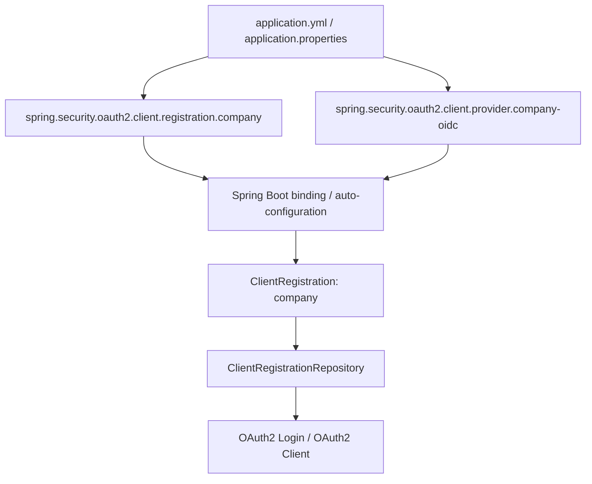

# 6.1. The `spring.security.oauth2.client.registration` Property Group

When a Spring Boot application acts as an **OAuth 2.0 Client** or **OpenID Connect (OIDC) Client**, it needs to know under what identity it is registered with the Authorization Server/OpenID Provider, which client authentication method it will use, how to request access permissions, and where to receive the login result. In Spring Boot, most of that information is declared under the group:

```properties
spring.security.oauth2.client.registration.<registration-id>.*
```

This is the configuration group that describes **a client registration**: a set of identity details and communication conditions that the application uses when acting as an OAuth2/OIDC Client. If the application signs in through multiple providers or needs multiple client configurations for different purposes, it can declare multiple registrations under the same group.

It is important to distinguish from the start: **`registration` describes who the client is and what it requests; `provider` describes where the client connects to execute the protocol.** The two groups are closely related but do not replace each other. This lesson focuses on the `spring.security.oauth2.client.registration` properties while explaining just enough of the `provider` section to show how a registration is used.

## 1. Structure of the `registration` Group

A common OIDC configuration:

```yaml
spring:
  security:
    oauth2:
      client:
        registration:
          company:
            provider: company-oidc
            client-id: ${OIDC_CLIENT_ID}
            client-secret: ${OIDC_CLIENT_SECRET}
            client-authentication-method: client_secret_basic
            authorization-grant-type: authorization_code
            redirect-uri: "{baseUrl}/login/oauth2/code/{registrationId}"
            scope:
              - openid
              - profile
              - email
            client-name: Company SSO
        provider:
          company-oidc:
            issuer-uri: https://id.example.org/realms/company
```

In the example:

- `registration.company`: `company` is the **registration ID** chosen by the application, used to reference the registration in Spring Security.
- `client-id` and `client-secret`: application registration credentials at the OpenID Provider.
- `authorization-grant-type: authorization_code`: selects the Authorization Code Grant for browser-based login.
- `scope` contains `openid`: requests OpenID Connect, not just plain OAuth 2.0.
- `redirect-uri`: where the provider returns the browser after issuing the authorization code.
- `provider: company-oidc`: links this registration to the provider configuration named `company-oidc`.
- `provider.company-oidc.issuer-uri`: identifies the OIDC issuer to discover metadata and the corresponding endpoints.

The two occurrences of `company` and `company-oidc` have different meanings. `company` is the **client registration name in the application**, while `company-oidc` is the **provider configuration group name**. They can be the same or different.

The `application.properties` equivalent for some entries:

```properties
spring.security.oauth2.client.registration.company.provider=company-oidc
spring.security.oauth2.client.registration.company.client-id=order-web
spring.security.oauth2.client.registration.company.authorization-grant-type=authorization_code
spring.security.oauth2.client.registration.company.scope=openid,profile,email
spring.security.oauth2.client.registration.company.redirect-uri={baseUrl}/login/oauth2/code/{registrationId}
spring.security.oauth2.client.provider.company-oidc.issuer-uri=https://id.example.org/realms/company
```

You can use YAML or properties; Spring Boot binds the corresponding properties into the OAuth2 Client configuration model. If using a secret, retrieve it from environment variables or a secret manager instead of writing real values into files committed to Git.

## 2. How Spring Boot Maps Configuration into `ClientRegistration`

An entry `spring.security.oauth2.client.registration.<id>` corresponds to the **`ClientRegistration`** concept in Spring Security. This object combines the client details and provider details needed for a specific OAuth2/OIDC usage.



In a servlet application, Spring Security uses `ClientRegistrationRepository` to look up a `ClientRegistration` by registration ID. Spring Boot typically auto-configures the repository based on the valid declared registrations.

You can think of the data after binding as follows:

| Configuration property | Corresponding property in `ClientRegistration` |
|---|---|
| `registration.company.client-id` | `clientId` |
| `registration.company.client-secret` | `clientSecret` |
| `registration.company.client-authentication-method` | `clientAuthenticationMethod` |
| `registration.company.authorization-grant-type` | `authorizationGrantType` |
| `registration.company.redirect-uri` | `redirectUri` |
| `registration.company.scope` | `scopes` |
| `registration.company.client-name` | `clientName` |
| The `company` key under `registration` | `registrationId` |
| `provider.company-oidc.issuer-uri` and metadata | Provider details in the registration such as issuer, authorization/token endpoints, JWKS, and UserInfo when present. |

The classes and methods underneath are the **Spring Security model**; not all of them are properties of the `registration` group. For instance, `authorization-uri` and `token-uri` belong to the `provider` configuration or discovered metadata; they are not `registration.company.authorization-uri`.

Spring Security uses `registrationId` when initiating login, when referencing an authorized client, or when the application needs to select a specific provider/client. Changing the registration ID can affect both URLs and references in code.

## 3. Key Properties of `registration`

The following properties are the core of client configuration in Spring Boot.

| Property after prefix `registration.<id>.` | Role | Notes |
|---|---|---|
| `client-id` | Identifier of the client registered at the Authorization Server/OP. | Required for a working registration; not a password or secret. |
| `client-secret` | Secret credential used to authenticate a confidential client when required by the method. | May be omitted for public clients; must be protected in the backend environment. |
| `client-authentication-method` | How the client authenticates at the token endpoint. | For example `client_secret_basic`, `client_secret_post`, `none`; must match provider policy. |
| `authorization-grant-type` | The OAuth2 grant type used by the registration. | Commonly `authorization_code` for login, `client_credentials` for server-to-server. |
| `redirect-uri` | Callback URI template for flows requiring redirects, especially Authorization Code. | Commonly uses placeholders; the resolved URI must be accepted by the provider. |
| `scope` | The scopes the client requests when asking for authorization. | Requires `openid` for OIDC login. |
| `client-name` | Human-readable name of the client registration. | Mainly used for display, such as on the default login page. |
| `provider` | Name of the provider configuration referenced by the registration. | An internal alias name, not an issuer URL. |

Some details depend on the Spring Boot/Spring Security version, provider capabilities, and grant type. Therefore, understand the **protocol meaning** of each property before choosing its value.

### 3.1. `<registration-id>`: Registration Identifier Name in the Application

The `<registration-id>` part is a dynamic key, for example:

```yaml
spring:
  security:
    oauth2:
      client:
        registration:
          employee-login:
            # first client configuration
          reporting-api:
            # second client configuration
```

The names `employee-login` and `reporting-api` are chosen by the application. They distinguish registrations and typically appear in the login initiation URL:

```text
/oauth2/authorization/employee-login
```

With the default callback containing the `{registrationId}` placeholder:

```text
/login/oauth2/code/employee-login
```

You can define multiple registrations using **the same provider**, or multiple registrations using **multiple providers**. The registration ID does not have to match the `client-id` issued by the provider. For example, the registration ID can be `employee-login`, while the actual `client-id` is `order-web-prod`.

Do not change a registration name arbitrarily after it is in use if code, login URLs, redirect URIs, or deployment workflows reference it.

### 3.2. `client-id`: Application Identifier at the Provider

`client-id` is the value issued by the Authorization Server/OP when registering the application.

```yaml
registration:
  company:
    client-id: order-management-web
```

The Client ID tells the provider who is requesting an authorization code or token. It **does not secretly authenticate the client**, because the client ID is typically sent in the authorization request through the browser.

Using an incorrect `client-id` can lead to errors such as `invalid_client`, the provider not finding the client, or the authorization request being rejected. The Client ID also determines the `aud` constraint of the ID Token in OIDC, so it must be configured to match the registration created at the OP.

### 3.3. `client-secret`: Secret of a Confidential Client

When the provider registers the application as a **confidential client** using a client secret, the backend must keep the secret confidential and use it at the token endpoint according to the configured method.

```yaml
registration:
  company:
    client-id: ${OIDC_CLIENT_ID}
    client-secret: ${OIDC_CLIENT_SECRET}
```

Key points to keep in mind:

- Spring Boot can resolve placeholders from environment variables, such as `OIDC_CLIENT_SECRET`.
- Do not write real client secrets into Git, configuration screenshots, logs, or parameters sent to the browser.
- Do not embed secrets in SPAs, mobile apps, or software distributed to user devices; these are typically **public clients**.
- If the provider requires a stronger authentication method such as private key JWT or mTLS, the configuration and execution mechanism must match; simply declaring a secret does not guarantee another method is properly implemented.
- When a secret is rotated at the provider, the application must update the corresponding secret to avoid failures at the token endpoint.

The `client-secret` value does not replace `state`, PKCE, TLS, or ID Token validation. Each measure has its own responsibility.

### 3.4. `client-authentication-method`: Authentication Method at the Token Endpoint

A registration needs to describe how the client authenticates when exchanging a code or requesting a token. Common values:

| Value | Meaning | Use case |
|---|---|---|
| `client_secret_basic` | Sends client credentials using HTTP Basic at the token endpoint. | Confidential clients when the provider supports this method. |
| `client_secret_post` | Sends `client_id` and `client_secret` in the POST form body of the token request. | Providers that require or allow authentication via request body. |
| `none` | Does not send secret-based client credentials. | Public clients; typically requires PKCE for the Authorization Code Flow. |

Example:

```yaml
registration:
  company:
    client-authentication-method: client_secret_basic
```

This is **client authentication** at the token endpoint, not how the user logs in. Choosing `client_secret_basic` does not mean users will see an HTTP Basic password prompt. Users still authenticate through the OP using the method enforced by the OP.

Advanced methods such as `private_key_jwt` or mTLS require corresponding supporting configuration to generate token assertions, signing keys/certificates, and security mechanisms. Do not assume that merely changing a property string provides all implementation components for every method.

### 3.5. `authorization-grant-type`: OAuth2 Flow to Execute

This property determines **how the client requests tokens**. Two common values:

| Value | Characteristics | Suitable for |
|---|---|---|
| `authorization_code` | Redirects the user to the authorization endpoint; receives a code via redirect; backend exchanges the code for tokens. | OAuth2/OIDC web login with users. |
| `client_credentials` | The client requests an Access Token using the application's own identity and credentials; no user login/redirect. | Backend server-to-server API calls. |

OIDC login example:

```yaml
registration:
  company:
    authorization-grant-type: authorization_code
    scope:
      - openid
      - profile
```

Service-to-service API call example:

```yaml
registration:
  inventory-service:
    authorization-grant-type: client_credentials
    client-id: ${INVENTORY_CLIENT_ID}
    client-secret: ${INVENTORY_CLIENT_SECRET}
    client-authentication-method: client_secret_basic
    scope:
      - inventory.read
    provider: internal-auth
provider:
  internal-auth:
    token-uri: https://auth.example.org/oauth2/token
```

**`client_credentials` is not OIDC login.** This grant does not represent an end user and does not use the `oauth2Login()` login flow. It is commonly used with an OAuth2 authorized client manager when the application needs an Access Token to call an API.

Legacy grant types such as `implicit` and `password` should not be chosen for new applications. Do not pick a grant type merely to match an endpoint name; choose according to the architecture and the Authorization Server's capabilities. When using advanced or extension grants, Spring Security support and additional configuration may differ from standard examples.

### 3.6. `redirect-uri`: Callback After Authorization Code Flow

In a typical Spring Security Servlet configuration:

```yaml
registration:
  company:
    redirect-uri: "{baseUrl}/login/oauth2/code/{registrationId}"
```

Spring Security substitutes the placeholders with request/registration data. For an application with public URL `https://app.example.org` and registration ID `company`, the generated callback is:

```text
https://app.example.org/login/oauth2/code/company
```

Common placeholders:

| Placeholder | Meaning |
|---|---|
| `{baseUrl}` | The external base URL of the application, including scheme, host, and port/path when applicable. |
| `{registrationId}` | The registration key such as `company`. |
| `{baseScheme}`, `{baseHost}`, `{basePort}`, `{basePath}` | Parts of the base URL when constructing a custom template. |
| `{action}` | Placeholder used in the general URI template of some Spring Security configurations; for OAuth2 login this is typically `login`. |

**The actual redirect URI must match a URI allowed by the provider.** For example, if the provider only allows `https://app.example.org/login/oauth2/code/company` but the application generates `http://localhost:8080/login/oauth2/code/company`, it will likely be rejected.

When the application sits behind a reverse proxy/load balancer, configure the public scheme/host and forwarded header handling only from trusted proxies. Do not open up uncontrolled wildcard callbacks just to avoid `redirect_uri_mismatch` errors.

With `client_credentials`, there is no browser redirect, so `redirect-uri` does not participate in the grant flow.

### 3.7. `scope`: Requesting Access Scopes

OAuth2 scopes describe the permissions that the client **requests** the Authorization Server to grant. Example:

```yaml
registration:
  company:
    scope:
      - openid
      - profile
      - email
```

Meaning of some standard OIDC scopes:

- `openid`: required to request OIDC; the token response of this flow includes an ID Token upon success.
- `profile`: requests standard profile information supported by the OP.
- `email`: requests email-related claims according to OP capabilities/policies.

Some providers also have custom scopes such as `orders.read`, `calendar.read`, or `api://...` according to that system's documentation. These are not standard OIDC scopes.

Important notes:

1. **Requesting a scope does not guarantee all scopes are granted.** The provider may restrict or deny them based on client, user, consent, and policy.
2. **`profile` and `email` do not guarantee every claim appears in the ID Token.** Depending on the OP, claims may reside in UserInfo or not be returned at all.
3. **A scope is not automatically equivalent to a business role.** Having `orders.read` does not necessarily mean the user can read all orders; the Resource Server still needs to check audience, permissions, and data scope.
4. **Scopes belong to each registration.** A web login client and another API-calling client may need different sets of scopes.
5. **Without `openid`**, the flow may be plain OAuth2 login, which does not provide OIDC ID Token guarantees to the client.

In `application.properties`, the list can be declared comma-separated:

```properties
spring.security.oauth2.client.registration.company.scope=openid,profile,email
```

### 3.8. `client-name`: Display Name

`client-name` helps the UI and certain application components display a friendly name for the registration:

```yaml
registration:
  company:
    client-name: Sign in with company account
```

On the default login page generated by Spring Security, the client name can appear on the login link when the application has an appropriate OAuth2 Login configuration. Changing `client-name` does not change `client-id`, issuer, audience, or the permissions granted by the provider.

If unspecified, Spring Security may derive a value from the registration/provider, depending on how it is configured. Therefore, set the display name explicitly if the application has multiple login options and needs user-friendly text.

### 3.9. `provider`: Linking a Registration to a Provider Configuration

`provider` is an **internal reference name** pointing to:

```properties
spring.security.oauth2.client.provider.<provider-id>.*
```

Example:

```yaml
spring:
  security:
    oauth2:
      client:
        registration:
          company:
            provider: corporate-oidc
            client-id: ${OIDC_CLIENT_ID}
            client-secret: ${OIDC_CLIENT_SECRET}
            authorization-grant-type: authorization_code
            scope: [openid, profile]
        provider:
          corporate-oidc:
            issuer-uri: https://id.example.org/realms/company
```

The name `corporate-oidc` in `registration.company.provider` must match the `provider.corporate-oidc` key. It is **not a URL** and does not have to match the registration ID or client display name.

Properties such as `issuer-uri`, `authorization-uri`, `token-uri`, `user-info-uri`, `jwk-set-uri`, and `user-name-attribute` describe the **provider**, so they belong under `spring.security.oauth2.client.provider` when declared directly. This separation is especially useful when multiple client registrations share the same endpoints/issuer of one provider.

Some well-known providers have default endpoint configurations supported by Spring Boot under known names. When using a different registration ID or a custom provider, link it explicitly with `provider` or declare the provider metadata. For OIDC, configuring `issuer-uri` is usually a convenient way to discover the required endpoints.

## 4. Complete Example: An OIDC Client Login for a Web Application

Suppose a Spring Boot system runs at `https://orders.example.org`, using the OpenID Provider `https://login.example.org/realms/staff`. At the OP, a confidential client `orders-web` has been created and the redirect URI `https://orders.example.org/login/oauth2/code/staff` has been registered.

### 4.1. `application.yml` Configuration

```yaml
spring:
  security:
    oauth2:
      client:
        registration:
          staff:
            provider: staff-oidc
            client-id: orders-web
            client-secret: ${STAFF_OIDC_CLIENT_SECRET}
            client-authentication-method: client_secret_basic
            authorization-grant-type: authorization_code
            redirect-uri: "{baseUrl}/login/oauth2/code/{registrationId}"
            scope:
              - openid
              - profile
              - email
            client-name: Staff account
        provider:
          staff-oidc:
            issuer-uri: https://login.example.org/realms/staff
```

Components that must align:

- `staff` is the registration ID used by Spring Boot in the initiation URL `/oauth2/authorization/staff` and the callback `/login/oauth2/code/staff`.
- `orders-web` is the `client-id` issued by the OP.
- `staff-oidc` is the provider alias; metadata from the issuer determines the authorization endpoint, token endpoint, and keys.
- `client-secret` is loaded from a server-side environment variable; the YAML file contains only a placeholder.
- `redirect-uri` resolves to the corresponding public URL and must match the registration condition at the OP.
- `scope` includes `openid`, because the goal is OIDC login with user identity.

### 4.2. Enabling `oauth2Login()`

```java
import org.springframework.context.annotation.Bean;
import org.springframework.context.annotation.Configuration;
import org.springframework.security.config.Customizer;
import org.springframework.security.config.annotation.web.builders.HttpSecurity;
import org.springframework.security.web.SecurityFilterChain;

@Configuration
public class SecurityConfiguration {

    @Bean
    SecurityFilterChain securityFilterChain(HttpSecurity http) throws Exception {
        http
            .authorizeHttpRequests(requests -> requests
                .requestMatchers("/", "/public/**").permitAll()
                .anyRequest().authenticated()
            )
            .oauth2Login(Customizer.withDefaults());

        return http.build();
    }
}
```

To start login, the user can visit:

```text
GET https://orders.example.org/oauth2/authorization/staff
```

Spring Security uses the `staff` registration, sends the browser to the OP, receives the authorization code at the callback, exchanges the code for tokens, and verifies the ID Token. After successful authentication, Spring Security can create an `OidcUser` and store the `SecurityContext` in the application's HTTP session.

The `registration` group **only describes client details**; it does not automatically define all URL access rules, business roles, or how the application links an identity to an internal profile. Those belong to Spring Security configuration and business logic.

### 4.3. Reading the Bound Registration

If you need to inspect the configuration created by Spring Boot in a servlet application, you can inject `ClientRegistrationRepository`:

```java
import org.springframework.security.oauth2.client.registration.ClientRegistration;
import org.springframework.security.oauth2.client.registration.ClientRegistrationRepository;
import org.springframework.stereotype.Component;

@Component
public class OidcClientMetadata {

    private final ClientRegistrationRepository registrations;

    public OidcClientMetadata(ClientRegistrationRepository registrations) {
        this.registrations = registrations;
    }

    public String configuredClientId() {
        ClientRegistration registration =
            registrations.findByRegistrationId("staff");

        if (registration == null) {
            throw new IllegalStateException("Missing staff registration");
        }

        return registration.getClientId();
    }
}
```

The example only reads `clientId` to illustrate lookup. Do not return `clientSecret` or tokens through an HTTP endpoint and do not print them to logs. When a registration does not exist, handle the configuration error clearly.

## 5. Multiple Registrations in One Application

There are two common patterns: multiple distinct providers, or multiple registrations sharing one provider.

### 5.1. Two Providers Used for Two Login Methods

For example, an application supports login for employee and partner accounts:

```yaml
spring:
  security:
    oauth2:
      client:
        registration:
          employee:
            provider: employee-idp
            client-id: ${EMPLOYEE_CLIENT_ID}
            client-secret: ${EMPLOYEE_CLIENT_SECRET}
            authorization-grant-type: authorization_code
            redirect-uri: "{baseUrl}/login/oauth2/code/{registrationId}"
            scope: [openid, profile, email]
            client-name: Employee
          partner:
            provider: partner-idp
            client-id: ${PARTNER_CLIENT_ID}
            client-secret: ${PARTNER_CLIENT_SECRET}
            authorization-grant-type: authorization_code
            redirect-uri: "{baseUrl}/login/oauth2/code/{registrationId}"
            scope: [openid, profile]
            client-name: Partner
        provider:
          employee-idp:
            issuer-uri: https://employee-login.example.org
          partner-idp:
            issuer-uri: https://partner-login.example.org
```

Login initiation paths:

```text
/oauth2/authorization/employee
/oauth2/authorization/partner
```

Two providers can issue the same email for two different identities. When linking users to internal accounts, use the verified **`(issuer, subject)` pair** rather than relying on email alone. Permissions for employee and partner accounts must have clear models and policies in the application.

### 5.2. Two Registrations Sharing One Provider

One provider can manage multiple client IDs, for example one registration for admin login and one registration for employee login:

```yaml
spring:
  security:
    oauth2:
      client:
        registration:
          backoffice:
            provider: company-oidc
            client-id: ${BACKOFFICE_CLIENT_ID}
            client-secret: ${BACKOFFICE_CLIENT_SECRET}
            authorization-grant-type: authorization_code
            redirect-uri: "{baseUrl}/login/oauth2/code/{registrationId}"
            scope: [openid, profile]
          self-service:
            provider: company-oidc
            client-id: ${SELF_SERVICE_CLIENT_ID}
            client-secret: ${SELF_SERVICE_CLIENT_SECRET}
            authorization-grant-type: authorization_code
            redirect-uri: "{baseUrl}/login/oauth2/code/{registrationId}"
            scope: [openid, profile, email]
        provider:
          company-oidc:
            issuer-uri: https://login.example.org/realms/company
```

Each registration has its own `client-id`, secret, and callback; both share the provider metadata. The provider must allow the corresponding callbacks for the right client.

Do not treat the user's choice of `backoffice` as sufficient proof of administrative privileges. The application must still verify the principal and business permissions after login. A registration ID is a client configuration, not a security role.

## 6. Registration for `client_credentials` vs. Registration for Login

A backend may sign employees in with OIDC **while also** needing to call internal APIs not tied to an end user. The two needs should be described with appropriate registrations.

```yaml
spring:
  security:
    oauth2:
      client:
        registration:
          staff-login:
            provider: staff-oidc
            client-id: ${STAFF_CLIENT_ID}
            client-secret: ${STAFF_CLIENT_SECRET}
            authorization-grant-type: authorization_code
            redirect-uri: "{baseUrl}/login/oauth2/code/{registrationId}"
            scope: [openid, profile]
          shipping-service:
            provider: service-auth
            client-id: ${SHIPPING_CLIENT_ID}
            client-secret: ${SHIPPING_CLIENT_SECRET}
            client-authentication-method: client_secret_basic
            authorization-grant-type: client_credentials
            scope: [shipping.read]
        provider:
          staff-oidc:
            issuer-uri: https://login.example.org/realms/staff
          service-auth:
            token-uri: https://auth.example.org/oauth2/token
```

Here:

- `staff-login` participates in `oauth2Login()`, involving a user and redirects.
- `shipping-service` uses the `client_credentials` grant, obtaining an Access Token for the application as a service client. There is no browser redirect and no ID Token representing an employee.
- `service-auth` only needs a token endpoint for the client credentials need in this example, without simulating an authorization endpoint or callback.
- When actually requesting and using a token from `shipping-service`, the application must have a properly configured OAuth2 authorized client manager/HTTP client mechanism. Simply declaring a registration does not automatically send tokens to every API.

If you want to **propagate user context** to an API, you need an Access Token with the appropriate semantics and audience (or a properly designed delegation/token exchange flow). You cannot take a `client_credentials` token and implicitly treat it as the logged-in user's authority.

## 7. Public Clients, Client Secrets, and PKCE

A browser SPA, mobile app, or desktop app typically cannot safely keep a fixed client secret in its distributed build. For this type of client, the registration at the Authorization Server may use a **public client** and the `none` authentication method.

Configuration-style example:

```yaml
spring:
  security:
    oauth2:
      client:
        registration:
          public-demo:
            provider: demo-oidc
            client-id: demo-public-client
            client-authentication-method: none
            authorization-grant-type: authorization_code
            redirect-uri: "{baseUrl}/login/oauth2/code/{registrationId}"
            scope: [openid, profile]
        provider:
          demo-oidc:
            issuer-uri: https://id.example.org/realms/demo
```

This example only describes registration parameters corresponding to a public client; **it does not by itself turn a session-based backend into an SPA**. With a public client, the Authorization Code Flow must be protected with PKCE in accordance with provider requirements and modern standards. How the verifier/challenge is generated, how the callback is handled, and where tokens are stored must be designed properly for the actual platform.

In a Spring Security application, whether PKCE is added automatically depends on the client type and version/configuration. If the system requires PKCE, ensure the actual authorization request includes `code_challenge` and the token request uses the matching `code_verifier`; do not assume that declaring `authorization-grant-type: authorization_code` alone suffices for every scenario.

For a server-side Spring Boot confidential client application, using a backend secret together with a PKCE policy matching the provider is common practice. Never put a secret into a JavaScript application just to mimic backend configuration.

## 8. How `registration` and `provider` Work Together

The two groups play complementary roles:

| Question | Configuration group that answers it |
|---|---|
| Under which client ID is this application registered? | `registration.<id>.client-id` |
| Is there a secret or which client authentication mechanism is used? | `registration.<id>.client-secret` / `client-authentication-method` |
| Which grant and which scopes are used? | `registration.<id>.authorization-grant-type` / `scope` |
| Where is the callback sent? | `registration.<id>.redirect-uri` |
| What is the display name of the registration? | `registration.<id>.client-name` |
| Which OP is used to log in? | `registration.<id>.provider` linked to `provider.<provider-id>` |
| Where are the authorization endpoint, token endpoint, and JWKS? | `provider.<provider-id>.*` or discovery metadata from `issuer-uri` |
| Which issuer issues the ID Token? | `provider.<provider-id>.issuer-uri` and trusted OIDC metadata |

For example, an OAuth2 provider **without OIDC discovery support** may require declaring endpoints manually:

```yaml
spring:
  security:
    oauth2:
      client:
        registration:
          external-service:
            provider: external-oauth
            client-id: ${EXTERNAL_CLIENT_ID}
            client-secret: ${EXTERNAL_CLIENT_SECRET}
            authorization-grant-type: authorization_code
            redirect-uri: "{baseUrl}/login/oauth2/code/{registrationId}"
            scope: [profile.read]
        provider:
          external-oauth:
            authorization-uri: https://accounts.example.org/oauth2/authorize
            token-uri: https://accounts.example.org/oauth2/token
            user-info-uri: https://accounts.example.org/api/userinfo
            user-name-attribute: id
```

Here there is no `openid` scope; the example is OAuth 2.0 login using UserInfo as supported by the provider, **not standard OIDC login**. Configuring `user-info-uri` and `user-name-attribute` belongs to the provider. Do not add a fictitious OIDC `issuer-uri` or assume every OAuth2 provider issues an ID Token.

Conversely, with an OP that supports OIDC Discovery, declaring a trusted `issuer-uri` usually lets the client retrieve endpoints and verification keys, reducing the number of URLs that must be declared manually.

## 9. URLs, Objects, and Behaviors Dependent on the Registration ID

After the application starts, `registration.<id>` participates in more connection points than just one YAML block:

| Usage point | Example with ID `company` |
|---|---|
| Default OAuth2 Login initiation path | `/oauth2/authorization/company` |
| Default callback | `/login/oauth2/code/company` |
| Configuration lookup in Java | `clientRegistrationRepository.findByRegistrationId("company")` |
| Selecting an authorized client for API calls | Looking up `OAuth2AuthorizedClient` by registration ID and the corresponding principal/storage source. |
| Login display name | Can use `client-name` if the application enables the corresponding login UI. |
| Error investigation | Logs/correlation can record the registration ID to identify which flow is running, without logging tokens/secrets. |

Example of a service method looking up a registration:

```java
import org.springframework.security.oauth2.client.registration.ClientRegistration;
import org.springframework.security.oauth2.client.registration.ClientRegistrationRepository;

public final class RegistrationLookup {

    private final ClientRegistrationRepository repository;

    public RegistrationLookup(ClientRegistrationRepository repository) {
        this.repository = repository;
    }

    public ClientRegistration require(String registrationId) {
        ClientRegistration registration =
            repository.findByRegistrationId(registrationId);

        if (registration == null) {
            throw new IllegalArgumentException(
                "Unknown client registration: " + registrationId
            );
        }

        return registration;
    }
}
```

This snippet is an example of referencing a registration by name. Do not pass `registrationId` directly from a user request to arbitrarily choose sensitive configurations; if allowing provider selection through the UI, restrict it to a list of providers permitted by the application.

## 10. Environment Variables and Deployment-Specific Configuration

A common way to avoid committing secrets into source code:

```yaml
spring:
  security:
    oauth2:
      client:
        registration:
          company:
            provider: company-oidc
            client-id: ${OIDC_CLIENT_ID}
            client-secret: ${OIDC_CLIENT_SECRET}
            authorization-grant-type: authorization_code
            redirect-uri: "{baseUrl}/login/oauth2/code/{registrationId}"
            scope: [openid, profile, email]
        provider:
          company-oidc:
            issuer-uri: ${OIDC_ISSUER_URI}
```

Placeholders are resolved by Spring Boot from the runtime environment, such as a developer machine, CI/CD, or a secret manager. Distinguish between:

- **Information that can live in environment-specific configuration:** issuer URI, registration ID, client ID, scope, redirect URI template, client-name.
- **Information that must be managed as secrets:** client secret, private keys used for client authentication, issued tokens, cookies/session IDs, and corresponding credentials.
- **Values that must be consistent between provider and application:** client ID, client authentication method, allowed redirect URIs, and requestable scopes.

Some environments use separate issuers and client IDs for dev/staging/prod. When switching environments, update the entire corresponding registration + provider pair; changing only the secret while keeping the wrong issuer or redirect URI will still cause the flow to fail.

### 10.1. Callbacks Behind a Reverse Proxy

For example, a request from the browser arrives at:

```text
https://orders.example.org/oauth2/authorization/company
```

but the reverse proxy forwards it to the internal backend:

```text
http://orders-service:8080/oauth2/authorization/company
```

If the application constructs `{baseUrl}` from the internal address, the callback may become `http://orders-service:8080/login/oauth2/code/company`, which does not match the OP registration and is unusable from the browser.

Configure the proxy and Spring Boot to recognize the public scheme/host via forwarded headers only from trusted infrastructure, or choose an explicit redirect URI that fits the architecture. Never trust arbitrary forwarded headers sent directly by external users; doing so can corrupt the redirect URL.

### 10.2. Do Not Let a Missing Secret Turn Into a Cryptic Error

For a confidential client, a missing or incorrect `client-secret` often only surfaces at the token endpoint after the user has already finished logging in at the OP. The application may look like "login succeeded at the IdP, then returned an error."

Runtime configuration should ensure required variables are supplied, manage secret rotation, and report configuration errors clearly enough for operations to know which registration is affected, without printing raw secrets.

## 11. Misconfiguration Scenarios and How to Identify the Root Cause

| Symptom | Configuration to check first | Explanation |
|---|---|---|
| Registration `company` not found. | Key `registration.company`; spelling of the registration ID. | The name in the URL/code must match the created registration key. |
| Provider returns `invalid_client`. | `client-id`, `client-secret`, `client-authentication-method`. | The client is not recognized by the OP or fails authentication at the corresponding endpoint. |
| Provider returns `redirect_uri_mismatch`. | `redirect-uri`, public URL, redirect URI registered at the OP. | The actual callback URI is not in the allowed list. |
| OIDC metadata discovery fails. | `provider` referencing the right alias; `provider.<id>.issuer-uri`. | Wrong issuer, discovery endpoint unsupported, or network/TLS error. |
| OAuth2 Login runs without `OidcUser`/ID Token. | Whether `scope` includes `openid`; whether the OP supports OIDC. | Plain OAuth2 login does not automatically provide OIDC semantics. |
| Login succeeds, but calling the target API fails. | Registered scopes; actual token audience; where the application sends the Access Token. | Configured scopes are only requests; the Resource Server still verifies the token and permissions. |
| `client_credentials` does not show a login page. | `authorization-grant-type`. | This is a service-to-service grant with no user login flow. |
| Callback fails due to `state`. | Session storing the authorization request, cookies, reverse proxy. | `state` is client-side flow state; not just a registration property. |
| Code exchange returns `invalid_grant`. | Redirect URI, PKCE, code state/lifetime, token endpoint configuration. | The code may be expired, already used, or fail to match constraints. |
| User logs in properly but receives `403`. | `authorizeHttpRequests` rules, authorities, business roles. | Registration configures login; access control belongs to application policy. |

### 11.1. Placing Properties in the Wrong Group

Structurally incorrect example:

```yaml
spring:
  security:
    oauth2:
      client:
        registration:
          company:
            client-id: order-web
            issuer-uri: https://id.example.org
```

`issuer-uri` is **provider** information, not a basic property of `registration.company`. Proper placement:

```yaml
spring:
  security:
    oauth2:
      client:
        registration:
          company:
            provider: corp
            client-id: order-web
            client-secret: ${OIDC_CLIENT_SECRET}
            authorization-grant-type: authorization_code
            scope: [openid]
        provider:
          corp:
            issuer-uri: https://id.example.org
```

YAML indentation mistakes are very common because `registration` and `provider` both sit under `client`. Using a clear two-branch structure helps the system bind properties properly.

### 11.2. Using the Wrong `registrationId` in the Redirect

Suppose the registration has the key `login-company`, while the OP only registered the callback `/login/oauth2/code/company` and the application uses:

```yaml
redirect-uri: "{baseUrl}/login/oauth2/code/{registrationId}"
```

Spring generates the callback `/login/oauth2/code/login-company`. The OP may reject it because the URI does not match. The fix is to register the right callback or align the registration/redirect URI consistently, rather than tampering with URI checks.

### 11.3. Using `scope: [profile, email]` and Expecting OIDC

To request OIDC, `openid` must be present. If `openid` is omitted, the application may work under OAuth2 Login, but it cannot obtain an ID Token and `OidcUser` by default under the OIDC standard.

### 11.4. Passing `client-secret` to the Frontend to Fix Errors

When the frontend cannot hold a secret, design the proper client type (public client + PKCE or a backend-for-frontend pattern depending on the architecture). Do not work around `invalid_client` errors by putting a backend secret into JavaScript; the secret will be exposed to users and third parties.

### 11.5. Configuring `client_credentials` While Expecting Spring to Log Users In

`oauth2Login()` uses an interactive user flow such as Authorization Code. For `client_credentials`, the application must use OAuth2 Client to obtain an Access Token for the **application** before calling an API, without expecting a redirect to the OP or an ID Token.

## 12. Observing Configuration Without Exposing Credentials

During deployment and diagnostics, you can record **non-sensitive** data such as:

- The registration ID being selected.
- The configured issuer/provider alias.
- The requested authorization grant type and scopes.
- The expected public callback URI after placeholder substitution.
- HTTP status/error codes from the authorization endpoint or token endpoint, with authentication data stripped.
- Timestamps of login successes/failures and safe correlation IDs.

Do not log `client-secret`, authorization codes, Access Tokens, ID Tokens, Refresh Tokens, code verifiers, session cookies, or raw token responses. When viewing metadata/debug endpoints, control access and avoid exposing sensitive properties.

In an application deployed across multiple instances, provider/registration configuration must be consistent across nodes. For session-based OIDC login, authorization request storage and session storage must also be designed properly; the `registration` group does not by itself solve distributed session requirements.

## 13. Relationship to Other Spring Security Components

A complete `registration` configuration only answers *which client is being used*. To build a complete system, other parts are needed:

| Component | Responsibility |
|---|---|
| `oauth2Login()` | Authenticates users via OAuth2/OIDC and creates an `Authentication` for the web application. |
| `ClientRegistrationRepository` | Looks up registration details bound by Spring Boot or created by the application. |
| `OAuth2AuthorizedClient` and its storage | Manages tokens associated with a client registration and the appropriate principal/context. |
| `OAuth2AuthorizedClientManager` | Supports obtaining/refreshing tokens according to the configured grant type and policy. |
| `SecurityContextRepository` | Saves/restores `SecurityContext` for web requests based on the session mechanism. |
| `oauth2ResourceServer()` | Verifies bearer Access Tokens when the application acts as an API Resource Server. |
| Access control and business logic | Decides which endpoints, data, and actions a user is permitted to use. |

These components can coexist in one Spring Boot service, but must not be conflated. Client registration is not resource server configuration; an Access Token is not an ID Token; a scope is not automatically permission to view every record; the application's HTTP session is not the SSO session at the OP.

## 14. Summary Through a Practical Example

A Spring Boot application that wants to sign employees in through an OP sets:

```yaml
spring:
  security:
    oauth2:
      client:
        registration:
          staff:
            provider: company
            client-id: ${STAFF_CLIENT_ID}
            client-secret: ${STAFF_CLIENT_SECRET}
            authorization-grant-type: authorization_code
            redirect-uri: "{baseUrl}/login/oauth2/code/{registrationId}"
            scope: [openid, profile, email]
            client-name: Company Login
        provider:
          company:
            issuer-uri: https://id.example.org
```

From this configuration, Spring Boot creates the `staff` client registration. Spring Security can use it to initiate login at `/oauth2/authorization/staff`, receive the authorization code at the `/login/oauth2/code/staff` callback, and handle OIDC login when properly enabled.

Throughout the process, `registration` answers **"as which client is the application registered, what kind of permissions/tokens does it request, and where does it receive callbacks?"**. `provider` answers **"which Authorization Server/OpenID Provider should it interact with and through which endpoints?"**. Configuring both accurately forms the foundation for an OAuth 2.0/OIDC Client to operate, while session creation, token storage, and authorization are handled by other Spring Security components and application logic.

### References

- [Spring Security Reference — OAuth2 Client Core](https://docs.spring.io/spring-security/reference/servlet/oauth2/client/core.html)
- [Spring Security Reference — OAuth2 Login](https://docs.spring.io/spring-security/reference/servlet/oauth2/login/index.html)
- [Spring Boot Reference — Spring Security](https://docs.spring.io/spring-boot/reference/web/spring-security.html)
- [OAuth 2.0 — RFC 6749](https://www.rfc-editor.org/rfc/rfc6749)
- [OpenID Connect Core 1.0](https://openid.net/specs/openid-connect-core-1_0.html)
