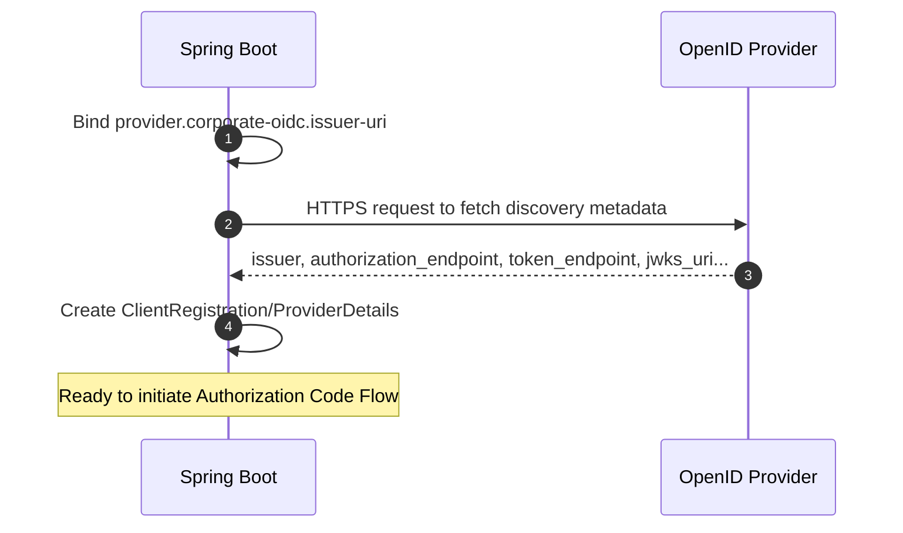

# 6.2. The `spring.security.oauth2.client.provider` Property Group

In Spring Boot, an OAuth 2.0 / OpenID Connect (OIDC) Client configuration has two sections that usually appear side by side: **`registration`** describes *how our application is registered as a client*, while **`provider`** describes *the Authorization Server/OpenID Provider with which the client communicates*. This lesson focuses on the property group:

```text
spring.security.oauth2.client.provider.<provider-id>.*
```

Understanding this group properly helps the application locate OIDC endpoints automatically via **issuer discovery**, or declare endpoints explicitly for providers without suitable discovery. At the same time, you can avoid common errors involving issuer, token endpoint, JWKS URI, UserInfo endpoint, and identity attribute mapping.

Examples apply to **Spring Boot 3.x, Spring Security 6.x, Servlet/Spring MVC applications** logging in with the Authorization Code Flow. URLs using `example.com` are illustrative only; in deployment, always use the official metadata of the real provider.

## 1. Position of `provider` in OAuth2 Client Configuration

General form in `application.yml`:

```yaml
spring:
  security:
    oauth2:
      client:
        registration:
          portal:
            provider: corporate-oidc
            client-id: ${OIDC_CLIENT_ID}
            client-secret: ${OIDC_CLIENT_SECRET}
            authorization-grant-type: authorization_code
            scope: [openid, profile, email]
            redirect-uri: "{baseUrl}/login/oauth2/code/{registrationId}"
        provider:
          corporate-oidc:
            issuer-uri: ${OIDC_ISSUER_URI}
```

There are **two distinct names** here:

- **`portal` is the registration ID**: the name of the client registration in the Spring application. It determines the default URL to initiate login: `/oauth2/authorization/portal`, and the callback suffix: `/login/oauth2/code/portal`.
- **`corporate-oidc` is the provider ID**: the configuration key referenced by `registration.portal.provider`. It simply groups information about the OIDC server; it does not have to match the issuer, hostname, or registration ID.

Linking model:

```text
spring.security.oauth2.client
  |
  +-- registration.portal
  |     +-- provider: corporate-oidc --------+
  |     +-- client-id: ...                    |
  |     +-- client-secret: ...                |
  |     +-- scope: [openid, profile]          |
  |     +-- redirect-uri: ...                 |
  |                                           |
  +-- provider.corporate-oidc <---------------+
        +-- issuer-uri: https://...
        +-- [authorization-uri]
        +-- [token-uri]
        +-- [jwk-set-uri]
        +-- [user-info-uri]
        +-- [user-info-authentication-method]
        +-- [user-name-attribute]
```

When Spring Boot reads these properties, it builds `ClientRegistration` instances containing `ClientRegistration.ProviderDetails`. The `provider` section does not create a usable login client by itself: a valid registration must still link to it.

## 2. Properties in the Provider Group

Spring Boot provides common keys under the prefix:

```text
spring.security.oauth2.client.provider.<provider-id>
```

| Property | Function | When needed |
| --- | --- | --- |
| `issuer-uri` | Identifies the issuer of the Authorization Server/OP; used to locate endpoint metadata when the provider supports discovery. | **Preferred for OIDC providers with discovery**. |
| `authorization-uri` | Authorization Endpoint URL, where the browser is redirected to begin the Authorization Code Flow. | Declared explicitly when not using discovery or when a specific endpoint configuration is needed. |
| `token-uri` | Token Endpoint URL, where the backend exchanges an authorization code for tokens or uses an appropriate grant. | Needed when not inferred from metadata/default provider configuration. |
| `jwk-set-uri` | JSON Web Key Set (JWKS) URL, publishing public keys to verify token signatures via the appropriate mechanism. | Important for OIDC ID Tokens using signatures verifiable with public keys; usually obtained from discovery. |
| `user-info-uri` | OIDC UserInfo Endpoint URL or the provider's user information endpoint. | When the flow needs to fetch user data from this endpoint. |
| `user-info-authentication-method` | How the OAuth2 Client authenticates requests to the UserInfo endpoint, typically with an access token. | When the provider requires a method other than the default. |
| `user-name-attribute` | Name of the attribute in the user info response used as the principal identifier in the OAuth2 login context. | Especially useful when integrating non-OIDC OAuth2 providers or custom user info structures. |

**Key point:** these fields are **not all required at the same time**. With working OIDC discovery, a single accurate `issuer-uri` in `provider` is usually enough for Spring to find the necessary endpoints; the registration section still needs client ID, secret (if confidential client), scopes, and corresponding details.

Keys following Spring Boot *relaxed binding* commonly use kebab-case such as `jwk-set-uri` and `user-info-uri`; when using `application.properties`, it is also good practice to write this exact form for clarity.

## 3. `issuer-uri`: Recommended Starting Point for OIDC

### 3.1. What is an Issuer?

The **Issuer** is the identifier of the token-issuing party, usually an HTTPS URL and sometimes containing a path identifying a tenant/realm. Example:

```text
https://idp.example.com/realms/training
```

It is **not** the `/login` page URL, not `/authorize` by default, and not the token endpoint path.

In OIDC, the OP publishes metadata following discovery rules. Metadata typically contains fields like:

```json
{
  "issuer": "https://idp.example.com/realms/training",
  "authorization_endpoint": "https://idp.example.com/realms/training/protocol/openid-connect/auth",
  "token_endpoint": "https://idp.example.com/realms/training/protocol/openid-connect/token",
  "jwks_uri": "https://idp.example.com/realms/training/protocol/openid-connect/certs",
  "userinfo_endpoint": "https://idp.example.com/realms/training/protocol/openid-connect/userinfo",
  "response_types_supported": ["code"],
  "id_token_signing_alg_values_supported": ["RS256"]
}
```

The endpoints in the example only illustrate relationships; they are **not a mandatory URL structure for every OP**. OPs may use different paths. The issuer used in Spring must exactly match the `issuer` value published by the OP and align with the `iss` claim in the ID Token.

### 3.2. How Spring Boot Uses Issuer Discovery

When declared as:

```yaml
spring:
  security:
    oauth2:
      client:
        provider:
          corporate-oidc:
            issuer-uri: https://idp.example.com/realms/training
```

Spring Security can retrieve metadata using **OIDC Discovery** and related discovery rules supported in the version in use; from that, it builds `ClientRegistration.ProviderDetails` containing the authorization endpoint, token endpoint, JWK Set URI, UserInfo URI, and required data.

High-level flow:



Benefits of this approach:

- Avoids manually copying multiple endpoints and reduces the risk of wrong paths.
- A consistent issuer helps verify the OP's identity; metadata whose issuer does not match the configuration is rejected.
- Providers can publish additional metadata needed for authentication methods, algorithms, and endpoints.
- When the OP changes how endpoints are published in metadata, application configuration depends less on individual URLs.

**Note on fetch timing:** depending on how Spring Boot/Spring Security initializes client registrations, metadata retrieval may happen during startup. If DNS, TLS, proxy, or the OP is unavailable, the application may **fail to start**, even before a browser attempts to log in.

Do not use an `issuer-uri` taken directly from untrusted user input to create arbitrary connections, as that can open network access to unintended addresses. For normal clients, the issuer must be a fixed value or come from a managed configuration system.

### 3.3. Difference Between Issuer and Metadata URL

Some OPs publish metadata at a URL like:

```text
https://idp.example.com/realms/training/.well-known/openid-configuration
```

However, rules for constructing the discovery path from an issuer can differ between OIDC Discovery and OAuth Authorization Server metadata, especially when the issuer has a path. Enter the **issuer value**, rather than taking a `.well-known` URL and placing that entire string into `issuer-uri`. Spring uses the supported discovery algorithm to locate metadata.

If a provider publishes a metadata document that Spring cannot fetch via standard discovery, you may need to declare endpoints explicitly or use specialized configuration; do not alter the issuer to an arbitrary URL just so the metadata request returns HTTP 200.

### 3.4. Example of the Same Provider in Two Formats

**YAML:**

```yaml
spring:
  security:
    oauth2:
      client:
        provider:
          training-idp:
            issuer-uri: ${TRAINING_ISSUER_URI}
```

**Properties:**

```properties
spring.security.oauth2.client.provider.training-idp.issuer-uri=${TRAINING_ISSUER_URI}
```

Example environment variable:

```text
TRAINING_ISSUER_URI=https://idp.example.com/realms/training
```

The name `training-idp` is only a mapping key in Spring. It does not need to match the realm name or URL hostname, but it must be referenced properly in `registration.<registration-id>.provider`.

## 4. `authorization-uri`: URL Where the Browser Starts Authorization

The Authorization Endpoint is where the application sends the browser via HTTP redirect:

```text
GET /oauth2/authorization/portal
            |
            v
Spring builds authorization request
            |
            v
302 Location: https://idp.example.com/.../authorize?response_type=code&...
```

If no discovery or built-in configuration is available, you can specify:

```yaml
spring:
  security:
    oauth2:
      client:
        provider:
          corporate-oidc:
            authorization-uri: https://idp.example.com/oauth2/authorize
```

This is **the OP's endpoint**, different from `/oauth2/authorization/portal` **on the Spring application**:

| Endpoint | Who owns it? | Role |
| --- | --- | --- |
| `/oauth2/authorization/portal` | Spring application | Triggers the client's OAuth2 Login filter. |
| `https://idp.example.com/oauth2/authorize` | Authorization Server / OP | Receives the authorization request from the browser and handles authentication/consent. |
| `/login/oauth2/code/portal` | Spring application | Receives the authorization response/callback. |

When constructing the authorization request, Spring adds `client_id`, `response_type=code`, `redirect_uri`, `scope`, `state`, and additional parameters when needed such as `nonce` and a PKCE challenge.

An authorization endpoint is **not a URL for logging in via direct password POST**. With OIDC, the browser and OP handle authentication interaction; the client application should not collect OP passwords just to "simplify" the flow.

## 5. `token-uri`: Authorization Code Exchange Endpoint

After the callback:

```text
GET https://app.example.com/login/oauth2/code/portal
    ?code=AUTHORIZATION_CODE&state=...
```

Spring Security performs a **back-channel HTTP request** from the backend to the token endpoint:

```http
POST /oauth2/token HTTP/1.1
Host: idp.example.com
Content-Type: application/x-www-form-urlencoded
Authorization: Basic <client-authentication-value>

grant_type=authorization_code&code=...&redirect_uri=...
```

This is only an illustrative request shape; how the client authenticates depends on the registration configuration and the OP's capabilities, and Basic authentication is not always required. If PKCE is enabled, the token request also includes `code_verifier`.

Declare `token-uri` when needed:

```properties
spring.security.oauth2.client.provider.corporate-oidc.token-uri=https://idp.example.com/oauth2/token
```

**Distinguishing the roles:**

- `authorization-uri`: where the browser is redirected.
- `token-uri`: called directly by the Spring backend to obtain tokens; normally does not appear in the browser's Network tab.
- `redirect-uri`: the Spring app URL that receives the code; **belongs to registration**, not inside provider.
- `client-authentication-method`: how the client authenticates to the token endpoint; **belongs to registration**, e.g., `client_secret_basic`.

Do not append client secrets to the query string of `token-uri` or copy token URLs containing secrets into logs. `invalid_client` errors usually relate to client ID/secret/authentication method; `invalid_grant` may relate to the code, redirect URI, PKCE, or expiration, not necessarily a wrong token endpoint.

## 6. `jwk-set-uri`: Publishing Keys for Signature Verification

An OIDC ID Token is typically a **signed JWT**. Spring needs to know which keys are trusted to verify the token's signature. Many OPs publish public keys via **JWKS (JSON Web Key Set)**:

```json
{
  "keys": [
    {
      "kty": "RSA",
      "kid": "signing-key-2026",
      "use": "sig",
      "alg": "RS256",
      "n": "<modulus-base64url>",
      "e": "AQAB"
    }
  ]
}
```

The example content is abbreviated. These are **public keys**, not private signing keys. Spring can select a key by `kid` in the JWT header and verify the signature according to accepted algorithms. Providers may **rotate** keys over time; clients need to refresh key material in a controlled manner.

If discovery is unavailable:

```yaml
spring:
  security:
    oauth2:
      client:
        provider:
          corporate-oidc:
            jwk-set-uri: https://idp.example.com/oauth2/jwks
```

Notes:

1. `jwk-set-uri` is a signing key source URL; it is **not** a client secret, the application's private keystore, or a session store.
2. Having the right public key is not enough to accept an ID Token: you must still check **issuer (`iss`)**, **audience (`aud`)**, validity window, nonce, and other OIDC conditions.
3. Do not dynamically fetch an arbitrary JWKS URI suggested by an unverified JWT (for example via an untrusted header) to "auto-fix" signature errors.
4. HTTPS and trusted certificate verification are required; disabling TLS verification breaks the trust boundary.
5. For providers using other token signing mechanisms, follow the specific framework/provider capabilities and rules; do not assume every access token is a JWT or that all tokens are verified using the same JWKS.

The `jwk-set-uri` field also appears in **Resource Server** under a different prefix, such as `spring.security.oauth2.resourceserver.jwt.jwk-set-uri`. These two configurations serve different roles: the **OAuth2 Client** provider helps the client verify ID Tokens during login; Resource Server uses appropriate keys to verify Bearer JWTs on incoming API requests.

## 7. `user-info-uri`: Source of Additional User Claims

OIDC has a **UserInfo Endpoint**. After the client receives an access token with appropriate permissions, it can call this endpoint to obtain claims provided by the OP. Example:

```http
GET /oidc/userinfo HTTP/1.1
Host: idp.example.com
Authorization: Bearer <access-token>
```

Illustrative response:

```json
{
  "sub": "user-123",
  "name": "Nguyen An",
  "preferred_username": "an.nguyen",
  "email": "an@example.com",
  "email_verified": true
}
```

Declaration:

```properties
spring.security.oauth2.client.provider.corporate-oidc.user-info-uri=https://idp.example.com/oidc/userinfo
```

**Limitations of the example:** not every provider supplies all claims, not every flow requires calling UserInfo, and a client may already have sufficient information from the ID Token. Whether Spring calls UserInfo also depends on OIDC user service configuration, scopes, metadata, and principal mapping mechanisms.

An important OIDC requirement: the `sub` claim in the UserInfo response must match the `sub` in the ID Token for that login. Do not merge data from two accounts solely by email or display name.

### 7.1. UserInfo is Not Equivalent to Token Introspection

| Endpoint | Purpose | Typical caller |
| --- | --- | --- |
| **UserInfo** | Returns claims about the end user to the OIDC Client. | Client using the issued access token. |
| **Token Endpoint** | Issues tokens or exchanges an authorization code. | OAuth2 Client. |
| **JWKS Endpoint** | Publishes public keys for signature verification. | Client, Resource Server, and appropriate JWT validators. |
| **Introspection Endpoint** | Allows checking token status/attributes per RFC 7662 when supported. | Resource Server or a party authorized by the OP. |

Do not put an introspection URL into `user-info-uri`. If your API receives opaque access tokens and needs introspection, that is a **Resource Server introspection** problem with its own configuration.

## 8. `user-info-authentication-method`: How Credentials Are Sent to UserInfo

Normally the OAuth2 Client calls UserInfo with the access token in the header:

```http
Authorization: Bearer eyJ...
```

Some providers accept access tokens differently. The `user-info-authentication-method` property lets you adjust the method supported by Spring Security and the provider.

Example using a Bearer token in the header:

```yaml
spring:
  security:
    oauth2:
      client:
        provider:
          corporate-oidc:
            user-info-authentication-method: header
```

In some configurations/versions there is also an option to send the token via form method. However, with modern OIDC providers, **sending the Bearer token in the Authorization header is standard and preferred**, as it reduces the risk of tokens appearing in query strings or URL logs.

Distinguish between:

- **`user-info-authentication-method`** in **provider**: how the request to the UserInfo Endpoint carries credentials.
- **`client-authentication-method`** in **registration**: how the OAuth2 Client authenticates to the **Token Endpoint**.
- **`authorization-grant-type`** in **registration**: the OAuth2 grant, e.g., `authorization_code`.

They have different semantics. Changing how the client authenticates at the token endpoint does not automatically change how the Bearer token is sent to UserInfo.

## 9. `user-name-attribute`: Mapping the Principal Identifier

An OAuth2 provider might return UserInfo like:

```json
{
  "id": 98765,
  "login": "student01",
  "display_name": "Student One"
}
```

In the case of **non-OIDC OAuth2 Login**, Spring Security needs to know which field is the principal name/identifier. You can configure:

```yaml
spring:
  security:
    oauth2:
      client:
        provider:
          legacy-provider:
            user-name-attribute: id
```

Spring uses the chosen field when mapping user details via the appropriate OAuth2 user service mechanism. **The value must match the exact attribute name** contained in the response; `userNameAttributeName` is not automatically a client ID or an internal database username.

With **OIDC login**, `sub` is the standard subject identifier in the OP. Normally an OIDC principal is modeled as `OidcUser` and identified by subject; do not use email or display name as a system-wide unique key because they can change or are not guaranteed unique by the provider.

### 9.1. Avoid Confusing `preferred_username`, `email`, and `sub`

| Claim / attribute | Meaning | Should it be an immutable internal ID? |
| --- | --- | --- |
| `sub` | Subject identifier issued by the issuer. | Usually a good choice when paired as **issuer + subject**. |
| `preferred_username` | Preferred username for display or use in the OP system. | Should not be assumed immutable/unique. |
| `email` | Email address; may be missing, unverified, or change. | Should not replace subject by default. |
| `name` | Display name. | Not suitable as a unique identifier. |

If multiple OPs can sign into one application, two identical `sub` values from two different issuers **do not necessarily represent the same person**. A common identity mapping pattern is the `(issuer, subject)` pair, combined with an account-linking policy defined by the product.

## 10. Configuring a Provider with `application.yml`

### 10.1. Option A — OP Supports OIDC Discovery (Start Here)

Example of a `portal` application signing in with `corporate-oidc`:

```yaml
spring:
  security:
    oauth2:
      client:
        registration:
          portal:
            provider: corporate-oidc
            client-id: ${OIDC_CLIENT_ID}
            client-secret: ${OIDC_CLIENT_SECRET}
            authorization-grant-type: authorization_code
            scope:
              - openid
              - profile
              - email
            redirect-uri: "{baseUrl}/login/oauth2/code/{registrationId}"
        provider:
          corporate-oidc:
            issuer-uri: ${OIDC_ISSUER_URI}
```

This configuration assumes the application is a **confidential web client** and the provider supports standard endpoints describable by discovery. `openid` is the foundational scope for performing OIDC authentication. For providers that do not require a secret based on the registered client type, update the authentication/PKCE configuration accordingly; never omit the secret without considering the client type.

Example environment variables:

```text
OIDC_CLIENT_ID=portal-web
OIDC_CLIENT_SECRET=<secret-issued-by-provider>
OIDC_ISSUER_URI=https://idp.example.com/realms/training
```

To start the flow:

```text
GET http://localhost:8080/oauth2/authorization/portal
```

Default callback:

```text
http://localhost:8080/login/oauth2/code/portal
```

This callback must be registered for the client at the OP. Production usually uses HTTPS and a public hostname. You can omit `redirect-uri` if using the exact default template, though keeping it in the example makes the path clear.

### 10.2. Option B — Explicitly Declared Provider Endpoints

A provider without suitable discovery may require explicit URL configuration. The following example is a **configuration template** for a provider whose endpoints have been verified from official documentation:

```yaml
spring:
  security:
    oauth2:
      client:
        registration:
          portal:
            provider: corporate-oidc
            client-id: ${OIDC_CLIENT_ID}
            client-secret: ${OIDC_CLIENT_SECRET}
            authorization-grant-type: authorization_code
            scope: [openid, profile]
            redirect-uri: "{baseUrl}/login/oauth2/code/{registrationId}"
        provider:
          corporate-oidc:
            authorization-uri: https://idp.example.com/oauth2/authorize
            token-uri: https://idp.example.com/oauth2/token
            jwk-set-uri: https://idp.example.com/oauth2/jwks
            user-info-uri: https://idp.example.com/oidc/userinfo
            user-info-authentication-method: header
            user-name-attribute: sub
```

The URLs in this template are **not verified real endpoints**. When doing OIDC with manual configuration, ensure that **issuer** and ID Token verification are not weakened due to missing metadata. Some providers require advanced settings or a custom `ClientRegistration`; when discovery is fully supported, using **`issuer-uri` is the more maintainable choice**.

Notice that the example has two complete sections:

- **Registration** is responsible for client name, client ID/secret, grant, scopes, and redirect.
- **Provider** is responsible for authorization/token/JWKS/UserInfo endpoints and user info attributes.

Do not place `authorization-uri` under `registration.portal`, or place `client-secret` under `provider.corporate-oidc`: Spring Boot will not bind them as you intend.

## 11. Equivalent Configuration in `application.properties`

### 11.1. Using Issuer Discovery

```properties
spring.security.oauth2.client.registration.portal.provider=corporate-oidc
spring.security.oauth2.client.registration.portal.client-id=${OIDC_CLIENT_ID}
spring.security.oauth2.client.registration.portal.client-secret=${OIDC_CLIENT_SECRET}
spring.security.oauth2.client.registration.portal.authorization-grant-type=authorization_code
spring.security.oauth2.client.registration.portal.scope=openid,profile,email
spring.security.oauth2.client.registration.portal.redirect-uri={baseUrl}/login/oauth2/code/{registrationId}

spring.security.oauth2.client.provider.corporate-oidc.issuer-uri=${OIDC_ISSUER_URI}
```

### 11.2. Explicit Endpoint Declaration

```properties
spring.security.oauth2.client.provider.corporate-oidc.authorization-uri=https://idp.example.com/oauth2/authorize
spring.security.oauth2.client.provider.corporate-oidc.token-uri=https://idp.example.com/oauth2/token
spring.security.oauth2.client.provider.corporate-oidc.jwk-set-uri=https://idp.example.com/oauth2/jwks
spring.security.oauth2.client.provider.corporate-oidc.user-info-uri=https://idp.example.com/oidc/userinfo
spring.security.oauth2.client.provider.corporate-oidc.user-info-authentication-method=header
spring.security.oauth2.client.provider.corporate-oidc.user-name-attribute=sub
```

The second block is the **provider property group**, which needs a corresponding registration to become a working client. Keys starting with `spring.security.oauth2.client.provider.` are **OAuth2 Client** configuration, not Resource Server or Authorization Server configuration.

### 11.3. YAML ↔ Properties Conversion Table

| YAML (under `provider.corporate-oidc`) | Full Properties Path |
| --- | --- |
| `issuer-uri: ...` | `spring.security.oauth2.client.provider.corporate-oidc.issuer-uri=...` |
| `authorization-uri: ...` | `spring.security.oauth2.client.provider.corporate-oidc.authorization-uri=...` |
| `token-uri: ...` | `spring.security.oauth2.client.provider.corporate-oidc.token-uri=...` |
| `jwk-set-uri: ...` | `spring.security.oauth2.client.provider.corporate-oidc.jwk-set-uri=...` |
| `user-info-uri: ...` | `spring.security.oauth2.client.provider.corporate-oidc.user-info-uri=...` |
| `user-info-authentication-method: header` | `spring.security.oauth2.client.provider.corporate-oidc.user-info-authentication-method=header` |
| `user-name-attribute: sub` | `spring.security.oauth2.client.provider.corporate-oidc.user-name-attribute=sub` |

Use a consistent configuration style in a project. If both `application.yml` and `application.properties` contain the same key, precedence between configuration sources decides the final value; this can cause you to read one file while the application uses a different value.

## 12. One Provider Used by Multiple Registrations

An application can use the **same OpenID Provider** while registering **two different OAuth2 clients**, for example one client for an employee portal and one client for an administration system:

```yaml
spring:
  security:
    oauth2:
      client:
        registration:
          staff:
            provider: shared-oidc
            client-id: ${STAFF_CLIENT_ID}
            client-secret: ${STAFF_CLIENT_SECRET}
            authorization-grant-type: authorization_code
            scope: [openid, profile]
          admin:
            provider: shared-oidc
            client-id: ${ADMIN_CLIENT_ID}
            client-secret: ${ADMIN_CLIENT_SECRET}
            authorization-grant-type: authorization_code
            scope: [openid, profile, email]
        provider:
          shared-oidc:
            issuer-uri: ${OIDC_ISSUER_URI}
```

The two registrations can share the same issuer/authorization/token/JWKS endpoints while having **different client IDs, secrets, scopes, and callbacks**:

```text
/oauth2/authorization/staff
/oauth2/authorization/admin

/login/oauth2/code/staff
/login/oauth2/code/admin
```

Both callbacks must be permitted by the OP for each respective client ID. Login, authorization, and application session policies still need to be designed according to each client's requirements.

Conversely, **a single registration cannot simultaneously point to two providers** with a single `provider` value. If you want users to choose among multiple OPs, define a separate registration for each OP and ensure proper issuer binding for each flow.

## 13. Built-in Providers and Custom Providers

Spring Security ships preconfigured defaults for several common OAuth2 providers (such as familiar registration IDs like `google` or `github` in supported versions). This can allow a registration to work without declaring every provider endpoint manually.

Abbreviated example:

```yaml
spring:
  security:
    oauth2:
      client:
        registration:
          google:
            client-id: ${GOOGLE_CLIENT_ID}
            client-secret: ${GOOGLE_CLIENT_SECRET}
```

This example assumes the Spring Security version and provider setup support that default registration ID and that other required values are inferred by the framework. Some built-in providers are plain OAuth2; **do not assume every built-in provider is OIDC** or provides an ID Token.

For custom providers such as `corporate-oidc`, `partner-sso`, or a dedicated tenant, you will normally declare `registration.<id>.provider` and the `provider.<provider-id>` group explicitly, or use `issuer-uri`.

**Do not assume** that merely naming a registration ID after a provider causes Spring to guess all endpoints. When encountering `provider details must be specified` or missing-endpoint errors, add a valid provider configuration or use issuer discovery.

## 14. `SecurityFilterChain` and Related Endpoints

The `provider` configuration does not itself decide which endpoints require login, are publicly accessible, or return `401`/redirect. Those behaviors belong to the application's security configuration.

Servlet security chain example:

```java
import org.springframework.context.annotation.Bean;
import org.springframework.context.annotation.Configuration;
import org.springframework.security.config.Customizer;
import org.springframework.security.config.annotation.web.builders.HttpSecurity;
import org.springframework.security.web.SecurityFilterChain;

@Configuration
public class SecurityConfig {

    @Bean
    SecurityFilterChain securityFilterChain(HttpSecurity http) throws Exception {
        http
            .authorizeHttpRequests(auth -> auth
                .requestMatchers("/", "/assets/**", "/error").permitAll()
                .anyRequest().authenticated()
            )
            .oauth2Login(Customizer.withDefaults());

        return http.build();
    }
}
```

When using Spring Boot auto-configuration with the OAuth2 Client starter and **without defining a custom security chain**, Boot may provide a default login configuration. If you write your own chain, enable `oauth2Login()` on the chain handling OAuth2 Login paths. Do not assume that declaring a provider alone is enough for callbacks to be handled by the filter.

Default paths in the `portal` example:

| URL | Component | Role |
| --- | --- | --- |
| `/oauth2/authorization/portal` | Spring OAuth2 Client | Starts the browser redirect to the provider authorization endpoint. |
| `/login/oauth2/code/portal` | Spring OAuth2 Client | Receives the authorization code callback and processes login. |
| `https://idp.example.com/.../authorize` | OP | Authorization endpoint, configured or derived from the provider. |
| `https://idp.example.com/.../token` | OP | Token endpoint called by the backend. |
| `https://idp.example.com/.../userinfo` | OP | UserInfo endpoint when the flow needs to retrieve user details. |

**Do not confuse Spring application URLs with provider URIs**, even though both appear in the same login flow.

## 15. How to Verify and Diagnose Provider Configuration

### 15.1. Check Metadata Before Logging In

When a provider supports OIDC discovery, you need to know the exact issuer published by the OP. The discovered metadata must contain an issuer matching the expected value and valid endpoint URLs.

Helpful checklist questions:

1. Does the issuer have the right **host and tenant/realm path**?
2. Can the HTTPS connection to the OP verify the certificate?
3. Does the OP publish `authorization_endpoint`, `token_endpoint`, and `jwks_uri` for the right environment?
4. Does the OP support `response_type=code` and the corresponding grant?
5. Is the Client ID registered under the right issuer with valid callbacks and scopes?

Do not put a metadata URL or admin console URL as the issuer if it does not match the `issuer` published by the OP.

### 15.2. Inspecting via the Browser

With `portal`:

```text
http://localhost:8080/oauth2/authorization/portal
```

If configured properly, the browser is redirected to the OP's authorization endpoint. In the Network tab, check:

- Does the redirect host/path match the **authorization endpoint** published by the OP or configured explicitly?
- Does the `client_id` parameter match the registration's client ID?
- Does `redirect_uri` match the registered callback?
- Does `scope` contain `openid` for OIDC?
- Is `state` present; and if OIDC nonce/PKCE is configured, are parameters like `nonce`, `code_challenge`, and `code_challenge_method` present?

Token exchange happens between the Spring backend and the OP; the browser normally does not see the request to the token endpoint.

### 15.3. Common Errors Table

| Error / symptom | Related layer | How to handle |
| --- | --- | --- |
| Startup reports issuer metadata not found | `issuer-uri`, DNS, network, TLS | Verify the exact issuer and that the OP publishes valid discovery; check proxy and trust store. |
| Issuer mismatch error | Discovery or ID Token `iss` | Compare declared issuer with issuer in metadata/ID Token; pay attention to tenant, path, and trailing `/`. |
| Redirects to wrong page or `404` at OP | `authorization-uri` | Use the official authorization endpoint, not an arbitrary login page URL. |
| OP reports `invalid_client` | Registration, token endpoint, client auth | Check client ID, secret, `client-authentication-method`, and token endpoint on the right OP. |
| OP reports `invalid_redirect_uri` | Registration/redirect URI | Compare full scheme, host, port, path, and callback allowlist. |
| Code exchange fails (`invalid_grant`) | Token request, PKCE, redirect URI | Check one-time use/expiration of code, `code_verifier` if used, and redirect URI; do not immediately conclude `token-uri` is wrong. |
| ID Token signature cannot be verified | `jwk-set-uri`, key rotation, token | Verify JWKS from the right OP, `kid`, allowed algorithms, and key refresh. |
| UserInfo fetch returns `401` | `user-info-uri` / authentication method | Check access token/scopes, token delivery method, and endpoint access rights. |
| User name attribute not found | `user-name-attribute` | Match the actual field in the UserInfo response with the declared key. |
| Principal lacks email | Scope/claims/UserInfo | Check `email` scope, consent, provider mapping; email is not a guaranteed claim. |
| Redirected back to login right after signing in | Session/cookie/SecurityContext | Check cookies, HTTPS proxy, session timeout, and session storage. |
| API using Bearer token returns `401` | Resource Server, token audience | Check Resource Server configuration and access token claims; this is a separate verification flow. |

### 15.4. Logging When Debugging

You can enable an appropriate Spring Security log level in the **development environment**:

```yaml
logging:
  level:
    org.springframework.security: DEBUG
```

DEBUG can help identify filters, redirects, and authentication errors. Increase log levels intentionally and turn them off when no longer needed. Never log full **client secrets, Authorization headers, authorization codes, ID Tokens, access tokens, refresh tokens, session IDs, or PKCE verifiers** to centralized or shared logging systems.

## 16. Design Mistakes to Avoid

### 16.1. Provider ID, Issuer, and Client ID Are Not the Same Thing

Example:

```yaml
registration:
  employee-portal:
    provider: internal-sso
    client-id: portal-prod-2026
provider:
  internal-sso:
    issuer-uri: https://login.example.com/realms/employees
```

Four parts to keep separate:

- `employee-portal`: registration ID in Spring.
- `internal-sso`: provider alias in the configuration file.
- `portal-prod-2026`: client ID issued at the OP.
- `https://login.example.com/realms/employees`: issuer identifying the OP.

There is no requirement that they be the same string.

### 16.2. Provider Properties Are Not Resource Server Configuration

The configuration:

```properties
spring.security.oauth2.client.provider.internal-sso.issuer-uri=https://login.example.com/realms/employees
```

tells the **OAuth2 Client** which OP to log in against. It **does not automatically enable** `Authorization: Bearer ...` verification for the application's REST APIs.

An API using JWTs typically has its own configuration such as:

```properties
spring.security.oauth2.resourceserver.jwt.issuer-uri=https://login.example.com/realms/employees
```

along with an appropriate security chain and resource-server dependency. Even when using the same issuer, the two prefixes serve **two different roles**. For an API, you also need to verify audience/scopes/authorities per resource server policy.

### 16.3. Do Not Blindly Choose `user-name-attribute=email`

Email can change, be unverified, be missing, or not be unique across an OP. With OIDC, a more stable subject is typically `sub` combined with `iss`. The value of `user-name-attribute` should never be used to bypass ID Token validation or automatically merge accounts across different issuers.

### 16.4. Do Not Fix Token Verification by Disabling HTTPS

If the application cannot download discovery metadata or JWKS due to a bad certificate, the proper fix is correcting the **CA/trust store, hostname, network, or certificate**. Accepting any certificate or disabling hostname verification opens the door to spoofed metadata/key sources.

### 16.5. Do Not Configure Every Endpoint Manually When Discovery Works Reliably

Manually declaring multiple endpoints increases the risk of one URI pointing to a different OP or realm. When the provider's OIDC discovery works reliably and securely, start with `issuer-uri`, and only add overrides with documented necessity and framework/provider compatibility.

## 17. Practice Exercises

### Exercise 1 — Read Configuration and Identify Endpoints

Given:

```yaml
spring:
  security:
    oauth2:
      client:
        registration:
          learning:
            provider: sso
            client-id: web-client
            client-secret: ${CLIENT_SECRET}
            scope: [openid, profile]
        provider:
          sso:
            issuer-uri: https://sso.example.com/realms/training
```

**Question:** What are the default URLs for initiating login and callback? Is `sso` the client's ID?

**Hint:** The initiation URL is `/oauth2/authorization/learning`, and the callback is `/login/oauth2/code/learning`. `sso` is the provider alias; the actual client ID is `web-client`.

### Exercise 2 — Choose Properties to Fill in URLs

The provider does not support issuer discovery. You receive three URLs from the OP documentation:

```text
https://login.example.com/auth
https://login.example.com/token
https://login.example.com/keys
```

**Question:** Which keys do those URLs belong to?

**Hint:** In order, they are `authorization-uri`, `token-uri`, and `jwk-set-uri`. They sit under `spring.security.oauth2.client.provider.<provider-id>`. Confirm that the provider actually supports OIDC and has sufficient issuer/ID Token validation information for a secure OIDC Client.

### Exercise 3 — Two Clients, One Provider

A company has two separate client IDs to log into the same OP. Do issuer and JWKS need to be declared twice?

**Hint:** Two `registration` entries can reference the same provider ID. Each client can have its own credentials and redirect URI; the shared provider details describe the same Authorization Server.

### Exercise 4 — Diagnose a UserInfo Error

Login succeeds, but Spring cannot map the principal from the UserInfo response:

```json
{"account_id":"42","display_name":"Learner"}
```

You configured:

```properties
spring.security.oauth2.client.provider.legacy.user-name-attribute=id
```

**Hint:** The actual payload does not have `id`, it has `account_id`. For appropriate OAuth2 Login, update `user-name-attribute=account_id` after confirming the meaning and uniqueness of the attribute. For OIDC, evaluate `sub`/issuer and how the OIDC principal is constructed; do not just change a key and skip token validation.

### Exercise 5 — Analyze a JWT Token Error

The client obtains an ID Token but reports a signature error. You discover that `jwk-set-uri` points to tenant `B`'s key set, while `issuer-uri` and the authorization/token endpoints belong to tenant `A`.

**Hint:** The endpoints/token metadata do not belong to the same provider/tenant. Use standard discovery or cross-check the entire configuration against the official OP documentation, verifying the issuer and JWKS URI from the right source; never bypass signature verification.

## 18. Key Takeaways

- `spring.security.oauth2.client.provider.<provider-id>` holds **metadata/endpoints of the Authorization Server or OpenID Provider**.
- `spring.security.oauth2.client.registration.<registration-id>` holds **registered client details** and references a provider via the `provider` key.
- For OPs supporting OIDC Discovery, **`issuer-uri` is the preferred minimal configuration starting point**.
- When explicit endpoints must be used, the key properties are `authorization-uri`, `token-uri`, `jwk-set-uri`, `user-info-uri`, along with UserInfo authentication method and username attribute options.
- Correctness of **issuer, JWKS, ID Token validation, and callback** matters more than login merely "appearing to work."
- OAuth2 Client `provider` configuration and OAuth2 Resource Server JWT/opaque token configuration are separate mechanisms.
- Keep secrets in appropriate configuration sources; do not commit client secrets or log tokens.

### Official Documentation for Reference

- [Spring Boot Reference — Spring Security / OAuth2 Client](https://docs.spring.io/spring-boot/reference/web/spring-security.html).
- [Spring Security Reference — OAuth 2.0 Client](https://docs.spring.io/spring-security/reference/servlet/oauth2/client/index.html).
- [Spring Security Reference — OAuth 2.0 Login](https://docs.spring.io/spring-security/reference/servlet/oauth2/login/index.html).
- [Spring Security Reference — Core Interfaces and Classes](https://docs.spring.io/spring-security/reference/servlet/oauth2/client/core.html).
- [OpenID Connect Discovery 1.0](https://openid.net/specs/openid-connect-discovery-1_0.html).
- [OpenID Connect Core 1.0](https://openid.net/specs/openid-connect-core-1_0.html).
- [RFC 8414 — OAuth 2.0 Authorization Server Metadata](https://www.rfc-editor.org/rfc/rfc8414).
- [RFC 7517 — JSON Web Key (JWK)](https://www.rfc-editor.org/rfc/rfc7517).
