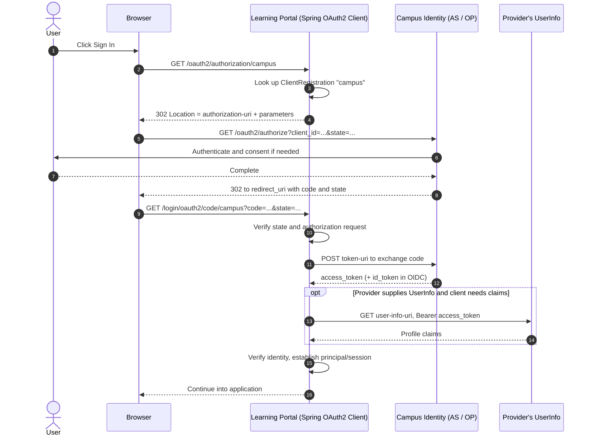

# 6.5. Manually Declaring `authorization-uri`, `token-uri`, and `user-info-uri`

## Lesson Objectives

After this lesson, you will be able to:

- Explain the distinct roles of **`authorization-uri`**, **`token-uri`**, and **`user-info-uri`** when Spring Security acts as an OAuth 2.0 / OpenID Connect (OIDC) Client.
- Know when provider endpoints need to be configured **manually** instead of relying on OIDC Discovery via `issuer-uri`.
- Write the proper `spring.security.oauth2.client.provider.<provider-id>.*` structure and link it with `registration.<registration-id>.provider`.
- Distinguish endpoints belonging to the **Authorization Server/OpenID Provider** from the login initiation URL and callback exposed by the **Spring application**.
- Configure a custom OAuth 2.0 provider with a UserInfo endpoint, and recognize the important additions when the provider supports OIDC.
- Understand requirements for user identity (`user-name-attribute` or `sub`), JWK Set URI, issuer, scopes, and ID Token validation.
- Diagnose endpoint configuration errors, `redirect_uri_mismatch`, authorization code exchange failures, UserInfo call errors, and common issues when running behind a reverse proxy.

## 1. Context: Why Declare Endpoints Manually?

Suppose **Learning Portal** is a Spring Boot web application integrating with **Campus Identity**. A user clicks "Sign In", is redirected to Campus Identity to authenticate, and then returns to the Portal. The Portal exchanges the authorization code for an access token and queries UserInfo to retrieve profile details.

A standard OIDC provider can publish metadata at a *discovery* address. When the application configures `issuer-uri`, Spring Boot/Spring Security can fetch metadata to discover the authorization endpoint, token endpoint, UserInfo endpoint, and public key location.

However, in practice there are cases where:

- An OAuth 2.0 provider **does not support OpenID Connect Discovery**.
- A provider has custom endpoints or incomplete discovery metadata.
- A legacy system only provides integration docs containing three fixed URLs.
- Internal/acceptance environments use different endpoints than production.
- A provider only supports OAuth 2.0 with a custom UserInfo/profile API and does not issue OIDC ID Tokens.
- An organization requires explicit integration URLs in configuration rather than always loading them via dynamic metadata.

In those cases, you can declare one or more endpoints using Spring Boot's provider properties.

**Key takeaway:** Manually declaring URLs only tells Spring **where to send requests**. It does not turn a plain OAuth 2.0 server into an OpenID Provider, nor does it guarantee OIDC compliance, valid token signatures, or standard claims from UserInfo.

## 2. Three Endpoints Serving Three Different Tasks

In the Authorization Code Flow, the client interacts with three provider endpoints at different stages.

| Spring Boot property | Who provides the endpoint? | Purpose | How the client typically uses it |
| --- | --- | --- | --- |
| `authorization-uri` | Authorization Server / OpenID Provider | Receives the authorization request, orchestrates user authentication and consent when needed | **The browser** is redirected to this endpoint |
| `token-uri` | Authorization Server / OpenID Provider | Accepts an authorization code or appropriate grant to issue tokens | **The backend client** calls it directly over HTTPS |
| `user-info-uri` | OpenID Provider or provider's protected profile endpoint | Returns claims / user info accessible with the access token | **The client** calls it with an access token when needed and properly configured |

Illustrative endpoints of a provider:

```text
Authorization endpoint:
https://sso.campus.example.org/oauth2/authorize

Token endpoint:
https://sso.campus.example.org/oauth2/token

UserInfo endpoint:
https://sso.campus.example.org/oidc/userinfo
```

These paths are **not mandatory conventions** of OAuth 2.0 or OIDC. A provider might use `/authorize`, `/connect/token`, `/me`, or other paths. Always use documentation/metadata confirmed by the provider rather than guessing URLs from a domain name.

### 2.1. `authorization-uri`: Starting Point for Authorization at the Provider

When the user initiates login, Spring builds the authorization request and returns an HTTP redirect to `authorization-uri`. The request typically carries parameters:

- `response_type=code`: uses the Authorization Code Flow.
- `client_id`: the OAuth Client identifier registered at the provider.
- `redirect_uri`: Learning Portal's callback.
- `scope`: requested permissions/claims.
- `state`: value correlating request and callback, protecting against request-forgery/mix-up attacks.
- `code_challenge` and `code_challenge_method`: when PKCE is applied.
- `nonce`: in OIDC scenarios using a nonce to bind the ID Token to the authentication request.

Example URL after Spring redirects, wrapped across lines for readability:

```text
https://sso.campus.example.org/oauth2/authorize
  ?response_type=code
  &client_id=learning-portal-web
  &redirect_uri=https%3A%2F%2Fportal.example.org%2Flogin%2Foauth2%2Fcode%2Fcampus
  &scope=openid%20profile%20email
  &state=<random-state>
  &code_challenge=<s256-code-challenge>
  &code_challenge_method=S256
```

This is illustrative data; Spring/the OAuth library constructs the URL and encodes values properly. Strings in `<...>` must never be sent verbatim in a real request.

The browser visits the authorization endpoint to complete authentication/authorization at the provider. **The Spring application should not collect Campus Identity passwords to perform this step itself.**

### 2.2. `token-uri`: Where Codes Are Exchanged and Tokens Issued

After the provider redirects the browser back to the Portal's callback with the authorization code, Spring sends an HTTP request **directly** to `token-uri`.

Example of a confidential client using `client_secret_basic`:

```http
POST /oauth2/token HTTP/1.1
Host: sso.campus.example.org
Authorization: Basic <encoded-client-credentials>
Content-Type: application/x-www-form-urlencoded

grant_type=authorization_code&code=<one-time-code>&redirect_uri=https%3A%2F%2Fportal.example.org%2Flogin%2Foauth2%2Fcode%2Fcampus
```

If PKCE is used, the request also includes the matching `code_verifier`. The authorization code is short-lived and bound to the client and redirect URI according to the Authorization Server's policy.

The response may look like:

```json
{
  "access_token": "<access-token>",
  "token_type": "Bearer",
  "expires_in": 300,
  "scope": "openid profile email",
  "id_token": "<id-token>"
}
```

**`id_token` only appears in applicable OIDC flows.** An OAuth 2.0 provider that does not support OIDC may return only an access token without issuing an ID Token. A refresh token is also not always issued.

In refresh flows, the same `token-uri` typically accepts `grant_type=refresh_token`. In the Client Credentials Flow, it accepts `grant_type=client_credentials`. Across grant types, `authorization-uri` is used for interactive/browser-delegated flows like Authorization Code, while the token endpoint handles token exchange for registered grants.

### 2.3. `user-info-uri`: Querying Profile Details with an Access Token

OIDC standardizes the **UserInfo Endpoint**: an OAuth 2.0 protected resource returning claims about the End-User. The client typically queries:

```http
GET /oidc/userinfo HTTP/1.1
Host: sso.campus.example.org
Authorization: Bearer <access-token>
Accept: application/json
```

Illustrative JSON UserInfo response:

```json
{
  "sub": "student-93bd18",
  "name": "Nguyen Minh",
  "preferred_username": "minh.nguyen",
  "email": "minh@example.org",
  "email_verified": true,
  "picture": "https://sso.campus.example.org/avatar/student-93bd18"
}
```

**The access token** is sent to UserInfo; **an ID Token must not be used instead of an access token** in the Bearer header. If the provider returns an OIDC UserInfo response, the `sub` claim must match `sub` in the ID Token before the data is used.

With an OAuth 2.0-only provider, `user-info-uri` may point to a custom profile endpoint, such as `/api/me`. In that case, the JSON attribute identifying the user might be `id`, `user_id`, or another field, and `user-name-attribute` must be configured to match the response. A custom profile endpoint **does not automatically become** standard OIDC UserInfo.

## 3. How Do These URLs Differ from Spring Application URLs?

When integrating OAuth2 Login, there are two distinct groups of URLs:

| URL | Owner | Meaning |
| --- | --- | --- |
| `/oauth2/authorization/{registrationId}` | **Learning Portal (Client)** | Login entry point on Spring; selects a `ClientRegistration` and redirects to the provider |
| `/login/oauth2/code/{registrationId}` | **Learning Portal (Client)** | Callback receiving the authorization response after the user finishes at the provider |
| `authorization-uri` | **Authorization Server/OP** | Endpoint receiving authorization requests |
| `token-uri` | **Authorization Server/OP** | Endpoint exchanging authorization codes for tokens |
| `user-info-uri` | **OpenID Provider/profile service** | Endpoint returning permitted profile claims |

For example, the user visits:

```text
https://portal.example.org/oauth2/authorization/campus
```

Spring selects the registration with `registrationId = campus` and returns a redirect to:

```text
https://sso.campus.example.org/oauth2/authorize?...
```

The provider then redirects to the registered callback:

```text
https://portal.example.org/login/oauth2/code/campus?code=...&state=...
```

After the callback, the Portal backend sends a `POST` to the token endpoint and, when needed, calls UserInfo.

**Do not set `authorization-uri` to the Portal's own `/oauth2/authorization/campus`.** That creates a loop or calls the wrong component. Similarly, do not set `token-uri` to the Portal's callback URL.

### Flow Diagram



In OIDC, Spring must validate the ID Token according to OIDC rules; the diagram uses one high-level step to keep focus on the three URIs.

## 4. Configuration Structure in Spring Boot

Manual endpoints are declared **under `provider`**, not directly under `registration`:

```text
spring.security.oauth2.client
  |
  +-- registration
  |     +-- <registration-id>
  |           +-- provider: <provider-id>
  |           +-- client-id
  |           +-- client-secret
  |           +-- authorization-grant-type
  |           +-- redirect-uri
  |           +-- scope
  |
  +-- provider
        +-- <provider-id>
              +-- authorization-uri
              +-- token-uri
              +-- user-info-uri
              +-- user-info-authentication-method
              +-- user-name-attribute
              +-- jwk-set-uri
```

`provider-id` is a local key allowing registrations to reference the same provider configuration. It does not have to match `registrationId`, `clientId`, or issuer.

Relevant properties:

| Configuration | Meaning |
| --- | --- |
| `registration.<id>.provider` | Points to the provider configuration key |
| `registration.<id>.client-id` | OAuth Client ID registered at the Authorization Server |
| `registration.<id>.client-secret` | Confidential client credential when used |
| `registration.<id>.authorization-grant-type` | For example `authorization_code` |
| `registration.<id>.redirect-uri` | Callback URI sent to the provider and used by the browser |
| `provider.<id>.authorization-uri` | Authorization endpoint at the provider |
| `provider.<id>.token-uri` | Token endpoint at the provider |
| `provider.<id>.user-info-uri` | UserInfo/profile endpoint if present |
| `provider.<id>.user-info-authentication-method` | How the access token is sent when calling UserInfo, e.g., `header` |
| `provider.<id>.user-name-attribute` | Claim in UserInfo used as the principal identifier in standard OAuth2 Login |
| `provider.<id>.jwk-set-uri` | Public key source, especially important when verifying OIDC ID Token signatures |
| `provider.<id>.issuer-uri` | Issuer identifier used for discovery-based configuration; not just a "root URL for Spring to append paths to" |

These property names follow standard Spring Boot OAuth2 Client configuration binding. Real endpoints must come from a trusted provider.

## 5. Example A: OAuth 2.0 Provider Without OIDC Discovery

Suppose **Legacy Campus OAuth** only supports OAuth 2.0 Authorization Code, provides a profile endpoint `/api/profile/me`, and returns the user ID in the `id` field. The provider **does not issue ID Tokens** and has no `openid` scope.

The `application.yml` configuration might be:

```yaml
spring:
  security:
    oauth2:
      client:
        registration:
          legacy-campus:
            provider: legacy-campus
            client-id: ${LEGACY_CAMPUS_CLIENT_ID}
            client-secret: ${LEGACY_CAMPUS_CLIENT_SECRET}
            client-authentication-method: client_secret_basic
            authorization-grant-type: authorization_code
            redirect-uri: "{baseUrl}/login/oauth2/code/{registrationId}"
            scope:
              - profile.read
            client-name: "Legacy Campus Account"

        provider:
          legacy-campus:
            authorization-uri: https://auth.legacy.example.org/oauth/authorize
            token-uri: https://auth.legacy.example.org/oauth/token
            user-info-uri: https://auth.legacy.example.org/api/profile/me
            user-info-authentication-method: header
            user-name-attribute: id
```

Assuming the profile endpoint returns JSON:

```json
{
  "id": "account-238",
  "display_name": "Nguyen Minh",
  "mail": "minh@example.org"
}
```

Points to understand:

1. `legacy-campus` under `registration` is Spring's **registration ID**.
2. `provider: legacy-campus` links the registration to the three-endpoint configuration.
3. `client-id` and `client-secret` are issued by the Authorization Server; the secret is supplied via secure configuration, never hard-coded in the repository.
4. Spring uses `authorization-uri` to redirect the browser, `token-uri` to exchange the code, and `user-info-uri` to fetch the profile.
5. `user-name-attribute: id` tells Spring that the **`id`** attribute from the profile response identifies the principal.
6. Because the registration does not request `openid`, this is **plain OAuth2 Login** with `OAuth2User`, not OIDC login merely because the profile endpoint property is called "user-info".

### 5.1. Why Does `user-name-attribute` Matter?

For an OAuth 2.0 provider **without OIDC support**, Spring Security needs to know which claim represents the user ID in the response when using `DefaultOAuth2UserService`.

If the API returns:

```json
{
  "account_id": "A-9001",
  "name": "Nguyen Minh"
}
```

then the configuration must match:

```yaml
user-name-attribute: account_id
```

If it still specifies `id`, Spring cannot find the required attribute name and OAuth2 Login fails when constructing the principal.

Do not blindly choose `email` as the username if email can change, collide, be unverified, or be absent. Choose a durable identifier guaranteed by the provider; when storing local accounts, also factor in the source/issuer to avoid ID collisions across providers.

### 5.2. `user-info-authentication-method: header`

With the `header` method, Spring sends the access token in the HTTP Authorization header when calling UserInfo, in Bearer form when appropriate:

```http
Authorization: Bearer <access-token>
```

This is standard and appropriate when the provider supports Bearer tokens. Depending on the provider and Spring Security version, other representations such as form submission exist; check the endpoint contract. Never move the token to a query string just to "make it work" if the endpoint does not require it or if doing so exposes credentials in URLs/logs.

### 5.3. Does This Configuration Produce OIDC?

**No.** `authorization-uri` + `token-uri` + `user-info-uri` suffice to describe the communication paths of an OAuth provider with a profile API, whereas **OIDC requires the authentication protocol and a proper ID Token**.

If a server only issues an access token and returns profile JSON on `/me`, the application can perform OAuth2 Login and build an `OAuth2User`; do not call that profile response an ID Token or assume the server is an OpenID Provider.

## 6. Example B: OIDC Provider Lacking Discovery That Publishes Manual Endpoints

Suppose **Campus OIDC** conforms to OpenID Connect Core, issues signed ID Tokens, and publishes a JWK Set, yet the server does not publish a discovery document that Spring can fetch automatically.

You need at least the details relevant to Authorization Code + OIDC Login:

- Authorization endpoint.
- Token endpoint.
- UserInfo endpoint, **if the provider offers it and the client needs it**.
- JWK Set URI or a trusted way to verify ID Token signatures according to supported algorithms/provider.
- Client ID, client authentication method, grant type, redirect URI, and scopes including `openid`.
- Issuer value and ID Token validation rules that the client must enforce.
- Provider support for actually needed OIDC mechanisms, such as responses with `id_token`, validation, and UserInfo subject matching.

An illustrative configuration:

```yaml
spring:
  security:
    oauth2:
      client:
        registration:
          campus:
            provider: campus-manual
            client-id: ${CAMPUS_CLIENT_ID}
            client-secret: ${CAMPUS_CLIENT_SECRET}
            client-authentication-method: client_secret_basic
            authorization-grant-type: authorization_code
            redirect-uri: "{baseUrl}/login/oauth2/code/{registrationId}"
            scope:
              - openid
              - profile
              - email
            client-name: "Campus Identity"

        provider:
          campus-manual:
            authorization-uri: https://sso.campus.example.org/oauth2/authorize
            token-uri: https://sso.campus.example.org/oauth2/token
            user-info-uri: https://sso.campus.example.org/oidc/userinfo
            user-info-authentication-method: header
            user-name-attribute: sub
            jwk-set-uri: https://sso.campus.example.org/.well-known/jwks.json
```

This is an **integration configuration template** for a special case, not a guarantee that every OP lacking discovery will operate securely with just these properties. With OIDC, the RP must verify signature, issuer (`iss`), audience (`aud`), expiration, and transaction bindings (`nonce` when used), along with related rules. If discovery/`issuer-uri` cannot be used, check the exact issuer validation mechanism of your Spring Security version and add an appropriate validator if one is not already applied. Never skip issuer validation merely because the JWT signature is valid.

In production environments, **prefer discovery if the provider supports it properly**. For a provider without discovery, you need reliable documentation for issuer, key metadata, signing algorithms, scopes, claims, and policies, and you must perform thorough integration testing before going live.

### 6.1. What Is `jwk-set-uri` For?

An OIDC ID Token is typically a signed JWT. `jwk-set-uri` is where the client can fetch the provider's public keys to verify signatures, for example:

```text
https://sso.campus.example.org/.well-known/jwks.json
```

A JWK Set typically contains one or more keys with `kid`, `kty`, `use`, `alg`, or corresponding key attributes. The client selects the appropriate key and verifies the signature under allowed algorithms.

**Never fetch a JWK Set from an arbitrary URL specified by an untrusted JWT.** The JWK Set URI must come from the validated provider configuration; avoid mixing keys from provider A with tokens from provider B.

A valid signature alone is **not enough**: the token must also target the right client (`aud`), be issued by the trusted issuer (`iss`), not be expired, and satisfy OIDC rules.

### 6.2. Why Not Add `issuer-uri` as a Decorative Property?

If configured as:

```yaml
provider:
  campus:
    issuer-uri: https://sso.campus.example.org
```

Spring Boot/Spring Security will normally use **issuer-based metadata discovery** to configure the provider, depending on version and initialization conditions. This may attempt to hit the metadata endpoint at startup and fail if the issuer does not support discovery.

Therefore, **`issuer-uri` is not just a string holding `iss` for safekeeping** across all configuration styles. When the intent is manual endpoint declaration because the provider lacks discovery, distinguish:

- The canonical issuer value against which the ID Token must be checked.
- The `issuer-uri` property used to initialize a provider via discovery.
- Spring Security's OIDC validator mechanism and how to pass the expected issuer without discovery.

Do not disable validation or force Spring to ignore issuer errors. If the provider publishes valid discovery, configuring via issuer is usually cleaner and less error-prone.

### 6.3. `sub` Is the Key Connecting ID Token and UserInfo

With OIDC, the UserInfo response must include `sub`. If the Client validated an ID Token with:

```json
{
  "iss": "https://sso.campus.example.org",
  "sub": "student-93bd18",
  "aud": "learning-portal-web"
}
```

then UserInfo must return:

```json
{
  "sub": "student-93bd18",
  "name": "Nguyen Minh"
}
```

If `sub` differs, the client must reject using the UserInfo response. Never "fix" this by overwriting the login identity with another value from UserInfo.

## 7. Using `issuer-uri` vs. Manual Declaration: Choosing the Right Option

There are two common ways to configure a provider:

### 7.1. Relying on Discovery

If the OP standardizes OIDC Discovery and has a trusted issuer, you can use:

```yaml
spring:
  security:
    oauth2:
      client:
        registration:
          campus:
            provider: campus
            client-id: ${CAMPUS_CLIENT_ID}
            client-secret: ${CAMPUS_CLIENT_SECRET}
            authorization-grant-type: authorization_code
            redirect-uri: "{baseUrl}/login/oauth2/code/{registrationId}"
            scope:
              - openid
              - profile
              - email
        provider:
          campus:
            issuer-uri: https://sso.campus.example.org
```

The application can obtain the appropriate metadata from the issuer instead of writing three URLs manually. The conditions are that the provider supports valid discovery and the environment can reach metadata/keys as required.

### 7.2. Manual Declaration

For a provider that only has static configured endpoints:

```yaml
provider:
  campus-manual:
    authorization-uri: https://sso.campus.example.org/oauth2/authorize
    token-uri: https://sso.campus.example.org/oauth2/token
    user-info-uri: https://sso.campus.example.org/oidc/userinfo
    user-name-attribute: sub
    jwk-set-uri: https://sso.campus.example.org/keys
```

With OIDC, supplement or verify all necessary validation and metadata as explained. With OAuth2 without an ID Token, `jwk-set-uri` is typically unnecessary for plain OAuth2 Login.

### 7.3. Comparison

| Criterion | `issuer-uri` + discovery | Manual endpoint declaration |
| --- | --- | --- |
| Number of URLs to write in the app | Usually just the issuer | Explicitly declare required endpoints |
| Depends on provider metadata | Yes | Can avoid discovery dependency |
| Endpoint path changes at provider | Metadata can reflect changes | Configuration must be updated manually |
| Risk of misconfiguring provider | Reduced when metadata is standard and verified | Requires careful control to avoid mixing endpoints |
| Applicable to OAuth2 providers without discovery | Not always available | Suitable |
| ID Token/OIDC validation | Library receives required metadata/issuer | Must explicitly verify issuer, keys, algorithms, audience, and OIDC constraints |
| Debugging | Check discovery/metadata and configuration | Read each declared URI directly |

"Manual" does not mean insecure. Risks arise if wrong endpoints are assigned, validation is skipped, or arbitrary redirects/URIs are permitted; configure and verify consistently.

## 8. Attaching Provider Configuration to `ClientRegistration`

The link between `registration` and `provider` is:

```yaml
spring:
  security:
    oauth2:
      client:
        registration:
          campus:
            provider: campus-manual
            client-id: learning-portal-web

        provider:
          campus-manual:
            authorization-uri: https://sso.campus.example.org/oauth2/authorize
            token-uri: https://sso.campus.example.org/oauth2/token
```

In the example:

- `campus` is the **registration ID**.
- `campus-manual` is the **provider ID/alias** in Spring Boot configuration.
- `learning-portal-web` is the **OAuth client ID** on Campus Identity.

When Spring receives:

```text
GET /oauth2/authorization/campus
```

it looks up the registration with ID `campus`, then uses the endpoints from provider `campus-manual` when building the request. The login initiation path is based on the registration ID, **not the provider alias**.

### 8.1. One Provider, Multiple Registrations

If two clients share one provider while having different client IDs, secrets, or scopes:

```yaml
spring:
  security:
    oauth2:
      client:
        registration:
          campus-student:
            provider: campus-manual
            client-id: ${STUDENT_CLIENT_ID}
            client-secret: ${STUDENT_CLIENT_SECRET}
            client-authentication-method: client_secret_basic
            authorization-grant-type: authorization_code
            redirect-uri: "{baseUrl}/login/oauth2/code/{registrationId}"
            scope: [openid, profile]

          campus-staff:
            provider: campus-manual
            client-id: ${STAFF_CLIENT_ID}
            client-secret: ${STAFF_CLIENT_SECRET}
            client-authentication-method: client_secret_basic
            authorization-grant-type: authorization_code
            redirect-uri: "{baseUrl}/login/oauth2/code/{registrationId}"
            scope: [openid, profile, email]

        provider:
          campus-manual:
            authorization-uri: https://sso.campus.example.org/oauth2/authorize
            token-uri: https://sso.campus.example.org/oauth2/token
            user-info-uri: https://sso.campus.example.org/oidc/userinfo
            user-name-attribute: sub
            jwk-set-uri: https://sso.campus.example.org/keys
```

Both registrations inherit the provider endpoints yet have **separate callback URLs**:

```text
https://portal.example.org/login/oauth2/code/campus-student
https://portal.example.org/login/oauth2/code/campus-staff
```

The provider must accept the exact callback registered for **each** client ID. Do not automatically grant STAFF privileges just because a user chose `/oauth2/authorization/campus-staff`; business permissions still need verification after OIDC login.

### 8.2. When `provider` Is Not Declared

In some setups with well-known providers, Spring Boot provides default values; however, with custom providers, omitting `provider` or using a mismatched alias can prevent Spring from finding the authorization/token/userInfo endpoints.

To reduce confusion, declare `registration.<registrationId>.provider` explicitly whenever using a manually configured provider under a custom key.

## 9. Configuring Spring Security to Use These Endpoints

For a Servlet application with the Spring Security OAuth2 Client dependency, the basic configuration to enable OAuth2 Login is:

```java
@Configuration
class WebSecurityConfig {

    @Bean
    SecurityFilterChain securityFilterChain(HttpSecurity http) throws Exception {
        http
            .authorizeHttpRequests(auth -> auth
                .requestMatchers("/", "/login", "/error").permitAll()
                .anyRequest().authenticated()
            )
            .oauth2Login(Customizer.withDefaults());

        return http.build();
    }
}
```

When the application has the `campus` registration, users can initiate login at:

```text
/oauth2/authorization/campus
```

Spring uses `authorization-uri`, `token-uri`, and the appropriate UserInfo/OIDC mechanism from the registered configuration.

Examples of involved components:

| Spring Security component | Responsibility |
| --- | --- |
| `ClientRegistrationRepository` | Supplies the configured `ClientRegistration` instances |
| `OAuth2AuthorizationRequestRedirectFilter` | Handles login initiation requests, builds authorization requests, and redirects to the authorization endpoint |
| `OAuth2LoginAuthenticationFilter` | Handles the authorization response callback from the provider |
| `OAuth2AuthorizationCodeAuthenticationProvider` | Executes the authorization code/token exchange step for OAuth2 Login |
| `DefaultOAuth2UserService` | Fetches user details from the UserInfo/profile endpoint in non-OIDC OAuth2 Login |
| `OidcAuthorizationCodeAuthenticationProvider` | Handles OIDC Authorization Code and ID Token processing |
| `OidcUserService` | Loads and merges OIDC information, optionally calling UserInfo depending on conditions and configuration |

This table only clarifies responsibilities; Spring Security also involves other services, validators, and filters in a complete flow. There is no need to reimplement the Authorization Code Flow yourself just because URLs were configured manually.

### 9.1. Inspecting the Active `ClientRegistration`

Backend example reading metadata (without returning secrets/tokens):

```java
@Service
class ProviderConfigurationInspector {

    private final ClientRegistrationRepository repository;

    ProviderConfigurationInspector(ClientRegistrationRepository repository) {
        this.repository = repository;
    }

    Map<String, String> inspectCampus() {
        ClientRegistration registration =
            repository.findByRegistrationId("campus");

        if (registration == null) {
            throw new IllegalStateException("Client registration not found");
        }

        ClientRegistration.ProviderDetails provider =
            registration.getProviderDetails();

        return Map.of(
            "registrationId", registration.getRegistrationId(),
            "authorizationUri", provider.getAuthorizationUri(),
            "tokenUri", provider.getTokenUri(),
            "userInfoUri", provider.getUserInfoEndpoint().getUri()
        );
    }
}
```

This snippet assumes a UserInfo URI is present; if the endpoint is optional, check for `null` before calling `Map.of`. Java examples in this lesson assume the appropriate imports/dependencies. Inspect internal URIs in admin logs or controlled debug output; never create a public endpoint exposing full configuration and credentials.

`ClientRegistration.ProviderDetails.UserInfoEndpoint` holds UserInfo metadata, including URI and `user-name-attribute`. Boot configuration is the declaration mechanism, while Spring Security classes are the runtime objects.

### 9.2. When Using OAuth2 Client Only to Call APIs

If a Spring application does not log users in and only uses `OAuth2AuthorizedClientManager` with `client_credentials`, it normally **does not need `authorization-uri` or `user-info-uri`** to execute that grant. It needs the token endpoint, client authentication, and matching settings.

By contrast, in **Authorization Code Login**, the client needs the authorization endpoint and token endpoint; the UserInfo/profile endpoint is needed depending on the identity retrieval mechanism. Avoid unnecessarily copying the same YAML block for every grant type.

## 10. Programmatic Configuration When YAML Is Not Enough

An application may occasionally need to retrieve endpoints from secure configuration or select a provider per tenant/environment. Spring Security allows creating a `ClientRegistration` via a builder.

Example of an **OAuth 2.0 provider without OIDC support**:

```java
@Configuration
class ManualOAuthClientConfiguration {

    @Bean
    ClientRegistrationRepository clientRegistrationRepository() {
        ClientRegistration campus = ClientRegistration
            .withRegistrationId("legacy-campus")
            .clientId("learning-portal-web")
            .clientSecret(System.getenv("LEGACY_CAMPUS_CLIENT_SECRET"))
            .clientAuthenticationMethod(
                ClientAuthenticationMethod.CLIENT_SECRET_BASIC
            )
            .authorizationGrantType(
                AuthorizationGrantType.AUTHORIZATION_CODE
            )
            .redirectUri(
                "{baseUrl}/login/oauth2/code/{registrationId}"
            )
            .scope("profile.read")
            .authorizationUri(
                "https://auth.legacy.example.org/oauth/authorize"
            )
            .tokenUri(
                "https://auth.legacy.example.org/oauth/token"
            )
            .userInfoUri(
                "https://auth.legacy.example.org/api/profile/me"
            )
            .userInfoAuthenticationMethod(
                AuthenticationMethod.HEADER
            )
            .userNameAttributeName("id")
            .clientName("Campus Legacy")
            .build();

        return new InMemoryClientRegistrationRepository(campus);
    }
}
```

Use Spring Security imports, manage secrets via proper secret management, and never hard-code credentials. `System.getenv(...)` only illustrates loading a secret from outside source code; real applications should configure and validate inputs clearly.

When declaring your own `ClientRegistrationRepository` bean, understand that it may replace the repository created by Boot auto-configuration. Avoid accidentally setting up two conflicting `ClientRegistration` sources. If the problem is simply three static URIs, YAML is usually simpler.

### 10.1. Why Should You Not Build Endpoints from Arbitrary User Input?

Insecure design example:

```text
providerHost = query parameter from browser
authorizationUri = "https://" + providerHost + "/authorize"
tokenUri = "https://" + providerHost + "/token"
```

This can introduce SSRF vulnerabilities or mix trust boundaries: the client might send codes, client credentials, or tokens to an externally controlled host. Load provider configuration from trusted sources, restrict hosts/issuers, and never let incoming requests dynamically alter endpoints for an active grant.

## 11. UserInfo and Identity: `OAuth2User` vs. `OidcUser`

Two cases should be clearly distinguished:

### 11.1. Plain OAuth2 Login

When the provider does not support OIDC, the application can use the configured UserInfo/profile API to create an `OAuth2User`.

```java
@RestController
class LegacyProfileController {

    @GetMapping("/legacy-me")
    Map<String, Object> me(
            @AuthenticationPrincipal OAuth2User principal) {

        return Map.of(
            "name", principal.getName(),
            "hasAttributes", !principal.getAttributes().isEmpty()
        );
    }
}
```

`principal.getName()` relies on `user-name-attribute` used by Spring to determine the username from the response. Never treat it as an OIDC `sub` identifier if the provider only returns a custom OAuth2 profile.

### 11.2. OIDC Login

When `scope` includes `openid` and the OP supports OIDC, Spring can construct an `OidcUser` from the validated ID Token and optionally supplement it with UserInfo.

```java
@RestController
class OidcProfileController {

    @GetMapping("/oidc-me")
    Map<String, Object> me(
            @AuthenticationPrincipal OidcUser principal) {

        Map<String, Object> response = new LinkedHashMap<>();
        response.put("subject", principal.getSubject());
        response.put("issuer", principal.getIssuer().toString());
        response.put("hasUserInfo", principal.getUserInfo() != null);
        response.put("name", principal.getFullName());
        return response;
    }
}
```

This is an example for an application logged in via OIDC. If `getFullName()` is `null`, the map handles nulls as `LinkedHashMap` illustrates; the UI should provide a fallback.

Key points to remember:

- **The ID Token attests to the authentication event** for the OIDC Client.
- **UserInfo supplies permitted profile claims**, fetched with an access token when conditions apply.
- `OidcUser.getUserInfo()` may be absent; not every OIDC Login is required to call UserInfo.
- `OidcUser.getClaims()` can be a combined claim set; to tell whether a claim came from the ID Token or UserInfo, read `getIdToken().getClaims()` and `getUserInfo().getClaims()` separately when available.
- When using UserInfo, OIDC requires comparing `sub` in the response with `sub` in the ID Token.

### 11.3. Is `user-info-uri` Required for Every OIDC Client?

No. In some cases, the OP provides all needed information via the ID Token, or the client does not need extra profile claims. UserInfo may then go unused. Moreover, Spring has specific conditions deciding whether to call UserInfo based on registration, endpoints, and scope/configuration capabilities.

**Do not infer that merely declaring `user-info-uri` guarantees Spring calls that endpoint on every login.** If calling a custom profile API is mandatory, you may need to customize `OAuth2UserService` or `OidcUserService` and handle responses safely according to the provider's contract.

## 12. Handling Endpoints with Different Client Authentication Methods

`token-uri` only specifies the **address** of the token endpoint. To obtain tokens successfully, the client must also use an authentication method registered with the provider.

Common methods you may encounter:

- `client_secret_basic`: confidential client sends client ID/secret in the Authorization header per OAuth HTTP Basic rules.
- `client_secret_post`: confidential client sends client ID/secret in the form body, if supported by the provider and allowed by policy.
- `private_key_jwt`: client authenticates with an assertion signed by its own private key when supported in the implementation.
- Public client: cannot safeguard a client secret distributed to a browser/mobile app; must use an appropriate model, typically Authorization Code + PKCE.

Example of switching authentication method (only when required by the provider):

```yaml
spring:
  security:
    oauth2:
      client:
        registration:
          campus:
            client-authentication-method: client_secret_post
```

Do not modify `token-uri` to fix `invalid_client` when the real issue is that the provider rejects the client authentication method. Conversely, a valid `client-id` with a wrong `token-uri` will still fail the exchange.

### 12.1. PKCE Does Not Replace Declaring the Right Token Endpoint

With Authorization Code + PKCE, the client sends `code_challenge` in the authorization request, then `code_verifier` in the token request. The two requests go to **two different endpoints**:

```text
authorization-uri  -> code_challenge
token-uri          -> code_verifier
```

PKCE binds the authorization code to the client that initiated the request. It does not turn the token endpoint into an arbitrary public API, nor does it replace client authentication for confidential clients where required.

## 13. Controlling Redirect URI on the Client Side

Example:

```yaml
redirect-uri: "{baseUrl}/login/oauth2/code/{registrationId}"
```

If the application runs at:

```text
https://portal.example.org
```

with registration `campus`, the resolved callback is typically:

```text
https://portal.example.org/login/oauth2/code/campus
```

This **exact redirect URI** must be registered on the Authorization Server side.

### 13.1. Reverse Proxy and Public Host

Suppose:

```text
Browser: https://portal.example.org
           |
           v
Ingress / Proxy
           |
           v
Spring Boot: http://portal-service:8080
```

If Spring derives `baseUrl` from the internal host/scheme, the authorization request may carry:

```text
redirect_uri=http://portal-service:8080/login/oauth2/code/campus
```

Because the provider only accepts the public HTTPS URL, it returns `redirect_uri_mismatch`.

Depending on deployment architecture, you may need to configure trusted forwarded header handling in Spring Boot, for example:

```yaml
server:
  forward-headers-strategy: framework
```

Evaluate this setting against your actual reverse proxy/ingress. Only trust forwarded headers overwritten by a trusted proxy; never let Internet users dictate the external host via headers they send.

### 13.2. `redirect-uri` Is Not `authorization-uri`

Do not write:

```yaml
authorization-uri: https://portal.example.org/login/oauth2/code/campus
```

The callback URL belongs to the **Client**, while the authorization endpoint belongs to the **Authorization Server**. Confusing them can redirect the browser to the wrong place, cause a loop, or fail login completely.

## 14. Managing Configuration per Environment

Separate environment-specific URLs into controlled values:

```yaml
spring:
  security:
    oauth2:
      client:
        registration:
          campus:
            provider: campus-manual
            client-id: ${CAMPUS_CLIENT_ID}
            client-secret: ${CAMPUS_CLIENT_SECRET}
            authorization-grant-type: authorization_code
            redirect-uri: "{baseUrl}/login/oauth2/code/{registrationId}"
            scope: [openid, profile]

        provider:
          campus-manual:
            authorization-uri: ${CAMPUS_AUTHORIZATION_URI}
            token-uri: ${CAMPUS_TOKEN_URI}
            user-info-uri: ${CAMPUS_USER_INFO_URI}
            user-name-attribute: sub
            jwk-set-uri: ${CAMPUS_JWK_SET_URI}
```

Example environment variables (all domains illustrative):

```text
CAMPUS_AUTHORIZATION_URI=https://sso.staging.example.org/oauth2/authorize
CAMPUS_TOKEN_URI=https://sso.staging.example.org/oauth2/token
CAMPUS_USER_INFO_URI=https://sso.staging.example.org/oidc/userinfo
CAMPUS_JWK_SET_URI=https://sso.staging.example.org/keys
```

Key principles:

1. Never mix a staging authorization endpoint with a production token endpoint.
2. Never use production client secrets in staging without explicit intent and policy.
3. Register callbacks matching each environment's host/scheme.
4. Use HTTPS for real endpoints; only allow controlled exceptions for local development.
5. For OIDC, ensure the ID Token and UserInfo belong to **the same issuer** trusted by the client.
6. Changing URIs can disrupt in-flight authorization sessions or token validation; coordinate cutovers properly.

Especially dangerous is a configuration like:

```text
authorization-uri = https://idp-a.example/authorize
token-uri         = https://idp-b.example/token
user-info-uri     = https://idp-a.example/userinfo
```

Unless the provider explicitly documents and guarantees a multi-host architecture, this usually indicates a configuration mix-up. Never send an authorization code or client credentials belonging to provider A to an endpoint managed by provider B.

## 15. Common Integration Errors

| Symptom | Likely cause | What to check |
| --- | --- | --- |
| Clicking login gives 404 at `/oauth2/authorization/campus` | Missing `campus` registration, `oauth2Login()` not enabled, or changed authorization request base URI | `registration.<id>`, `SecurityFilterChain`, login link |
| Browser redirects to a non-existent URL | Wrong `authorization-uri`, missing path, or Client URI used instead of AS endpoint | Official URL provided by the provider |
| OP reports `invalid_request` | Missing or invalid OAuth parameter, unsupported URI | Client registration, redirect URI, scopes, PKCE |
| OP reports `redirect_uri_mismatch` | Callback not in client ID's allowlist or wrong host/scheme | `redirect-uri`, `baseUrl`, proxy, callback registered at OP |
| Browser returns to Portal but token exchange fails | Wrong `token-uri`, wrong client authentication, invalid code/verifier/redirect URI | Safe error code logs, token endpoint config, and client auth |
| Token endpoint returns `invalid_client` | Client ID/secret/authentication method mismatch | `client-id`, secret, `client-authentication-method`, client config at OP |
| HTTP 404/405 when calling token endpoint | Wrong path or HTTP method | Exact token endpoint; token requests typically use POST |
| HTTP 401 at UserInfo | Access token expired, wrong audience/scope, or rejected | Access token and UserInfo endpoint for the right issuer |
| HTTP 404 at UserInfo | Wrong `user-info-uri`, provider has no UserInfo, or needs a custom path | Provider metadata/documentation |
| Spring reports user name attribute not found | `user-name-attribute` does not match JSON field in OAuth2 profile response | Check response structure and stable claim name |
| OIDC Login fails JWT/key validation | Missing/wrong JWK Set URI, signature or algorithm mismatch | Issuer/JWKS, trust, algorithm, clock/expiration, audience |
| OIDC has valid ID Token but UserInfo rejected | UserInfo lacks permission, unsuitable token, or `sub` mismatch | Scopes, UserInfo, `sub`, and token |
| Startup fails when setting `issuer-uri` | Spring attempts metadata discovery, but OP does not publish compatible metadata | Discovery capability, manual config, and issuer validation |
| Works in dev, redirect fails in production | Different proxy, scheme, host, or context path | External base URL and forwarded-header strategy |

### 15.1. Distinguishing Errors by Stage

One way to read the flow over HTTP:

```text
(A) GET /oauth2/authorization/campus
      |
      +-- error at A: registration, login filter, link

(B) 302 -> provider's authorization-uri
      |
      +-- error at B: authorize URL, client_id, scope, redirect_uri

(C) GET /login/oauth2/code/campus?code=...&state=...
      |
      +-- error at C: callback, state, cookie/session, proxy

(D) POST token-uri
      |
      +-- error at D: token endpoint, client authentication, code, PKCE

(E) GET user-info-uri + Bearer access_token
      |
      +-- error at E: endpoint, access token, scope, response, subject

(F) Authentication/Session in Spring
      |
      +-- error at F: ID Token, user-name-attribute, user mapping
```

Step E may be skipped when UserInfo is unnecessary/unconfigured; in OIDC, ID Token validation may happen before UserInfo.

Reading the error at the right stage is far more effective than randomly altering all three URIs.

### 15.2. When Login Loops with Repeated 302s

If the browser bounces between the Portal and the provider without establishing a session, it may be due to session cookies not being preserved, lost `state`, callback mismatch, reverse proxy security, or another login condition. Check the actual flow and cookies/session before concluding the token endpoint is wrong.

Changing `authorization-uri` to another URL merely because you see repeated redirects can make things worse if the cause is on the Client side.

## 16. Reading Logs Without Exposing Tokens

During diagnostics, you can record:

- The selected `registrationId`.
- Provider alias and configured endpoint hostnames/paths (excluding secrets).
- HTTP status and OAuth error codes (`invalid_client`, `invalid_grant`, `invalid_scope`, etc.) when present.
- Internal request correlation ID.
- Stage where the error occurred: authorization redirect, callback, token exchange, or UserInfo.

Do not log:

- `client-secret`.
- Authorization header or access/refresh tokens.
- Authorization codes, `code_verifier`, session IDs, or cookies.
- Full ID Tokens or UserInfo responses containing personal data.
- Sensitive details inside callback query strings unless required for a controlled investigation.

If a client intentionally logs the full HTTP body of token endpoint traffic, credentials can leak into unprotected log aggregation systems. Be especially careful with HTTP client logging when debug mode is enabled.

## 17. Practice Exercise: Switching from Discovery to Manual Endpoints

Suppose integration documentation provides:

```text
Provider: Example University SSO
Authorization URL: https://identity.university.example/auth/authorize
Token URL:         https://identity.university.example/auth/token
Profile URL:       https://identity.university.example/api/me
Profile user ID:   uid
Client ID:         course-web
Callback:          https://courses.university.example/login/oauth2/code/university
Grant:             authorization_code
```

The provider only advertises OAuth2 Login with a profile API and does not confirm OIDC support.

### 17.1. Suggested Configuration

```yaml
spring:
  security:
    oauth2:
      client:
        registration:
          university:
            provider: university-custom
            client-id: course-web
            client-secret: ${UNIVERSITY_CLIENT_SECRET}
            client-authentication-method: client_secret_basic
            authorization-grant-type: authorization_code
            redirect-uri: "{baseUrl}/login/oauth2/code/{registrationId}"
            client-name: "University SSO"
            scope: [profile.read]
        provider:
          university-custom:
            authorization-uri: https://identity.university.example/auth/authorize
            token-uri: https://identity.university.example/auth/token
            user-info-uri: https://identity.university.example/api/me
            user-info-authentication-method: header
            user-name-attribute: uid
```

With this example, the login initiation path is:

```text
https://courses.university.example/oauth2/authorization/university
```

Spring uses `university-custom`'s `authorization-uri` to redirect the browser to the provider. The callback is `/login/oauth2/code/university`, token exchange goes to `/auth/token`, and the profile is fetched from `/api/me`.

### 17.2. Questions to Ask the Provider Before Going Live

- Is the client registered with the exact configured **callback**?
- Does the token endpoint require `client_secret_basic`, `client_secret_post`, PKCE, or another method?
- Does `/api/me` accept a Bearer access token in the header?
- Does the JSON have a `uid` field that is stable and unique within the provider?
- Is `profile.read` the right scope and already granted to the client?
- Does the provider actually support OIDC? If so, what are the issuer, JWK Set URI, ID Token signing policy, and standard UserInfo endpoint?
- Are there network restrictions, TLS trust chain rules, or internal proxies affecting the Spring backend?

These questions determine real compatibility; syntactically valid URLs alone do not guarantee login works.

## 18. Self-Check Questions

**1. In YAML, does `authorization-uri` go under `registration` or `provider`?**

> Provider endpoint properties are placed under `spring.security.oauth2.client.provider.<provider-id>.authorization-uri`. Registration links to the provider via `registration.<registration-id>.provider`.

**2. A user opens `/oauth2/authorization/campus`. Is this the OP's `authorization-uri`?**

> No. That is the Spring application's URL to select the registration and initiate login. Spring then redirects the browser to the OP's real `authorization-uri`.

**3. Why is the token endpoint usually called from the backend?**

> The client exchanges the authorization code for tokens over a direct channel, sending client authentication when needed and the PKCE verifier if applicable. The token endpoint is not a browser callback.

**4. Are three URIs alone enough for secure OIDC authentication?**

> No. OIDC also requires a valid ID Token, checking issuer, audience, signature, expiry, nonce when used, key metadata, and UserInfo linking rules. `jwk-set-uri` and an issuer validation mechanism must be established clearly if discovery is not used.

**5. Which token is used to query `user-info-uri`?**

> An access token authorized for UserInfo access. Never use an ID Token or refresh token in the Bearer header.

**6. An OAuth2 provider returns profile JSON with `account_id`, while `user-name-attribute: id`. What can happen?**

> Spring cannot find the claim configured as the principal name. Change `user-name-attribute` to the actual stable field, such as `account_id`, and check the profile API contract.

**7. Can the three endpoints be declared on three different hosts?**

> Only when that is an architecture documented and trusted by the provider. Never mix URLs from different issuers; that breaks trust boundaries and can leak authorization codes/credentials.

**8. Is setting `issuer-uri` always "manual declaration"?**

> No. In typical configurations, Spring Boot uses the issuer for metadata discovery. If the OP does not support discovery, design an appropriate manual configuration and validation instead of treating the issuer URI as a decorative string.

**9. Does renaming a provider alias from `campus-manual` to `campus-v2` change `/oauth2/authorization/campus`?**

> No, if `registrationId` remains `campus` and the registration points to the new alias. The login initiation URL is based on the registration ID; the provider alias only selects the referenced endpoint configuration.

**10. An OAuth request fails with `redirect_uri_mismatch`. Should you edit `user-info-uri`?**

> No. This error belongs to the authorization request/callback; check `redirect-uri`, external `baseUrl`, reverse proxy, and the redirect URI allowlist accepted by the provider.

---

## Remember

When discovery cannot be used, Spring Boot allows manually declaring **`authorization-uri`** (where the browser goes to request authorization), **`token-uri`** (where the client directly exchanges a code/grant for tokens), and **`user-info-uri`** (where the client uses an access token to fetch profile claims) under `spring.security.oauth2.client.provider.<provider-id>`. Spring's registration links to the provider through the `provider` property. These URLs are completely distinct from `/oauth2/authorization/{registrationId}` and `/login/oauth2/code/{registrationId}` belonging to the Client application. Plain OAuth2 Login requires mapping the user claim via `user-name-attribute`; OIDC requires ensuring ID Token validation, issuer/JWKS, and `sub` matching per standard. Accurate URL configuration is a necessary condition for a proper and secure login flow, alongside proper client registration, redirect URIs, scopes, and credential protection.
