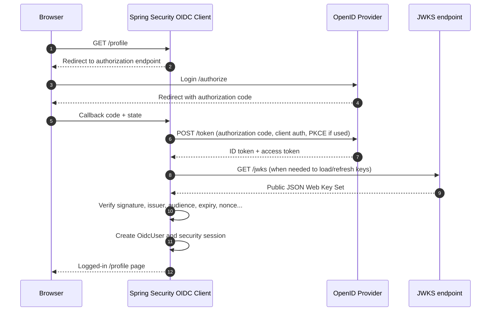
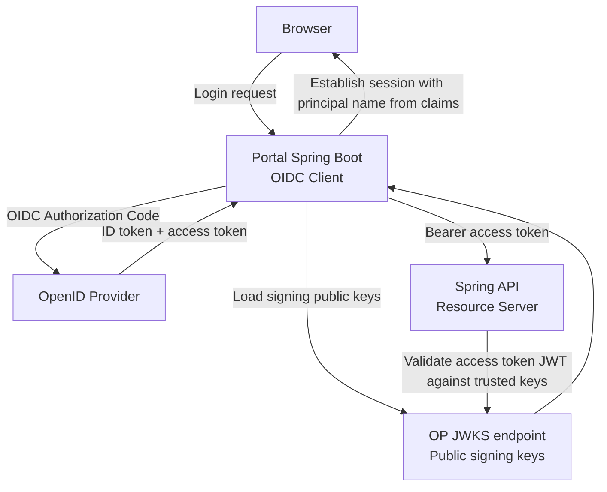

# 6.6. Declaring `jwk-set-uri` and `user-name-attribute`

In **Spring Security OAuth 2.0/OIDC Client**, the `provider` section of `ClientRegistration` describes the endpoints and conventions the application needs to work with an Authorization Server or OpenID Provider (OP). Two properties that are easy to confuse are **`jwk-set-uri`** and **`user-name-attribute`**.

They serve **two independent purposes**:

- **`jwk-set-uri`** points to the endpoint serving the **JSON Web Key Set (JWKS)**, where the client fetches public keys to verify the signatures of signed tokens issued by the OP, especially the **OIDC ID Token** during login.
- **`user-name-attribute`** specifies the **claim/attribute name** used as the principal's identifier name in Spring Security, such as `sub` in OIDC or `id` for an OAuth 2.0 provider with a custom UserInfo API.

One property belongs to the **cryptographic verification layer**, while the other belongs to the **identity mapping layer**. Changing `user-name-attribute` does not fix token signatures; changing `jwk-set-uri` does not alter a user's `sub`, email, or username.

## 1. Where the Two Properties Sit in `ClientRegistration`

`ClientRegistration` is the Spring Security object representing an OAuth 2.0/OIDC client registration. It has the following main information groups:

| Group | Example properties | Purpose |
|---|---|---|
| **Client registration** | `registrationId`, `clientId`, `clientSecret` | Identify and authenticate the application with the provider |
| **OAuth flow** | `authorizationGrantType`, `redirectUri`, `scopes` | Specify how the client receives authorization codes/tokens |
| **Provider endpoints** | `authorizationUri`, `tokenUri`, `userInfoUri` | Know where to execute protocol steps |
| **Provider key information** | `jwkSetUri` | Locate public keys for verifying signed tokens |
| **Provider principal mapping** | `userNameAttributeName` | Determine which attribute is used as `OAuth2User.getName()`/principal name |
| **Provider OIDC metadata** | `issuerUri`, discovered metadata | Verify issuing source and protocol configuration |

In Spring Boot's `application.yml`, both properties must be declared in the **`provider` branch**:

```yaml
spring:
  security:
    oauth2:
      client:
        registration:
          company:
            provider: company
            client-id: ${OIDC_CLIENT_ID}
            client-secret: ${OIDC_CLIENT_SECRET}
            authorization-grant-type: authorization_code
            client-authentication-method: client_secret_basic
            redirect-uri: "{baseUrl}/login/oauth2/code/{registrationId}"
            scope:
              - openid
              - profile
              - email
        provider:
          company:
            issuer-uri: https://login.example.org
            jwk-set-uri: https://login.example.org/oauth2/jwks
            user-name-attribute: sub
```

In this example:

- `registration.company` is an OAuth client registration with local name `company` in the application.
- `provider: company` makes the registration use the configuration at `provider.company`.
- `issuer-uri` identifies the trusted OP, used for OIDC discovery/validation when supported.
- `jwk-set-uri` indicates the address **serving the OP's public key set**.
- `user-name-attribute: sub` selects the `sub` claim as the principal name.

URLs and environment variables are illustrative. Real endpoints must match metadata from the OP. **Do not set an arbitrary JWK Set URI merely because that server can return JSON.** This is part of the trust boundary in OIDC login.

> In most standard OIDC integrations, declaring `issuer-uri` alone and letting Spring Security discover `jwks_uri`, the authorization endpoint, token endpoint, and UserInfo endpoint from OP metadata is sufficient. Explicitly declaring `jwk-set-uri` is useful when there is a specific configuration reason, but it must stay consistent with the trusted OP.

## 2. Understanding `jwk-set-uri` Accurately

### 2.1. What Is a JWK?

**JSON Web Key (JWK)** is a JSON representation of cryptographic keys. A **JSON Web Key Set (JWKS)** is a collection of JWKs, often serving multiple keys to support signing with different algorithms or key rotation.

For example, the OP signs ID tokens with an RSA private key. The Spring application needs the corresponding **RSA public key** to verify the signature. This public key can be published by the OP via a JWKS endpoint.

Example JWKS (the modulus value is illustrative only, not a real usable key):

```json
{
  "keys": [
    {
      "kty": "RSA",
      "use": "sig",
      "kid": "rsa-key-2026-11",
      "alg": "RS256",
      "n": "<base64url-encoded-public-modulus>",
      "e": "AQAB"
    }
  ]
}
```

Field meanings:

| Field | Meaning |
|---|---|
| `keys` | List of JWKs published by the endpoint |
| `kty` | Key type, such as `RSA` or `EC` |
| `kid` | Key ID, helping select the matching key when the OP has multiple keys |
| `use` | Intended usage, such as `sig` for signing |
| `alg` | Suggested matching algorithm, such as `RS256` |
| `n`, `e` | RSA public key components |
| `crv`, `x`, `y` | Elliptic curve public key components in EC-type JWKs |

A JWKS for signature verification must never publish **private key** components, such as `d` in RSA. The OP operator keeps the private key and publishes the public portion so Relying Parties can verify ID tokens.

### 2.2. Which Step of OIDC Login Uses `jwk-set-uri`?

In the OIDC Authorization Code Flow:

1. The user is redirected from the Spring application (Relying Party) to the OP to authenticate.
2. The OP returns an authorization code to the registered redirect URI.
3. The Spring backend exchanges the code for tokens at the token endpoint.
4. The OP returns an **ID token** (usually a signed JWT) and an access token.
5. Spring Security must verify the ID token's signature using the public key published by the OP.
6. Spring reads **`jwk-set-uri`** from provider metadata/configuration, fetches or reuses a cached key set, and selects the matching key.
7. After signature verification, the RP must still check required claims such as `iss`, `aud`, `exp`, `iat`, nonce as required, and other OIDC conditions.
8. Only when login is valid does the application establish the principal/session per policy.



The diagram separates `JWKS endpoint` from `OP` to clarify responsibilities; in practice, JWKS is usually served by the OP under the same domain or an endpoint published in metadata.

**Note:** Fetching JWKS does not necessarily occur on every login. JWT processing libraries usually cache keys and fetch updates when needed, depending on version/configuration. Do not design a flow assuming a request to JWKS is sent every time an ID token arrives.

### 2.3. Difference Between Signing and Encryption

A signed JWT (JWS) lets the RP verify whether the token was altered and whether it was issued by a party holding a trusted signing key. A signed JWT's payload can be Base64URL-decoded by anyone who receives the token; **a signature does not keep content confidential**.

- **OP's private key**: used for signing, never sent to the RP.
- **Public keys in JWKS**: used to verify signatures.
- **RP's client secret**: used to authenticate the OAuth client at the token endpoint (for confidential clients).
- **Access token/ID token**: credentials issued in the protocol, each with its own lifetime and intended audience.

These four items are not interchangeable. `jwk-set-uri` is also **not** a store for client secrets, user passwords, or an endpoint for downloading refresh tokens.

Some OIDC deployments support encrypted ID tokens (JWE), but decryption/encryption keys require different configuration than simply declaring JWKS to verify JWS signatures.

## 3. Obtaining `jwk-set-uri` via OIDC Discovery

### 3.1. How Are `issuer-uri` and `jwks_uri` Related?

An OP supporting **OpenID Connect Discovery** publishes metadata, usually at a URL like:

```text
GET https://login.example.org/.well-known/openid-configuration
```

Illustrative metadata:

```json
{
  "issuer": "https://login.example.org",
  "authorization_endpoint": "https://login.example.org/oauth2/authorize",
  "token_endpoint": "https://login.example.org/oauth2/token",
  "userinfo_endpoint": "https://login.example.org/oidc/userinfo",
  "jwks_uri": "https://login.example.org/oauth2/jwks",
  "response_types_supported": ["code"],
  "id_token_signing_alg_values_supported": ["RS256"]
}
```

The `jwks_uri` value in the metadata document corresponds to Spring's **`jwk-set-uri`** configuration property. The names differ because:

- `jwks_uri` is the field name in the discovery protocol.
- `jwk-set-uri` is the property name in Spring Boot's configuration system.
- `ClientRegistration.ProviderDetails.getJwkSetUri()` is the Java API to read the applied value.

If the provider supports full discovery, configuration can be concise:

```yaml
spring:
  security:
    oauth2:
      client:
        registration:
          company:
            provider: company
            client-id: ${OIDC_CLIENT_ID}
            client-secret: ${OIDC_CLIENT_SECRET}
            client-authentication-method: client_secret_basic
            authorization-grant-type: authorization_code
            redirect-uri: "{baseUrl}/login/oauth2/code/{registrationId}"
            scope: openid,profile,email
        provider:
          company:
            issuer-uri: https://login.example.org
```

Spring Security/Spring Boot uses appropriate discovery capabilities to populate OP endpoints and metadata, including the JWKS URI. Consequently, configuration depends less on the provider's internal paths.

**Do not guess** that the JWKS endpoint is always `/.well-known/jwks.json`, `/keys`, or `/oauth2/jwks`. The path depends on the OP; retrieve it from discovery or reliable integration documentation/policy.

### 3.2. When to Declare `jwk-set-uri` Explicitly?

Relevant scenarios include:

- The OP does not provide complete discovery metadata, yet publishes an official JWKS URL.
- The application builds `ClientRegistration` manually in Java.
- Endpoints must be configured per a specific enterprise OP integration contract.
- Provider metadata lacks the required value or the environment uses controlled custom endpoint configuration.

Example declaring endpoints explicitly:

```yaml
spring:
  security:
    oauth2:
      client:
        registration:
          partner:
            provider: partner
            client-id: ${PARTNER_CLIENT_ID}
            client-secret: ${PARTNER_CLIENT_SECRET}
            client-authentication-method: client_secret_basic
            authorization-grant-type: authorization_code
            redirect-uri: "{baseUrl}/login/oauth2/code/{registrationId}"
            scope:
              - openid
              - profile
        provider:
          partner:
            authorization-uri: https://id.partner.example/authorize
            token-uri: https://id.partner.example/token
            user-info-uri: https://id.partner.example/userinfo
            jwk-set-uri: https://id.partner.example/.well-known/jwks.json
            user-name-attribute: sub
```

When configuring provider endpoints manually, ensure all endpoints, actual token issuer, signatures, client registration, and algorithms are compatible with the OP. Omitting `issuer-uri` in manual configuration can weaken or alter how issuer checks are applied depending on framework and version; design issuer verification explicitly. **Never use an arbitrary JWKS as a substitute for checking the ID token's issuer and audience.**

### 3.3. Never Use `jwk-set-uri` to "Bypass" Issuer Checks

Being able to verify a token's signature with a public key does not prove the token is an **ID token intended for this specific application**. An RP must verify OIDC conditions, notably:

| Condition | Why is it necessary? |
|---|---|
| Valid signature and permitted algorithm | Proves the token has not been tampered with and was signed with a trusted key |
| `iss` matches the configured issuer | Prevents accepting tokens from another provider |
| `aud` contains the RP's client ID | Prevents accepting an ID token issued for another application |
| `exp` not expired; reasonable `iat` | Avoids accepting tokens outside their validity window |
| `nonce` matches when a nonce was sent | Binds the ID token to the initial authentication request |
| Other OIDC conditions (`azp`, `auth_time`, etc.) | Depends on payload/flow and security requirements |

Never enable an "accept any algorithm" mode simply because `alg` appears in the JWT header; that header comes from untrusted content prior to verification. Use a well-maintained OIDC library and configure the proper issuer and algorithms.

### 3.4. Key Rotation at the OpenID Provider

An OP may rotate signing keys over time. The JWKS endpoint can publish **multiple keys simultaneously**, distinguished by `kid`.

A rotation cycle may involve:

1. The OP adds the new public key to JWKS while the old public key remains present.
2. The OP starts signing new ID tokens with the private key matching the new public key.
3. When RPs need to verify tokens bearing the new `kid`, they reload JWKS or refresh their cache per library mechanics.
4. Once old tokens no longer need verification, the OP retires the old public key per policy.

**Do not hard-code a single `kid` or copy a single public key into code if the OP rotates keys.** Configuring `jwk-set-uri` to a stable endpoint lets Spring fetch the right keys across the operational lifecycle.

Conversely, if an OP removes an old public key too early or the JWKS endpoint becomes unreachable, RPs may fail to verify ID tokens that should still be valid. Coordinate rotation windows with caches, token TTLs, and RP key-refresh behavior.

## 4. What Is `user-name-attribute`?

### 4.1. A Claim Used as the Principal Name in Spring

In Spring Security, once OAuth2/OIDC Login succeeds, the application gets a **principal** representing the authenticated user. Common interfaces:

- `OAuth2User`: OAuth 2.0 Login principal, with `getAttributes()`, `getAuthorities()`, and `getName()`.
- `OidcUser`: OIDC principal, extending access to the ID token, UserInfo, and standard claims.
- `Authentication.getName()`: principal name returned by Spring Security to the rest of the application.

The **`user-name-attribute`** property indicates the **claim/attribute name** Spring uses to produce `getName()` for the principal in the corresponding mechanism. Example:

```yaml
spring:
  security:
    oauth2:
      client:
        provider:
          company:
            user-name-attribute: sub
```

If user information contains:

```json
{
  "sub": "user-6db7f2",
  "preferred_username": "minh.nguyen",
  "name": "Nguyen Minh",
  "email": "minh@example.org",
  "email_verified": true
}
```

then choosing `user-name-attribute: sub` intends to use **`user-6db7f2`** as the principal name. This does not have to be the name displayed in the UI.

When Spring calls `getName()`, the framework retrieves the name according to how the principal class is built. With a typical `OidcUser`, the default name is usually `sub`; with an appropriate `user-name-attribute` setting, the principal name can be taken from the specified claim.

### 4.2. `user-name-attribute` Does Not Change the Account at the OP

Changing from:

```yaml
user-name-attribute: sub
```

to:

```yaml
user-name-attribute: preferred_username
```

does not instruct the OP to issue a new user ID, does not modify `sub` in the ID token, does not change email, and does not alter the login credentials used by the OP. It only changes **which attribute the Spring application picks as the principal name** if that claim is supported and present.

Effects can show up in:

- `Authentication.getName()`.
- `OAuth2User.getName()` and `OidcUser.getName()`.
- Logs/auditing or services using `getName()` as an identifier.
- Sessions and application data if the system stores usernames directly based on `getName()`.

Therefore, changing this property between deployments can alter application key lookups if the application has coupled user identity to `getName()`. Design a dedicated **identity key** mapping layer, especially with OIDC.

### 4.3. How Do `sub`, `preferred_username`, `email`, and `id` Differ?

| Attribute | Typical source | Characteristics | Use as a long-term account key? |
|---|---|---|---|
| `sub` | OIDC ID token and UserInfo | Subject identifier scoped to the issuer; core OIDC identifier | **Recommended together with `iss`** |
| `preferred_username` | OIDC profile claim | Preferred username, may change or not be unique | Should not be default |
| `email` | OIDC email claim | May change, be recycled, verified or unverified | Should not be default |
| `name` | OIDC profile claim | Display name; not guaranteed unique | No |
| `id` | Profile API of a non-OIDC OAuth provider | Provider-defined attribute name | Depends on provider documentation and identifier scope |

**With OIDC, the user identity key should be based on the `(issuer, subject)` pair**, i.e., `(iss, sub)`. Never assume an email always represents the same account across multiple issuers.

In particular, OIDC has **pairwise subject identifiers**: the same user at an OP may receive different `sub` values for RPs in different sectors. Thus `sub` is not necessarily a universal user ID across all applications, yet remains the proper identifier within an RP/issuer scope per the specification.

### 4.4. Principal Name and Display Name Are Two Different Things

Suppose the RP needs to display "Nguyen Minh" on the home page. There is no need to change `user-name-attribute` from `sub` to `name`. The application can keep `sub` as the identity key and use the `name` claim for UI display.

Example Spring MVC/REST endpoint showing fields with different purposes:

```java
import org.springframework.security.core.annotation.AuthenticationPrincipal;
import org.springframework.security.oauth2.core.oidc.user.OidcUser;
import org.springframework.web.bind.annotation.GetMapping;
import org.springframework.web.bind.annotation.RestController;

@RestController
public class AccountController {

    public record AccountView(
        String issuer,
        String subject,
        String principalName,
        String displayName,
        String email
    ) {}

    @GetMapping("/me")
    public AccountView me(@AuthenticationPrincipal OidcUser user) {
        return new AccountView(
            user.getIdToken().getIssuer().toString(),
            user.getSubject(),
            user.getName(),
            user.getFullName(),
            user.getEmail()
        );
    }
}
```

This example assumes the endpoint is protected by OIDC login. `getFullName()` and `getEmail()` may be `null` when the OP does not supply the corresponding claims; the UI should handle missing values. Never return the entire ID token or access token to the frontend just to display the user's name.

## 5. Configuring `user-name-attribute` for Non-OIDC OAuth2 Login

### 5.1. Why Does `OAuth2User` Need an ID Attribute?

OAuth 2.0 itself does not define an ID token or a standard user-identity claim set. Many providers still offer an API endpoint returning user info, for example:

```http
GET /api/v1/me HTTP/1.1
Host: oauth.example.org
Authorization: Bearer <access-token>
```

Response:

```json
{
  "id": "employee-12345",
  "login": "minh.nguyen",
  "display_name": "Nguyen Minh",
  "email": "minh@example.org"
}
```

An OAuth2 Login client using `DefaultOAuth2UserService` can fetch this data via the UserInfo endpoint. Spring needs to know which attribute represents the principal name. If the provider defines the ID as `id`, configure:

```yaml
spring:
  security:
    oauth2:
      client:
        registration:
          legacy-oauth:
            provider: legacy-oauth
            client-id: ${LEGACY_CLIENT_ID}
            client-secret: ${LEGACY_CLIENT_SECRET}
            client-authentication-method: client_secret_basic
            authorization-grant-type: authorization_code
            redirect-uri: "{baseUrl}/login/oauth2/code/{registrationId}"
            scope:
              - user.read
        provider:
          legacy-oauth:
            authorization-uri: https://oauth.example.org/authorize
            token-uri: https://oauth.example.org/token
            user-info-uri: https://oauth.example.org/api/v1/me
            user-name-attribute: id
```

Here:

- The client **does not request the `openid` scope** and does not assume the OP issues an ID token.
- `user-info-uri` returns user data from the provider's API.
- `user-name-attribute: id` lets the `OAuth2User` principal use `employee-12345` as its name.
- `jwk-set-uri` **is not required for this flow** merely because the application calls UserInfo; there is no OIDC ID token signature to verify in this case.

If you configure `user-name-attribute: sub` while the API only returns `id`, building/looking up the principal may fail due to a missing identifier attribute per Spring's mechanism; configuration must match the provider's **actual** JSON.

### 5.2. `OAuth2User` vs. `OidcUser`

| Criterion | Non-OIDC OAuth2 Login | OIDC Login |
|---|---|---|
| Initial scope | Custom scope, e.g., `user.read` | Includes `openid` |
| Standardized authentication proof | No OIDC ID token | Has OIDC ID token |
| Typical principal | `OAuth2User` | `OidcUser` |
| Attribute source | Provider's custom API/UserInfo | ID token and optionally UserInfo |
| ID attribute | May be `id`, `login`, or provider-specific attribute | `sub` is the core identifier claim |
| Needs JWKS to verify OIDC ID token | No, as there is no OIDC ID token | Yes, when token is signed with an asymmetric algorithm published by the OP |
| Confirm UserInfo subject matches ID token | Not directly applicable under OIDC standard | Must match `sub` when UserInfo is used |

Each provider may have its own Spring Security defaults, such as well-known providers whose ID attribute name is already known. When declaring a **custom provider**, determine the exact attribute from documentation or API responses.

## 6. OIDC UserInfo and Its Relationship to `user-name-attribute`

### 6.1. ID Token Still Takes Precedence in Authentication

OIDC differs from unstandardized OAuth2 Login in that the OP issues an **ID token** carrying `sub`, `iss`, and claims about the authentication session. The UserInfo endpoint can supply additional email, name, avatar, or profile details.

Example verified OIDC ID token payload:

```json
{
  "iss": "https://login.example.org",
  "sub": "user-6db7f2",
  "aud": "portal-web",
  "exp": 1924999999,
  "iat": 1924996399
}
```

UserInfo response:

```json
{
  "sub": "user-6db7f2",
  "preferred_username": "minh.nguyen",
  "name": "Nguyen Minh",
  "email": "minh@example.org"
}
```

Per OIDC, **`sub` from UserInfo must match `sub` in the verified ID token**. This is a critical check to prevent an RP from accidentally associating another user's profile with the login session.

Declaring `user-name-attribute: preferred_username` **does not allow skipping the `sub` check**. Nor does it alter the actual `sub` in the ID token or turn email into proof of who logged in.

### 6.2. UserInfo Is Not Always Called

Spring Security may fetch UserInfo depending on `OidcUserService` configuration/conditions and OP capabilities. Some claims may appear only in the ID token, others in UserInfo, and some may be absent because the user withheld consent for a scope or the OP restricts data.

When choosing a `user-name-attribute` other than `sub`, such as `preferred_username`, ensure that claim is actually present in the dataset received by `OidcUser` when constructing the principal. If the claim is missing, the outcome may be an error or an unexpected principal name depending on how your Spring Security version/customization constructs the user.

Therefore:

- **`sub` is the safe choice semantically for OIDC identity**.
- Display name, email, or nickname should be accessed as separate attributes on `OidcUser`.
- Business access control should rely on internal accounts and roles/permissions, rather than relying on `getName()` when it is a display claim.

## 7. Complete Spring Boot Example with an OIDC Client

Suppose a Spring MVC application runs at `https://portal.example.org` and uses OP `https://login.example.org`. The OP issues a client ID/secret to the backend, supports Authorization Code + PKCE, and publishes discovery and JWKS.

### 7.1. Dependencies

Gradle Groovy:

```groovy
dependencies {
    implementation 'org.springframework.boot:spring-boot-starter-security'
    implementation 'org.springframework.boot:spring-boot-starter-oauth2-client'
    implementation 'org.springframework.boot:spring-boot-starter-web'
}
```

This example uses Spring Security for a **Servlet-based web application**. APIs accepting bearer tokens need a separate **Resource Server** configuration, discussed later.

### 7.2. Automatic Configuration via `issuer-uri`

```yaml
spring:
  security:
    oauth2:
      client:
        registration:
          company:
            provider: company
            client-id: ${OIDC_CLIENT_ID}
            client-secret: ${OIDC_CLIENT_SECRET}
            client-authentication-method: client_secret_basic
            authorization-grant-type: authorization_code
            redirect-uri: "{baseUrl}/login/oauth2/code/{registrationId}"
            scope:
              - openid
              - profile
              - email
        provider:
          company:
            issuer-uri: https://login.example.org
            user-name-attribute: sub
```

Here `jwk-set-uri` is not declared directly because Spring is expected to obtain `jwks_uri` from OIDC discovery metadata.

If the provider requires a specific JWKS URL, you can add:

```yaml
spring:
  security:
    oauth2:
      client:
        provider:
          company:
            issuer-uri: https://login.example.org
            jwk-set-uri: https://login.example.org/oauth2/jwks
            user-name-attribute: sub
```

The second `provider.company` snippet only illustrates additional properties on the already-declared provider, **not a separate YAML block to copy alongside the entire first example**. In a real file, merge properties under a single `spring.security.oauth2.client.provider.company` block to avoid duplicate YAML keys.

### 7.3. `SecurityFilterChain` Configuration

```java
import org.springframework.context.annotation.Bean;
import org.springframework.context.annotation.Configuration;
import org.springframework.security.config.Customizer;
import org.springframework.security.config.annotation.web.builders.HttpSecurity;
import org.springframework.security.web.SecurityFilterChain;

@Configuration
public class SecurityConfig {

    @Bean
    SecurityFilterChain securityFilterChain(HttpSecurity http) throws Exception {
        http
            .authorizeHttpRequests(auth -> auth
                .requestMatchers("/", "/error").permitAll()
                .anyRequest().authenticated())
            .oauth2Login(Customizer.withDefaults());

        return http.build();
    }
}
```

When a request hits an endpoint requiring login:

- Spring looks up the `ClientRegistration` with `registrationId=company`.
- The browser is redirected to the matching authorization endpoint.
- The default callback typically uses path `/login/oauth2/code/company`.
- The backend exchanges the authorization code for tokens.
- The ID token is verified by Spring using provider details and OIDC rules.
- The principal is created with its name taken from `user-name-attribute`, `sub` in this example.

Security note: if a confidential client requires PKCE, verify how your Spring Security version handles PKCE and proactively configure an appropriate Authorization Request Customizer. **`jwk-set-uri` and `user-name-attribute` do not substitute for PKCE, `state`, or redirect URI validation.**

### 7.4. Reading Principal Name and Subject in a Controller

```java
import java.util.Map;

import org.springframework.security.core.annotation.AuthenticationPrincipal;
import org.springframework.security.oauth2.core.oidc.user.OidcUser;
import org.springframework.web.bind.annotation.GetMapping;
import org.springframework.web.bind.annotation.RestController;

@RestController
public class ProfileController {

    @GetMapping("/profile")
    public Map<String, String> profile(@AuthenticationPrincipal OidcUser user) {
        String issuer = user.getIdToken().getIssuer().toString();
        String subject = user.getSubject();
        String principalName = user.getName();

        return Map.of(
            "issuer", issuer,
            "subject", subject,
            "principalName", principalName
        );
    }
}
```

`Map.of` does not accept `null`; in this example, `issuer` and `subject` are required fields of a valid ID token, and `principalName` exists when the principal is built successfully. If expanding to return `email` or `fullName`, handle missing values.

Never expose an endpoint returning all of `OidcUser.getAttributes()` publicly just for debugging. Claims can contain PII; return only the fields needed for the UI.

## 8. Declaring in Java Instead of `application.yml`

Spring Security allows building `ClientRegistration` with Java APIs. When the OP supports discovery, for example:

```java
import org.springframework.context.annotation.Bean;
import org.springframework.context.annotation.Configuration;
import org.springframework.security.oauth2.client.registration.ClientRegistration;
import org.springframework.security.oauth2.client.registration.ClientRegistrationRepository;
import org.springframework.security.oauth2.client.registration.ClientRegistrations;
import org.springframework.security.oauth2.client.registration.InMemoryClientRegistrationRepository;
import org.springframework.security.oauth2.core.AuthorizationGrantType;
import org.springframework.security.oauth2.core.ClientAuthenticationMethod;

@Configuration
public class OidcClientRegistrationConfig {

    @Bean
    ClientRegistrationRepository clientRegistrationRepository() {
        String issuer = System.getenv("OIDC_ISSUER_URI");
        String clientId = System.getenv("OIDC_CLIENT_ID");
        String clientSecret = System.getenv("OIDC_CLIENT_SECRET");

        ClientRegistration company = ClientRegistrations
            .fromIssuerLocation(issuer)
            .registrationId("company")
            .clientId(clientId)
            .clientSecret(clientSecret)
            .clientAuthenticationMethod(ClientAuthenticationMethod.CLIENT_SECRET_BASIC)
            .authorizationGrantType(AuthorizationGrantType.AUTHORIZATION_CODE)
            .redirectUri("{baseUrl}/login/oauth2/code/{registrationId}")
            .scope("openid", "profile", "email")
            .jwkSetUri("https://login.example.org/oauth2/jwks")
            .userNameAttributeName("sub")
            .build();

        return new InMemoryClientRegistrationRepository(company);
    }
}
```

API meanings:

- `ClientRegistrations.fromIssuerLocation(issuer)` retrieves metadata from the OP via framework-supported discovery.
- `jwkSetUri(...)` explicitly sets the JWKS URL, overriding the discovered value when needed.
- `userNameAttributeName("sub")` declares the principal's claim name.
- `InMemoryClientRegistrationRepository` stores registrations in application memory and looks them up by `registrationId`.

There is no need to call `jwkSetUri(...)` manually when OP metadata already provides the right endpoint and you want to rely on discovery. Each application must already have a client ID/secret registered at the OP; building a `ClientRegistration` in Java **does not create a new registration at the OP**.

### 8.1. Inspecting What Spring Has Loaded

You can read provider settings after `ClientRegistrationRepository` is created:

```java
import org.springframework.security.oauth2.client.registration.ClientRegistration;
import org.springframework.security.oauth2.client.registration.ClientRegistrationRepository;

public class RegistrationInspector {

    private final ClientRegistrationRepository repository;

    public RegistrationInspector(ClientRegistrationRepository repository) {
        this.repository = repository;
    }

    public void inspect() {
        ClientRegistration registration =
            repository.findByRegistrationId("company");

        if (registration == null) {
            throw new IllegalStateException("Missing OAuth2 registration: company");
        }

        String jwksUri =
            registration.getProviderDetails().getJwkSetUri();

        String userNameAttribute =
            registration.getProviderDetails()
                .getUserInfoEndpoint()
                .getUserNameAttributeName();

        // Use non-secret metadata to observe configuration.
        System.out.println("JWKS configured: " + (jwksUri != null));
        System.out.println("Principal attribute: " + userNameAttribute);
    }
}
```

This snippet illustrates reading properties. In production, use a controlled logger instead of `System.out` and avoid logging secrets, authorization codes, ID tokens, or access/refresh tokens. You can use these values to verify that property binding into `ClientRegistration` succeeded as expected, **not as a substitute for protocol verification**.

## 9. Distinguishing OAuth2 Client `jwk-set-uri` and Resource Server `jwk-set-uri`

Spring Security supports multiple roles. Two similarly named configuration properties sit in **two different branches**:

### 9.1. OIDC Client: Verifying the Logged-In User's ID Token

```yaml
spring:
  security:
    oauth2:
      client:
        provider:
          company:
            jwk-set-uri: https://login.example.org/oauth2/jwks
```

Primary purpose in OIDC Login: the RP uses public keys to verify the **ID token** issued for the application's `client_id`.

### 9.2. OAuth2 Resource Server: Verifying Bearer Access Tokens

```yaml
spring:
  security:
    oauth2:
      resourceserver:
        jwt:
          issuer-uri: https://login.example.org
          jwk-set-uri: https://login.example.org/oauth2/jwks
```

Purpose: the Resource Server uses public keys to verify the signature of **JWT access tokens** when an API receives `Authorization: Bearer ...` requests.

Both configurations can point to the same JWKS URL if the Authorization Server uses the same signing key set, yet each role must enforce **purpose-appropriate token checks**:

| Criterion | OIDC RP / OAuth2 Client | OAuth2 Resource Server |
|---|---|---|
| Primary token to verify | ID token | Access token intended for the API |
| Checked audience | RP's Client ID | API's audience |
| Purpose | Authenticate user for the RP | Verify bearer access token to authorize API access |
| Property | `client.provider.<id>.jwk-set-uri` | `resourceserver.jwt.jwk-set-uri` |
| User principal | `OidcUser` or `OAuth2User` | Typically `JwtAuthenticationToken`/API principal |
| `user-name-attribute` | Can adjust principal name for OAuth2/OIDC Login | Not used to name Resource Server JWT principals |

**Declaring `resourceserver.jwt.jwk-set-uri` alone does not configure OIDC Login**, and declaring `client.provider.company.jwk-set-uri` alone does not make APIs verify bearer access tokens. An application acting as both an RP and a Resource Server must configure each role explicitly.

If a Resource Server configures only `jwk-set-uri` without issuer validation, do not assume `iss` is automatically checked properly. APIs must also configure audience validation and business scope/authorization rules. A validly signed JWT may still have been issued for a **different recipient**.

## 10. Common `jwk-set-uri` Configuration Mistakes

### 10.1. Pointing to the Wrong Endpoint

A typical wrong configuration:

```yaml
jwk-set-uri: https://login.example.org/oauth2/token
```

The token endpoint accepts grant-exchange requests; it does **not** serve JWKS JSON. Similarly, the authorization endpoint and UserInfo endpoint are not JWKS endpoints.

A valid JWKS response normally contains JSON with a `keys` array field. Never use a URL returning login page HTML or full provider metadata JSON in place of the key set.

### 10.2. Server Cannot Reach the JWKS URL

The client backend must be able to reach the JWKS endpoint over the network. A user's browser might succeed in logging into the OP, while the Spring server running inside a VPC/container lacks egress, DNS, or a truststore to call the JWKS endpoint.

Symptoms include key-fetch or ID token verification failures on callback even though the authorization code exchange succeeded.

Check:

- DNS and network routing from the **Spring runtime host** to the JWKS endpoint.
- HTTPS/TLS and the JVM/HTTP client truststore.
- Proxy/egress policies, firewalls, and private DNS.
- Timeouts, caching, endpoint availability, and key rotation.

Never disable TLS verification or use an untrusted HTTP endpoint just to "make it work." The public key endpoint belongs to the application's trust configuration.

### 10.3. Token Signed with an Unaccepted Key/Algorithm

An ID token bearing `kid=key-new` when the JWKS read by the RP only contains `kid=key-old` will be rejected. Likewise, a token signed with an algorithm not configured for the OP/RP is invalid even if the endpoint contains some public keys.

Do not resolve this by skipping signature checks. Align signing algorithms, JWKS, and key rotation schedules between the OP and RP. Never accept every signed token solely based on a self-declared `kid`.

### 10.4. Overriding JWKS with a Different Issuer

Suppose the real issuer is `https://login.corp.example`, while `jwk-set-uri` points to a staging environment's JWKS. Production tokens may fail verification or create a broken trust boundary.

Proper practice is to use `issuer-uri`/discovery for the matching environment and override JWKS only under a clear integration contract. Never pick a JWKS URI dynamically from a browser parameter or unverified token content; this can introduce **server-side request forgery (SSRF)** or expand trusted key sources unexpectedly.

### 10.5. Confusing Public Keys with Client Secrets

The JWKS path serves **public** keys. It is not where Spring fetches `client-secret` to authenticate at the token endpoint. If a token request returns `invalid_client` due to a wrong secret, changing `jwk-set-uri` will not fix the cause.

Conversely, when code exchange succeeds but ID token signature verification fails, changing the client secret will not resolve a signing key/issuer/algorithm mismatch.

## 11. Common `user-name-attribute` Mistakes

### 11.1. Choosing a Non-Existent Claim

For example, the provider response only contains:

```json
{
  "id": "12345",
  "login": "minh"
}
```

while configuration specifies:

```yaml
user-name-attribute: sub
```

If the provider uses non-OIDC OAuth2 Login and has no `sub`, the UserInfo-based principal builder will fail to find the configured name attribute. Choose `id` if the API guarantees it is the proper ID:

```yaml
user-name-attribute: id
```

By contrast, with standard OIDC, `sub` is a mandatory ID token claim; choosing `id` out of habit from a different OAuth 2.0 provider's custom API may be inappropriate.

### 11.2. Using Email as the Identity Key

`email` can change, be unverified, or be recycled. In multi-provider applications, the same email can appear across multiple distinct issuers.

To map local accounts reliably, store:

```text
user_identity:
  issuer:  https://login.example.org
  subject: user-6db7f2
  local_user_id: 1287
```

Here `(issuer, subject)` represents the authenticated identity from the OP, while `local_user_id` is the application's internal key. If you want to display email or username, read them from separate claims; do not equate them with the identity key.

Never allow a user account to automatically merge with another account simply because two logins share an email, unless an explicitly designed and verified **account-linking workflow** exists.

### 11.3. Confusing `user-name-attribute` with Access Permissions

`user-name-attribute: preferred_username` does not mean the user has `ROLE_USER`, nor does it prove which department the user belongs to.

**Authentication** produces an authenticated principal; **authorization** determines which resources the principal may access. Granting roles/authorities in Spring requires an independent policy: mapping trusted claims, loading permissions from a database, or integrating an authority mapper/user service depending on architecture.

Never automatically grant admin privileges because of an arbitrary claim named `admin` or because `getName()` has a friendly-looking value.

### 11.4. Changing `user-name-attribute` Across Application Versions

If an application already stores `Authentication.getName()` in audit tables or account links, changing from `sub` to `email` can cause subsequent requests to map to a different user or fail to find prior records.

Consider:

- Keeping `(issuer, sub)` as the internal linking key.
- Using `preferred_username`, `name`, or `email` for display attributes.
- Decoupling user-identity storage logic from the default value of `getName()`.
- Auditing impact on code depending on principal name before changing configuration in a running system.

Changing `user-name-attribute` is not a safe way to "rename a user" if the application treats it as a primary key.

## 12. Reading Symptoms to Isolate the Right Configuration

| Symptom | Area to inspect | How to handle |
|---|---|---|
| OIDC login receives code, but ID token signature verification fails | `jwk-set-uri`, algorithm, `kid`, JWKS cache, issuer | Check OP metadata, signing keys, and backend ability to fetch JWKS |
| Connection or TLS error when calling JWKS endpoint | DNS, egress, firewall, truststore | Ensure backend has trusted HTTPS connectivity to the endpoint |
| `invalid_client` error at token endpoint | `client-id`, secret, client authentication method | Check client registration and credentials; JWKS is not directly involved |
| `invalid_grant` error when exchanging code | Code, redirect URI, PKCE verifier, expiration | Check authorization transaction and flow configuration |
| `OAuth2User.getName()` is empty/wrong or login fails due to missing ID | `user-name-attribute` and UserInfo JSON | Pick the actual claim returned by the provider |
| `OidcUser.getName()` differs from displayed username | `sub`/`preferred_username`/`name` claims | Keep identity key separate from display name |
| Login succeeds, yet cannot access admin pages | Roles/authorities and application authorization | Review authorization policy; do not change `jwk-set-uri` or `user-name-attribute` to bypass checks |
| JWT API returns 401 even though web OIDC Login succeeded | Resource Server issuer/audience/JWKS and access token | Inspect separate Resource Server configuration; do not send ID token as bearer |
| Enabled `issuer-uri` yet still hard-coding old JWKS | Updated metadata, rotation, or wrong override | Use JWKS from discovery or a consistent override |
| Local/staging/prod receive different tokens | Environment-specific Client ID, issuer, JWKS URL, redirect URI | Separate configurations per environment/registration |

When inspecting logs, record only necessary configuration metadata such as registration ID, issuer, and principal attribute name. Never log client secrets, authorization codes, full tokens, callback query strings containing sensitive data, or HTTP Authorization headers.

## 13. End-to-End Example: Same OP, Two Applications with Different Roles

Suppose an enterprise operates:

- `https://portal.example.org`: Spring Boot OIDC Client for employee login.
- `https://api.example.org`: Spring Boot Resource Server returning data.
- `https://login.example.org`: OpenID Provider issuing ID tokens and access tokens.

Overall flow:



At **Portal**, configuring `client.provider.company.jwk-set-uri` (or discovery) helps verify the ID token. `user-name-attribute: sub` sets the principal name in Portal.

At **API**, configuring `resourceserver.jwt.jwk-set-uri` combined with issuer/audience validation helps verify bearer access tokens without reading Portal's `user-name-attribute`.

If an employee changes email from `old@example.org` to `new@example.org` while the OP still confirms `sub=user-6db7f2`, Portal still recognizes the same internal user via `(iss, sub)`. The new email only affects displayed profile data.

If the OP rotates signing keys and publishes a new public key at the JWKS endpoint, services must be able to reach the updated JWKS. Meanwhile, a login failure caused by a missing `preferred_username` claim is a **principal mapping** issue, independent of whether the token was validly signed.

## 14. Configuration Selection Principles

When integrating a new provider with Spring Security OAuth2/OIDC Client, decide in order:

1. **Does the provider support OIDC?** If yes, request `openid` and use OIDC Login with an ID token; if it only supports OAuth2/custom UserInfo, treat it as OAuth2 Login.
2. **Does the OP have valid discovery metadata?** If yes, prefer `issuer-uri` so Spring fetches `jwks_uri` and endpoints; if not, configure endpoints manually per the integration contract.
3. **Which JWKS endpoint does the OP publish?** Only declare `jwk-set-uri` from a trusted source, over HTTPS, reachable by the backend.
4. **Which claim is used as the principal name?** OIDC should use `sub`; OAuth2-only should use the identifier attribute specified by the provider's API, such as `id`.
5. **How are display name and internal ID mapped?** Prefer the `(iss, sub)` key for OIDC, separate from `email` or `preferred_username`.
6. **Does the application also act as a Resource Server?** If yes, configure `resourceserver.jwt.*` independently and verify access tokens for the right issuer, audience, and permissions.
7. **How does the system handle JWKS/rotation operations?** Ensure connectivity, TLS, caching, and key-refresh behavior compatible with the OP.
8. **What validation and authorization rules remain?** JWKS only supports signature verification; issuer, audience, nonce, token expiration, and access permissions must still be enforced.

**Remember:** `jwk-set-uri` supplies **public keys to verify token signatures**, whereas `user-name-attribute` controls **choosing the principal name in Spring Security**. A principal name is not cryptographic proof, and a valid signature does not decide which resources a user is allowed to view.

## 15. References

- [OpenID Connect Core 1.0](https://openid.net/specs/openid-connect-core-1_0.html): ID token, `sub`, UserInfo, and OIDC validation rules.
- [OpenID Connect Discovery 1.0](https://openid.net/specs/openid-connect-discovery-1_0.html): metadata `issuer`, `jwks_uri`, and authorization/token/UserInfo endpoints.
- [RFC 7517 — JSON Web Key (JWK)](https://www.rfc-editor.org/rfc/rfc7517): JWK and JSON Web Key Set structure.
- [RFC 7515 — JSON Web Signature (JWS)](https://www.rfc-editor.org/rfc/rfc7515): signing and verifying content with JWS.
- [RFC 7519 — JSON Web Token (JWT)](https://www.rfc-editor.org/rfc/rfc7519): JWT and registered claims.
- [RFC 9700 — Best Current Practice for OAuth 2.0 Security](https://www.rfc-editor.org/rfc/rfc9700): modern OAuth 2.0 security recommendations.
- [Spring Security — OAuth 2.0 Client](https://docs.spring.io/spring-security/reference/servlet/oauth2/client/index.html): `ClientRegistration`, `ClientRegistrationRepository`, and provider configuration.
- [Spring Security — OAuth 2.0 Login](https://docs.spring.io/spring-security/reference/servlet/oauth2/login/index.html): OAuth2/OIDC Login, principals, and UserInfo.
- [Spring Security — OAuth 2.0 Resource Server](https://docs.spring.io/spring-security/reference/servlet/oauth2/resource-server/index.html): configuring JWT verifiers for bearer access tokens.
