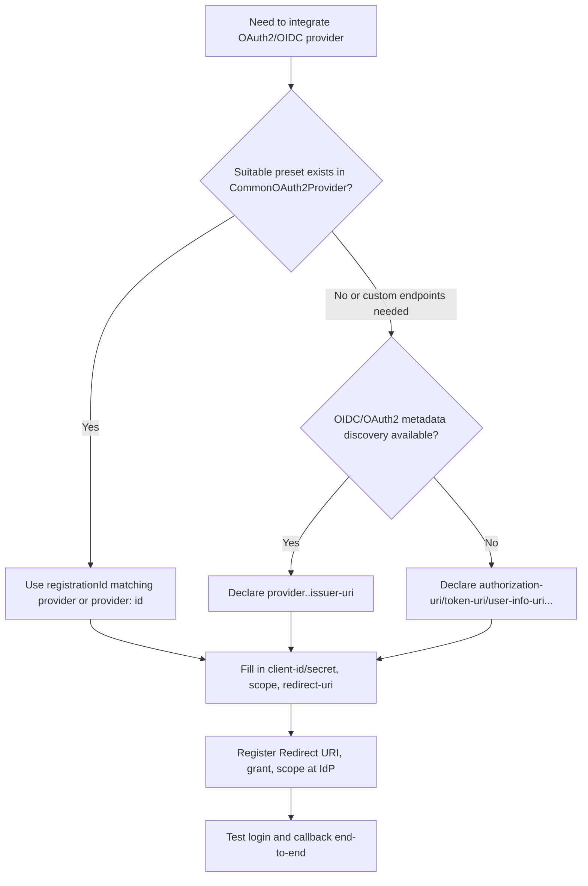

# 6.7. `CommonOAuth2Provider` and Common Provider Configurations

In a **Spring Security OAuth 2.0/OIDC Client** application, `ClientRegistration` describes a Client registered with an OAuth 2.0 or OpenID Connect (OIDC) provider. Beyond `client-id`, `client-secret`, and scopes, Spring Security needs to know the **Authorization Endpoint**, **Token Endpoint**, and **UserInfo Endpoint** addresses, as well as details like the user-identifying attribute name and how to verify ID Tokens.

If every provider required manually configuring every endpoint, code and YAML would be verbose, error-prone when copying URLs, and hard to maintain. To reduce this work, Spring Security provides the **`CommonOAuth2Provider`** enum containing sensible default configurations for several popular providers. For tenant-specific or enterprise systems, Spring also supports **OIDC discovery** based on `issuer-uri` and **manual provider configuration**.

This lesson explains these three configuration paths, how to apply them with Google, GitHub, Facebook, X, Okta, Microsoft Entra ID, Keycloak, and other OIDC IdPs, and the limitations you must know in real-world integrations.

## 1. Separating Two Concepts: Client Registration and Provider

In Spring Security, OAuth2 Client information is stored in `ClientRegistration`. We can divide it into two broad groups.

| Group | Example properties | Question to answer |
|---|---|---|
| **Registration** | `registrationId`, `clientId`, `clientSecret`, `authorizationGrantType`, `clientAuthenticationMethod`, `scopes`, `redirectUri` | With what credentials is **this** application registered at the IdP, and which permissions does it request? |
| **Provider details** | `authorizationUri`, `tokenUri`, `userInfoEndpoint.uri`, `userInfoEndpoint.userNameAttributeName`, `jwkSetUri`, `issuerUri` | Which endpoints and identity conventions does the **provider server** expose? |

For example, an inventory management application might register two different OAuth Clients both using Google, each with its own `client-id`, `scope`, and callback. Both can still use the same Google **provider defaults**. Conversely, a single application can register Clients with both Google and Microsoft Entra ID, each provider having its own metadata.

In Spring Boot, a typical configuration looks like:

```yaml
spring:
  security:
    oauth2:
      client:
        registration:
          my-login:
            provider: google
            client-id: ${GOOGLE_CLIENT_ID}
            client-secret: ${GOOGLE_CLIENT_SECRET}
        provider:
          # Only declare here if customizing or using an unknown provider.
```

`registration.my-login.provider: google` means "the registration named `my-login` uses the **Google provider configuration**." It **does not rename** the registration to `google`. The login initiation URL in Spring remains:

```text
/oauth2/authorization/my-login
```

and the default redirect still typically ends with:

```text
/login/oauth2/code/my-login
```

When `provider` is omitted, Spring Boot can use `registrationId` to look up a provider configuration of the same name, including supported common providers.

## 2. What Is `CommonOAuth2Provider`?

`CommonOAuth2Provider` lives in the package:

```java
org.springframework.security.config.oauth2.client.CommonOAuth2Provider
```

It is a **Spring Security enum** providing the method:

```java
ClientRegistration.Builder getBuilder(String registrationId)
```

Each enum constant pre-populates a `ClientRegistration.Builder` with default values characteristic of that provider. For instance, OAuth2 endpoints and user-info parsing conventions that rarely change are initialized automatically, while **`client-id` and `client-secret` must still be supplied from the Client issued by the provider**.

### 2.1. Which Providers Are Supported?

In **Spring Security 7.x**, the enum constants documented in the API are:

| `CommonOAuth2Provider` constant | Provider ID in Spring Boot | Typical integration nature | Notes |
|---|---|---|---|
| `GOOGLE` | `google` | OIDC/OAuth 2.0 Login | Can request the `openid` scope and process ID Tokens |
| `GITHUB` | `github` | OAuth 2.0 Login | Standard OAuth App; do not assume OIDC with ID Token by default |
| `FACEBOOK` | `facebook` | OAuth 2.0 Login | Permissions and Graph API depend on Meta policies |
| `X` | `x` | OAuth 2.0 Login | Present in newer Spring Security branches; verify X app registration and permissions |
| `OKTA` | `okta` | Commonly uses OIDC | Endpoints depend on organization and authorization server, so issuer is often configured |

**Version note:** Spring Security **6.5.x** documentation lists `GOOGLE`, `GITHUB`, `FACEBOOK`, `OKTA`; **7.x** documentation adds `X`. Therefore, do not use `CommonOAuth2Provider.X` in examples compiled with Security 6.5 where the library does not yet contain this constant. The safest practice is checking the API docs for your **exact dependency version**.

Verification sources: [CommonOAuth2Provider API](https://docs.spring.io/spring-security/reference/api/java/org/springframework/security/config/oauth2/client/CommonOAuth2Provider.html), [Spring Security 6.5 OAuth2 Login Core](https://docs.spring.io/spring-security/reference/6.5/servlet/oauth2/login/core.html).

### 2.2. Which Values Are Pre-Populated?

Depending on the enum constant and version, the builder may supply:

- `authorizationUri`: endpoint where the browser is sent for user authentication/authorization.
- `tokenUri`: endpoint called directly by Spring to exchange the authorization code for tokens.
- `userInfoUri`: endpoint for reading account details after receiving an access token.
- `userNameAttributeName`: claim/attribute name used to identify the principal in the user response.
- `jwkSetUri` or `issuerUri` and related OIDC properties when supported by the provider.
- Certain defaults for scopes, redirect URI template, grant, or Client authentication method.

**Do not assume the exact same set of defaults for every provider.** OAuth2 does not mandate an ID Token, OIDC-style UserInfo, or a JWKS endpoint. Spring sets values appropriate to each specific provider; to know for sure, inspect the `ClientRegistration` created in your running version.

### 2.3. `CommonOAuth2Provider` Is Not a Directory of Every IdP

This enum speeds up configuring **a small group of familiar providers**; it cannot represent every OAuth2/OIDC provider in the world. Enterprise IdPs, self-hosted systems, or tenant-based integrations typically need:

- `issuer-uri` so Spring discovers OIDC/OAuth2 metadata.
- Manual `authorization-uri`, `token-uri`, `user-info-uri`, and `jwk-set-uri` configuration if discovery is unavailable.
- Custom properties for scopes, Client authentication, redirect URI, and user-name attribute.

Therefore, not seeing Microsoft Entra ID or Keycloak in the enum **does not mean Spring Security does not support them**.

## 3. Quick Google Setup with Built-In Defaults

Google is the most common example demonstrating the convenience of `CommonOAuth2Provider`.

### 3.1. When `registrationId` Matches the Provider Name

```yaml
spring:
  security:
    oauth2:
      client:
        registration:
          google:
            client-id: ${GOOGLE_CLIENT_ID}
            client-secret: ${GOOGLE_CLIENT_SECRET}
```

When a registration is named `google`, Spring Boot can infer the `CommonOAuth2Provider.GOOGLE` preset. You do not need to declare the Authorization Endpoint, Token Endpoint, and UserInfo Endpoint URLs manually if the defaults fit.

When using Spring MVC `oauth2Login`, the login initiation path is:

```text
http://localhost:8080/oauth2/authorization/google
```

Default callback:

```text
http://localhost:8080/login/oauth2/code/google
```

**You must register the actual callback in Google Cloud Console** on the corresponding OAuth Client. Spring knowing Google's endpoints does not mean Google automatically allows every Redirect URI.

### 3.2. When You Want a Different Registration ID

Suppose the application wants to name the registration `google-staff`:

```yaml
spring:
  security:
    oauth2:
      client:
        registration:
          google-staff:
            provider: google
            client-id: ${GOOGLE_STAFF_CLIENT_ID}
            client-secret: ${GOOGLE_STAFF_CLIENT_SECRET}
            authorization-grant-type: authorization_code
            scope:
              - openid
              - profile
              - email
            redirect-uri: "{baseUrl}/login/oauth2/code/{registrationId}"
```

`provider: google` tells Boot to pick Google's defaults even though the registration key is `google-staff`. Now:

```text
Start:    /oauth2/authorization/google-staff
Callback: /login/oauth2/code/google-staff
```

This is a key point in multi-login applications: **`registrationId` identifies the application's `ClientRegistration`, while `provider` selects the endpoint configuration set**.

### 3.3. Steps Required on the Google Side

A YAML configuration only works once you have an OAuth Client issued by Google for your application:

1. Select or create a project in Google Cloud Console.
2. Configure the OAuth consent screen if needed, including scopes, user type, and test settings.
3. Create an OAuth Client suitable for a web application with a backend.
4. Declare **Authorized redirect URIs** for the local/staging/production environments you use.
5. Obtain the Client ID and Client secret, and supply them via environment variables or a secret manager.
6. Choose minimal scopes serving your purpose; for OIDC login, `openid profile email` can be used.

Steps and policies are subject to change by Google; official documentation: [Google OpenID Connect](https://developers.google.com/identity/openid-connect/openid-connect).

**Important warning:** even when the ID Token includes an `email` claim, the application should not use email as a durable identity key. In OIDC, the `(iss, sub)` pair is the proper identifier for linking accounts.

## 4. Configuring GitHub: OAuth2 Login vs. OIDC Login

With standard GitHub login via **OAuth Apps**, the application uses OAuth 2.0 to access account details. This is not automatically an OIDC login flow under OpenID Connect.

### 4.1. Using the GitHub Preset

```yaml
spring:
  security:
    oauth2:
      client:
        registration:
          github:
            client-id: ${GITHUB_CLIENT_ID}
            client-secret: ${GITHUB_CLIENT_SECRET}
            scope:
              - read:user
              - user:email
```

The `scope` entries in the example are OAuth App scopes related to user data; they must match the permissions of the actual GitHub app. Scope names and API behavior can vary by app registration type; GitHub Apps and OAuth Apps do not necessarily share the same permission model.

Typical callback:

```text
https://portal.example.test/login/oauth2/code/github
```

This must be configured on the registered GitHub OAuth App.

### 4.2. Differences in Principal Handling

With standard GitHub OAuth2 login, Spring typically creates an `OAuth2User` instead of an `OidcUser` because there is **no standard OIDC ID Token** in this flow.

Example OAuth2 user attributes returned by GitHub might look like:

```json
{
  "id": 123456,
  "login": "sample-user",
  "name": "Nguyen A",
  "avatar_url": "https://avatars.example.test/u/123456",
  "email": null
}
```

This is a structural example only, not real user data.

Points to remember:

- GitHub uses the account attribute `id` to identify the user in the standard resource response; there is no OIDC `sub` claim by default.
- The primary email on a profile may be private so `email` is `null`, even after the user logs in successfully.
- The `user:email` scope relates to accessing the email API; fetching email from another endpoint may require **an additional API call** and logic to pick the appropriate email.
- Do not assume `user:email` makes the `email` field in the default UserInfo response always non-null.
- If the application supports both GitHub OAuth2 and OIDC, design identity mapping for **each principal type**.

Do not mechanically add `openid` to a GitHub OAuth App and expect an ID Token. Spring Security's GitHub OAuth2 handling and OIDC login are two distinct scenarios.

Sources: [GitHub OAuth Apps](https://docs.github.com/en/apps/oauth-apps), [GitHub REST Users API](https://docs.github.com/en/rest/users/users).

## 5. Facebook and X: Presets Exist, Yet Depend on Platform Policies

### 5.1. Facebook OAuth2 Login

Example using Facebook's default configuration:

```yaml
spring:
  security:
    oauth2:
      client:
        registration:
          facebook:
            client-id: ${FACEBOOK_APP_ID}
            client-secret: ${FACEBOOK_APP_SECRET}
```

Additional scopes, profile/email access, Graph API versions, app review, and data-granting policies depend on Meta. If using documentation or SDKs differing from your Spring Security version, verify the actual endpoints and permissions.

Standard Facebook Login is not OIDC with an ID Token following Google's model by default. Verify the **actual response and protocol published by the provider**, instead of forcing every `OAuth2User` to be treated as an `OidcUser`.

### 5.2. X OAuth2 Login

Spring Security **7.x** adds the `CommonOAuth2Provider.X` preset with configuration ID `x`. A Spring Boot configuration on a supported branch looks like:

```yaml
spring:
  security:
    oauth2:
      client:
        registration:
          x:
            client-id: ${X_CLIENT_ID}
            client-secret: ${X_CLIENT_SECRET}
```

In a real integration, verify that the X Developer App enables the OAuth2 Authorization Code Flow, registered permissions and redirect URI, Client authentication method, and required scopes. Additional adjustments may be needed per app/Client type. If the project still uses **Spring Security 6.5**, check the matching version docs: the enum **did not yet include `X`** then.

**Do not equate** "having a preset" with "needing no external platform setup." A preset reduces the endpoints you declare, but it does not create an OAuth app, issue Client ID/secret, or enable APIs and permissions for you.

## 6. Okta: Preset Exists, Yet Endpoints Depend on Tenant

Okta is an important case because the provider has an **organization domain** and can host multiple **Authorization Servers** per tenant. Thus, even though `CommonOAuth2Provider.OKTA` exists, real configurations usually require **`issuer-uri` or specific endpoints**.

### 6.1. Prefer OIDC Discovery When Possible

Suppose the issuer published by the IdP is:

```text
https://dev-example.okta.com/oauth2/default
```

You can configure:

```yaml
spring:
  security:
    oauth2:
      client:
        registration:
          okta:
            provider: okta-tenant
            client-id: ${OKTA_CLIENT_ID}
            client-secret: ${OKTA_CLIENT_SECRET}
            authorization-grant-type: authorization_code
            scope:
              - openid
              - profile
              - email
            redirect-uri: "{baseUrl}/login/oauth2/code/{registrationId}"
        provider:
          okta-tenant:
            issuer-uri: https://dev-example.okta.com/oauth2/default
```

`okta-tenant` is an **application-chosen provider ID**. `issuer-uri` must match the **exact issuer** of the Authorization Server where the application is registered; `default` is only an example Authorization Server name, not a value applicable to every Okta organization.

### 6.2. When Endpoints Must Be Declared Manually

If a deployment cannot use discovery or requires explicit settings, declare the provider:

```yaml
spring:
  security:
    oauth2:
      client:
        registration:
          okta-manual:
            provider: okta-custom
            client-id: ${OKTA_CLIENT_ID}
            client-secret: ${OKTA_CLIENT_SECRET}
            authorization-grant-type: authorization_code
            scope: [openid, profile, email]
            redirect-uri: "{baseUrl}/login/oauth2/code/{registrationId}"
        provider:
          okta-custom:
            authorization-uri: https://dev-example.okta.com/oauth2/default/v1/authorize
            token-uri: https://dev-example.okta.com/oauth2/default/v1/token
            user-info-uri: https://dev-example.okta.com/oauth2/default/v1/userinfo
            jwk-set-uri: https://dev-example.okta.com/oauth2/default/v1/keys
            user-name-attribute: sub
```

These URLs use an illustrative structure for an Okta Custom Authorization Server; do not copy them verbatim into production without verifying the tenant's metadata. For OIDC, prefer `issuer-uri` when supported so Spring gets full metadata and issuer-checking mechanisms. If configuring endpoints manually, ensure they belong to a single Authorization Server and appropriate validation policies.

### 6.3. Multi-Tenant Scenarios

```text
Tenant A issuer: https://tenant-a.example.okta.com/oauth2/default
Tenant B issuer: https://tenant-b.example.okta.com/oauth2/default
```

Each issuer may have its own endpoints/keys, token policies, and Client IDs. Do not collapse them into one fixed "okta" provider if the application genuinely supports multi-tenancy. The design must separate registrations and enforce trusted issuers. Never accept an arbitrary issuer URL from a user and instruct the server to connect to it.

Source: [Okta OpenID Connect & OAuth 2.0](https://developer.okta.com/docs/concepts/oauth-openid/).

## 7. Providers Not in `CommonOAuth2Provider`: Using `issuer-uri`

OIDC includes a **discovery metadata** mechanism. When an OpenID Provider publishes its issuer and standard endpoints, Spring Security can build the provider configuration without hard-coding every URI.

### 7.1. A Typical OIDC Discovery Document

Example metadata (abbreviated):

```json
{
  "issuer": "https://login.example.test/realms/employees",
  "authorization_endpoint": "https://login.example.test/realms/employees/protocol/openid-connect/auth",
  "token_endpoint": "https://login.example.test/realms/employees/protocol/openid-connect/token",
  "userinfo_endpoint": "https://login.example.test/realms/employees/protocol/openid-connect/userinfo",
  "jwks_uri": "https://login.example.test/realms/employees/protocol/openid-connect/certs",
  "response_types_supported": ["code"],
  "subject_types_supported": ["public"]
}
```

Real metadata contains many additional fields, such as supported ID Token signing algorithms, scopes, grants, and Client authentication methods.

When using `issuer-uri`, Spring Security can use discovery to determine:

- Authorization Endpoint: where the browser goes during login.
- Token Endpoint: where the server sends the authorization code to exchange for tokens.
- UserInfo Endpoint: where to fetch profile claims if supported by the provider and permitted for the Client.
- JWKS URI: where to fetch public keys to verify token signatures when appropriate.
- Issuer: value that must match the `iss` claim in the ID Token to prevent trusting the wrong provider.

This is why `issuer-uri` is so useful for Keycloak, Microsoft Entra ID, Auth0, Amazon Cognito, and self-hosted IdPs supporting OIDC.

### 7.2. Keycloak

Sample configuration for the `employees` realm:

```yaml
spring:
  security:
    oauth2:
      client:
        registration:
          keycloak:
            provider: keycloak-provider
            client-id: ${KEYCLOAK_CLIENT_ID}
            client-secret: ${KEYCLOAK_CLIENT_SECRET}
            authorization-grant-type: authorization_code
            scope: [openid, profile, email]
            redirect-uri: "{baseUrl}/login/oauth2/code/{registrationId}"
        provider:
          keycloak-provider:
            issuer-uri: https://sso.example.test/realms/employees
```

Keycloak typically publishes its metadata document at:

```text
https://sso.example.test/realms/employees/.well-known/openid-configuration
```

The exact value depends on your Keycloak URL and deployment. In the admin console, create the Client with the right type, grants, authentication method, and **Valid Redirect URIs**. Spring's `ClientRegistration` does not replace those steps.

### 7.3. Microsoft Entra ID

An OIDC configuration for a specific tenant can use an issuer containing the tenant ID:

```yaml
spring:
  security:
    oauth2:
      client:
        registration:
          microsoft:
            provider: entra
            client-id: ${ENTRA_CLIENT_ID}
            client-secret: ${ENTRA_CLIENT_SECRET}
            authorization-grant-type: authorization_code
            scope: [openid, profile, email]
            redirect-uri: "{baseUrl}/login/oauth2/code/{registrationId}"
        provider:
          entra:
            issuer-uri: https://login.microsoftonline.com/YOUR_TENANT_ID/v2.0
```

Replace `YOUR_TENANT_ID` with the real tenant ID and check the issuer from the tenant's metadata. Configurations using `common` or `organizations` endpoints for multi-tenant apps have distinct issuer rules; do not assume they behave identically to a single-tenant issuer. Integrations calling Microsoft Graph also involve scopes, consent, and audiences beyond basic OIDC scopes.

Source: [Microsoft identity platform — OpenID Connect](https://learn.microsoft.com/en-us/entra/identity-platform/v2-protocols-oidc).

### 7.4. Auth0

Auth0 provides an issuer per tenant/domain. Example:

```yaml
spring:
  security:
    oauth2:
      client:
        registration:
          auth0:
            provider: auth0-tenant
            client-id: ${AUTH0_CLIENT_ID}
            client-secret: ${AUTH0_CLIENT_SECRET}
            scope: [openid, profile, email]
            authorization-grant-type: authorization_code
        provider:
          auth0-tenant:
            issuer-uri: https://your-tenant.us.auth0.com/
```

**The trailing slash** can be part of the issuer; use the exact value published by the tenant. In the Auth0 Application settings page, register Allowed Callback URLs matching `{baseUrl}/login/oauth2/code/{registrationId}`.

### 7.5. Amazon Cognito

For an Amazon Cognito User Pool supporting OIDC, the issuer typically follows a region and user pool structure:

```yaml
spring:
  security:
    oauth2:
      client:
        registration:
          cognito:
            provider: cognito-pool
            client-id: ${COGNITO_CLIENT_ID}
            client-secret: ${COGNITO_CLIENT_SECRET}
            authorization-grant-type: authorization_code
            scope: [openid, email, profile]
        provider:
          cognito-pool:
            issuer-uri: https://cognito-idp.ap-southeast-1.amazonaws.com/ap-southeast-1_EXAMPLE
```

The issuer is used for OIDC token verification; Cognito's hosted UI login domain may differ. Do not construct the Authorization Endpoint path by concatenating strings onto the issuer without checking metadata and user pool configuration. When manual configuration is needed, use the endpoints published by AWS for the exact pool/domain.

## 8. When There Is No OIDC Discovery: Declaring Provider Properties Manually

Not every Authorization Server supports OIDC, and not every OAuth2 provider publishes metadata discoverable by Spring. In that case, Spring Boot lets you define each endpoint:

```yaml
spring:
  security:
    oauth2:
      client:
        registration:
          partner-login:
            provider: partner-auth
            client-id: ${PARTNER_CLIENT_ID}
            client-secret: ${PARTNER_CLIENT_SECRET}
            client-authentication-method: client_secret_basic
            authorization-grant-type: authorization_code
            scope: [profile.read]
            redirect-uri: "{baseUrl}/login/oauth2/code/{registrationId}"
        provider:
          partner-auth:
            authorization-uri: https://auth.partner.example.test/oauth2/authorize
            token-uri: https://auth.partner.example.test/oauth2/token
            user-info-uri: https://api.partner.example.test/v1/me
            user-info-authentication-method: header
            user-name-attribute: id
```

All URLs are illustrative. Check the exact OAuth2 documentation of `partner-auth` before substituting real URLs.

### 8.1. Explaining the Provider Properties

| Spring Boot property | Meaning | When needed? |
|---|---|---|
| `provider.<id>.issuer-uri` | Issuer used for metadata discovery and issuer validation | OIDC/metadata providers supporting discovery |
| `provider.<id>.authorization-uri` | Authorization Endpoint URL | Redirect-based flows; manual configuration or overriding defaults |
| `provider.<id>.token-uri` | Token Endpoint URL | Code exchange, refresh token, or other grants |
| `provider.<id>.user-info-uri` | URL for retrieving user details | OAuth2/OIDC providers with a user profile endpoint |
| `provider.<id>.user-info-authentication-method` | How the access token is sent when calling UserInfo, typically `header` | When the provider requires a specific access method |
| `provider.<id>.user-name-attribute` | Attribute in user info used to identify `OAuth2User` | Non-OIDC OAuth2 providers or custom field names |
| `provider.<id>.jwk-set-uri` | URL for fetching JSON Web Keys | When verifying signed tokens, usually with OIDC, if not using discovery |

**Not every row is required in every protocol.** For example, an OAuth2 provider that does not issue ID Tokens does not need JWKS configured to "turn it into" OIDC. Conversely, if a Client receives an ID Token from an OIDC provider, it must verify the required protocol properties rather than reading the JSON payload and trusting it blindly.

### 8.2. When Is `user-name-attribute` Used?

With an OAuth2 provider, user info data might look like:

```json
{
  "id": "account-245",
  "display_name": "Minh Tran",
  "email_address": "minh@example.test"
}
```

If the identifier field is `id`, configuring:

```yaml
provider:
  partner-auth:
    user-name-attribute: id
```

tells Spring which attribute to use as the principal name under standard `OAuth2User` handling.

This **does not mean `id` is the OIDC `sub` claim**. If real OIDC is used, requirements for ID Token, issuer, subject, audience, and nonce must still be met. In many OIDC scenarios, using discovery produces a more reliable configuration.

## 9. Three Ways to Configure a Provider: Which One Should You Choose?



| Scenario | Recommended approach | Reason |
|---|---|---|
| Standard Google login | `registration.google.client-id/client-secret` | Preset can populate default endpoints |
| GitHub OAuth App | `provider: github` or `registration.github` | Preset for OAuth2 Login; handle `OAuth2User` and email appropriately |
| Facebook Login | Preset if suitable, plus Meta permissions/settings | Reduces manual endpoints, though subject to Graph API policies |
| X OAuth2 Login with Security 7.x | `provider: x` or `registration.x` | Preset exists in newer branch; check Client/app permissions |
| Okta per tenant/custom server | `provider.<id>.issuer-uri` | Endpoints, issuer, and JWKS belong to the specific server |
| Keycloak realm | `issuer-uri` per realm | Supports per-realm OIDC metadata |
| Microsoft Entra ID tenant | `issuer-uri` per tenant | Needs per-tenant issuer/audience verification |
| Auth0 tenant | `issuer-uri` | Issuer per tenant domain |
| OAuth2 partner without discovery | Manually configure `authorization-uri`, `token-uri`, `user-info-uri` | Each endpoint must match provider documentation |

Presets are not an absolute priority: if actual provider details differ or tenant mechanics are specialized, **discovery or accurate manual configuration** may be the better choice.

## 10. Demo: Multiple Providers in One Spring Boot Application

Suppose a website supports login with Google for customers, GitHub for developers, and Keycloak for staff.

```yaml
spring:
  security:
    oauth2:
      client:
        registration:
          google-customer:
            provider: google
            client-id: ${GOOGLE_CLIENT_ID}
            client-secret: ${GOOGLE_CLIENT_SECRET}
            scope: [openid, profile, email]
            authorization-grant-type: authorization_code
            redirect-uri: "{baseUrl}/login/oauth2/code/{registrationId}"

          github-developer:
            provider: github
            client-id: ${GITHUB_CLIENT_ID}
            client-secret: ${GITHUB_CLIENT_SECRET}
            scope: [read:user, user:email]
            authorization-grant-type: authorization_code
            redirect-uri: "{baseUrl}/login/oauth2/code/{registrationId}"

          staff:
            provider: keycloak-staff
            client-id: ${KEYCLOAK_STAFF_CLIENT_ID}
            client-secret: ${KEYCLOAK_STAFF_CLIENT_SECRET}
            scope: [openid, profile, email]
            authorization-grant-type: authorization_code
            redirect-uri: "{baseUrl}/login/oauth2/code/{registrationId}"

        provider:
          keycloak-staff:
            issuer-uri: https://sso.example.test/realms/staff
```

In the example:

| Registration ID | Provider config | Login initiation link | Callback |
|---|---|---|---|
| `google-customer` | Preset `google` | `/oauth2/authorization/google-customer` | `/login/oauth2/code/google-customer` |
| `github-developer` | Preset `github` | `/oauth2/authorization/github-developer` | `/login/oauth2/code/github-developer` |
| `staff` | Discovery `keycloak-staff` | `/oauth2/authorization/staff` | `/login/oauth2/code/staff` |

A Spring Security MVC application can enable:

```java
import org.springframework.context.annotation.Bean;
import org.springframework.context.annotation.Configuration;
import org.springframework.security.config.Customizer;
import org.springframework.security.config.annotation.web.builders.HttpSecurity;
import org.springframework.security.web.SecurityFilterChain;

@Configuration
public class SecurityConfig {

    @Bean
    SecurityFilterChain securityFilterChain(HttpSecurity http) throws Exception {
        http
            .authorizeHttpRequests(authorize -> authorize
                .requestMatchers("/", "/error").permitAll()
                .anyRequest().authenticated()
            )
            .oauth2Login(Customizer.withDefaults());

        return http.build();
    }
}
```

When multiple registrations qualify, Spring Security can display the options on the default login page. The application can replace it with a custom UI linking directly to `/oauth2/authorization/{registrationId}`. The default callback path is handled by a Spring filter; it is not a controller written by the developer.

### 10.1. Reading Principals from Different Types of Providers

All are OAuth2 logins, yet the principal can differ:

- Google or Keycloak via OIDC: typically `OidcUser` with an ID Token and optionally UserInfo depending on provider.
- GitHub OAuth App: typically `DefaultOAuth2User` or another `OAuth2User` implementation without an OIDC ID Token.

A controller can read common details via `OAuth2User`:

```java
import java.util.LinkedHashMap;
import java.util.Map;
import org.springframework.security.core.annotation.AuthenticationPrincipal;
import org.springframework.security.oauth2.core.user.OAuth2User;
import org.springframework.web.bind.annotation.GetMapping;
import org.springframework.web.bind.annotation.RestController;

@RestController
public class MeController {

    @GetMapping("/me")
    public Map<String, Object> me(@AuthenticationPrincipal OAuth2User principal) {
        Map<String, Object> result = new LinkedHashMap<>();
        result.put("principalName", principal.getName());

        Object displayName = principal.getAttribute("name");
        if (displayName != null) {
            result.put("displayName", displayName);
        }
        return result;
    }
}
```

This snippet based on `OAuth2User` only displays illustrative info and assumes the endpoint is protected so the user has a principal. If you need to distinguish the login type:

```java
import org.springframework.security.oauth2.core.oidc.user.OidcUser;
import org.springframework.security.oauth2.core.user.OAuth2User;

// principal is an OAuth2User already authenticated by Spring.
if (principal instanceof OidcUser oidcUser) {
    String issuer = oidcUser.getIdToken().getIssuer().toString();
    String subject = oidcUser.getSubject();
    // Suitable OIDC identifier: (issuer, subject)
} else {
    String providerSpecificName = principal.getName();
    // Identify provider and account key using registrationId.
}
```

With multiple providers, avoid using a bare `principal.getName()` as a global key without tying it to source/provider. GitHub's `123456` could collide with `123456` from another provider. For OIDC, use `(iss, sub)`; for non-OIDC OAuth2, use **provider/registration + ID** per each provider's contract.

## 11. Configuring `CommonOAuth2Provider` Directly in Java

YAML is not mandatory. Spring Security also lets you create `ClientRegistration` via the builder returned from the enum:

```java
import org.springframework.security.config.oauth2.client.CommonOAuth2Provider;
import org.springframework.security.oauth2.client.registration.ClientRegistration;
import org.springframework.security.oauth2.client.registration.ClientRegistrationRepository;
import org.springframework.security.oauth2.client.registration.InMemoryClientRegistrationRepository;

import org.springframework.context.annotation.Bean;
import org.springframework.context.annotation.Configuration;

@Configuration
public class OAuthClientRegistrationsConfig {

    @Bean
    ClientRegistrationRepository clientRegistrationRepository() {
        ClientRegistration google = CommonOAuth2Provider.GOOGLE
            .getBuilder("google-staff")
            .clientId(System.getenv("GOOGLE_CLIENT_ID"))
            .clientSecret(System.getenv("GOOGLE_CLIENT_SECRET"))
            .scope("openid", "profile", "email")
            .redirectUri("{baseUrl}/login/oauth2/code/{registrationId}")
            .build();

        ClientRegistration github = CommonOAuth2Provider.GITHUB
            .getBuilder("github-developer")
            .clientId(System.getenv("GITHUB_CLIENT_ID"))
            .clientSecret(System.getenv("GITHUB_CLIENT_SECRET"))
            .scope("read:user", "user:email")
            .redirectUri("{baseUrl}/login/oauth2/code/{registrationId}")
            .build();

        return new InMemoryClientRegistrationRepository(google, github);
    }
}
```

Meaning:

- `CommonOAuth2Provider.GOOGLE.getBuilder("google-staff")` retrieves Google's preset and assigns the application's registration ID.
- `clientId` and `clientSecret` are supplied by your configuration system; these belong specifically to the Client.
- `scope` can be overridden according to login needs.
- `redirectUri` is explicitly set to the template handled by Spring.
- `InMemoryClientRegistrationRepository` provides lookup of `ClientRegistration` instances by ID.

In a real application, if you already use Spring Boot properties to auto-configure the repository, **you do not need this manual bean**. Choose one clear configuration mechanism to avoid confusion over which repository Spring uses.

### 11.1. Inspecting Generated Provider Details

Example with any `ClientRegistration`:

```java
import org.springframework.security.oauth2.client.registration.ClientRegistration;
import org.springframework.security.oauth2.client.registration.ClientRegistrationRepository;

public class ProviderInspector {
    private final ClientRegistrationRepository registrations;

    public ProviderInspector(ClientRegistrationRepository registrations) {
        this.registrations = registrations;
    }

    public void inspect() {
        ClientRegistration registration =
            registrations.findByRegistrationId("google-staff");

        if (registration == null) {
            throw new IllegalStateException("Unknown registration");
        }

        var details = registration.getProviderDetails();

        System.out.println("registrationId: " + registration.getRegistrationId());
        System.out.println("grant: " +
            registration.getAuthorizationGrantType().getValue());
        System.out.println("authorization URI: " + details.getAuthorizationUri());
        System.out.println("token URI: " + details.getTokenUri());
        System.out.println("userinfo URI: " +
            details.getUserInfoEndpoint().getUri());
    }
}
```

This snippet demonstrates reading a registration's metadata; there is no need to print full configuration in production. **Never log client secrets, authorization codes, access tokens, refresh tokens, or ID Tokens.**

### 11.2. Using Discovery in Java

In addition to presets, you can initialize a builder from an issuer:

```java
import org.springframework.security.oauth2.client.registration.ClientRegistration;
import org.springframework.security.oauth2.client.registration.ClientRegistrations;

ClientRegistration registration = ClientRegistrations
    .fromIssuerLocation("https://sso.example.test/realms/staff")
    .registrationId("staff")
    .clientId(System.getenv("KEYCLOAK_STAFF_CLIENT_ID"))
    .clientSecret(System.getenv("KEYCLOAK_STAFF_CLIENT_SECRET"))
    .scope("openid", "profile", "email")
    .redirectUri("{baseUrl}/login/oauth2/code/{registrationId}")
    .build();
```

`ClientRegistrations.fromIssuerLocation(...)` may fetch provider metadata. Therefore the issuer must be a **trusted, valid, and reachable** address in the runtime environment, never taken arbitrarily from user data. In deployments on internal networks, DNS/proxy/TLS must allow the Client to reach the corresponding metadata and token/JWKS endpoints.

## 12. Redirect URI and Provider Defaults: An Important Relationship

A preset only reduces declaring endpoints on the provider side; it does not ensure the **redirect URI is registered** in the provider's console.

For a `google-staff` registration:

```text
Application login initiation URL:
https://portal.example.test/oauth2/authorization/google-staff

Authorization Endpoint:
published/configured by Google provider

Redirect URI sent by Spring:
https://portal.example.test/login/oauth2/code/google-staff

Token Endpoint:
published/configured by Google provider
```

`registrationId` is `google-staff`, while the provider is `google`. Hence the final callback path still uses `google-staff`.

If you want a custom callback:

```yaml
spring:
  security:
    oauth2:
      client:
        registration:
          google-staff:
            redirect-uri: "{baseUrl}/auth/callback/{registrationId}"
```

then with **Servlet `oauth2Login`**, synchronize the filter:

```java
http.oauth2Login(oauth2 -> oauth2
    .redirectionEndpoint(endpoint ->
        endpoint.baseUri("/auth/callback/*")
    )
);
```

and register the actual callback `https://portal.example.test/auth/callback/google-staff` at the provider. Changing YAML without updating the filter or updating the callback at the IdP causes redirect failures.

### 12.1. Reverse Proxy and `{baseUrl}`

When running behind a reverse proxy, the public URL may be `https://portal.example.test` while Spring receives internal traffic at `http://app:8080`. If the template expands to the internal address, the provider rejects the callback or sends the browser to an unreachable URL.

Depending on your Spring Boot deployment, you may need forwarded header handling, for example:

```yaml
server:
  forward-headers-strategy: framework
```

Only trust `Forwarded` or `X-Forwarded-*` headers from proxies under your control. Never let external clients dictate the callback host/scheme. Compare the `redirect_uri` in the actual authorization request against the URI registered at the provider.

## 13. Security Issues That Cannot Be "Delegated" to Presets

### 13.1. Least-Privilege Scopes

Request only the scopes needed for the feature. Example:

- Google OIDC for login only: consider `openid profile email`.
- GitHub OAuth App needing profile info: use specific scopes and check API policies.
- Internal Okta/Keycloak: request only required claims/roles, not every enterprise scope automatically.

Never default to requesting `address`, `phone`, `offline_access`, or broad API permissions merely because the provider offers them. Requesting a scope does not guarantee it is granted or that a claim will always be present.

### 13.2. Client Secret and Tokens

- Never commit real secrets in `application.yml` or source code.
- Never place Client secrets in frontend JavaScript or query strings.
- Never send tokens to arbitrary redirect URLs.
- Use HTTPS for real Authorization/Token/UserInfo endpoints.
- Never log authorization codes, client secrets, access tokens, refresh tokens, ID Tokens, or session cookies.
- Protect sessions, `state`, `nonce`, and PKCE according to the flow used.

### 13.3. Avoid Confusing Issuers or Accounts

With OIDC, Spring Security must verify the ID Token for issuer, audience, signature, validity period, and flow-specific checks. With multi-tenancy, never treat tokens from a different issuer as equivalent. Email, preferred username, or display name are **not** stable security identifiers across providers.

With non-OIDC OAuth2 Login, account info fetched from the provider's API must be handled based on the exact endpoints and token policies of that provider. Never assign admin privileges merely because a user info response contains an `email` field belonging to a particular domain.

### 13.4. Never Construct Provider URIs from Unchecked Input

Allowing users to supply an arbitrary issuer URL and instructing the application to fetch metadata can open SSRF vulnerabilities or cause trusting a rogue server. If an application supports multiple IdPs, maintain a **trusted issuer/tenant allowlist**, validate URLs, DNS/TLS, and onboarding policies.

## 14. Diagnosing Provider Configuration Errors

| Symptom | Common cause | How to check |
|---|---|---|
| `Unknown client registration id` or missing login link | Wrong/unloaded Registration ID | Check `registration.<id>` and `/oauth2/authorization/<id>` link |
| Registered `google-staff` but not using Google default endpoints | Missing `provider: google` | Check registration → provider mapping |
| `Unable to resolve Configuration with the provided Issuer` | Wrong issuer, unreachable metadata, TLS/DNS/proxy error | Verify exact issuer and `.well-known/openid-configuration` in the runtime environment |
| `invalid_client` at Token Endpoint | Wrong Client ID/secret or client authentication method | Check Client details at IdP; do not log secret |
| `redirect_uri_mismatch` | Actual callback differs from URI allowed by IdP | Decode `redirect_uri` in the authorization request |
| OAuth2 callback returns to app but yields 404 | Callback path does not match filter | Check `redirect-uri` and `redirectionEndpoint().baseUri` |
| `invalid_scope` | Scope not supported/granted by provider | Check requested scopes and consent/permissions settings |
| Have `OAuth2User`, but casting to `OidcUser` fails | Provider uses OAuth2 Login without a standard ID Token | Distinguish OAuth2 providers from OIDC providers |
| GitHub login succeeds, yet `email=null` | Email is private/absent from default user info response | Check email API permissions and separate email fetch flow if needed |
| Okta/Keycloak returns `Invalid issuer` | Metadata issuer and token `iss` mismatch, wrong tenant/realm selected | Use the issuer of the right Authorization Server |
| OIDC reports signature/JWKS error | Wrong issuer, JWK URI, key rotation, or unreachable JWKS | Check provider metadata and published keys |
| `No enum constant ... X` error on Security 6.x | Constant `X` does not yet exist in that branch's enum | Use manual provider config or a supported branch |
| Using Google and GitHub, yet accounts get merged incorrectly | Using bare email/ID as a global key | Associate source/provider and corresponding identifier |

### 14.1. A Systematic Isolation Workflow

1. Confirm the exact `registrationId` and `provider` selected by Spring.
2. Inspect which `authorizationUri`, `tokenUri`, `userInfoUri`, and `issuerUri` Spring generated.
3. Inspect the actual authorization request: `client_id`, `scope`, `redirect_uri`, `response_type`.
4. For OIDC, read issuer metadata and verify connectivity to JWKS/token endpoints.
5. After callback, isolate whether the failure is in `state`/session, token exchange, ID Token verification, or user info mapping.
6. Verify the principal type and actual claim data before using them in business logic.

In development, you can enable Spring Security logging at an appropriate level for diagnostics, while ensuring you never log or share sensitive secrets, tokens, or codes.

## 15. Practice Exercises

### Exercise 1: Choosing the Right Preset

You have:

```yaml
registration:
  sign-in-google:
    client-id: ${CLIENT_ID}
    client-secret: ${CLIENT_SECRET}
```

The application wants to use Google's provider defaults. What is missing?

**Answer:** add `provider: google` under `sign-in-google`, or rename `registrationId` to `google` if keeping the old name is not required. If keeping `sign-in-google`, the callback also has the `/sign-in-google` suffix.

### Exercise 2: Do Google and GitHub Produce the Same Principal Type?

An application logs users in successfully with both Google and GitHub. Should you always cast the principal to `OidcUser`?

**Answer:** no. Google OIDC login typically produces `OidcUser`, whereas a standard GitHub OAuth App produces `OAuth2User` without an ID Token. Use the common `OAuth2User` API where appropriate and handle features requiring ID Token/issuer/subject separately.

### Exercise 3: Corporate IdP Not in the Enum

A company IdP publishes the issuer:

```text
https://login.corp.example.test/realms/office
```

What is a sensible configuration?

**Answer:** create a provider with `issuer-uri: https://login.corp.example.test/realms/office` and a registration pointing to that provider. Supply Client ID, secret/method, scopes, and callback. Only declare every endpoint manually when discovery is unsuitable or unsupported.

### Exercise 4: Same Company Okta, Two Authorization Servers

Team A logs in through `/oauth2/default`, while Team B uses a separate authorization server with a different issuer. Can one `issuer-uri` be used for both?

**Answer:** you cannot assume they are identical. Check which issuer each token carries, which server each Client registration is authorized to use, and each server's scopes and keys. Separate providers/registrations to match the real configuration while keeping issuer validation consistent.

### Exercise 5: Multiple Registrations Using One Provider

An application has two Google OAuth Clients:

```text
registrationId = google-admin
registrationId = google-customer
```

Do you need two copies of Google's Authorization Endpoint?

**Answer:** no, both can use `provider: google`. However, each registration still has its own Client ID/secret, scopes, callback, and policy matching the Client issued by Google. Callbacks can differ via `{registrationId}`.

## 16. Quick Reference Table

| Need | Configuration choice |
|---|---|
| Simple Google login | `registration.google.client-id/client-secret` |
| Custom Registration ID using Google | `registration.<id>.provider: google` |
| GitHub/Facebook OAuth2 Login | Matching preset, understanding it is not necessarily OIDC |
| X OAuth2 Login | `x` preset when supported by the Spring Security version in use |
| Okta custom authorization server | `provider.<id>.issuer-uri` matching the actual issuer |
| Keycloak/Microsoft Entra ID/Auth0/Cognito | OIDC discovery via `issuer-uri` for the right tenant/realm/pool |
| OAuth2 provider without discovery | Declare `authorization-uri`, `token-uri`, `user-info-uri`, and matching properties |
| Two Clients sharing one provider | Two registrations, same `provider` if endpoints match |
| User info response has a different ID key | Set `user-name-attribute` per provider documentation |
| Custom callback | Synchronize `redirect-uri`, Spring Security filter path, and redirect URI at the IdP |
| OIDC login | Require `openid`, verified ID Token, `OidcUser` principal |
| Non-OIDC OAuth2 login | Do not assume an ID Token exists; handle `OAuth2User` |

## 17. Official References

1. [Spring Security Reference — OAuth2 Login Core](https://docs.spring.io/spring-security/reference/servlet/oauth2/login/core.html): `ClientRegistration`, `CommonOAuth2Provider`, custom provider configuration, and Spring Boot mapping rules.
2. [Spring Security API — CommonOAuth2Provider](https://docs.spring.io/spring-security/reference/api/java/org/springframework/security/config/oauth2/client/CommonOAuth2Provider.html): available enum constants and the `getBuilder` method.
3. [Spring Security 6.5 — OAuth2 Login Core](https://docs.spring.io/spring-security/reference/6.5/servlet/oauth2/login/core.html): preset list reference for the 6.5 branch.
4. [Spring Boot Reference — OAuth2 Client](https://docs.spring.io/spring-boot/reference/security/oauth2.html): `registration.<id>.provider`, common providers, and provider properties configuration.
5. [Spring Security Reference — OAuth2 Client Core](https://docs.spring.io/spring-security/reference/servlet/oauth2/client/core.html): `ClientRegistration` and `ClientRegistrationRepository` components.
6. [OpenID Connect Discovery 1.0](https://openid.net/specs/openid-connect-discovery-1_0.html): how OpenID Providers publish issuer, endpoints, and JWKS.
7. [OpenID Connect Core 1.0](https://openid.net/specs/openid-connect-core-1_0.html): ID Token, OIDC scopes, and UserInfo.
8. [Google Identity — OpenID Connect](https://developers.google.com/identity/openid-connect/openid-connect): Google login flow and Client configuration.
9. [GitHub Docs — OAuth Apps](https://docs.github.com/en/apps/oauth-apps): OAuth Apps, scopes, and callback registration.
10. [Microsoft identity platform — OpenID Connect](https://learn.microsoft.com/en-us/entra/identity-platform/v2-protocols-oidc): issuer and metadata for Microsoft Entra ID.

`CommonOAuth2Provider` is useful because it **reduces repetitive configuration for familiar providers**, while `issuer-uri` and custom provider properties let Spring Security work with most other OpenID Providers and Authorization Servers. When integrating, always distinguish **provider defaults**, **issued Client details**, **actual OAuth2/OIDC protocol**, and **registered callbacks**. Those pieces must align for a login to succeed correctly and securely.
