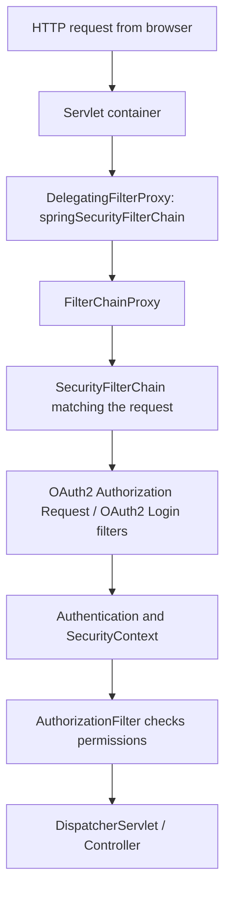
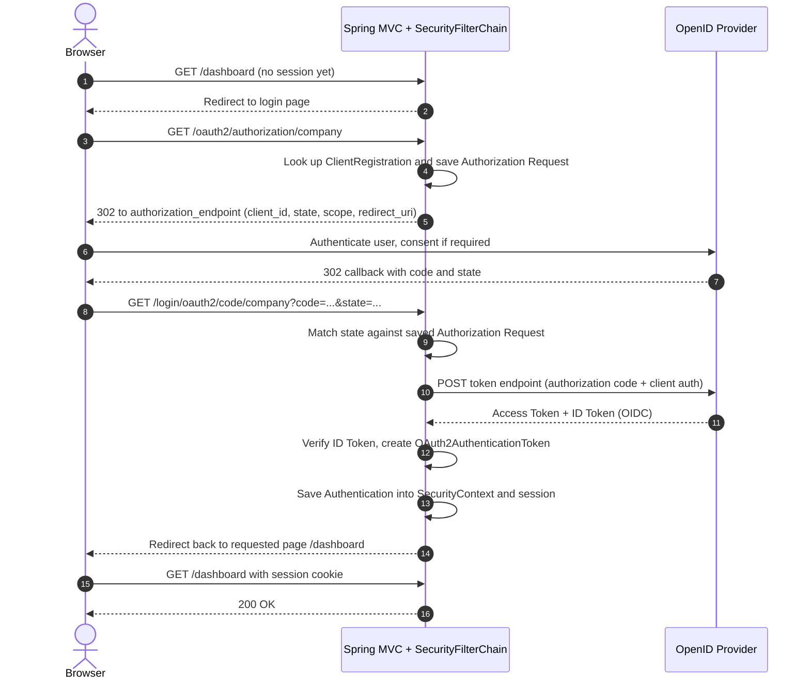

# 7.1. SecurityFilterChain and oauth2Login Configuration

## 1. The Problem: Protecting a Servlet Website with OAuth 2.0 / OIDC Login

Suppose you are building an **Employee Portal** with Spring Boot MVC. Users navigate to `/dashboard`, but the system does not build its own password input screen. Instead, the application redirects them to an OpenID Provider (OP) such as Keycloak, Microsoft Entra ID, or another OIDC provider. After logging in, the user returns to the application with an **authorization code**; Spring Security exchanges the code for tokens, verifies the identity, and creates a server-side login session.

For **Servlet** applications, the starting point for HTTP security configuration is one or more **`SecurityFilterChain`** beans, typically created using the **`HttpSecurity`** DSL. To enable login based on OAuth 2.0 Authorization Code and OIDC, use:

```java
http.oauth2Login(Customizer.withDefaults());
```

This is a short call, yet it activates multiple collaborating filters and components: initiating the authorization request, handling the callback, exchanging the authorization code, loading user information when needed, validating the ID Token for OIDC, and storing the authentication result in the `SecurityContext`.

> **Role distinction:** `oauth2Login` logs **users into the web application**. `oauth2Client` supports OAuth2 Client capabilities when obtaining/using access tokens to call APIs. `oauth2ResourceServer` protects APIs that accept Bearer tokens. All three features can coexist in a system, serving different needs.

## 2. Core Components of Servlet Security

A request passes through Spring Security's Servlet filter chain before reaching a controller:



The diagram only shows the steps directly relevant to this lesson; the actual filter order and list depend on the configuration and Spring Security version. A request may terminate early at a filter when redirected, denied access, or encountering an authentication error.

| Component | Role |
| --- | --- |
| `SecurityFilterChain` | Defines the group of security filters applied to matching requests |
| `HttpSecurity` | DSL for configuring authentication, authorization, OAuth2 login, CSRF, logout, session, and HTTP policies |
| `FilterChainProxy` | Selects a `SecurityFilterChain` matching the request according to chain order |
| `OAuth2AuthorizationRequestRedirectFilter` | Initiates the OAuth 2.0 Authorization Request and redirects the browser to the provider |
| `OAuth2LoginAuthenticationFilter` | Handles the callback containing the authorization code and completes the OAuth2 login authentication process |
| `ClientRegistrationRepository` | Looks up OAuth/OIDC client configuration by `registrationId` |
| `OAuth2AuthorizedClientService` / `OAuth2AuthorizedClientRepository` | Stores/retrieves authorized client information and tokens, depending on context |
| `SecurityContext` | Holds the authenticated `Authentication` for the request/login context |
| `Authentication` | Represents the principal and authorities used during authorization checks |

**Servlet and WebFlux do not use the same configuration model.** Servlet uses `SecurityFilterChain`, `HttpSecurity`, and `ClientRegistrationRepository`. WebFlux uses `SecurityWebFilterChain`, `ServerHttpSecurity`, and `ReactiveClientRegistrationRepository`. Do not mix code from the two stacks just because both support OAuth2.

### How does `SecurityFilterChain` differ from `FilterChainProxy`?

You generally **do not create** `FilterChainProxy` yourself. Spring Security collects the chains and selects the first chain whose matching condition fits the request. You define one or more `SecurityFilterChain` beans by calling `http.build()` inside a bean method.

For a simple website, **one chain** is sufficient. For a project that has both a website using session/cookies and an API accepting only Bearer tokens, you can use **two chains** with `securityMatcher` and `@Order` to apply different policies. Section 10 illustrates that scenario.

## 3. Preparing the Spring Boot Servlet Project

The following example uses **Spring Boot 3.x / Spring Security 6.x**, **Spring MVC (Servlet)**, and an OIDC provider with an illustrative issuer:

```text
Issuer:          https://id.example.com/realms/company
Client ID:       employee-portal-web
Registration ID: company
Redirect URI:    http://localhost:8080/login/oauth2/code/company
Scopes:          openid, profile, email
Grant:           authorization_code
```

To test this, the application must be registered beforehand at the OIDC Provider. The provider must allow the Authorization Code flow, the exact redirect URI, the corresponding scopes, and issue client credentials according to the selected authentication method.

### 3.1. Adding dependencies

With Maven:

```xml
<dependencies>
    <dependency>
        <groupId>org.springframework.boot</groupId>
        <artifactId>spring-boot-starter-web</artifactId>
    </dependency>
    <dependency>
        <groupId>org.springframework.boot</groupId>
        <artifactId>spring-boot-starter-security</artifactId>
    </dependency>
    <dependency>
        <groupId>org.springframework.boot</groupId>
        <artifactId>spring-boot-starter-oauth2-client</artifactId>
    </dependency>
</dependencies>
```

Equivalent with Gradle Kotlin DSL:

```kotlin
dependencies {
    implementation("org.springframework.boot:spring-boot-starter-web")
    implementation("org.springframework.boot:spring-boot-starter-security")
    implementation("org.springframework.boot:spring-boot-starter-oauth2-client")
}
```

Here, **`spring-boot-starter-oauth2-client`** is the dependency needed for `oauth2Login`. You do not need `spring-boot-starter-oauth2-resource-server` just to log users into a website via OIDC. The Resource Server dependency is only needed when the application also protects endpoints that accept Bearer tokens under a Resource Server configuration.

### 3.2. Declaring ClientRegistration in `application.yml`

```yaml
server:
  port: 8080

spring:
  security:
    oauth2:
      client:
        registration:
          company:
            provider: company-idp
            client-id: ${OIDC_CLIENT_ID}
            client-secret: ${OIDC_CLIENT_SECRET}
            client-authentication-method: client_secret_basic
            authorization-grant-type: authorization_code
            redirect-uri: "{baseUrl}/login/oauth2/code/{registrationId}"
            scope:
              - openid
              - profile
              - email
        provider:
          company-idp:
            issuer-uri: https://id.example.com/realms/company
```

The values:

| Key | Meaning |
| --- | --- |
| `registration.company` | Local identifier used to initiate login and select the client; here it is `company` |
| `provider: company-idp` | Reference to the OP declaration section |
| `client-id` | Client ID issued by the OP when registering the application |
| `client-secret` | Authentication secret for a confidential client, loaded securely from the environment |
| `authorization-grant-type` | `authorization_code`, the browser-based login flow |
| `client-authentication-method` | Method the client uses to authenticate at the token endpoint; must be supported by the OP |
| `redirect-uri` | Spring callback that receives the authorization code; must be allowed by the OP |
| `scope` | Includes `openid` to request OIDC login; add profile scopes as needed |
| `issuer-uri` | Trusted OIDC issuer, used for Discovery and ID Token validation |

**`registrationId` is not `clientId`.** In the example, the Spring paths are `/oauth2/authorization/company` and `/login/oauth2/code/company`, even though the Client ID on the OP is `employee-portal-web`.

With an OP that supports OIDC Discovery, declaring `issuer-uri` allows Spring Boot/Spring Security to fetch metadata such as the authorization endpoint, token endpoint, JWKS URI, and UserInfo endpoint. If the OP does not publish valid metadata, the configuration must supply the corresponding URIs according to the mechanism supported by the provider.

### 3.3. Keeping client secret outside source code

Example environment variables in a PowerShell terminal session:

```powershell
$env:OIDC_CLIENT_ID = "employee-portal-web"
$env:OIDC_CLIENT_SECRET = "<secret-from-secret-manager>"
```

The example intentionally does not use a real secret. In production, you can use a secret manager and deployment infrastructure integration. Avoid committing credentials into the repository, embedding them in the frontend, pasting them into tickets, or printing raw tokens/secrets to logs.

## 4. Minimal `SecurityFilterChain` to Enable `oauth2Login`

This is the central configuration of the lesson:

```java
package com.example.portal.security;

import org.springframework.context.annotation.Bean;
import org.springframework.context.annotation.Configuration;
import org.springframework.security.config.Customizer;
import org.springframework.security.config.annotation.web.builders.HttpSecurity;
import org.springframework.security.web.SecurityFilterChain;

@Configuration
public class SecurityConfig {

    @Bean
    SecurityFilterChain securityFilterChain(HttpSecurity http) throws Exception {
        http
            .authorizeHttpRequests(authorize -> authorize
                .requestMatchers("/", "/css/**", "/js/**", "/images/**", "/error")
                    .permitAll()
                .anyRequest().authenticated()
            )
            .oauth2Login(Customizer.withDefaults());

        return http.build();
    }
}
```

### 4.1. Reading each configuration block

**`@Configuration` and `@Bean`:** declares `SecurityFilterChain` for the Spring ApplicationContext. In modern Spring Security, this replaces extending the removed `WebSecurityConfigurerAdapter`.

**`authorizeHttpRequests`:** defines access permissions. Public resources can be accessed without logging in; all remaining requests must be authenticated.

**`requestMatchers(...).permitAll()`:** allows the website to serve the home page, CSS, JavaScript, images, and the error page. Place specific rules before `anyRequest()`.

**`anyRequest().authenticated()`:** requires the user to be authenticated, though it does not yet check specific roles or business permissions.

**`oauth2Login(Customizer.withDefaults())`:** enables OAuth2 Login with the default endpoints/filters. For a registration with the `openid` scope, Spring Security processes OIDC login and creates an `OidcUser` principal; for a non-OIDC OAuth 2.0 provider, the principal is typically `OAuth2User` depending on the provider/configuration.

**`http.build()`:** completes the DSL and returns the chain for Spring Security to use.

This example does not include `http.csrf(csrf -> csrf.disable())`. **Keep default CSRF protection for websites with session/cookie-based login**, especially for POST/PUT/PATCH/DELETE operations. Default OAuth2 login also relies on state and session to bind the authorization request to the callback.

### 4.2. Why are both authentication and authorization still needed?

**Authentication** determines *who is accessing*; with `oauth2Login`, the user is authenticated by the provider and Spring Security verifies the result. **Authorization** decides *which endpoints that user can access* according to matchers and authorities.

Example protecting an admin page as well:

```java
http.authorizeHttpRequests(authorize -> authorize
        .requestMatchers("/", "/css/**", "/error").permitAll()
        .requestMatchers("/admin/**").hasRole("ADMIN")
        .anyRequest().authenticated()
    )
    .oauth2Login(Customizer.withDefaults());
```

The `hasRole("ADMIN")` rule requires the `ROLE_ADMIN` authority. An OIDC provider may return roles in a custom claim, but **roles are not automatically mapped across all providers**. Without `ROLE_ADMIN` in `Authentication`, an already logged-in user can still receive **403 Forbidden**. You must configure trusted role/authority mapping based on the system's actual token/role source; never default all OIDC users to admin.

## 5. Request Flow When `oauth2Login` Operates

With the `SecurityFilterChain` in section 4, the browser accesses a URL that requires authentication:



The diagram illustrates the **OIDC Authorization Code flow**. If the client configures PKCE, the authorization request also includes `code_challenge` and the token request includes `code_verifier`. Depending on provider requirements and the Spring Security version, configure PKCE appropriately.

### 5.1. Default endpoints to remember

| Path | Who calls it? | Function |
| --- | --- | --- |
| `/oauth2/authorization/{registrationId}` | Browser → Spring application | Initiates the authorization request and redirects to the provider |
| `/login/oauth2/code/{registrationId}` | Browser → Spring application after redirect from OP | Receives the authorization code and state so Spring can complete login |
| `/login` | Browser → Spring application | Login page; may be the page generated by default by Spring Security |
| `/logout` | Browser → Spring application | Application-side logout endpoint as configured in Spring Security |

When only OAuth2/OIDC Client registrations exist and `oauth2Login` is enabled, the default login page can display links to providers, provided the repository can be iterated to list client registrations. `InMemoryClientRegistrationRepository` typically meets that condition. If using a custom repository that does not support iteration, you may need to create a custom login page.

**Do not confuse the two URIs**:

```text
Initiate OAuth2 login:
http://localhost:8080/oauth2/authorization/company

Callback registered at the OP:
http://localhost:8080/login/oauth2/code/company
```

The `/login` page is where login options are displayed/selected. The authorization endpoint `/oauth2/authorization/company` is where **Spring starts sending the request to the provider**, whereas the callback `/login/oauth2/code/company` is where **Spring receives the response from the provider**.

### 5.2. Parameters in the authorization request

A redirect to the OP typically contains:

```text
https://id.example.com/realms/company/protocol/openid-connect/auth
  ?response_type=code
  &client_id=employee-portal-web
  &scope=openid%20profile%20email
  &state=<random-state>
  &redirect_uri=http%3A%2F%2Flocalhost%3A8080%2Flogin%2Foauth2%2Fcode%2Fcompany
```

The URL above is wrapped across lines for readability; **it is not an actual URL to copy verbatim**. Depending on configuration, there may also be `nonce`, `code_challenge`, `code_challenge_method`, and provider-specific parameters.

`state` binds the callback to a previously created login request, helping prevent forgery/mix-up attacks. With OIDC, `nonce` (when used) binds the ID Token to a single authentication attempt. These are not optional parameters that you should disable just to fix an error.

### 5.3. Which filter handles which step?

| Stage | Component involved | Behavior |
| --- | --- | --- |
| Initiate login | `OAuth2AuthorizationRequestRedirectFilter` | Selects registration, builds request, saves state, and returns redirect to OP |
| Arrive at callback | `OAuth2LoginAuthenticationFilter` | Extracts code/state, creates authentication request, and delegates to authentication manager |
| Exchange code for tokens | `OAuth2LoginAuthenticationProvider` and client/token response components | Exchanges the authorization code at the token endpoint |
| OIDC processing | `OidcAuthorizationCodeAuthenticationProvider` and OIDC processors | Verifies ID Token and loads UserInfo when applicable |
| Completion | Authentication success handler + SecurityContext/session | Establishes logged-in state and redirects after login |
| Subsequent page access | Authorization filter | Checks `authenticated()` and specific rules |

The exact names and presence of filters/providers may vary by version and enabled options; the table focuses on core responsibilities. Under default configuration, Spring Security handles most of this process, so you do not need to write your own servlet filter to send token requests or capture callbacks in a controller.

## 6. Accessing the Authenticated Identity in a Controller

When using OIDC login, Spring Security provides an **`OidcUser`** principal to the controller.

```java
package com.example.portal.web;

import java.util.Map;

import org.springframework.security.core.annotation.AuthenticationPrincipal;
import org.springframework.security.oauth2.core.oidc.user.OidcUser;
import org.springframework.web.bind.annotation.GetMapping;
import org.springframework.web.bind.annotation.RestController;

@RestController
public class ProfileController {

    @GetMapping("/me")
    public Map<String, String> me(@AuthenticationPrincipal OidcUser user) {
        return Map.of(
                "subject", user.getSubject(),
                "issuer", user.getIssuer().toString(),
                "displayName", user.getFullName() != null
                        ? user.getFullName() : user.getSubject()
        );
    }
}
```

Here `OidcUser` has been created after the OIDC login process succeeds. `sub` is the user identifier **within the scope of the issuer**, while claims such as name/email may not be provided by the OP. Do not rely on email as an immutable identifier key if business workflows allow email changes.

The example above assumes `/me` is only accessed after **OIDC login**. If the same application supports multiple authentication types (form login, HTTP Basic, JWT, or non-OIDC OAuth2 login), the principal might not be an `OidcUser`. In that case, the controller must handle the appropriate `Authentication` types rather than casting blindly.

To inspect authenticated permission info at the Spring Security level:

```java
import java.util.List;

import org.springframework.security.core.Authentication;
import org.springframework.web.bind.annotation.GetMapping;
import org.springframework.web.bind.annotation.RestController;

@RestController
public class AuthorizationController {

    @GetMapping("/my-authorities")
    public List<String> myAuthorities(Authentication authentication) {
        return authentication.getAuthorities().stream()
                .map(authority -> authority.getAuthority())
                .toList();
    }
}
```

Illustrative endpoints should be protected by `authenticated()` and only return data permitted by the product. Do not return **raw ID Token/access token/refresh token** to the frontend just to display user information.

## 7. Customizing the Login Page

By default, Spring Security can generate a `/login` page containing links to registrations. In a real product, you usually want a login page styled with your project's UI.

### 7.1. Specifying a custom login page

Example configuration using a **static HTML page** at `src/main/resources/static/login.html`:

```java
@Bean
SecurityFilterChain securityFilterChain(HttpSecurity http) throws Exception {
    http
        .authorizeHttpRequests(authorize -> authorize
            .requestMatchers(
                "/", "/login.html", "/css/**", "/js/**", "/images/**", "/error"
            ).permitAll()
            .anyRequest().authenticated()
        )
        .oauth2Login(oauth2 -> oauth2
            .loginPage("/login.html")
        );

    return http.build();
}
```

Contents of `login.html`:

```html
<!doctype html>
<html lang="en">
<head>
  <meta charset="utf-8">
  <title>Employee Portal Login</title>
</head>
<body>
  <h1>Employee Portal</h1>
  <a href="/oauth2/authorization/company">Sign in with Company SSO</a>
</body>
</html>
```

Notes:

- `loginPage("/login.html")` specifies the **path to the login page inside the application**, not the authorization endpoint URL at the OP.
- The login page must be accessible when the user is unauthenticated; otherwise, the browser may get caught in a redirect loop.
- The link `/oauth2/authorization/company` uses the exact **registration ID** declared in YAML.
- When setting a custom login page, **Spring Security no longer auto-generates login HTML for you**; the application is responsible for returning the content for that URL.

Do not embed client secrets in `login.html` or JavaScript; the authorization code is exchanged for tokens on the backend.

### 7.2. When there are multiple providers

The login page can have multiple links:

```html
<a href="/oauth2/authorization/company">Sign in with company account</a>
<a href="/oauth2/authorization/partner">Sign in with partner account</a>
```

The requirement is that `ClientRegistrationRepository` contains the corresponding `company` and `partner` registrations. Each client needs a valid callback URI registered at its provider.

## 8. Customizing Login Initiation and Callback URLs

Normally, you should keep the default URLs. However, some systems need to change them to fit their router or application structure.

### 8.1. Changing the authorization request base URI

Example:

```java
http.oauth2Login(oauth2 -> oauth2
        .authorizationEndpoint(authorization -> authorization
            .baseUri("/sso/authorize"))
);
```

Then the login initiation URL using the registration ID will be:

```text
/sso/authorize/company
```

If using a custom login page, you must update the link accordingly. `authorizationEndpoint().baseUri(...)` is a path **inside the Spring application**; it does not change `authorizationUri` at the OP.

### 8.2. Changing the callback base URI

Suppose a system wants callbacks under `/sso/callback/*`:

```java
http.oauth2Login(oauth2 -> oauth2
        .redirectionEndpoint(redirection -> redirection
            .baseUri("/sso/callback/*"))
);
```

At the same time, the client registration must set:

```yaml
spring:
  security:
    oauth2:
      client:
        registration:
          company:
            redirect-uri: "{baseUrl}/sso/callback/{registrationId}"
```

And the OP must allow the callback, for example:

```text
http://localhost:8080/sso/callback/company
```

**Changing the callback filter without changing `redirect-uri`, or only changing the URI at the OP without updating Spring, can cause the flow to fail.** The values must stay synchronized in three places: the callback filter matcher, the redirect URI sent in the authorization request, and the allowlisted URIs at the OP.

### 8.3. Do not create a controller at the same callback URL

In a normal `oauth2Login` configuration, `OAuth2LoginAuthenticationFilter` handles the callback. Creating your own `@GetMapping("/login/oauth2/code/company")` to receive the authorization code is generally unnecessary and prone to flow conflicts, especially if the controller attempts to exchange tokens manually or bypasses state validation.

## 9. Post-Login Redirect, Login Failure, and Logout

### 9.1. Success: return to original URL or a default page?

With standard login, Spring Security typically remembers the request that sent the user to login, then redirects them back to the original URL. For example, if a user opens `/dashboard`, after a successful login they return to `/dashboard`.

If you want to provide a default target page:

```java
http.oauth2Login(oauth2 -> oauth2
        .defaultSuccessUrl("/dashboard", false)
);
```

The `false` argument preserves the behavior of prioritizing the saved request; `/dashboard` is used as the default destination when there is no suitable request to return to. If `true` is used, Spring Security always redirects to `/dashboard` in the corresponding default success handler.

Replacing this with a custom `successHandler(...)` must be designed carefully so it does not lose the request cache or introduce an open redirect via untrusted URL parameters.

### 9.2. Failure: displaying safe error messages

With a custom login page, you can send the user back to a login page with an error status:

```java
http.oauth2Login(oauth2 -> oauth2
        .loginPage("/login.html")
        .failureUrl("/login.html?error")
);
```

On the UI, display a brief message such as "Login failed, please try again." Detailed causes should be recorded in operational logs with sensitive information masked.

Do not expose client secrets, authorization codes, access tokens, ID Tokens, or stack traces on the user-facing error page.

### 9.3. Logging out from the application and from the OIDC Provider

With session-based login, Spring Security's `logout` typically clears the authentication/session at the **application**, but this **does not necessarily log out from the OP**. If the OP still holds an SSO session, the user may be logged back in without entering a password.

Example local logout configuration:

```java
http.logout(logout -> logout
        .logoutSuccessUrl("/")
        .invalidateHttpSession(true)
        .deleteCookies("JSESSIONID")
);
```

A logout request under Spring Security's default configuration is typically a POST to `/logout` with a valid CSRF token. In server-side UIs, use a POST form rather than creating a GET link when CSRF protection is enabled.

If the product also needs to log out of the OP session, Spring Security supports **OIDC RP-Initiated Logout** via `OidcClientInitiatedLogoutSuccessHandler` when the OP publishes and supports an end-session endpoint. That is **additional** provider-dependent configuration; do not assume clearing the local session revokes all tokens or ends the entire SSO session.

## 10. Multiple `SecurityFilterChain`s: Login Website and Bearer Token API

An application can provide both a **website for users logging in via OIDC** and a **REST API for other services**. The two types of requests may require different policies:

- Website: interactive login via `oauth2Login`, uses session cookies, keeps CSRF protection.
- REST API: accepts `Authorization: Bearer <access-token>`, does not rely on browser sessions, typically uses `oauth2ResourceServer` to validate JWT or opaque tokens.

For that requirement, you can create **two filter chains** and specify their order. The following example is **only for systems that also have a Resource Server REST API**, requiring the `spring-boot-starter-oauth2-resource-server` dependency and issuer/audience configuration matching API tokens:

```java
package com.example.portal.security;

import org.springframework.context.annotation.Bean;
import org.springframework.context.annotation.Configuration;
import org.springframework.core.annotation.Order;
import org.springframework.security.config.Customizer;
import org.springframework.security.config.annotation.web.builders.HttpSecurity;
import org.springframework.security.config.http.SessionCreationPolicy;
import org.springframework.security.web.SecurityFilterChain;

@Configuration
public class MultiChainSecurityConfig {

    @Bean
    @Order(1)
    SecurityFilterChain apiFilterChain(HttpSecurity http) throws Exception {
        http
            .securityMatcher("/api/**")
            .authorizeHttpRequests(authorize -> authorize
                .anyRequest().authenticated()
            )
            .sessionManagement(session -> session
                .sessionCreationPolicy(SessionCreationPolicy.STATELESS)
            )
            .csrf(csrf -> csrf.disable())
            .oauth2ResourceServer(resourceServer -> resourceServer
                .jwt(Customizer.withDefaults())
            );

        return http.build();
    }

    @Bean
    @Order(2)
    SecurityFilterChain webFilterChain(HttpSecurity http) throws Exception {
        http
            .authorizeHttpRequests(authorize -> authorize
                .requestMatchers(
                    "/", "/login.html", "/css/**", "/js/**", "/error"
                ).permitAll()
                .anyRequest().authenticated()
            )
            .oauth2Login(oauth2 -> oauth2
                .loginPage("/login.html")
            );

        return http.build();
    }
}
```

In this configuration:

1. `@Order(1)`: the chain for `/api/**` is evaluated first. It validates **Bearer tokens**, sets the session to stateless, and does not perform `oauth2Login`.
2. `@Order(2)`: the remaining chain handles the website, login page, and callback.
3. `securityMatcher("/api/**")` selects the **entire chain** for matching requests. This differs from `requestMatchers(...)` inside `authorizeHttpRequests`, which only determines permissions after a chain has been selected.
4. The website chain in the example has no `securityMatcher`, so it acts as the catch-all chain for remaining requests.
5. CSRF is disabled **only in the API chain restricted to stateless Bearer token requests**, assuming that API does not rely on cookies as an authentication mechanism automatically sent by browsers. If an API uses cookie/session authentication, re-evaluate CSRF instead of disabling it just because of the "API" name.

If you want to protect the API by scope, you can use an example rule like:

```java
.authorizeHttpRequests(authorize -> authorize
    .requestMatchers("/api/admin/**").hasAuthority("SCOPE_admin.read")
    .anyRequest().authenticated()
)
```

Remember the **audience** of the access token. A Resource Server should not rely solely on signature/issuer while ignoring which resource the token is intended for; configure the JWT validator according to the actual API contract.

### 10.1. Why does filter chain order matter?

Suppose the web chain has an overly broad matcher and is evaluated before the API chain. A `GET /api/orders` request could enter the web chain, resulting in a redirect to the login page instead of returning `401` for an invalid Bearer token. Conversely, if the API chain accidentally includes the callback `/login/oauth2/code/company`, the OAuth2 Login filter may never receive the authorization code.

`FilterChainProxy` chooses the **first chain that matches the request**. It does not merge all matching chains into one composite chain. When writing multiple chains, always check matchers and `@Order` so that login/callback paths fall into the chain with `oauth2Login`.

### 10.2. Is a single SecurityFilterChain okay?

Yes. If the project is solely a web app with OIDC login and session-based controllers, the minimal example in section 4 is sufficient. There is no need to split chains just because the application has `/api/**` endpoints returning JSON. Split chains when **the authentication mechanism, session model, or HTTP policy actually differs**.

## 11. Login Session, `SecurityContext`, and OAuth2 State

After completing login, authentication information must persist across HTTP requests. In Servlet MVC applications, Spring Security typically uses the **HTTP session** to store login state and related requests. The session ID usually resides in the `JSESSIONID` cookie.

### 11.1. Types of state to distinguish

| State | Data/meaning | Related components |
| --- | --- | --- |
| **Temporary authorization request** | `state`, registration, redirect, nonce/PKCE when present | `AuthorizationRequestRepository` |
| **Authentication** | Authenticated principal and authorities | `SecurityContext` / `SecurityContextRepository` |
| **Authorized client** | `ClientRegistration` + access token, possibly refresh token | `OAuth2AuthorizedClient` and authorized client store |
| **HTTP session** | Maintains context across browser requests | Servlet container and session mechanism |
| **Client registration** | Static OAuth/OIDC client configuration | `ClientRegistrationRepository` |

These states serve **different points in time** during the flow. For example, `ClientRegistrationRepository` does not store tokens; `SecurityContext` does not replace access token management when calling APIs.

### 11.2. Why can the callback fail if the session is lost?

When initiating login, Spring Security saves the authorization request information needed to match against the callback. If the browser returns without the session/cookie or the request is routed to a server that does not share the session, Spring may fail to find the corresponding authorization request.

Common causes:

- Cookies are blocked or dropped due to mismatched domain, `SameSite`, `Secure`, or HTTPS settings.
- Redirecting across a different domain/port prevents the browser from sending the application's cookie.
- A load balancer routes the callback to an instance that does not share the session the system relies on.
- The session expires before the user finishes MFA/consent.
- A proxy constructs an incorrect callback URL so the user returns to a different address from where login started.

If the application runs on multiple nodes, you may need **sticky sessions** or a shared session mechanism (for example, Spring Session with an appropriate store), depending on fault tolerance and architecture. Do not solve this error by disabling `state` validation or creating arbitrary authentication requests at the callback.

### 11.3. SecurityContext and session cookies are not access tokens

After login, the browser typically sends the session cookie to the Employee Portal on subsequent requests. The cookie allows Spring to restore `SecurityContext`, check `authenticated()`, and evaluate authorities.

The browser **does not need to send an access token on every HTML request** to the website just to maintain a login session. If the backend needs to call an API on behalf of the user, the OAuth2 Client/Authorized Client layer uses the appropriate access token at that time. Do not store raw access tokens in JavaScript-accessible cookies to replace sessions without a clear architectural requirement.

### 11.4. Session fixation, CSRF, and redirects

Spring Security provides default protections for session fixation and CSRF. Configuring `oauth2Login` is not a reason to disable those protections.

- **Session fixation:** when authentication state changes, the session authentication mechanism should create/change the session identifier according to Spring and container security policies.
- **CSRF:** for state-changing requests in a web app relying on session cookies, keep CSRF protection and integrate the token into forms/AJAX requests.
- **State:** protects the authorization callback from being attached to another flow.
- **Cookie:** use `Secure` over HTTPS; configure `HttpOnly`, `SameSite`, domain/path according to login requirements and proxy topology.
- **HTTPS:** production login endpoints must use secure connections, including the callback.

## 12. How `oauth2Login` Distinguishes OIDC from Standard OAuth 2.0

Spring Security OAuth2 Login can work with OAuth 2.0 providers that support fetching user info and with OPs that support OIDC. Depending on registration/scopes and token responses, they use different authentication models.

| Aspect | Standard OAuth 2.0 login | OIDC login |
| --- | --- | --- |
| Base scope | Scopes required by the provider to access user info | Includes `openid` |
| Login token | Typically uses access token to call provider's UserInfo/user endpoint | Has an **ID Token** per the OIDC specification |
| Principal | Typically `OAuth2User` | Typically `OidcUser` |
| Identity attribute | Depends on provider's user API | `iss` + `sub` identify the user within the issuer's context |
| Specific checks | Format of user attributes and provider mechanism | ID Token signature, issuer, audience, expiration, nonce per OIDC rules |
| Provider metadata | May require manual endpoint configuration | OIDC Discovery typically provides endpoints and JWKS |

**Adding the `openid` scope does not turn a non-OIDC OAuth2 provider into an OP.** The provider must genuinely support OIDC, issue ID Tokens, and provide the required information/claims.

### 12.1. ID Token must be verified

For OIDC, Spring Security handles ID Token verification based on trust configuration: signature or OIDC-supported verification mechanism, issuer, audience, expiration, and additional flow requirements.

- `iss` must match the trusted provider.
- `aud` must contain the matching client ID.
- `exp` and time-based claims must be valid.
- `nonce` must match the initial request when used.
- `kid` in the JWT header helps select the public key from the issuer's JWKS; `kid` itself does not make the token trustworthy.
- Depending on OIDC conditions, claims such as `azp`, `auth_time`, or `at_hash` may need verification.

Never Base64URL-decode the payload yourself and trust that data as a verified identity. Being able to read a JWT **does not prove a valid signature**.

### 12.2. Using tokens in the right place

With OIDC login:

- **ID Token** provides user authentication information to the **OIDC Client**.
- **Access token** is used to call APIs/Resource Servers according to granted audience and scopes.
- **Refresh token**, if issued, helps the client obtain a new access token per provider policy.

A REST API should not accept an ID Token as if it were an access token just because both are signed JWTs. The two token types have different purposes and audiences.

## 13. Customizing UserInfo and Authorities After OAuth2 Login

In real-world projects, users often need application-level roles/permissions, not just name and email from the provider. Spring Security lets you hook into loading user information or mapping authorities, though authorization decisions must still rely on a trusted source.

### 13.1. Configuring userInfoEndpoint

`oauth2Login` provides customization hooks:

```java
http.oauth2Login(oauth2 -> oauth2
    .userInfoEndpoint(userInfo -> userInfo
        .oidcUserService(customOidcUserService)
    )
);
```

Here `customOidcUserService` is an application-created bean/object implementing `OAuth2UserService<OidcUserRequest, OidcUser>`. It can load additional details or map the profile according to system rules.

For non-OIDC OAuth2 login, there is a corresponding hook:

```java
http.oauth2Login(oauth2 -> oauth2
    .userInfoEndpoint(userInfo -> userInfo
        .userService(customOAuth2UserService)
    )
);
```

The two snippets above are **illustrative options**, used only when a suitable bean is declared. For basic needs, use the defaults to avoid duplicating Spring Security's ID Token validation and UserInfo calls.

### 13.2. Role mapping needs a clear policy

Some providers issue roles/groups in custom claims; some applications store roles in an internal database. Never blindly convert arbitrary client-supplied role strings into `ROLE_ADMIN`.

Design options:

1. **Provider-sourced roles:** take only from verified claims issued by a trusted issuer, with controlled semantics and namespaces.
2. **Internal roles:** use `iss` + `sub` to look up permissions in the application's database.
3. **Hybrid:** obtain identity from OIDC and apply internal authorization policy; optionally supplement with verified group/organization claims.

Define when permissions are refreshed, how long they are cached, and what happens when an account is locked. A successful OIDC login proves user authentication at the OP under its policy; **it does not automatically prove the user has access to all internal features**.

## 14. Configuration Patterns to Avoid When Migrating to Spring Security 6

Many older tutorials still describe Spring Security using:

```java
// Legacy pattern, DO NOT use in Spring Security 6 projects:
class SecurityConfig extends WebSecurityConfigurerAdapter {
    // ...
}
```

`WebSecurityConfigurerAdapter` has been removed. Replace it with a `SecurityFilterChain` bean, the `HttpSecurity` lambda DSL, and supporting beans as needed.

Some comparison pairs:

| Legacy / commonly seen approach | Modern approach in Spring Security 6 |
| --- | --- |
| Extending `WebSecurityConfigurerAdapter` | `@Bean SecurityFilterChain` |
| `authorizeRequests()`, legacy config | `authorizeHttpRequests(authorize -> ...)` |
| `antMatchers(...)` | `requestMatchers(...)` |
| `http.oauth2Login()` with legacy chained API | `http.oauth2Login(Customizer.withDefaults())` or lambda |
| Treating `WebSecurityCustomizer` ignoring all static resources as the only option | Prefer `permitAll()` inside the chain when security filters should remain active |

Most basic configurations do not need to manually add `OAuth2LoginAuthenticationFilter`. Let the `oauth2Login` DSL build the default filter chain first; customize only when there is a real requirement.

### 14.1. Choosing the right HTTP stack

If a project has both Spring MVC and WebFlux on the classpath, Spring Boot may prioritize the Servlet web application type per auto-configuration conditions. When you see sample code using `ServerHttpSecurity` while your bean receives `HttpSecurity` (or vice versa), verify whether the project actually runs **Servlet** or **Reactive**.

For this lesson:

```text
Spring MVC / Servlet
  -> HttpSecurity
  -> SecurityFilterChain
  -> ClientRegistrationRepository
  -> OAuth2LoginAuthenticationFilter
  -> OidcUser / OAuth2User
```

This is the set of APIs to use consistently.

## 15. Applications Behind a Reverse Proxy: Callbacks and HTTPS

A production deployment often has this topology:

```text
Browser
   |
   | HTTPS https://portal.example.com
   v
Ingress / Reverse Proxy (TLS termination)
   |
   | HTTP http://employee-portal:8080
   v
Spring Boot Servlet
```

The application must send the exact **public callback URL** registered at the OP:

```text
https://portal.example.com/login/oauth2/code/company
```

If Spring receives an internal `http://employee-portal:8080` request and forwarded headers are misconfigured, `{baseUrl}` may generate a callback with the wrong scheme/hostname/port.

Once the proxy is configured as a trusted component, you can use the appropriate Spring Boot option, for example:

```yaml
server:
  forward-headers-strategy: framework
```

The proxy must **overwrite/strip forwarded headers from external clients**. Only trust `Forwarded` or `X-Forwarded-*` headers controlled by a trusted proxy; accepting spoofed headers can allow attackers to manipulate URL construction.

Other options include configuring explicit per-environment redirect URIs, which still must match the OP exactly. Do not open broad wildcard callbacks in production just to avoid `redirect_uri_mismatch` errors.

### 15.1. Cookies and SameSite during callback

An OIDC callback typically arrives via a redirect navigation from the OP back to the application. With common GET redirect flows, `SameSite=Lax` cookie policies usually work; the exact policy must match the browsers, endpoints, and system architecture. If using other response modes or logging in inside an iframe/cross-site context, cookie requirements can differ significantly.

When encountering a missing `state` error after callback, check **whether the browser actually sends the cookie back**, rather than rushing to disable state validation.

## 16. Guide to Testing the Minimal Configuration

To observe the actual behavior of `SecurityFilterChain`, use a test environment with a registered OIDC client.

### 16.1. Basic steps

1. Create a Spring Boot Servlet application with the three starters from section 3.1.
2. Declare the `company` client registration and accurate issuer at the OP.
3. Register the callback `http://localhost:8080/login/oauth2/code/company` at the OP.
4. Set `OIDC_CLIENT_ID` and `OIDC_CLIENT_SECRET` via environment variables or a secret manager.
5. Add the `SecurityFilterChain` bean as in section 4, without writing a custom callback controller.
6. Add a `/dashboard` page or test `/me` to inspect the authenticated principal.
7. Run the application, open a private browser window, and visit `http://localhost:8080/me`.
8. Observe the login page, select `company`, and authenticate at the OP.
9. After the callback, verify `/me` receives a `sub` and issuer matching the test user.

**This is a practical guide, not verified output from a live OP run.** A valid client registration and test account at the provider are required.

### 16.2. How to inspect HTTP redirects

Using Browser Developer Tools → Network (enable Preserve log if needed), the flow typically shows:

| Step | Address | Status / behavior |
| --- | --- | --- |
| Open protected page | `GET /me` | Spring sees unauthenticated state, redirects to login |
| Start login | `GET /oauth2/authorization/company` | Spring sends redirect to OP |
| Log in at OP | `GET authorization_endpoint` and OP requests | User authenticates and grants consent per policy |
| Return to callback | `GET /login/oauth2/code/company?code=...&state=...` | Spring processes code/state |
| After authentication | `GET /me` | Browser sends session cookie and receives authenticated data |

Browser network logs **will not necessarily show the token endpoint request**, because the Spring Boot backend sends this request directly to the OP. Do not assume the absence of a token endpoint call in Browser Network means token exchange did not occur.

### 16.3. Checking permissions after login

If `/me` returns an identity but `/admin` returns `403`, login succeeded. The error in that case is **authorization**: `Authentication` lacks the authority required by the endpoint. Check authority mapping and business policies, rather than changing the secret or callback if they already work.

### 16.4. Safe log inspection

In a test environment, you can enable Spring Security logging at an appropriate level to inspect filter/authentication steps, though never store or share raw requests containing authorization codes, secrets, or tokens. Log correlation ID, registration ID, request path, HTTP status, and exception type. In production, limit log levels and mask sensitive data.

## 17. Common Errors with `SecurityFilterChain` and `oauth2Login`

| Symptom | Likely cause | Remediation |
| --- | --- | --- |
| No redirect to OIDC Provider | `oauth2Login` not enabled, missing registration, request hits wrong chain, or misconfigured custom login page | Check `SecurityFilterChain` bean, registration, and matchers |
| `/oauth2/authorization/company` returns 404 | Wrong `registrationId`/authorization base URI or missing OAuth2 Login config | Verify `registration.company` and `authorizationEndpoint` config |
| `/login` redirect loop | Custom login page is protected by `authenticated()` | Add `permitAll()` for login URL/resources |
| Provider returns `redirect_uri_mismatch` | URI sent by Spring differs from registered callback; proxy builds wrong host/scheme | Compare absolute URI, proxy settings, and `redirect-uri` |
| Provider returns `invalid_client` | Wrong client ID/secret or client auth method | Check app registration and how credentials are sent |
| Token endpoint returns `invalid_grant` | Expired/reused authorization code, redirect/PKCE mismatch | Check clock skew, redirect, token exchange, and PKCE |
| Callback reports missing authorization request / `invalid_state` | Browser lost session cookie, state mismatch, multiple instances without shared session | Check cookies, session store, callback, and load balancer |
| OIDC login fails with `invalid_token` / issuer | ID Token has wrong issuer/audience/nonce/timestamp | Check issuer, client ID, and OIDC token validation |
| Unable to fetch JWKS keys | Wrong issuer/JWKS URI, TLS/DNS/rotation issue | Check OIDC Discovery, network connectivity, and JWKS cache |
| User is logged in but gets **403** | Role/authority not mapped, rule requires higher permission | Inspect `Authentication.getAuthorities()` and mapping |
| Browser gets **403** on form POST | Missing CSRF token | Include CSRF token in form/AJAX instead of disabling all CSRF arbitrarily |
| API returns **302 to /login** instead of **401** | API request is hitting the website chain | Check `@Order` and `securityMatcher("/api/**")` |
| Logging out still logs right back in without password | OP still holds an SSO session | Configure OIDC logout via OP if required by product |
| App works locally but redirects wrongly in production | Misaligned forwarded headers/domain/HTTPS proxy settings | Adjust reverse proxy and external callback |
| Adding SecurityFilterChain changes default behavior | Custom security bean replaced/overrode parts of auto-configuration | Ensure the chain declares all desired policies |

When troubleshooting, identify whether the failure occurs at **filter chain selection**, **redirect to OP**, **callback/state**, **code-for-token exchange**, **ID Token validation**, or **post-login authorization**. Each stage is handled by different components, so fixing the wrong layer can introduce vulnerabilities or redirect loops.

### 17.1. Troubleshooting flowchart

```text
(1) Does GET on the protected page hit the right SecurityFilterChain?
      |
      +-- No -> securityMatcher / @Order / configuration bean
      |
      v
(2) Does Spring redirect to the right OP?
      |
      +-- No -> oauth2Login / registrationId / loginPage
      |
      v
(3) Does the OP accept the client, redirect, scopes, and user?
      |
      +-- No -> app registration / consent / policy at OP
      |
      v
(4) Does the callback have code + state and matching session?
      |
      +-- No -> proxy / cookie / state / session / redirect URI
      |
      v
(5) Does Spring exchange the code for tokens and verify the ID Token?
      |
      +-- No -> secret / token endpoint / PKCE / issuer / JWKS
      |
      v
(6) Does the authenticated user have sufficient permissions?
      |
      +-- No -> authority mapping / role / authorize rules
      |
      v
(7) Controller access succeeds
```

## 18. Good Security Configuration Habits

- **Grant access by explicit paths:** permit public resources, require authentication for private content, and add roles/permissions for sensitive actions.
- **Keep CSRF protection for cookie/session websites:** customize only according to the actual authentication architecture.
- **Use Authorization Code flow and appropriate PKCE:** avoid legacy flows, especially when providers require S256.
- **Keep state and nonce validation:** use Spring Security/OIDC's built-in mechanisms; do not bypass them as a temporary workaround.
- **Do not capture callbacks in a controller:** use `oauth2Login` to leverage standard filters and authentication providers.
- **Register exact callbacks:** avoid broad wildcards; synchronize across Spring, reverse proxy, and OP.
- **Manage secrets securely:** separate environments, rotate secrets, and restrict secret access.
- **Separate web sessions from API tokens:** OIDC login authenticates the user; Resource Servers must validate access tokens and API-specific permissions.
- **Protect cookies/sessions:** enforce HTTPS, proper cookie attributes, and consistent session storage across multiple instances.
- **Control logging:** never expose authorization codes, client secrets, ID Tokens, or access tokens.
- **Keep OAuth/OIDC policies aligned with the provider:** changes to issuer, allowed scopes, keys, client authentication, or redirect URIs can all affect login.

## 19. Summary via the Employee Portal Use Case

Suppose a user opens `/dashboard` on the Employee Portal. `SecurityFilterChain` requires `authenticated()`, and `oauth2Login` redirects them to log in via the OIDC Provider. After the OP authenticates the user, Spring Security receives the authorization code at `/login/oauth2/code/company`, validates `state`, exchanges the code for tokens, and verifies the OIDC ID Token. The result is stored as an `Authentication` in `SecurityContext` so subsequent requests carrying the session cookie can access controllers.

The configuration pieces that must work together are:

1. **`ClientRegistration`:** issuer, client ID/secret, grant, scope, and redirect URI.
2. **`SecurityFilterChain`:** authorization rules and `oauth2Login` configuration.
3. **OAuth2 Login endpoints:** login initiation URL and callback URL.
4. **`Authentication` / `SecurityContext`:** identity and authorities after login.
5. **Session, CSRF, cookies, and proxy:** maintaining flow continuity and security.
6. **Business authorization:** enforcing rules based on verified application roles/permissions.

Once you understand these parts, you can implement standard Spring Security Servlet OIDC Login without manually writing filters to handle authorization codes, while knowing where to configure custom login pages, callbacks, success redirects, logout, or separate security for websites and APIs.

### References

- [Spring Security — OAuth2 Login, Servlet](https://docs.spring.io/spring-security/reference/servlet/oauth2/login/index.html)
- [Spring Security — OAuth2 Login Advanced Configuration](https://docs.spring.io/spring-security/reference/servlet/oauth2/login/advanced.html)
- [Spring Security — Java Configuration](https://docs.spring.io/spring-security/reference/servlet/configuration/java.html)
- [Spring Security — Authorize HTTP Requests](https://docs.spring.io/spring-security/reference/servlet/authorization/authorize-http-requests.html)
- [Spring Security — CSRF Protection](https://docs.spring.io/spring-security/reference/servlet/exploits/csrf.html)
- [OpenID Connect Core 1.0](https://openid.net/specs/openid-connect-core-1_0.html)
