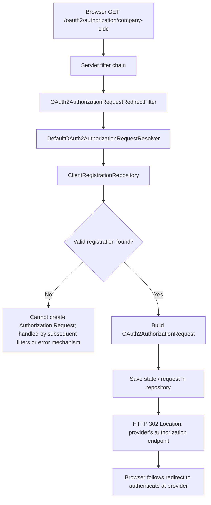

# 7.2. Login Initiation Endpoint `/oauth2/authorization/{registrationId}`

In a **Spring Security OAuth 2.0 / OpenID Connect (OIDC) Client running on Servlet**, the URL `/oauth2/authorization/{registrationId}` is the entry point for initiating login through an Authorization Server (AS) or OpenID Provider (OP). When the browser navigates to this URL, Spring Security looks up the `ClientRegistration` configuration with the matching ID, builds an **OAuth 2.0 Authorization Request**, saves the state needed for callback verification, and returns an HTTP redirect sending the browser to the provider's authentication page.

The most important point: **`/oauth2/authorization/{registrationId}` is an endpoint on the Spring application, not the provider's login endpoint and not the callback that receives the authorization code.** It is an address that initiates the redirect.

This lesson focuses on the endpoint's mechanism in Spring MVC/Servlet: prerequisites for the endpoint to work, handling components, HTTP requests/responses, its relationship with `ClientRegistration` and `oauth2Login()`, how to customize the initiation URL, and common deployment pitfalls.

## 1. Role and Meaning of the URL

The default path takes the form:

```text
GET https://app.example.org/oauth2/authorization/{registrationId}
```

For example, when the application declares a `registrationId` of `company-oidc`:

```text
GET https://app.example.org/oauth2/authorization/company-oidc
```

Three commonly confused parts:

| Path / endpoint | Owner | Role |
|---|---|---|
| `/oauth2/authorization/company-oidc` | Spring Security application | **Initiates** login: selects the registration, builds the Authorization Request, and redirects the browser to the provider. |
| `https://idp.example.org/.../auth` | Authorization Server / OpenID Provider | Receives the Authorization Request, authenticates the user, and may prompt for consent. |
| `/login/oauth2/code/company-oidc` | Spring Security application | Default **callback**: receives `code` and `state`, and completes authentication. |
| `/login` | Spring Security application | Login page (default or custom) that may display links to initiate the flow. |

`registrationId` is an **internal key in `ClientRegistrationRepository`**, not necessarily equal to the `client-id` issued by the provider to the application. It enables one application to support multiple login methods, for example:

```text
/oauth2/authorization/company-oidc
/oauth2/authorization/partner-oidc
/oauth2/authorization/social-login
```

These paths can select different clients, scopes, providers, redirect URIs, or policies. The ID name must match the Spring Boot configuration key or the repository bean declared by the application.

## 2. Spring Security Components Handling the Endpoint

On the Servlet stack, `OAuth2AuthorizationRequestRedirectFilter` is the filter that intercepts login initiation requests. This filter uses an `OAuth2AuthorizationRequestResolver` to determine whether a request belongs to an OAuth2 flow to initiate and to construct the `OAuth2AuthorizationRequest`.

By default, Spring Security typically uses:

- `OAuth2AuthorizationRequestRedirectFilter`: intercepts initiation requests and sends the redirect to the provider.
- `DefaultOAuth2AuthorizationRequestResolver`: recognizes URLs with base URI `/oauth2/authorization`, resolves the registration, and builds the authorization request.
- `ClientRegistrationRepository`: supplies `ClientRegistration` by `registrationId`.
- `OAuth2AuthorizationRequestRepository<OAuth2AuthorizationRequest>`: stores the original request before redirecting so it can be matched when the provider returns a result.
- `HttpSessionOAuth2AuthorizationRequestRepository`: the default repository typically using the HTTP session in the Servlet OAuth2 Login flow.
- `OAuth2LoginAuthenticationFilter`: handles the login **callback** at the default base URI `/login/oauth2/code/*`, distinct from the initiation filter.

These components operate inside the `SecurityFilterChain` built by `HttpSecurity.oauth2Login()`. They are not standard MVC `@GetMapping` handlers that you write yourself.



### 2.1. Why a filter instead of a controller?

Spring Security must process OAuth2 initiation **inside the security chain**, where it has access to `HttpServletRequest`, `HttpServletResponse`, the session, and client configuration. A filter can terminate the request with a redirect before it reaches `DispatcherServlet` and MVC controllers.

If an application writes a controller to redirect manually to the provider, it would have to manage `state` generation, callback correlation, Authorization Request storage, protocol parameter handling, and coordination with Spring Security's token exchange mechanism. For typical applications, let the default filter handle this.

### 2.2. Why is a repository needed to store the Authorization Request?

When the browser leaves the application for the provider, the initiating HTTP request ends. The provider later redirects the browser back to the application with a **new** HTTP request. Spring needs the original information to confirm that the response corresponds to a request initiated by the application.

`HttpSessionOAuth2AuthorizationRequestRepository` uses the HTTP session to store information such as `state` and related parameters. This differs from the repository used to store `OAuth2AuthorizedClient` after tokens have been issued.

## 3. Complete Flow from Initiation URL to Successful Login

```mermaid
sequenceDiagram
    autonumber
    participant U as Browser
    participant S as Spring MVC OAuth2 Client
    participant P as OpenID Provider
    U->>S: GET /oauth2/authorization/company-oidc
    Note over S: Resolve ClientRegistration, generate state,<br/>and save Authorization Request
    S-->>U: 302 Location: provider/authorize?client_id=...&state=...
    U->>P: GET authorization endpoint
    P-->>U: Login form / consent prompt
    U->>P: Authenticate and consent (if required)
    P-->>U: 302 Location: /login/oauth2/code/company-oidc?code=...&state=...
    U->>S: GET /login/oauth2/code/company-oidc?code=...&state=...
    Note over S: Match state; exchange code for tokens;<br/>verify OIDC info
    S->>P: POST token endpoint
    P-->>S: Access token, ID token (for OIDC), ...
    S-->>U: Login session and redirect to target page
```

Processing sequence:

1. The user clicks "Sign in with Company" or the browser navigates to `/oauth2/authorization/company-oidc`.
2. `OAuth2AuthorizationRequestRedirectFilter` intercepts the request. The resolver extracts `company-oidc` from the URL, retrieves `ClientRegistration`, and constructs an Authorization Request matching the grant type.
3. Spring generates an unpredictable `state` value to bind request and response, applies required OIDC/PKCE parameters depending on registration and configuration, and saves the original request.
4. The application returns `302 Found` with a `Location` header pointing to the provider's authorization endpoint and query parameters.
5. The browser follows the redirect; the provider handles authentication/consent. The application never receives the password the user enters at the provider.
6. The provider sends the browser back to the registered **callback URI**, typically `/login/oauth2/code/company-oidc` with `code` and `state`.
7. `OAuth2LoginAuthenticationFilter` handles the callback, validates correlation with the saved Authorization Request, and exchanges the code for tokens; for OIDC, Spring also verifies the ID Token and builds the principal.
8. Upon success, Spring stores or provides `Authentication` through the security context per configuration. The browser can proceed to access protected resources.

Only at steps **7–8** does the application complete login. Receiving a `302` from the initiation endpoint does not prove the provider authenticated the user or issued an access token.

## 4. What Does the Authorization Request Contain?

The redirect URL sent to the provider typically carries information like:

```http
HTTP/1.1 302 Found
Location: https://idp.example.org/realms/company/protocol/openid-connect/auth?response_type=code&client_id=my-client&scope=openid%20profile&state=RANDOM_VALUE&redirect_uri=https%3A%2F%2Fapp.example.org%2Flogin%2Foauth2%2Fcode%2Fcompany-oidc
Set-Cookie: JSESSIONID=...; Path=/; HttpOnly; Secure
```

This is only an **illustrative example** of the HTTP structure: cookie headers and attributes depend on the container, session, and actual cookie policy; the authorization URL may include additional parameters.

| Parameter | Meaning |
|---|---|
| `response_type=code` | Requests an authorization code, typically used for server-side login. |
| `client_id` | Client ID issued by the provider; distinct from the internal `registrationId` key. |
| `redirect_uri` | URI where the provider sends the authorization response; must match the URI registered at the provider. |
| `scope` | Requested permission scopes; for OIDC, must include `openid`. |
| `state` | Value correlating the response with the original Authorization Request, helping defend against login flow forgery attacks. |
| `nonce` | OIDC parameter used to bind the ID Token to the requesting session; present when the OIDC flow and configuration apply. |
| `code_challenge` and `code_challenge_method` | PKCE parameters if enabled or automatically applied per configuration; helps protect authorization code exchange. |
| `prompt`, `login_hint`, `acr_values`... | Optional OIDC/provider extension parameters, used only when specifically needed. |

Spring Security generates and manages `state`; do not replace it with a static string or let the frontend compute it. PKCE and `nonce` serve different purposes: `state` correlates request and response, PKCE binds the token request to the initiator of the authorization request, and `nonce` binds the ID Token in OIDC.

Tokens are **not** returned in the initial response of `/oauth2/authorization/{registrationId}`. In the authorization-code flow, tokens are obtained after the callback processes `code`.

## 5. Configuring Spring Boot Servlet to Enable the Endpoint

Example Spring Boot application using Spring MVC and OAuth2 Login/OIDC. Key Maven dependencies:

```xml
<!-- Excerpt from <dependencies> in pom.xml -->
<dependency>
    <groupId>org.springframework.boot</groupId>
    <artifactId>spring-boot-starter-web</artifactId>
</dependency>
<dependency>
    <groupId>org.springframework.boot</groupId>
    <artifactId>spring-boot-starter-security</artifactId>
</dependency>
<dependency>
    <groupId>org.springframework.boot</groupId>
    <artifactId>spring-boot-starter-oauth2-client</artifactId>
</dependency>
```

### 5.1. Registering the client in `application.yml`

```yaml
spring:
  security:
    oauth2:
      client:
        registration:
          company-oidc:
            provider: company
            client-id: "${OIDC_CLIENT_ID}"
            client-secret: "${OIDC_CLIENT_SECRET}"
            client-authentication-method: client_secret_basic
            authorization-grant-type: authorization_code
            redirect-uri: "{baseUrl}/login/oauth2/code/{registrationId}"
            scope:
              - openid
              - profile
              - email
        provider:
          company:
            issuer-uri: https://idp.example.org/realms/company
```

Explanation:

- The `registration.company-oidc` key defines the `registrationId` used in the initiation path.
- `client-id` and `client-secret` must be real credentials issued by the provider, managed via environment variables or a secret store. Never commit secrets to a Git repository.
- `provider.company.issuer-uri` is the exact issuer URI published by the provider. When discovery is supported, Spring can retrieve authorization/token/JWK endpoints from metadata.
- `authorization-grant-type: authorization_code` is the grant type for the interactive login flow.
- `scope: openid` indicates an OIDC request; `profile` and `email` are common additional scopes if supported by the provider.
- `redirect-uri` is the **callback** address, not the initiation address. `{baseUrl}` and `{registrationId}` are expanded when building the authorization request.

The hostnames in the example are illustrative. For a real application, the provider must recognize the client ID, client authentication method, redirect URI, and requested scopes. Issuer discovery configuration may require network access when building `ClientRegistration`.

### 5.2. Enabling OAuth2 Login in `SecurityFilterChain`

```java
import org.springframework.context.annotation.Bean;
import org.springframework.context.annotation.Configuration;
import org.springframework.security.config.Customizer;
import org.springframework.security.config.annotation.web.builders.HttpSecurity;
import org.springframework.security.web.SecurityFilterChain;

@Configuration
class SecurityConfig {

    @Bean
    SecurityFilterChain securityFilterChain(HttpSecurity http) throws Exception {
        http
            .authorizeHttpRequests(authorize -> authorize
                .requestMatchers("/", "/error").permitAll()
                .anyRequest().authenticated()
            )
            .oauth2Login(Customizer.withDefaults());

        return http.build();
    }
}
```

`oauth2Login(Customizer.withDefaults())` registers the OAuth2 Login mechanism, including the filter that handles authorization request redirects and the filter that handles callbacks. The application does not need to declare a controller for `GET /oauth2/authorization/company-oidc`.

**Note on multiple `SecurityFilterChain` beans:** if the application configures multiple chains with `securityMatcher(...)`, the initiation request must hit the chain that actually has `oauth2Login()`. Another chain matching the request first can prevent the OAuth2 filter from running, even when `ClientRegistration` is configured properly.

## 6. Directing Users to the Endpoint from the Login UI

### 6.1. Using an HTML link

A custom-built login page can use a standard link:

```html
<a href="/oauth2/authorization/company-oidc">
    Sign in with company account
</a>
```

When the user clicks the link, the browser performs a page navigation to the initiation endpoint, receives a `302` response, and proceeds to the provider. This fits server-side web apps or Backend for Frontend (BFF) architectures especially well. Even for an SPA using a backend as the OAuth2 Client, initiation should use a **browser navigation** to the backend rather than expecting `fetch()` to read JSON from the initiation URL: the flow involves redirects and login interaction on the IdP's domain.

If the application has a context path such as `/portal`, HTML links must account for the context path. In Thymeleaf, you can use URL expression syntax to build the path properly:

```html
<a th:href="@{/oauth2/authorization/company-oidc}">
    Sign in with company account
</a>
```

### 6.2. Default login page vs. custom login page

When no custom login page is declared, Spring Security can generate a default login page containing OAuth2 links based on discovered registrations. Whether the provider list is displayed depends on the configuration and whether the repository can be iterated over, such as `InMemoryClientRegistrationRepository`.

If using a custom login page:

```java
@Bean
SecurityFilterChain securityFilterChain(HttpSecurity http) throws Exception {
    http
        .authorizeHttpRequests(authorize -> authorize
            .requestMatchers("/", "/login", "/error", "/css/**").permitAll()
            .anyRequest().authenticated()
        )
        .oauth2Login(oauth2 -> oauth2
            .loginPage("/login")
        );
    return http.build();
}
```

In this case, the application needs a handler/view serving `/login`. That page should link to `/oauth2/authorization/company-oidc`. Configuring `loginPage("/login")` **does not replace** the OAuth2 initiation base URI; it only sets the page displaying login choices.

### 6.3. When users access a protected resource

Accessing `GET /orders` while unauthenticated may cause Spring Security to redirect the user to `/login` first, where they choose a provider via a link. Do not assume every unauthenticated request automatically jumps directly to `/oauth2/authorization/company-oidc`. If you want to skip the provider selection page or automatically pick a provider by path, you need a custom authentication entry point or routing logic.

If an initial request was saved by `RequestCache`, after a successful login the application can redirect the user back to the requested resource, depending on the success handler and configuration.

## 7. Customizing the Login Initiation URL

The default base URI of `OAuth2AuthorizationRequestRedirectFilter` is:

```text
/oauth2/authorization
```

Spring Security allows changing the base URI if the application needs URLs matching an existing system, for example `/sso/start/{registrationId}`:

```java
@Bean
SecurityFilterChain securityFilterChain(HttpSecurity http) throws Exception {
    http
        .authorizeHttpRequests(authorize -> authorize
            .requestMatchers("/", "/login", "/error").permitAll()
            .anyRequest().authenticated()
        )
        .oauth2Login(oauth2 -> oauth2
            .authorizationEndpoint(authorization ->
                authorization.baseUri("/sso/start")
            )
        );
    return http.build();
}
```

After this configuration, the login link must use:

```html
<a href="/sso/start/company-oidc">Sign in with Company</a>
```

Points to remember:

1. Changing `authorizationEndpoint().baseUri(...)` changes the **initiation path**, and does not automatically change the callback URI.
2. If the frontend still points to `/oauth2/authorization/company-oidc`, requests will no longer be recognized by the filter.
3. If providing a custom `OAuth2AuthorizationRequestResolver`, the resolver must match the chosen initiation URL pattern and client repository/configuration. Avoid conflicting routing rules between two mechanisms.
4. In applications with multiple security chains or a context path, check the actual matchers where the request enters.

### 7.1. Changing the callback is a separate customization

The default callback `/login/oauth2/code/{registrationId}` is governed by the **redirection endpoint** and `ClientRegistration`'s `redirect-uri`. To change it to `/auth/callback/{registrationId}`, both sides must be kept in sync:

```yaml
spring:
  security:
    oauth2:
      client:
        registration:
          company-oidc:
            redirect-uri: "{baseUrl}/auth/callback/{registrationId}"
```

```java
http.oauth2Login(oauth2 -> oauth2
    .redirectionEndpoint(redirection ->
        redirection.baseUri("/auth/callback/*")
    )
);
```

Finally, register the **full expanded URI** with the provider. Do not confuse changing the callback with changing `/oauth2/authorization/...`.

## 8. Customizing the Authorization Request When a Provider Needs Extra Parameters

Some OpenID Providers support optional parameters such as `prompt=select_account` to prompt account selection or `login_hint` to suggest a username. Spring Security supports `DefaultOAuth2AuthorizationRequestResolver` and an `OAuth2AuthorizationRequest.Builder` customizer.

Illustrative example adding `prompt=select_account` for requests handled by a resolver:

```java
import org.springframework.context.annotation.Bean;
import org.springframework.security.config.annotation.web.builders.HttpSecurity;
import org.springframework.security.oauth2.client.registration.ClientRegistrationRepository;
import org.springframework.security.oauth2.client.web.DefaultOAuth2AuthorizationRequestResolver;
import org.springframework.security.web.SecurityFilterChain;

@Bean
SecurityFilterChain oauth2Chain(
        HttpSecurity http,
        ClientRegistrationRepository registrations) throws Exception {

    var resolver = new DefaultOAuth2AuthorizationRequestResolver(
            registrations, "/oauth2/authorization");

    resolver.setAuthorizationRequestCustomizer(builder ->
            builder.additionalParameters(params ->
                    params.put("prompt", "select_account")));

    http
        .authorizeHttpRequests(authorize -> authorize
            .anyRequest().authenticated()
        )
        .oauth2Login(oauth2 -> oauth2
            .authorizationEndpoint(authorization ->
                authorization.authorizationRequestResolver(resolver)
            )
        );

    return http.build();
}
```

This configuration example is standalone from earlier `SecurityFilterChain` examples; declare only **one appropriate configuration** for a real application. Not all providers support the same parameters. A shared customizer can affect multiple registrations; in a multi-provider system, scope it by provider policy if needed.

Do not replace `state`, `nonce`, or protocol protection parameters with arbitrary values. When significant custom login logic is required, prefer Spring Security extension APIs rather than manually concatenating authorization URL strings.

## 9. Operating Prerequisites and Deployment Risks

### 9.1. A matching ClientRegistration ID must exist

If a link points to `/oauth2/authorization/company-oidc` while only this is declared:

```yaml
spring:
  security:
    oauth2:
      client:
        registration:
          company-login:
            client-id: ...
```

the resolver will not find registration `company-oidc`. The request may pass through subsequent filters or fail depending on security/routing config; **there is no guarantee the framework always returns the same HTTP status**. Fix the link or configuration ID so they match.

### 9.2. An appropriate grant type must be used

This endpoint is for authorization redirect flows, typically `authorization_code`. A registration configured only with `client_credentials` is designed for machine-to-machine tokens, with **no browser login**. Do not point a "Sign in" button at a client credentials registration.

### 9.3. Session state must survive until the callback

The Authorization Request is saved before redirecting. If the session cookie is lost, the browser uses a different session, or the app runs multiple instances without sharing session data properly, Spring may not find the original request to verify `state`.

Scenarios to check:

- The session cookie is not sent back by the browser on the callback.
- Cookie `Secure`/`SameSite`, domain, or path attributes are incompatible with the actual redirect flow.
- A proxy alters scheme/host when the app constructs the redirect URI.
- Session storage is not shared across instances or the session expires.
- The user starts multiple parallel logins; request storage and state correlation behavior must be designed/tested against the repository in use.

Never disable `state` checking to bypass session errors: fix the root cause of losing the Authorization Request.

### 9.4. Running behind a reverse proxy

`{baseUrl}` is typically derived from the request URL as observed by Spring. In production behind a proxy, the app might see `http://internal-host:8080` even though the browser visits `https://app.example.org`. The authorization request then carries an invalid `redirect_uri` and is rejected by the provider.

Spring Boot provides forwarded header handling, for example:

```yaml
server:
  forward-headers-strategy: framework
```

Choosing `framework`, `native`, or another value depends on the container and deployment. Only accept forwarded headers set by a **trusted proxy**; the proxy must strip untrusted headers from external clients. Always inspect the actual `redirect_uri` rather than only looking at the YAML template.

### 9.5. SecurityChain does not receive the initiation request

In applications with multiple `SecurityFilterChain` beans, the chain with `oauth2Login()` must match `/oauth2/authorization/**`. If a higher-priority API chain captures all requests first, initiation requests might never reach the OAuth2 filter.

When checking, verify:

1. The application is actually Servlet/Spring MVC, not WebFlux.
2. Which security chain receives the request, based on order and `securityMatcher`.
3. Whether that chain enables `oauth2Login()` and configures the matching authorization endpoint.
4. Whether any context path or proxy rewrite changes the external path.

## 10. Illustrative HTTP Trace: Observing the Initiation Flow

Suppose the application and provider are configured properly. A user visits:

```http
GET /oauth2/authorization/company-oidc HTTP/1.1
Host: app.example.org
Cookie: JSESSIONID=existing-session
```

Spring Security creates the Authorization Request and typically responds:

```http
HTTP/1.1 302 Found
Location: https://idp.example.org/realms/company/protocol/openid-connect/auth?response_type=code&client_id=my-client&scope=openid%20profile&state=RANDOM_VALUE&redirect_uri=https%3A%2F%2Fapp.example.org%2Flogin%2Foauth2%2Fcode%2Fcompany-oidc
```

The browser follows the `Location` header. If the provider accepts the request, the user proceeds to log in on the provider's UI; there is no JSON response from the initiation endpoint.

You can inspect **Network** in browser DevTools, filter for requests to `/oauth2/authorization/...`, and check the redirect status and target host. Use only test environments and avoid sharing or logging `state`, `code`, token, or session cookie values, as they are protocol-sensitive.

During development, Spring Security can provide debug output per logger configuration, but avoid leaving verbose logging enabled in production long-term or accidentally persisting authentication data.

## 11. Common Error Diagnostics Table

| Symptom | Possible cause | How to diagnose / resolve |
|---|---|---|
| Accessing `/oauth2/authorization/company-oidc` does not redirect to provider | `registrationId` does not exist, base URI changed, chain lacks `oauth2Login()` | Check the ID, resolver config, and which security chain actually matches the request. |
| Repeatedly sent back to the login page | Incorrect chain/login page routing, session not preserved, login fails and returns to entry point | Inspect HTTP redirect sequence, callback, cookies, and success/failure handlers. |
| Provider returns `invalid_request` | Missing or invalid `client_id`, `scope`, `redirect_uri`, PKCE/parameters per provider policy | Compare actual query parameters with config and provider documentation. |
| Provider reports `redirect_uri_mismatch` | Callback URI differs from registered address, proxy changed scheme/host/port | Compare URL-decoded `redirect_uri` with the URI registered at the provider. |
| Callback reports missing authorization request or invalid `state` | Lost session, cookie not sent, overlapping login requests, or inconsistent repository | Check session persistence, callback request, and Authorization Request storage. |
| `invalid_client` during code exchange | Incorrect client ID/secret or client authentication method | Verify confidential/public client config and credentials at provider; do not log secrets. |
| OIDC login fails even after receiving code | Mismatched Issuer/ID Token/JWK metadata or OIDC validation checks | Check provider registration, exact issuer, and OIDC config; keep security validations intact. |
| Login succeeds but downstream API call returns 403 | Access token lacks scope/audience, wrong authorized client selected | Distinguish outbound API errors from login initiation endpoint errors. |
| Old link stops working after changing base URI | Login page still points to `/oauth2/authorization/...` | Synchronize links with `authorizationEndpoint().baseUri(...)`. |

### 11.1. Do not confuse initiation errors with callback errors

If the browser receives a valid HTTP 302 from `/oauth2/authorization/company-oidc` but the application reports an error upon returning to `/login/oauth2/code/company-oidc`, the initiation step succeeded. Investigation should focus on cookies/session, `state`, token exchange, issuer, or ID Token. Separating stages avoids modifying `registrationId` unnecessarily when the root cause lies in the callback.

### 11.2. Do not confuse the login endpoint with the access token endpoint

`/oauth2/authorization/{registrationId}` starts a browser authorization flow. It is not a URL for a backend batch job to call directly to obtain an access token. For `client_credentials`, the application uses `OAuth2AuthorizedClientManager` or a corresponding client manager to communicate with the provider's token endpoint without browser redirects.

## 12. Security Principles to Remember

1. **Never generate a static `state`** or skip callback correlation. Spring Security already manages binding the Authorization Request and response.
2. **Do not build authorization URLs via arbitrary string concatenation** unnecessarily; use `OAuth2AuthorizationRequestResolver` and supported extension points.
3. **Never let clients choose an arbitrary `redirect_uri`** to forward into the authorization request. Callbacks must belong to registered/allowed URIs to prevent illegal redirects.
4. **Do not confuse `client-id` with a secret.** Client IDs are generally public identifiers; client secrets must remain on the backend or in a secret store, never exposed to browsers.
5. **Never pass access tokens or ID Tokens in the initiation URL.** The authorization-code flow receives a code at the callback and exchanges it for tokens on the backend.
6. **Ensure PKCE aligns with provider/system policy.** Automatic PKCE addition depends on client type and Spring Security version/config; do not assume every registration uses PKCE without verifying.
7. **Keep OIDC validation enabled.** When using the `openid` scope, Spring must verify the ID Token per protocol constraints. Fix issuer, audience, signature, or nonce errors at the source.
8. **Protect sessions and proxy configuration.** Login depends on correlation between initiation and callback requests; sessions/cookies and external URLs must stay consistent.

## 13. Comprehensive Example: Two Providers in One Application

An admin application allows employees to sign in via Corporate IdP and partners via Partner IdP:

```yaml
spring:
  security:
    oauth2:
      client:
        registration:
          corporate:
            provider: corporate-op
            client-id: "${CORPORATE_CLIENT_ID}"
            client-secret: "${CORPORATE_CLIENT_SECRET}"
            authorization-grant-type: authorization_code
            redirect-uri: "{baseUrl}/login/oauth2/code/{registrationId}"
            scope: [openid, profile, email]
          partner:
            provider: partner-op
            client-id: "${PARTNER_CLIENT_ID}"
            client-secret: "${PARTNER_CLIENT_SECRET}"
            authorization-grant-type: authorization_code
            redirect-uri: "{baseUrl}/login/oauth2/code/{registrationId}"
            scope: [openid, profile]
        provider:
          corporate-op:
            issuer-uri: https://idp.example.org/realms/corporate
          partner-op:
            issuer-uri: https://idp.partner.example.org/realms/partners
```

Login page:

```html
<nav aria-label="Sign-in methods">
    <a href="/oauth2/authorization/corporate">Employees</a>
    <a href="/oauth2/authorization/partner">Partners</a>
</nav>
```

When a user selects "Employees", Spring Security retrieves the `corporate` registration, builds an authorization request with the `corporate-op` provider, and redirects to the corporate issuer. For "Partners", the filter and base URI **remain the same**, while the resolver selects a different `ClientRegistration`. Each client's callback includes its corresponding `registrationId`:

```text
https://app.example.org/login/oauth2/code/corporate
https://app.example.org/login/oauth2/code/partner
```

Both callbacks must be registered with the right client at each provider. This illustrates the purpose of `registrationId`: selecting the right OAuth2 configuration when the user starts logging in.

## 14. Review Questions

1. Why does `/oauth2/authorization/corporate` belong to the Spring application while the actual authorization endpoint resides on the provider's domain?
2. How do `OAuth2AuthorizationRequestRedirectFilter`, `DefaultOAuth2AuthorizationRequestResolver`, and `ClientRegistrationRepository` collaborate?
3. Does the browser receiving HTTP 302 from the initiation endpoint mean the user has logged in successfully?
4. How does `registrationId` differ from `client-id` and `providerId`?
5. Why must the Authorization Request be saved before redirecting, and what happens if the callback cannot find the original `state`?
6. If the base URI is changed to `/sso/start`, what must be updated on the login page? Does the callback change automatically?
7. When an application has multiple `SecurityFilterChain`s, why might the endpoint not be recognized even with a valid client registration?
8. If a provider reports `redirect_uri_mismatch` behind a reverse proxy, which URL components should be compared?
9. Why does `client_credentials` not use the browser login initiation endpoint?
10. To add a `prompt` parameter for an OIDC provider, which Spring Security component should be customized?

## References

- [Spring Security Reference — OAuth2 Login: Core Configuration](https://docs.spring.io/spring-security/reference/servlet/oauth2/login/core.html)
- [Spring Security Reference — OAuth2 Login: Advanced Configuration](https://docs.spring.io/spring-security/reference/servlet/oauth2/login/advanced.html)
- [Spring Security Reference — OAuth2 Client (Servlet)](https://docs.spring.io/spring-security/reference/servlet/oauth2/client/index.html)
- [Spring Security API — OAuth2AuthorizationRequestRedirectFilter](https://docs.spring.io/spring-security/reference/api/java/org/springframework/security/oauth2/client/web/OAuth2AuthorizationRequestRedirectFilter.html)
- [Spring Security API — DefaultOAuth2AuthorizationRequestResolver](https://docs.spring.io/spring-security/reference/api/java/org/springframework/security/oauth2/client/web/DefaultOAuth2AuthorizationRequestResolver.html)
- [Spring Security API — HttpSessionOAuth2AuthorizationRequestRepository](https://docs.spring.io/spring-security/reference/api/java/org/springframework/security/oauth2/client/web/HttpSessionOAuth2AuthorizationRequestRepository.html)
