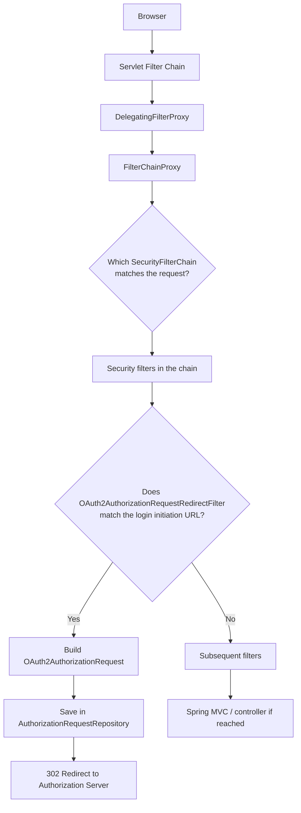
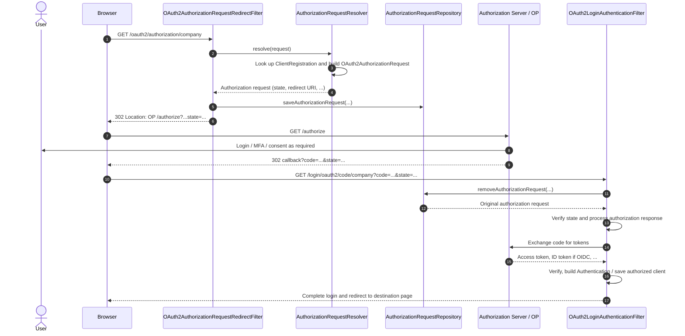
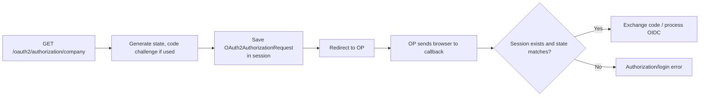

# 7.3. OAuth2AuthorizationRequestRedirectFilter in the Filter Chain

When a Spring Boot application uses **Spring Security OAuth 2.0 / OIDC Client** for Servlet login, an HTTP request such as `GET /oauth2/authorization/company` can produce a `302 Found` response redirecting the browser to the Authorization Server. The component performing this initiation step is **`OAuth2AuthorizationRequestRedirectFilter`**.

This filter's responsibility is to **create and store an OAuth 2.0 authorization request, then redirect the browser to the authorization endpoint**. It sits in Spring Security's filter chain and participates in the **initial phase of the Authorization Code Flow**. The filter does not log the user in itself, does not receive the authorization code at the callback, does not exchange the code for tokens, and does not validate the ID token.

This lesson moves from the filter's placement in the Servlet architecture to the runtime flow, dependent components, default configuration, customization options, and error diagnostics.

## 1. Placing the Filter in the Right Servlet Processing Chain

A Spring MVC application can have many servlet filters: handling encoding, tracing, proxy headers, sessions, and security. Spring Security contributes **`FilterChainProxy`**, integrated into the servlet container through a mechanism such as `DelegatingFilterProxy`. `FilterChainProxy` selects **one matching `SecurityFilterChain`** for the request, then executes that chain's security filters in sequence.

When `oauth2Login()` is configured, Spring Security adds the components required for OAuth 2.0/OIDC login, including the filter that **initiates the redirect** and the filter that **handles the callback**.



Under default configuration, the initiation URL is typically:

```text
GET /oauth2/authorization/{registrationId}
```

For example:

```text
GET /oauth2/authorization/company
```

**`registrationId`** is the name of the `ClientRegistration` in the application, **not necessarily identical to `client_id`** at the Authorization Server.

For requests that do not match the initiation endpoint, the filter generally delegates via `filterChain.doFilter(...)` so downstream filters run. For a matching request with valid data, the filter sends the redirect and terminates processing for the current request branch. The request does not reach a regular MVC controller.

### Relative position matters more than numeric order

In the Servlet login chain, two filters worth identifying are:

1. **`OAuth2AuthorizationRequestRedirectFilter`**: intercepts the request that *initiates* the authorization flow and redirects to the Authorization Server.
2. **`OAuth2LoginAuthenticationFilter`**: handles the *callback* containing the authorization response when the browser returns to the application.

Other filters handle security context, exception handling, authorization, session, logout, and any enabled authentication mechanisms. The exact set of filters depends on configuration; do not treat a fixed enumerated order as a stable API across versions.

**Core relationship:** the redirect filter creates the request, and the **login callback filter reuses that request** to verify context and complete authentication.

## 2. Before the Filter Runs: ClientRegistration

Spring Security needs to know **which client will request authorization**. Spring Boot configuration typically looks like:

```yaml
spring:
  security:
    oauth2:
      client:
        registration:
          company:
            provider: company
            client-id: ${OIDC_CLIENT_ID}
            client-secret: ${OIDC_CLIENT_SECRET}
            authorization-grant-type: authorization_code
            redirect-uri: "{baseUrl}/login/oauth2/code/{registrationId}"
            scope:
              - openid
              - profile
              - email
        provider:
          company:
            issuer-uri: https://id.example.test/realms/company
```

This is an illustrative configuration for a **web application with a backend**; the issuer URL must be replaced with an actual issuer providing valid metadata. Never commit a real client secret into Git.

In the example above:

- **`company`** is the `registrationId`, used by `/oauth2/authorization/company` to look up the client.
- **`client-id`** is the identifier registered at the Authorization Server.
- **`authorization-grant-type` = `authorization_code`** indicates the client will exchange an authorization code for tokens.
- **`scope`** includes `openid`, making this an OIDC login request.
- **`redirect-uri`** is the callback address back to the application; distinct from the login initiation URL.
- **`issuer-uri`** enables Spring Security/Boot to use OIDC/OAuth metadata discovery compatible with the provider.

`ClientRegistrationRepository` loads registrations by `registrationId`. For example, a common implementation is `InMemoryClientRegistrationRepository`.

The redirect filter **does not arbitrarily infer `client_id` from the URL**; it uses `registrationId` to look up the configured registration and builds the authorization request with the right client details from it.

## 3. Two Endpoints Not to Confuse

| Role | Default endpoint | Related filter |
| --- | --- | --- |
| **Initiate OAuth2 Login** | `/oauth2/authorization/{registrationId}` | `OAuth2AuthorizationRequestRedirectFilter` |
| **Receive callback after OP authentication** | `/login/oauth2/code/{registrationId}` | `OAuth2LoginAuthenticationFilter` |

A valid flow can look like:

```text
1. Browser -> GET https://app.example.test/oauth2/authorization/company
2. App     -> 302 Location: https://id.example.test/.../authorize?...
3. Browser -> GET https://id.example.test/.../authorize?...
4. OP      -> 302 Location: https://app.example.test/login/oauth2/code/company?code=...&state=...
5. Browser -> GET https://app.example.test/login/oauth2/code/company?code=...&state=...
6. App     -> POST token endpoint (server-side)
7. App     -> Establish authentication/session; redirect to original destination
```

**`/oauth2/authorization/company` is not the callback URI registered at the OP.** The callback is typically `/login/oauth2/code/company`. Mistakenly registering the initiation URL as the redirect URI can create a redirect loop or cause the OP to reject the request.

The **post-login destination page** (for example `/account`) is yet another concept: the application sends the user there after completing callback processing.

## 4. What Happens When a Request Enters OAuth2AuthorizationRequestRedirectFilter?

### Step 1 — Determine whether the request is an authorization initiation request

The filter receives `HttpServletRequest` via `doFilterInternal(...)`. It uses an **`OAuth2AuthorizationRequestResolver`** to determine whether an authorization request can be created from the current HTTP request.

In the default setup, `DefaultOAuth2AuthorizationRequestResolver` takes `ClientRegistrationRepository` along with the base URI:

```text
/oauth2/authorization
```

For `/oauth2/authorization/company`, the resolver retrieves registration `company`. For non-matching requests, the resolver does not create an authorization request for the filter, and processing continues through the filter chain.

### Step 2 — Build OAuth2AuthorizationRequest

An `OAuth2AuthorizationRequest` describes the intent to request authorization. Key elements include:

| Element | Meaning |
| --- | --- |
| **Authorization URI** | The Authorization Server's endpoint, e.g., `https://id.example.test/.../authorize` |
| **`response_type=code`** | Requests the Authorization Code Flow |
| **`client_id`** | Client identifier at the OP/AS |
| **`scope`** | Requested permissions or OIDC information |
| **`redirect_uri`** | Callback back to the client once authorization finishes |
| **`state`** | Random value binding the response to the initial request |
| **`code_challenge`, `code_challenge_method`** | PKCE parameters when applied |
| **`nonce` and extension parameters** | OIDC-related or OP-specific parameters when used |

The URL sent to the OP might look like this:

```http
GET /realms/company/protocol/openid-connect/auth?
    response_type=code&
    client_id=web-company&
    scope=openid%20profile%20email&
    redirect_uri=https%3A%2F%2Fapp.example.test%2Flogin%2Foauth2%2Fcode%2Fcompany&
    state=example-random-state&
    code_challenge=example-s256-challenge&
    code_challenge_method=S256 HTTP/1.1
Host: id.example.test
```

The `state` and `code_challenge` values here are only placeholders; actual values must be properly generated by the library, never hardcoded.

Not every deployment shows the exact same extension parameters. For instance, whether PKCE is added automatically or requires extra configuration depends on the client type and Spring Security version/config. When using OIDC, `nonce` and ID token verification belong to the OIDC context; do not manually invent a fixed string parameter.

### Step 3 — Save OAuth2AuthorizationRequest before leaving the application

The filter uses **`AuthorizationRequestRepository<OAuth2AuthorizationRequest>`** to preserve the original request across two separate HTTP requests: first leaving the app for the OP, and later returning to the callback.

By default in typical Servlet configurations, the repository is **`HttpSessionOAuth2AuthorizationRequestRepository`**: authorization request details are stored in the **HTTP session**.

Why save it? When the callback returns, Spring Security needs to verify:

- Does the callback correspond to a request initiated by this application?
- Does `state` match the original value?
- Which client registration and redirect URI are involved?
- What internal attributes are needed to complete Authorization Code / PKCE / OIDC?

If the original request disappears, the callback may fail even if the OP authenticated the user successfully.

### Step 4 — Send the HTTP redirect to the Authorization Server

After creating and saving the request, the filter uses a **`RedirectStrategy`** to send an HTTP redirect to the authorization endpoint with encoded query parameters.

```http
HTTP/1.1 302 Found
Location: https://id.example.test/realms/company/protocol/openid-connect/auth?response_type=code&client_id=web-company&...
Set-Cookie: JSESSIONID=<session-id>; Path=/; HttpOnly
```

`Set-Cookie` is an example that may appear when the server creates/updates a session; cookie policy and when the session ID is issued depend on configuration. Do not assume every redirect necessarily generates a new cookie.

When the browser receives `302`, it goes to the Authorization Server. At this moment **the Spring Boot application has not yet been issued an access token for that authorization attempt**, and **`OAuth2AuthorizationRequestRedirectFilter` has completed its job**.

### Step 5 — Callback handled by another filter

The Authorization Server performs login, MFA, or consent per policy. Afterward, the browser returns to the callback:

```text
GET /login/oauth2/code/company?code=...&state=...
```

**`OAuth2LoginAuthenticationFilter`** is responsible for handling the response. It retrieves the saved authorization request from `AuthorizationRequestRepository` and proceeds to authenticate the authorization response. The OAuth2/OIDC authentication provider components exchange the code for tokens and perform appropriate OIDC checks.

After a successful login, Spring Security sets `Authentication` in `SecurityContext` and saves `OAuth2AuthorizedClient` according to the configured mechanism. Those steps are **beyond** the scope of the redirect filter.

## 5. Complete Sequence Diagram Across Both Filters



The diagram shows the **logical responsibility flow**: token exchange and OIDC checks are coordinated by authentication providers/services behind `OAuth2LoginAuthenticationFilter`, rather than an HTTP filter implementing the entire protocol directly.

## 6. Distinguishing Commonly Confused Repositories

Many repository names appear in OAuth2/OIDC with distinct purposes:

| Component | What does it store? | Stage |
| --- | --- | --- |
| **`ClientRegistrationRepository`** | Client config: ID, secret, endpoints, scopes, redirect URI | Building authorization request and reading client config |
| **`AuthorizationRequestRepository<OAuth2AuthorizationRequest>`** | Pending authorization request, including `state` and related metadata | Before redirect → callback |
| **`OAuth2AuthorizedClientRepository`** / **`OAuth2AuthorizedClientService`** | Issued tokens for registration + principal | After authorization succeeds, when calling APIs |
| **`SecurityContextRepository`** | SecurityContext holding the user's Authentication | Maintaining login across requests |
| **`RequestCache`** | Original request the user wanted to access, e.g., `/reports` | Returning user to resource after authentication |

For example, when a user opens `/reports` while unauthenticated:

1. Spring Security may save the `/reports` request in `RequestCache`.
2. When starting OAuth2 Login, `OAuth2AuthorizationRequestRedirectFilter` saves the authorization request (with `state`) in `AuthorizationRequestRepository`.
3. When the callback succeeds, the application saves the authentication and authorized client.
4. The success handler can return the user to `/reports`.

**Do not use `OAuth2AuthorizedClientRepository` in place of `AuthorizationRequestRepository`.** One holds tokens *after* authorization is granted; the other holds state *before* receiving the code.

## 7. Starting Login with the Default Path

For a Spring Boot web application, common dependencies include:

```xml
<dependency>
    <groupId>org.springframework.boot</groupId>
    <artifactId>spring-boot-starter-security</artifactId>
</dependency>
<dependency>
    <groupId>org.springframework.boot</groupId>
    <artifactId>spring-boot-starter-oauth2-client</artifactId>
</dependency>
```

Spring Security configuration using `SecurityFilterChain`:

```java
import org.springframework.context.annotation.Bean;
import org.springframework.context.annotation.Configuration;
import org.springframework.security.config.Customizer;
import org.springframework.security.config.annotation.web.builders.HttpSecurity;
import org.springframework.security.web.SecurityFilterChain;

@Configuration
class SecurityConfig {

    @Bean
    SecurityFilterChain securityFilterChain(HttpSecurity http) throws Exception {
        return http
            .authorizeHttpRequests(authorize -> authorize
                .requestMatchers("/", "/public/**", "/error").permitAll()
                .anyRequest().authenticated())
            .oauth2Login(Customizer.withDefaults())
            .build();
    }
}
```

Add a link on the login page or home page:

```html
<a href="/oauth2/authorization/company">
    Sign in with company account
</a>
```

If OIDC is configured properly, a browser visiting the link receives a redirect to the OP. If no custom login page is provided, Spring Security can generate a default login page with links to discovered client registrations.

**Why don't you need a `@GetMapping("/oauth2/authorization/company")` controller?** Because the filter intercepts the request in the security chain **before it reaches Spring MVC**. Writing a controller at the same endpoint is usually unnecessary and tends to obscure root causes of errors.

**Note:** the filter may not execute if the request does not pass through a `SecurityFilterChain` with `oauth2Login()`, or if an earlier filter already terminated the request.

## 8. How Users Reach the Filter: Clicking Login vs. Intercepted at a Protected Page

Two scenarios are easily confused:

### Scenario A — User explicitly clicks "Sign in"

```text
GET /oauth2/authorization/company
    -> OAuth2AuthorizationRequestRedirectFilter
    -> 302 Authorization Server
```

This is a direct path into the redirect filter, independent of what resource the user visited beforehand.

### Scenario B — User accesses a URL requiring authentication

```text
GET /private
    -> authorization checks requirement
    -> AuthenticationEntryPoint initiates login behavior
    -> browser goes to login page or registration URL
    -> GET /oauth2/authorization/company
    -> OAuth2AuthorizationRequestRedirectFilter
    -> 302 Authorization Server
```

With default configuration and multiple client registrations, users typically see a provider selection page. If the application configures a different entry point or login behavior, it may route directly to a specific registration.

**`OAuth2AuthorizationRequestRedirectFilter` is not the filter deciding whether a user can access `/private`.** Authorization belongs to the authorization and exception handling filters. The redirect filter only processes authorization initiation requests according to its configured URI/resolver.

## 9. Changing the Base URI of the Redirect Filter

Spring Security allows changing the URL that **initiates** OAuth2 Login, for example from:

```text
/oauth2/authorization/company
```

to:

```text
/sso/start/company
```

Configuration:

```java
import org.springframework.context.annotation.Bean;
import org.springframework.context.annotation.Configuration;
import org.springframework.security.config.annotation.web.builders.HttpSecurity;
import org.springframework.security.web.SecurityFilterChain;

@Configuration
class SecurityConfig {

    @Bean
    SecurityFilterChain securityFilterChain(HttpSecurity http) throws Exception {
        return http
            .authorizeHttpRequests(auth -> auth
                .requestMatchers("/", "/login", "/error").permitAll()
                .anyRequest().authenticated())
            .oauth2Login(oauth2 -> oauth2
                .loginPage("/login")
                .authorizationEndpoint(authorization ->
                    authorization.baseUri("/sso/start")))
            .build();
    }
}
```

At this point, the application-provided `/login` page needs to link to:

```html
<a href="/sso/start/company">SSO Login</a>
```

If you declare `loginPage("/login")`, there must be an actual controller/view or route serving `/login`. When using a custom login page, Spring Security does not auto-generate a separate page for the application.

**Changing the initiation base URI does not change the callback URI.** With the configuration above, the callback remains:

```text
/login/oauth2/code/company
```

To change the callback path, you must separately configure all of:

- `spring.security.oauth2.client.registration.company.redirect-uri`, for example `{baseUrl}/sso/callback/{registrationId}`;
- `oauth2Login(oauth2 -> oauth2.redirectionEndpoint(redirection -> redirection.baseUri("/sso/callback/*")))`;
- The Redirect URI allowlist for the client at the Authorization Server.

The two names look similar, yet they are independent endpoints:

```text
authorizationEndpoint().baseUri(...)   -> Application URL to INITIATE login
redirectionEndpoint().baseUri(...)     -> Application URL to RECEIVE callback
```

## 10. Customizing OAuth2AuthorizationRequestResolver

`OAuth2AuthorizationRequestResolver` is the extension point for altering how `OAuth2AuthorizationRequest` is built. The default implementation is **`DefaultOAuth2AuthorizationRequestResolver`**; it looks up `ClientRegistration` and builds the request with appropriate OAuth2/OIDC values.

Customization is needed when an Authorization Server requires valid extra parameters such as:

- `prompt=login` to require user re-authentication per OP policy.
- `login_hint` when a hint for the user's identity is already known.
- `acr_values` for a requested authentication context level if supported by the OP.
- `code_challenge` with PKCE when explicit enabling or control is needed.
- Other `additionalParameters` documented by the OP.

Example configuring a resolver that adds `prompt=login` for the `company` registration:

```java
import java.util.LinkedHashMap;
import java.util.Map;

import org.springframework.context.annotation.Bean;
import org.springframework.context.annotation.Configuration;
import org.springframework.security.config.annotation.web.builders.HttpSecurity;
import org.springframework.security.oauth2.client.registration.ClientRegistrationRepository;
import org.springframework.security.oauth2.client.web.DefaultOAuth2AuthorizationRequestResolver;
import org.springframework.security.oauth2.client.web.OAuth2AuthorizationRequestRedirectFilter;
import org.springframework.security.web.SecurityFilterChain;

@Configuration
class OAuth2RequestConfig {

    @Bean
    SecurityFilterChain securityFilterChain(
            HttpSecurity http,
            ClientRegistrationRepository registrations) throws Exception {

        var resolver = new DefaultOAuth2AuthorizationRequestResolver(
            registrations,
            OAuth2AuthorizationRequestRedirectFilter.DEFAULT_AUTHORIZATION_REQUEST_BASE_URI);

        resolver.setAuthorizationRequestCustomizer(builder ->
            builder.additionalParameters(params -> params.put("prompt", "login")));

        return http
            .authorizeHttpRequests(auth -> auth
                .requestMatchers("/", "/error").permitAll()
                .anyRequest().authenticated())
            .oauth2Login(oauth2 -> oauth2
                .authorizationEndpoint(endpoint ->
                    endpoint.authorizationRequestResolver(resolver)))
            .build();
    }
}
```

In the example, `prompt=login` is always added to authorization requests handled by the resolver; if the application has multiple registrations, add conditional logic per registration rather than applying it globally. Verify that the parameter is supported by the OP and actually required by the business flow.

This configuration **customizes the request built by the filter** without replacing the entire filter. It preserves how Spring Security saves requests, checks `state`, and processes callbacks, while letting you tailor the request sent to the OP.

### When PKCE is needed

Spring Security provides PKCE support, including a customizer such as:

```java
import org.springframework.security.oauth2.client.web.OAuth2AuthorizationRequestCustomizers;

// If configuring the PKCE customizer on DefaultOAuth2AuthorizationRequestResolver:
resolver.setAuthorizationRequestCustomizer(
    OAuth2AuthorizationRequestCustomizers.withPkce());
```

This is a standalone illustration of the customizer; if you also need `prompt`, compose the customizations properly instead of calling `setAuthorizationRequestCustomizer` twice and expecting both configurations to remain active.

**Security:** never place `client_secret`, access tokens, refresh tokens, or sensitive data in the authorize URL. Query strings can appear in browser history, proxy logs, or monitoring tools. `state` and `code_verifier` must be securely generated and handled by the library, never hardcoded to a global constant.

## 11. AuthorizationRequestRepository: Role of the HTTP Session

Between the browser leaving for the OP and returning, Spring Boot handles **two separate HTTP requests**. `HttpSessionOAuth2AuthorizationRequestRepository` persists the authorization request via the session so the callback can look it up by `state`.



**Operational implications:**

- The browser must retain the session cookie per the configured session mechanism during the round trip to the OP.
- If the application runs multiple instances with local in-memory sessions, a callback routed to a different instance will not find the original authorization request.
- If requests cross different hosts, the cookie might not be sent back due to domain/path/security policies.
- If callback configuration produces a public redirect URI with the wrong scheme/host, the browser may land on a different origin and lose session correlation.
- If the session expires or the app restarts while the user is still at the OP, the stored request data may be lost.

A custom `AuthorizationRequestRepository` can be used when needed, though this touches **state, CSRF, PKCE, and sensitive data**. Moving storage to a cookie or external store must protect data integrity, confidentiality, and expiration, and fit the callback flow. Never disable request/response correlation just to work around session errors.

## 12. Customizing the Repository in the DSL

An application can configure a specific repository for authorization requests:

```java
import org.springframework.context.annotation.Bean;
import org.springframework.context.annotation.Configuration;
import org.springframework.security.config.annotation.web.builders.HttpSecurity;
import org.springframework.security.oauth2.client.web.AuthorizationRequestRepository;
import org.springframework.security.oauth2.client.web.HttpSessionOAuth2AuthorizationRequestRepository;
import org.springframework.security.oauth2.core.endpoint.OAuth2AuthorizationRequest;
import org.springframework.security.web.SecurityFilterChain;

@Configuration
class AuthorizationRequestStorageConfig {

    @Bean
    AuthorizationRequestRepository<OAuth2AuthorizationRequest> authorizationRequestRepository() {
        return new HttpSessionOAuth2AuthorizationRequestRepository();
    }

    @Bean
    SecurityFilterChain chain(
            HttpSecurity http,
            AuthorizationRequestRepository<OAuth2AuthorizationRequest> requests) throws Exception {
        return http
            .authorizeHttpRequests(auth -> auth
                .requestMatchers("/", "/error").permitAll()
                .anyRequest().authenticated())
            .oauth2Login(oauth2 -> oauth2
                .authorizationEndpoint(endpoint ->
                    endpoint.authorizationRequestRepository(requests)))
            .build();
    }
}
```

This snippet highlights the dependency between the redirect filter and the repository; in most simple Servlet apps, you can rely on the default without defining a separate bean. When customizing, ensure **the storage mechanism and callback retrieval are compatible**, so the two stages do not read and write to different stores.

## 13. When Multiple SecurityFilterChains Exist

A project with stateless APIs, a Servlet login website, and actuator endpoints may declare multiple `SecurityFilterChain` beans. `FilterChainProxy` selects the first matching chain in order. This directly determines whether the redirect filter gets a chance to run.

Conceptual example:

```text
SecurityFilterChain A: /api/**
    -> Bearer token / API security
SecurityFilterChain B: /**
    -> oauth2Login()
    -> OAuth2AuthorizationRequestRedirectFilter
```

If `/oauth2/authorization/company` enters chain A or fails to enter a chain with `oauth2Login()`, the redirect filter will not handle it even though the registration exists.

Similarly, configuring `securityMatcher("/app/**")` tightly restricts the chain's scope; leaving `/oauth2/authorization/**` outside that scope without another chain containing the login filter prevents the flow from starting.

**Distinction:**

- **`securityMatcher(...)`** decides **whether this chain handles the request at all**.
- **`authorizeHttpRequests(...requestMatchers(...).permitAll())`** decides whether a request already inside the chain is permitted at the authorization step.
- A filter positioned **before** authorization can intercept the request and send a redirect even if that endpoint is marked `permitAll()`.

Therefore, when starting OAuth2 Login yields 404 or fails to redirect, inspect chain matching and the filter list before attempting to write a controller at the filter's URL.

## 14. Typical Errors Directly Related to the Redirect Filter

| Symptom | What to verify | Resolution |
| --- | --- | --- |
| `GET /oauth2/authorization/company` returns 404 | Does a chain contain the filter? Is `oauth2Login()` enabled? Was base URI changed? | Route the endpoint into the right `SecurityFilterChain`, use the right base URI |
| Accessing login initiation URL does not redirect to OP | Does the resolver match the request and find registration `company`? Did an earlier filter block it? | Check path, filter list, and `ClientRegistrationRepository` |
| `Invalid Client Registration` or registration not found | URL `registrationId` differs from the configuration key | Use the exact key; distinguish registration ID from client ID |
| 302 to OP, but OP reports `invalid_redirect_uri` | Sent `redirect_uri` is not in the allowlist, or wrong host/scheme was generated | Compare actual URL, proxy/forwarded headers config, and OP settings |
| 302 to `http://app-internal:8080` | Spring inferred internal origin behind reverse proxy | Trust headers only from trusted proxy; configure forwarded headers or explicit redirect URI |
| OP login succeeds, but callback fails on state/correlation | Session, cookie, state, or authorization request was lost | Check session affinity/replication, cookies, TTL, and callback origin |
| Callback `/login/oauth2/code/company` returns 404/no login | Callback belongs to a different filter; path or `SecurityFilterChain` mismatch | Check `OAuth2LoginAuthenticationFilter` and `redirectionEndpoint().baseUri` |
| Authorization request missing required `prompt` or PKCE | Resolver/customizer was not applied or was overwritten | Verify resolver attached to DSL and actual authorize parameters |
| Login succeeds, but does not return to original page | `RequestCache`/success handler/session config | Distinguish saved request from authorization request repository |
| App loops continuously to login | Authentication/session not saved; cookies blocked | Check success flow and security context persistence |

### Case 1 — Confusing the authorize URL with the callback

Wrong idea:

```yaml
spring:
  security:
    oauth2:
      client:
        registration:
          company:
            redirect-uri: "{baseUrl}/oauth2/authorization/company"
```

That URL is the authorization **initiation** point. If the OP returns the browser there with `code`, the redirect filter may try to start a fresh authorization instead of handling the callback properly.

Standard configuration:

```yaml
redirect-uri: "{baseUrl}/login/oauth2/code/{registrationId}"
```

And register the corresponding callback at the OP.

### Case 2 — Staging redirects with an internal hostname

Public app is `https://staging.app.example.test`, yet the authorization request contains:

```text
redirect_uri=http://spring-app:8080/login/oauth2/code/company
```

This is typically an issue with how the app builds `{baseUrl}` behind a reverse proxy. Ensure the proxy passes public scheme/host/port via forwarded headers and Spring consumes them properly, or provide an environment-specific absolute redirect URI. Also, trust headers only from controlled proxies.

### Case 3 — 302 succeeds, callback still fails

This indicates the redirect filter **ran up through the redirect stage**, but callback handling could not locate the original request. Check `JSESSIONID`, `SameSite`/`Secure` cookie attributes, hostnames, session replication, and state. Do not skip `state` validation just to let the callback pass.

## 15. Observing Runtime Behavior in the Application

### 15.1. Inspecting Network in the browser

Useful steps:

1. Open the application page using its actual public URL.
2. Navigate to `/oauth2/authorization/company`.
3. In Developer Tools → Network, inspect the HTTP response of this request.
4. Confirm a redirect status code (usually 302) and that `Location` points to the expected authorization endpoint.
5. Decode `client_id`, `response_type`, `scope`, and `redirect_uri` to verify against registration and OP.
6. After a test login, inspect the callback to `/login/oauth2/code/company` and verify the app creates the session properly.

You may check whether parameters like `state`, `nonce`, and `code_challenge` are present; **do not share raw values** in logs or tickets. Never share authorization codes, ID tokens, access tokens, or refresh tokens.

### 15.2. Using filter chain logs when debugging

Security logging can be enabled at DEBUG level in a controlled environment:

```yaml
logging:
  level:
    org.springframework.security.web.FilterChainProxy: DEBUG
    org.springframework.security.oauth2.client: DEBUG
```

The goal is to see **which chain a request entered**, whether login started, and at which stage an error occurred. Avoid enabling broad TRACE logging or recording full HTTP headers, authorize URLs, or token responses in production. Disable verbose logging after diagnosing the issue.

### 15.3. Minimal check with curl

For a locally running app:

```bash
curl -i http://localhost:8080/oauth2/authorization/company
```

You should normally see `HTTP/1.1 302` and a `Location` header pointing to the OP. This only observes the **initiation step**. `curl` does not replace a browser with cookies/sessions and login interaction when testing full OIDC Login.

## 16. Security Boundaries of the Redirect Filter

The redirect filter is an important protocol point, but you should not place the entire security burden on a single filter.

**1. Preserve `state` and authorization request correlation.** This is essential for linking the callback to the initiating request and defending against login CSRF/mix-up in relevant contexts. Never write a custom resolver that drops or reuses a fixed `state`.

**2. Do not accept an arbitrary Redirect URI from users.** The Redirect URI sent to the OP must come from trusted client registration/configuration and match the registered allowlist. Never take a user-supplied `returnUrl` as the OAuth callback.

**3. Use Authorization Code + PKCE where appropriate.** PKCE helps defend against code interception, especially important for public clients. Backends with a client secret still need proper login, token, and OIDC configuration.

**4. Keep malicious code away from tokens/secrets.** Client secrets do not belong in authorize URLs; access tokens and ID tokens are not returned by the redirect filter over the front channel in standard Authorization Code Flow.

**5. Handle sessions/cookies safely.** For Servlet login, authorization requests are typically stored in the HTTP session; use HTTPS, appropriate `HttpOnly`/`Secure` and `SameSite` cookie attributes, and consistent session storage across multiple instances.

**6. Trust origins accurately.** Behind a reverse proxy, `Forwarded` / `X-Forwarded-*` headers must be controlled at the proxy; never let external clients dictate the host or scheme in `redirect_uri`.

**7. Separate authorization requests from authorization policies.** `/oauth2/authorization/company` triggers the login flow; which APIs the user can subsequently access still depends on authentication, token scopes, audience, and authorization at the application/Resource Server.

## 17. Scenario Exercises

### Exercise 1 — Find the right filter

The browser calls:

```text
GET /oauth2/authorization/company
```

The application then returns:

```text
HTTP/1.1 302 Found
Location: https://id.example.test/.../authorize?client_id=...&state=...
```

**Question:** Which component generated this redirect, and is an access token available at this point?

> `OAuth2AuthorizationRequestRedirectFilter` created and saved `OAuth2AuthorizationRequest`, then redirected the browser to the authorization endpoint. No access token has been issued for this request from the redirect step alone.

### Exercise 2 — Distinguish the two repositories

Before redirecting to the OP, what data does the application store? After a successful callback, what data does it store?

> Before the redirect, `AuthorizationRequestRepository` holds `OAuth2AuthorizationRequest` to match `state` and context on callback. After tokens are issued, `OAuth2AuthorizedClientRepository` or service holds `OAuth2AuthorizedClient`; `SecurityContextRepository` can hold the user's `Authentication`. These represent different states.

### Exercise 3 — Changing the initiation URL

You change the authorization base URI to `/sso/start` while keeping the login link at `/oauth2/authorization/company`.

**Question:** Why does the old link stop working?

> The redirect filter is configured to listen on the new path. The link must be updated to `/sso/start/company`. Changing the initiation URL does not automatically change the callback URL.

### Exercise 4 — Lost authorization request on callback

The user logs in at the OP, the browser returns to the right callback with `code`, yet the application cannot find the saved state.

**Question:** Why is this not necessarily an Authorization Server error?

> Because the original state is typically stored in the application's HTTP session. Missing cookies, mismatched domains, timeouts, restarts, or multiple instances not sharing sessions can prevent the callback from loading `OAuth2AuthorizationRequest`. Check session, `state`, and routing.

### Exercise 5 — Filter not seen during debugging

You enable `oauth2Login()` in a chain that only has `securityMatcher("/web/**")`, then navigate to `/oauth2/authorization/company`.

**Question:** Why does the request not trigger the filter?

> Because the request does not fall under `/web/**`, so it does not enter the chain containing the filter. Redesign the chain matcher or login initiation path so the request hits the chain with OAuth2 Login.

### Exercise 6 — Need to add `prompt=login`

**Question:** Should you write a new servlet filter to append to `Location` via string concatenation, or customize the resolver?

> Use `OAuth2AuthorizationRequestResolver`, typically via `DefaultOAuth2AuthorizationRequestResolver` with a request customizer. This modifies the request where it is constructed while keeping standard request persistence and callback handling intact.

## 18. Flow Summary to Remember

```text
ClientRegistrationRepository
    |
    v
GET /oauth2/authorization/{registrationId}
    |
    v
OAuth2AuthorizationRequestRedirectFilter
    |
    +--> OAuth2AuthorizationRequestResolver
    |        |
    |        +--> OAuth2AuthorizationRequest
    |              (client_id, scope, redirect_uri, state, PKCE...)
    |
    +--> AuthorizationRequestRepository.save(...)
    |
    +--> 302 Redirect to Authorization Server
    |
    v
Browser logs in at Authorization Server / OpenID Provider
    |
    v
GET /login/oauth2/code/{registrationId}?code=...&state=...
    |
    v
OAuth2LoginAuthenticationFilter
    |
    +--> AuthorizationRequestRepository: find and remove original request
    +--> Validate authorization response / state
    +--> Exchange code for tokens and verify OIDC
    +--> Save Authentication, OAuth2AuthorizedClient
    |
    v
User returns to the application logged in
```

One sentence to remember: **`OAuth2AuthorizationRequestRedirectFilter` handles "going to the OP", while `OAuth2LoginAuthenticationFilter` handles "returning from the OP"**. Both filters collaborate through the saved authorization request to ensure the callback belongs to the authentication transaction that was initiated.

### Official References

- [Spring Security API — OAuth2AuthorizationRequestRedirectFilter](https://docs.spring.io/spring-security/reference/api/java/org/springframework/security/oauth2/client/web/OAuth2AuthorizationRequestRedirectFilter.html)
- [Spring Security API — AuthorizationRequestRepository](https://docs.spring.io/spring-security/reference/api/java/org/springframework/security/oauth2/client/web/AuthorizationRequestRepository.html)
- [Spring Security — Advanced OAuth 2.0 Login Configuration](https://docs.spring.io/spring-security/reference/servlet/oauth2/login/advanced.html)
